# 戴卫·奇普菲尔德新作｜西班牙百年银行总部变身向公众开放的文化场馆

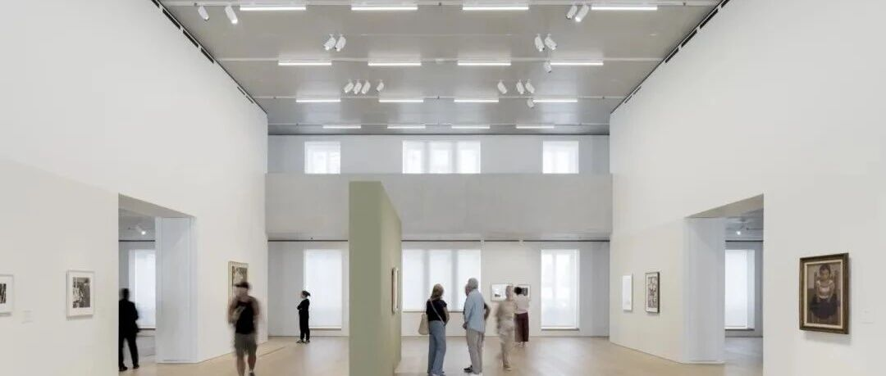

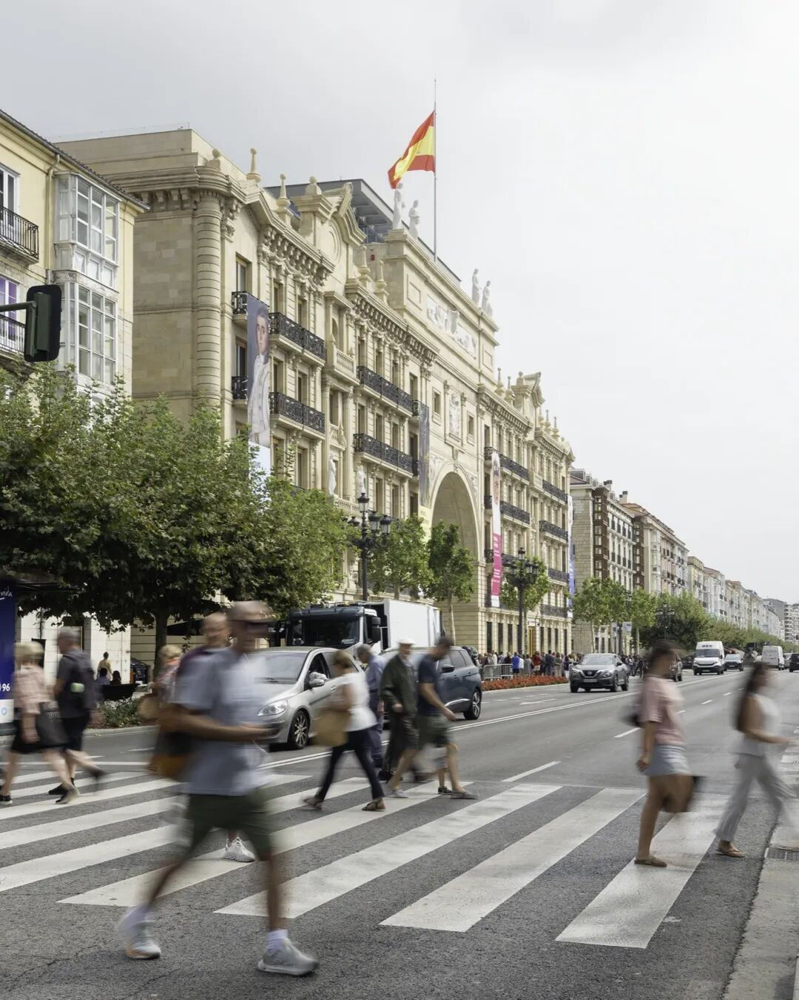
©  Xoán Vázquez González
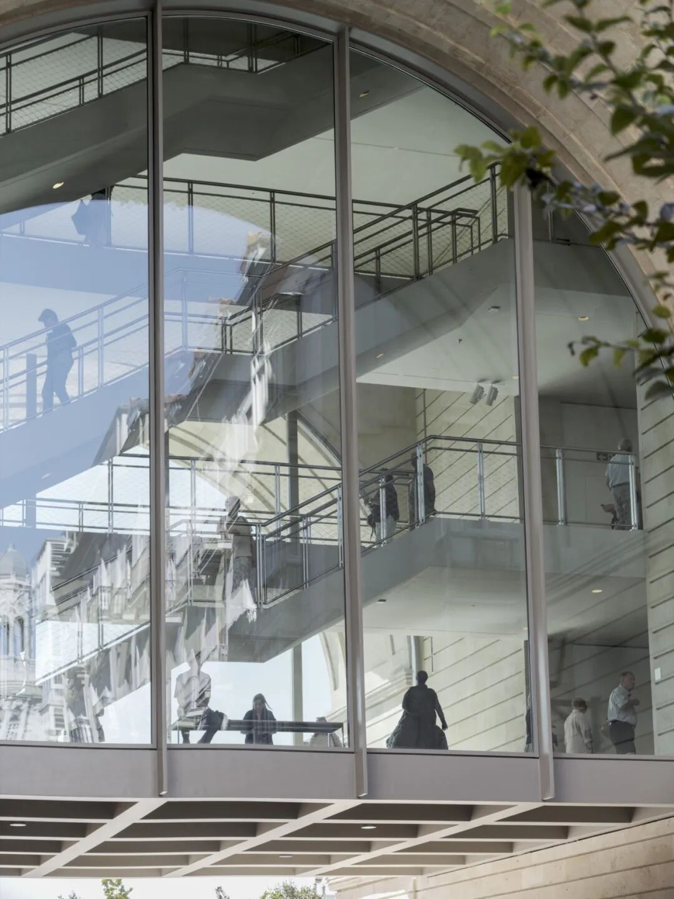
©  Luis Díaz Díaz
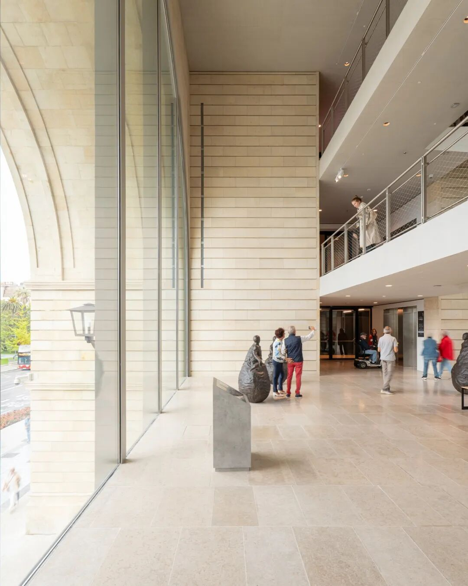
©  Luis Díaz Díaz
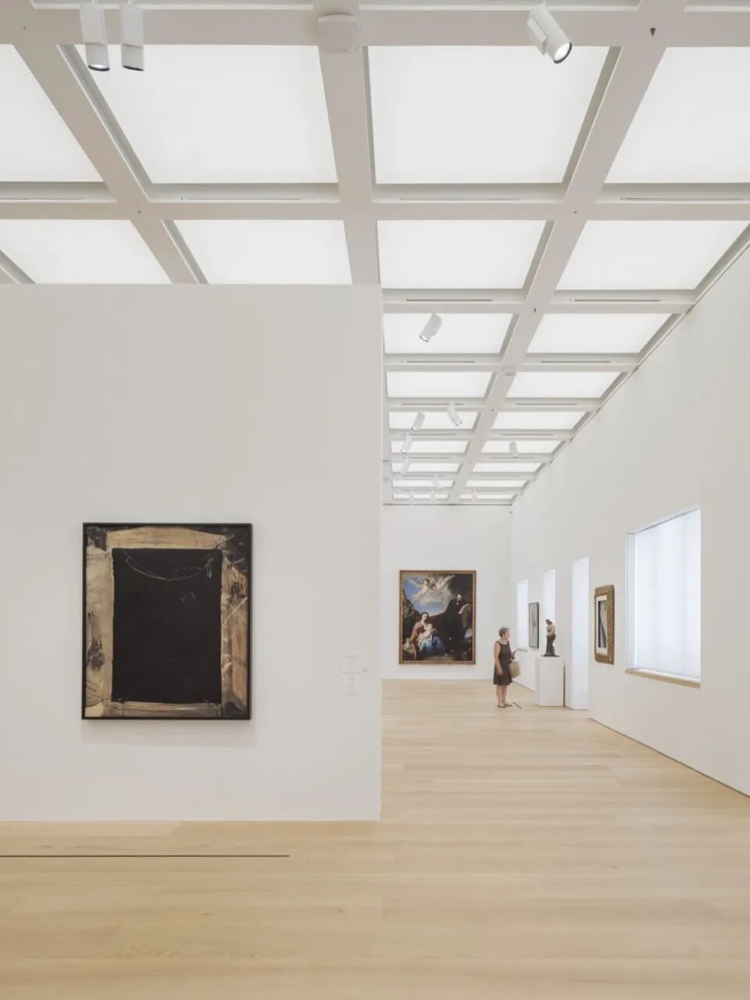
©  Luis Díaz Díaz
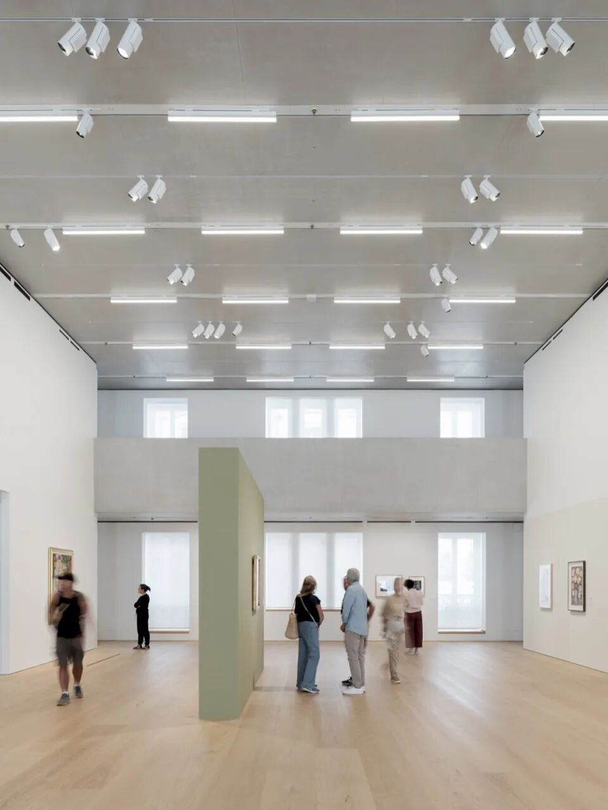
©  Luis Díaz Díaz
如今，这座建筑以Faro
Santander之名开启新的角色——被重新构想为一座博物馆与文化场馆，容纳桑坦德银行艺术收藏，并举办不断更新的展览与活动。项目将这座历史悠久的银行总部转化为融入桑坦德市民生活的公共文化空间。
感谢  ** 戴卫·奇普菲尔德建筑事务所  ** 对gooood的分享
Faro
Santander由桑坦德银行历史总部改造而成，是一座全新的重要公共文化场馆，于2026年9月7日（周一）正式开幕。西班牙国王费利佩六世陛下与多位地方及国家政府官员出席了开幕仪式。开幕仪式于上午11:30至下午1:30举行，桑坦德银行执行主席Ana
Botín、桑坦德市长Gema Igual Ortiz与David Chipperfield建筑事务所创始人David
Chipperfield爵士分别致辞。建筑于次日9月8日（周二）起向公众开放。
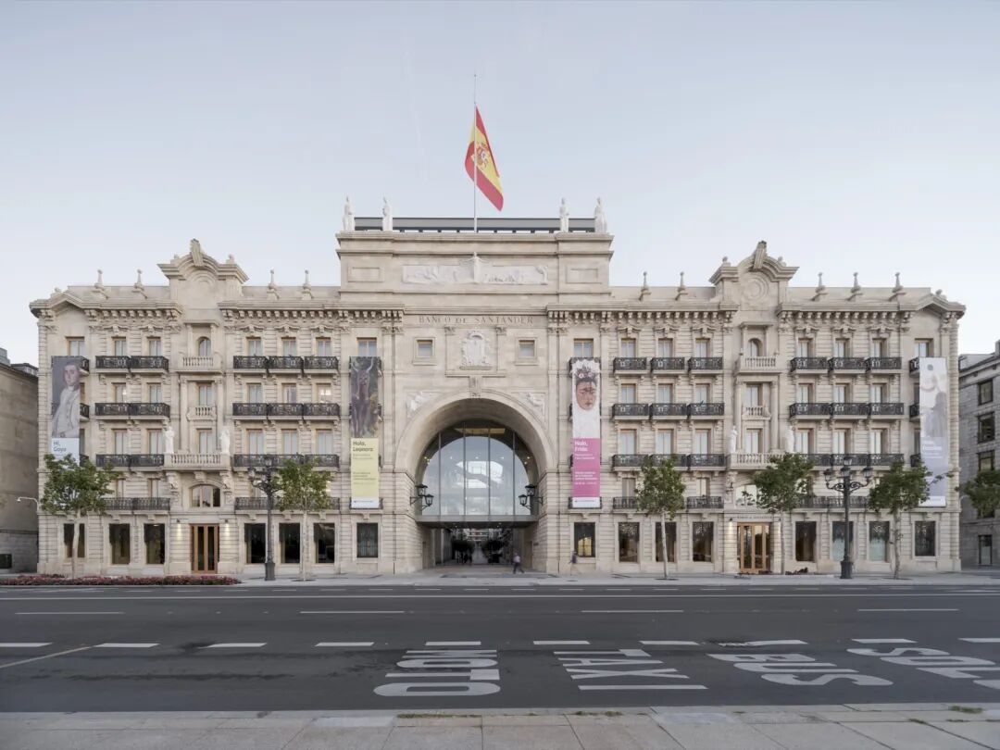
▲建筑正立面与标志性大拱门  © Luis Díaz Díaz
Paseo de Pereda
9-12号自1923年起便是桑坦德银行的总部所在地。凭借宏伟的拱门，它成为俯瞰佩雷达花园与桑坦德湾的海岸线上独具特色的一部分。如今，这座建筑以Faro
Santander之名开启新的角色——被重新构想为一座博物馆与文化场馆，容纳桑坦德银行艺术收藏，并举办不断更新的展览与活动。项目将这座历史悠久的银行总部转化为融入桑坦德市民生活的公共文化空间。

▲从街道望向建筑立面  © Xoán Vázquez González
尽管外观浑然一体，Paseo de Pereda
9-12号实为逐步扩建而成，最早的部分可追溯至1795年。它由两栋独立的住宅建筑演变为统一的总部大楼，并由一座1951年加建的开放拱门连接，拱门横跨Marcelino
Sanz de Sautuola街。
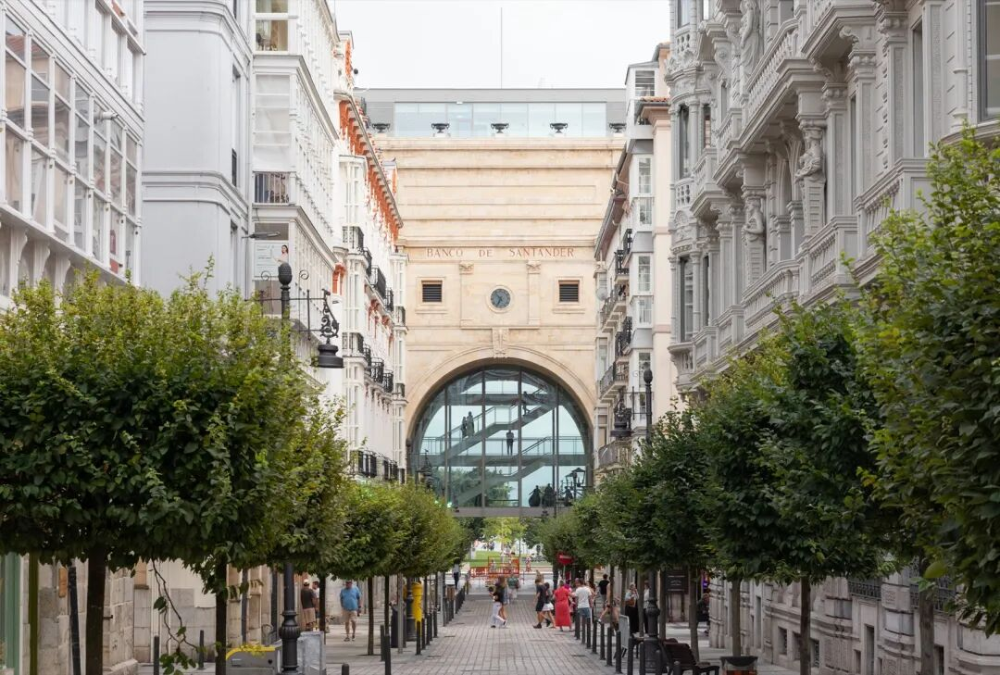
▲横跨Marcelino Sanz de Sautuola街的拱门  © Xoán Vázquez González
既有建筑的居家尺度与局促的内部布局无法满足公共博物馆的空间需求。设计在保留并修复建筑历史立面的同时——包括全部107扇原窗与屋顶雕塑——在其后方创造出全新的展厅空间。原室内的材料，包括木地板与大理石，均被回收并重新利用于新空间中。

▲透过玻璃围合的拱门望向室内  © Luis Díaz Díaz
这座标志性的拱门既定义了建筑，也将其一分为二。设计将拱门构想为连接体：通过对其上部进行局部玻璃围合，连通建筑两侧，使之成为建筑的中脊。在这里，交通流线清晰可见，传递出一种新的开放性，也庆祝着银行向城市重要公共场馆的转变。尽管加入了玻璃填充，拱门仍保留着其城市属性，是连接城市与大海的标志性门户。
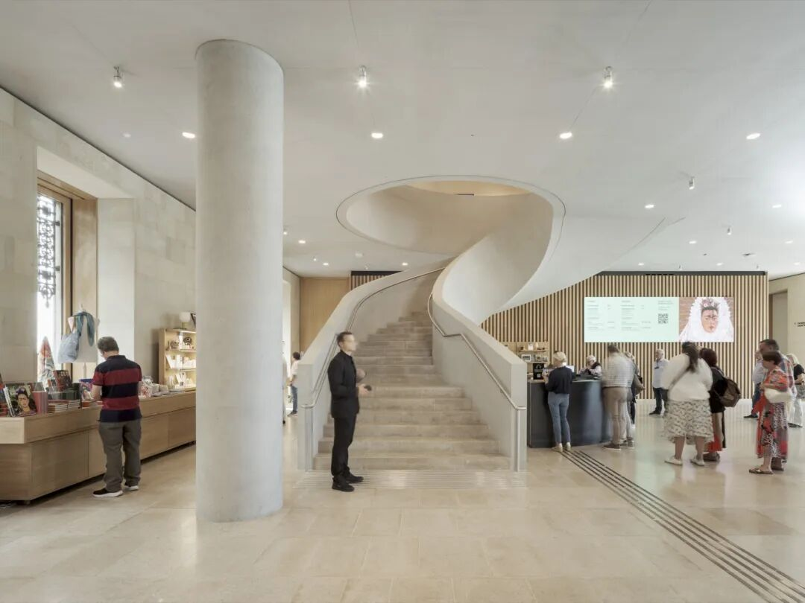
▲入口大厅与螺旋楼梯  © Luis Díaz Díaz

▲拱门内的通高空间  © Xoán Vázquez González
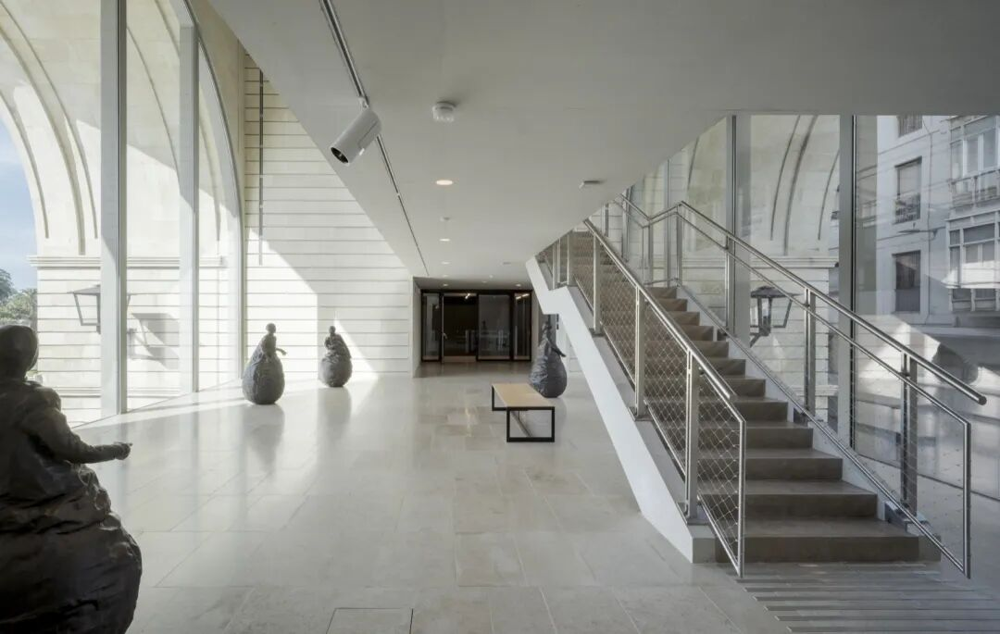
▲玻璃拱内的交通空间  © Luis Díaz Díaz
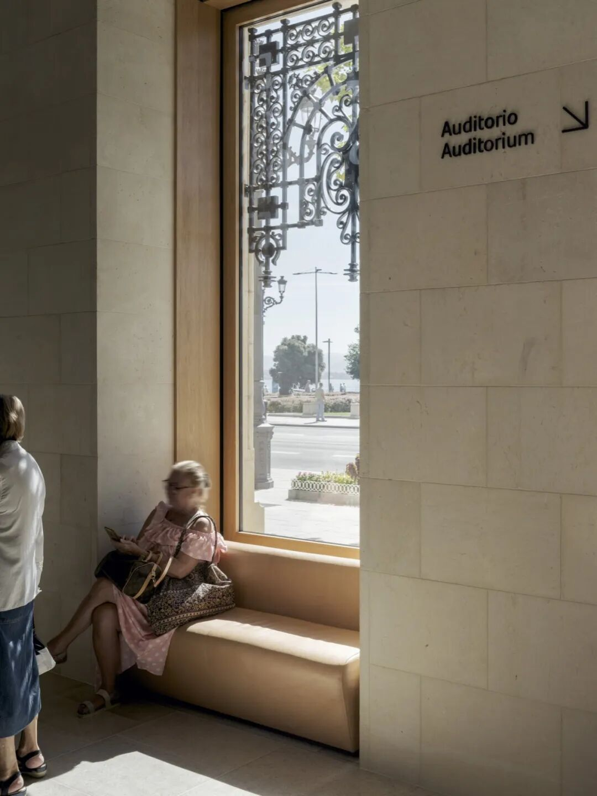
▲历史窗边的座位区  © Luis Díaz Díaz
建筑的大部分空间用作桑坦德银行艺术收藏的新展厅。这批藏品自马德里迁来，涵盖鲁本斯、埃尔·格列柯、毕加索、奇利达与米罗等艺术家的作品。一系列单层与双层通高的空间适应了不同类型与尺度的艺术品，而原有窗户则将经过过滤的自然光引入展厅。
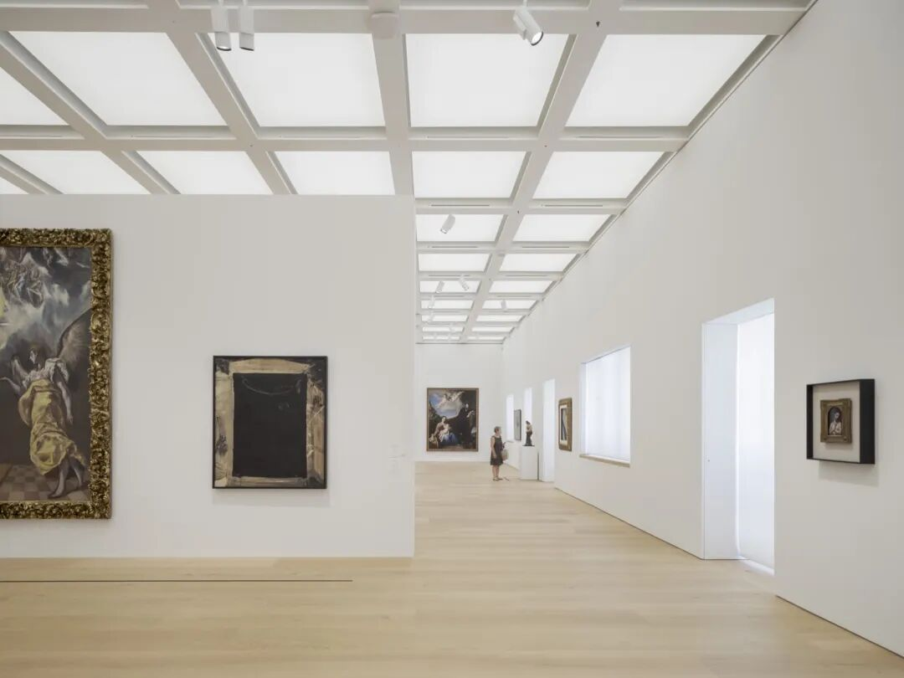
▲带格状天窗的展厅  © Luis Díaz Díaz
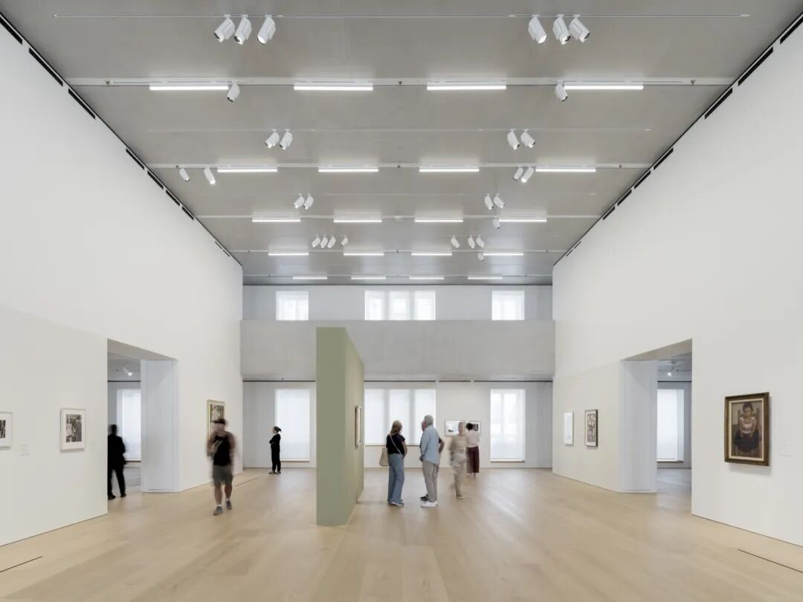
▲双层通高展厅  © Luis Díaz Díaz
除文化展览功能外，Faro
Santander还设有一个多媒体展厅，讲述银行、城市与建筑本身的历史，并配有多功能空间与咖啡馆。建筑顶部，一座新亭容纳了餐厅，并通向可举办活动与聚会的露台，在此可尽览海湾与城市的全景。随着这座曾经不对公众开放的建筑敞开大门，Faro
Santander成为城市社会与文化生活中活跃的一部分。
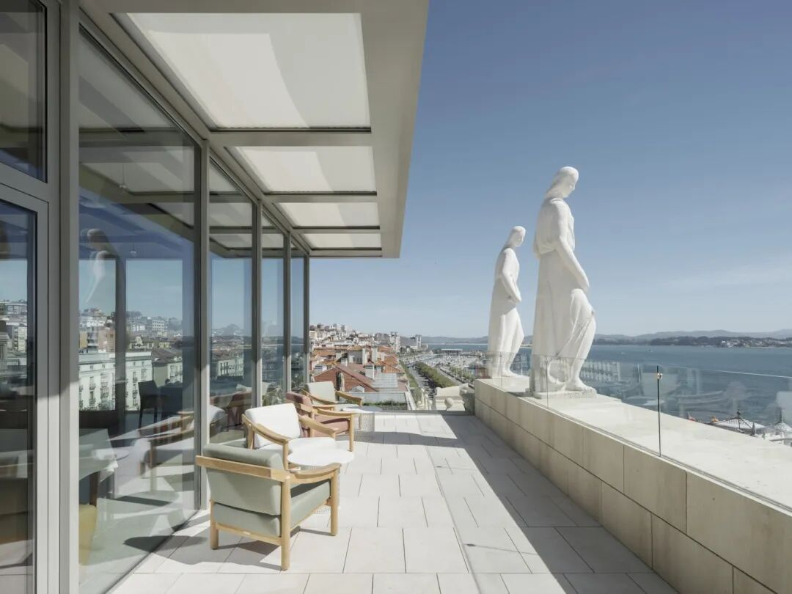
▲顶层露台与屋顶雕塑，俯瞰桑坦德湾  © Luis Díaz Díaz
“经过八年的专注工作，我们很高兴看到这座历史建筑向桑坦德市民敞开大门。曾经，人们大多只能从外部感受它；如今，它被重新构想为一个文化、相遇与公共可达的场所。建筑的标志性拱门连接着机构与城市，已成为此次改造的核心——从物理与象征两个层面将其打开。结合新的展厅空间与屋顶露台，这座建筑如今能够在桑坦德的公共与文化生活中发挥积极作用。”
—— David Chipperfield建筑事务所
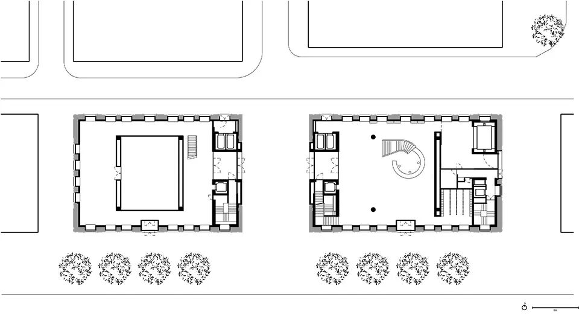
▲一层平面图  © David Chipperfield Architects
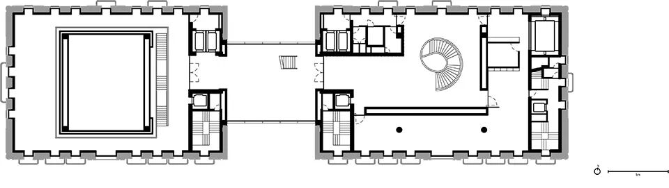
▲二层平面图  © David Chipperfield Architects
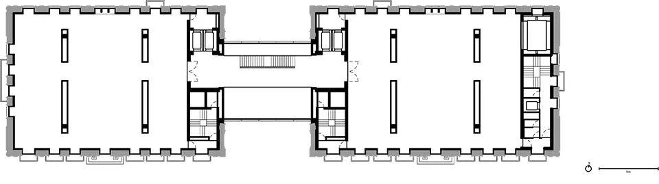
▲三层平面图  © David Chipperfield Architects
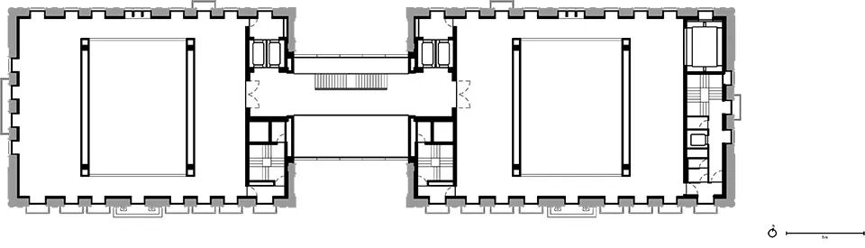
▲四层平面图  © David Chipperfield Architects
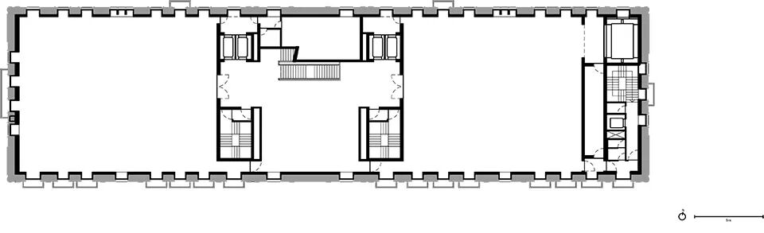
▲五层平面图  © David Chipperfield Architects
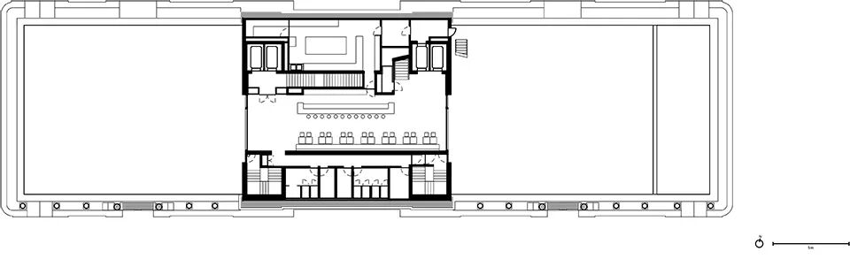
▲六层平面图  © David Chipperfield Architects
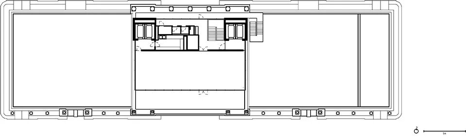
▲屋顶层平面图  © David Chipperfield Architects
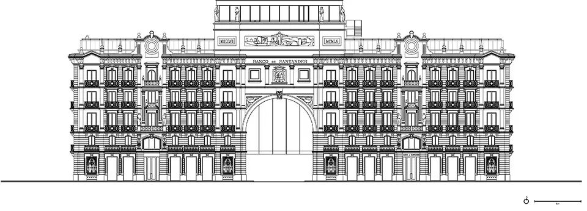
▲立面图  © David Chipperfield Architects
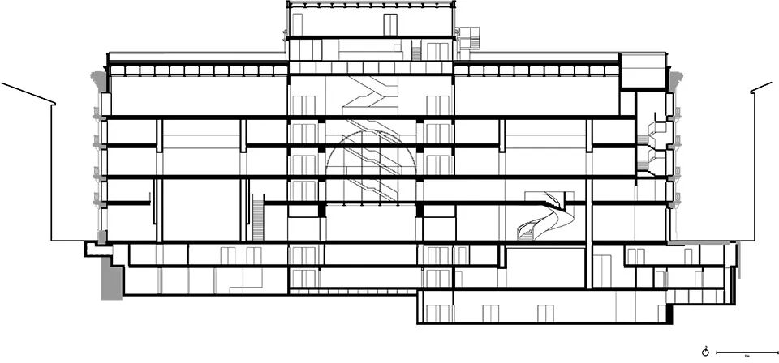
▲剖面图  © David Chipperfield Architects
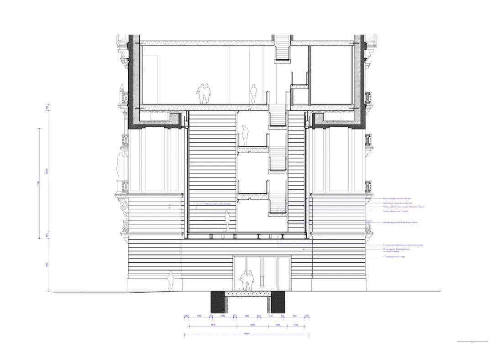
▲细部详图  © David Chipperfield Architects
项目地点：西班牙桑坦德，Paseo de Pereda 9-12
项目年份：2017–2026  竞赛：2017-18  项目开始：2018  开工：2021  竣工：2026
总建筑面积：10,000 m²  公共使用空间面积：6,200 m²
建筑高度：30.49 m（自入口门槛标高起算）  层数：地上7层，地下3层
业主：Banco Santander
建筑设计：David Chipperfield Architects London
总监：David Chipperfield Architects Santiago de Compostela
项目建筑师：David Chipperfield, Benito Blanco, Billy Prendergast, Rodrigo Antón
Carrasquer
董事：Jose Azevedo, Sergio Pereira
设计团队：Ricardo Álvarez, Alba Azuara, Alexander Awramenko, Toja Coray, Bernardo
Criscuoli, Cathal Crumley, Patricia Fredborg, Victoria Gallagher, Clemens
Gerritzen, Nadège Giraudet, Alexander Hill, Antonio Jimenez, Joseph Little,
Davide Maggio, Jusin Park, Renato Pimenta, Ines Sanz Pinto, Daniela Puga,
Monica Resines, Luisa Respondek, Carlo Vincelli, Richard Youel, Uxía Mouriño
竞赛团队：Lewis Armstrong, Clemens Gerritzen, Alexander Hill, Davide Maggio, Ruth
Mellor, Tram Huong Ngo, Billy Prendergast, Monica Resines, Kim Schürmann,
Gabor Tajnafoi, Alban Wagener, Matilda Williams
执行建筑师：iAMarq, IDOM
项目管理：IDOM
项目控制：IDOM
总承包商：Ferrovial
造价咨询：iAMarq, IDOM
结构工程师：Bernabeu Ingenieros, IDOM
机电工程师：Urculo Ingenieros, IDOM
消防：iAMarq, Urculo Ingenieros, IDOM
可持续顾问：Urculo Ingenieros, IDOM
声学顾问：Manuel Margarida, IDOM
灯光顾问：Arup
幕墙顾问：Thornton Tomasetti, IDOM
平面设计：Jesus Moreno
结构体系：混凝土柱/楼板与钢框架
主要材料：混凝土与钢
相关饰面：混凝土、钢、天然石材与橡木
可持续策略：低能耗与被动式能量交换
可持续认证：BREEAM Outstanding
摄影：Luis Díaz Díaz，Xoán Vázquez González
网站 / Website:  davidchipperfield.com
邮箱 / Email:  media@davidchipperfield.co.uk
版权©www.gooood.cn，欢迎转发，  禁止以gooood编辑版本进行任何形式转载

↓  网站最新发布项目一览
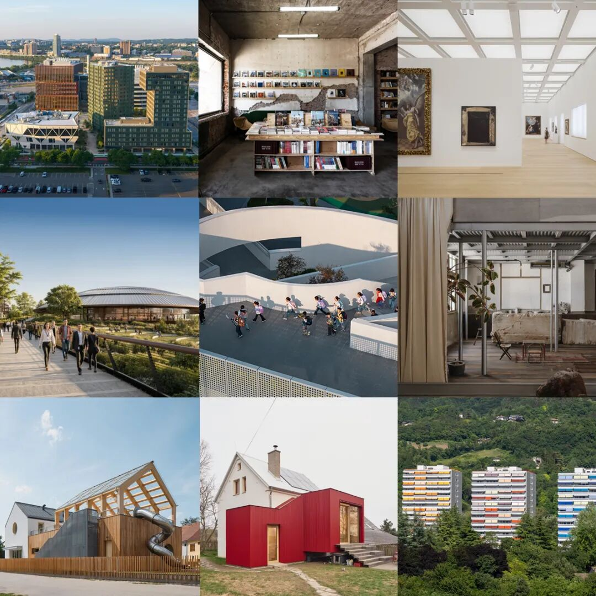
猛击“阅读原文”，进入网站畅享更多精彩

