# AUD新作宣发｜华润西安浐灞万象汇

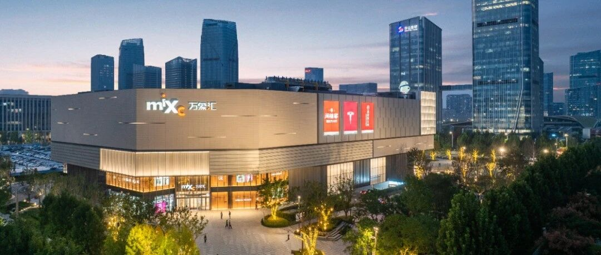

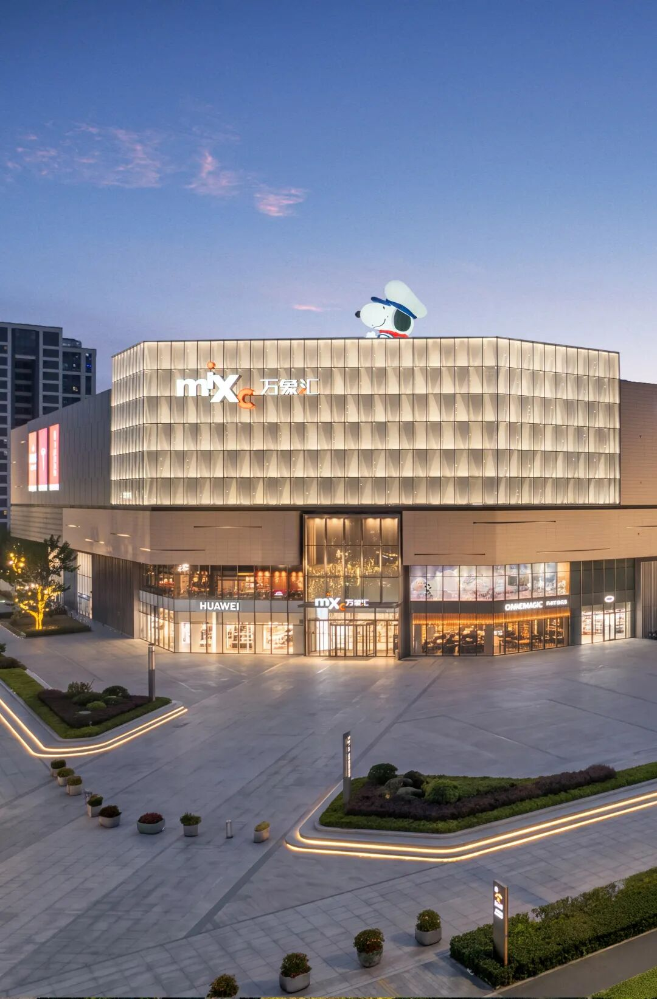

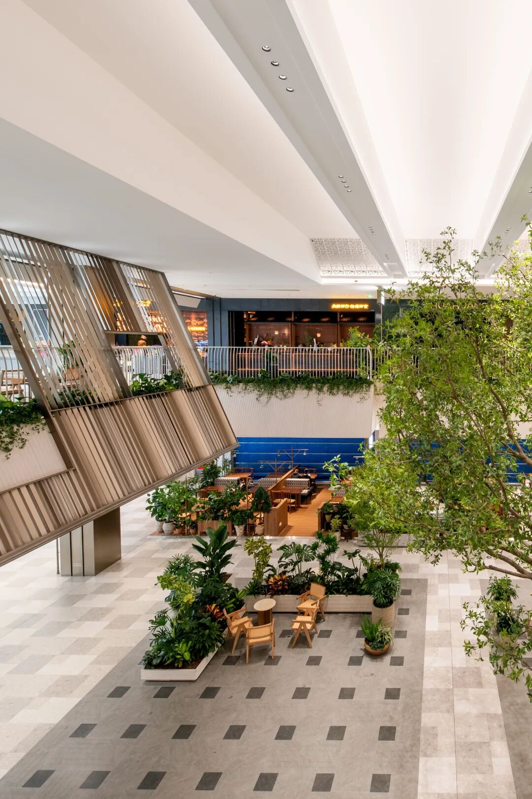
© 深圳燃番科技
建筑不再是到点关闭的容器，而是持续服务周边社区的城市空间。一座商场也可以是一座城市的客厅，而好的设计，终究是让人愿意留下来，好好生活。
感谢  ** AUD  ** 对gooood的分享
9月12日，由AUD通过竞赛中标并全程主导建筑设计的西安浐灞万象汇正式开业。作为华润置地在西北布局的首座“汇”系商业作品，它试图回答一个新城普遍面临的难题：当人口与产业快速聚集之后，商业建筑如何缝合被道路割裂的城市，让人愿意停留，成为城市的公共生活空间，并真正融入市民的日常。
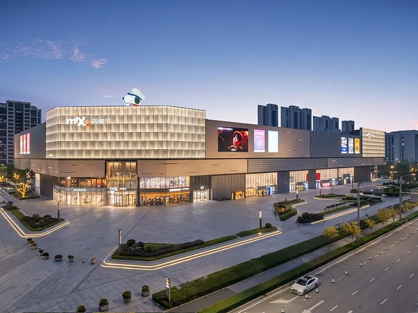
▲  夜晚的商场主界面  ©  深圳燃番科技
以TOD缝合城市，  补齐新城的“生活拼图”
项目坐落于西安对外开放的东大门——浐灞国际港，无缝接驳地铁3号线与14号线换乘站双寨站，是一座双轨上盖的TOD立体商业综合体，总商业建筑面积约10.4万平方米，涵盖地下2层与地上5层。
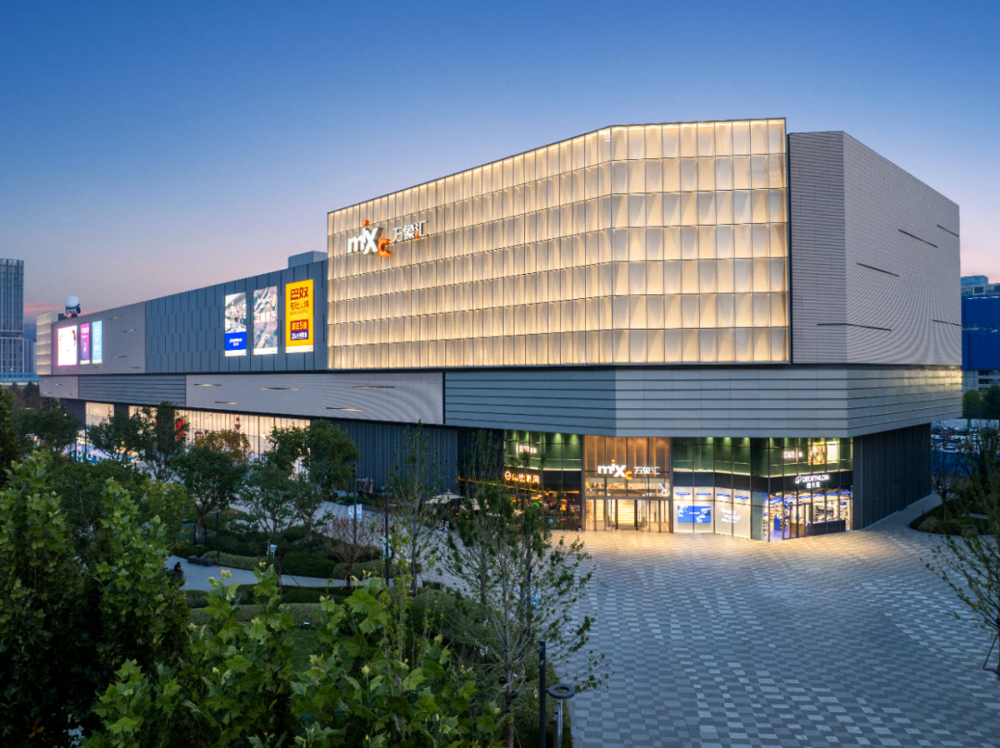
▲  建筑夜景  ©  深圳燃番科技
对这片区域而言，这座综合体的意义不止于“多了一个商场”。浐灞国际港所在的奥体板块，长期处于“先有设施、后有生活”的新城发展模式中：场馆、路网、住宅次第落成，但让日常生活得以停留的公共消费空间始终缺位。万象汇的出现，让这片区域第一次拥有了一个可以将居住、通勤、观演、消费串联起来的日常锚点。
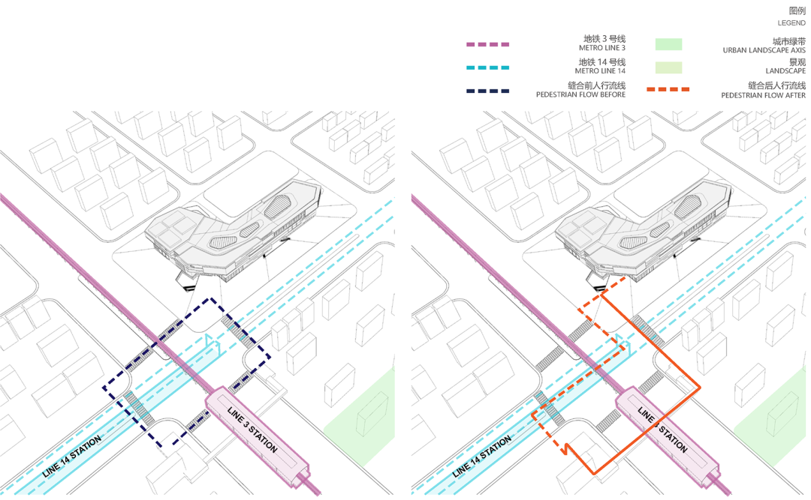
▲  TOD概念分析图  © AUD
在前期场地研判中，AUD的设计团队将此视为项目的核心城市矛盾，并确立了清晰定位：不止做一座商业建筑，更要做奥体板块的城市缝合器、人气聚合核与生活配套补全者。
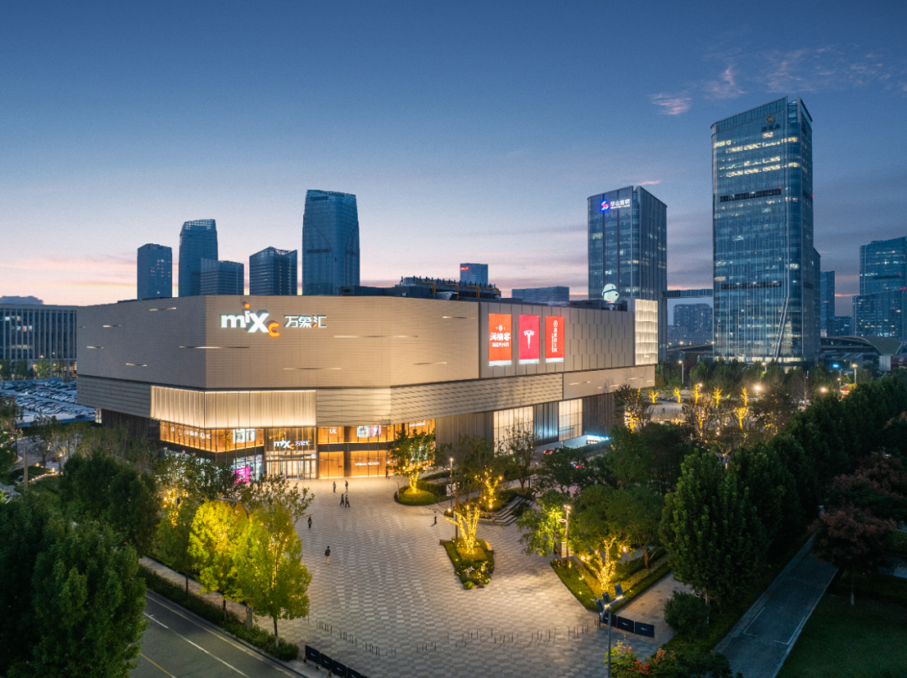
▲  融入城市生活的建筑  ©  深圳燃番科技
作为片区稀缺的TOD载体，项目以综合体为核心枢纽，打通地铁、公交等多维交通人流，搭建连贯的步行接驳网络，出站即可直达商场；同时修复城市主干道带来的空间割裂，实现交通客流与商业人流的无缝转换。设计还植入了城市绿廊概念，系统性串联片区中央绿轴、城市生态绿化带与商业公共活动空间，让生态场景、城市公共场景与商业消费场景深度联动。
打破“方盒子”，让室内外流动交融
在整体空间规划上，设计的出发点并非复制一套标准化的商业空间，而是围绕区域客群的真实生活需求，定制可停留、可参与的场景体验。
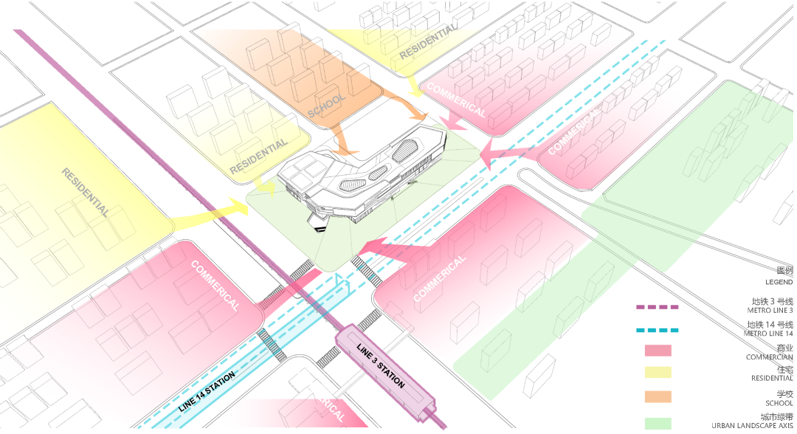
▲  城市人流及交通组织分析图  © AUD
项目打破了传统商业封闭“方盒子”的思路，强调室内外交融、自然烟火共生的设计理念，规划出不同的生活场景。在浐灞万象汇，“公园”“亲子”“社交”并非严格的空间分类，而是贯穿各楼层与公共区域的生活属性。
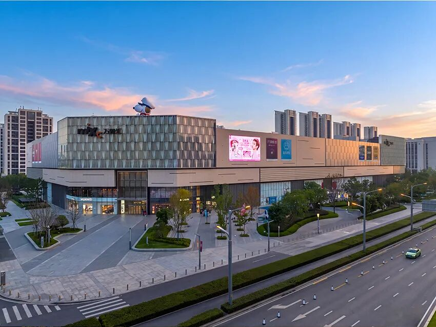
▲  面向城市的商场主入口  ©  深圳燃番科技
L1户外的城市露营公园，是嵌入商业体的一处“城市留白”，回应年轻客群对松弛感的情绪需求；它向内与下沉广场贯通，后者的小型音乐演出与随意散坐于阶梯的人群，让空间从公园的松弛自然过渡到更具停留感的休闲惬意。位于4—5层的半山食院采用跨层挑空设计，绿植与大树贯穿其间，像一座嵌入商业体内部的微型庭院，不用餐亦可随意落座。此外，悠然公园、城市休憩地等主题空间，让不同生活节奏的人都能找到适合自己的停留方式。
在地的设计表达
古长安的东西市曾是千年丝路的商贸核心，设计以此为原型，将轻量化的丝路文化肌理与长安商贸美学渗透于立面、中庭与室内场景之中——既呼应国际港务区对外交往、科创贸易的现代定位，也保留了西安独有的历史底蕴。开业期间的室内设计，即以中欧班列的运行轨迹串联整个场地。
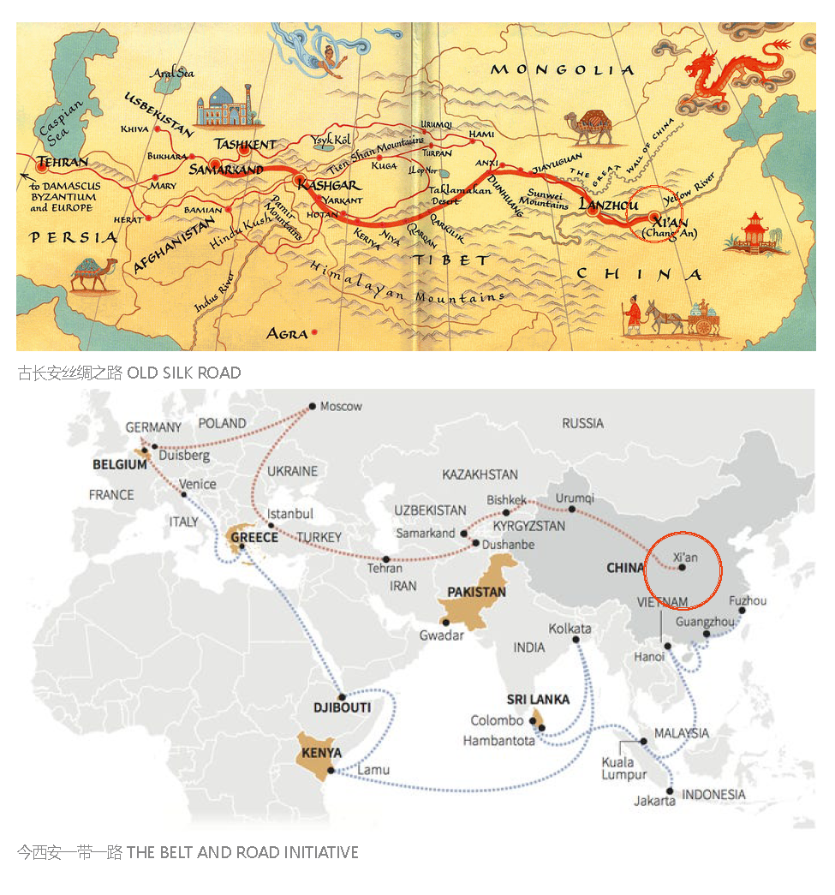
▲  设计概念丝路万象  © AUD
立面则选取古都城墙砖作为融合“古”与“新”的关键元素，在材料、颜色、轮廓、线条乃至堆叠尺度上做出创新。落地阶段，设计团队对主入口界面的陶板幕墙造型与收边细节进行了多轮优化，并将传统外置灯盒改为内嵌式结构，在控制施工与运维成本的同时，保留了立面的虚实层次与入口的仪式感。
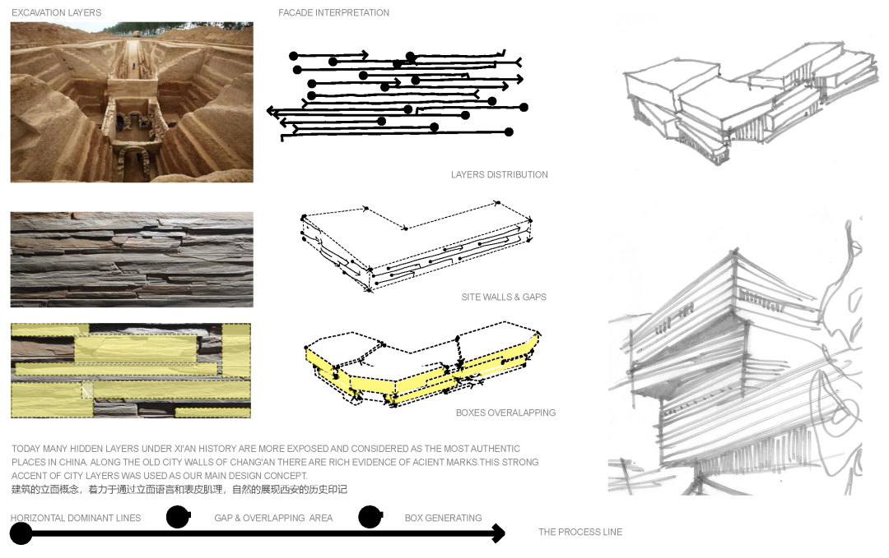
▲  前期立面概念手绘  ©  AUD
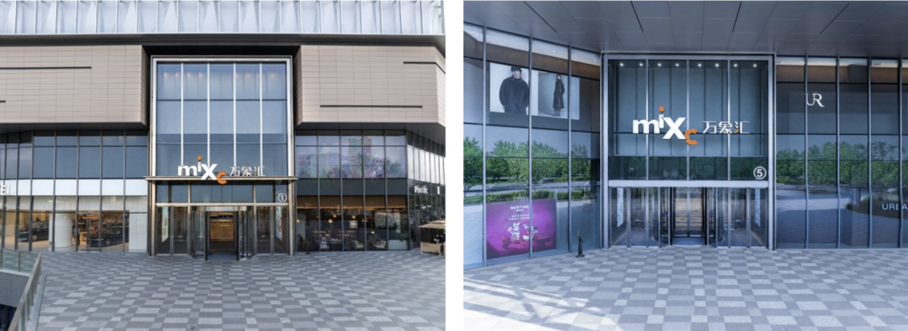
▲  主、次入口  ©  深圳燃番科技
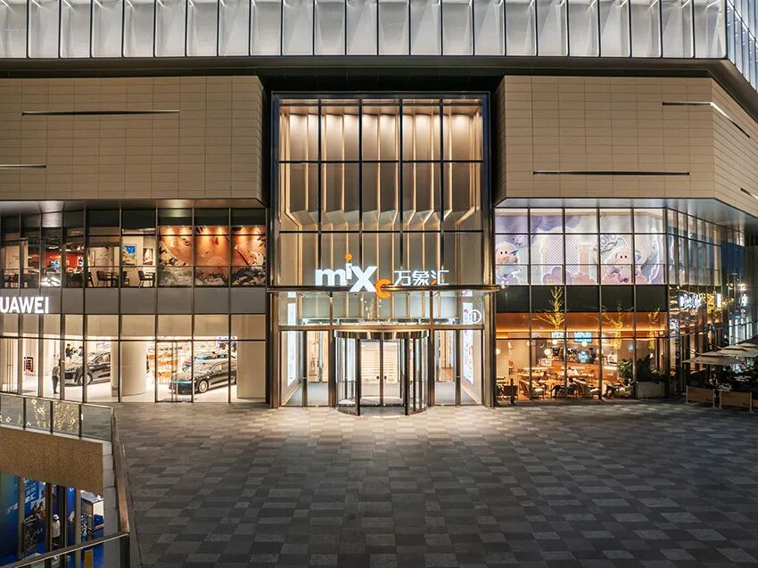
▲  主入口夜景  ©  深圳燃番科技
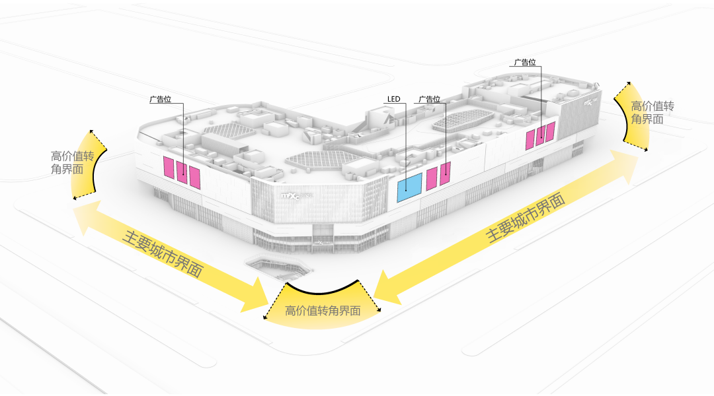
▲立面广告位分析图  © AUD
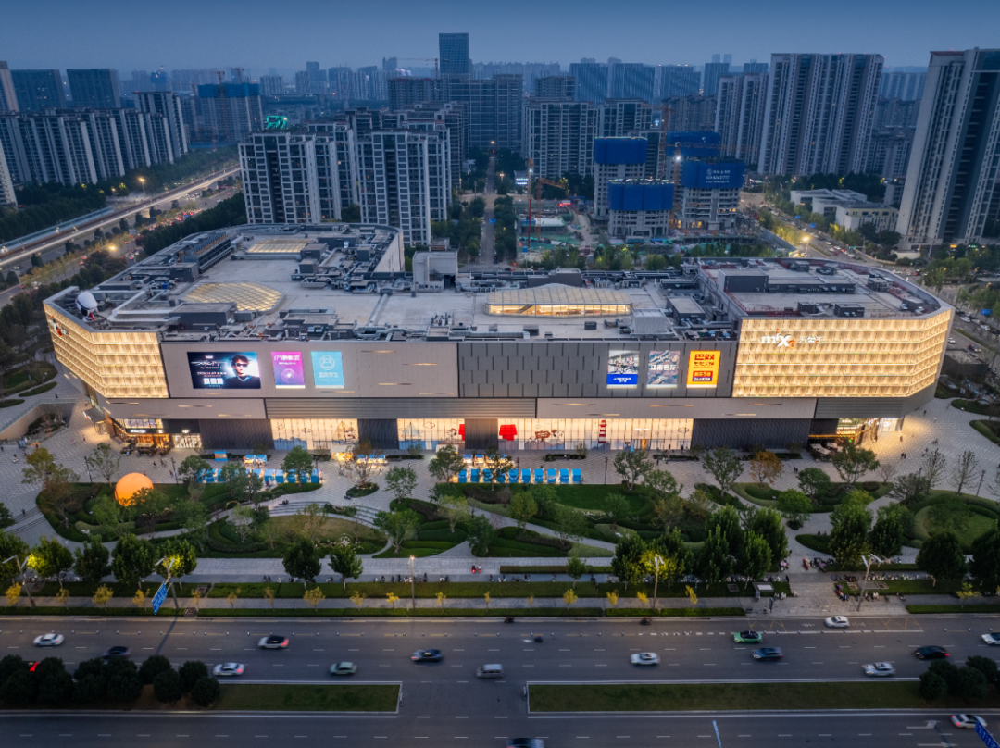
▲  立面鸟瞰  ©  深圳燃番科技
史努比“航海时代”主题IP展西北首展亦在此亮相，航海巨轮与10米高眺望灯塔构成的沉浸式场景，与西安国际港的“港口”身份形成了巧妙的在地呼应。
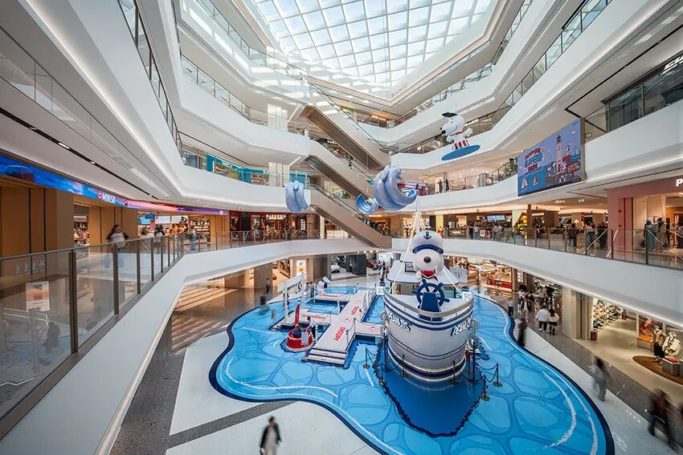
▲  主中庭  ©  深圳燃番科技
回归生活本质的务实设计
商业建筑的力量未必来自夸张的造型与昂贵材料，而在于精准嵌入城市脉络，创造出可供市民持续停留、交往、消费的公共场景。项目立项于2021年，彼时行业仍处高位，但设计团队与甲方达成共识：从全生命周期出发控制投资。这一理念反而与设计一拍即合——大型的商业空间不应只是堆砌豪华的装修，而应回归生活的本质。“这个项目做得比较平实，但它带来了一种新的活力。”
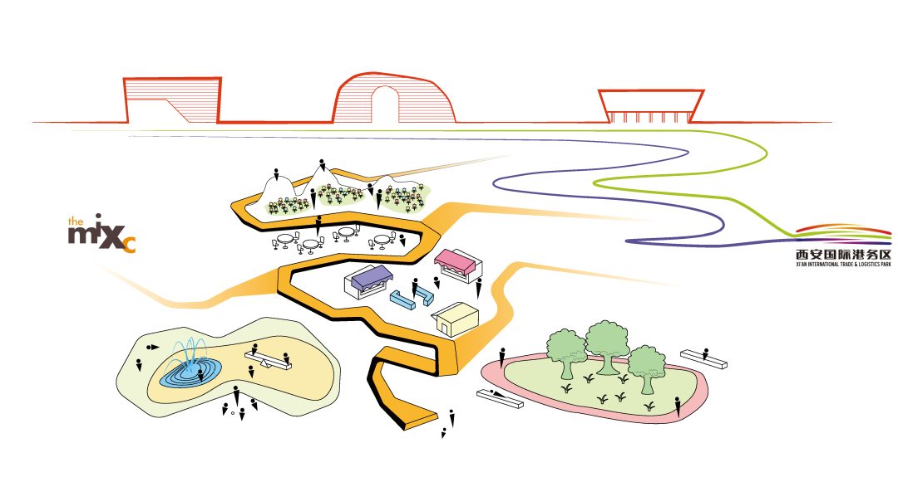
▲  设计概念丝路万象  © AUD
动线是这种务实思路的直接体现：一条长度适宜的单动线，有意被主动打断，将外摆区、绿植、空中美食庭院等植入其中。逛街时，眼前不是无尽的商铺，而是外摆平台或是一片绿植，仿佛在室外街巷、街边公园漫步。考虑到西安夏热冬冷的气候，大部分的消费场景被设在室内，但绿化、庭院等室外主题被引入室内，在AUD的设计团队看来，最好的购物商业环境，应该是室内和室外的有机结合。
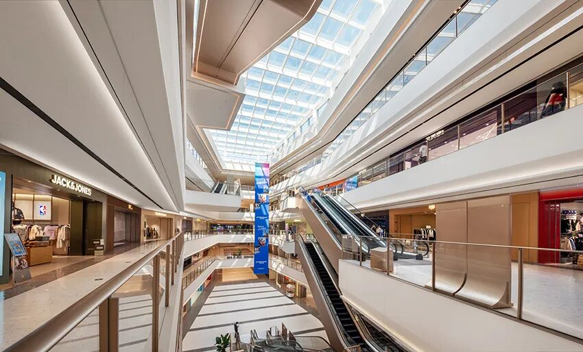
▲  次中庭  ©  深圳燃番科技
为了控制造价成本，室内的许多商业空间使用石膏板，但通过建筑骨架的尺度控制、中庭天窗的光线组织与动线的节奏变化等设计手法，最终呈现并未因材料朴素而失分，简约的材料，做好空间本身，一样可以做出动人的商业。
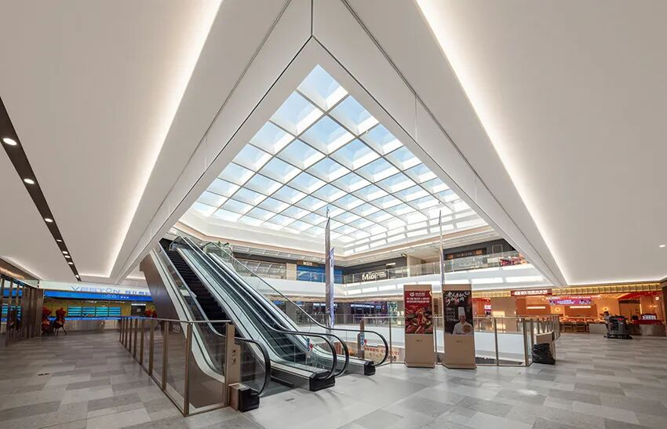
▲  格栅天窗  ©  深圳燃番科技
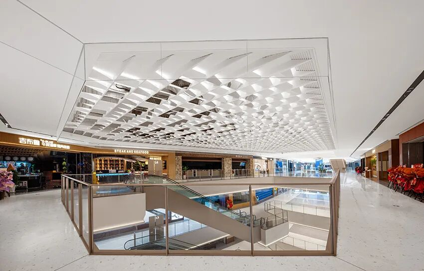
▲  四层商业  ©  深圳燃番科技
设计团队还尽量将屋顶机电布置在边角，为屋顶商业与活动场所预留弹性。平面规划在保障商铺得铺率的基础上预留充足弹性铺位，为首店落地提供空间支撑。
“现在人们去逛街，是为了满足情绪价值。当你设计出一个好的空间，购物，是自然而然的一个结果。”好的设计不一定需要非常大的财力堆积，用平实的材料和简约的方式，也能创造出非常好的商业空间。
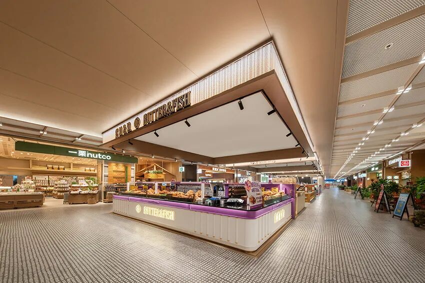
▲  负一层商业  ©  深圳燃番科技
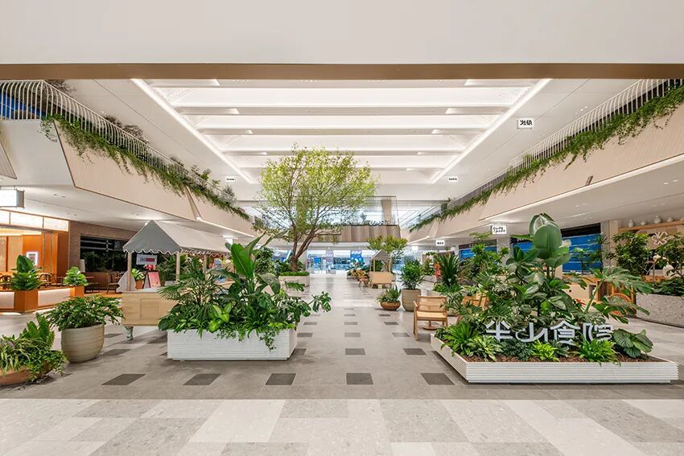
▲  半山食院  ©  深圳燃番科技
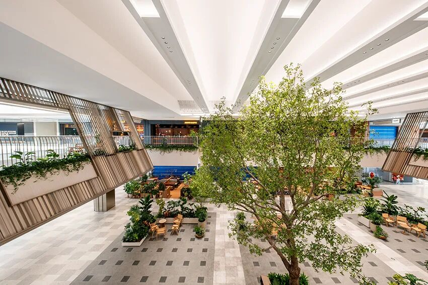
▲  半山食院双层挑空  ©  深圳燃番科技
商业作为城市的公共客厅
作为万象体系定位为“区域型品质生活中心”的作品，浐灞万象汇的核心气质是亲民、在地，回应十年来奥体板块激增人口最真实的日常需求。它不是面向游客的城市巨型地标，而是扎根社区、服务周边居民的生活配套。
商场不只是购物的场所，同时也是公共的城市空间。浐灞万象汇用一种谦逊的姿态，把自己编织进城市的日常肌理。设计团队把公共属性的功能延伸到商业空间之外，甚至在晚间闭店之后，部分室外区域依然可以作为市民停留活动的场所。建筑不再是到点关闭的容器，而是持续服务周边社区的城市空间。一座商场也可以是一座城市的客厅，而好的设计，终究是让人愿意留下来，好好生活。
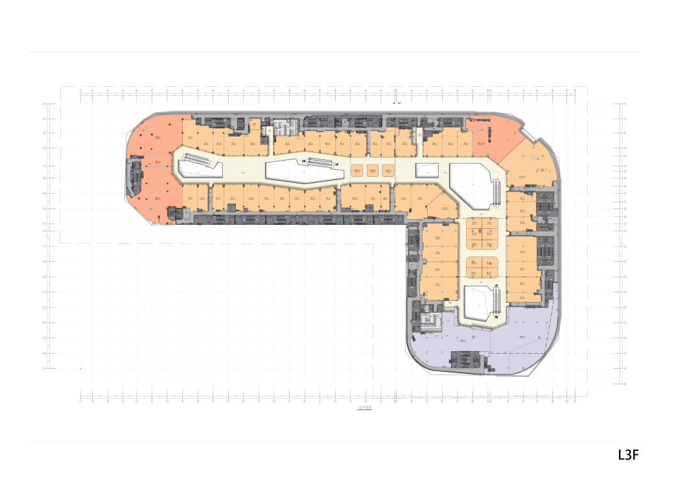
▲  平面图  © AUD
项目名称：西安浐灞万象汇
设计单位：AUD
项目主创：郭驽
设计团队：尹振羽、詹晟、Marusic Bosko、张志超、Theo Niculae、郑超、祝少杰、施庭晧、姜雨秋
项目地点：陕西省西安市，浐灞国际港（欧亚大道与港兴二路交汇处，奥体中心东南侧）
用地面积 ：52亩，约3.47万㎡
商业建筑面积：104,405平方米
建筑层数：地下2层，地上5层
建成时间：2026年9月12日
业主：华润置地
摄影：深圳燃番科技
版权©www.gooood.cn，欢迎转发，  禁止以gooood编辑版本进行任何形式转载

↓  网站最新发布项目一览
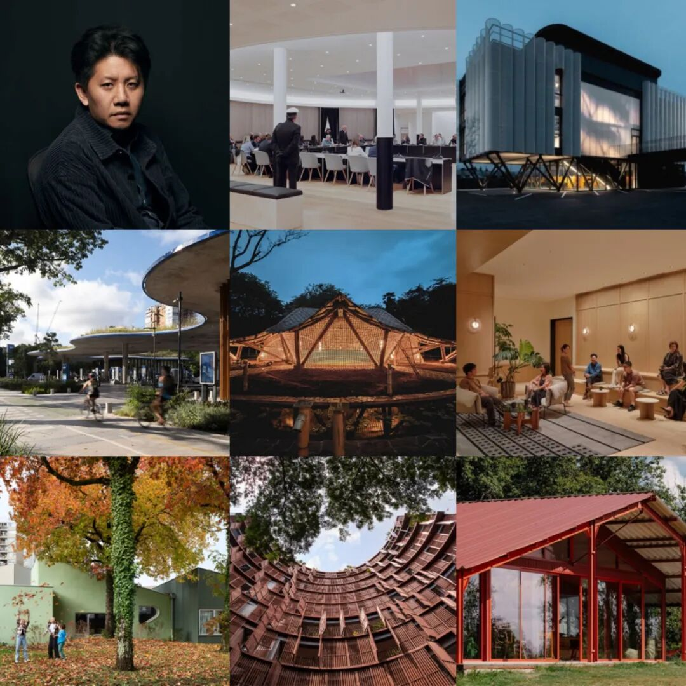
猛击“阅读原文”，进入网站畅享更多精彩

