# Foster + Partners｜美国Oracle甲骨文全球总部园区

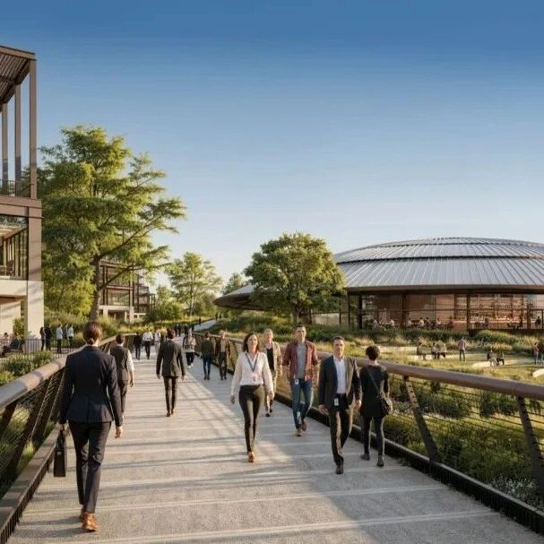

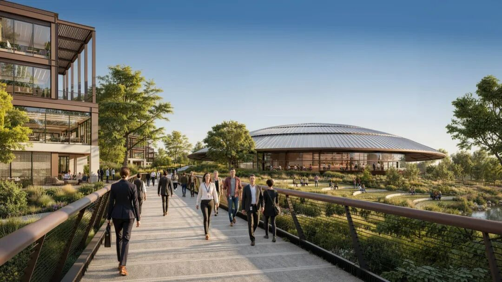
©  Foster + Partners
一座新桥跨越河面，将园区与Germantown社区相连，并与环湖步行道相接，穿行于办公组团之间。方案还包括礼堂、访客中心、后勤中心以及纳什维尔首家Nobu酒店。项目引入16.5英亩公共绿地，包括一座2英亩公园、带零售功能的广场，以及环绕场地的多模式绿色环线。
感谢  ** Foster + Partners  ** 对gooood的分享
Foster +
Partners为美国跨国科技公司Oracle在田纳西州纳什维尔坎伯兰河畔设计了一座绿色园区。项目已举行奠基仪式，将工业场地转型为企业全球总部，并以开阔绿地重新连接人与自然。园区占地约70英亩，拥有1.2公里滨水岸线；五个办公组团围绕宽阔湖面和浮动剧场布置。
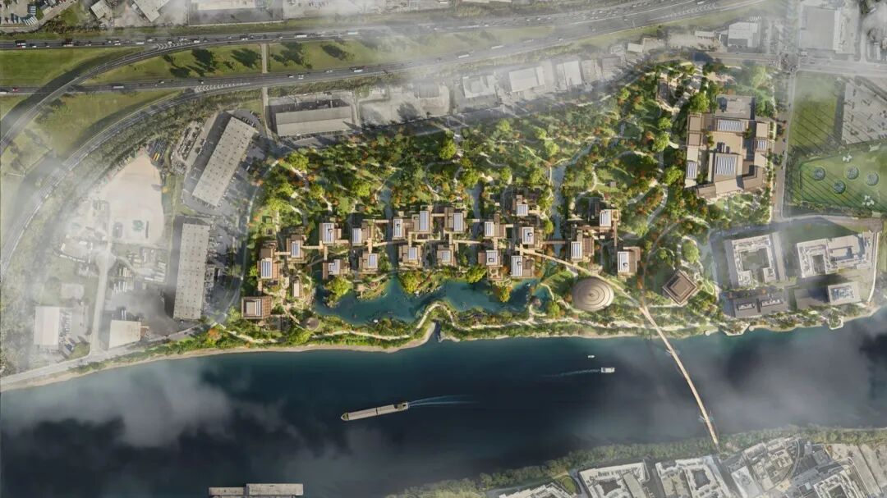
▲园区整体鸟瞰  © Foster + Partners
Foster + Partners工作室负责人Gerard
Evenden表示：“园区将成为Oracle充满活力的枢纽，也将成为纳什维尔市民的新目的地。我们正在绿化工业场地、恢复生物多样性，同时引入大片绿地和公共设施，回馈城市。相互连接的办公组团在私密与共享空间之间取得平衡，并确保员工在每个楼层都能保持与自然的联系。”
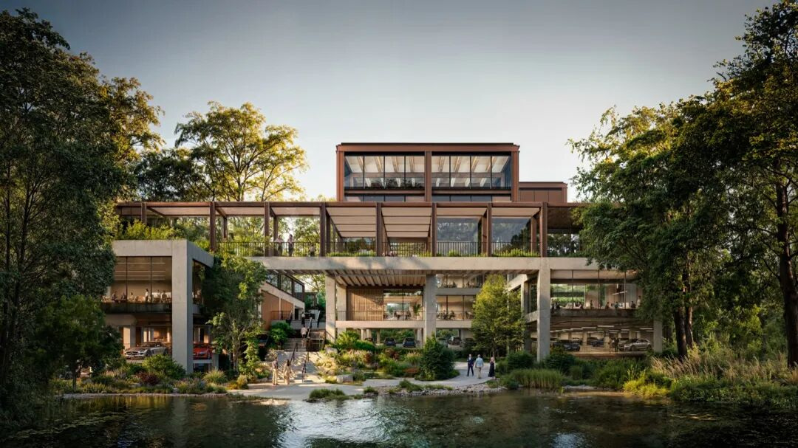
▲沿湖布置的办公组团  © Foster + Partners
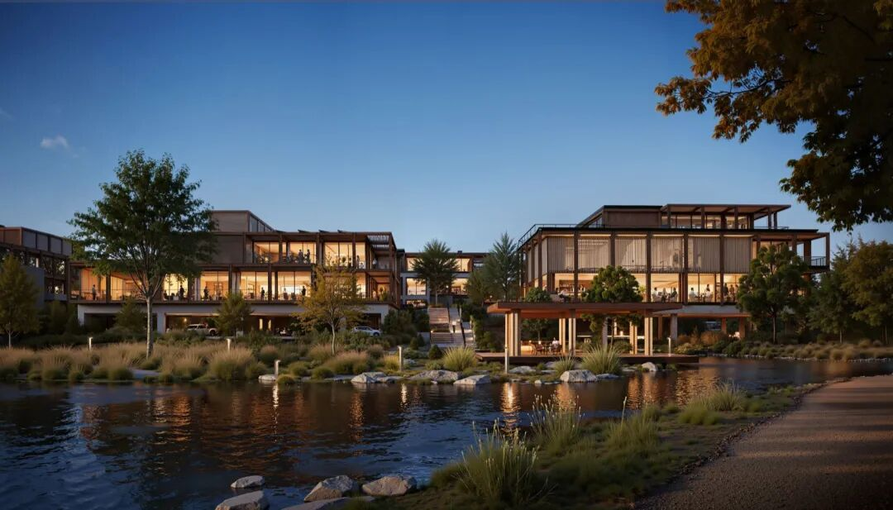
▲黄昏中面向湖面的办公组团  © Foster + Partners
一座新桥跨越河面，将园区与Germantown社区相连，并与环湖步行道相接，穿行于办公组团之间。方案还包括礼堂、访客中心、后勤中心以及纳什维尔首家Nobu酒店。项目引入16.5英亩公共绿地，包括一座2英亩公园、带零售功能的广场，以及环绕场地的多模式绿色环线。

▲步行路径通向浮动剧场  © Foster + Partners
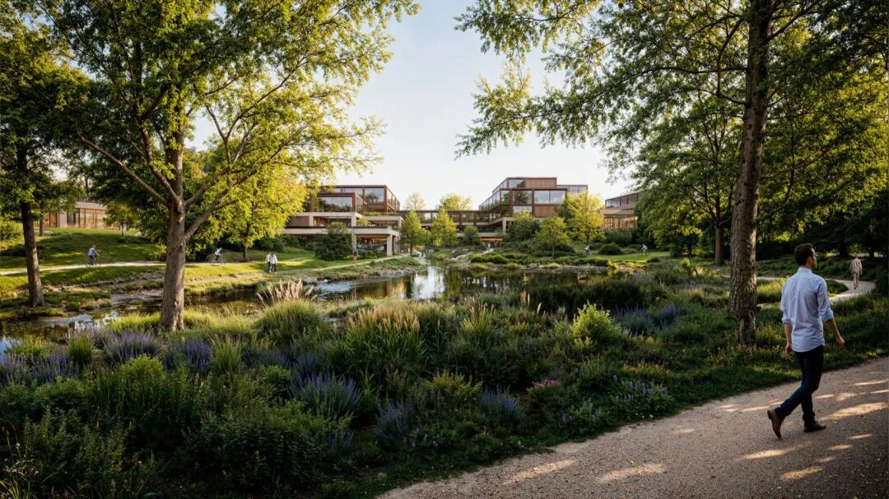
▲穿越自然保护区的步行与骑行路径  © Foster + Partners
设计团队正与生态学家密切合作，在园区内营造多种生态分区。溪流蜿蜒穿过办公组团并汇入湖面，营造宁静工作环境。方案通过步行路径和自行车道鼓励可持续出行，让员工穿过生机盎然的自然保护区抵达湖畔办公室。由于场地位于洪泛区，所有关键基础设施均抬高至洪水位以上，停车空间隐藏于建筑下方。园区将种植1900多棵树，并通过栖息地设计支持生物多样性，目标获得LEED金级认证。
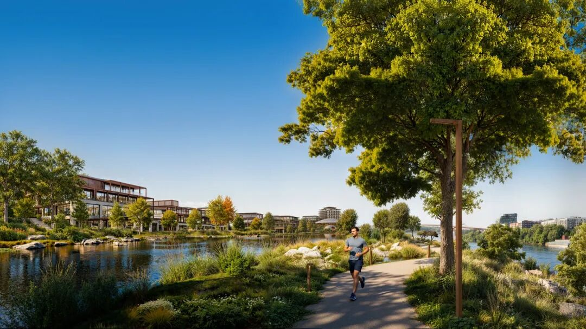
▲湖畔步道与本土植栽  © Foster + Partners
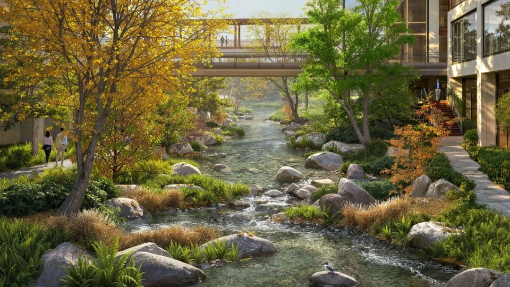
▲修复后的溪流与生物多样性栖息地  © Foster + Partners
办公组团内不同建筑通过统一的甲板层和高架桥网络连接，可欣赏周围自然景观。建筑设计从城市工业遗产中汲取灵感，拆分传统办公体量，为不同团队营造更个性化的空间，同时保持强烈的社区感。每个组团设有图书馆、餐饮设施等配套，促进跨部门协作。办公建筑提供可完全定制的空间以满足不同需求，设有采光充足的中庭，并在各处与自然保持视觉联系。
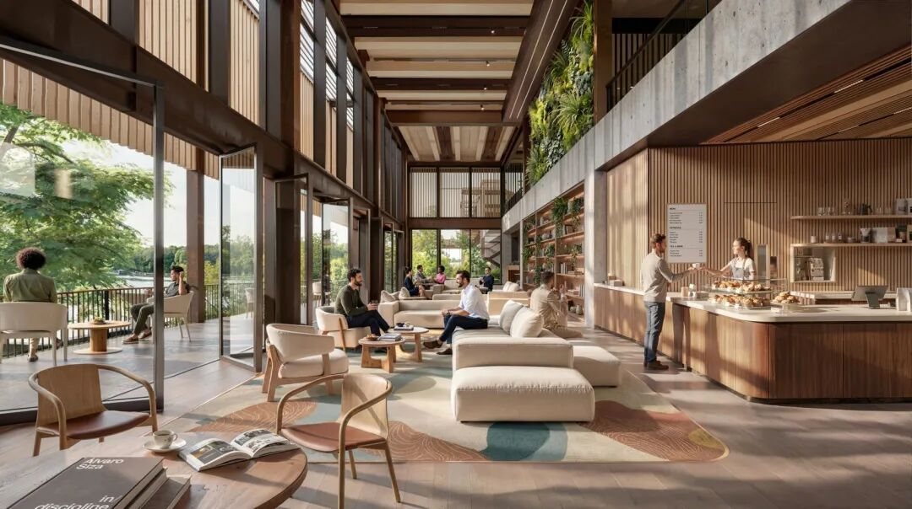
▲与自然保持视觉联系的室内办公空间  © Foster + Partners
高架礼堂俯瞰湖面和剧场，将在夏季成为大型聚会和活动场地。
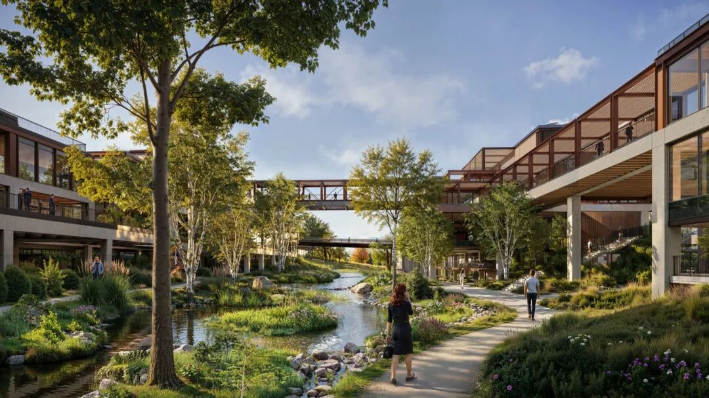
▲连接办公建筑的高架桥  © Foster + Partners
项目名称：Oracle Campus
项目地点：美国田纳西州纳什维尔
设计：Foster + Partners
客户：Oracle
占地面积：约70英亩
滨水长度：1.2公里
公共绿地：16.5英亩
可持续发展目标：LEED金级认证
网站：  fosterandpartners.com
版权©www.gooood.cn，欢迎转发，  禁止以gooood编辑版本进行任何形式转载

↓  网站最新发布项目一览
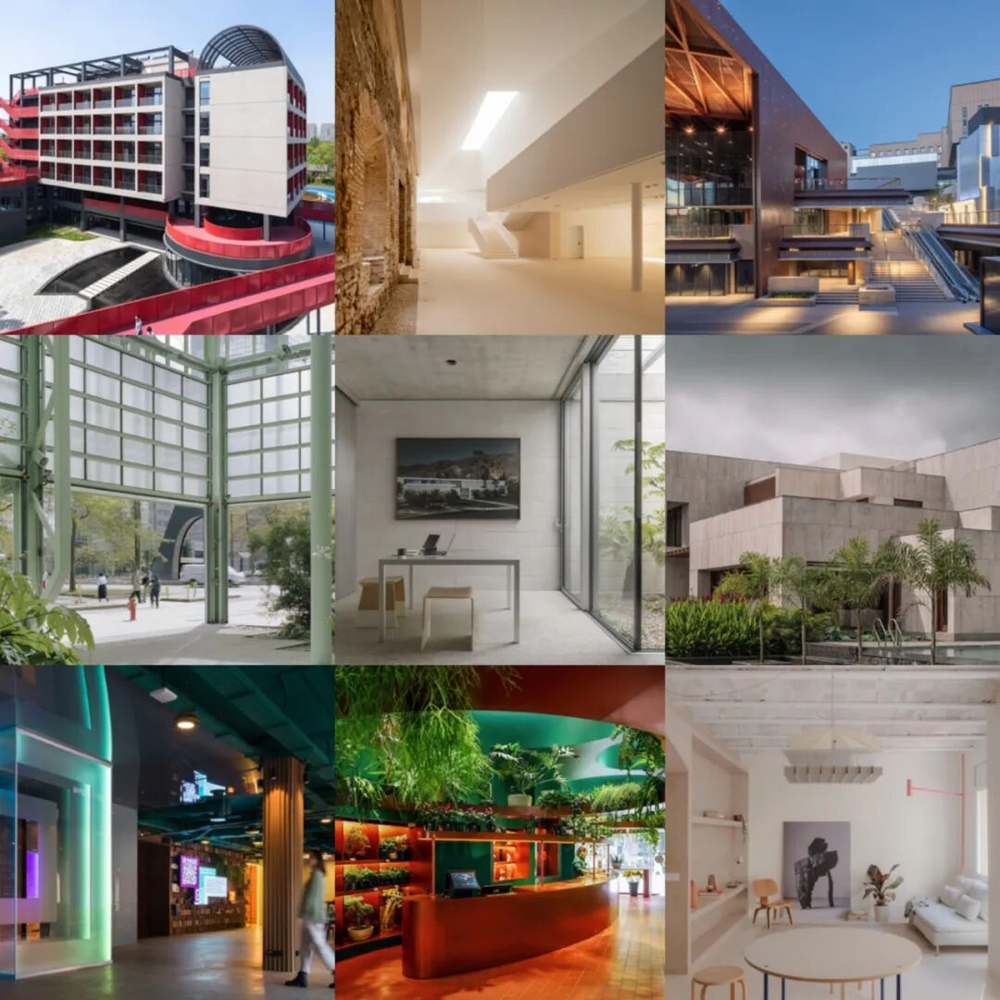
猛击“阅读原文”，进入网站畅享更多精彩

