# SHoP + gad新作｜上海淮海路8号

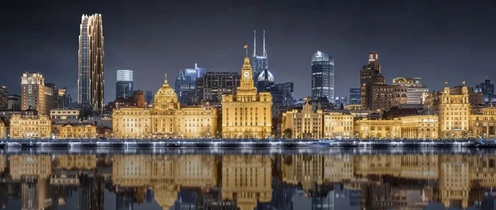

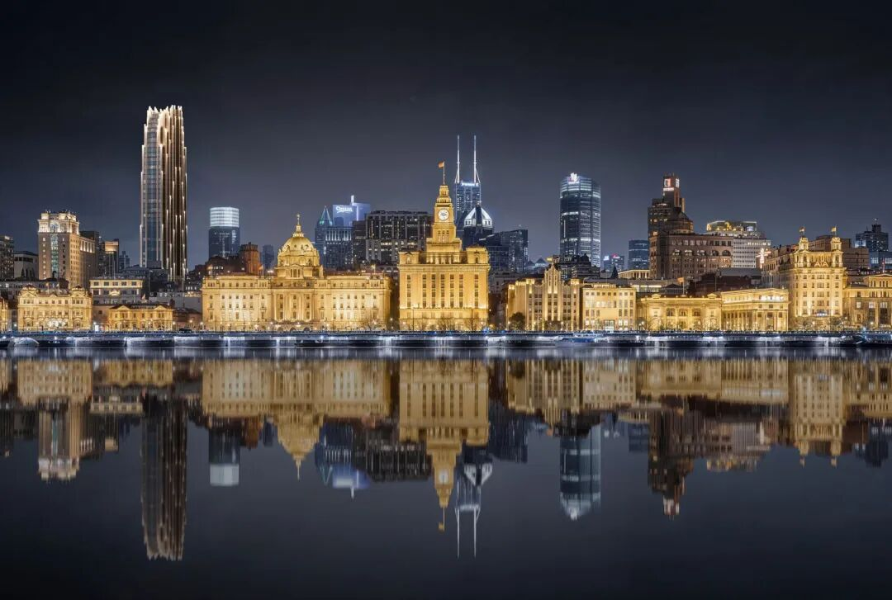

© Atchain

一个人的露台，最终成为了天际线的一部分。它让“家”不只是一个与城市隔绝的内部空间，也成为观看城市、感受城市的一种方式。

感谢 SHoP Architects 对gooood的分享

撰文：张旭 Xu，SHoP事务所合伙人，纽约州注册建筑师

一座城市的天际线，往往能透露很多事情：它在不同的时代重视什么，如何生长，又如何被一代代人重新想象。纽约的住宅塔楼早已成为城市轮廓中最容易被辨认的部分之一；伦敦则不断尝试让新的建筑进入层层叠加的历史之中。上海又有所不同。在不过百余年的时间里，这座城市的天际线已经被数次重新书写——从外滩到陆家嘴，再到今天仍在两者之间以及更远处不断生长的城市。对很多人来说，我们也许并不知道一栋建筑是哪一年建成、由谁设计，却会记得第一次看见一座城市时的轮廓，也会在离开很多年以后，因为远处某个熟悉的建筑重新意识到：自己回来了。但在中国，我们通常并不会用同样的方式去理解住宅。住宅更多被认为属于居住其中的人，它承载的是回家、吃饭、休息，是阳台上的植物，也是窗户背后那些并不属于公共生活的日常。可当一栋住宅以如此巨大的体量进入城市，并在那里存在三十年、五十年甚至更久，它真的还只是属于少数人的私人建筑吗？绝大多数人也许永远不会真正走进它，却会无数次从它旁边经过，会从另一条街看见它，会在照片、电影和人们记录城市的影像中遇见它，也可能在某一天凭借它的轮廓判断自己身处城市的哪里。随着时间过去，这些短暂而普通的相遇不断累积，一栋私人住宅也会慢慢进入市民、游客，甚至几代人关于一座城市的共同记忆。

这也是我们开始设计淮海路8号时一直在思考的问题。长期以来，住宅构成了中国城市中最庞大的建筑类型，却很少被要求承担塑造城市形象的角色。办公楼、文化建筑、商业综合体与基础设施往往拥有更鲜明的公共身份，而住宅更多围绕户型、面积、配置、景观和价格被讨论，仿佛它的价值主要与最终住进去的人有关。但在上海这样一座拥有强烈城市性格、也始终在被重新书写的城市里，我们希望重新思考这种关系：一栋住宅在回应少数人的私人生活之外，是否也应该为更多生活在这座城市里的人留下些什么？

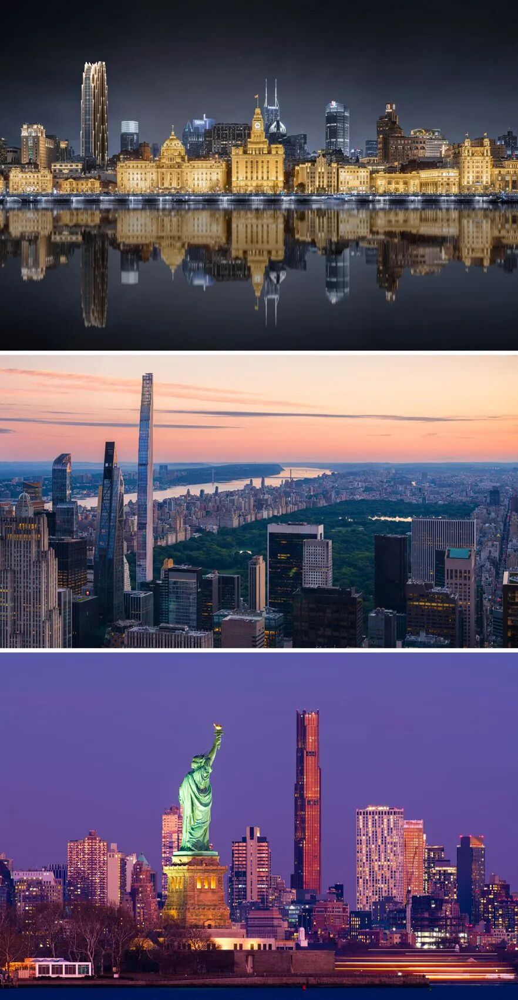

▲从上至下：上海淮海路8号、纽约111号西57街、纽约布鲁克林大楼© Atchain；纽约 / New York © 王千一 | 小红书 @Cheeanyee

从一个露台，到城市天际线

真正塑造这栋塔楼的一些想法，最初并不是从城市尺度开始的，而是从一个很小的生活场景开始。我们想象一个人结束一天的工作回到家，换下衣服，推开门走到露台。太阳正在落下，光线掠过陶板表面，脚下的街道依然忙碌，而更远处，上海开始一点点亮起来。你已经回到家，处在一个非常私人的空间里，却依然与整座城市保持着直接的联系。它让“家”不只是一个与城市隔绝的内部空间，也成为观看城市、感受城市的一种方式。

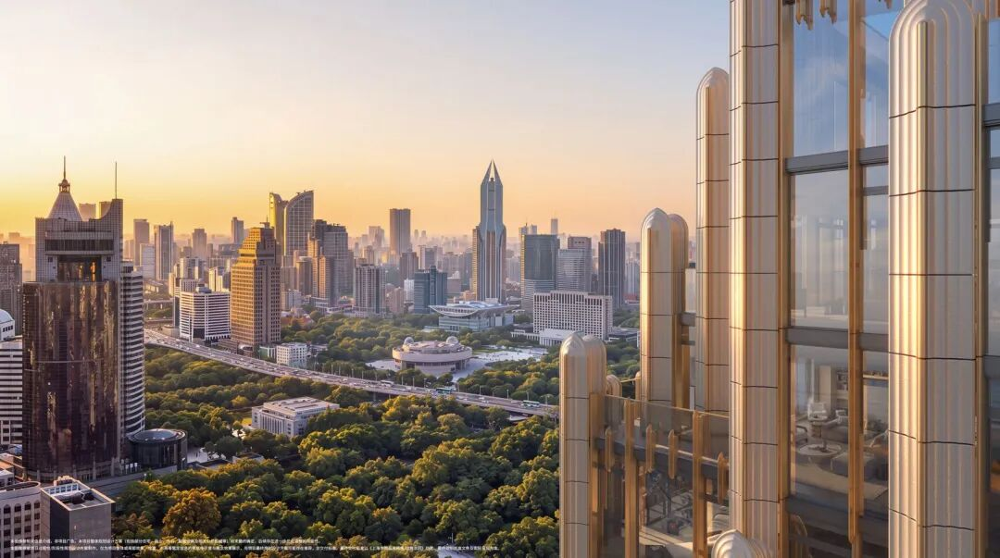

▲从住宅露台望向上海天际线，私人生活与城市尺度在这里交汇© Atchain

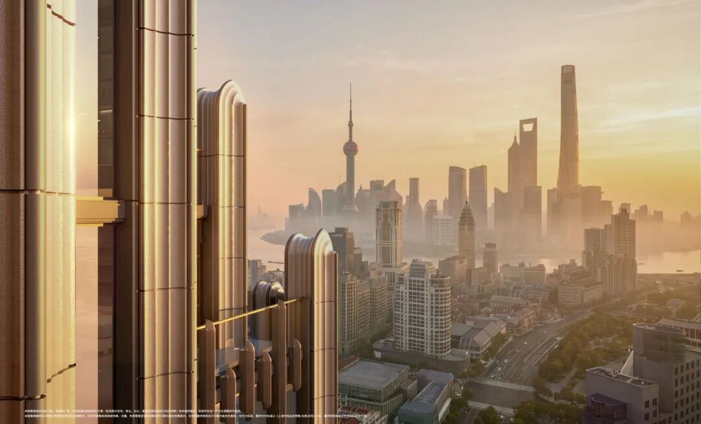

▲夕阳中的露台与城市，家成为观看和感受上海的场所© Atchain

随着设计不断推进，露台开始沿着塔楼逐层退让并向上生长。它们首先回应的是居住者真实的生活，但与此同时，也不断改变着建筑的比例、轮廓与观看方式。塔楼因此变得更加纤细、更加竖向，而从城市不同的位置望过去，也会呈现出不同的表情。一个最初关于日常生活、非常私密的想法，就这样慢慢进入了城市尺度。一个人的露台，最终成为了天际线的一部分。这也是我们很在意的一件事。建筑中的宏观与微观，并不是两件彼此分离的事情。一个建筑师面对的可能是一座150米高的塔楼，但真正让建筑成立的，有时候恰恰是一个人在黄昏时站在露台上的几分钟。城市最终也是由这些尺度完全不同的体验共同组成的。

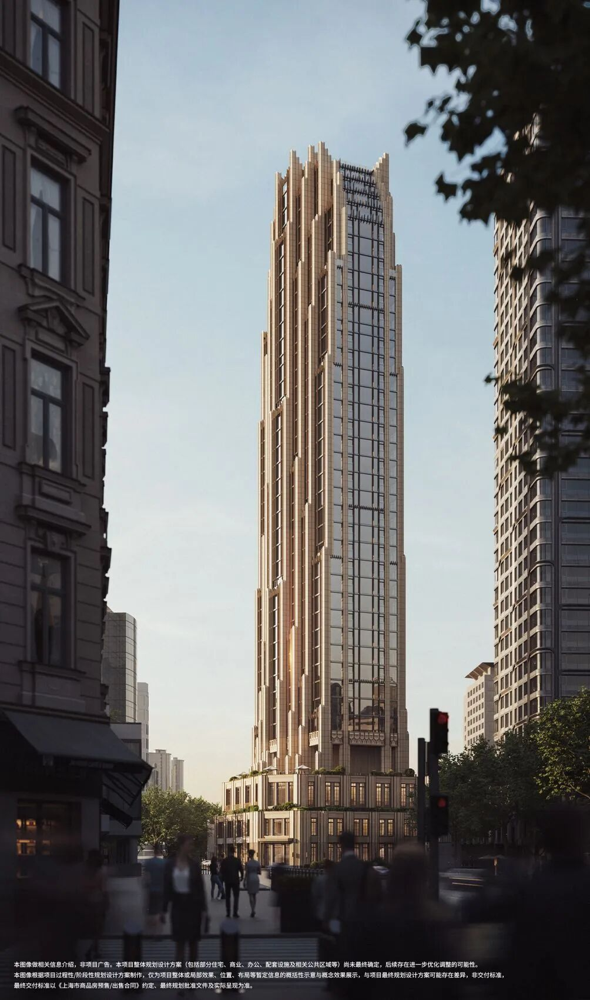

▲从街道望向塔楼，层层退台与竖向线条共同形成清晰的向上轮廓© Atchain

“向上”从来不只是高度

ASCENDANT 这个名字并不是设计完成以后附加在建筑上的，它几乎与建筑本身同时出现。随着塔楼向上生长，露台层层退让，立面的竖向线条不断延续并最终汇聚到塔冠，整栋建筑形成了一种非常明确的向上趋势。中国传统山水给我们的启发并不来自某一种具体的山形，而来自它被感知的方式。人在山水之间移动时，前景、中景与远景不断发生变化，遮挡与显现、远与近持续交替，同一个对象随着观看位置的不同，会呈现出完全不同的关系。“横看成岭侧成峰”说的其实就是这种体验，因此，项目中的“山水”并不是一个可以直接附着在建筑上的“中国文化符号“。

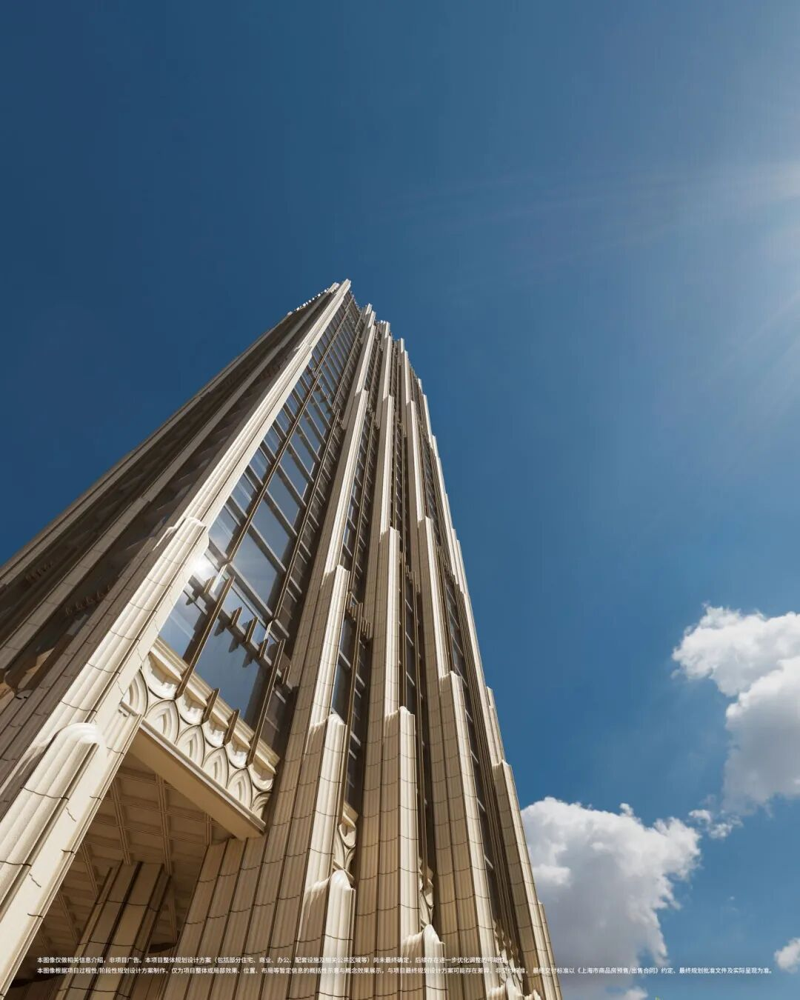

▲仰望塔楼，竖向线条与层层收束的体量强化了建筑向上的趋势© Atchain

沿着一条街道看过去，建筑可能显得纤细而近乎对称；换一个方向，露台与退台的层次会更加明显；当距离进一步拉远之后，这些局部变化又重新汇聚成一个完整的轮廓。我们并不希望建筑只有一个所谓“最好的角度”，它更应该随着人在城市中的移动不断被重新认识。远处看到的是天际线，近处则是一系列真实可使用的露台和生活界面，城市轮廓与居住体验在这里最终成为同一套建筑秩序的两个尺度。这也是“ASCENDANT”这个名字真正成立的地方。它所表达的向上，不只是高度增加，而是一种从生活尺度、建筑尺度到城市尺度不断展开的过程。

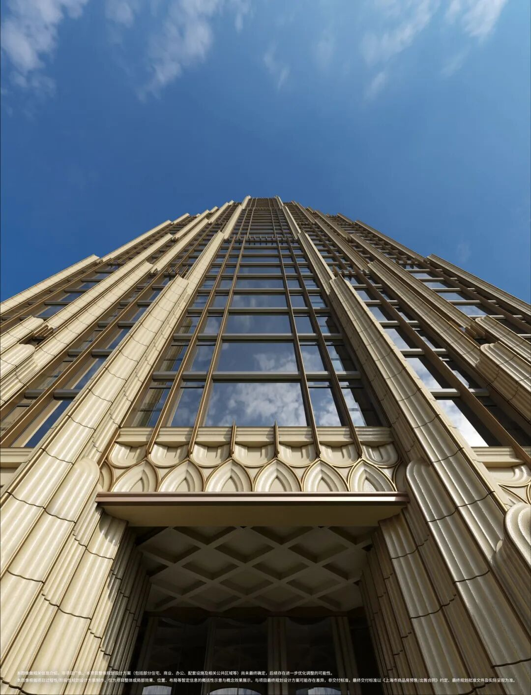

▲从近人尺度仰望建筑，立面细部与竖向秩序 共同强化了塔楼的挺拔感© Atchain

一栋建筑如何属于上海

我们从未试图重新创造一个“旧上海”。Art Deco 当然是上海建筑历史中非常重要的一部分，但上海从来不只属于某一种风格。真正让一座城市成为它自己的，往往是一些更难被概括的东西。可能是一条街道的尺度，是梧桐树间落下来的光，是一处旧阳台或露台，是建筑与人行道之间微妙的距离；也可能是从一个安静的历史街区走出来，突然在远处看到当代上海天际线的那一刻。相比寻找一个可以被快速辨认的“上海元素”，这些真实的城市经验对我们更重要。它们让我们开始思考比例、材料、深度与克制。一栋建筑如何可以有力量，却不需要喧哗？它如何可以足够当代，却又不与已经存在的城市失去联系？真正的在地性，也许并不是建筑看起来“像这里”，而是让一栋建筑经过很多年以后，依然让人觉得：它就应该在这里。这也是为什么，我们没有把上海性理解为一种可以直接复制的形式。它更多藏在尺度里，藏在材料和光线里，藏在建筑与街道的距离里，也藏在建筑面对城市时所保持的分寸之中。

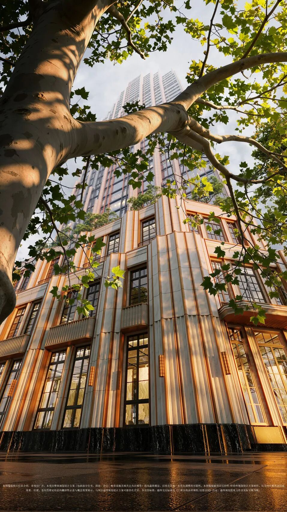

▲梧桐树影与建筑立面交叠，回应上海街道尺度与光影变化中的城市气质© ICON

陶板、光线与时间

材料也是这套思考的一部分。我们希望建筑使用一种真正有深度和重量感的材料，而不是一个平整、均质、很快就能被读完的表面。陶板对我们来说很重要，因为它能够接住上海不断变化的光。一天之中，它的颜色、阴影和肌理会持续发生变化；随着观看距离不同，立面有时显得厚重，有时更细腻，而在更远的位置，它又逐渐转化为一种清晰的竖向秩序。

因此，陶板在这里并不只是覆盖建筑的表皮。它更像是一种时间媒介。好的材料不需要在第一眼就把所有东西告诉你，而应该允许人在不同天气、不同时间、不同距离里不断重新阅读。清晨、午后、黄昏、雨天，同一栋建筑会呈现出不同的表情，而这些变化并不是额外附加在建筑上的效果，而是材料本身与光线、天气和时间共同作用的结果。这件事对我们来说很重要，因为建筑最终并不是一张完成的效果图。它会在那里经历阳光、雨水、季节，也会经历人的反复观看。真正能够留下来的建筑，应该允许时间进入它，也应该在很多年以后，依然能够给人新的感受。

“淮海路8号的意义.建筑以人为尺度，塑形陶板很大程度上在于为上海的城市肌理注入一种工艺与材质的丰盈。切割石材与繁复的青铜镂空花饰在外立面上交织出丰富的光影营造出一座充满愉悦与视觉惊喜的建筑。”

—William & Chris Sharples，创始合伙人 / Founding Principals

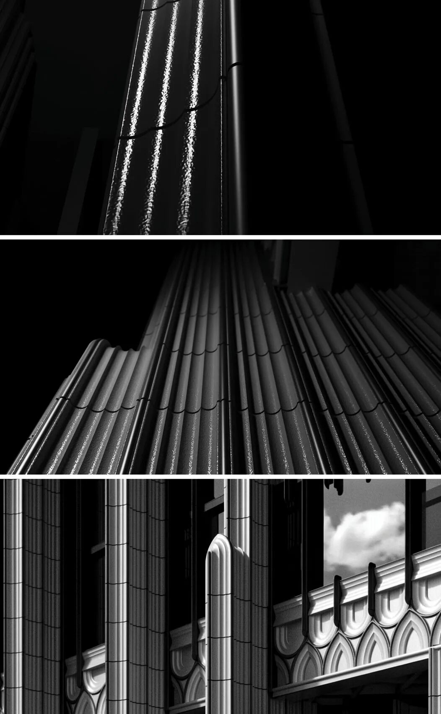

▲陶板立面在不同角度与光线下呈现出的肌理、反射与竖向节奏© Atchain

塔冠，作为建筑的完成

塔冠是整栋建筑向上运动最终抵达的地方。我们从一开始就不希望它成为一个附加在顶部的造型，也不希望为了让塔楼更容易被辨认，而单独制造一个与主体脱节的符号。它应该来自建筑自身的逻辑，来自退台的延续、竖向线条的上升，以及整个体量不断向上收束的过程。所以，塔冠真正重要的并不是它能否制造一个足够戏剧化的形象，而是它有没有把整栋建筑完成。一栋塔楼不应该到了顶部突然换一种语言，塔冠更像是一句话最后的标点。此前关于体量、退台、露台、竖向秩序、材料和光影的关系，到了这里被重新汇聚，最终形成一个可以从城市远处被辨认的轮廓。它不是为了让建筑更”怪”，而是为了让建筑更完整。

这种完整性也决定了我们如何理解“辨识度”。一栋建筑当然需要有自己的性格，但辨识度并不意味着它必须比周围的一切更响亮。它可以参与城市天际线，同时依然保持克制；可以被人记住，却不需要以打断城市的方式获得注意。真正能够留下来的识别，往往来自长期的观看和熟悉，而不是一瞬间的视觉刺激。真正的识别度，不来自对城市的打断，而来自最终被城市记住。

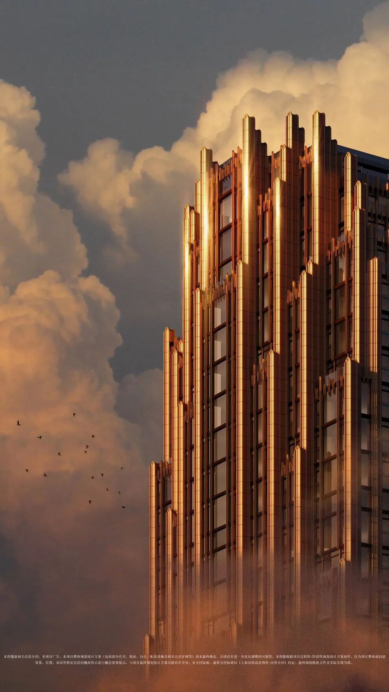

▲塔冠在黄昏光线中完成建筑向上的收束，也成为城市远观时最清晰的轮廓之一© ICON

从设计判断，到真实建造

项目推进一段时间以后，我们才意识到一个有意思的时间关系。华润置地在中国参与城市建设已经超过三十年，而2026年，SHoP也走到了自己的第三十年。两段三十年的经验并不相同，却在这个项目里形成了一种很自然的互补。

对SHoP来说，过去很长时间的实践都在处理同一个问题：一个最初很强的建筑想法，如何在结构、幕墙、材料、施工图和建造这些漫长而复杂的过程中，依然保持它最开始成立的原因。我们在111 West 57th Street和The Brooklyn Tower的过程中，对这一点有非常直接的体会。真正困难的从来不是提出一个概念，而是几年之后，当建筑真正站进城市时，那个最初值得坚持的东西是否还清晰。

华润带来的则是另一种经验。它同时面对市场、居住者、工程、采购、交付以及项目落成之后长期的运营，对建筑从图纸走向现实的全过程有非常具体的理解。很多设计最后失去方向，并不是因为最初的想法不够好，而是在这个过程中被一点点消耗掉。

与此同时，gad作为项目重要的设计合作伙伴，持续参与本地规范、深化设计与落地。对我们来说，这种合作并不是把一个设计方案简单交给下一个阶段，而是让最初的设计判断在进入真实的规范、工程与建造条件之后，依然能够被准确延续。也正因为如此，我们都很珍惜这次合作的一点：不同团队的经验并没有被用来证明“我们已经知道该怎么做”，反而让我们更愿意去判断哪些东西真正值得坚持，哪些又需要重新思考。

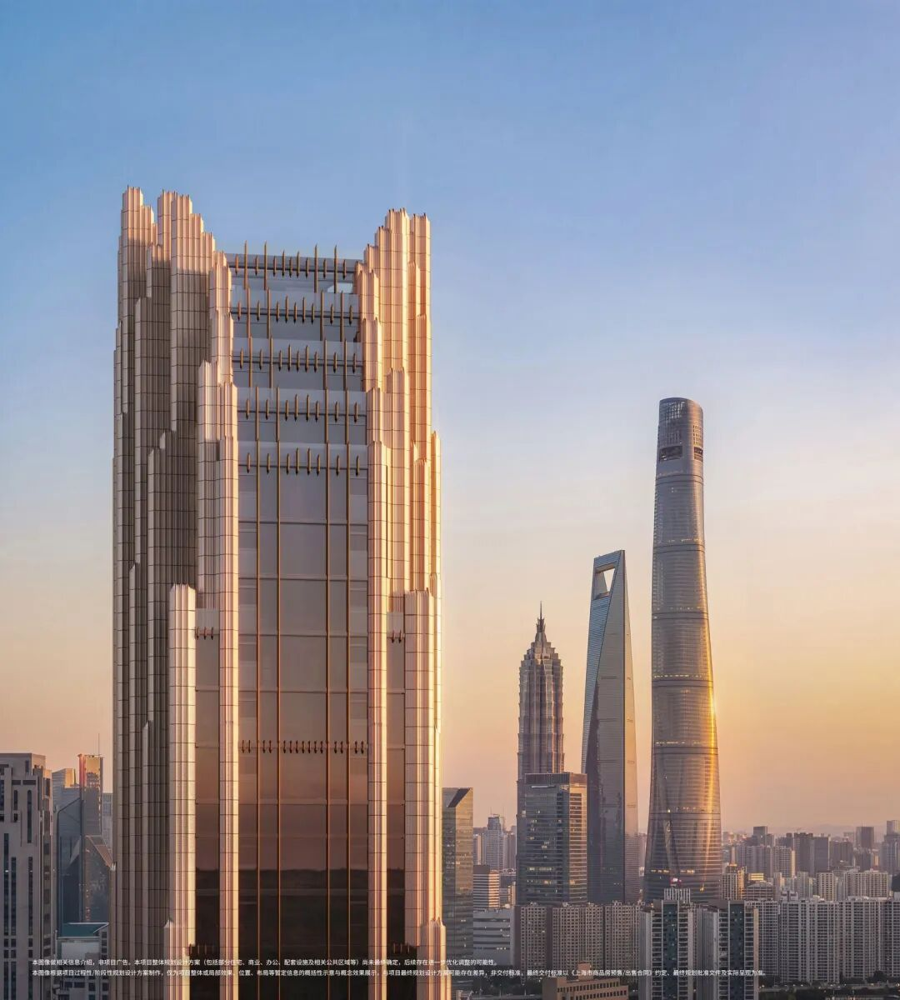

▲从城市远处望向ASCENDANT，塔楼以清晰而克制的轮廓进入上海天际线© Atchain

不再只是城市的背景

ASCENDANT首先当然是一处住宅。建筑如果不能成为一个好的生活场所，那么关于城市的任何讨论都没有意义。但在淮海路这样的位置，一栋住宅的生命也不会只停留在门窗以内。它会在那里存在几十年，与城市中的一代又一代人共同经历时间。这也是为什么我们越来越觉得，住宅建筑承担的责任并不止于居住者本身。建筑存在的时间，往往比一个人的童年更长。一个孩子可能从小每天经过同一栋建筑，把它当作上学路上再普通不过的背景；很多年以后，他离开这座城市，又在某一次回来时重新看见它。那时候，他未必知道这栋建筑是谁设计的，也未必记得自己曾经多少次从它身边经过，但那个轮廓可能依然会让他意识到：自己回来了。城市对人的影响也从来不只发生在学校、美术馆或博物馆中，我们每天经过的街道、建筑和公共空间，同样在潜移默化地塑造我们如何理解尺度、形式、差异，以及这个世界可能拥有的样子。

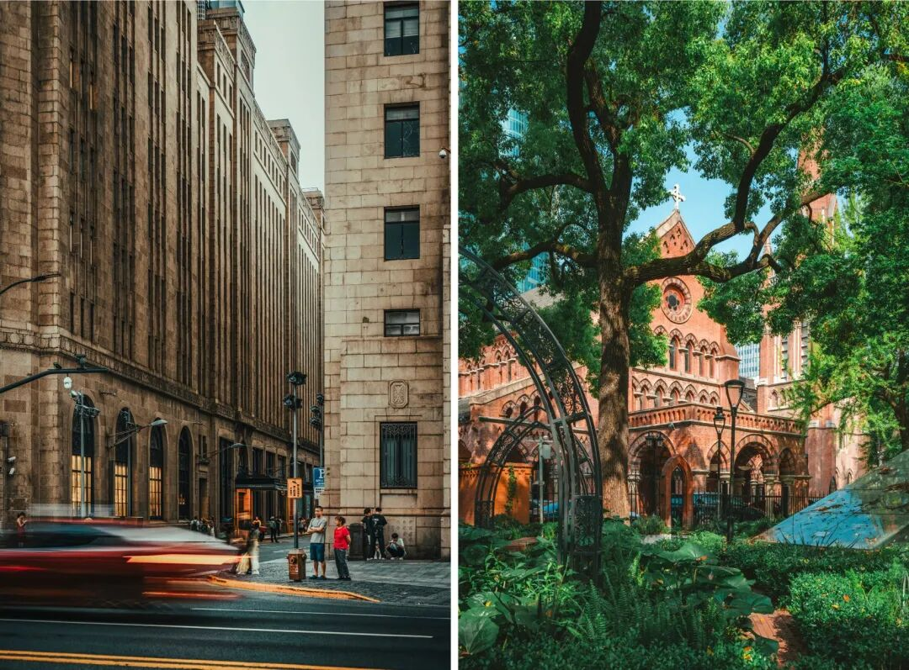

▲历史街区与日常街道并置，上海的城市气质始终来自不同年代与尺度的叠加© 薛晓旸 | 小红书 @Elliot_Arch

如果一个人从小面对的是一个高度单一、不断重复的城市环境，他所接触到的空间经验自然也会更加有限。反过来，当一座城市允许不同的建筑拥有自己的性格、材料、尺度与表达时，这种多样性所带来的并不只是更丰富的城市景观。它也让生活其中的人意识到，同一个问题可以拥有不同的答案，城市本身也可以成为激发好奇心和想象力的环境。对于一个需要持续产生本土创造力的社会来说，这种日常而长期的影响也许很难被量化，却同样真实。

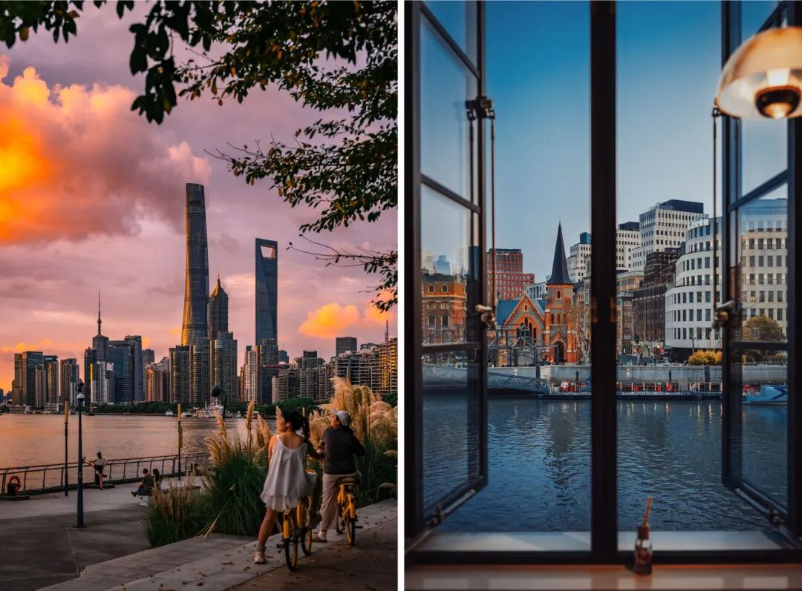

▲从滨水公共空间到窗内视角，城市既被远观，也被日常生活持续感知© 薛晓旸 | 小红书 @Elliot_Arch

因此，我们从来不希望把ASCENDANT理解成一栋恰好位于上海的“国际豪宅”。它应该从这座城市真实的尺度、生活、材料气质，以及历史与当代之间的关系中生长出来，同时也进入一个更大的讨论：纽约、伦敦和许多全球城市，都曾通过住宅建筑不断改变自己的城市形象，而今天的上海也应该拥有属于自己的回答。这个回答不需要复制其他城市已经出现过的形式，更重要的是重新思考，在今天的中国，住宅可以如何超越单一的产品属性，与城市建立更长久、更公共的关系。

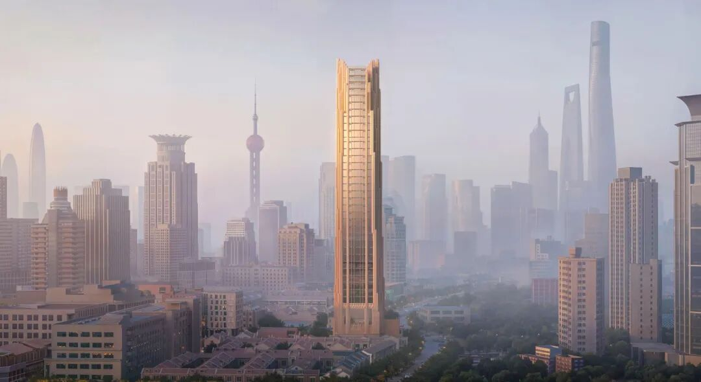

▲ASCENDANT置于上海既有城市轮廓之中，尝试建立属于当代住宅自己的城市位置© Animation by Atchain

项目名称：ASCENDANT，上海淮海路8号
设计：SHoP Architects
设计合作伙伴：gad
业主：华润置地
项目地点：中国上海
撰文：张旭 Xu，SHoP事务所合伙人，纽约州注册建筑师

版权©www.gooood.cn，欢迎转发，

禁止以gooood编辑版本进行任何形式转载

↓网站最新发布项目一览

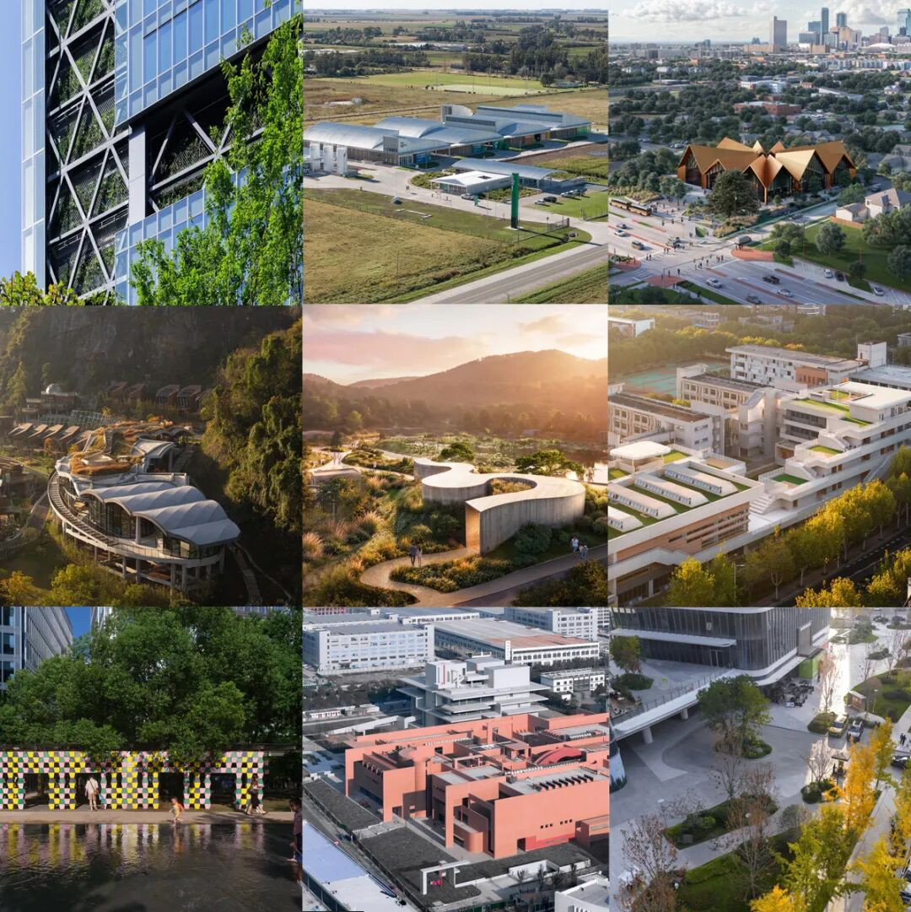

猛击“阅读原文”，进入网站畅享更多精彩

预览时标签不可点

阅读原文

修改于

不喜欢
