# MAKHNO Studio｜乌克兰Dyvo小屋

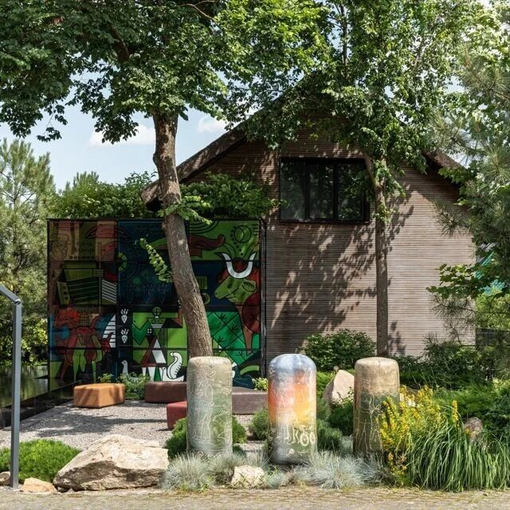

©  Sergiy Kadulin
为了让项目不只有美感，也让人感到舒适，我们在周围营造了一片绿荫。在石头、灌木与树木之间，既有适合独处的地方，也有可以与朋友一同休憩的空间。这里有彩色玻璃风格的待客桌、玻璃窗旁的彩色柱台、水边的木质长凳，以及令人感到舒适温暖的石头和小片草地。
感谢  ** MAKHNO Studio  ** 对gooood的分享
DYVO HUT兼具实用功能与艺术性。它原本是一处办公室旁的门卫室，我们将其改造成了一件供人休憩的艺术作品。项目与Ilya Tovstonoh合作完成。
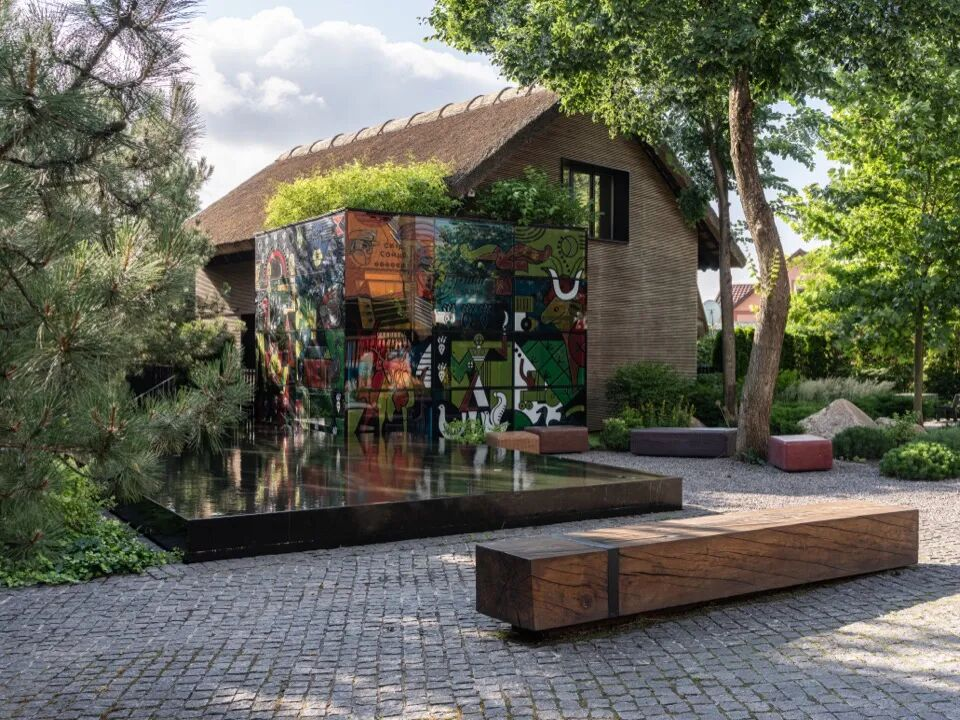
▲小屋、彩色玻璃与水边木凳  © Sergiy Kadulin
挑战
将一处沉闷的功能性设施变成吸引办公室员工与访客会面、休憩的场所。这里让人想坐一坐、散散步，也让人舍不得离开。
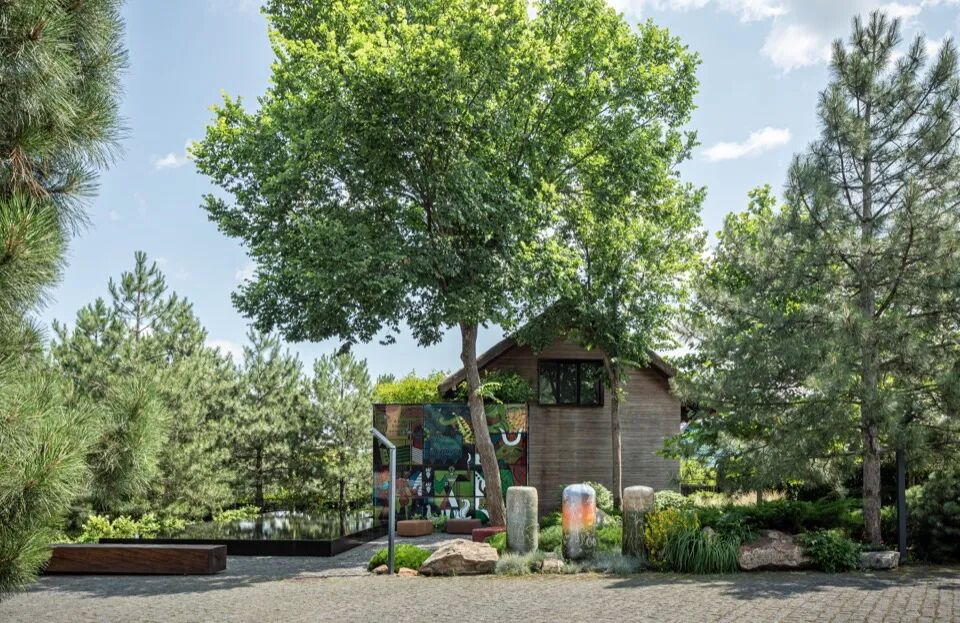
▲绿荫中的小屋与庭院  © Sergiy Kadulin
小屋
为了传递温暖、自然的感受，我们用木材包覆小屋的墙面，并在上方搭建芦苇屋顶。因此，它从外面看像一座林间小屋，内部却具备现代技术功能。
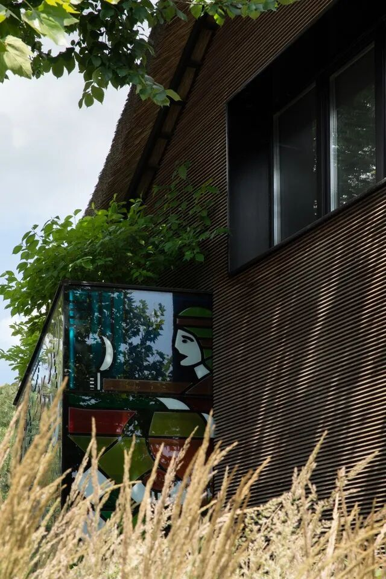

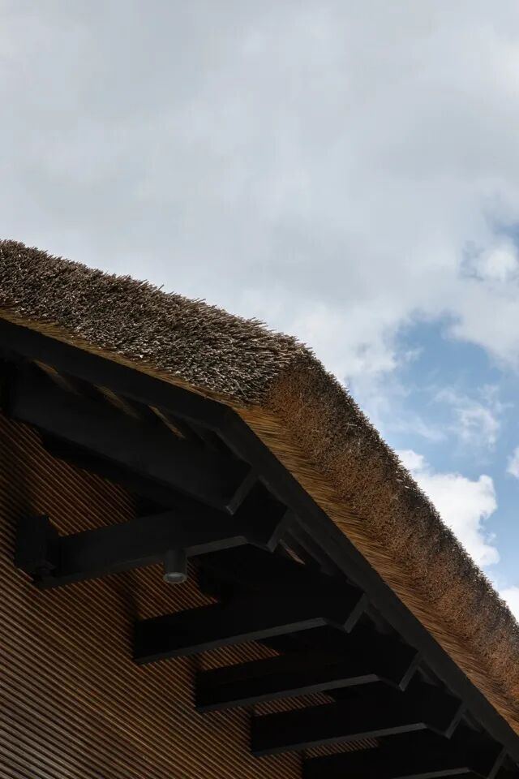
▲木墙与芦苇屋顶  © MAKHNO Studio
彩色玻璃
我们希望这个地方有趣且富于启发性，于是在小屋旁打造了一间非同寻常的彩色玻璃空间，使它成为真正的艺术作品。而这样的彩色玻璃显然不同寻常：首先，它以著名艺术家Serhii
Radko的草图为基础。其次，它采用了图形粘接与立体夹胶的独特工艺。彩色玻璃的图案主题还描绘了业主的业务领域。
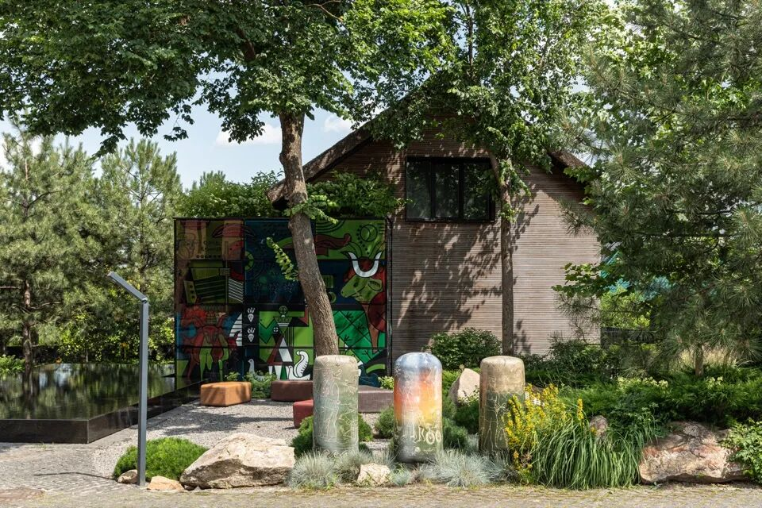
▲彩色玻璃空间与小屋  © Sergiy Kadulin
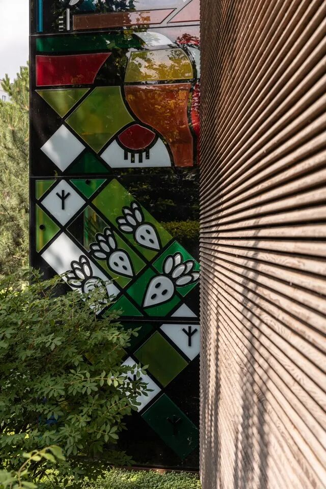

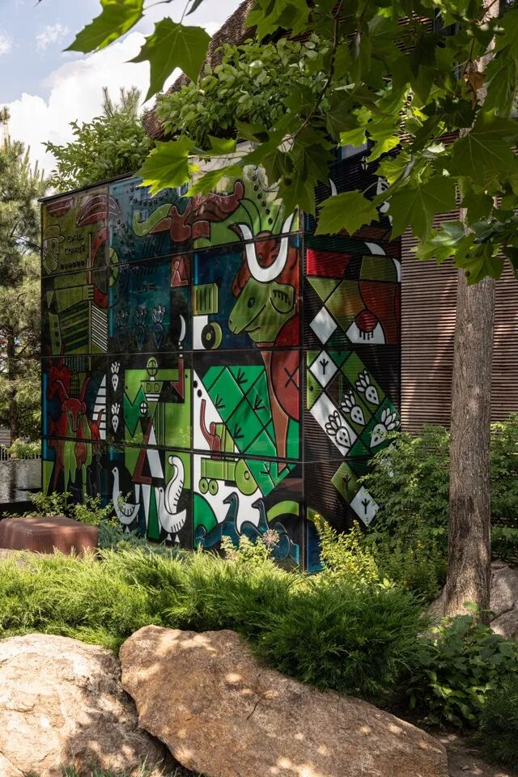
▲玻璃图案与木格栅细节  © Sergiy Kadulin
水
为了让这里吸引周围的人们，我们在小屋旁设计了一片水面。这是一个富于巧思的视觉设计：彩色玻璃的图案倒映在水中，形成引人注目的立体画面。同时，它也很实用，因为在炎热的夏日，人们总想待在水边。
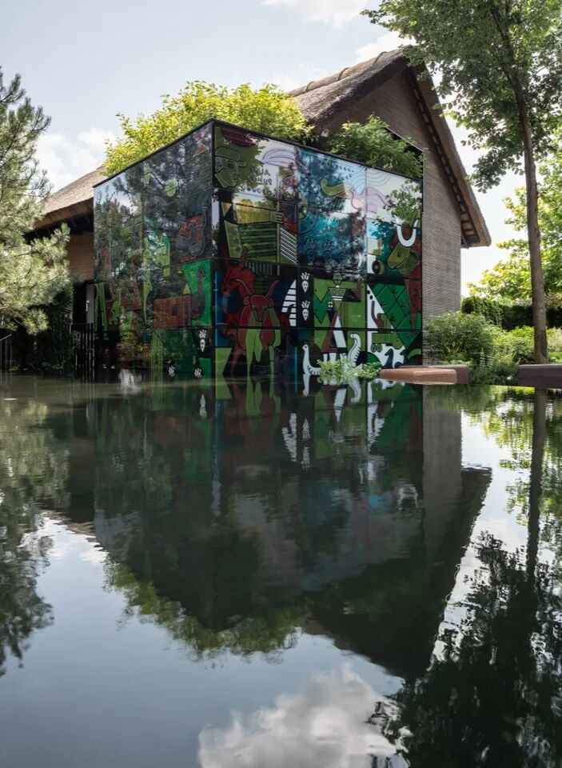

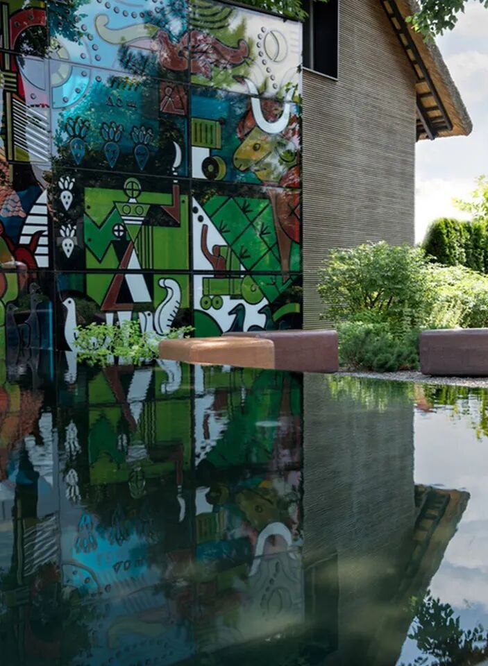
▲玻璃图案与水中倒影  © Sergiy Kadulin
雕塑花园
为了让项目不只有美感，也让人感到舒适，我们在周围营造了一片绿荫。在石头、灌木与树木之间，既有适合独处的地方，也有可以与朋友一同休憩的空间。这里有彩色玻璃风格的待客桌、玻璃窗旁的彩色柱台、水边的木质长凳，以及令人感到舒适温暖的石头和小片草地。
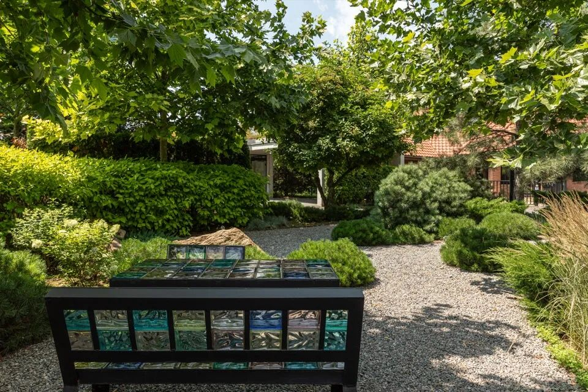
▲绿荫中的待客桌与小径  © Sergiy Kadulin
庭院中的艺术雕塑尤其值得关注。它们如同真正的艺术画布，延续了彩色玻璃的视觉叙事。
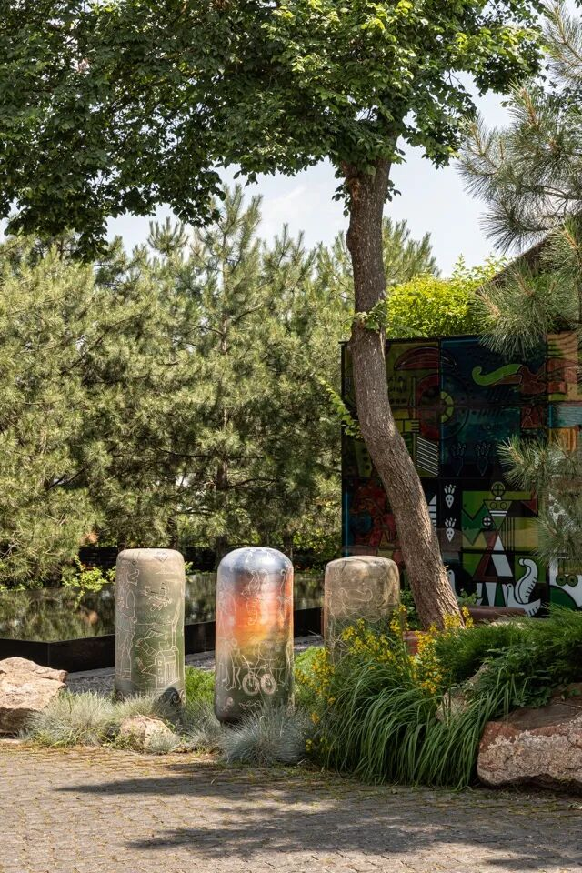

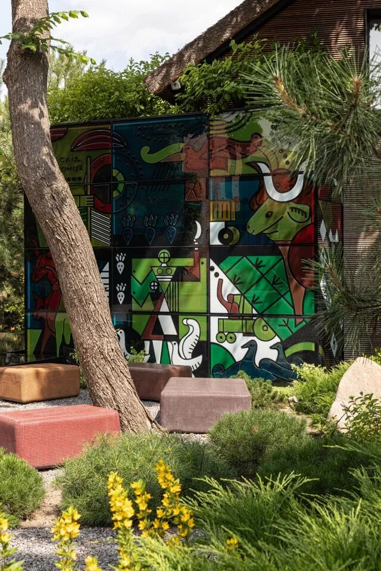
▲花园中的艺术与休憩场所  © Sergiy Kadulin
此外，这里还有一座质朴的石质洗手台，仿佛用镐直接从一块岩石中凿出。
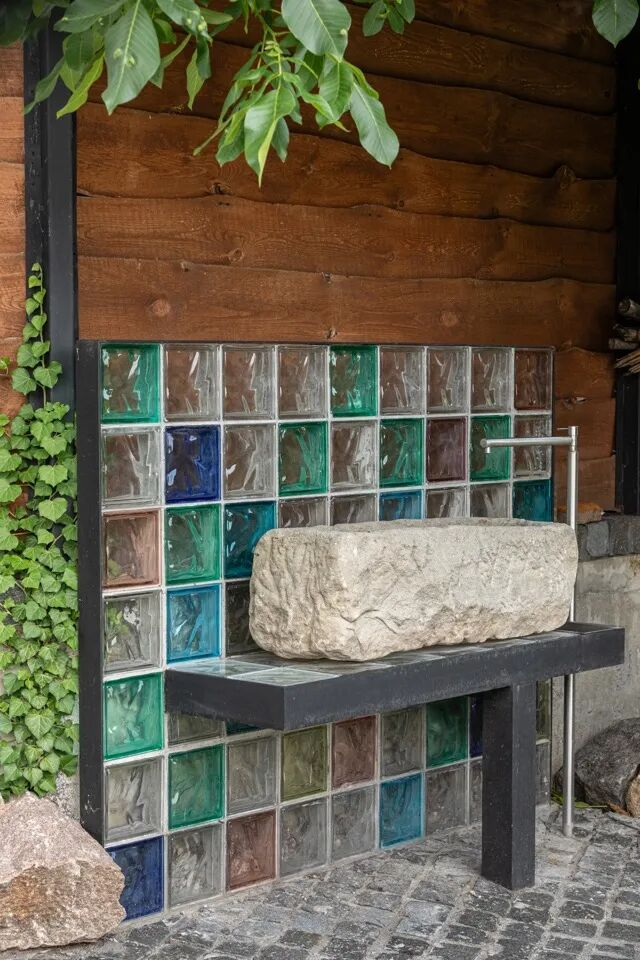

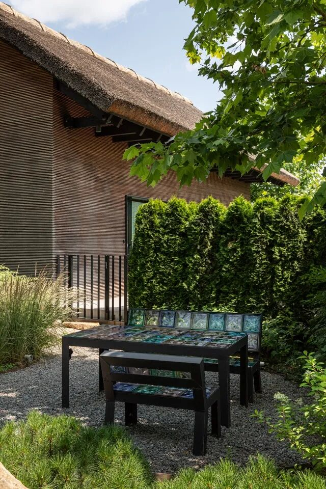
▲石质洗手台与彩色玻璃砖与彩色玻璃风格的待客桌  © Sergiy Kadulin
DYVO
HUT规模不大，却充满艺术性；每向前一步，都会发现一个新的、不同寻常的设计。这个项目讲述了一个关于惊喜与愉悦的故事：让人与自然成为朋友，让自然与艺术相互亲近。它也是在办公日常中创造一个小小奇迹的故事。
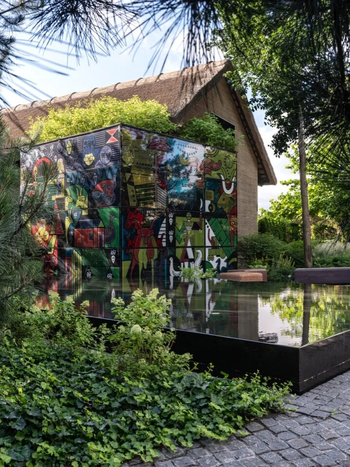
▲自然、建筑与艺术相互映衬  © Sergiy Kadulin
项目名称：Dyvo Hut（奇妙小屋）
项目类型：综合基础设施
项目地点：乌克兰
项目面积：2079.68㎡
年份：2021
设计：MAKHNO Studio
合作：Ilya Tovstonoh
彩色玻璃草图：Serhii Radko
摄影：Sergiy Kadulin
图片版权：MAKHNO Studio
版权©www.gooood.cn，欢迎转发，  禁止以gooood编辑版本进行任何形式转载

↓  网站最新发布项目一览
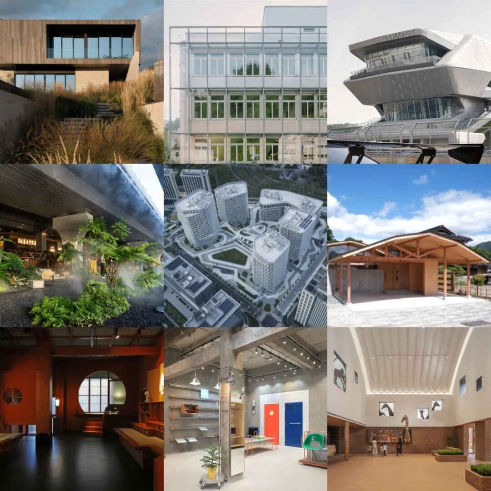
猛击“阅读原文”，进入网站畅享更多精彩

