# 半场第七场开幕论坛：片段与结构之间

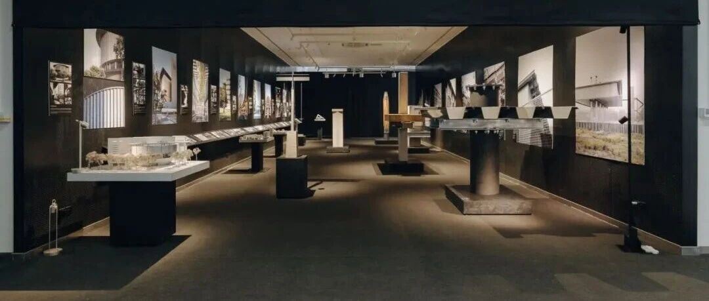

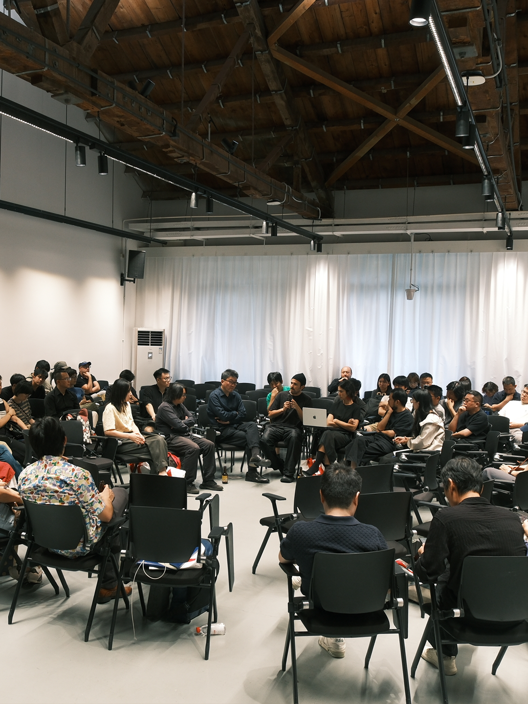

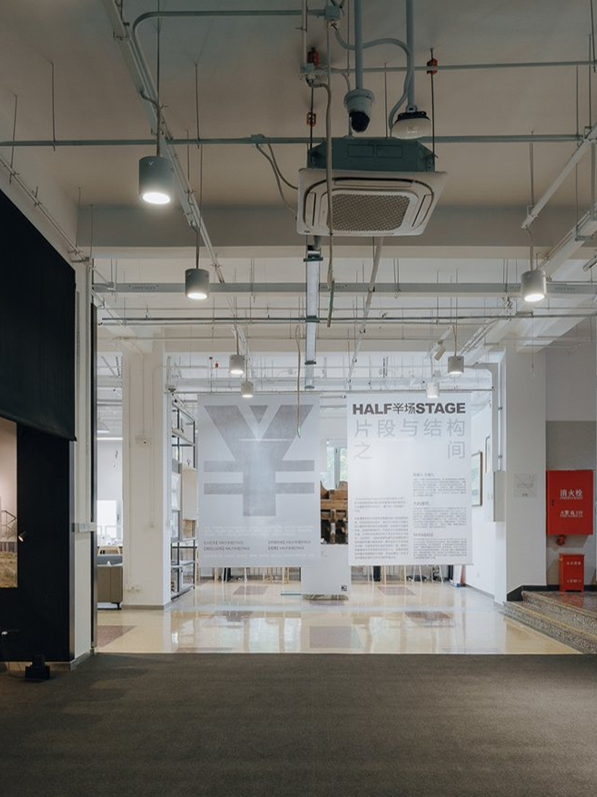

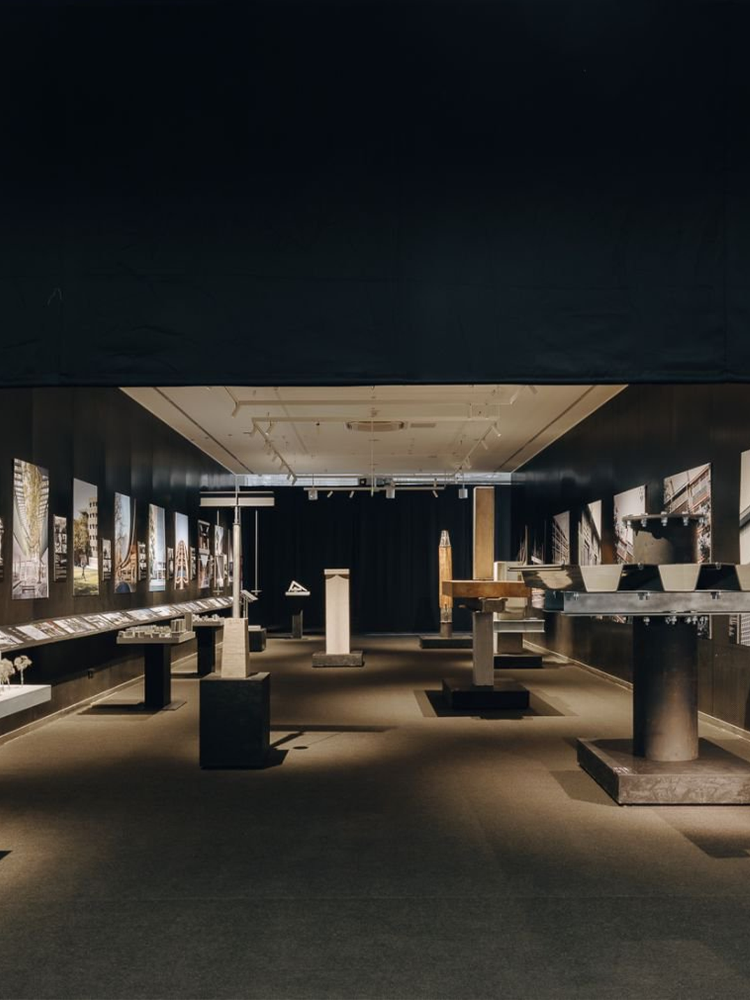

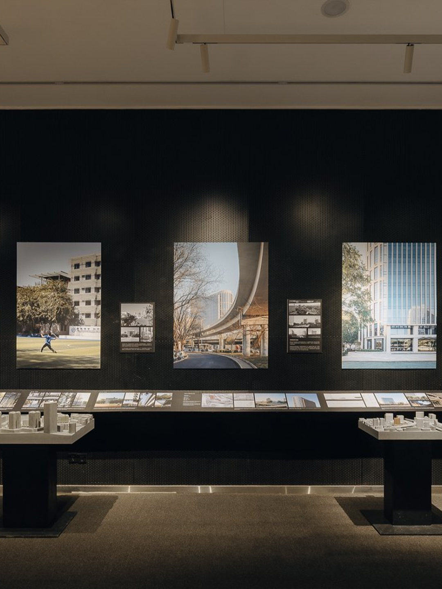

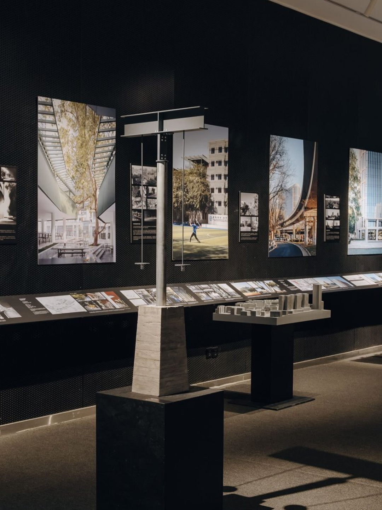
©  尧迪 /  朱雨蒙
《Structuring Fragments 片段与结构之间》首次将来自中国与瑞士的两家青年建筑事务所——大屿建筑与 PARABASE
置于同一现场展开对话。两家事务所的主持建筑师都曾在瑞士接受建筑教育，而在此后的实践中，他们又分别进入中国与瑞士截然不同的城市发展进程、资源条件与建造体系。相似的教育起点，不同的文化语境和现实处境，让两种实践逐渐形成了各自不同的工作路径。
感谢  ** HALF半场STAGE  ** 对gooood的分享
对谈
郭廖辉  :
把你们两个实践放在同一个展场形成了一种有意思的对话。你们大致在同一时期、相似的教育体系中学习，但最终的实践有明显差异，这一点值得追问，也请你们稍后回应。我想先谈建筑语言问题，这是作为观察者最直接也是相对浅的一种对比理解。于岛的作品强调对语境回应和材料表达的关注，将建筑作为一个完整体的编织与考量，建筑指向一种古典雕塑的优美和完形。PARABASE的设计思路或者说是策略明显不同，几乎是从回收建造的唯一主题出发，建筑在理性的建造秩序中有一种拼贴感。回收构件也带来了天然的粗野和随机。我想起一个有意思的例子，有一个瑞士建筑师盖了一个混凝土住宅，采用了预制混凝土构件与现浇结合建造的方式以达到一种无缝的整体效果。利用了构件但最终并不刻意显露，完整框架成为了最终的目标。所以建筑师处理建筑语言时，我想是有着极大的自由，它是一种认知、观念和直觉的结果。PARABASE的建筑让人印象深刻。我记忆中的回收建造的讨论有的停留在数据层面、有的以一种高度临时性的状态出现。循环建造和一个具体的功能性很强的建筑不容易建立一种想象，并且让人怀疑是否具有一种普世性；而你们的工作给这个话题开拓了新的语境。作为结果，在强有力的依据支撑下，形成了有辨识度的建筑语言。所以，我想问你们两方：你们怎么看待自己在应用的建筑语言？对此持什么态度？我知道这个问题跳过了你们的建筑思考，直接落到建筑语言这个建筑作为结果不得不面对的问题。
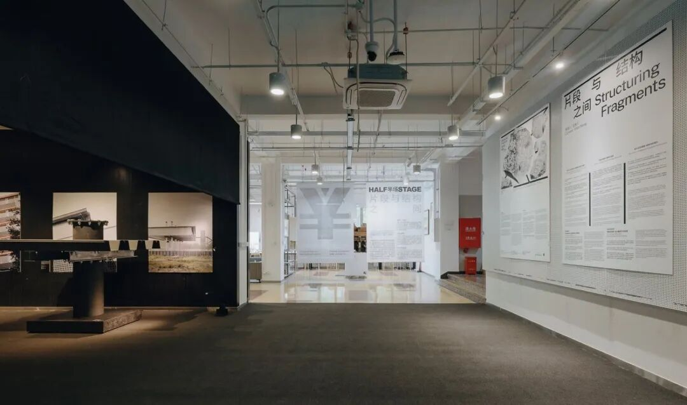
▲展览空间  © 朱雨蒙
于岛
：刚才提到的雕塑性，浪漫主义，拼贴这些性格，确实是某种语言的特质，这些特质更多是我们工作后形成的一种结果。对我来说语言是具体而综合的事物，建筑通过它在环境中言说，也获得自己的位置和性格，就像一面镜子。我觉得遵循某种语言的逻辑和结构，是很基础而且重要的，因为我们使用语言的目的并不是为了自言自语，而是交流，否则我们也不会发展出那么细致的语法结构，建筑的语言也一样。
我认为语言虽然和建筑师个人的经历和喜好有很大关系，但重要的是它不能脱离条件而独自存在。物体的特质一方面和我在当时的兴趣有关，另一方面也和瑞士的经历有关，物体本身的质量在当时的瑞士是一个非常重要的讨论点。
回国实践以后，我们的场地大多在复杂的高密度都市环境中，建筑面对的参照不是一个清晰的总体，而是一种碎片化的现实。在这样的场地中工作，建筑需要在环境中成为一种协调关系的媒介，但我觉得重要的是，我们所做的事情不是简单的整理工作，让现有关系变得更周到或平衡，而是在向外梳理或回应这些既存物的过程中，让抽象的，复杂的关系反向渗透进建筑物本身中，物体也会发生解体和变形。这是一个有对抗感和拉扯感的双向过程，最终建筑成为具有某种特质的，具体的“关系物”，形成一种语言。这次展览中想重点强调的也在这里，一种从抽象关系，到具体关系物的演变过程。
Pablo Garrido Arnaiz
：建筑语言是一个危险的话题，因为它很容易带来误解和一些我们并不认同的方法。我们的经历也比较特殊。我们最初在西班牙学习，当时老师并不把“语言”当作一个需要质疑的问题。建筑语言大体上由地域共享，例如巴塞罗那的加泰罗尼亚语境与马德里或许不同，但范围很广。后来我们去了瑞士，情况完全不同：每位教授，尤其是主要人物，都有非常鲜明、并且有意发展的语言。你刚才提到的几位建筑师就是例子。
对我们而言，关键并不是语言本身，而是一套连贯的作品，以及对周围世界的连贯看法。那更接近一种立场，也体现在我们穿什么、怎么说话、消费什么。语言的问题之所以棘手，是因为它与建筑师的主观性和个人偏好紧密相连，而我们一直试图避免从这里出发。我们当然对语言感兴趣，但语言绝不能成为建筑的起点。
我们的做法是先理解自己在世界中的位置和所面对的挑战，再用技术性的、相对客观的建筑知识装备自己。我们希望建立规则和限制，避免仅凭个人趣味作决定。只有当我们确认了愿意处理、也感兴趣的一系列客观或技术条件之后，语言的问题才会进入。此时，我们才可能调节这些客观事实，使它们服务于项目。
以我们的实践为例，我们处理再利用构件和二手材料。它们通常尺寸过大，因此建筑无论是否愿意，都会比使用新构件时更厚。展览中展示的连接和节点，是把原本不属于同一体系的事物组合起来的方式，所以它们在建筑的语法和语言中变得非常重要。问题在于：是否要强化这些连接？是否要强调破损、不完美的边缘和节点？其中始终存在“间隙”的概念，即不同事物如何结合。建筑语言可以从这些技术性的、相对客观的事实中发展出来，这正是我们正在尝试的。
这种能力也需要时间。问题是，有些建筑师到了职业后期，语言会压过建筑本身，作品只剩下对某种潮流或立场的追随。我们不希望这种情况发生在自己身上。
董功
：我对于岛很了解，我们是多年的朋友和同行。过去七八年里，瑞士建筑或瑞士建筑文化在国内行业中的影响力逐渐增强。我们那一代留学时大多去美国；大约十年前，开始出现第一批从瑞士毕业、回国实践的建筑师。那时你和程博、李博、郭廖辉等人刚毕业或还在做毕业设计，我们好像在一次活动上见过。
你们在瑞士接触到的价值观，设计理念和方法与这几年你们在国内的实践之间究竟是什么关系？这是我感兴趣的东西。因为中国文化和瑞士文化至少在表面上有许多不同点，甚至是矛盾点。瑞士建筑呈现出来的带有某种清冷感的逻辑性，对造物的执着，以及近乎极小的容错率；我们的文化好像更容错，我们会说差不多就行了。在职业运行机制里，项目的管理程序也非常不同。这些事情平时大家很少谈，但你今天的报告多少涉及了一点，在我看，它们也是建筑设计的一部分。
我想请于岛谈谈这方面的体会，尤其可以聚焦于改造。今天大家都在谈 recycle 和
reuse。当你面对旧物，或让一个场地和另一件既有事物共同工作时，其中会出现很多偶然、突发的条件，要求一些应变和平衡。
于岛
：这个过程可以从我刚回国的阶段说起。在瑞士接受建筑教育的几年里，逐渐形成了一种工作方法，从城市策略，到类型控制，再通过材料调动和构造关系去支持，这种环环关联的发展，需要一种精度贯穿在中间，如果哪个环节脱节了，就会觉得别扭。
最初做梦工场的时候，会带着这种思维惯性，和一种对精度的执着去工作。前后做了五年，房子最终建成后还是有一些失控的地方。有时候项目精度执行不到位，和您提到的项目组织的机制有直接的关系，而不只是技术层面的原因，处于实践早期阶段的建筑师往往会比较被动，这点和瑞士很不同。
在后来的实践中，认识逐渐产生了一些变化，我现在觉得对精确的定义，不一定是指物理层面的分毫不差，而是策略层面的准确。尤其在对细部的认识上，好的细部是一种关系的末端，可以让更大层级的关系获得一种准确的物质形态，更重要的是一种意图和关系上的准确。
另一方面的认知变化是关于策略的弹性，如何把未来可能产生的变数，纳入策略本身去考虑，但这方面确实需要经验的积累。
我们在做蛇口学校改造的时候，知道工期会很极限，分毫不差的控制肯定做不到。在三角地就餐平台的区域，我们提前了解到校园内所有市政管线都在地下经过这片用地，预判到柱子基础的位置会有不确定性。基于这个条件，我们最开始就选择用一种非正交体系的关系，去组织柱子的位置，提前做好策略上的应对。果然在施工的时候，柱子的位置随着现场挖掘工作不断做调整，过程持续了半年多。最终形成的柱群关系，体感就像一片树林，有着某种偶然性，和场地上存在的树木发生了某种对照的关系。
在这个过程里，除了策略的弹性，另一方面我觉得重要的是，面对一种不确定性，需要持续不断地回到具体的“物”本身去做判断。就餐平台的柱群看似偶然，但人站在哪个视角，视线会以怎样的方式穿透或是被截断，柱子的位置关系如何形成一种积极的节奏，这种调整工作的背后依然是一种感受精度的意识。我觉得这种意识是瑞士的经历带给我更重要的事情。
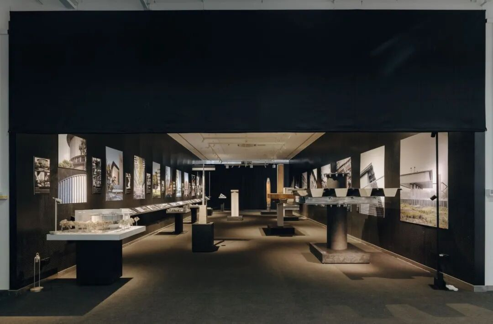
▲展览空间  © 朱雨蒙
董功
：中国的执业环境更需要过程中的应变，管理系统还没有清晰到能够替建筑师处理所有事情，但这反而可能很有意思。我这几年也有相似体会：同样是在谈论造物，当你先理解社会合作机制和策略，再作出判断和决定，与把造物置于这些关系之外单独讨论，是两种完全不同的状态。在不同的文化背景的语境条件下，自由与精确不是一对僵化的对立概念，而是处于某种带有张力的平衡关系当中。
接下来，我想把关于工作过程的问题转向PARABASE。你们的工作过程是特殊的，绝大部分建筑设计是从思考建造开始，你们首先是思考如何拆除。这些拆除的逻辑会以某种方式影响到之后关于建造的方式。我好奇你们拆除的房子和你们设计的房子项目是否是对应的，还是说你们会在更大范围里先通过拆除，储存这些物件和材料，再在不同的项目中使用。
Carla Ferrando Costansa  :
瑞士一直有很大的改造潜力，项目推进的速度也慢得多。许多人参与其中，我们可以在每一个环节投入时间。但类似的事情也发生在其他地方，例如西班牙或墨西哥。当再利用被纳入系统化流程时，它也可以很快。我们尝试采用可适应的连接方式，让过程更快、更灵活，并允许项目整合不必完美、也不必完全相同的多种构件，从而使整个过程更加敏捷。构件从哪里取得，则因项目而异。
在我们展示的 Element Housing
项目中，工作从拆除开始。业主有一栋必须拆解的建筑，我们研究如何把构件切割出来并用于新项目，随后根据这些构件展开设计。我们还规划了构件在未来建设用地上的储存方式。储存对于再利用非常重要，也可能花费很多钱，因此必须安排得很好。理想情况下，一栋建筑拆解后，构件应尽快进入新建筑，以节省储存时间和场地。
这也意味着，在瑞士等地，可以通过某些平台了解未来几年哪些建筑将被拆除。正在推进的项目因而可以提前知道有哪些构件可用，即使这些构件还没有进入仓储。只要了解待拆建筑，设计者就能考虑如何把构件纳入项目；构件一旦拆出，就可以直接进入新项目。
我们与国家铁路公司合作的项目则不同。铁路公司每年更换大约四十公里铁轨，通常只是把金属熔化后重新回收。我们在这一流程中直接取用旧铁轨，因此几乎不需要额外储存。铁路公司本来就有相关场地，这让流程变得容易，而这一点非常重要。
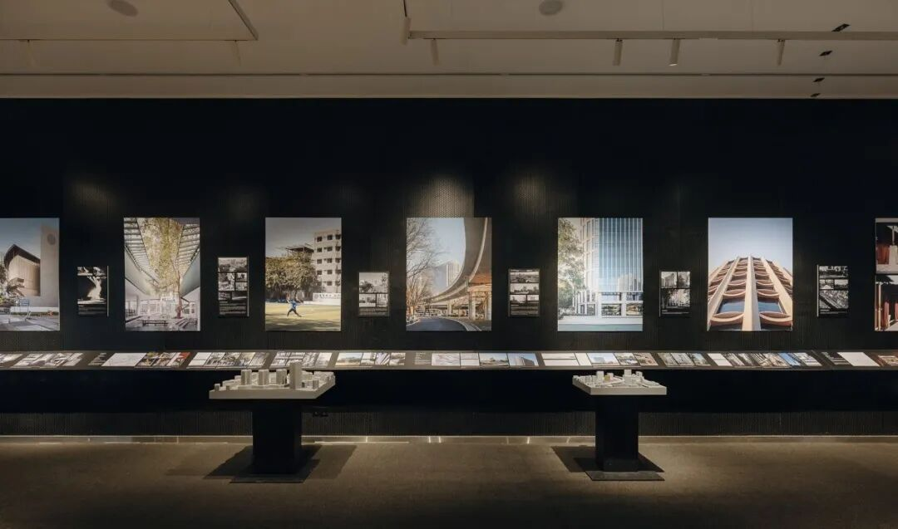
▲展览空间  © 朱雨蒙
董功  ：另一个问题：你们认为自己的建筑是精确的吗？你们如何理解这种精确？
Pablo Garrido Arnaiz
：瑞士通常以很高的精度运作，这一点没有错。当地建筑师习惯在一到两厘米的公差内工作，预先知道项目的各个阶段，并且可能提前五年制定非常精确的时间表。我们不是这样工作。我们的确需要精确，但不是公差意义上的精确。我们的节点可能允许正负十厘米的公差，而我们必须在这种完全不同的尺度上做到精确。
这属于项目设计本身。我们的项目必须能够承受不可预见的情况：我们不知道最后会有一百根柱子，还是九十五根，但无论发生哪一种情况，项目质量都不应受损。因此，我们的精确以另一种更主动的方式存在。
事实上，世界上绝大多数不是由建筑师设计或规制的建筑都会再利用材料。再利用并不只是我们展示的一种特殊做法，它更接近传统建筑，而不是从零开始、全部使用新构件。因此，这种思路也应该被应用到建筑实践中。
方书君
：我觉得你们处理既有建筑的方式非常特别，也很有趣。通常当我们谈论建筑改造时，会从原有建筑的空间、结构和场地条件出发，思考这些既存条件如何为新的设计提供线索和启发。但在你们的实践中，关注点似乎发生了某种转移。你们更关注构件本身的物质属性，以这些构件为起点，重新组织和创造建筑。而有趣的是，最终形成的建筑和空间依然具有非常完整的建筑品质，并不只是旧材料的重新组合。我在你们的作品中也感受到一种很强的乐观主义。我很好奇：当你们开始回收和再利用现存建筑的构件，你们会如何想象你们的改造项目在十年后或若干年后的状态？你们是否也会从一开始就考虑，这座建筑未来可能再次被拆解，而它的构件又进入下一轮的回收与再利用？
Carla Ferrando Costansa  :
你说得对，但我们的工作与翻新、修复既有建筑其实很接近。即使原建筑已经被拆开，我们也会先研究这些构件的能力，尽可能从中获得更多。它们也许尺寸过大，但我们仍把它们作为结构构件使用，所以构件本身的状态对我们非常重要。
遗憾的是，即使使用旧构件，我们仍必须遵守新建项目的全部法规；而修复和翻新既有建筑时，法规通常会宽松一些。不过，这也意味着我们仍然可以自由地做建筑，把它作为一栋新建筑来设计，即使材料来自既有建筑。
我们把正在推进的每一个项目都看作某种临时事件，所以所有节点都采用干式连接，可以在未来拆解。构件和材料从一栋建筑中取出，被转化成另一栋建筑；未来，新建筑也可以再次拆解，构件被重新利用并转化为下一栋建筑。
我们遵循面向拆解的设计原则。结构采用干式建造和干式连接，立面与结构相互独立，室内隔墙也独立设置。这样，如果将来需要修理或更换立面，由于各部分寿命不同，我们只需更换立面，而不必拆除整栋建筑。若干年后，这栋建筑也许不复存在，但它的所有构件会出现在其他地方。
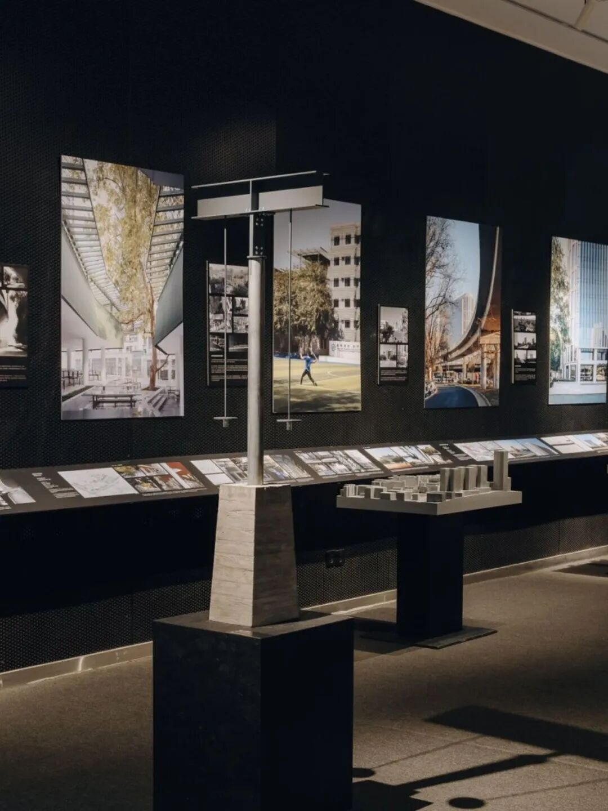
▲展览空间  © 朱雨蒙
王逸凡  ：
当你处理既有事物时，它看起来似乎会限制创造和控制。你无法控制设计中的每一个细节。那么，在无法控制所有细节的条件下，设计意味着什么？从零开始设计，与利用环境中已有的物体和现成构件来设计，有什么不同？这些“现成物”在你们两方的设计中分别扮演什么角色？
P  ablo G  arrido Arnaiz  ：
“设计”是一个非常宽泛的概念。选择某件东西本身就是设计，如何操作已经存在的事物也是设计。“现成品”并不是孤立的一件东西，而是把某个既有事物与另一个条件连接起来。设计从最初的选择开始，一直延伸到最后一个细节，但最初的选择本身已经是设计。很多时候，我们甚至满足于只做到这一点。我们立场的终极目标，是能够找到一个既有事物，只通过场地设计或把它从一个地方移到另一个地方，就形成一个项目。那对我们来说已经足够。我们并不追求增加更多设计，而是尽量减少不必要的设计。
于岛  ：
通常我们会把新建和改造看作两种不同类型的设计任务，改造项目的特质是需要处理环境中既存事物的关系，但如果在一个更大的尺度中去理解，存量环境中那些复杂的既存物，也是地表结构的一部分，只不过被人工化了。如果以一种深读场地的方式去工作，新建项目需要回应的事情是相似的，改造和新建都需要挖掘出地表结构上重要的既存线索，用合适的手法调用它们，形成新的建造物。当建筑师个人的主观判断，是建立在场地中真实而具体的事情上，设计的深度会被推得更远。
我们场地中既存物的关系相对复杂，如何去调用它们，是一种有选择性的操作，并不是面面俱到地去照顾。这个过程里，我觉得重要的是带着一种有结构性的环境意识去观察和辨别，形成有层级的控制，可以做出更有力度的第一层级的结构，而不至于在一开始就陷入到一种局部的纠缠里，被那些碎片淹没。
比如在不同的场地里，哪些有潜力的既存事物可以被优先调动，对重要的第一层级的策略有帮助，哪些可以在局部被关照，形成第二层级的层次。我觉得好的建筑可以在反复阅读中被不断打开，看到内部的层次。
董功  ：今天听 PARABASE
谈旧物利用，让我想到，在中国建筑行业里，所谓存量更新已经成为一个普遍话题。十年前，做一个改造项目本身就具有示范价值，因为那是建筑师需要争取的事情。现在所有人都在做改造：大型设计院、小事务所都在处理存量更新。当存量更新或旧物再利用成为一件公认正确的事，我们还是会发现，好的建筑师能够做出更好的项目。这体现在逻辑性上，也体现在郭廖辉刚才提到的语言等方面。建筑中有很多事情难以言说，但它们并非不存在。所以，我想强调的一点很简单：好的建筑师仍然重要。无论出发点是政治上的正确，还是可持续性的要求，好的建筑最终总能为社会带来更多愉悦和审美价值。好的建筑师始终具备这些能力。建筑中有些东西很难谈，一旦说出口，似乎就已经失去了一部分。比如什么是语言？这些都很个人，却很重要。
Pablo Garrido Arnaiz  ：这是一个很难回答的问题。归根结底，我们当然还是希望做出建筑，但这也可能意味着少设计。刚才回答王逸凡时，我想到
Lacaton & Vassal 在 Bordeaux 的一个典型项目：他们提出不做新的设计，而是把资金用于维护现有场所，并因此赢得了委托。
“设计”这个词本身非常宽泛。“设计”“美”“比例”“语言”都可能产生误导，甚至带来危险。我宁可让人感觉我们做得更少，而不是更多。并不是每个人都是好建筑师，实际上，糟糕的建筑师占多数。因此，我更愿意让设计尽可能晚地出现。
首先，建筑师必须理解自己的工作。这个说法也许有些过头，但建筑应当接近一种服务、一种工匠的工作，先履行其功能，然后才谈设计。当然，我们也有兴趣挑战这些概念，包括追问什么是美，但我们倾向于避免直接谈论它们。
比例对我来说是最后才会考虑的问题。即便站在一座公认的建筑作品中，我也不愿把讨论简化为“我喜欢这个比例”或“我不喜欢这个比例”。在比例之前，还有许多更关键、更基础，也更为当代建筑所需要的问题。
董功
：我完全理解你的意思，在某种程度上也同意。尤其面对公众时，谈论建筑设计中那些难以言说的时刻必须非常谨慎。但当这种焦虑进入学校，我会有些担心，因为我不知道学生会如何理解。有一种现象我很难解释，却非常明显。以美国的建筑教育为例，在我们那个时期，人们似乎不谈比例和美，谈这些被认为不正确；有时甚至连空间和氛围都不适合谈。你走进某些地方，会感受到一种很强的气氛，仿佛所有事情都必须符合某套标准，讨论到此为止。但与此同时，我还有一个问题：为什么美国有这么多优秀的学校，却在过去十五到二十年里没有为新一代建筑师带来相应的好机会或代表性成果？
Pablo Garrido Arnaiz
：我认为有几个原因。我们对美国的现状也非常批判。如果回看二十世纪六七十年代，当时的建筑生态非常活跃，并且具有示范意义；今天则不同。首先，这背后有文化、经济和政治问题。美国几乎没有公开竞赛。其次，我们所理解的、接近艺术实践的优秀建筑，在美国绝对是例外。绝大多数建筑由大型公司完成，优先考虑经济指标、净毛面积比等参数，那不能算真正的设计。我们想强调的是，如果设计只依靠
Rhino
等工具任意调整形态，就会不断陷入“为什么这里不是再多一点或少一点”“这个比例是否合适”“它是否美”之类的问题。我无法进行这种讨论，因为这些问题本身并没有依据。当这种任意的形式判断对建筑师变得无关紧要时，它也会逐渐对社会失去意义。
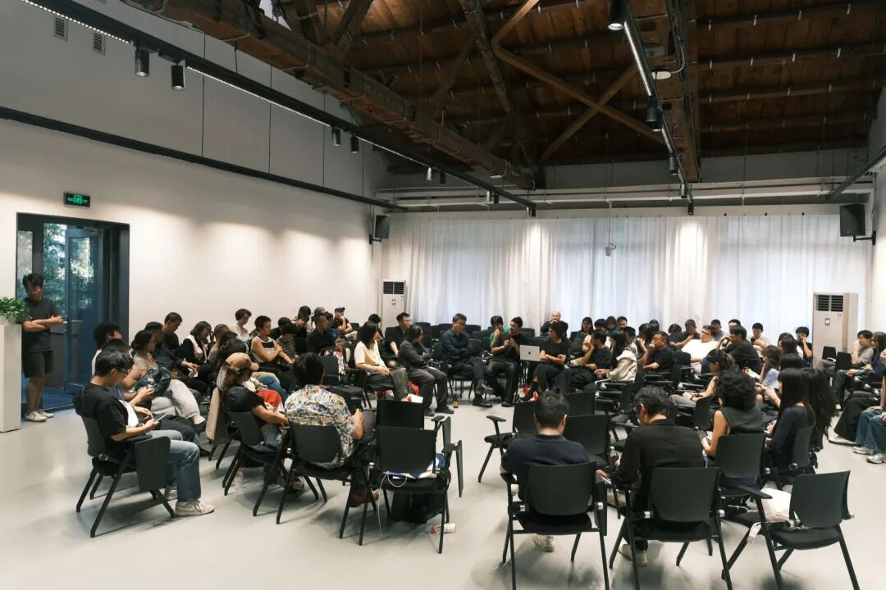
▲对谈现场  © 尧迪
董功  ：所以，关键是常识。
P  a  blo Garrido Arnaiz
：是的，不仅是常识，还有技术知识。如果你根本不知道建筑将如何建成，那么几何形态的依据就只剩个人趣味。这样一来，建筑师就会变成艺术指导：在 Pinterest
或 Instagram 上浏览图片，决定自己更喜欢哪一种，然后把各种东西拼在一起。这不是我们的工作。
我们的工作首先需要扎实的技术知识。这至少是建筑师能够、也应该为社会提供的东西。在此基础上，我们才可以说某种构造具有诗意、意义或其他价值。
郭廖辉  :
我可以再问Pablo和Carla两个问题。门德里西奥建筑学院最近创刊了一本期刊《6850》，在第二期同时收录了你们和我的文章，我还没来得及看你们的文章，我记得第二期的题目是“On
Contemporary”，关于对当代建筑的看法是一个非常重要的问题。不得不说，我在瑞士的学习和工作所了解到的当代建筑与当下会有一定的差异。
据我了解，你们收藏了很多不同时代建筑师的书，并且有着很丰富的建筑文化的知识。这让我判断你们今天提出的强烈立场并非凭空出现，而是试图把自己的努力放进一个对建筑文化的认知结构中，并且在这个位置上提供一个支点。我想了解你们如何看待欧洲目前的变化，以及你们如何在这个变化中锚定自己实践的方向。
第二个问题更偏实操。我们看到开始每个项目时，你们会先做研究，列出可能使用的构件，作为设计前的准备等等。而长期下来，你们一定积累了不少经验。我能想象你们实践的两种情况，一种是“匠人”式逐个项目、逐案思考的定制化设计，另一种是在一个完善的体系中系统性地回应不同条件的项目。在你们的分享中我看到了两者的影子，你们一方面展示了对待个案的细致、理性的工作，另一方面也在试图有使命感地回应更大范围的危机。这两个层面的思考和工作是如何构成你们的实践的？
Pablo Garrido Arnaiz
：我先回答第一个问题。在瑞士乃至欧洲，确实出现了一种回归：项目重新从材料、建造技术的定义，以及具体的材料性出发。例如，El Croquis 曾讨论
Balearic Islands
的一种社会住宅倡议，它使用当地的石材、木材和海藻等材料，本身就非常有意思。欧洲许多大学都有持类似方法的教授，因为世界面临的紧急状况正在要求这些解决方案。它们可能采用生物基材料，也可能主张暂停新建。除此之外，还有第三种可能的方法，也就是我们所做的：更新和使用已经存在的事物，从更广义的“改造”角度理解整个世界。你可以从街上拾取废弃物，也可以把它重新利用。
我们也与几位建筑师的实践感到紧密关联。这些建筑师即使具有鲜明的语言，在我们看来，那种语言仍是材料选择的结果。他们对建造材料的选择并非偶然，而是与工程师共同发展的。我们的做法与之并没有本质不同，只是使用的材料有所不同。另一些建筑师同样从材料出发，但处理的不是废弃物，而是大理石、玻璃等珍贵材料。所有这些问题都位于设计过程的最初阶段。一旦材料和构造建立了规则，整个项目便由此展开。
Carla Ferrando Costansa  :
我们会平行推进两个体系和两种尺度。每次开始项目时，我们先看那个具体时刻、具体项目周边有什么可用。大学则让我们能够在更广的尺度上研究其他材料。它们在当下的项目中也许并不存在，但可能用于未来的项目，或供学生发展自己的项目。这是在认识更多可能性。与学生合作时，我们更关注基础设施，而不只关注为了某个项目正在拆除的建筑。在全球化、高度工业化的世界中，各个行业生产了多少废弃物？其中有多少可以进入建造领域？
这些研究也让我们在参加竞赛或启动其他项目时，已经具备能够纳入新项目的知识。由于我们总是从建造和构件出发，我们还希望用同一组基本条件、同一份材料目录，发展不同的建造体系和类型。例如，在一个从停车结构出发的住宅项目中，我们面对两块不同的用地，尝试从同一种停车结构发展出两套不同的建造体系。我们关注的是既有构件还能实现什么：一段铁轨能否成为梁、柱，或承担其他作用？我们的研究会继续沿着这些可能性展开。
方书君
：我和于岛生活在同一个城市，平时也经常交流，是很好的朋友，但这其实是我第一次如此仔细、系统地阅读你的作品和实践。我注意到，你在处理建筑或具体项目时，会非常认真地研究场地，并思考建筑的介入、立场或姿态如何重新组织一个可能混乱的场地，或提升周围的环境品质。
与此同时，我也感到一种很有意思的矛盾或者说张力：一方面，建筑试图回应、调解或重组周边环境，但另一方面，最终形成的建筑又具有非常鲜明的形式和自主性。它不仅仅是一个组织场地关系的框架或工具，同时也作为一个具有独立品质的建筑对象而存在。这让我想到你在今天报告一开始展示的那个学生时期的竞赛作品。我不知道我的理解是否准确：它似乎已经包含了你后来实践中一直在探索的这种关系：建筑既回应场地，又试图建立自身的独立性。
所以我很好奇，你为什么选择用这个早期作品作为今天报告的开场？回过头来看，你是否也把它视为自己建筑实践的某种起点？你今天又会如何理解这件作品，以及它与你后来实践的联系？
于岛
：高屋在时间上最早，虽然是学生时期的作品，但和其他展出的项目放在一起来看，还是可以识别出一种早期浮现出的线索。我希望这次展览可以呈现我们工作方法的发展过程，虽然不一定是线性的。其次，这个作品是一个竞赛，还没有进入复杂的真实世界，可以做得比较纯粹。但当我第一次看到这个基地，确实不知道该怎么回应，填海形成的空旷场地，看似没有任何抓手，通过建筑去应对的设计过程，有一种拉扯和对抗感。最后形成的棚屋，处于物体和环境之间的状态，具有某种多义感，棚屋与地表若即若离的姿态，像一个帐篷，也和填海用地的特质有某种内在关系。
后来第一次进入实践，面对的是更加复杂的存量场地，建筑和环境之间的拉扯变得更加剧烈，也让我意识到我们的实践处境和欧洲很不一样。基于这个原因，在完成梦工场项目后，回到ETH选择硕士毕业设计的时候，我也有意选择了复杂度较高、矛盾感强烈的场地环境，题目是“如何通过建筑去应对一处规划上的疏漏”——
我认为会更接近我们日后需要面对的真实的城市处境。
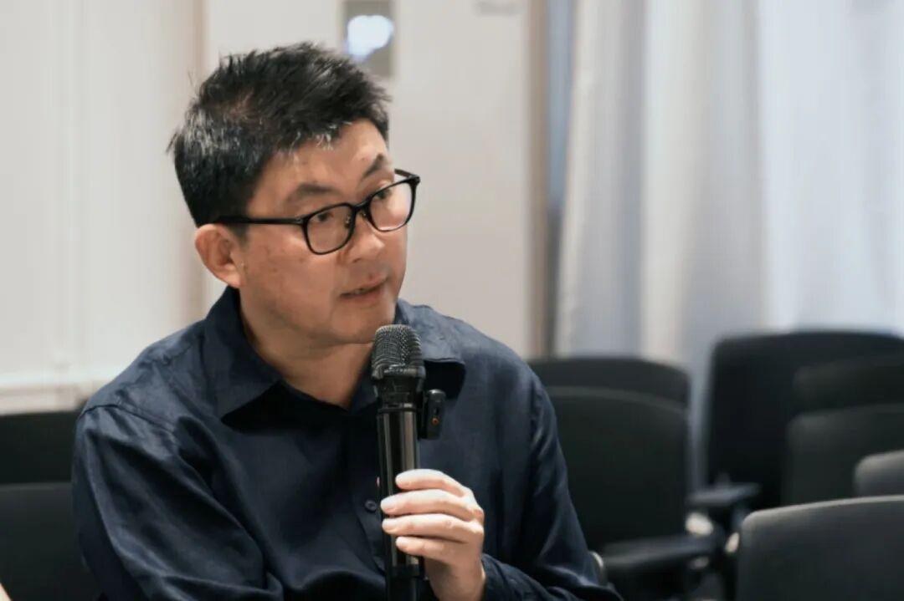

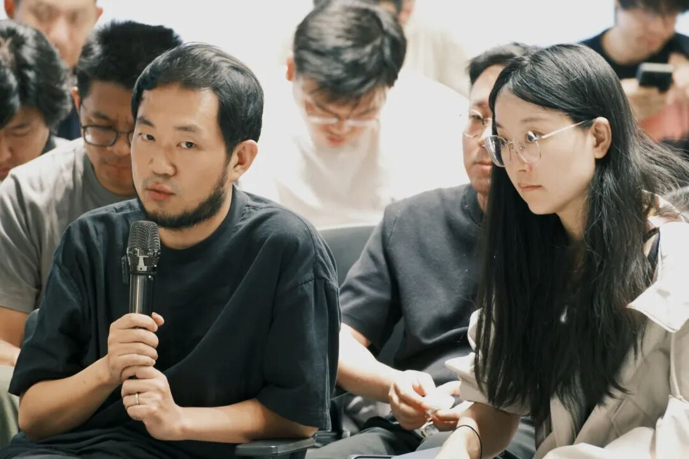
▲对谈现场  © 尧迪
Audience Member 1  :
我先作几点评论。把瑞士等同于精确，是一种常见看法，但每个国家能够达到怎样的精度，取决于社会条件和产业链，并不完全取决于建筑师个人。瑞士的建筑生产拥有更完善的条件，因此能够实现标准更高、更精确的结果。第二，现在是
2026
年，我们可以讨论社会、再利用、可持续性等更多议题，也可以通过其他方式完成建筑。我认为氛围、美和比例既可能是建筑最基础的问题，也可能是最后才处理的问题。当代建筑能够讨论的范围更大，也更加自由。
我有几个问题。第一，你们喜欢中国吗？你们怎么看中国建筑和中国建筑师？我很好奇，这是否是你们第一次来亚洲或中国。
第二个问题与建筑方法有关。你们从某处获得构件，或根据某种目录工作。这种方式会不会让建筑在设计过程中失去某种可触知性？你们的作品从既有构件出发，因此会保留一种预制感。你们如何在这些构件与你们自身的设计之间取得平衡？这有些像解决数学问题：如何把所有构件放在最正确的位置。这个结果是否仍然是你们自己的方案？
第三，我很好奇事务所的工作流程。你们愿意使用人工智能，也采用三维扫描等技术来记录材料。事务所如何组织工作，让不同设计环节与场地事实发生更深入的联系？
最后，你们来自不同背景，又在瑞士工作。你们如何在不同国家中定位自己，又如何理解瑞士？对我们来说，某些问题似乎像回到了五十年前。我们可以从你们身上学到什么？
Pablo Garrido Arnaiz
：我们很喜欢中国。我们当然不是中国建筑专家，但对一些当代实践感到非常亲近。我们共享相似的材料观，也同样关注事物如何被建造。
关于第二个问题，你提到自己在门德里西奥与 Leopold Banchini
开展的工作。那与我们给学生布置的练习并不遥远，虽然两者并不完全相同。我们希望与学生和年轻建筑师分享的第一件事，是改变他们观看世界的方式。城市乃至整个世界在广义上都像一座矿山，而人也需要保持批判意识：我们正在生产多少废弃物？事物是怎样被生产出来的？它们又有怎样的生命历程？对物质世界和非生命世界的这种意识，对我们非常重要。
练习的方法很直接：走出去，寻找被当作废物、但仍可使用并且可获得的东西，然后把它们带回来。你们当时只选了三种构件；我们也许没有那么严格，但同样只选少量构件，再去理解它们。理解意味着研究它们的物理和化学属性、生命周期、生产地点、使用方式、废弃方式，以及整个循环如何运作。随后，我们尝试组织或发展新的建造技术。我们的项目从来不会百分之百使用再利用构件。对我们而言，这种方法不是限制，反而带来解放。比如展览中那组由破碎混凝土构件组成的立面，如果从零开始设计，我们会觉得它过于表现性，根本不会这样画。但当这些构件已经存在，并且你根据一定规则连接它们、组织水平和竖向关系时，最终就会形成这样的结果。
这既是我们教学生的方式，也是事务所的设计方式。我们对此感到自在，因为它让设计更自由。对于工具，我们也采取同样的态度：不预先判断。为什么大理石一定比一块普通玻璃纤维更好、更珍贵？我们当然可以作价值判断，但这种判断并不能帮助设计，所以我们暂时放下它。我们只是接受事物，并用分析的方法理解它们可以被如何使用。
对工具也是如此。我们愿意画草图，愿意做三维扫描，愿意使用人工智能，也愿意制作质量极高或非常粗糙的渲染图。今天的报告也体现了这一点：有些图像只是文档截图，可以直接放进来；另一些图像则经过重新制作，背后可能投入了一千个小时，才能得到准确的照片或渲染。
我们的总体立场是：先不要判断，接受一切。任何事物都可能适合进入建筑，也可能被重新转化为建筑。
王逸凡
：正式讨论到这里必须结束，但我们鼓励大家继续自发交流。嘉宾还会留在校园和展厅附近，相信很多人也愿意回到展览中再次观看。正如我们刚才所说，这次展览试图提供一些线索，帮助大家理解这些作品如何形成。欢迎大家在展厅的片段中重新组织自己的理解；每次观看，都可能获得新的认识。感谢各位老师、同学和同事参加讨论。也祝贺于岛和
PARABASE，并感谢各位教授和嘉宾参与今天的交流。
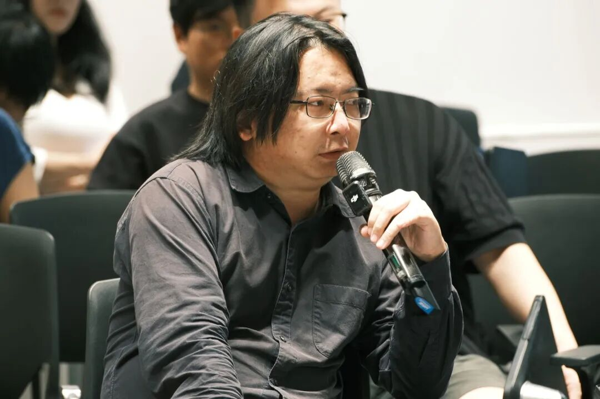

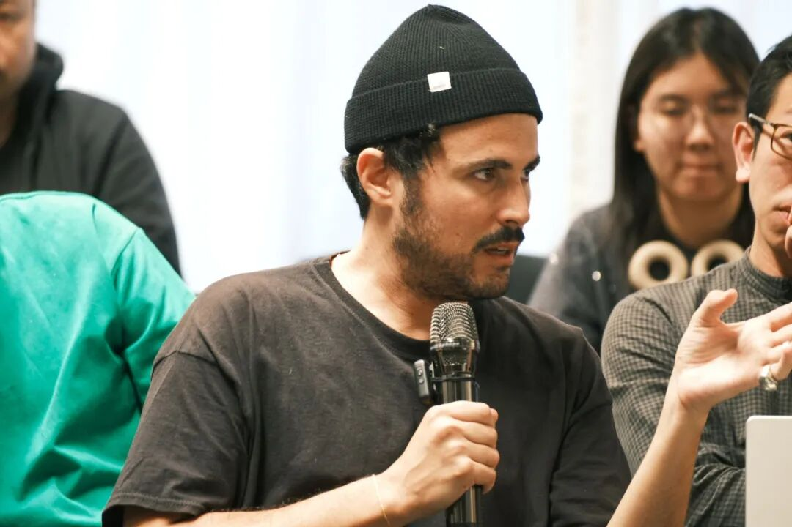
▲对谈现场  © 尧迪
策展人
王逸凡
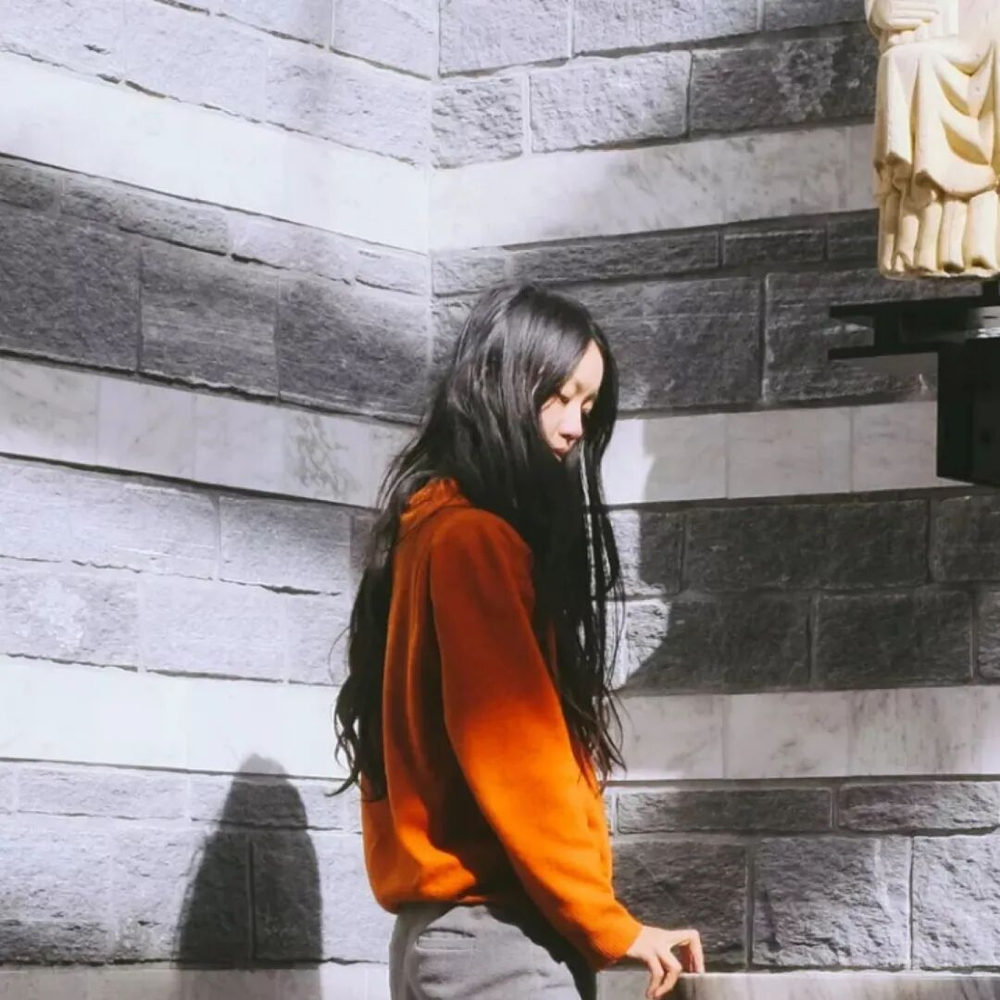
东南大学建筑学院副教授，曾于苏黎世联邦理工学院（ETH Zürich）担任博士后研究员。她是设计行动小组 tactac
的联合发起人，也是建筑民族志（architectural
ethnography）课题组的发起人。课题组的成果广泛发表于有影响力的建筑学科期刊、设计出版物与设计展，包括英国期刊 arq: Architectural
Research Quarterly、法国建筑与遗产城（Cité de l’architecture et du
patrimoine）、《建筑学报》、上海当代艺术博物馆（PSA）、童寯建筑馆、深港双城双年展以及北京设计周等。
参展事务所
大屿建筑
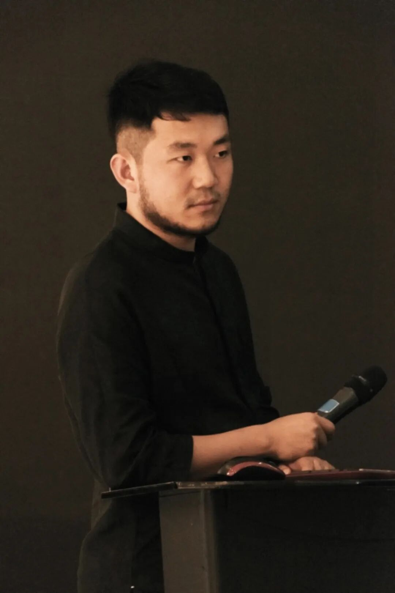
大屿建筑由程博与于岛共同创立，是一家立足于当代城市与建筑实践的独立建筑事务所。事务所关注高速城市化与存量更新背景下破碎而复杂的现实场地，致力于通过精确的建筑介入，重新组织环境中既有事物之间的方向、层级、边界与接续，使原本疏离、错位的要素建立新的空间关系。其代表实践包括深圳福田青年剧场改造“梦工场”、北京理工大学国际交流中心改造、深圳蛇口学校改造、松美术馆马厩改造“废墟花园”以及深圳蛇口港综合设施国际竞赛“高屋”等。
PARABASE
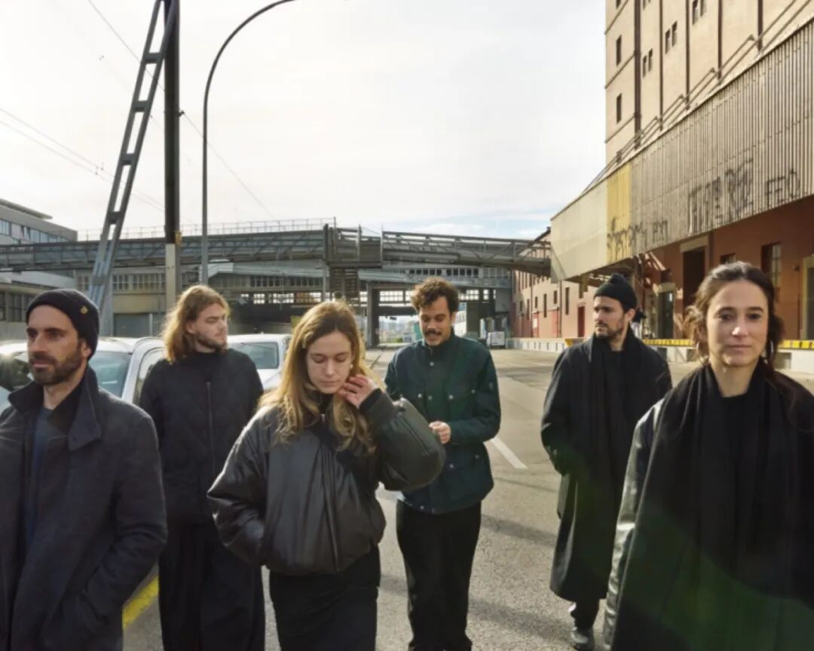
PARABASE 是由 Carla Ferrando Costansa 与 Pablo Garrido Arnaiz
共同创立的建筑与研究工作室，活跃于瑞士及欧洲当代建筑实践前沿。事务所致力于探索循环建造与后工业资源再利用的建造范式，专注于将欧洲后工业景观中废弃的工业现成物与存量构件转化为新建筑的结构与空间起点。近期代表作包括巴塞尔
Güterbahnhofareal Wolf 货运站区域1.5万平米住宅竞赛第一名项目“BINARIA”、瑞士斯塔比奥人行及自行车桥（STABIO
BRIDGE）、瑞士乌斯特循环利用中心（RECYCLING CENTER USTER）及圣贝纳迪诺住宅等。
研讨嘉宾
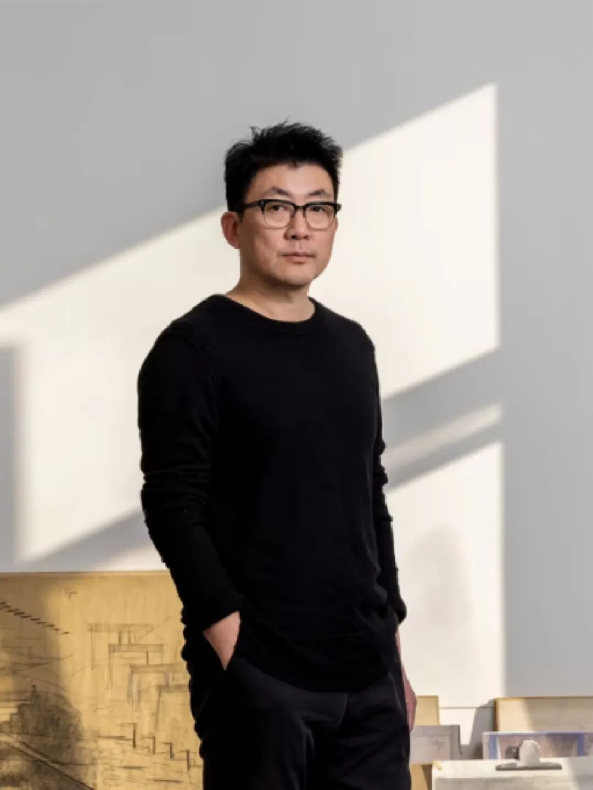
董功
：直向建筑创始人／主持建筑师，法国建筑科学院外籍院士。先后受聘为清华大学及中央美术学院设计导师、美国伊利诺大学普林姆（Plym）教席杰出客座教授、意大利都灵理工大学客座教授。代表作品包括阿那亚孤独图书馆、海边礼堂、阳朔糖舍酒店、船长之家改造、南开大学海冰楼等。
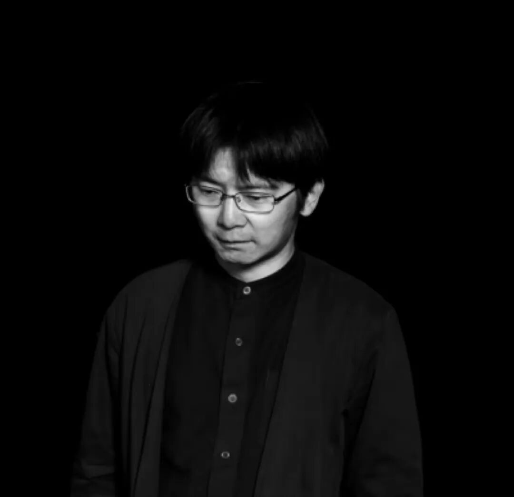
郭廖辉
：郭廖辉工作室（AtelierGuo）主持建筑师，拾柴学社发起人。门德里西奥建筑学院硕士，曾于彼得·卒姆托工作室、卡鲁索·圣约翰事务所、弗朗切斯卡·托尔佐工作室工作实践。
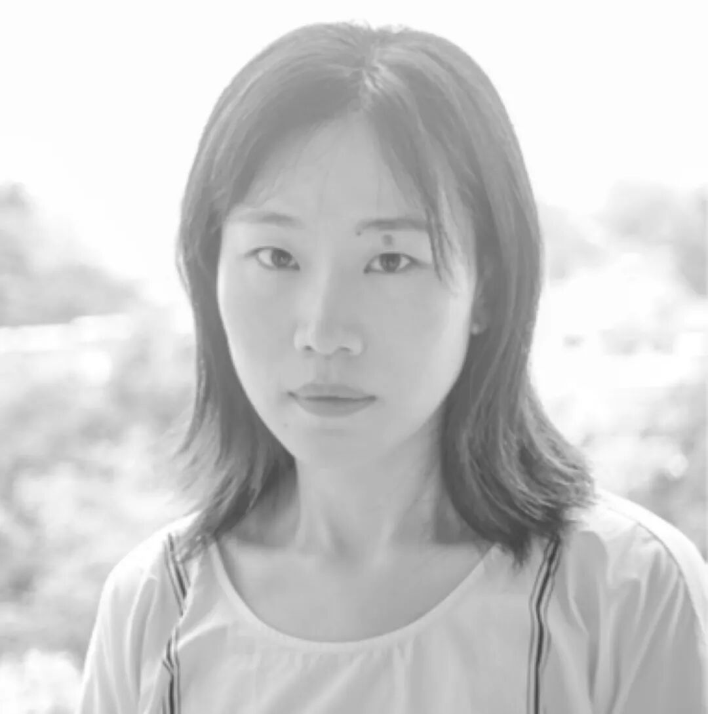
方书君  ：方书君工作室（STUDIOFSJ）主持建筑师，设计行动小组 tactac 联合发起人。毕业于苏黎世联邦理工学院（ETH
Zürich），瑞士联邦注册建筑师。

王逸凡  ：策展人，东南大学建筑学院副教授。

于岛  ：大屿建筑联合创始人／主持建筑师。
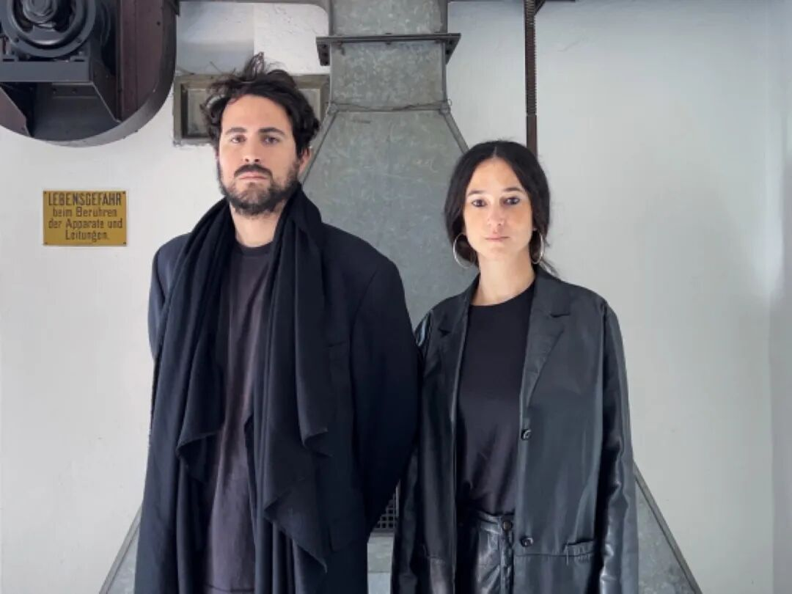
Carla Ferrando Costansa & Pablo Garrido Arnaiz  ：PARABASE 联合创始人／主持建筑师。
展览信息

展览地点：北京建筑大学（西城校区）建筑馆一层展厅
策展人：王逸凡
参展事务所：大屿建筑/YUARCHITECTS、PARABASE
展览支持：瑞士文化基金会上海办公室
展览总监：谢舒婕
展览团队：秦鸿昕、韩一阁、张靖雯、王子瑶、宫灵希、王鹏博、
尧迪（北京建筑大学团队）；王赫筠、王相沄（东南大学团队）
平面设计：孟逸扬
“半场”发起人：金秋野、李涵
主办单位：北京建筑大学建筑与城市规划学院
合作媒体：谷德、建筑创作、建筑技艺、建筑师、建筑学报、卷宗书店、
群岛 ARCHIPELAGO、有方（按照拼音首字母排序）
合作播客：艺锅端
特殊鸣谢
模型制作/现场搭建：禾铸北京精工团队
模型金属加工：廊坊市康正装饰工程有限公司
照明顾问：李帅绪
空间摄影：朱雨蒙
策展人前言
片段与结构之间
《Structuring Fragments 片段与结构之间》首次将来自中国与瑞士的两家青年建筑事务所——大屿建筑与 PARABASE
置于同一现场展开对话。两家事务所的主持建筑师都曾在瑞士接受建筑教育，而在此后的实践中，他们又分别进入中国与瑞士截然不同的城市发展进程、资源条件与建造体系。相似的教育起点，不同的文化语境和现实处境，让两种实践逐渐形成了各自不同的工作路径。
与此同时，当越来越多的建筑实践重新面对既有城市存量与建造资源，原本发生于不同地域的问题，也逐渐显现出彼此关联的一面。高速城市化遗留下的复杂场地与欧洲后工业时代的废弃构件，共同构成了当代建筑学必须回应的“碎片性现实”。展览以两家事务所近年来的作品为切入点，在具体项目的并置中观察差异与关联：大屿建筑在都市碎片的错位中重新组织关系与边界，PARABASE
则在工业存量的废墟中重新编织物质与结构。以此为始，展览试图展开一次关于当代建筑处境、形式自主性与建造工作方法的中瑞深层讨论。
半场开篇语
《  半场》是本土青年建筑师共同发起的系列文化活动，同时也是对职业生涯半程的回顾与展望。主要形式包括多家事务所两两组合举办的系列
《
半场》是本土青年建筑师共同发起的系列文化活动，同时也是对职业生涯半程的回顾与展望。主要形式包括多家事务所两两组合举办的系列展览，以及与之相关的讲座、对谈、播客、视频、发表和出版活动。
展览，以及与之相关的讲座、对谈、播客、视频、发表和出版活动。
建筑师们希望冲破职业藩篱，重新与城市和大众建立关联；也期望以空间为纸笔，关注身边世界的点滴，用职业素养服务于真实的社会生活。
与建筑工作高强度、高投入、高专业性的一面相比，我们更想展现建筑师工作有趣、有想法、有活力的一面。在图纸和模型之外，借助各种各样的媒介，展示不同的思考模式和行动方式，表达差异和多样性，以个体而非群体身份，投身于瞬息万变的现实之流。
《半场》因此成为调整蓄力的契机，与建筑一起破圈，在 AI 时代彰显“人”的价值。它也是个机会，向人们证明建筑不只是盖房子，更是打开未来的方式。
——《半场》发起人 金秋野、李涵
版权©www.gooood.cn，欢迎转发，  禁止以gooood编辑版本进行任何形式转载

↓  网站最新发布项目一览
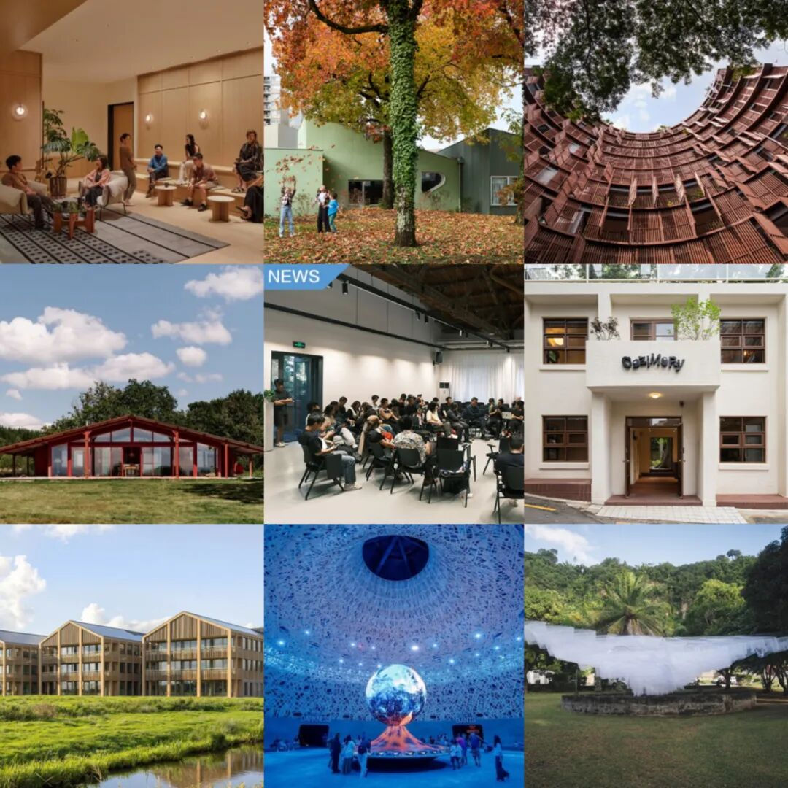
猛击“阅读原文”，进入网站畅享更多精彩

