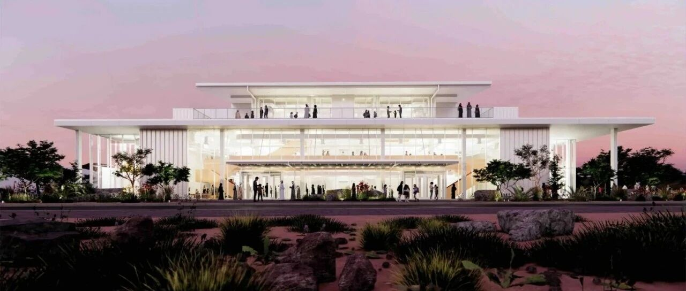
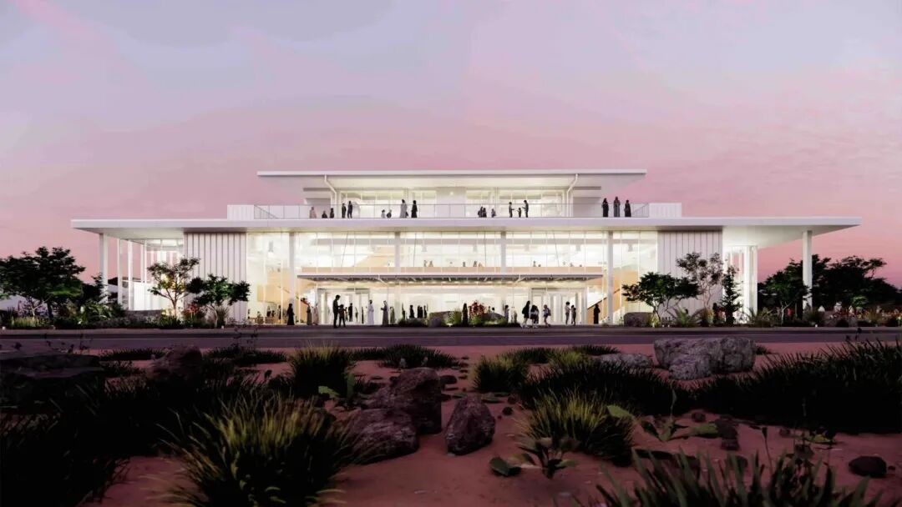
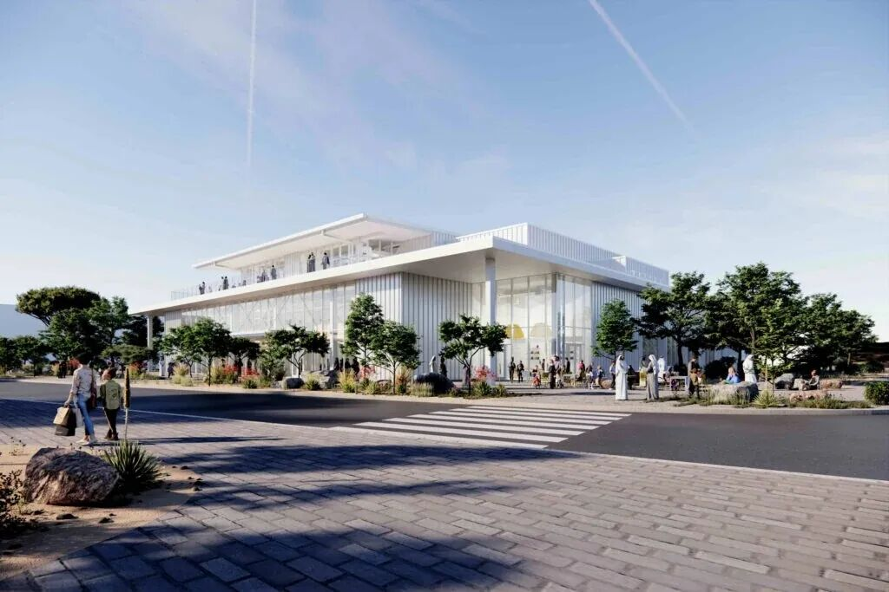
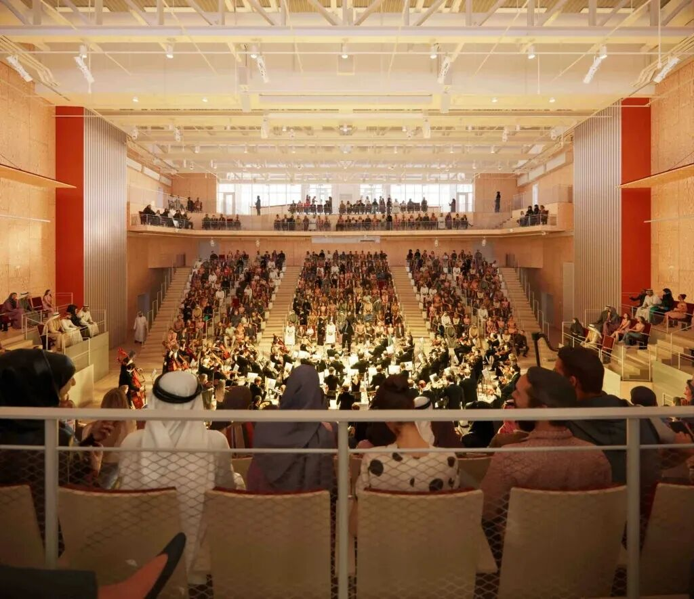
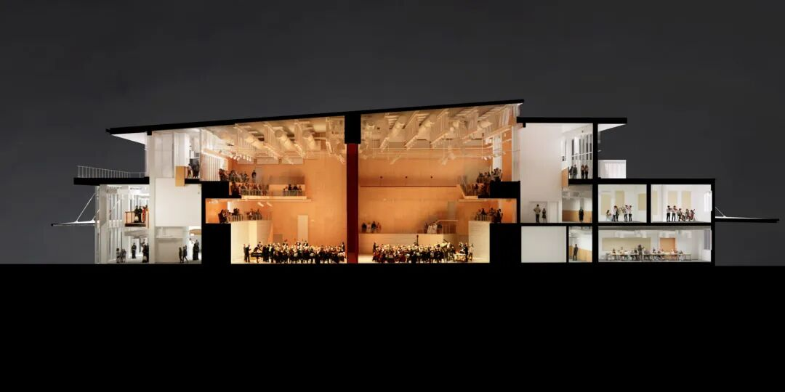
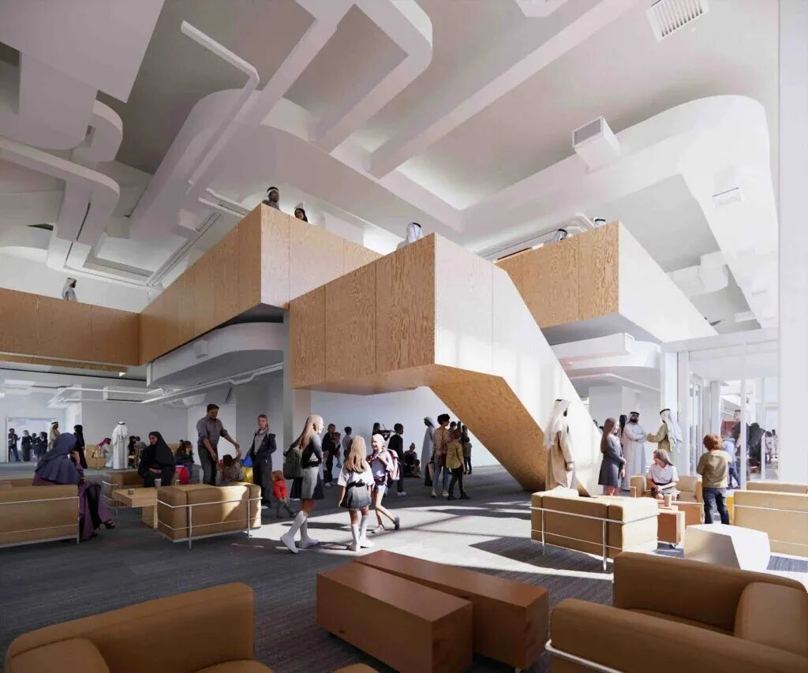
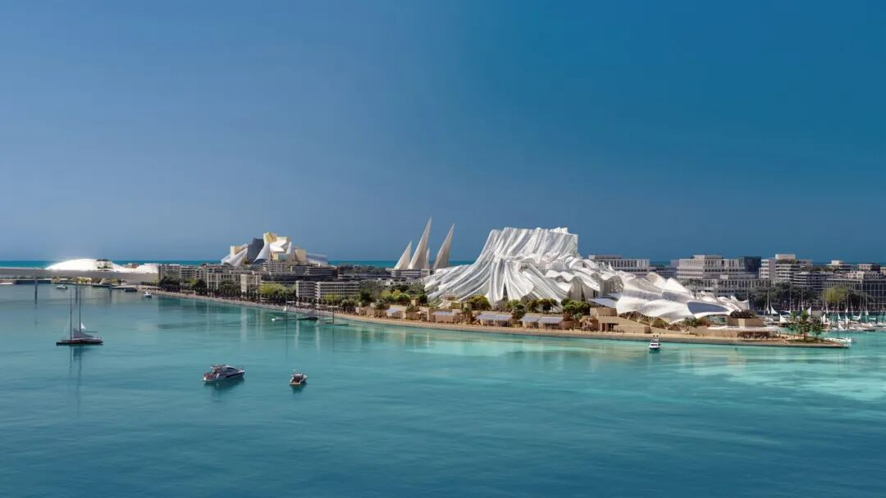
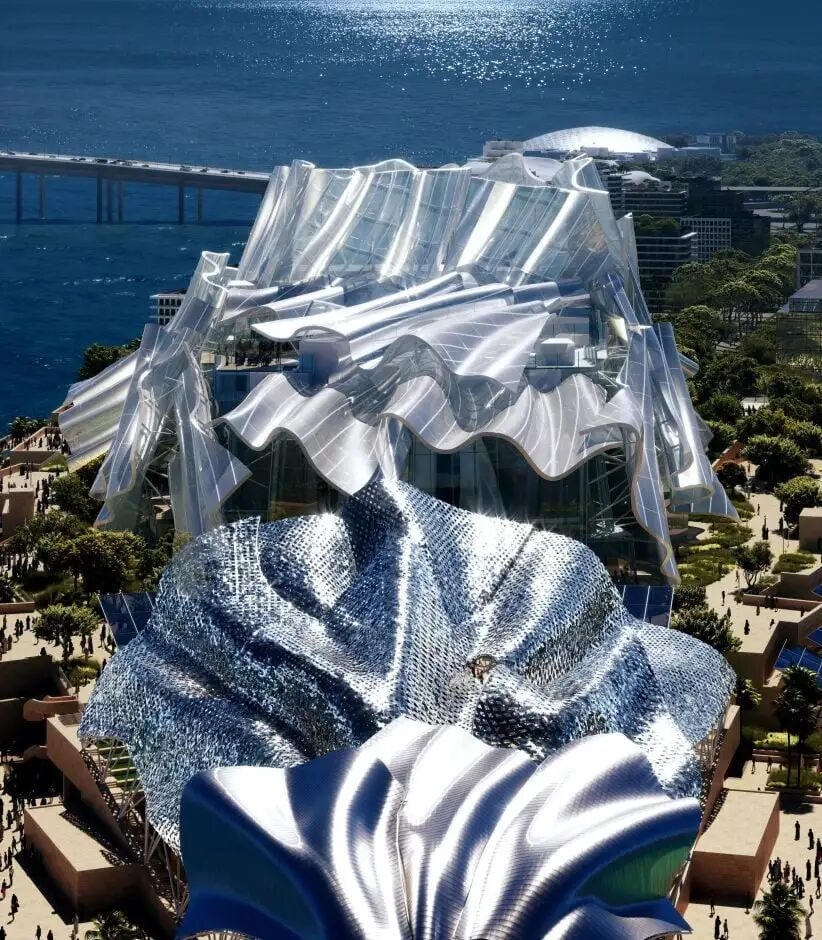

# 最不像弗兰克盖里风格的遗作，阿布扎比青年管弦乐厅方案

阿布扎比文化与旅游部公布了为年轻音乐家打造的音乐厅计划，该音乐厅由加拿大裔美国建筑师弗兰克·盖里在去世前设计。
阿布扎比青年管弦乐团项目预计于2027年1月在米纳扎耶德港区开放，将包含一座600座音乐厅和18间排练室。这座乐团建筑由盖里在去年12月去世前设计，与这位建筑师著名的流畅有机形态相比，外观将更为简约克制。

效果图显示，这是一座两层建筑，拥有长而平直的屋顶线条和高大的玻璃立面，玻璃立面由白色面板分隔。内部，楼梯和阳台走道将以木材饰面，顶层将通向屋顶露台。阿布扎比青年管弦乐团将为6至9岁儿童提供免费音乐教育项目，首批将招收100名学生。

“阿布扎比青年管弦乐团是对我们未来的一项重要投资，也是我们致力于让所有人接触文化和创意的承诺，”阿布扎比文化与旅游部主席穆罕默德·哈利法·阿尔·穆巴拉克表示。

“通过免费提供世界级音乐教育项目，我们正在为年轻人创造机会，让他们发现自己的才华、发展潜能，并体验音乐所能带来的终身益处，”他继续说道。“随着阿布扎比继续巩固其作为全球文化与创意中心以及联合国教科文组织音乐创意城市的地位，这样的机构确保下一代拥有充分机会参与、贡献并塑造我们的文化未来，同时保护构成我们遗产重要部分的丰富音乐传统。”

在阿布扎比其他地方，盖里设计的Dar al Funoon Abu Dhabi正在建设中，这是一座表演艺术场馆，外覆波浪般、
织物般的外立面。这位建筑师期待已久的阿布扎比古根海姆博物馆预计将于12月11日在萨迪亚特岛向公众开放。

Construction has commenced on Dar al Funoon Abu Dhabi, a performing arts venue
designed by Canadian-American architect Frank Gehry before his death, Abu
Dhabi‘s Department of Culture and Tourism has announced. Expected to be
completed in 2030, the landmark venue will be located on Saadiyat Island,
joining Gehry’s Guggenheim Abu Dhabi, which is also under construction. Dar al
Funoon Abu Dhabi will host opera, ballet, theatre and other live performances
and be one of the final completed buildings designed by the celebrated
architect, who passed away aged 96 in December last year.
fr  o  m：网络  ，  在此  作为  交  流，如涉及作品内容、版权和其它问题，请及时与我们联系，我们将在第一时间删除，感恩您的理解包容。
    
