# “古老玻璃海绵礁”丨温哥华首座350米超高层摩天楼

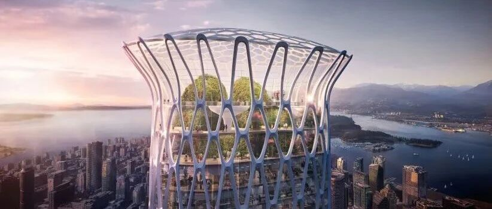

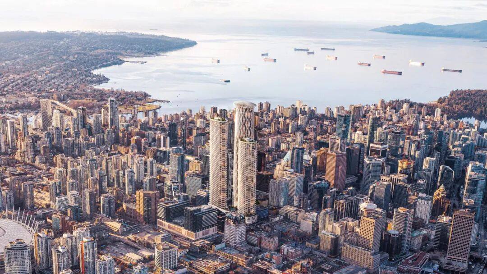
本地事务所Henriquez Partners Architects在加拿大温哥华设计了三座摩天楼，其中包括该市首座超高层摩天楼。
这三座摩天楼是开发商Holborn Group更大规模“Georgia &
Abbott”开发项目的一部分，将建在这座人口稠密的加拿大城市中部，并以一座高1033英尺（314米）的摩天楼为核心。
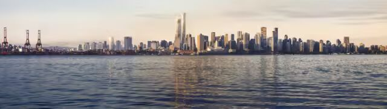

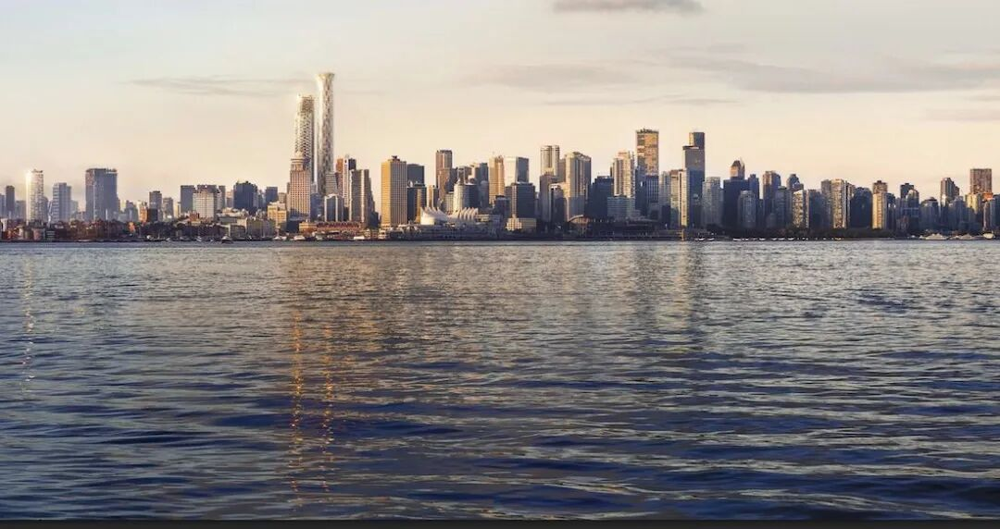
建成后，59  5 West Georgia Street将成为温哥华首座超高层摩天楼——超高层定义为超过984英尺
（300米）的建筑。建筑将包裹在钢制外骨骼结构中，外覆白色GFRP面板，并整体覆盖高度透明的玻璃跨段。
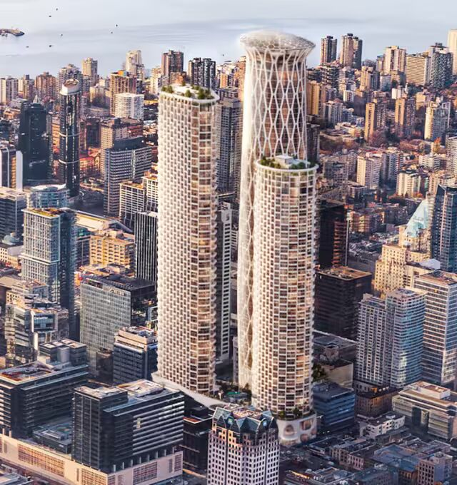

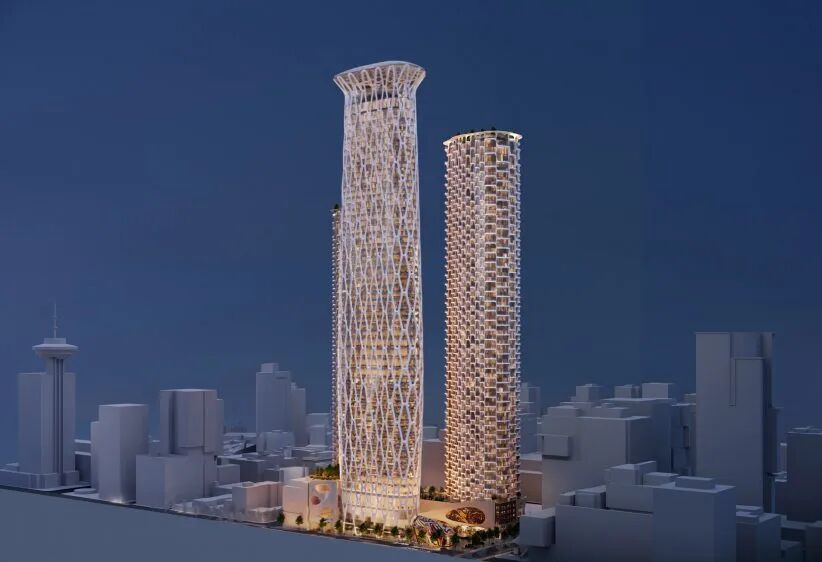
Henriquez Partners温哥华超高层摩天楼
据该事务所介绍，设计基于海绵礁的外观，事务所希望这座摩天楼能像海绵在海洋中那样，对城市环境发挥积极作用。
“该项目的建筑表达讲述了一个不列颠哥伦比亚省独有的故事，灵感来自稀有而古老的玻璃海绵礁——这些活体结构存在于不列颠哥伦比亚海岸附近，展现出强度与适应性，”Henriquez
Partners Architects表示。
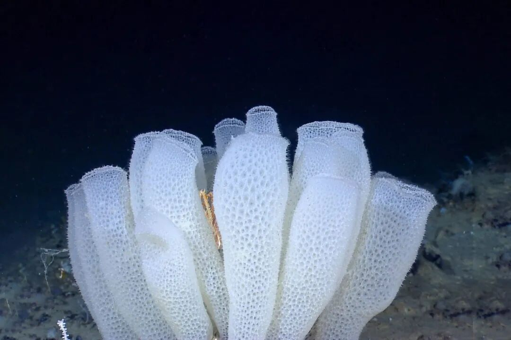
海绵礁的外观
“这一自然隐喻不仅体现在独特的轮廓和最高塔楼的雕塑形态中，也体现在其面向净零碳运营的环境性能中。”这座超高层摩天楼顶部将设有一个大型中庭，内含树木填充的公共空间，公众可进入。
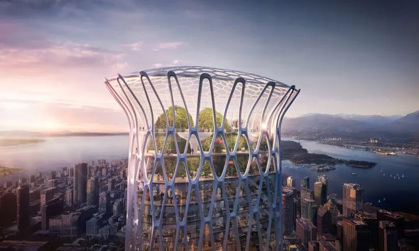

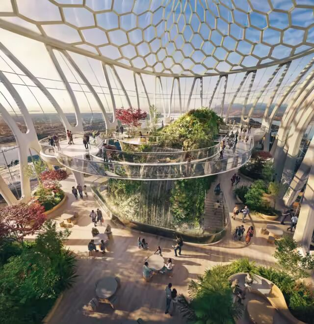
Henriquez Partners温哥华超高层摩天楼
温哥华西乔治亚街501-595号哈德逊湾停车场城市街区重建项目初步概念艺术效果图。
Preliminary conceptual artistic rendering of the Hudson’s Bay parkade city
block redevelopment at 501-595 West Georgia Street, Vancouver. (Henriquez
Partners Architects/Holborn Group)
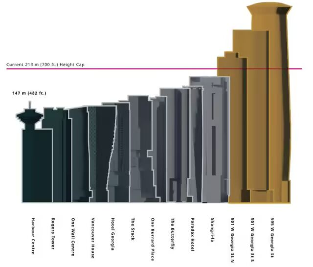

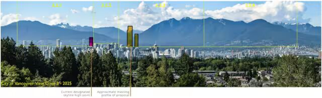

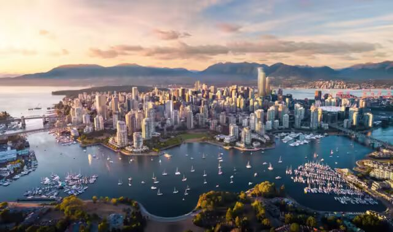
其形态和立面图案受玻璃海绵启发
综合体中的另外两座摩天楼将从同一裙楼升起，高度分别为783英尺（237米）和889英尺（271米）。现代裙楼将纳入1926年兰德尔大楼的立面，遵循温哥华的遗产保护原则。餐厅、咖啡馆和其他零售设施可从摩天楼之间的广场进入，另有一座独立的圆形结构承载酒店接待功能。效果图显示，这一体量绘有壁画，似乎引用了原住民艺术母题。
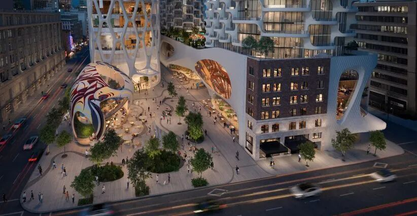

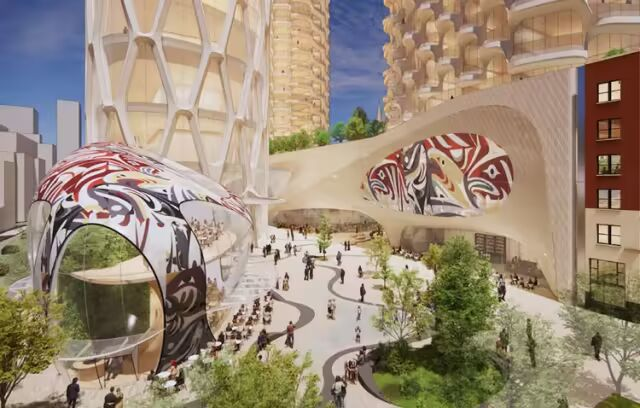

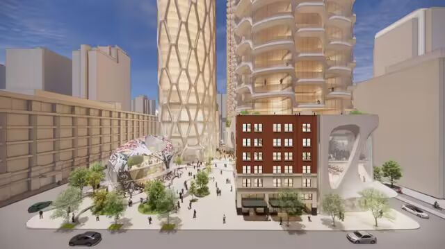

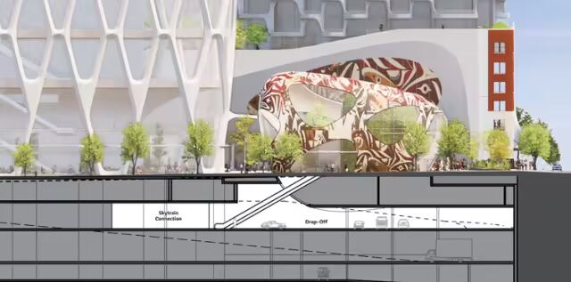
Henriquez Partners温哥华超高层摩天楼
三座塔楼在温哥华市中心一个街区形成广场
根据
社会住房要求，开发项目还包括更东侧的第三座建筑。据该事务所介绍，这座高402英尺（122米）的结构将包含社会住房以及一座专门展示原住民艺术的画廊。其八层裙楼将采用砖饰立面，而上方退台的30层塔楼将更具当代感。
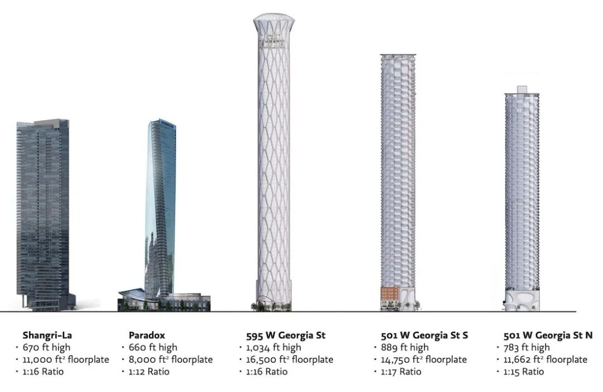

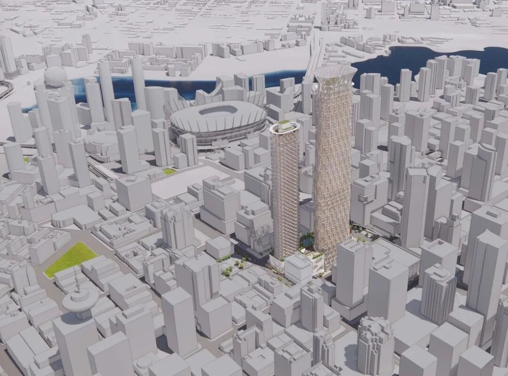
两座住宅塔楼，以及零售、餐厅、广场和新的SkyTrain入口
除了超高层酒店塔楼外，Hudson’s Bay停车场用地还将在Richards
Street沿街建设两座额外塔楼，包含住宅和商业用途：一座高889英尺（271米）、79层的塔楼，将成为加拿大西部第二高建筑；以及一座高783英尺（239米）、68层的塔楼。
这两座混合用途住宅塔楼合计将包含1,546套住宅，其中包括1,270套分层产权市场公寓住宅和276套受保障的专用市场租赁住宅。
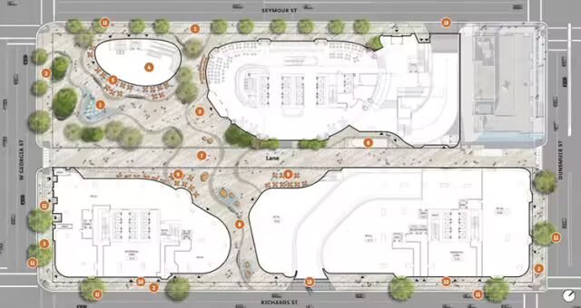
户型组合包括883套一居室、396套两居室和267套三居室。两居室和三居室约占总住宅套数的38%，满足市政对家庭型住宅的要求。这些住宅塔楼的基座裙楼内将有约40,000平方英尺的零售/餐厅空间，有助于激活面向West
Georgia Street及周边临街面的17,000平方英尺私有、适合活动、公众可进入的广场。位于West Georgia Street与Seymour
Street交叉口显眼东北角的一座独立两层餐厅亭，还将兼作进入SkyTrain的Granville
Station的额外地铁入口，由开发商出资，尚需与TransLink进一步商讨。
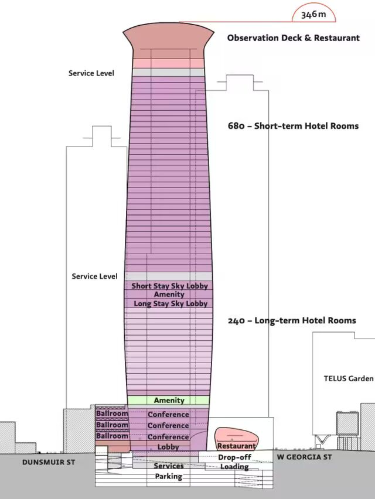

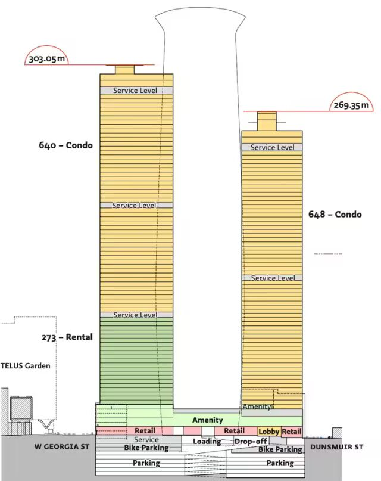

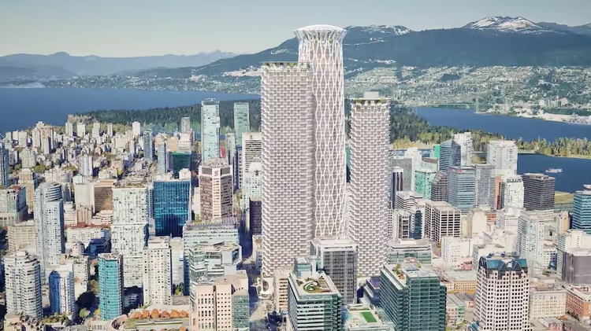

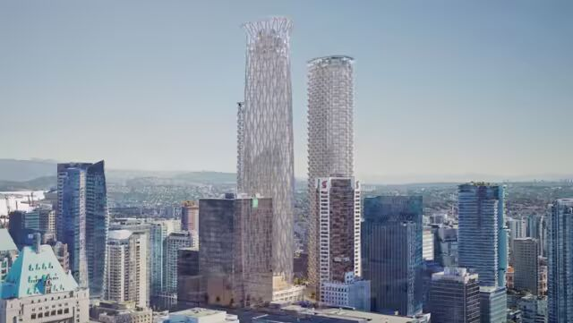

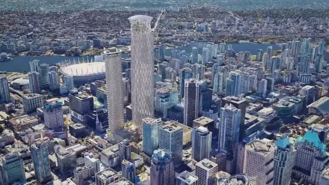
fr  o  m：  Henriquez Partners Architects/Holborn Group  ，  在  此  作为  交
流，如涉及作品内容、版权和其它问题，请及时与我们联系，我们将在第一时间删除，感恩您的理解包容。
CONTACT联系：sheji131666
