# 中标及优胜方案丨广州湾区中央法务区中心区（白云）三期城市设计出炉

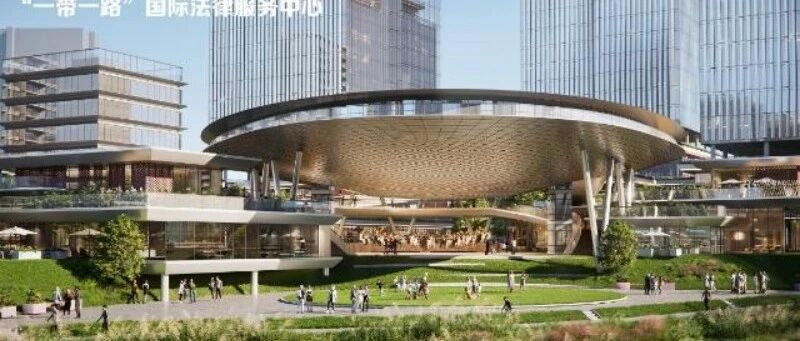

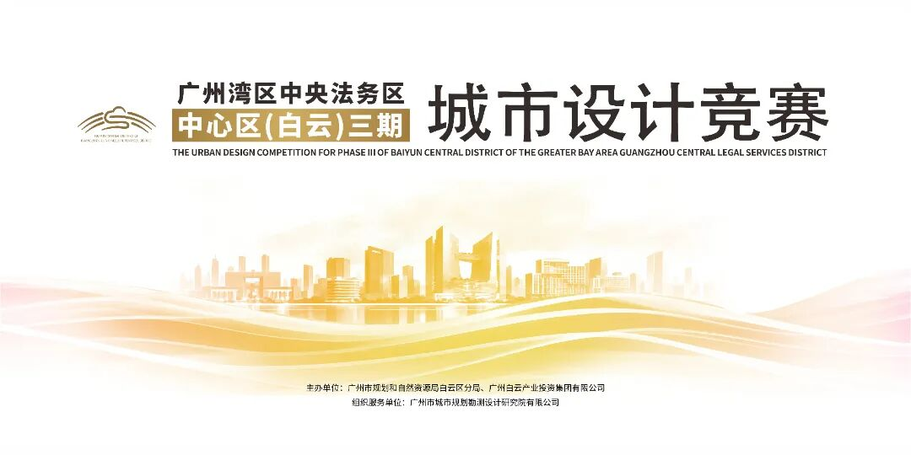

法务区三期位于白云新城与望岗新城衔接区域、华南快速路与白云大道交汇处，是广州湾区中央法务区“一中心三片区”布局的核心组成部分。项目定位为功能复合、产城融合的新型产业社区，核心逻辑是“产业与法务双向赋能”。法务区三期作为广州湾区中央法务区战略的重要延伸，将在空间与功能上实现双重跃升。

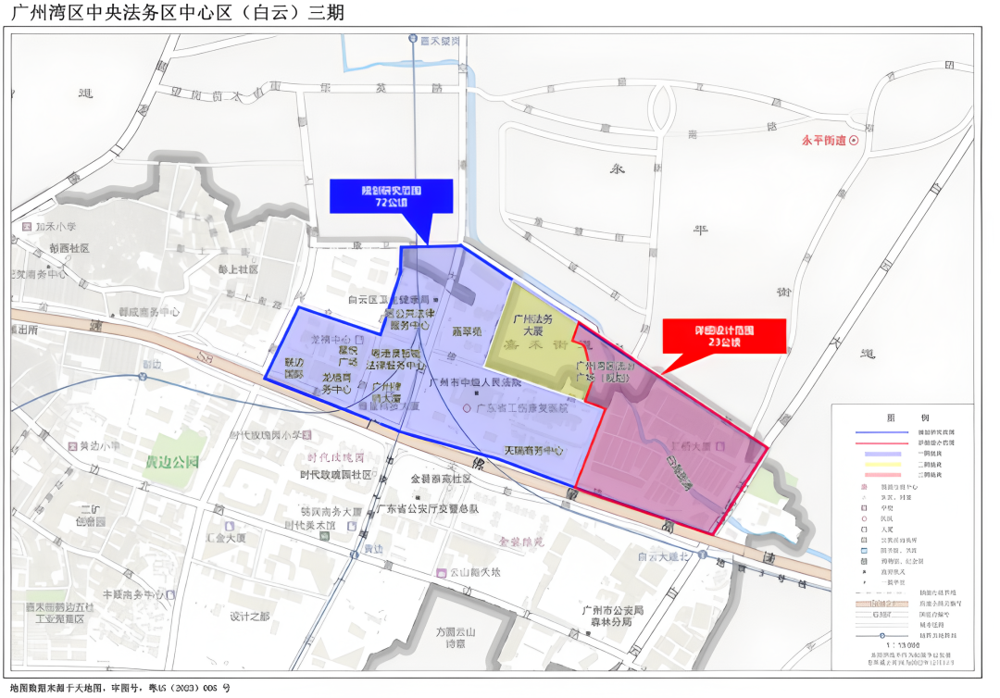

【5名入围参赛团队】（以下排名不分先后）

· 德国ISA意厦国际设计集团、广州市城市规划设计有限公司、广州市工信创新产业发展研究院；

· 广东省建筑设计研究院集团股份有限公司、盛裕（中国）企业管理有限公司、世理仕（上海管理咨询有限公司）；

· 莫菲西斯建筑事务所、华东建筑设计研究院有限公司；

· 华南理工大学建筑设计研究院有限公司、株式会社日建设计；

· 赫姆斯米勒、上海同济城市规划设计研究院有限公司、广州班德勒斯建筑设计事务所有限公司。

【3名候补参赛团队】

· 深圳市建筑设计研究总院有限公司、法国AAUPC建筑规划事务所、广州市现代城市更新产业发展中心；

· 中国建筑设计研究院有限公司、上海柏盈设计工程咨询有限公司；

· 中国城市规划设计研究院、麦德（北京）建筑设计咨询有限公司。

近日，广州湾区中央法务区中心区（白云）三期（以下简称“法务区三期”）城市设计竞赛历时数月圆满收官，3个优胜方案脱颖而出。

【第一名】法商并蓄· 缤纷社区

单位名称：

华南理工大学建筑设计研究院有限公司

株式会社日建设计

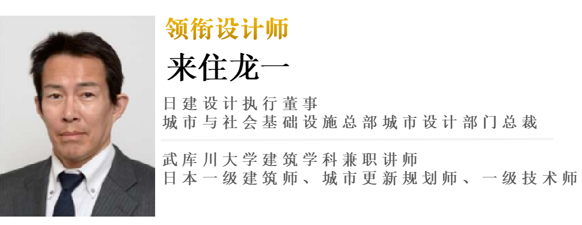

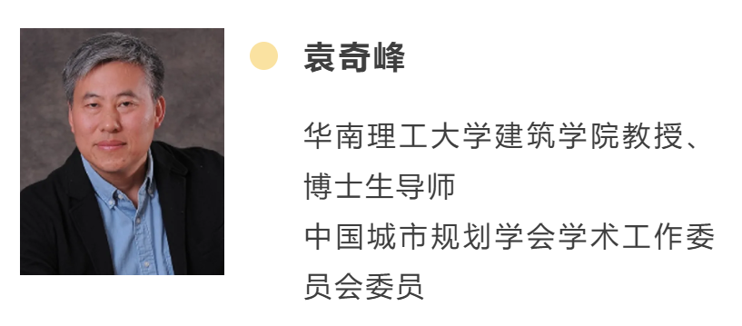

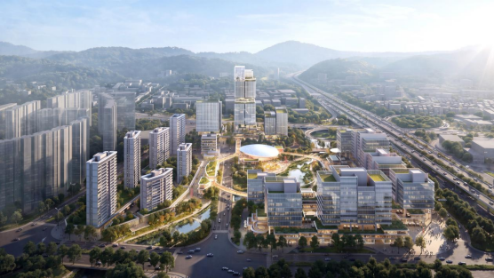

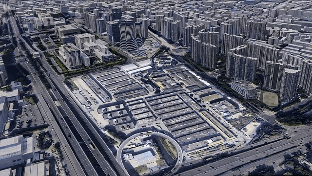

01 从法务集聚走向法商融合

三期将推动法律服务与金融、科技、贸易、会计审计、企业服务等现代服务业协同发展，让专业功能、商务活动与城市生活在同一片区中共生。

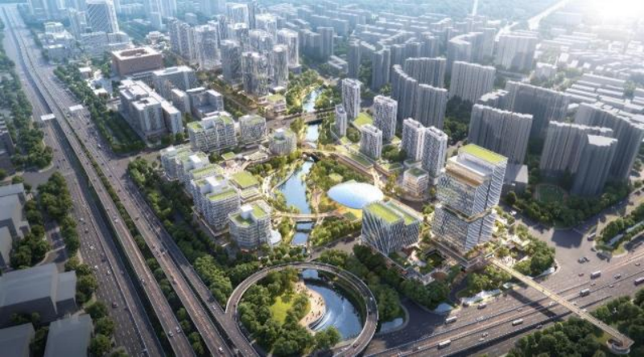

▲法商并蓄·缤纷社区方案鸟瞰图

02 设计理念：Beyond Law, Into Life

三期重点打造一个“法务长在生活里、商务长在法务上”的开放社区。它不只是一片办公园区，更是一座可漫步、可停留、可生活的城。方案研究了芝加哥Loop、新加坡Maxwell、首尔瑞草等国际样本，从中提炼三期的空间逻辑。

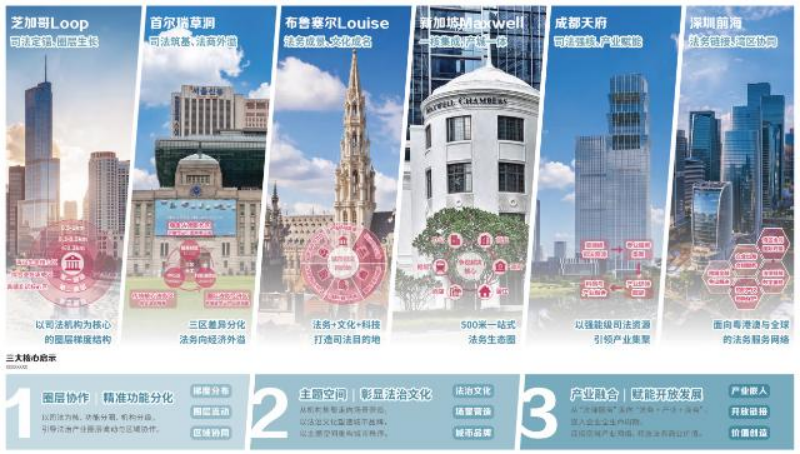

▲国际案例研究

03 从“法务+政务”到“法务+商务”

设计方案依托广州市中级人民法院的司法强磁场效应，构建“3+6”产业生态，聚力打造“国际法律服务、非诉争议解决、法商融合服务”三大中心，推动“法务×产业”的深度融合。

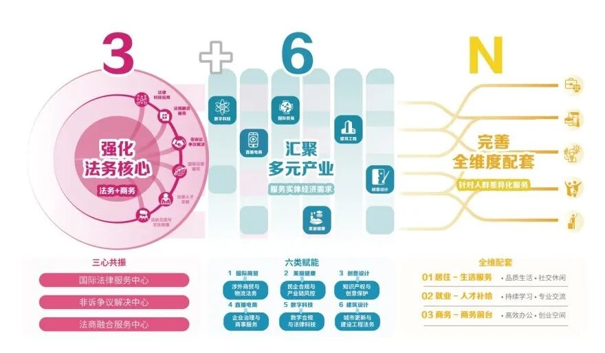

▲“3+6+N”产业生态

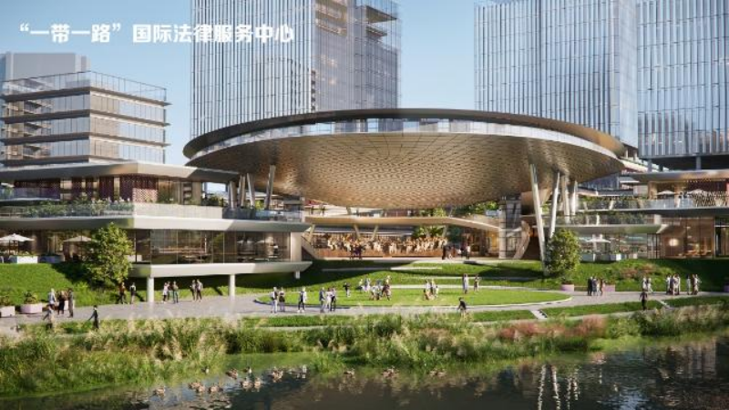

▲“一带一路”国际法律服务中心

04 以山水为底、以法轴串城

方案构建“一轴双心多点，一环双廊三园”的空间结构，以法韵礼轴串联一、二、三期重点功能，以共享绿环、生态廊道和主题公园完善公共空间体系。

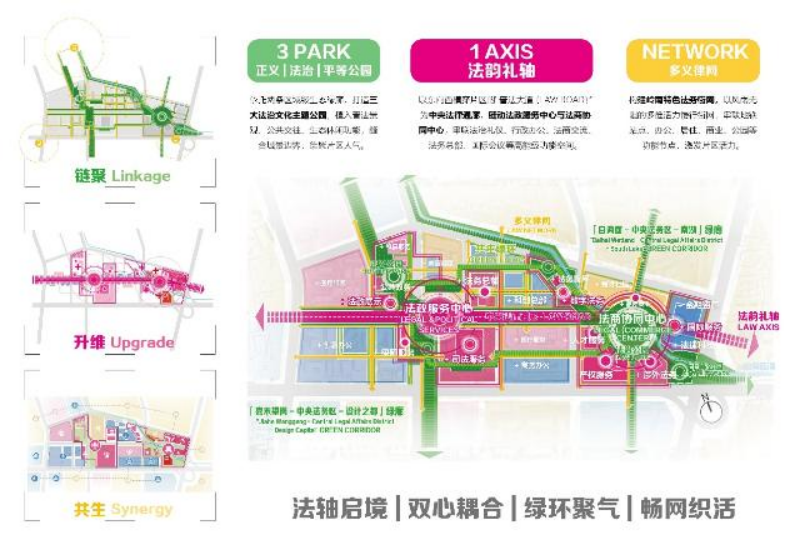

▲总体空间结构

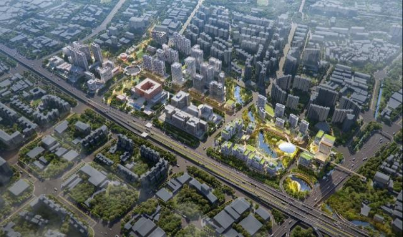

▲法务区整体鸟瞰

城与山相望，法与景相融，一幅“法景共生”的城市画卷正徐徐展开。整体天际线随山就势、错落有序，为白云山预留景观视廊，为法务区塑造可识别的城市新封面。

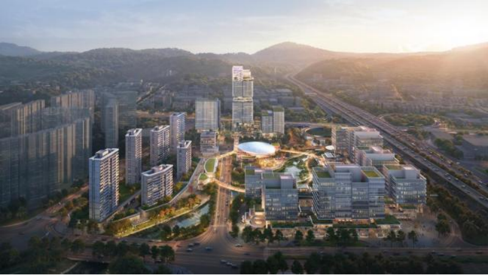

▲景观视廊示意

详细设计从人的日常体验出发，提取岭南园林、传统街巷与适应湿热气候的空间智慧，形成“河涌畔、巷陌间、合院里、屋檐下”四重场景，共同构成一套从生态修复、慢行组织、产业载体到气候适应的空间系统。

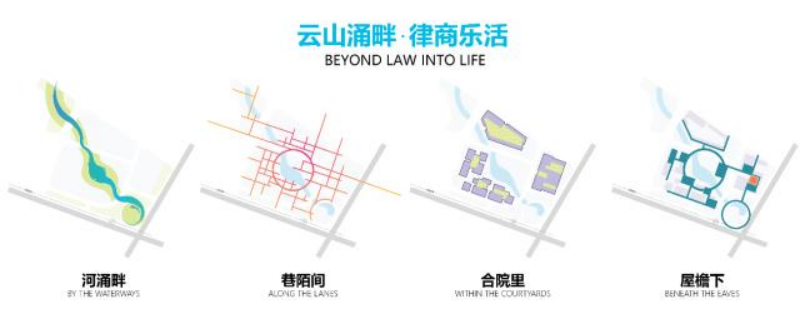

▲四重空间场景

针对部分河段覆盖、水岸空间不连续等现状，方案结合白云山视线廊道，提出河涌复明与滨水空间整治，重新打开城市与水的联系。

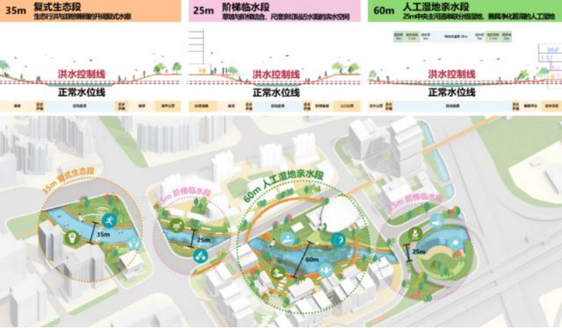

▲河涌复明与滨水空间设计

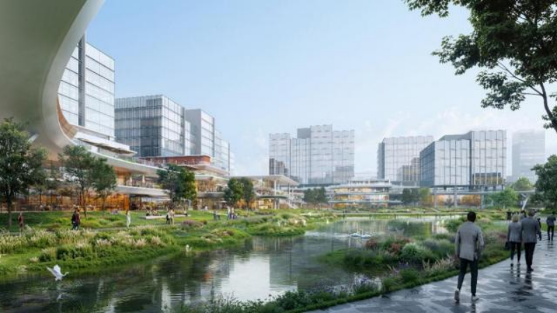

▲滨水公共空间效果图

借鉴岭南园林“连房广厦、庭院相通”的组织方式，结合场地高差、建筑首层、二层平台与连廊，形成上下联系、内外贯通的立体慢行体系。

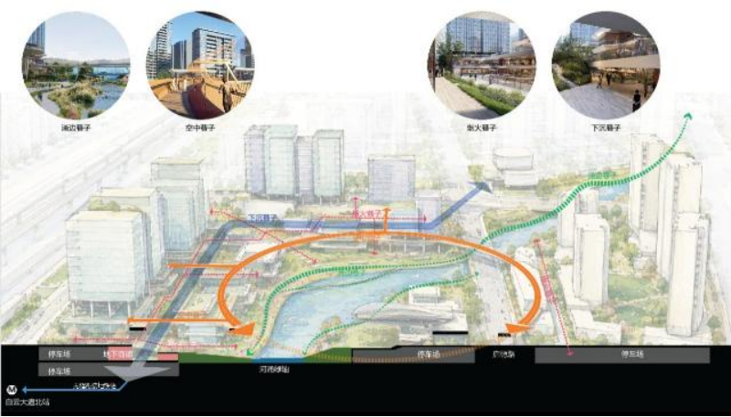

▲立体慢行体系

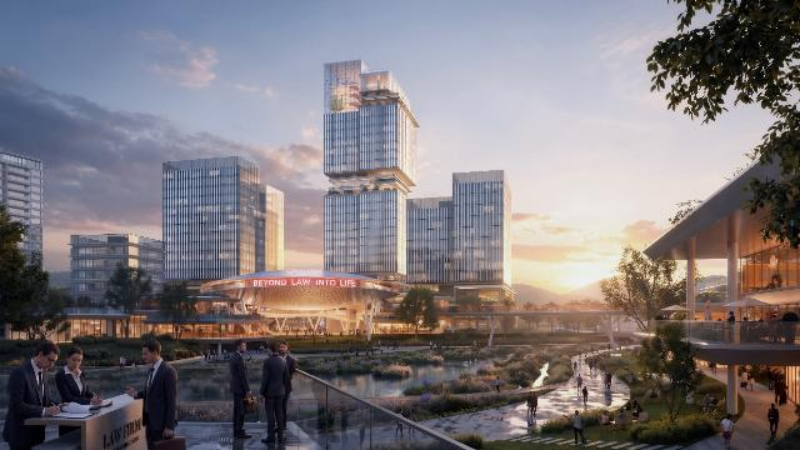

▲街巷与滨水空间效果图

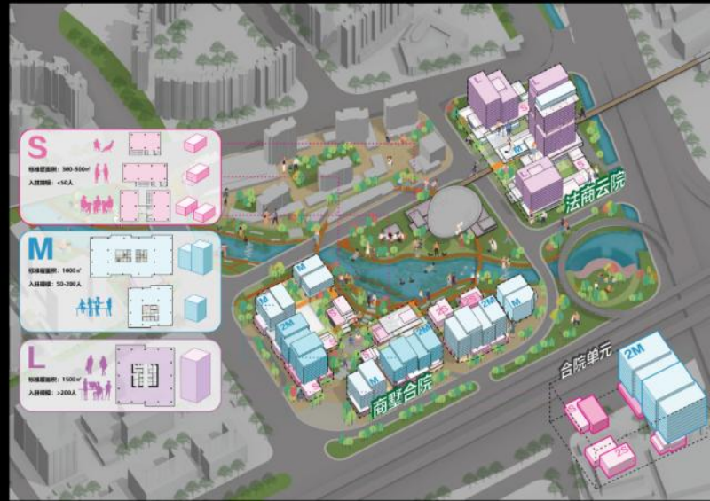

▲合院模块与空间布局

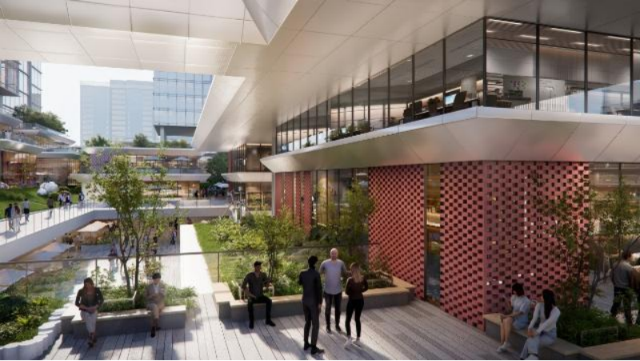

▲合院共享空间效果图

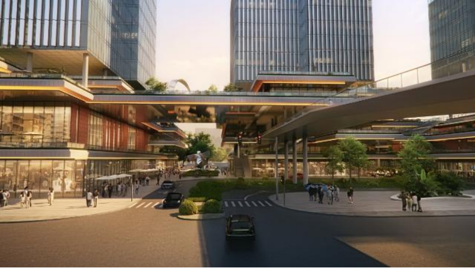

▲檐下公共空间效果图

【第二名】引山织水· 文理筑城

单位名称：

HOLMES MILLER LTD.（英国赫姆斯米勒有限公司）

上海同济城市规划设计研究院有限公司

广州班德勒斯建筑设计事务所有限公司

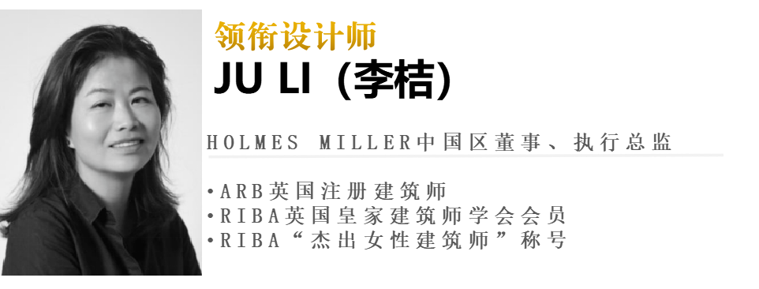

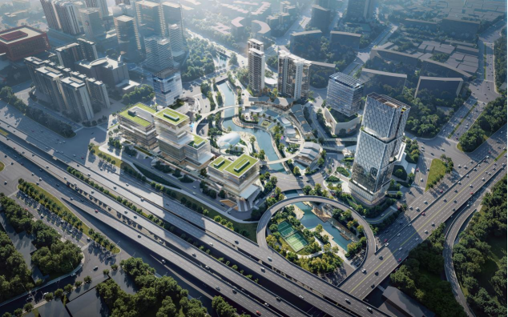

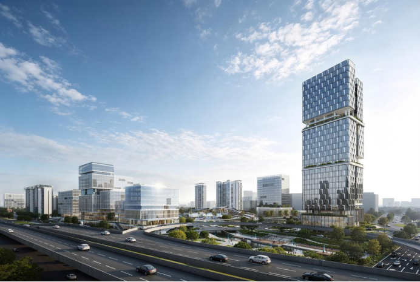

核心理念：“引山水”——化劣为势，重塑场所精神。本次设计将原本纯功能性的河涌，转化为大型滨水公园。同时，打通与白云山的视觉通廊，让法理秩序与自然山水在此交融，把场地的“割裂感”转化为“渗透感”。“化割裂”——树立门户，刚柔并济塑形象。对外，建立庄重的水岸门户与法务特质界面，塑造高辨识度的城市名片；对内，传承岭南地域风貌，以柔性空间保持与城市的视线渗透，让新的与法务相融合的区域充满人文温度。“立体城”——TOD引擎，构建立体交通网。依托TOD开发模式，搭建“地下-地面-地上”的立体交通系统，形成商业环线与无缝慢行衔接。

【第三名】大湾区法务应用场景示范区·法商融合的城市会客厅

单位名称：

ISA—Internationales Stadtbauatelier（德国ISA意厦国际设计集团）

广州市城市规划设计有限公司

广州市工信创新产业发展研究院

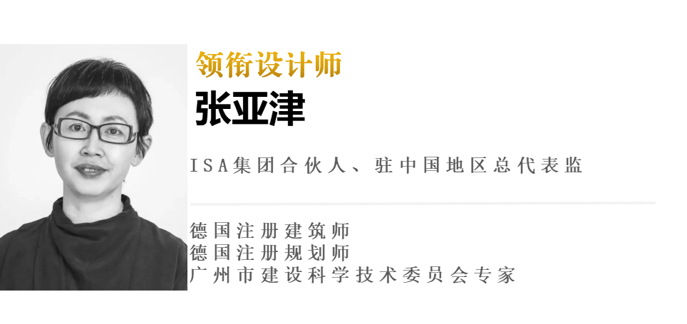

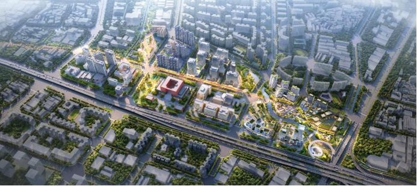

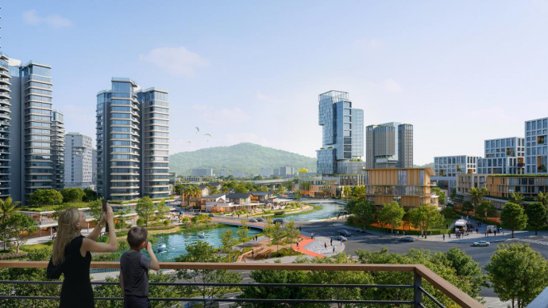

核心理念：法产人城——四维度统筹布局。方案以“法务深化、产法融合、人法融合、城法融合”四大维度为核心，聚焦“最善交往、最懂产业”的法务区建设，推动法治服务与产业发展、人才集聚、城市品质深度融合，让法治成为产业升级的护航力量。花园水岸——织就活力交往纽带。贯穿场地的白海面涌将通过生态修复与商业植入，串联法治科普公园与桥下门户绿地两大景观核心。从地铁站出发，出站即见园。沿整治一新的水岸前行，开放滨水商业满足日常交往需求，法治公园化身户外普法学堂，六百米花园水岸成为整个片区共享的活力交往核心。南聚法务、北融邻里——构建产居协同的功能格局。以水岸为界，南岸打造“法务+”总部社区，布局高层地标酒店、法务数字综合体与低密度商墅，配套律师会堂，集聚涉外法务、专业交流等核心功能，汇聚法律全产业链，护航企业跨境出海。北岸打造复合创新邻里，布局智汇总部谷与居住、公寓等生活单元，承载法务产业延伸、总部办公与人才安居配套。

from：广州白云发布&网络，在此作为交流，如涉及作品内容、版权和其它问题，请及时与我们联系，我们将在第一时间删除，感恩您的理解包容。

预览时标签不可点

不喜欢
