# gmp中标丨吉达中央开发区体育场

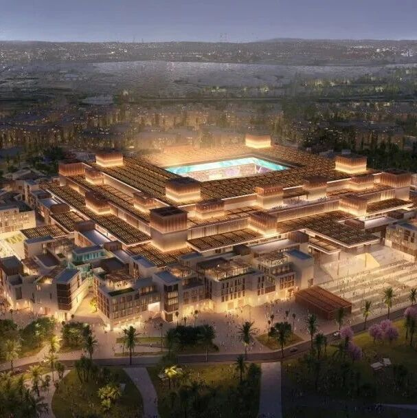

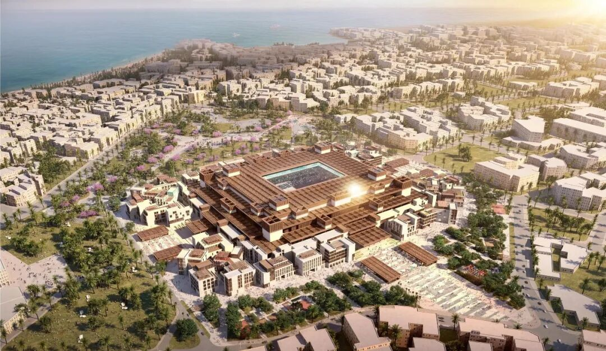
© A-Promise
城市街区式体育场：吉达中央开发区体育场的设计在概念上将细腻的城市肌理浓缩进体育场的空间格局中，碗状观众席看台  区
位于其核心。建筑群的形态、材质和比例均借鉴了吉达历史老城  “  巴拉德  ”  的建筑风格。体育场的宏大体量只有身处内部的看台和球场上时才能切身感受到。
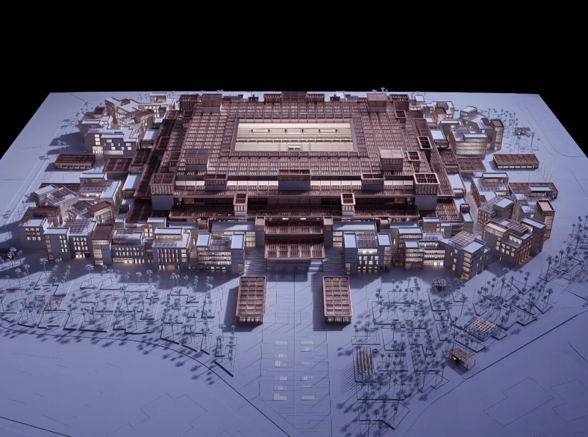

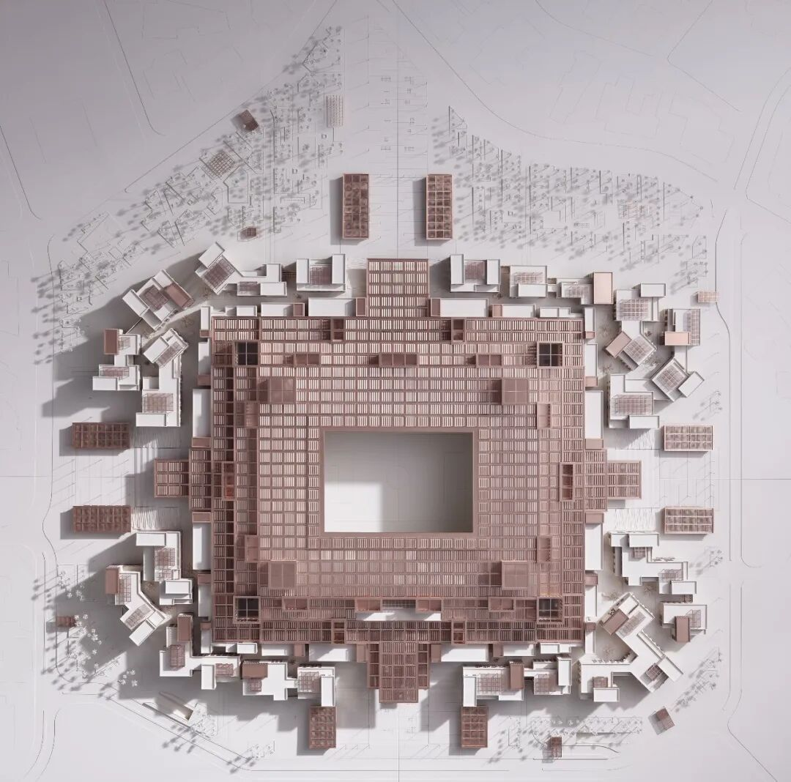
©  Taufik Kenan
吉达中央开发区体育场，把整座老城装进了四万六千个座位里。
德国 gmp
以“城市街区”为灵感，将吉达巴拉德老城的窄巷、广场与木格栅，转译成一座会呼吸的现代体育场。碗状看台居中，四周由商业、休闲与运动空间围合；重叠屋面如传统风塔般拔风降温，格栅滤光，让烈日也变得温柔。这里不只在比赛日醒来。没有赛事的日子，商店照常营业，咖啡依旧飘香，公共广场始终向城市敞开——一座真正属于市民的体育场。
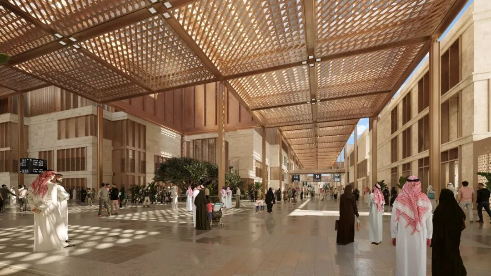
© A-Promise
四个由不同大小和高度的建筑体量组成的集群环绕体育场碗状主体结构布局。在这些设有球迷商店、零
售店、咖啡厅以及运动和休闲设施的建筑之间，形成了一个由遮荫小巷和公共广场交织而成的步行网络。沿中心轴线延伸的林荫大道通往体育场的四个主入口，并提供了远瞭球场的视野。因此，这个可全天候使用的运动枢纽在非比赛期间也将成为一个充满活力的城市场所。
它看起来不像一座体育场，更像一片全年无休的城市街区。四万六千个座位，围着老城肌理生长。窄巷遮荫，广场聚人，格栅滤光，风塔通风。gmp
没有复制传统符号，而是让文化重新工作：遮阳、降温、透气，也让建筑自然融入吉达的日常。
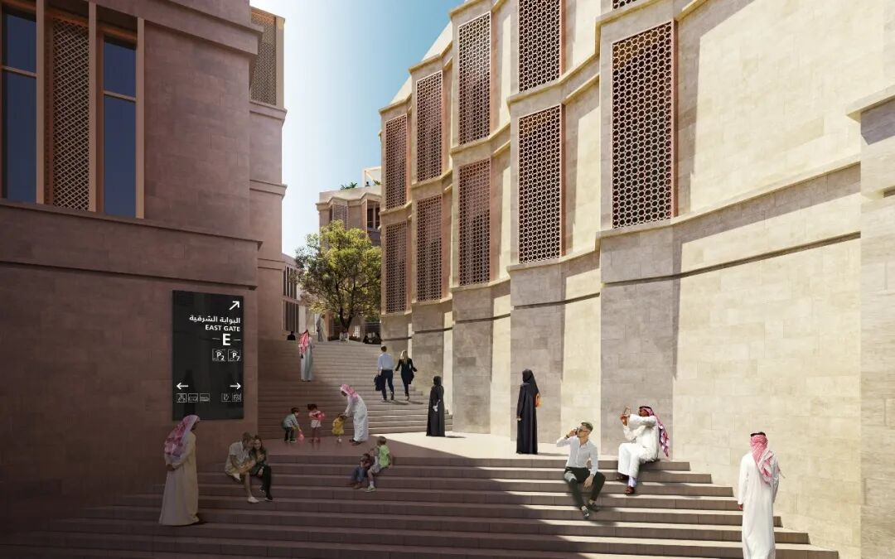

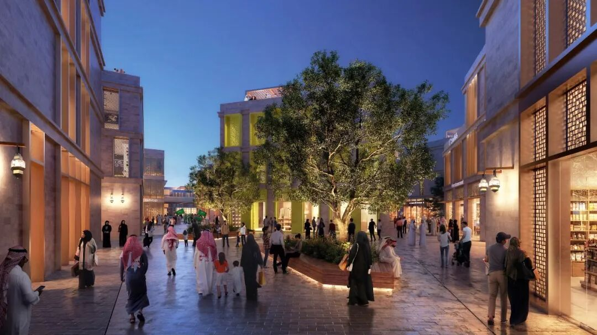
© A-Promise
体育场屋顶将整个建筑群融合为一个宏观的整体：相互重叠、大小各异的屋面构件由外向内层层递进，并在看台上方达到最高点和最大延伸范围。矩形格栅设计如同当代阿拉伯木雕窗，具有不同的透光度。高度各异的天窗对传统风塔进行了现代演绎，在屋顶景观中形成了额外的制高点。由此产生的光影互动
精准  满足了当地特殊的气候要求，在确保最大程度遮阳的同时，实现了自然空气循环与降温。
吉达中央开发区体育场，是 2034 世界杯赛场，也是一座全年开放的城市街区。gmp
把巴拉德老城的窄巷、广场和木格栅，变成球迷商店、咖啡厅与公共空间。屋顶负责遮阳通风，街区负责连接人与生活。比赛时它是球场，平时它仍是城市。
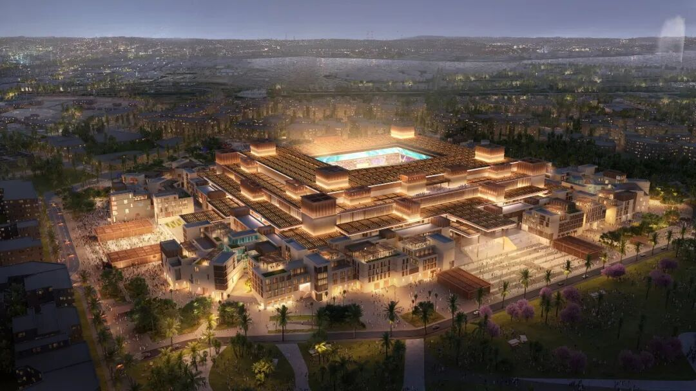
© A-Promise
移动式内部屋顶、  360  度  LED  大屏幕以及看台制冷系统适于举办各种类型的活动  。
与此同时，屋顶光伏发电区可提供太阳能能源，有助于实现体育场的碳中和运营。
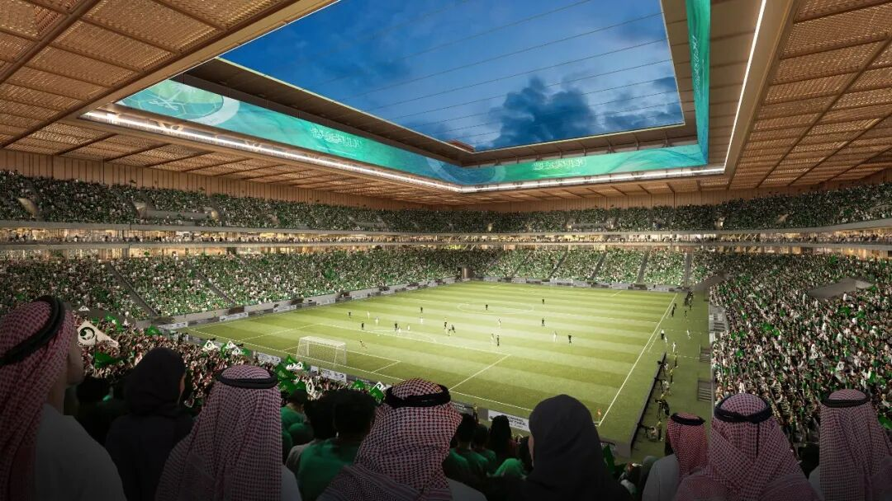
© A-Promise
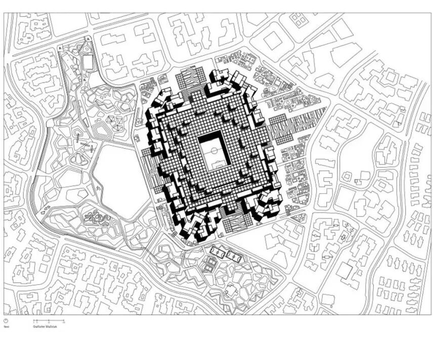
总平面图 © gmp Architekten
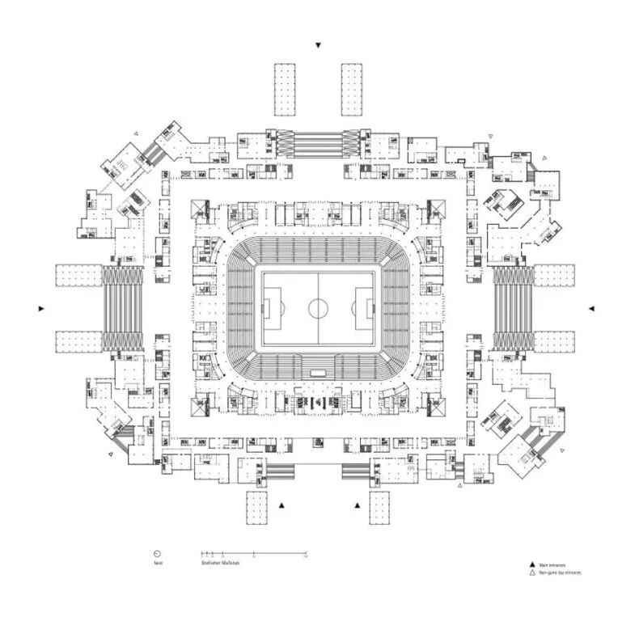
三层平面图 © gmp Architekten
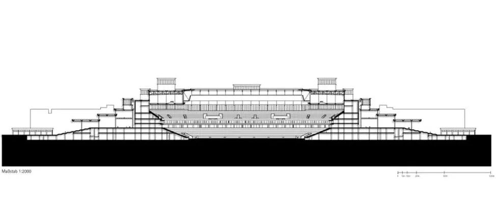
剖面图 © gmp Architekten
** 设计竞赛  ** ：  2022  年  ，  一等奖  ** 设计：  ** 福尔克温·玛格与胡伯特·尼恩霍夫及汉斯  \-  约阿希姆  ·
帕普与桑德·特罗斯特  ** 合作设计  ** ：  沙特  K&A  联合工程公司  ** 业主：  ** 吉达中央开发公司 座位数：  4  .6  万
座
fr  o  m：gmp建筑师事务所-北京上海深圳  ，  在  此  作为  交
流，如涉及作品内容、版权和其它问题，请及时与我们联系，我们将在第一时间删除，感恩您的理解包容。
    
