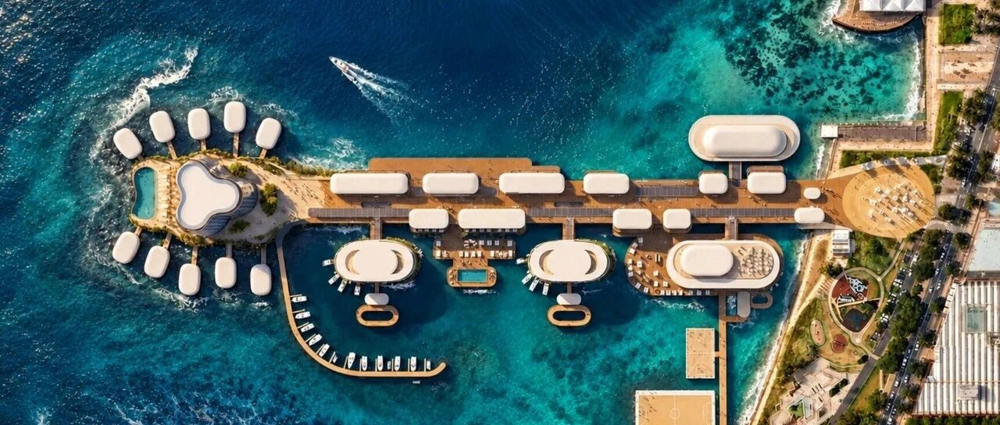
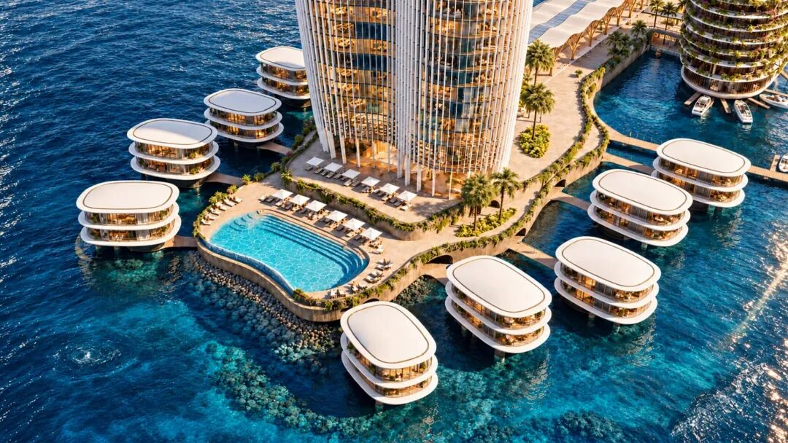
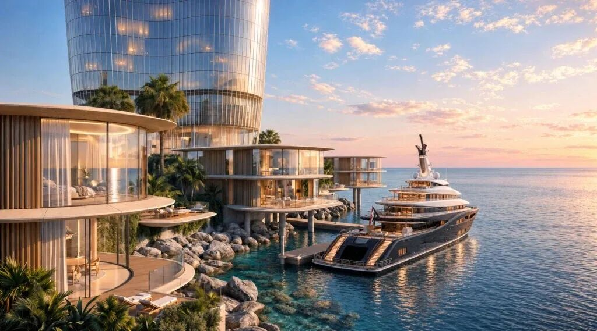
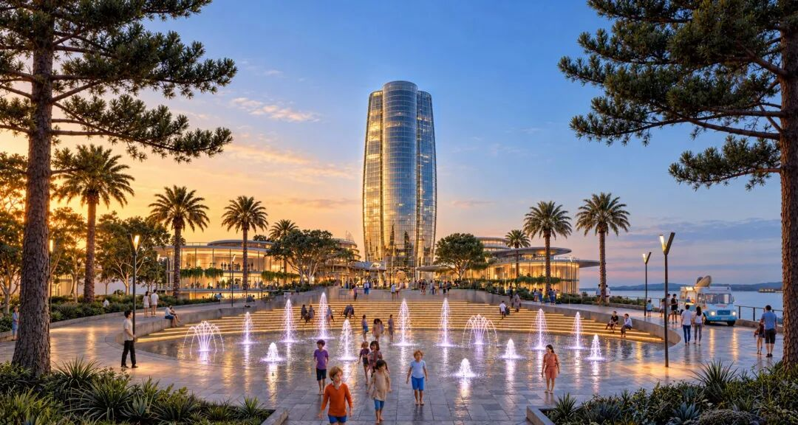
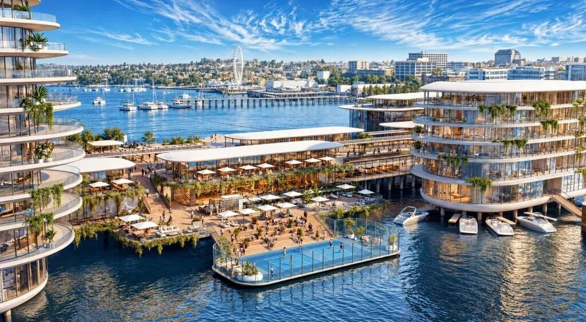
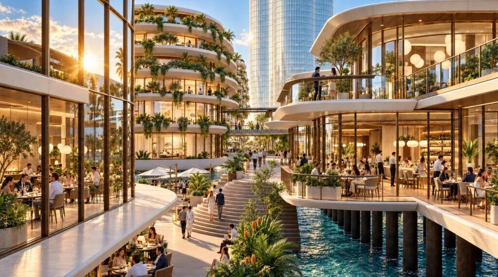
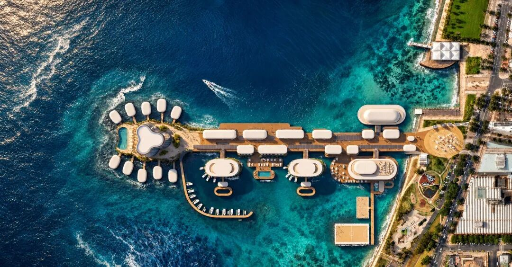

# SOM中标丨澳大利亚码头豪华滨水开发项目设计

国际建筑事务所SOM将把维多利亚州吉朗的一座历史码头改造成滨水目的地，并以一座圆形高层建筑收尾。SOM最近赢得了为开发商Gurner Group和Costa
Property Group设计这个1万平方米开发项目的竞赛。项目将在科里奥湾水面上增加公共空间、公寓、一座200间客房的酒店、商店和餐厅。

该项目将涉及改造和扩建现有的坎宁安码头。该码头最初建于1855年，为停靠船只提供铁路通道。它在1929年经历了大规模翻修，现在是一片停车场，尽头是餐厅和活动空间。该项目被设想为步行化的滨水目的地，游客将通过带水景的公共广场进入SOM改造后的码头。
The project will involve transforming and extending the existing Cunningham
Pier, which was originally built in 1855 to give railway access to docking
ships. It underwent major refurbishment in 1929, and now acts as a stretch of
car parking spaces culminating in a restaurant and event space.Envisioned as a
pedestrianised waterfront destination, visitors will enter SOM’s revamped pier
through a public square with water features.

一座34层建筑将在码头尽头拔地而起，超过21层的米拉马尔公寓塔楼，成为吉朗最高建筑。该塔楼平面呈三叶草形，形态将类似三个组合圆柱体，向顶部和底部逐渐收窄。沿坎宁安码头全长将布置一系列边缘圆润、露台层叠的建筑，SOM设计这些建筑以借鉴水的流动和海洋形态。

该豪华开发项目将包含约280套公寓和12栋滨水别墅，每栋配独立游艇泊位。活动空间和运动场将建在浮动平台上。SOM希望该项目将使坎宁安码头成为“既是水上社区，也是吉朗居民和游客的目的地”。

“一条高架公共长廊构成了方案的组织的脊梁，”SOM表示。“通过将新建筑沿历史码头布置，设计保留了下方现有结构，同时在上方创造步行环境。”“商店、餐厅和聚会场所将沿路线排列，将城市与活动及科里奥湾景观连接起来。”
A 34-storey building will rise at the end of the pier, which will surpass the
21-storey Miramar apartment tower to become Geelong’s tallest building.Trefoil
in plan, the tower’s form will resemble three combined cylinders that taper
towards the top and bottom.Lining the length of Cunningham Pier will be a
series of buildings with rounded edges and layered terraces, designed by SOM
to reference the movement of water and marine forms.

据SOM介绍，重建将在码头创造新的海洋栖息地以支持生物多样性。
“这一生态目标属于更广泛方法的一部分，该方法将滨水区视为公共生活和海洋生物的共同场所，”该事务所表示。SOM最近公布的其他项目包括芝加哥滨水场地上的一座阶梯式摩天大楼，以及在堪萨斯城建造20层数据中心的计划。

fr  o  m：SOM  ，  在此  作为  交  流，如涉及作品内容、版权和其它问题，请及时与我们联系，我们将在第一时间删除，感恩您的理解包容。
    
