# 如果鸟巢长这样？2008年那些北京奥运会主体育场未中标的方案！

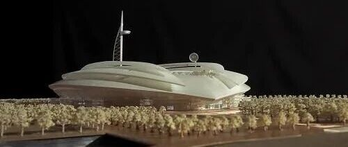

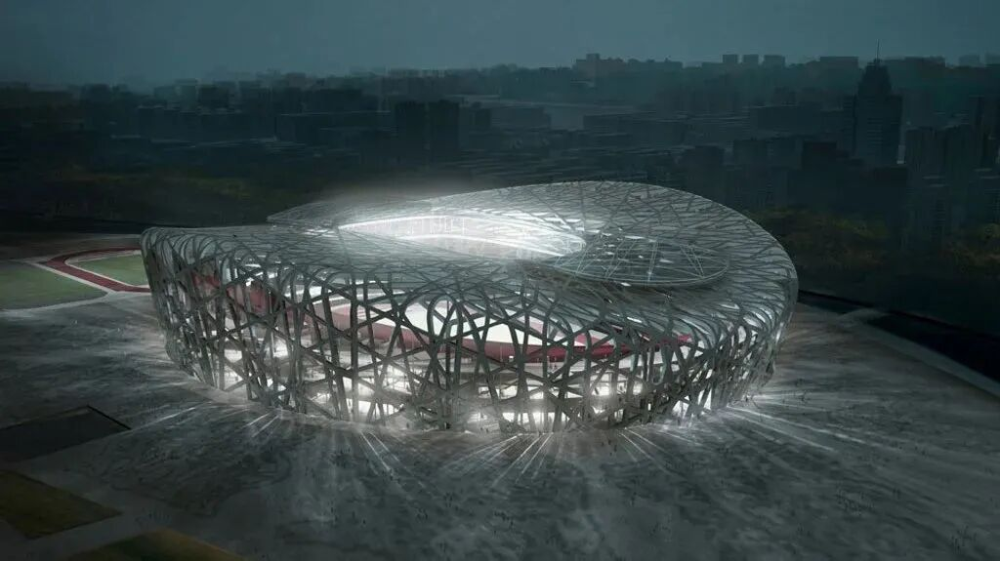

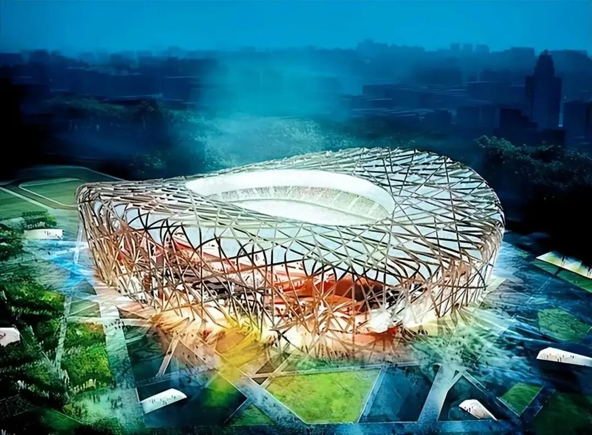
如果鸟巢长这样？应该叫什么名字？
方案一：
该方案的屋面是世界上独一无二的"浮空开启屋面”，体现了绿色奥运、科技奥运的精神，同时它象征着"开启”和“腾飞”。刚性观光走廊、8根构架式龙骨、隔层网、氨气囊以及外蒙皮等构成了巨大的飞艇，20个由高强度聚乙烯或凯夫拉绳网构成的隔层网来分隔内置的氨气囊和20万立方的氨气为飞艇提供了足够的升力。设计时，对控制、安全、维护等方面经过了仔细的考虑，确保实际使用时的安全可靠。
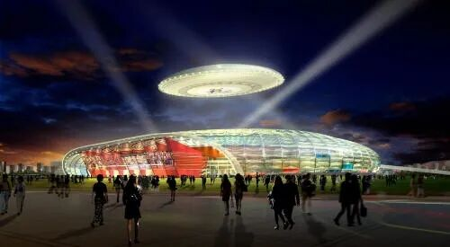

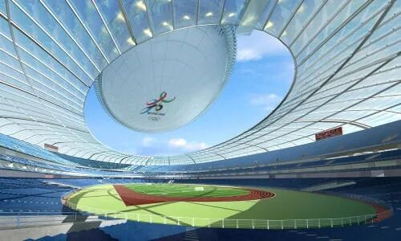

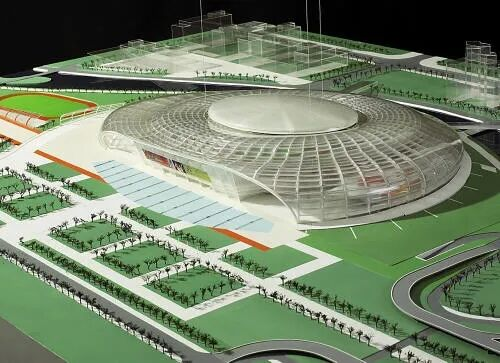

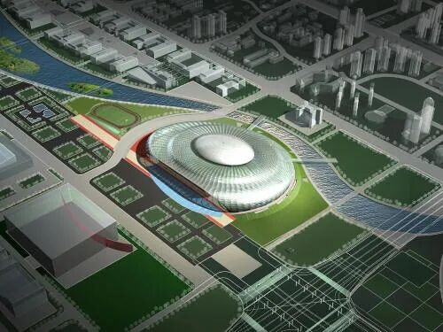
赛时座席数为10万个，其中永久座席8万个，临时座席2万个，赛后临时座席可以拆除，利用所占的空间建设一定的经营性用房，便于赛后的综合开发利用。
方案二：
这个方案的屋顶采用了一系列自由轻巧的花瓣结构所构成，它可以根据各种不同的情况自由开合，来满足不同需要，半透明的材料使得遮阳和自然采光兼而有之，并能使屋顶随时敞开实现自然通风。象征着“绿色奥运，科技奥运，人文奥运”的理念，从更广的意义上来说，代表了"自然，科学和人类”的思索。
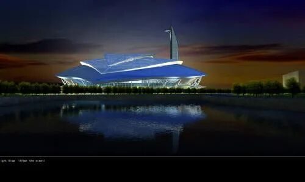

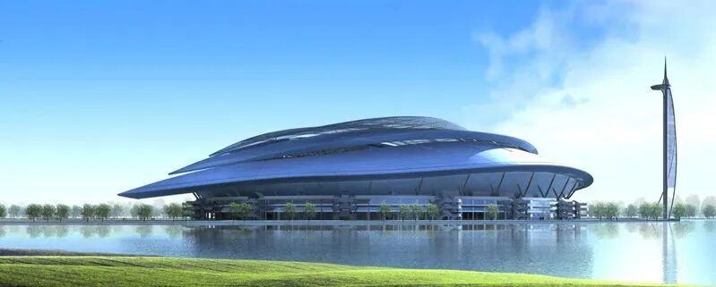

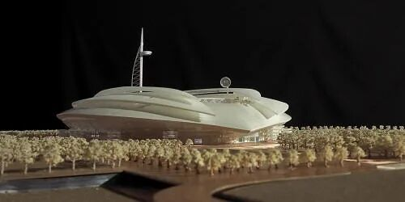

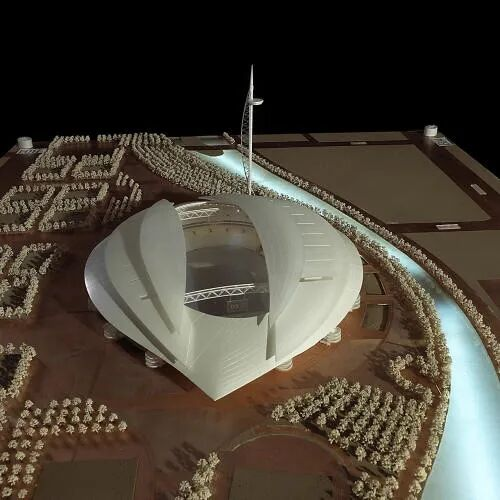
圆形的主体育场可以容纳10万名观众观看比赛，碗型的设计保证了良好的座席视线。奥运会之后，可以永久性的拆除南面2万个座位，使体育馆容量变为8万人，并将腾出的空间改建为文化娱乐活动的舞台。
方案三：
这个方案的顶部造型的象两片树叶，也象充满活力的肌肉，延伸至底部的两翼实现了空间上的互通，成为了世界上独一无二的\"屋顶通道\"。片巨型的树叶轻捷地栖息在一块晶莹的卵石上，它是连接远古与现代、中国与世界、象征与现实的纽带，它定位于文化和艺术中轴线的交点。
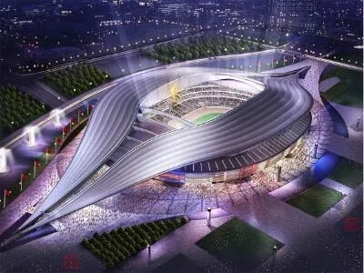

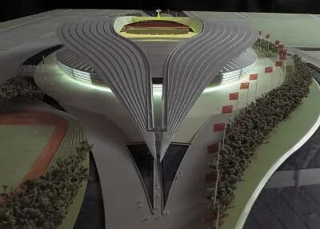

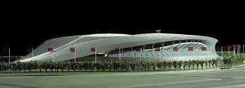

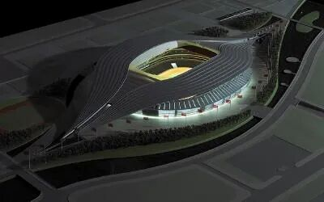
建筑面积150，000平方米，奥运期间体育场内可以容纳10万人观看赛事，赛后，可以将2万个临时座席拆除以作他用，需要时还可以重新搭建。
方案四  ：  以200米高的生态塔为核心，塔身集成四组高效风力发电机组，所发电能可满足周边照明需求，实现了建筑美学与绿色功能的有机融合。
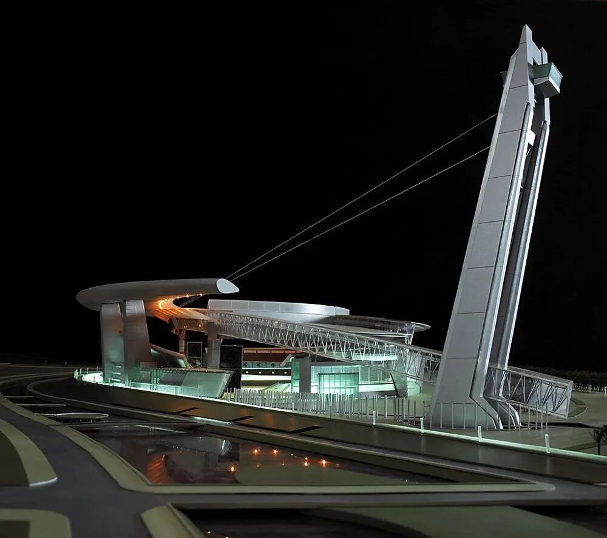

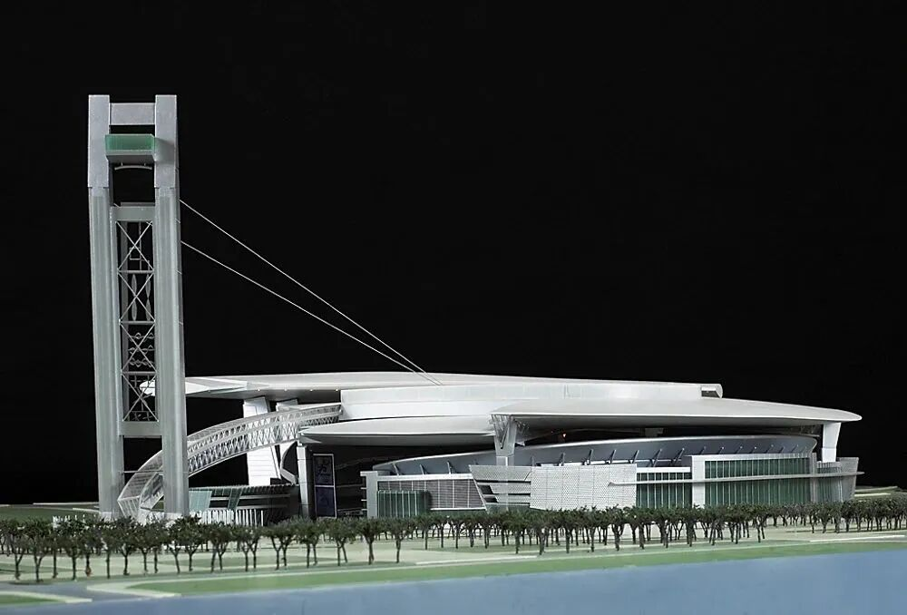
方案五：
场馆的设计核心是其屋顶系统，通过错落有致的天空露台群，为观众带来多层次的观赛视角。结构采用多层级桁架转换技术，将基础网格由椭圆形自然过渡为圆形，实现了建筑形态与结构逻辑的高度统一。
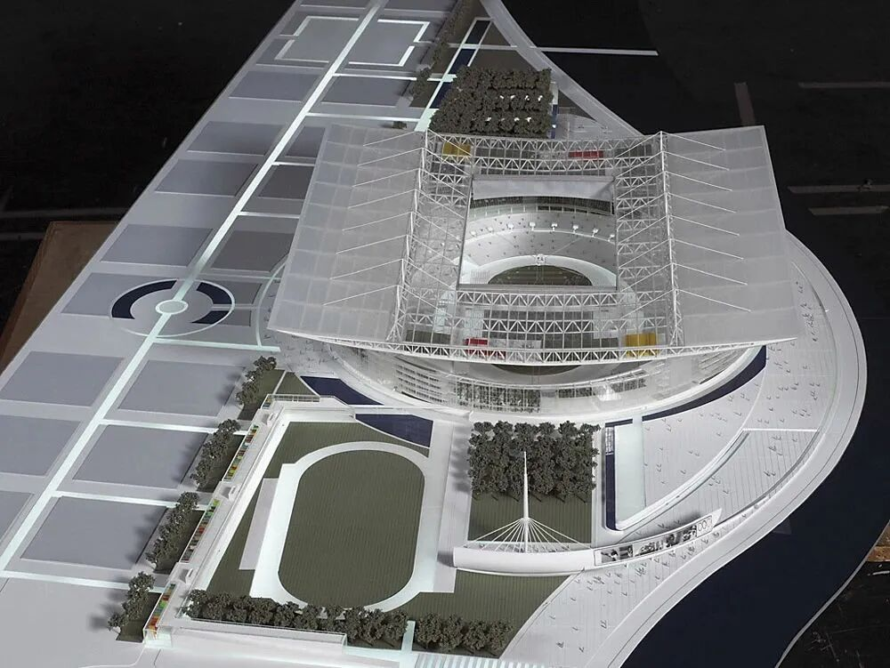

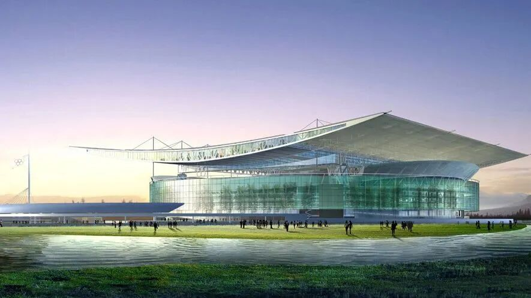
方案六：  以仿生理念打造，整体如绽放花朵，由弧形“花瓣”环绕主体。馆前设宽阔水景，通过镜面水池形成“睡莲浮于碧波”的诗意画面。
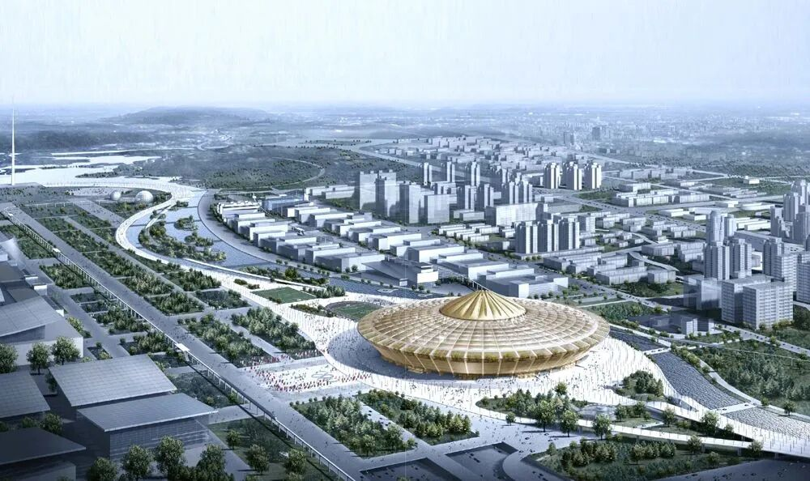

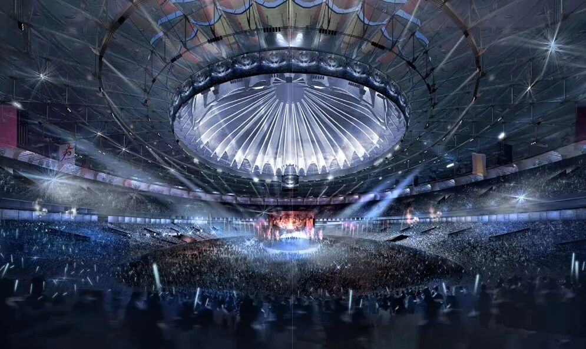
方案七：  以仿生理念打造，整体如绽放花朵，由弧形“花瓣”环绕主体。馆前设宽阔水景，通过镜面水池形成“睡莲浮于碧波”的诗意画面。
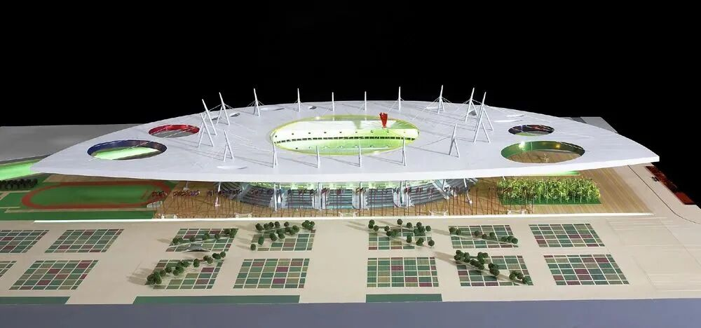

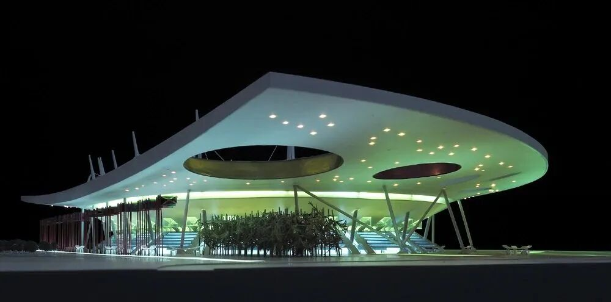
fr  o  m：网络  .  ，  在  此  作为  交
流，如涉及作品内容、版权和其它问题，请及时与我们联系，我们将在第一时间删除，感恩您的理解包容。
    
