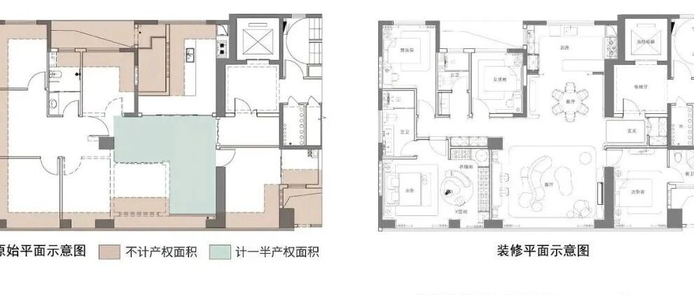
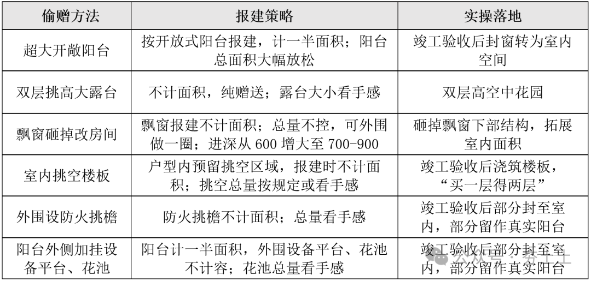
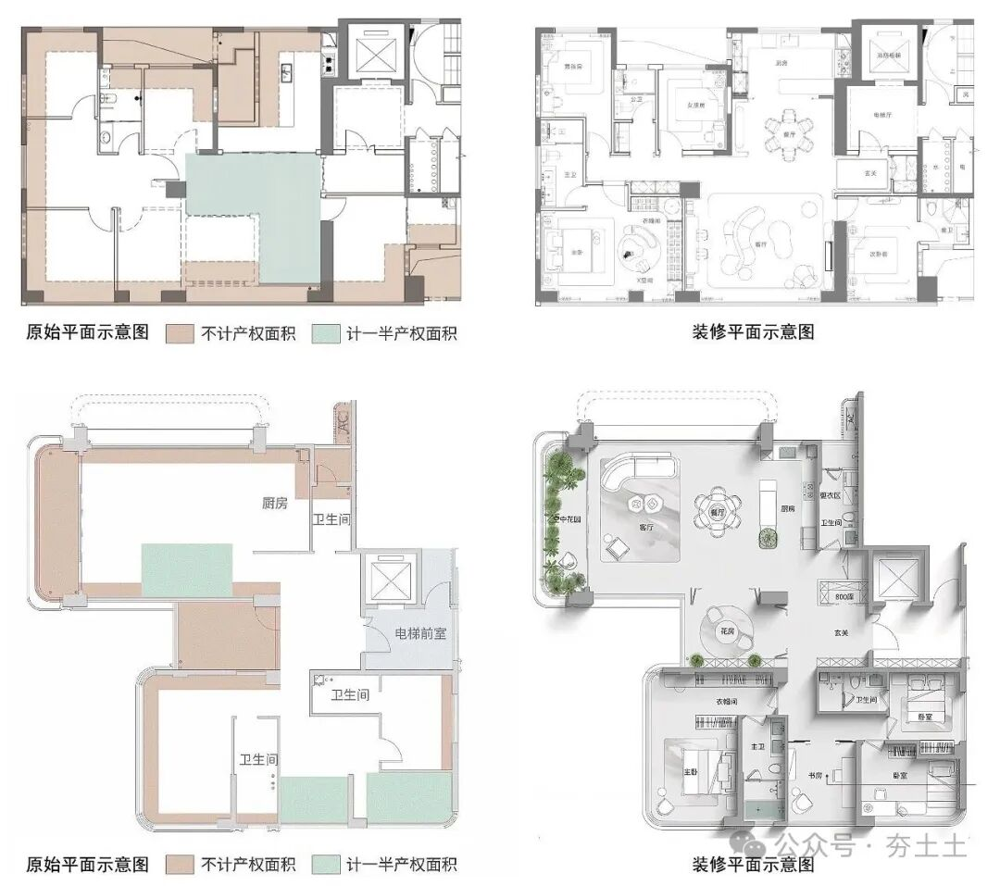
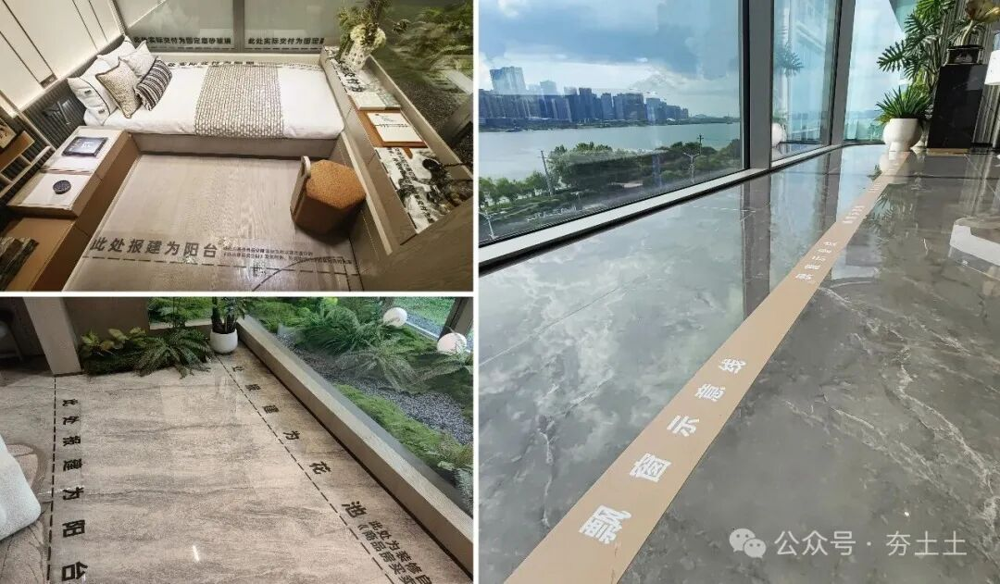
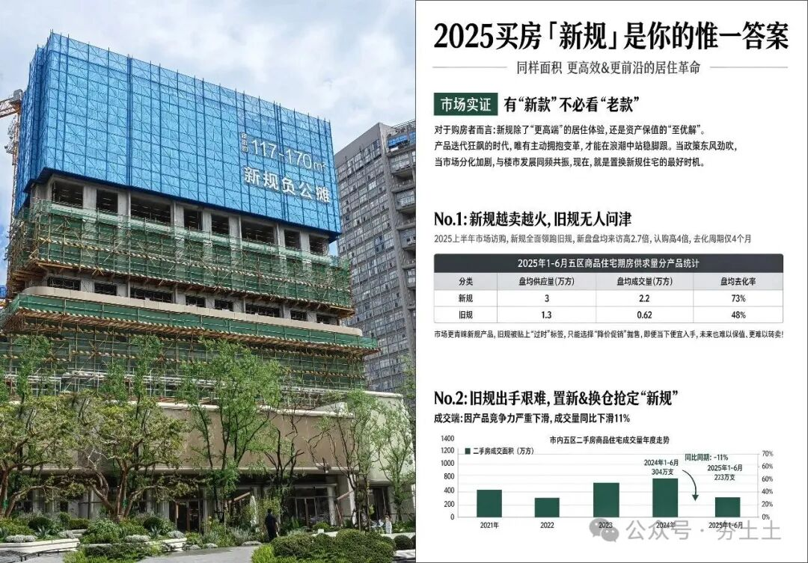
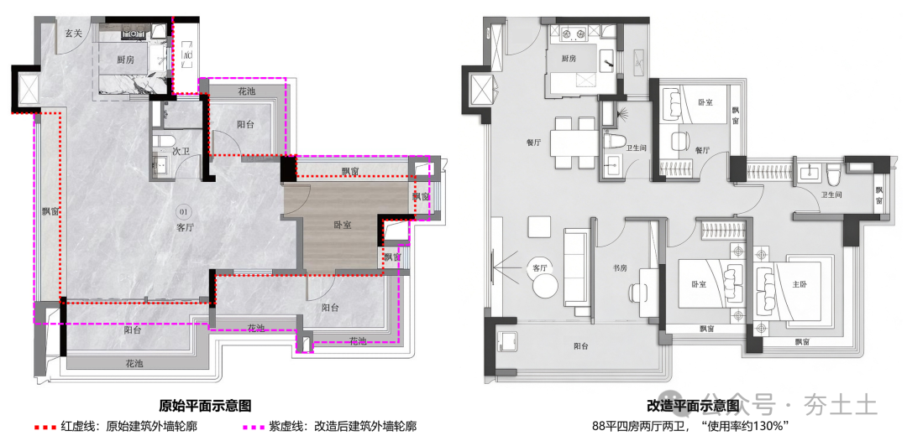
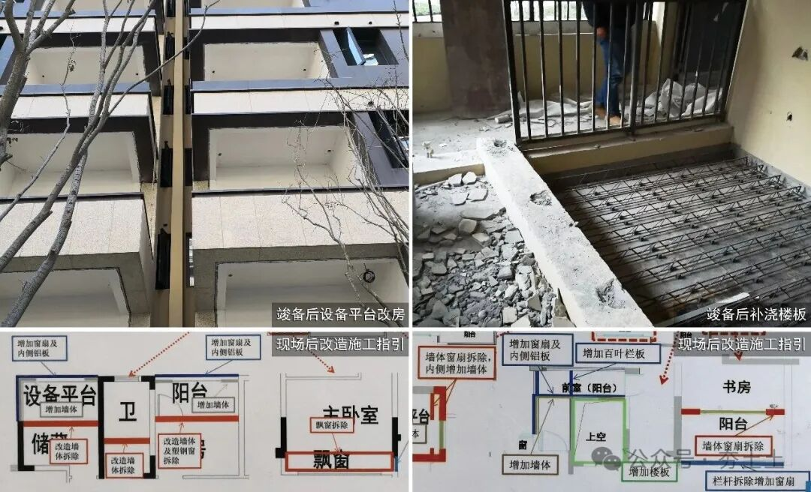
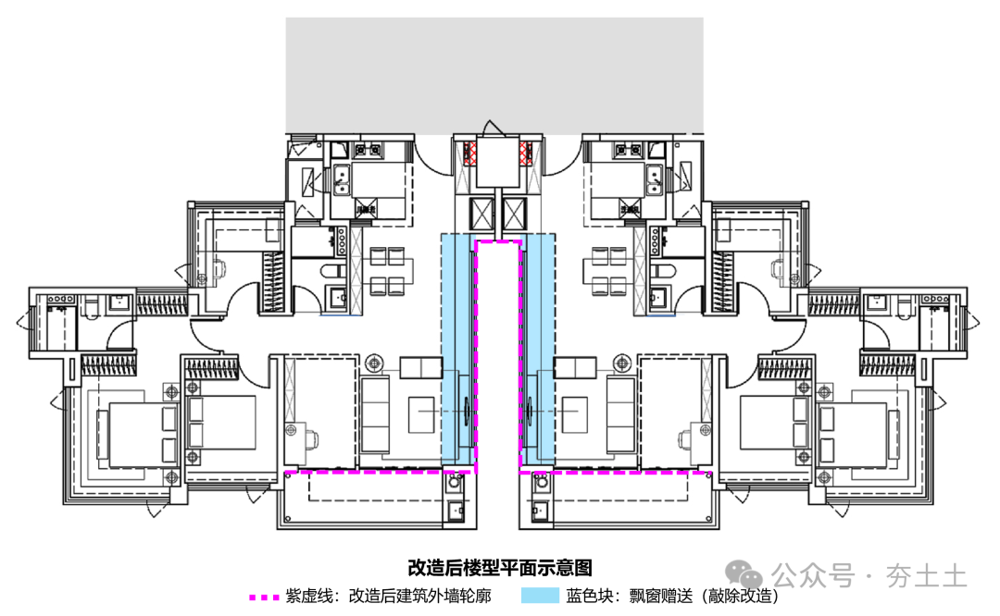

# 靠偷面积能成就好房子吗？

以下文章来源于夯土土  ，作者夯土

野百合有春天，野路子  没  有
** NO. 1｜壹  ** **
** 两千年前的升斗与人心  **
春秋末期的临淄城，繁华之下暗流涌动。
彼时齐国的公室，依然恪守着立国数百年的法定量器——“公量”：
四升为豆，四豆为区，四区为釜。
这是齐桓公称霸、管仲理政留下的规矩，是通用于齐国大地的法度，也是维系国家赋税与市井交易的基准尺。
然而，执掌国政的卿大夫田氏，却悄悄在深宅大院里铸造了一套截然不同的量具——“家量”。田氏将每一级量器的容积，整整放大了四分之一：
五升为豆，五豆为区，五区为釜。
百姓春荒借粮赈灾时，田氏大开私廪，任由家量用大斗借出  ，极尽仁义之名；  等到百姓偿还粮食时，则按照公量的标准收回。
一收一放之间，百姓借一豆还一豆，平白多得了二成的粮米。
史载，不过数十年光景，齐国万民
“归之如流水”。
百姓盛赞田氏之德，而将苛敛之名尽归公室。深居宫阙的姜齐国君，尚自得于府库未亏、法度未乱，殊不知，支撑其八百年社稷的天下之秤，早已在升斗的方寸挪移之间，被悄无声息地抽空了底座。
后人读史，多将“田氏代齐”视作一场旷日持久的道德收买；但若以制度与经济的冷峻目光审视，那分明是一场以“私改度量衡”为刃、行隐性利益再分配之实的旷世制度套利。田氏未动刀兵，未改赋律，仅仅是将法定计量标尺放宽了一格，便重塑了人心的流向，改写了历史的国祚。
** NO. 2｜贰  **
** 末世困局：大斛激荡天下  **
田氏之所以能成事，在于他巧妙地利用了“双重度量衡”的刻度差。他在官方标准之外，私自设立了一套更宽松、更具诱惑力的“大斗”。百姓在短期的物质获利中狂欢，却在无形中协同田氏架空了国家的法度。这留给后世的深刻启示是：掌握资源的权力主体，只要私自更改计量标尺，就能以极低的成本，悄无声息地完成财富的隐性转移与人心的定向撬动。
** 如果说田氏代齐是主动利用计量规则重构秩序，那么王朝末世的度量衡崩坏，就是标准失序后的系统性灾难。  **
明朝开国时，太祖朱元璋曾铸“洪武铁斗、铁尺”颁行天下，确立统一法度。然而到了明末，面对辽饷、剿饷、练饷等三饷加派的泰山压顶，朝廷的税负已至极限。地方官吏与粮长胥吏不敢明目张胆在正供之外横加名目，便心照不宣地在度量衡上大做文章：法定一石为十斗，各地官府征税时私自铸造特大斗斛，实际一石要多出两三斗；再加上“淋尖踢斛”，使百姓实际完税负担凭空暴增三到五成；赈灾与发饷时又换用微型小斗。
更严重的是全境度量衡彻底碎片化：一省之内斗尺不一，府县各自为政，市井商贾纷纷私造量具套利。社会交易标准难寻，田产交易与粮食买卖纠纷呈爆发式增长，商业流通成本飙升，最终成为激起席卷全国的明末流民起义的导因之一。
到了清代中后期，这一幕荒诞剧再次以更高的频率重演。朝廷标榜“滋生人丁永不加赋”
的祖制，官方法定税率不能动，朝廷在两百余年间不敢在明面上加征漕粮正额。然而嘉道以降，地方财政亏空如海，漕运链条层层盘剥。地方官吏便在漕斛上极尽钻营——私铸特大仓斛，配合踢斛抛撒，账面完税一石，实收往往是一石五斗甚至两石。祖制的面子保住了，民间的里子却被掏空了。
同时全国衡法陷入严重割裂：银两称重有库平、漕平、关平、市平，长度有营造尺、裁衣尺，各地标准相差悬殊。跨区域经商必须反复折算，欺诈丛生、争讼不休。江南作为赋税重镇，受害尤甚。这种因度量衡失序带来的治理危机与公平崩塌，直接引爆了道光、咸丰年间江南普遍的“抗粮闹漕”大暴动，成为摇撼晚清政权的致命推手。
** NO. 3｜叁  **
** “买100平得130平”的新规好房子  **
两千年后，夯土的好朋友小李飞泥，在上个周末去了售楼处。
他回来后激动不已：“夯土你知道这房子有多好吗？买百平得百三、飘窗可敲、阳台露台大赠送、得房率突破110%！我本来钱只够买小三房，现在一下子干到了四房，父母都能接过来住了！”他脸上洋溢着幸福的光晕，把周边的墙面都照亮了。
望着小李飞泥炽热的眼神，天天被行业鞭打得灰头土脸的夯土，感到一股暖流从丹田升起，深感欣慰：真好啊，不枉我天天刻苦钻研。
他说的这套打法，我太熟悉了：
2023年之后，地产市场持续下行，城市分化加剧，弱二线及三四线城市土地流拍严重，新房去化困难。地方政府为托举土拍市场、稳定新房量价，开始在产品规则上松绑。各地住建与规划部门相继出台“产品新规”，借着“支持高品质好房子建设”的东风，大幅放宽对户型面积计算的限制，实则为变相提升赠送率，用“赠送面积”制造价格优势。这套玩法从财政压力大、楼市低迷的城市率先出现，快速传导至强二线甚至一线城市，最终蔓延全国，业内直白称之为“新规高赠送”。
具体操作手法五花八门，尺度远超行业既往三十年：超大阳台计容一半，竣工验收备案（简称“竣备”）后封闭转为室内空间；超大双层高露台不计容；超大飘窗不计容，竣备后拆除下部结构以拓展室内面积；户型预留挑空区域不计容，竣备后统一浇筑楼板；户型外围设置防火挑檐不计容，竣备后改造为室内空间；更有能人可以在阳台外侧再外挂设备平台、花池，进一步增加赠送面积。

图-1 “新规高赠送”常见做法
备注：仅示意市场常见手法，不同城市的属地做法不同、松紧程度不同
于是，现在市面上会看到这样突破认知的“新规户型  ”  正在热销：

图-2 户型原始平面与装修改造平面
图片来源：项目官方宣传物料，作者整理
  * 棕色部分：沿户型外围先布置一圈“飘窗”，再叠加局部设备平台、挑檐、露台，所有这些，全部属于“不计产权面积”；
  * 绿色部分：每套户型依规范拥有一定比例的阳台面积，产权计一半。正常应临外墙布置以符合生活场景，但具体报批就各凭本事，深埋于户型内部也不要惊讶。
  * 白色部分：这才是常规理解的“室内部分”，然而从原始平面图上来看，我们甚至都无法辨认，这个白色部分的“户型”到底是个什么格局。
最后，所有的奥秘都藏在“装修平面示意图”里，这才是在报规户型图之外真实的居住空间，当然，它是“改造后”的。
与此同时，这类面积赠送的操作不再只隐藏于报建图纸的细节之中，而是光明正大地走进了项目样板房，成为销售端最核心的产品卖点。

图-3 户型样板房改造示意图
图片来源：项目样板房实景照片，作者整理
正如图-3的样板房实景所示，地面清晰标注出报建阳台、设备平台、飘窗的边界线；销售顾问会沿着标识逐一讲解每一处赠送空间、每一种竣备后改造方案，直白地向客户点明：飘窗是可以敲掉的、阳台要改成房间、花池可以包进室内、防火挑檐实际上是阳台或房间。
——  “买  到的和得到的不一样”  ，不再是心照不宣的潜台词，而是被明明白白放到了台面上，让人热血沸腾。
在对外宣传推广的项目核心竞争力中，“新规产品”、“新规得房率”、“新规负公摊”，也成了产品的最核心卖点。排名第一的关键词，不是品质更好、不是功能升级，是“负公摊”，是产权登记面积与实际建筑面积有着巨大的差值。

图-4 新规产品宣传海报示意图
图片来源：项目官方宣传物料，作者整理
小李飞泥依然沉醉在他热情描绘的未来美好生活里，夯土却又有点小焦虑了：
一不留神，友商又进步了啊。
同时，那股跨越千年的熟悉气息，竟如此真切地扑面而来。
** NO. 4｜肆  **
** 千年镜像：不动产领域的“私改升斗”  **
回望中国地产三十年的发展历程，通过规划设计突破面积限制的操作早已屡见不鲜，但在过往的市场周期里，这类做法始终游走在规则的灰色地带：设计阶段暗藏处理手法，交付后业主自行改造；销售端也只可意会不可言传，全程遮遮掩掩，始终登不上正式的推广台面。
从未有哪一个阶段，像这一轮“新规高赠送”这样，将规则的松绑与突破演变为全行业公开的销售逻辑，整个市场的合规底线被彻底刷新。
在行业规则日趋细化、监管持续收紧的大背景下，这种堂而皇之的“规则放水”，堪称一场醒目的行业黑色幽默。更滑稽的是，这场席卷全行业的“面积赠送竞赛”，实则将所有房企都裹挟进了违规钻营的赛道：各家为突破面积限制绞尽脑汁、动用各类公关手段；而不愿突破规则、不参与此类操作的企业，反而在市场竞争中处于明显劣势，面临被淘汰的风险。
这几年，中国房地产跌到了谷底。大家都在追问：
地产的春天，在哪里？
在行业漫长寒冬里苦苦寻觅“春天”的人们或许未曾意识到：古代权力在饥馑与变局中操弄的“私改升斗”之术，如今正换上一身“好房子新规”与“第四代住宅”的华美盛装，在现代不动产的世界里粉墨登场。
表面上看，这是一场  “开发商好卖房、购房者占便宜、政府好卖地”  的三赢游戏，但在冷酷的经济规律与城市规划逻辑面前，  天上从来不会掉馅饼
，这种规则松绑下的“合规偷面积”正在酿成极其深远的制度性与社会性灾害。其破坏力甚至不亚于前几年“双限时期”（限地价、限房价）的降标减配——如果说降标减配耗损的是单个项目的产品品质，那规则松动侵蚀的，就是城市规划与产权计量的底层标尺。
一、计量标尺松动：升斗方寸间的历史镜鉴
在中国古代的治理叙事里，度量衡从来不是匠人手中的技术参数，而是国之公器，是天下公义的基准线。斗、升、尺、寸一旦由国家标定，就是全社会公认的价值基准，一尺一斗的校准，关乎赋税公平，关乎市场秩序，更关乎民心向背。
方寸之间的改动，足以撬动利益格局，甚至改写王朝命运。翻开中国历史，权力对度量衡刻度的每一次私自篡改与任性松动，都曾演变为深刻的制度动荡与社会灾难，正如前面的“田氏代齐”与“末世困局”。
放到今天的房地产市场，法定建筑面积就是不动产领域的“官定度量衡”。
它是产权登记的基础，是交易定价的标尺，是税费征缴、拆迁补偿的依据，其严肃性与古代的升斗尺寸一脉相承。尺子一旦歪了，财富分配的秩序就会全盘崩塌；标准一旦乱了，交易成本与社会矛盾就会几何级爆发。
而当下的“新规偷面积”，本质就是现代不动产领域的度量衡失准与标尺失范。
近年各地以“产品创新”为名各开暗门的面积规则松绑，本质正是对这把公共标尺的隐性调整——历史上反复上演的计量博弈，千年之后换了一副面孔，重新出现在地产市场。
现代社会在担心货币通胀的同时，先迎来了面积通胀。同样标注100平方米的产权面积，新规项目实际使用面积比存量住宅多出20%-40%，
等于悄悄稀释了“平方米”这一计量单位的实际内涵。
这其中恰好对应着历史的双重镜像：
一面是田氏逻辑的当代复刻——地方与房企打着“让利消费者”的旗号，“大斗出粮”，用赠送面积制造获得感，实则架空了国家统一计量规范的严肃性，让法定建筑面积的公信力打了折扣；另一面是末世弊政的现实投射——地方财政承压、土地市场遇冷，为托住房价地价，便在度量衡上变相注水，用面积膨胀托举货值与地价，最终将稀释成本转嫁给存量房主，把配套压力甩给未来城市。
这种计量标尺的松动，正在将不动产市场拖入“度量衡双轨制”的泥潭：
早年购房的业主，手中“足值面积”的房产变相缩水，财富被无声剥夺；后期购房者看似赚取了使用面积，实则支付了对应价值的房价，还为未来交易、征税、补偿埋下了产权隐患。更严重的是公平性问题：统一计量标准被打破，市场同时流通“足值面积”与“注水面积”两类房产，计价单位看似一致，实际含量天差地别。
这不仅扰乱了不动产定价体系，更破坏了产权登记的严肃性。历史上每一次计量标尺的放水，最终都会由全社会承担长期成本。
这一次，也不例外。
二、定价体系紊乱：冲击存量市场，打断置换循环
新规项目凭借“超高得房率”大打价格战，相当于以隐性面积补贴变相降价，直接冲击周边存量二手房市场。 同等地段下，新房买100平实得120-140
平，二手房100平即为实际  100平  ，即便单价更低也缺乏竞争力。由此导致二手房挂牌价持续下行，业主无法顺利售出旧房来置换新房，置换链条彻底断裂。
政策初衷是通过规则松绑托举新房市场，结果反而砸盘二手房，拖累置换需求，进一步加剧新房市场冷清，形成  “松规→二手房下跌→置换受阻→新房更冷”
的恶性循环。
三、规划刚性突破：从空间失衡到公共配套的长期透支
容积率是城市规划的核心刚性指标，同时约束着建筑空间体量与片区人口密度两大边界。从空间体量上来说，通过偷面积变相突破容积率，首先会让整个小区的建筑轮廓整体外扩、体量“大出一圈”，打破了周边区域既定的空间平衡：相邻地块的日照采光、自然通风、视野通透性、街道界面秩序都会受到不同程度的挤压，这是肉眼可见的显性影响。
相比之下，更隐蔽也更沉重的代价隐藏在公共配套层面
\----也是多数人完全没有意识到的重大长期隐患。超额的建筑面积意味着在法定规划之外超量导入人口，“两房变三房、三房变四房  ”
，片区的交通、教育、医疗、市政管网等公共配套的承载压力将被同步放大。它不会在房子交付时立刻显现，却会成为未来几十年城市运行的刚性负债——交通拥堵、学位紧缺、医疗挤兑、基础设施超负荷等一系列城市病，终将随着人口导入逐步爆发，最终由整个城市和全体市民共同买单。
本质上，这是将当下短期的土地财政压力与行业困境，转嫁给了远期的城市发展，与城市高质量发展的目标背道而驰。
四、资源畸形浪费：高质量口号下的低质量发展
为实现最大化面积赠送，户型与楼体设计被迫偏离正常逻辑。外墙轮廓无序延伸，不仅直接导致建筑保温隔热性能下降、运行能耗攀升，与双碳目标、绿色建筑导向背道而驰；更严重的是交付后的大规模拆改：砸飘窗、移外墙、浇楼板、封阳台、换门窗，产生巨量建筑垃圾，浪费天量建材、人力与社会资源，同时让报建时层层审核的“外墙节能计算”、绿色建筑标准成为一句笑话。
这样生产出来的所谓“安全、舒适、绿色、智慧”的“好房子”，从诞生之初就伴随巨大的资源浪费，所谓的“高质量发展”，在规则钻营面前沦为空谈。

图-5 户型改造前后的外墙轮廓示意
图片来源：项目官方宣传物料，作者整理
正如图-5所示，某热销项目“88平可得四房”、“使用率约130%”。为实现“大赠送”，项目通过花池、阳台、飘窗等多种手段报建，前期图纸审查、节能审核、规划报建、施工竣备均
按  红色虚线  的外墙轮廓执行，实际竣工验收后再改造至  紫色虚线  范围。
两段虚线间的差异如此之大，再加上改造阶段是没有第三方或政府监管的，以至于其既脱离了规划指标管控，也让外墙节能、保温隔热、防水气密等性能标准成为事实上无法考证的黑箱。同时，改造过程中伴随的大规模拆除、重建，甚至是精装房的局部拆除重建，更是人为制造出大量无意义的资源损耗。

图-6 竣备后改造与现场施工示意图
图片来源：项目实景图片，作者整理
在这种畸形的利益导向下，产品异化进一步从单户型蔓延至整栋楼的平面设计，出现了极具讽刺意味的逆向设计。
如图-7所示，大量项目的楼体上刻意设计“凹缝”，打造凹凸曲折的外墙轮廓，核心目的就是沿外围多做飘窗赠送——通过人为增加外墙轮廓的总长度，换取更多不计容面积。无论是建设阶段的成本浪费，还是后期运营的能耗陡增，都让绿色低碳的发展目标彻底落空——如果不紧急踩刹车，行业正在给未来生产出一批畸形的低质量“能耗怪兽”。

图-7 楼型设计凹缝增加飘窗赠送
图片来源：项目官方宣传物料，作者整理
** NO. 5｜伍  **
** 春天在哪里？  **
在2021年的高峰之后，地产旧时代的落幕比所有人预想的都要决绝。
高杠杆、高周转的玩法戛然而止，房价下跌、债务违约、停工烂尾、保交付成了时代不可回避的背景音，房地产成为这几年行业从业者与购房族最深的痛。
小李飞泥经常调侃：夯土，你整天愁眉苦脸的加班苦干，倒是说说你最近为行业做了什么贡献？
我说：我在研究偷面积。
小李飞泥：上次喊你看火箭发射，你说在研究偷面积；这次喊你看汽车起飞，你也说在研究偷面积。
我有点生气：开什么玩笑！  偷面积输给友商，怎么对得起我这985的本硕？
马斯克进步靠研究升空，我进步靠研究偷面积。
小李飞泥：那你看最近武汉小米员工住宅 “光谷梦享家”的新闻了吗？你觉得小米这种科技企业会偷面积吗？
我笑了：在周边项目的挤压下，如果不偷，你看它的房子能卖得出去不？
小米也得偷面积，
这就是时代的黑色幽默。
纵观三十年中国地产发展史，我们已经见过太多次这样的轮回，行业始终在与管制的博弈中摇摆，以及行业在规则缝隙里求生的惯性钻营。我们用持续十余年的调控、一轮惨烈的行业出清，才将扭曲的行业发展逻辑拉回正轨半步。
颇具讽刺的是，历史从不重复，却常同韵。我们曾经在房价上涨周期，行政限价压制市场，催生了降标减配的异化；而在目前的房价下行周期，规则松动托举市场，又催生出
一场更为荒诞的“面积通胀”狂欢。我们总试图扭转市场方向，结果却每次都在规则的边缘，长出畸形的果实。
这次，我们难道又要用新的规则扭曲，把行业再推回钻营的老路上去？
而且，这次是更为严重的扭曲。
古人云“谨权量，审法度”。计量标准的稳定，从来都是治理的基石。田氏靠它赢得人心，末世因它失去民心，一兴一亡之间，藏着最朴素的治理逻辑：标准的公正是最大的公正，尺子的稳定是最基础的稳定。法定建筑面积就是不动产领域的“官定度量衡”，靠松动计量标尺换取短期市场热度，本质是在透支公共信用的存量。方寸之间的改动看似轻巧，其背后的公平代价与长期隐患，终将需要整个市场与社会来承担。
新周期的开启，本应是中国房地产洗心革面、回归空间品质与居住本质的契机。我们付出了行业深度出清的沉重代价，终于迎来了产品回归居住、市场回归正常商业逻辑的时代。品质房企的长期坚持开始兑现价值，改善需求的释放指引着行业方向，一切都在向“好房子”的目标靠近。可新规偷面积的乱象，又给这份来之不易的回归蒙上了阴影。
本应依靠功能、材质、性能、设计、服务取胜的产品竞争，又有滑向“比谁更会钻空子、比谁赠送多”的苗头，如果任其继续发展，中国房地产就将错失这场真正的自我救赎。
所有人都在等地产的春天，但真正的春天不在尺子的小聪明里；好房子的春天，绝不会诞生于对规则的钻营与对度量衡的亵渎之中。
那么，春天在哪里？
小李飞泥说，我记得有一首儿歌很好听的。
春天在哪里呀
春天在哪里
春天在那偷来的飘窗里
这里有挑空呀
这里有赠送
还有那不计容的小把戏
    ****END**
     联系我们：sheji2415投稿邮箱：youtharch@163.com
    
