# 罗马公布“新教堂设计”竞赛结果，坂茂、BIG成功入选

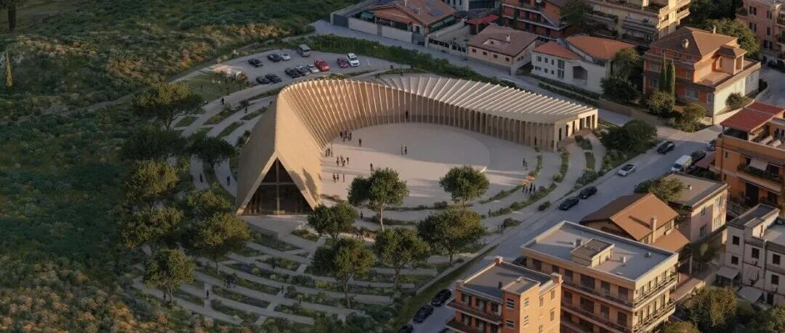

近日，意大利罗马教区公布了“新教堂计划”的设计竞赛结果，涉及罗马外围五个社区的宗教建筑建设，包括四座新建教堂和一座既有教堂的扩建。获胜团队中包括日本建筑师坂茂（Shigeru
Ban）和丹麦建筑事务所BIG创始人比亚克·英格尔斯（Bjarke Ingels）。
该计划由罗马教区联合意大利主教团推动，旨在为长期使用临时场所的堂区提供永久性宗教建筑。竞赛强调木结构与预制建造技术，同时关注建筑与城市环境的关系、宗教仪式空间、艺术表达、建造成本及后期维护。
获胜团队
01\.
切基尼奥拉——圣安塞尔莫堂
B15A，BIG - Bjarke Ingels Group
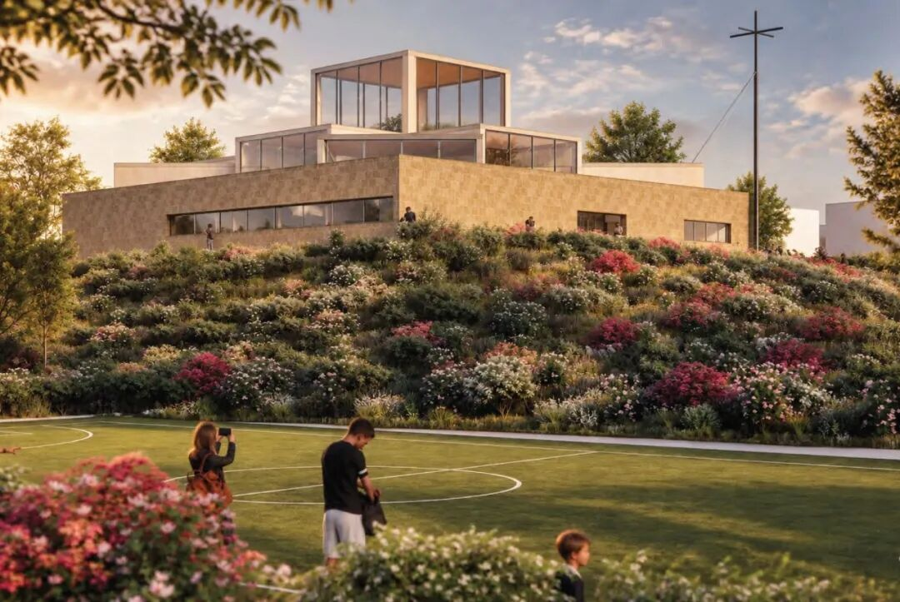

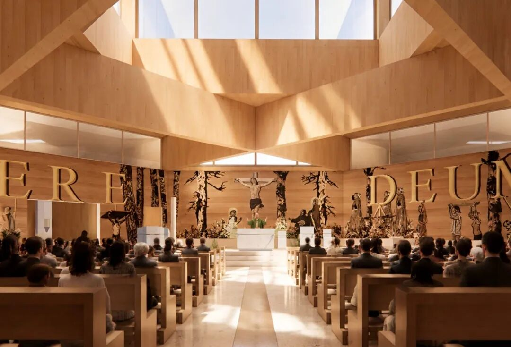
©B15A，BIG - Bjarke Ingels Group
由B15A  与BIG等人共同设计  的圣安  塞尔莫  教堂（Sant’Anselmo），  位于切基尼奥拉
。建筑采用逐级收缩的矩形体量，顶部结合玻璃采光界面，形成阶梯状轮廓。室内通过相互交叠的木梁组织顶部空间，自然光从不同高度进入礼拜大厅。祭坛后方设置大型宗教艺术作品，建筑整体布局还为未来堂区扩建预留了空间。
02\.
奥斯蒂亚——圣文森佐·德·保利堂
Vittorio Petrucci，坂茂 Shigru Ban
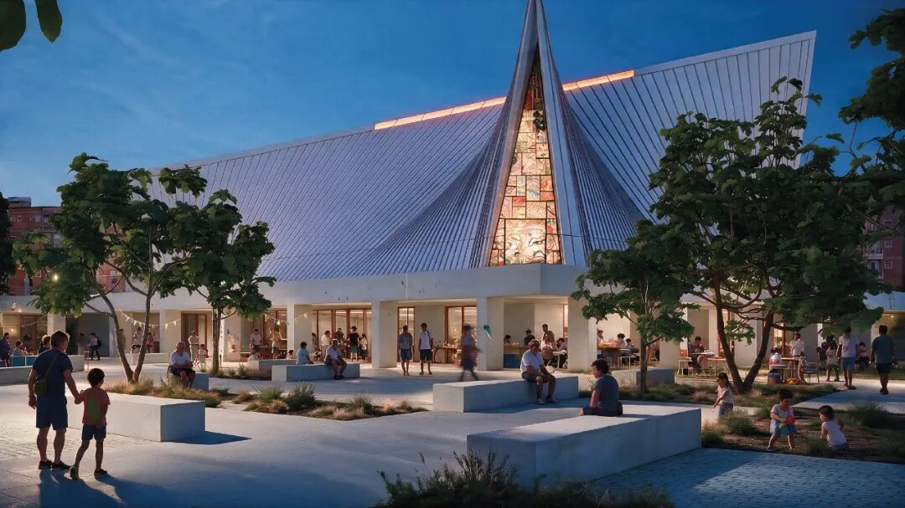

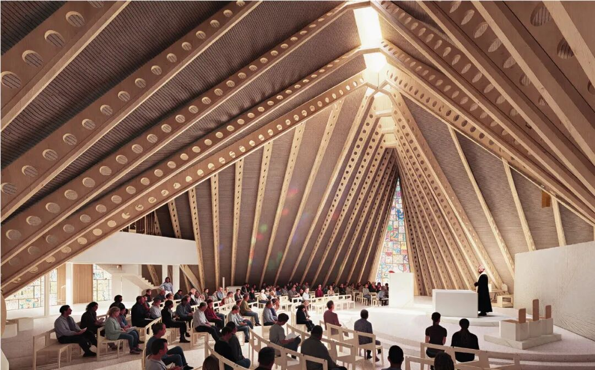
©Vittorio Petrucci ，坂茂 Shigru Ban
由Vittorio Petrucci与  坂茂共同设计  的圣文森特·德·保利教堂，
位于奥斯蒂亚。建筑采用连续起伏的曲面屋顶，两侧屋面向中央高点汇聚，形成具有竖向特征的建筑轮廓。室内采用外露木结构，倾斜排列的木梁沿屋顶展开，祭坛后方设置大尺度三角形彩色玻璃窗，将自然光、木结构与宗教艺术结合起来。
03\.
蒙特斯帕卡托——圣乔瓦尼·内波穆切诺·诺伊曼堂
VESPIER ARCHITECTS
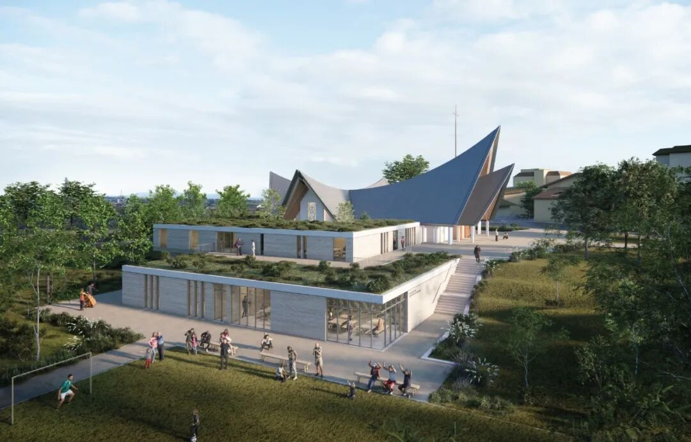

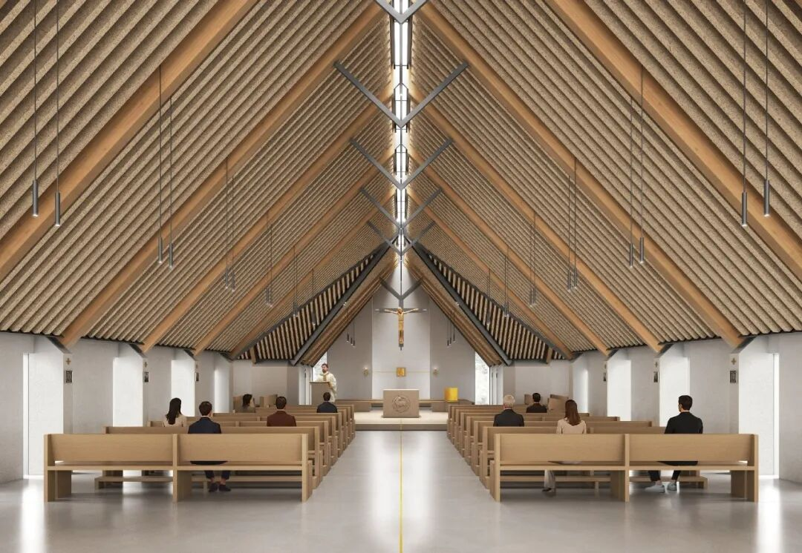
©VESPIER ARCHITECTS
由Danilo Antonello Vespier领导的团队设计  的  圣乔瓦尼·内波穆切诺·诺伊曼教堂，
位于蒙特斯帕卡托。建筑结合场地地形布置不同高度的体量，礼拜大厅采用双坡屋顶，连续排列的外露木梁形成具有方向性的室内空间。部分建筑屋面被处理为可上人的绿色屋顶，与周边开放空间和景观相连接。
04\.
帕尔马罗拉——圣布里吉达·迪·斯韦齐亚堂
ICARO PROGETTI
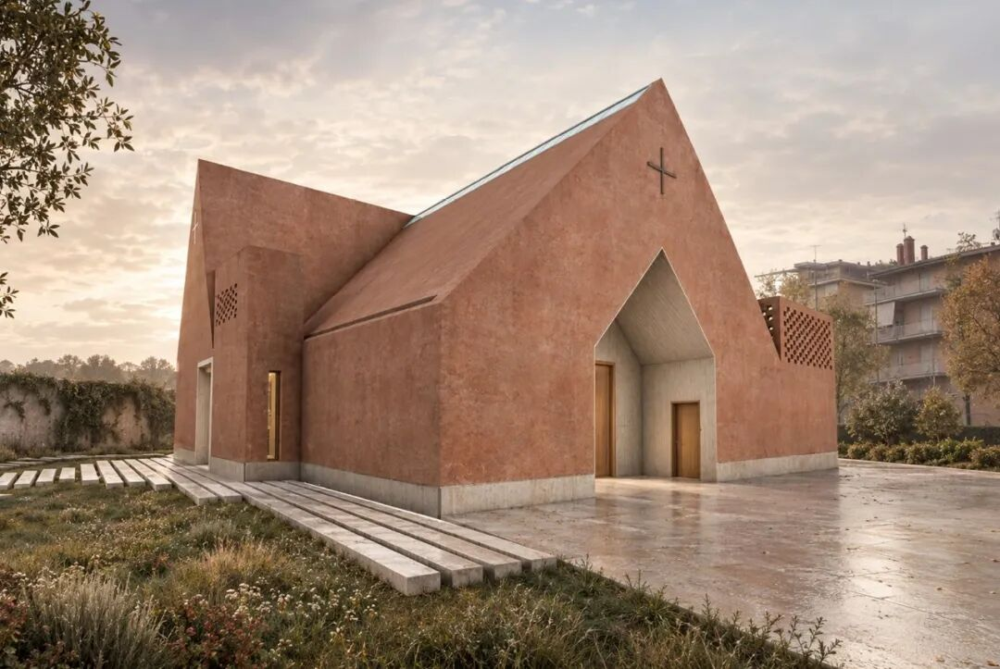

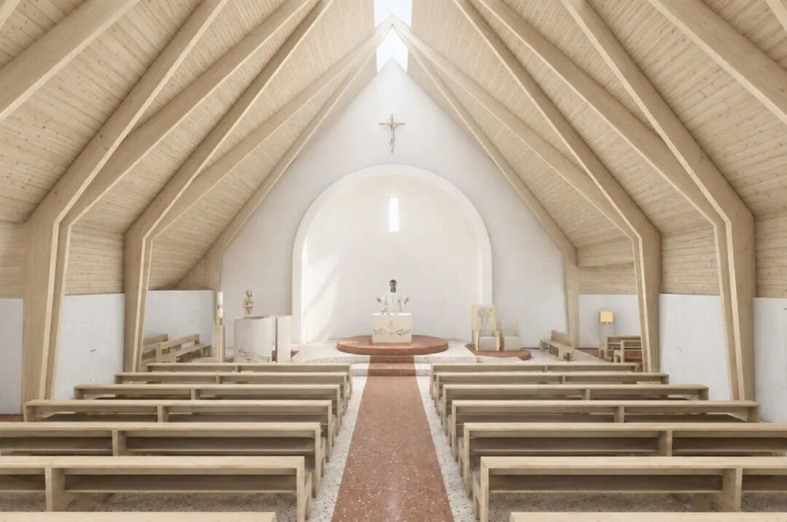
©ICARO PROGETTI
由Benedetta Fontana领导的团队设计的  圣布里吉达·迪·斯韦齐亚教堂  ，  位于帕尔马罗拉
。方案以圣布里吉德的生平与旅行为设计线索，采用金字塔形屋顶，并在建筑正面设置向内退让的入口。建筑通过朝向、材料和入口路径的组织，将宗教仪式中的行进过程转化为空间序列。
05\.
莫雷纳——圣安娜堂
Estudio Arquitectura Hago
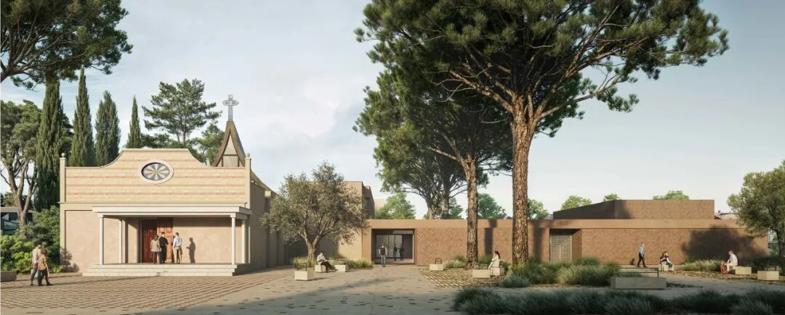

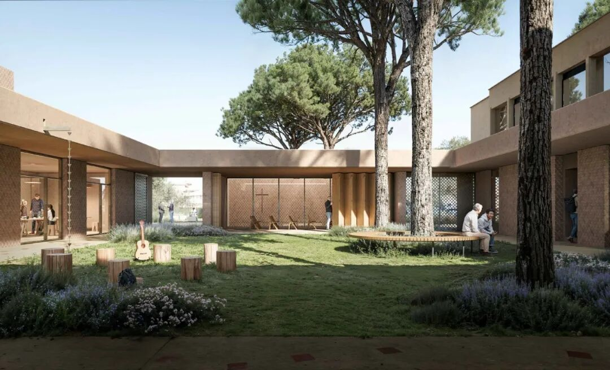
©AM3 Architetti Associati
由AM3  设计  的圣安娜教堂  位于莫雷纳，
是此次计划中唯一的扩建项目。新增建筑采用连续排列的竖向木构件，并通过有顶步道连接既有建筑与室外花园。设计保留了原有教堂的空间特征，同时调整内部功能和无障碍通行系统，使新增空间与既有建筑形成完整的堂区设施。
除了这五个获胜方案以外，评审委员会还为另外三个方案颁发了荣誉提名。
荣誉提名
01\.
蒙特斯帕卡托——圣乔瓦尼·内波穆切诺·诺伊曼堂
Vincenzo Ramires Pomella, Kengo Kuma & Associates
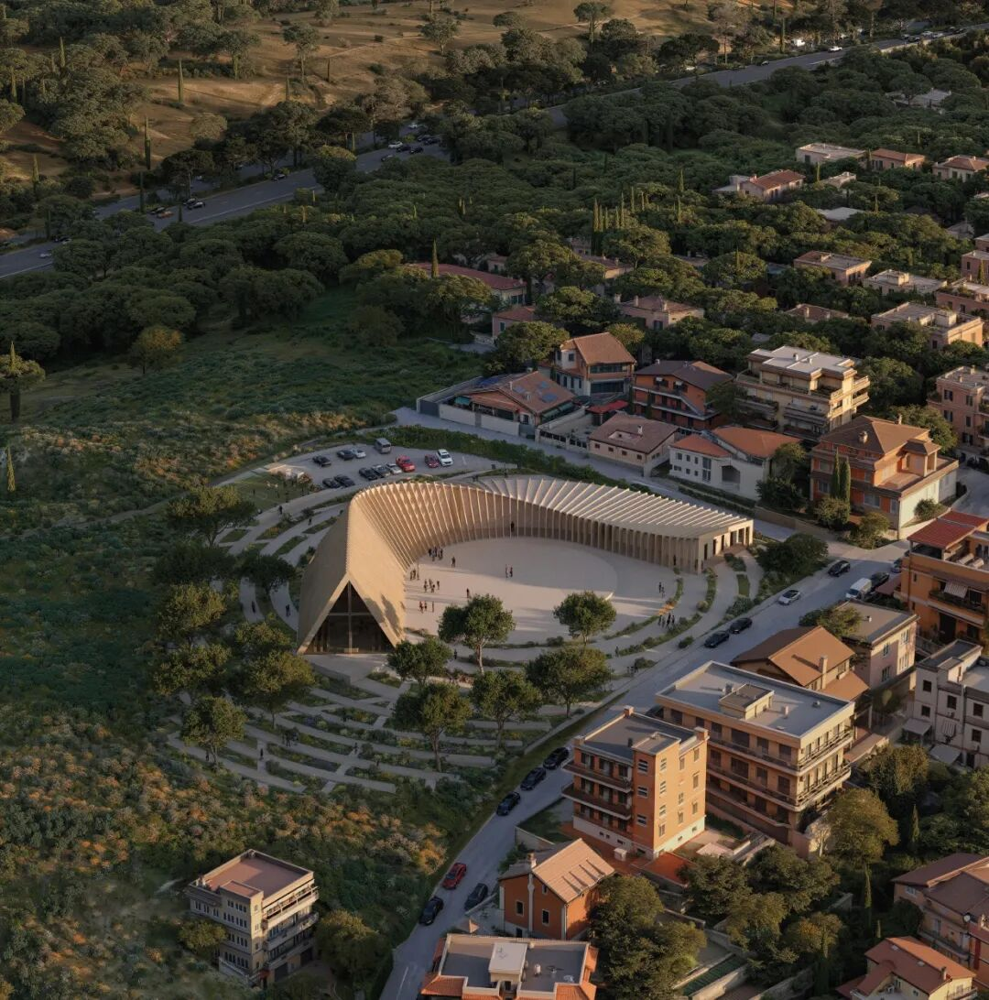

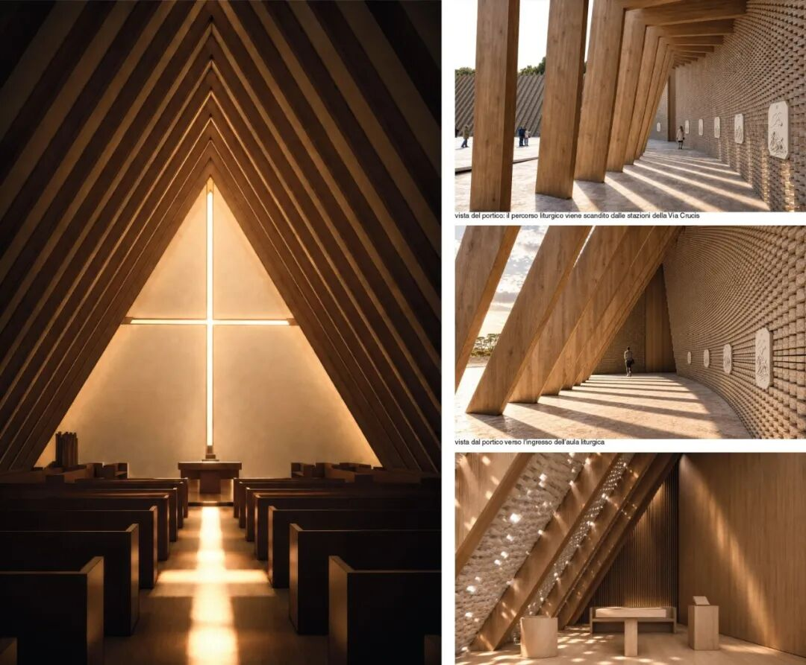
©  Vincenzo Ramires Pomella, Kengo Kuma & Associates
圣乔瓦尼·内波穆切诺·诺伊曼教堂的提名授予  隈研吾建筑都市设计事务所  & Associates、  Vincenzo Ramires Pomella
共同参与的设计团队
。该方案以系列化建筑构件的重复排列为主要设计特征，通过构件之间连续的组合关系组织建筑空间。不同元素在重复与排列中形成一定的空间节奏，同时建立建筑各部分之间的联系，使整体构图保持连贯性。评审委员会认可了方案在建筑构思上的原创性，以及系列化构件在空间划分和整体秩序组织方面的作用。
02\.
莫雷纳——圣安娜堂
Estudio Arquitectura Hago
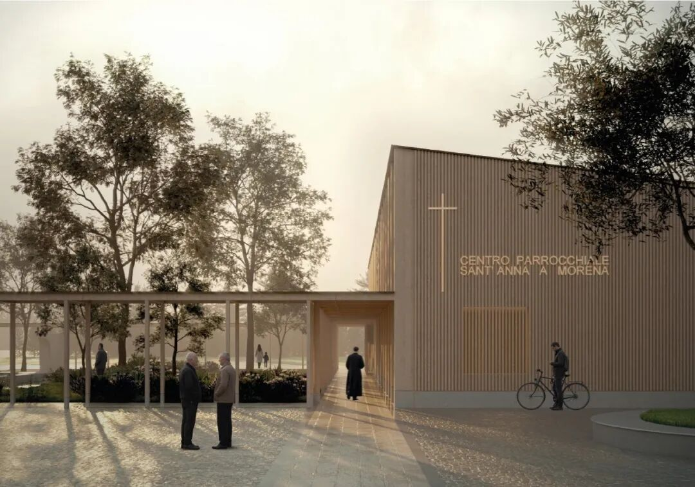

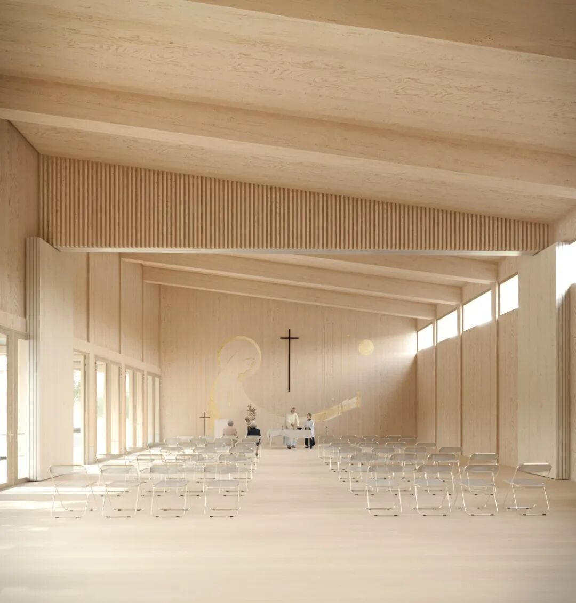
©Estudio Arquitectura Hago
圣安娜教堂扩建项目的另一项提名则授予  Estudio Arquitectura Hago  建筑事务所
。该方案针对既有堂区建筑的扩建需求，将环境可持续性与木结构建造技术作为主要设计方向。设计团队通过对木材建造技术的应用，回应竞赛对于建筑材料、施工方式及环
境影响的要求。评审委员会特别认可了方案在环境可持续性方面与竞赛要求的一致性，以及对木结构技术的运用。
03\.
帕尔马罗拉——圣布里吉达·迪·斯韦齐亚堂
Francesca Leto，Michele Battistella，Daniele Bertoldo
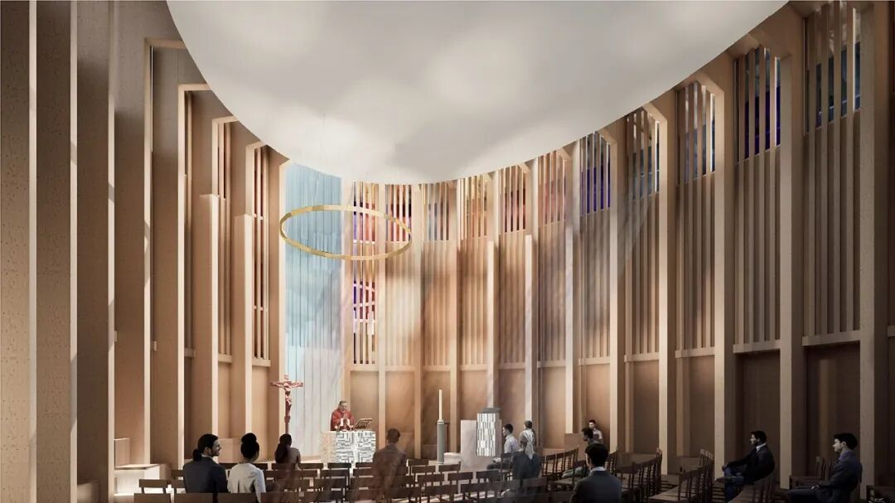

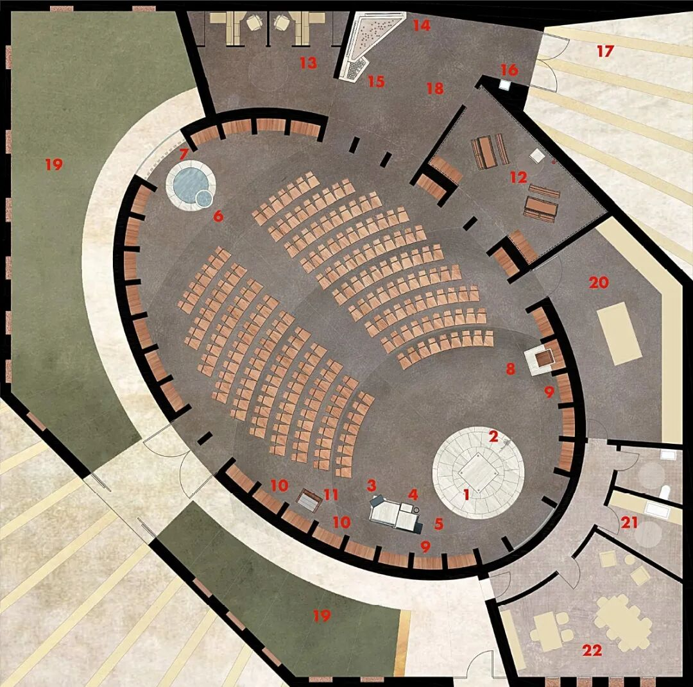
©Francesca Leto，Michele Battistella，Daniele Bertoldo
圣布里吉达·迪·斯韦齐亚教堂的提名授予由Francesca Leto协调的团队  ，Michele Battistella与Daniele
Bertoldo等人共同参与
。方案重点关注礼拜空间的组织及宗教仪式中的行进路线，通过不同礼仪空间之间的联系，组织参与者在教堂内部的移动过程。评审认可了其礼仪空间布局的有效性，以及对仪式动线的细致研究。
目前，五个获胜团队将进入与罗马教区的前期协商阶段，后续的协商结果推进下一阶段的设计工作。三项荣誉提名则作为本次竞赛评审的补充结果，共同呈现了不同团队在宗教建筑、木结构技术及礼仪空间组织方面的设计探索。
    **END**
     联系我们：sheji2415投稿邮箱：youtharch@163.com
    [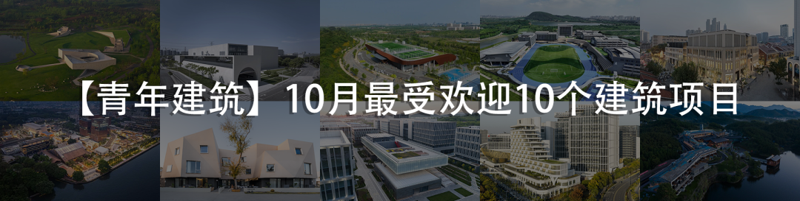](https://mp.weixin.qq.com/s?__biz=MzAxNzMyNzc1Mg==&mid=2650763922&idx=1&sn=1eaa422455c0ce99aa2fc745711769ee&scene=21#wechat_redirect)[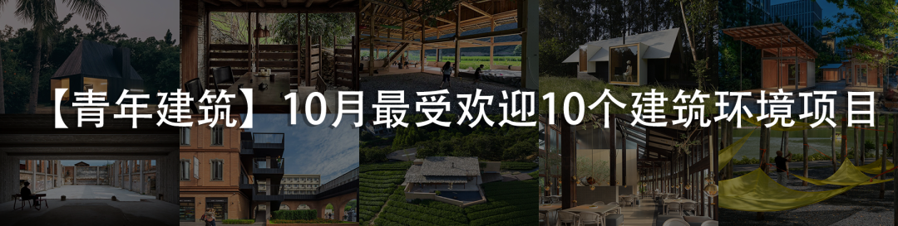](https://mp.weixin.qq.com/s?__biz=MzAxNzMyNzc1Mg==&mid=2650764566&idx=1&sn=5701a89ae6234532344fce6359621bad&scene=21#wechat_redirect)
