# 项目申报中！| 2027 纽约建筑设计奖NY ARCHITECTURAL DESIGN AWARDS

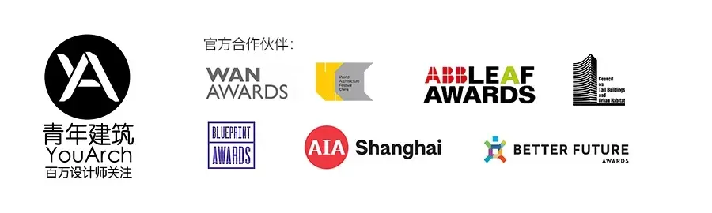

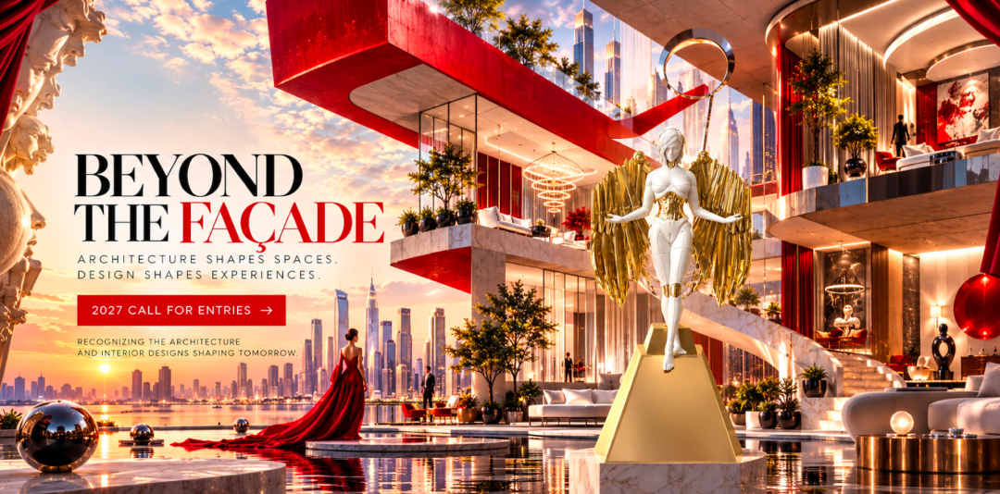
NY Architectural Design
Awards（纽约建筑设计奖）旨在表彰建筑、室内设计、城市规划和概念设计领域的杰出成就，是全球创新、风格和影响力的集中体现。
NY Architectural Design
Awards（纽约建筑设计奖）纽约建筑设计奖是一个享有盛誉的平台，旨在表彰世界上最杰出的建筑设计，这个奖项平台汇聚了来自全球各个角落的技艺精湛的建筑师、富有远见的设计师和有抱负的学生所创作的最具创新性的杰出作品。
NY Architectural Design
Awards（纽约建筑设计奖）表彰塑造我们空间的智慧和创造力，突破形式、功能和可持续性的界限，创造出令人惊叹和钦佩的建筑。
2027年度  纽约建筑设计奖  具体参赛  信息如下：
日期及费用
早鸟阶段：2026年11月06日-2026年12月09日
一般阶段：2026年12月10日-2027年01月20日
最终阶段：  2027年01月21日-2027年02月19日
延期阶段：  2027年02月20日-2027年03月17日
公布结果：2027年05月14日
早鸟价：219美元/项目
一般价：229美元/项目
终期价：249美元/项目
延期价：259美元/项目
管理费：一次性支付30美元
其他费用
获奖者套件订购费用：320美元/套
国际邮寄费：105美元/套（含运输、清关等费用）
类别
住宅建筑、商业建筑、机构架构、、文件建筑、城市设计与规划、室内设计、景观建筑、照明设计（新）、家具设计（新）、创新建筑、历史保护与翻新、概念设计、学生设计
奖项设置
纽约建筑设计奖共  设  立四个奖项  等级：
年度设计奖（每组别1个）
作  为  纽约建筑设计奖  中的最  高荣誉，只有每个组别中得分最高的设计作品才能获此殊荣；
铂金大奖（数量不限）
综合评分为85-100分的作品，均授予“铂金大奖”荣誉；
金奖（数量不限）
综合评分为70-84分的作品，均授予“金奖”荣誉；
银奖（数量不限）
综合评分为50-69分的作品，均授予“银奖”荣誉。
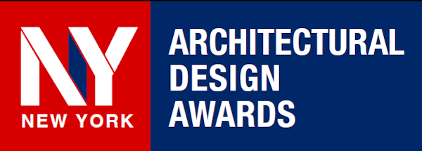
以下是获奖作品部分展示：
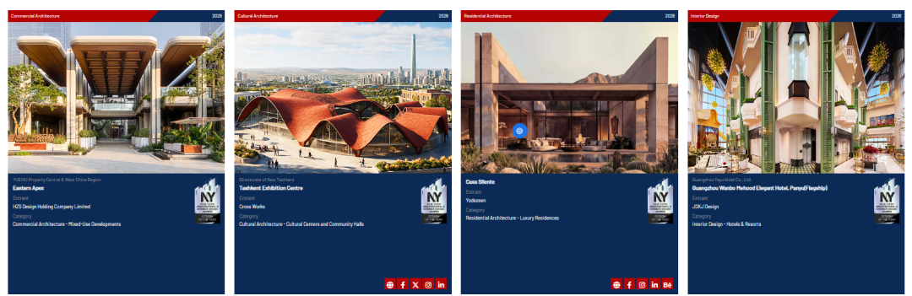

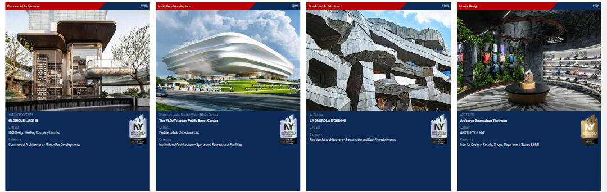

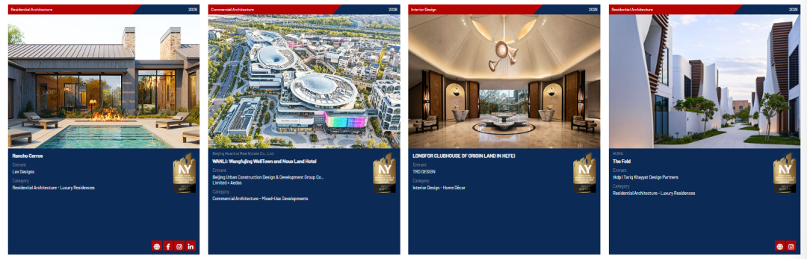

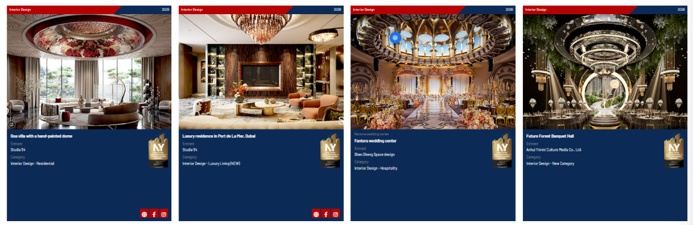

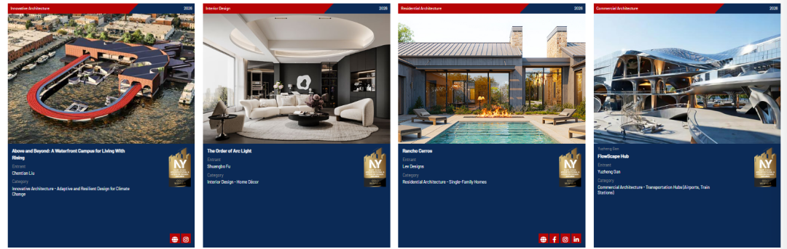

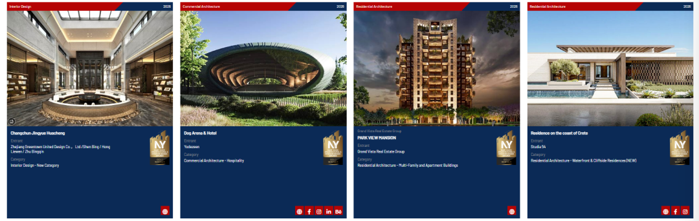

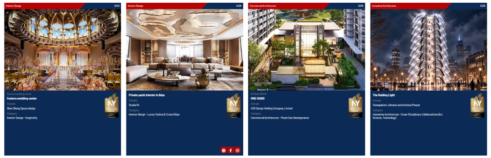

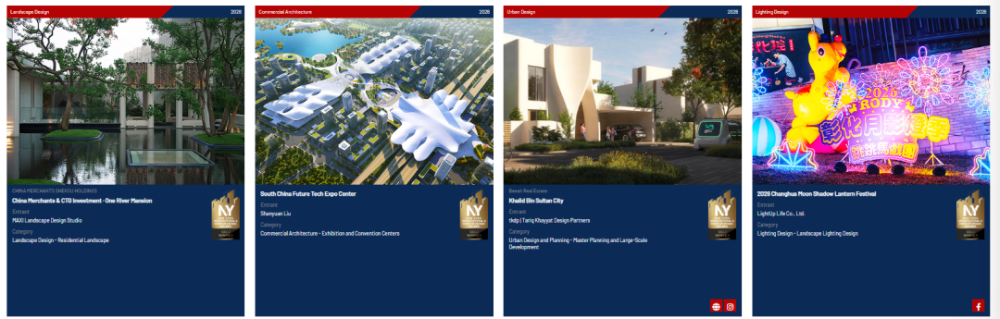

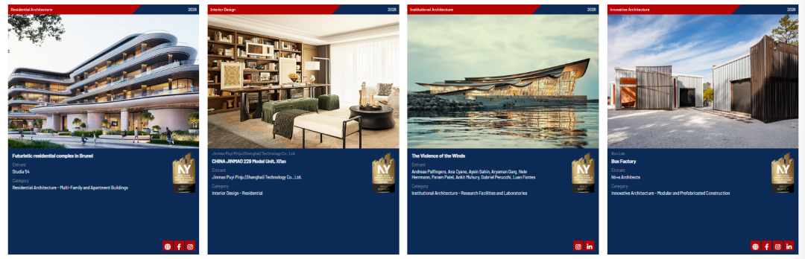

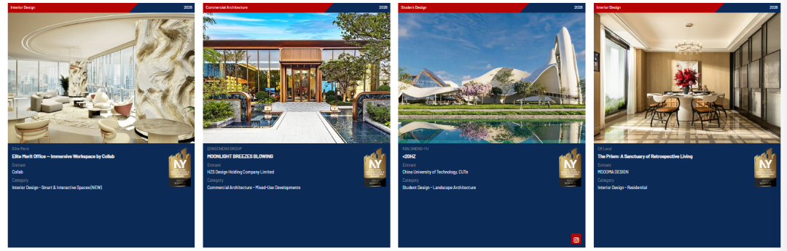

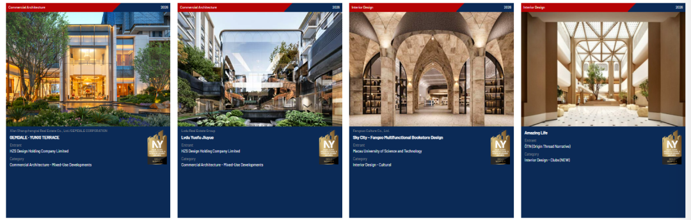

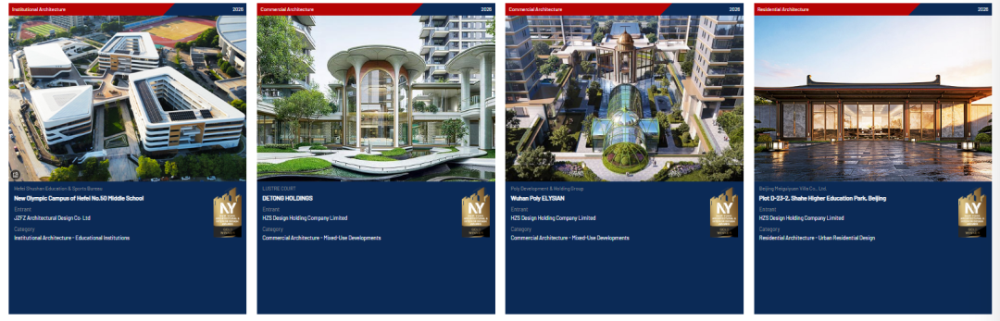
** 赛事与奖项咨询  **

** Wechat ID : sheji2415  ** **
** ** 【青年建筑】  ** ** 一站式报奖服务  **
** 1\. 专业团队  **
【青年建筑】报奖团队成员有：一级注册建筑师、海归设计师、专业外语翻译、建筑设计公司品牌负责人。拥有建筑、外语、品牌、平面全方位技术支持。
** 2\. 七年经验  **
【青年建筑】报奖团队成立七年，在上海、悉尼、柏林设有联络点，为30余家建筑设计公司提供累计400多次海外报奖服务，获奖比例高达80%以上。
** 3\. 权威认证  **
** 【青年建筑】凭借建筑设计媒体的品牌影响力，已与多项国际大奖，如WAF、WAN、blueprint、Leaf
建立长期合作伙伴关系，在国际市场上享有盛誉。  **
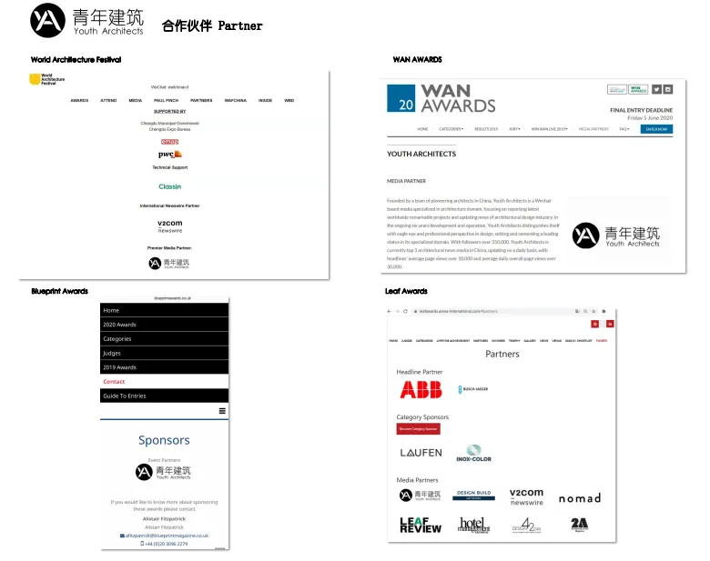
** 4\. 专业服务  **
结合作品实际水平与奖项难易情况，提供国际设计奖项申请匹配、排版文案优化、翻译、获奖推广及奖项代领等服务，助力设计作品软实力提升。
** 5\. 安心保障  ** 特别提出安心保障计划，如判断能获奖而未能获奖，将返还25%服务费用（代缴报名费除外），具体可联系客服咨询。  **
赛事与奖项咨询  **

** Wechat ID : sheji2415  **
