# 十月最受欢迎十个建筑环境项目发布

过去的十月中，【青年建筑】在全网发布了数百个优秀项目，通过这些社交平台的互动与反馈，不断让我们了解行业热点与设计趋势。今天，我们整理了十月份在【青年建筑】各个平台上综合热度最高的10个国内建筑环境项目。这些项目不仅表现了设计师们对空间的创作思考，也从不同维度展现了当代设计的前沿探索与创新。让我们共同欣赏这些独具匠心的作品，感受设计的无限魅力。
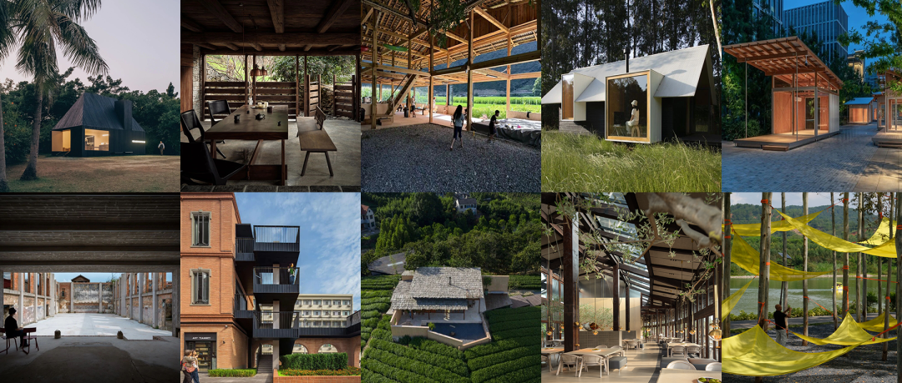
01\.
公园BOX·深圳湾——共栖 Park Life Vision
Pills Architects
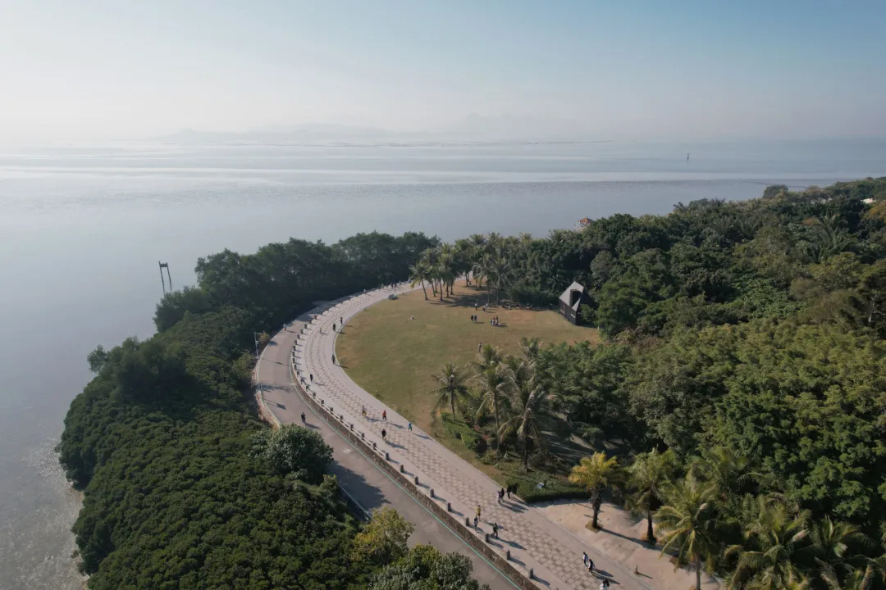

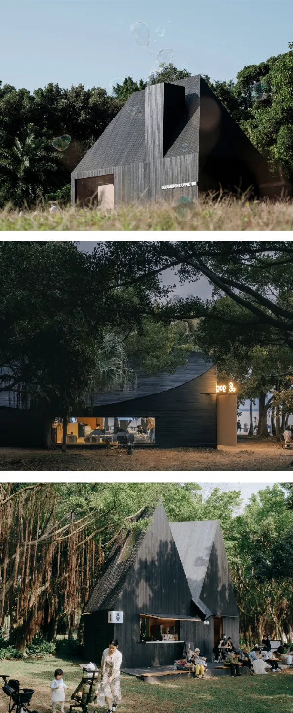
深圳湾公园“公园BOX”项目沿约2.7公里滨海长廊布置12座轻量化景观构筑物，将公共服务、艺术体验与休闲消费融入滨海公园。其中，PILLS设计的烟囱屋、船屋与双子屋以三种不同的建筑原型回应自然环境与日常使用。烟囱屋采用简洁的坡顶造型与黑色炭烧木板，屋顶烟囱内置泡泡装置，将咖啡消费转化为趣味互动；船屋以渔船为意象，通过弧形屋顶、顶部采光缝与可开合的低位长窗，将海面、远山和树影引入室内；双子屋以镜像折叠的双坡屋顶整合餐饮与文创功能，并通过可关闭的门窗及外部休憩平台适应不同使用场景。三座小屋以深色木质表皮融入林木与草坡，通过光线、雨水和可变界面丰富滨海停留体验，以低干预方式为公园增添可休憩、观景与交流的公共节点。
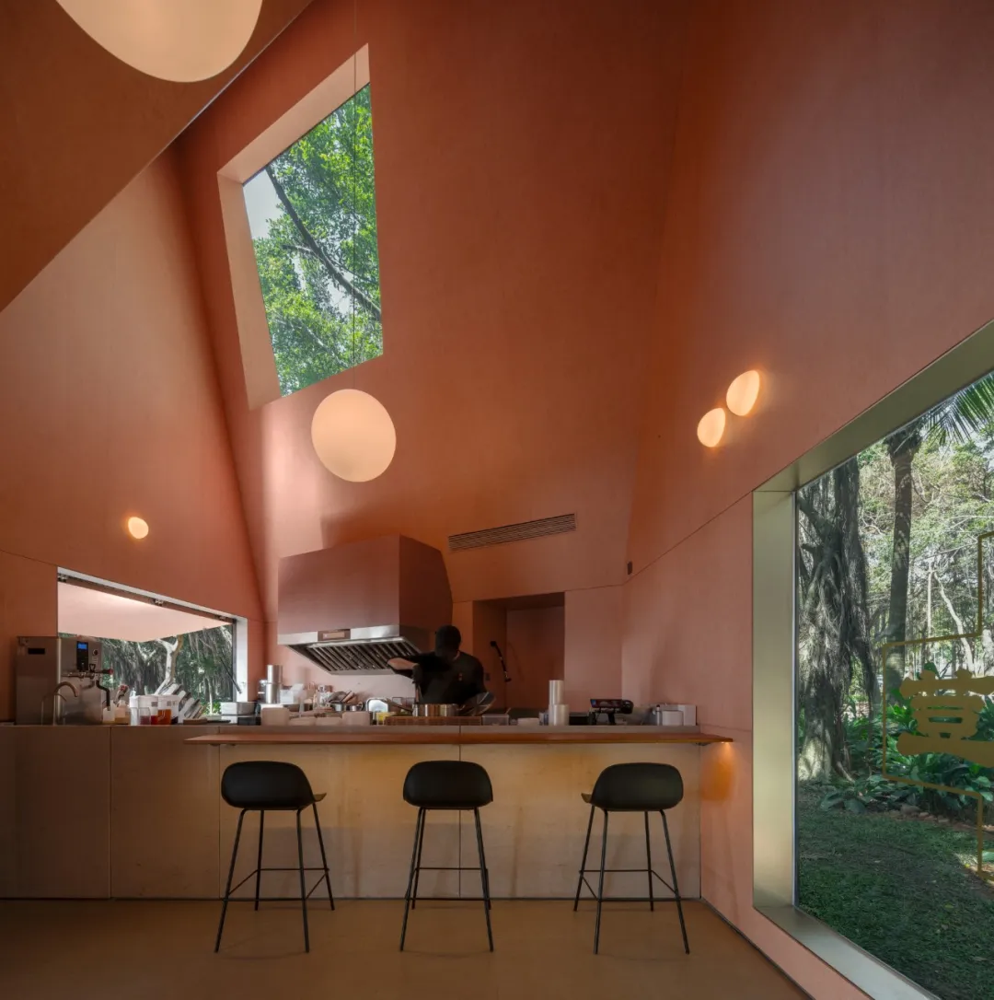
摄影  ©  吴嗣铭
项目完整介绍可点击下方青年建筑文章链接：
[ 公园BOX·深圳湾——共栖 Park Life Vision / Pills Architects](https://mp.weixin.qq.com/s?__biz=MzAxNzMyNzc1Mg==&mid=2650760198&idx=1&sn=ca576b1a6d9673ec76af36d1a8210360&scene=21#wechat_redirect)
02\.
怒江既下山·寄·雾里村
旭喜建筑
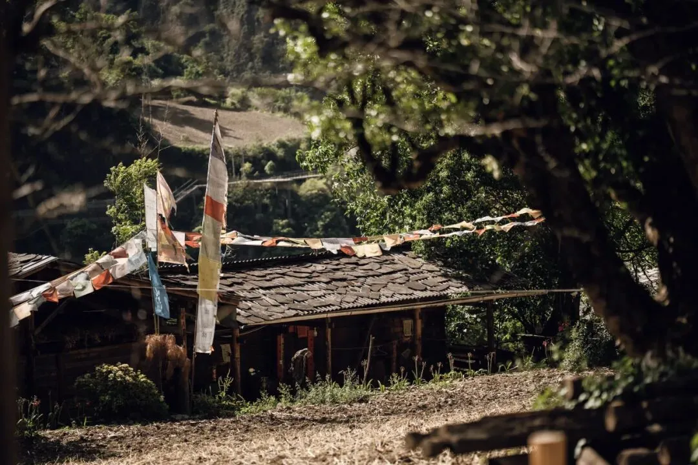
寄·雾里村位于云南怒江州贡山县丙中洛镇雾里村，坐落于怒江对岸的山地村落中，需经索桥与古道步行抵达。项目历时四年建造，首批九栋木屋延续怒族传统木楞房的建造方式，以原木咬合结构回应山地地形与乡土生活。设计尊重原有村落肌理，保留老核桃树、山路及既有房屋尺度，根据不同建筑的状态与使用需求进行修缮和调整，将原有猪圈改造为茶室与泡池，并利用山势组织面向怒江、石崖及高黎贡山的观景空间。室内家具与建筑木构一体化设计，依据各栋房屋的梁柱位置、墙体尺度和使用动线定制桌面、柜体及门窗细部。项目以传统手工建造结合现代旅居功能，在低干预更新中延续怒族民居的空间特征与村落日常生活。
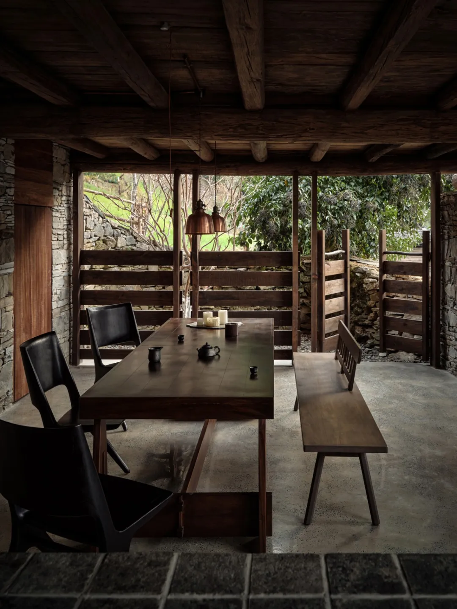

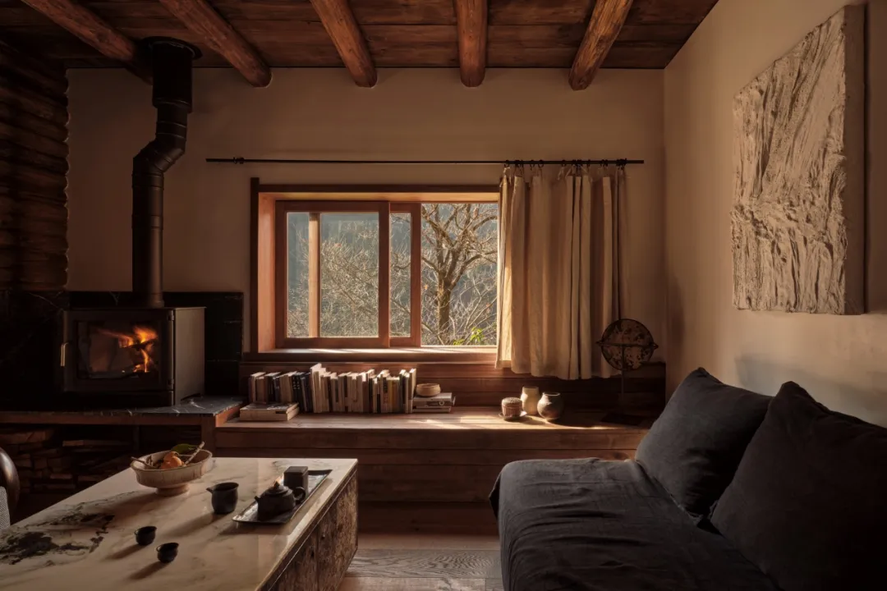

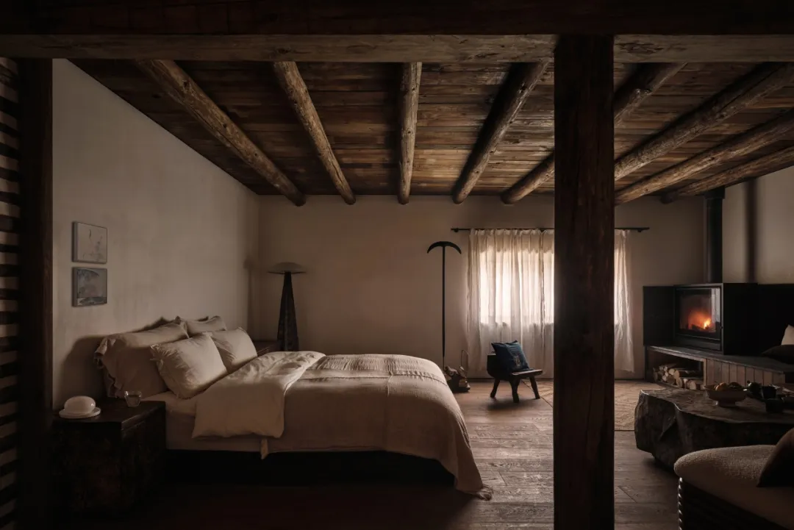

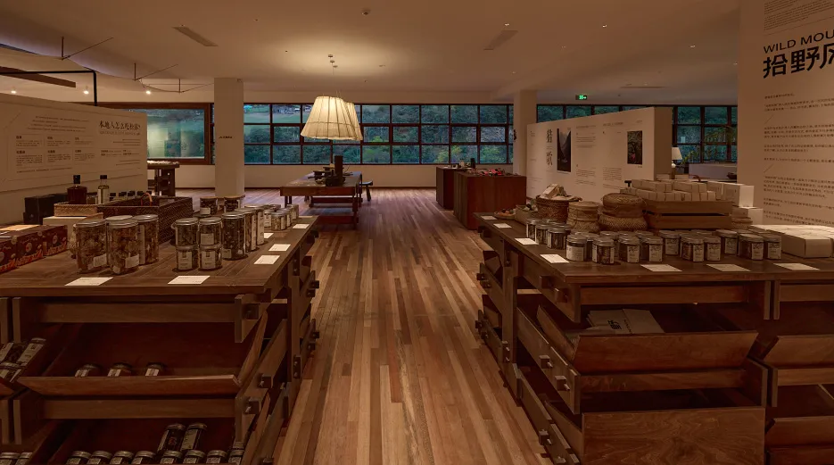
摄影团队:雷坛坛、李恒、大巍、罗青山、许炎华、既下山和ta的朋友们
项目完整介绍可点击下方青年建筑文章链接：
[ 怒江既下山·寄·雾里村 / 旭喜建筑](https://mp.weixin.qq.com/s?__biz=MzAxNzMyNzc1Mg==&mid=2650759994&idx=3&sn=b913330956cd5798e4039256b6332512&scene=21#wechat_redirect)
03\.
德钦霞若户外中心
平介设计
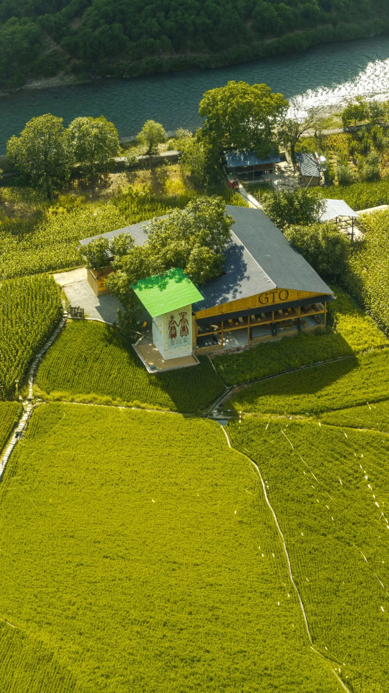
云南迪庆霞若户外中心位于白马雪山附近的河谷田坝，以当地傈僳族传统青稞晾晒架为建筑原型，将漂流、攀岩等户外运动服务与村民农耕生活结合。建筑采用可装配、可拆解的木构体系，以密柱网、连续层架与深远屋檐形成开放通透的空间，并通过独立于结构的玻璃围护界面保持木架的完整形态。设计围绕场地原有核桃树组织庭院，一层设置漂流准备室、咖啡吧台及灵活展示空间，二层面向田野布置休憩与观景平台，东南角设置攀岩塔。檐下及二层局部通过可增减的临时木梁，在收获季转换为青稞晾晒区。项目结合本地木材与传统工匠技艺，以轻量、可逆的建造方式融入农田，使户外运动、乡村市集与日常农事共享同一处公共空间。
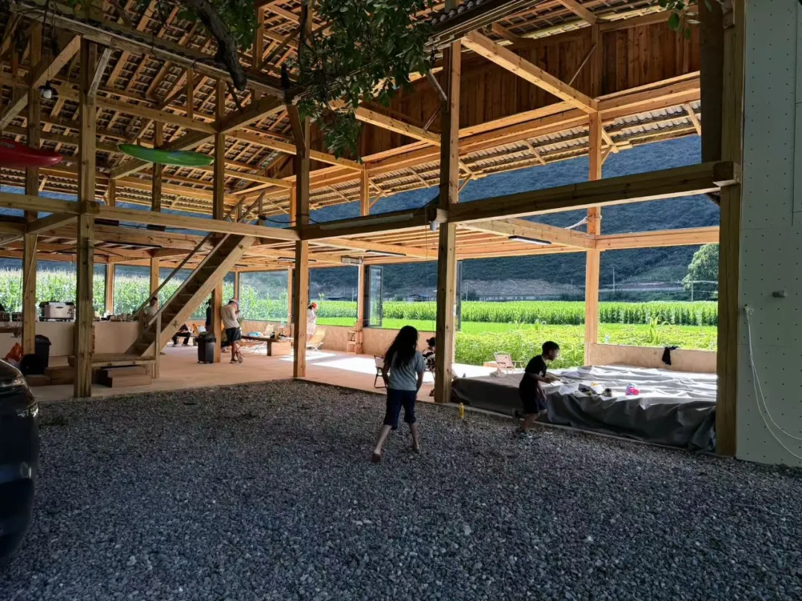

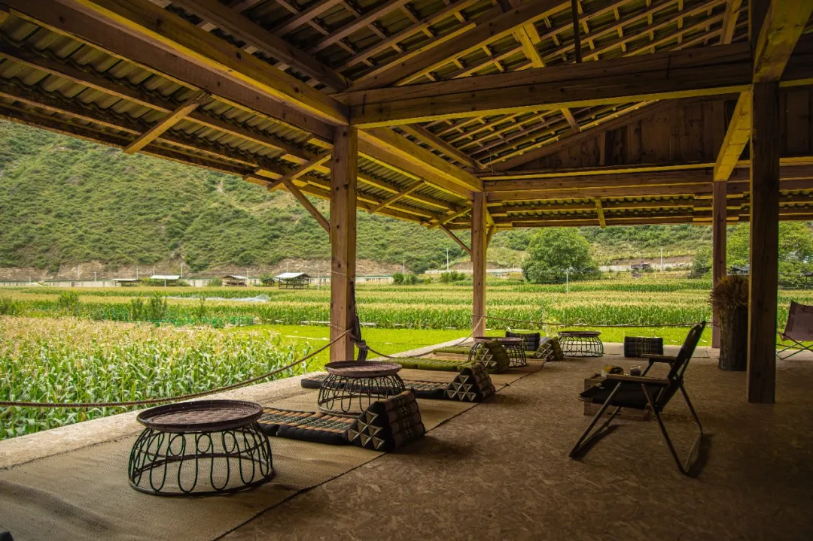

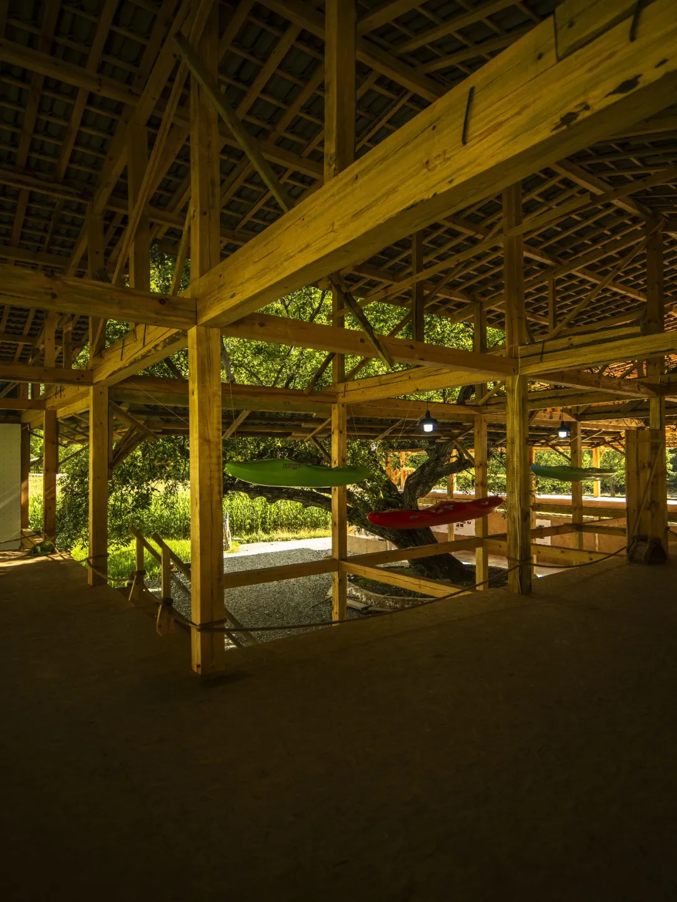

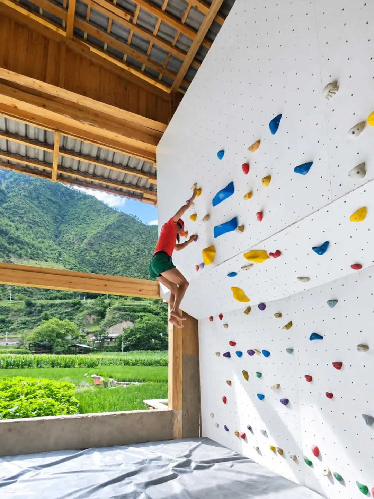
摄影版权：程昌、扎西培楚、农丽铃
项目完整介绍可点击下方青年建筑文章链接：
[ 德钦霞若户外中心 / 平介设计](https://mp.weixin.qq.com/s?__biz=MzAxNzMyNzc1Mg==&mid=2650762001&idx=3&sn=160477257d85401d3e836aacf08f0a34&scene=21#wechat_redirect)
04\.
成都移舍-可移动的自然居所
尌林建筑设计事务所
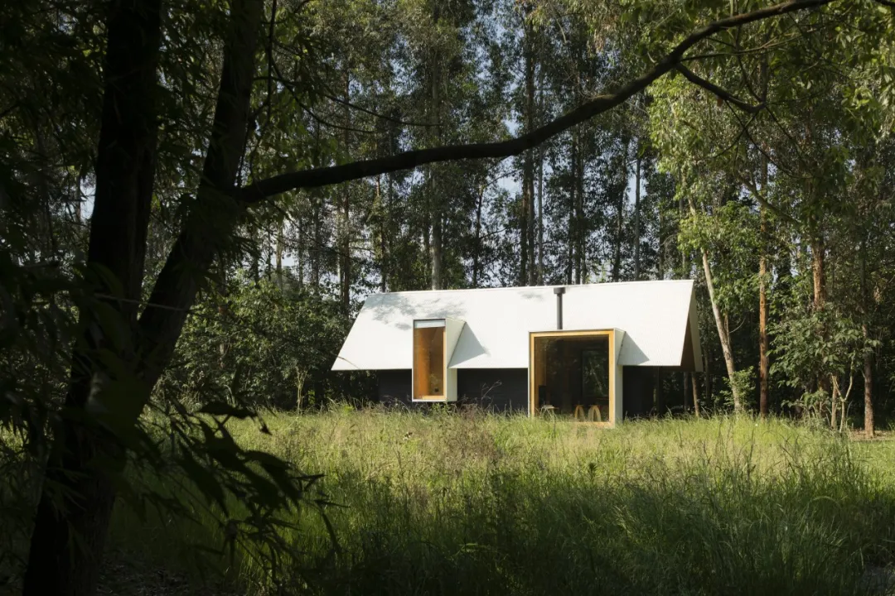
©存在建筑
“移舍·万景之窗”是一款以灵活迁移与自然融合为核心的模块化木屋，首个样屋落位于桉树林中。设计提取传统乡村民居的双坡屋顶与低矮深檐，以黑色碳化木、象牙白铝波纹板及不同尺度的观景窗形成简洁的建筑形态。木屋采用3.6米见方的标准模块，两个单元组合成基本居住空间，室内外围护、设备及装修在工厂预制完成，现场通过吊装拼接快速落位，并支持重复拆装与迁移。建筑整体架空约60厘米，以六处支点连接基础，减少对原有树木及地面的干扰。室内采用桦木饰面，结合真火壁炉、大面积落地窗、可开启飘窗与户外平台，将树林景观引入日常起居。项目以标准化生产和灵活组合适应不同场地与功能需求，探索可移动建筑在自然旅居与轻型商业空间中的应用。
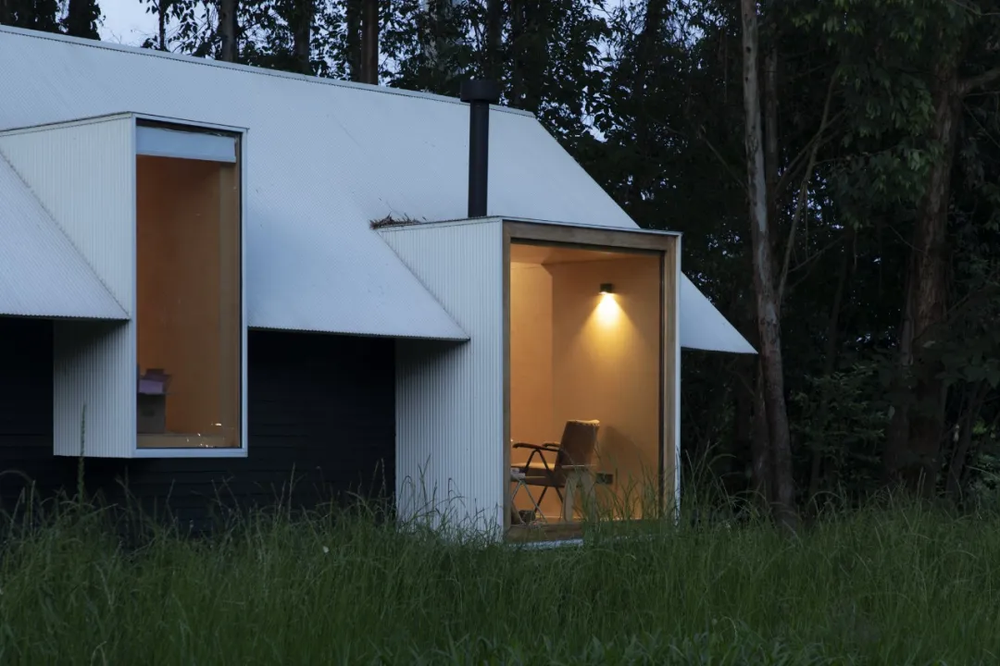
©存在建筑
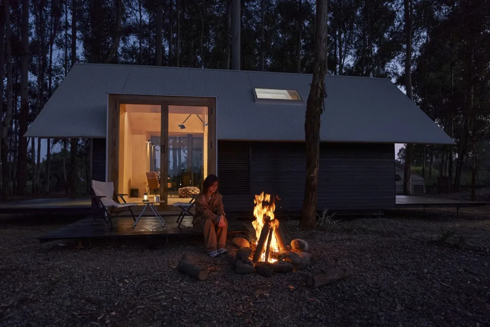
©张洋
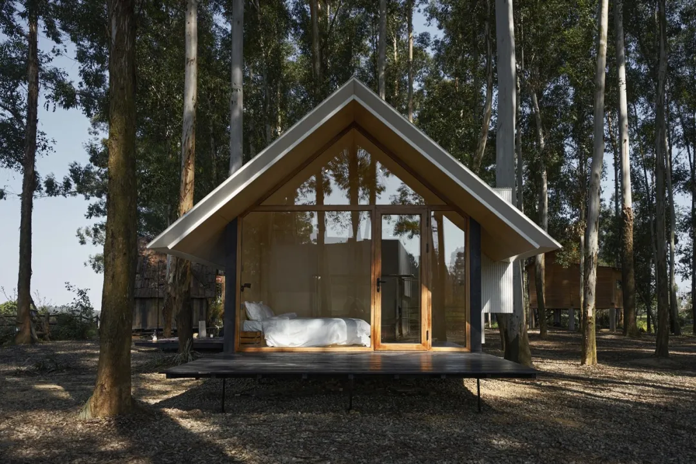
©张洋
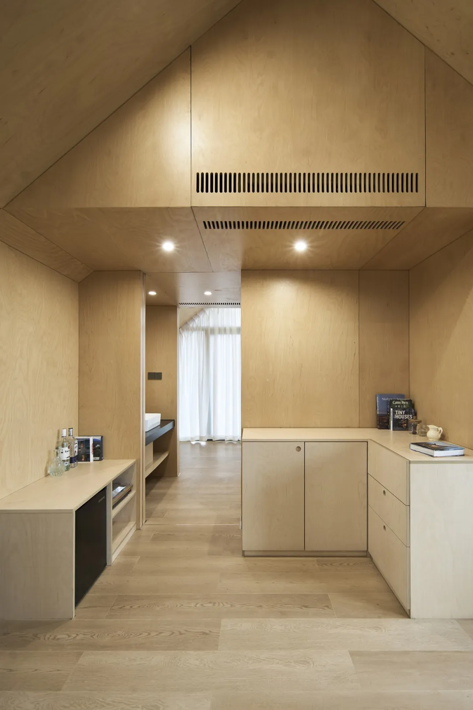
©林霄鹰
项目完整介绍可点击下方青年建筑文章链接：
[ 成都移舍-可移动的自然居所 / 尌林建筑设计事务所](https://mp.weixin.qq.com/s?__biz=MzAxNzMyNzc1Mg==&mid=2650761299&idx=3&sn=0891e40fb7a9470bb7f36701df36dc59&scene=21#wechat_redirect)
05\.
杭州天目里国际街区更新
空场建筑
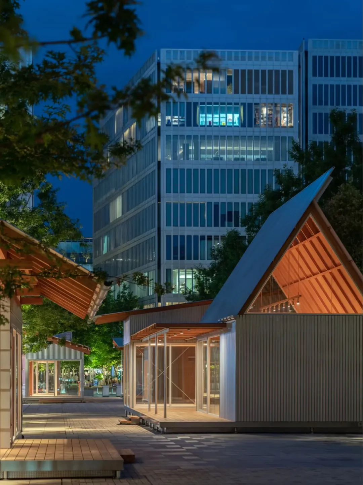
杭州天目里国际街区“慢闪公园计划”以轻量化商业建筑介入既有公共空间，探索城市街区的持续更新。项目依托北园、天目里与南岸三大区域，通过取消地面停车、设置约1200米全龄友好慢行环道，构建开放连续的步行网络。设计在原有广场与景观空间中植入11座小尺度商业木屋，以错动的几何体量、通透的底层界面与温润木质材料，回应天目里清水混凝土建筑的空间秩序。建筑之间形成尺度丰富的街巷、庭院与停留节点，引导人流在开放场地中自由游走。商业空间采用可快速部署、灵活调整的轻量化体系，结合零售与餐饮品牌的周期性更替，容纳市集、社交及社区活动，使原本以景观和通行为主的户外空间转化为兼具公共生活与商业活力的开放街区。
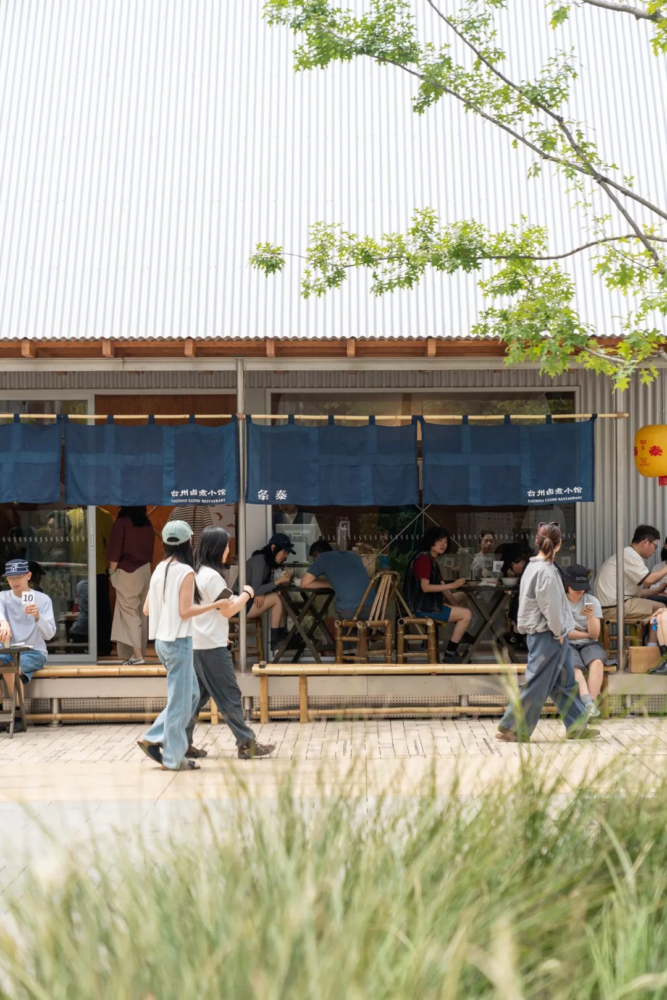

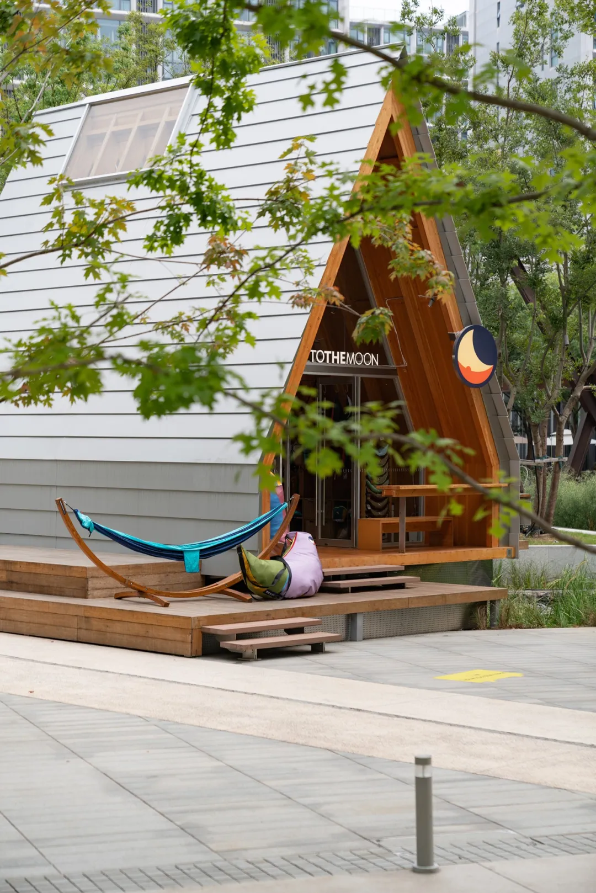

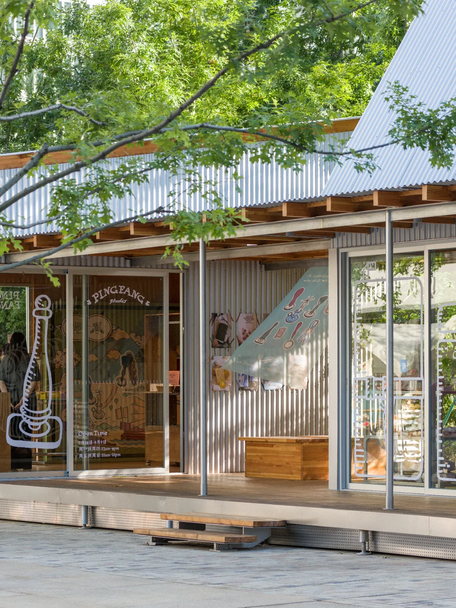

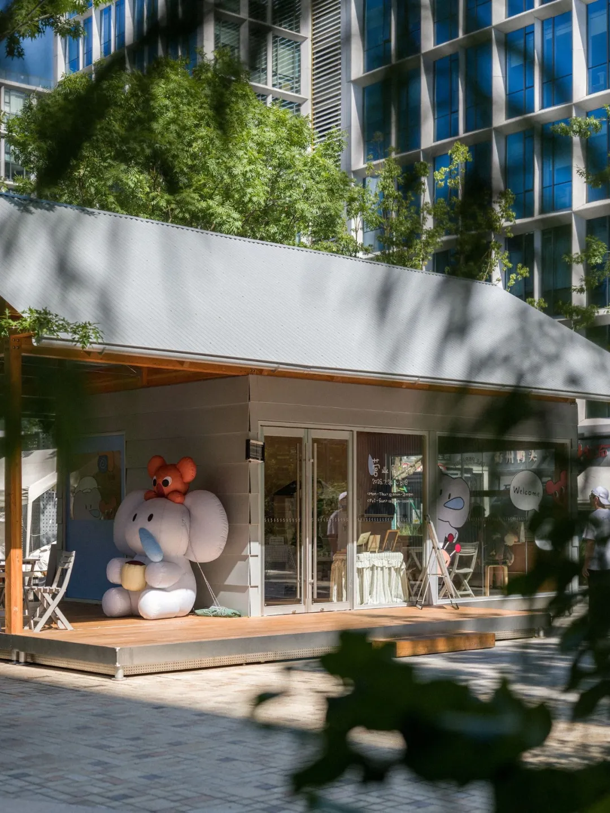
项目摄影｜潘绍清
项目完整介绍可点击下方青年建筑文章链接：
[ 杭州天目里国际街区更新 / 空场建筑](https://mp.weixin.qq.com/s?__biz=MzAxNzMyNzc1Mg==&mid=2650760940&idx=2&sn=983ffc7e7048875ef815da658731fb4c&scene=21#wechat_redirect)
06\.
景德镇陶阳里灼灼社区
韦加设计
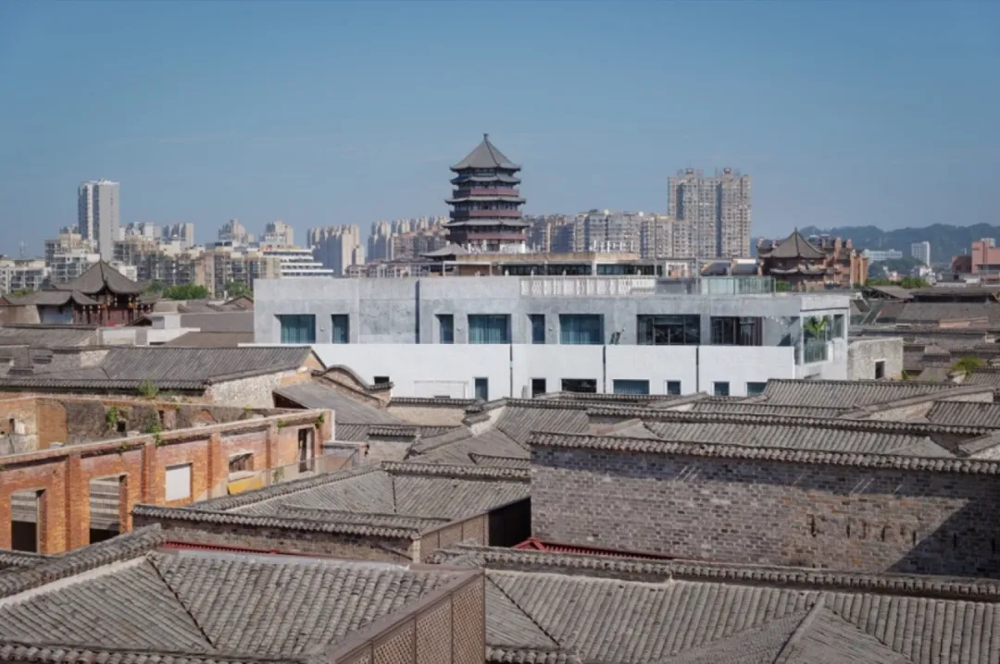
景德镇灼灼社区位于陶阳里历史文化街区核心，西接中山北路步行街，东邻御窑厂遗址，以渐进式更新串联老城里弄、院落与不同年代的建筑遗存。项目保留原有街巷肌理，通过庭院、连廊及开放首层连接灼灼酒店、快乐园剧场、南昌会馆、社区服务岛、木屋庭院与青年宿舍，植入住宿、餐饮、艺术创作、展演及公共服务等复合功能。白瓷房子利用四组旧民居围合庭院，以白瓷砖和釉色延续制瓷文化；快乐园剧场保留坍塌屋顶后的砖墙遗址，增设看台与楼梯形成露天公共剧场；传统木屋及旧板楼则通过保留木构、窑砖墙和新增共享空间适应当代旅居需求。项目以差异化修缮和轻量介入延续老城的材料与空间记忆，使分散的历史建筑逐步形成面向居民、游客与创作者开放的文化生活社区。
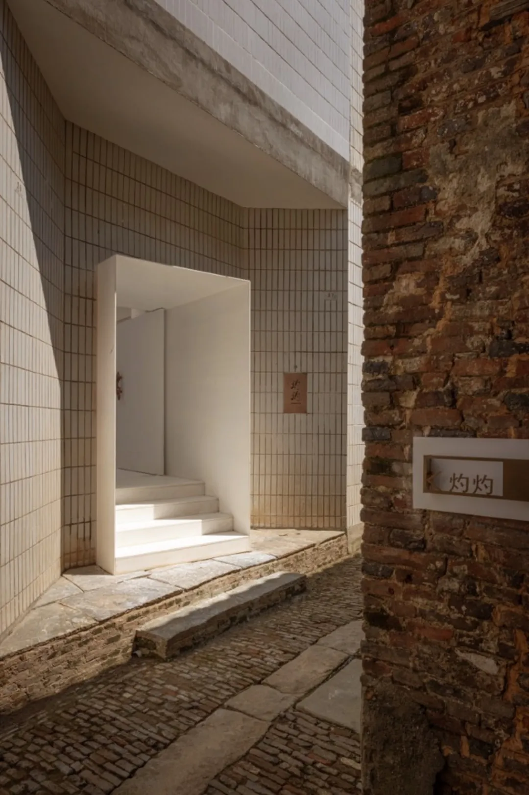

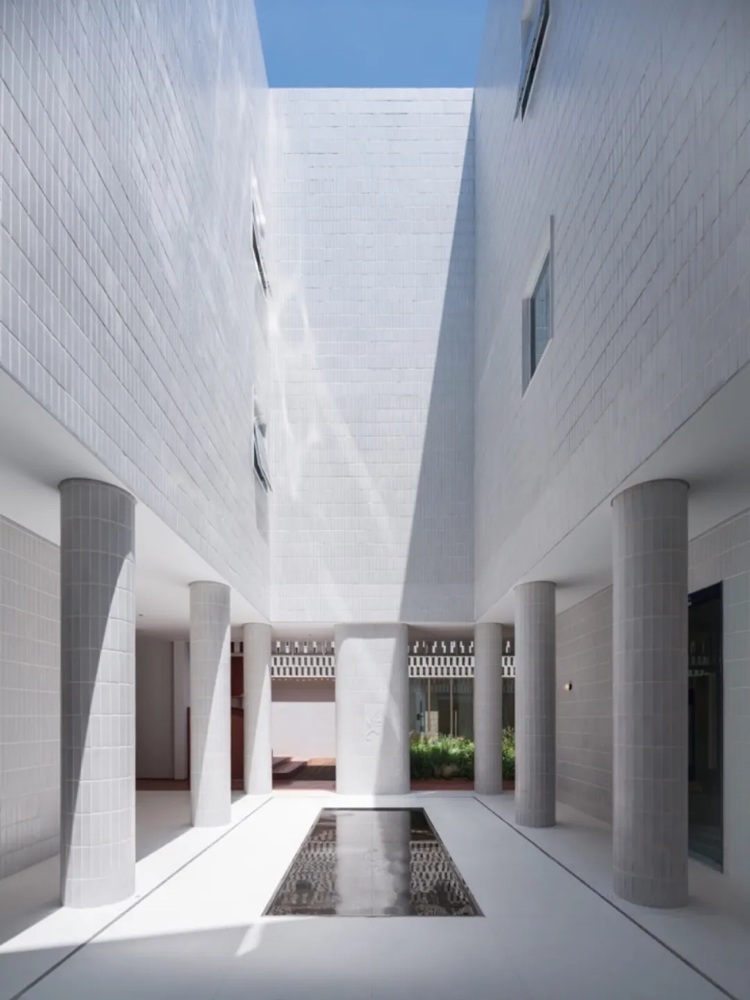

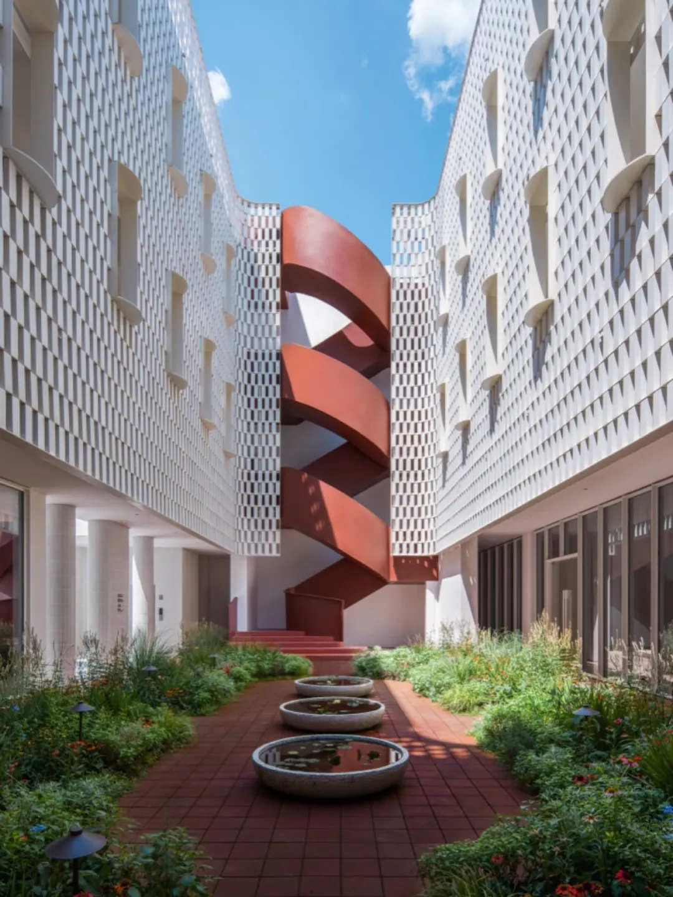

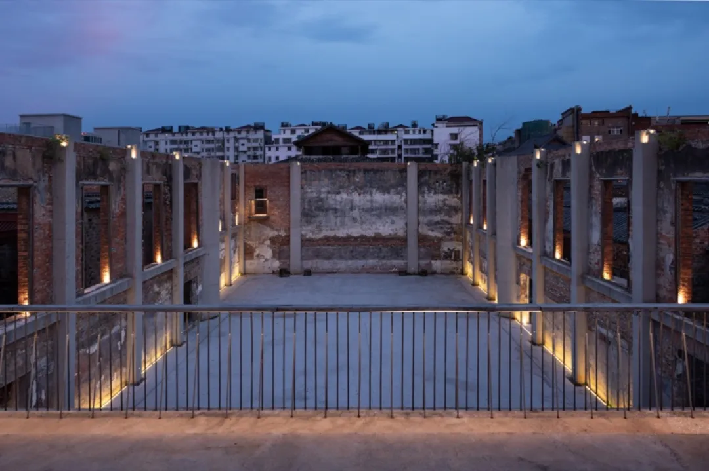
© 魏溦 WeiWei
项目完整介绍可点击下方青年建筑文章链接：
[ 景德镇陶阳里灼灼社区 / 韦加设计](https://mp.weixin.qq.com/s?__biz=MzAxNzMyNzc1Mg==&mid=2650760583&idx=3&sn=4d7c6fc055952cd6cab656c9d4d8a652&scene=21#wechat_redirect)
07\.
天津天美艺术街区核心区
米思建筑
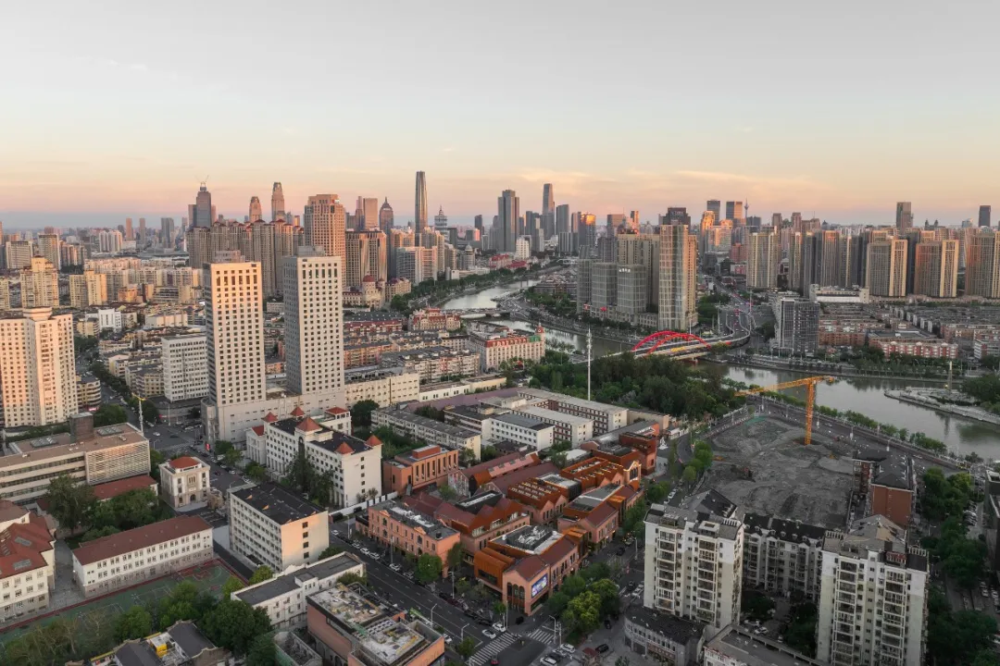
© 刘国威
天津天美艺术街区位于天津美术学院西侧的老城片区，以“街区、校区、景区、社区”四区融合为理念，通过历史建筑修缮、旧厂房改造与新建建筑织补，推动衰退街区向开放型艺术社区转型。规划以天纬路及约800米长的L形艺术轴线串联六大片区，结合商业内街、公共广场、架空通廊、大阶梯与二层连廊，形成多层次的步行网络。建筑采用商业与教学垂直复合的布局，首层向城市开放，上层连接美院教学、展览及创作空间。更新保留民国建筑、红砖厂房与原有结构痕迹，以红砖、锈钢板、青砖及连续拱形元素协调不同年代的建筑风貌。项目通过运营前置与渐进式改造，将艺术教育、商业活动、历史保护和居民日常融入同一街区，使原本封闭的校园与老城空间转化为可自由穿行、停留和参与公共文化活动的城市艺术场所。
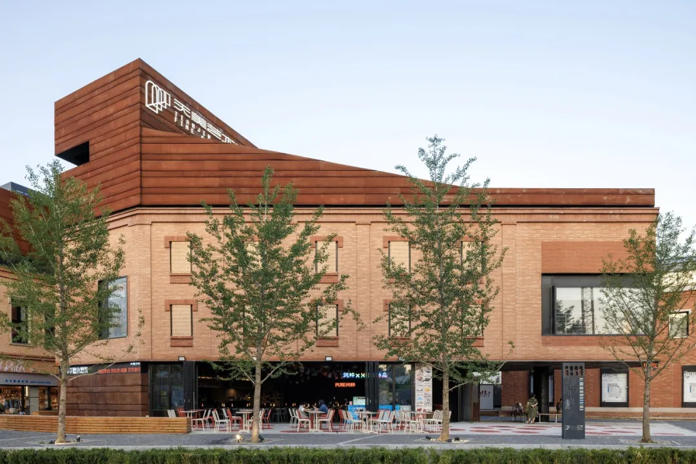
© 刘国威
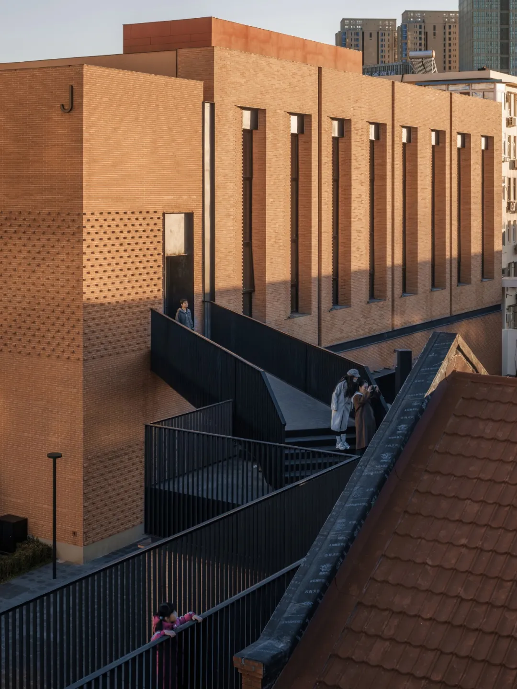
© 黄维旻
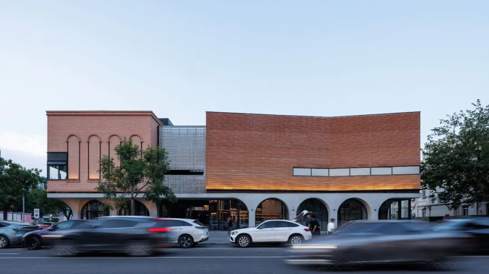
© 刘国威
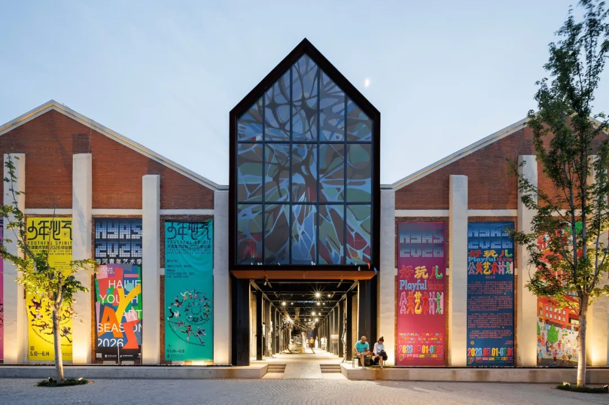
© 刘国威
项目完整介绍可点击下方青年建筑文章链接：
[ 天津天美艺术街区核心区 / 米思建筑](https://mp.weixin.qq.com/s?__biz=MzAxNzMyNzc1Mg==&mid=2650760482&idx=2&sn=3b0fcdc57339e50a2ad0fbd50b0637c9&scene=21#wechat_redirect)
08\.
莫干山云在何处咖啡馆
本位空间设计机构
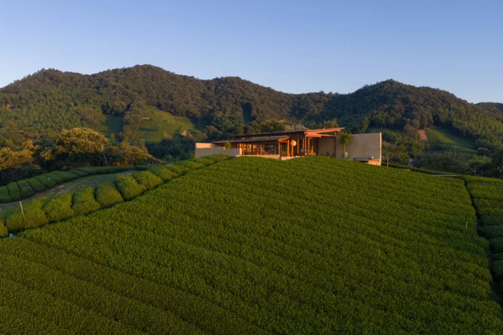
莫干山茶园建筑更新项目位于层叠起伏的山地茶田之间，由闲置乡村夯土老屋改造及新建冥想空间共同构成。老屋改造遵循低干预原则，保留夯土墙、青瓦坡屋顶与原木穿斗结构，利用毛石台基适应山地高差，以深出檐形成面向茶园的半开放廊道。空间顺应茶垄走势展开，通过不同标高的木平台、碎石步道与夯土围墙连接建筑、庭院及周边茶田，圆形漏窗将远山景观引入休憩空间。独立设置的茶园冥想空间采用白色折面三角体量，以倾斜墙体形成向内收束的高耸室内，结合顶部采光、不同尺度的观景窗及内嵌坐凳，营造安静的观景与冥想场所。项目以乡土材料的延续和简洁几何形态的介入，保留茶山原有地形与植被，使旧建筑更新与新建空间共同融入山地景观。
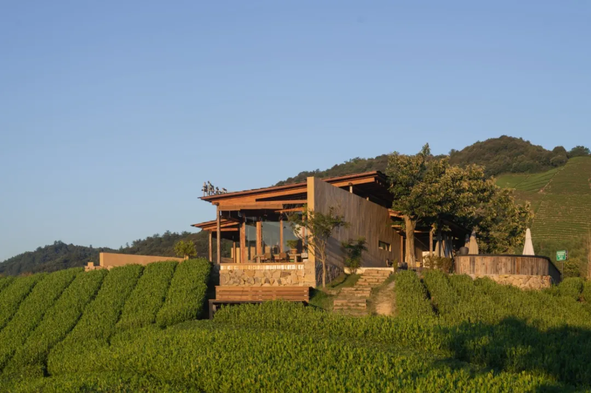

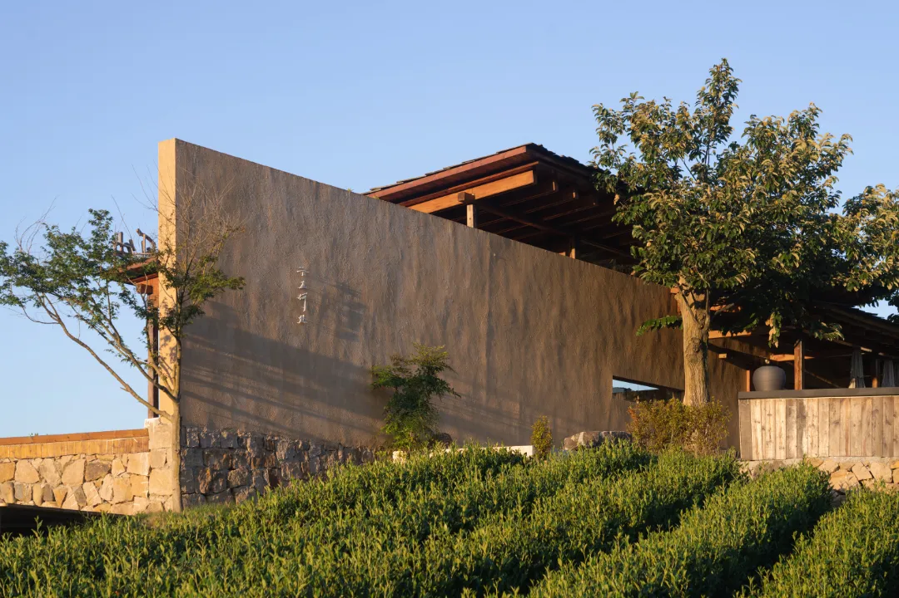

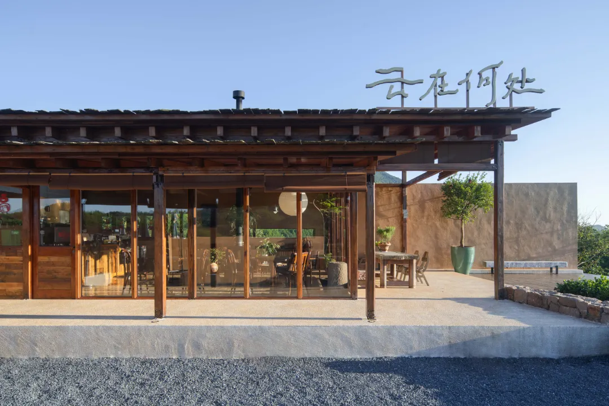

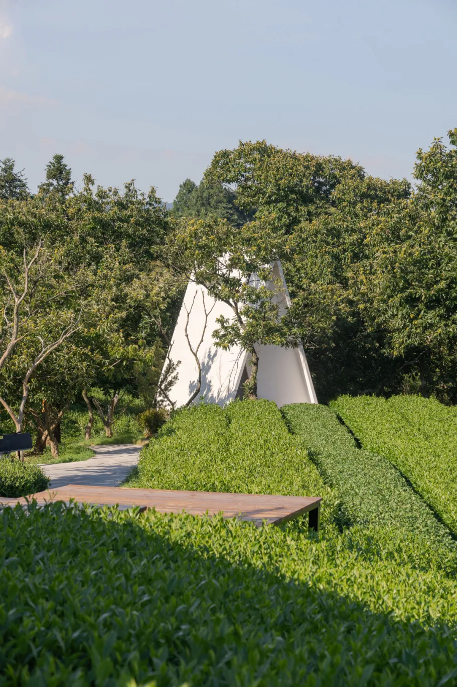
项目摄影｜  DONG建筑影像
项目完整介绍可点击下方青年建筑文章链接：
[ 莫干山云在何处咖啡馆 / 本位空间设计机构](https://mp.weixin.qq.com/s?__biz=MzAxNzMyNzc1Mg==&mid=2650759787&idx=3&sn=f6b59accb6c95fcd395a06cc5028f4ba&scene=21#wechat_redirect)
09\.
西溪 · 芯HOTEL
DOMANI东仓建设
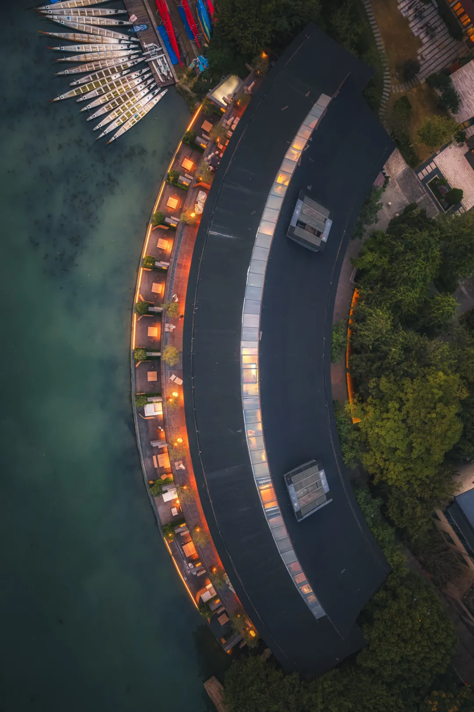
杭州西溪湿地东南门户的芯HOTEL由原湿地水岸码头客用中心改造而成，DOMANI东仓以保护性更新与轻量介入为原则，将这座建于2005年的滨水建筑转化为融合自然疗愈、旅居与艺术体验的酒店。建筑延续顺应河道走势的弧形体量，最大限度保留原有木钢结构及历经岁月形成的古锈质感，通过局部可逆性加固与功能调整适应新的使用需求。设计优化东西向采光界面，修缮西侧观景露台及下沉亲水空间，使湿地、水杉林与落日景观融入室内活动。内部尊重原有柱跨与结构秩序，以低干预方式布置客房、食疗餐厅、茶空间及疗愈场所，并通过当代艺术装置、定制家具与灯具建立新旧空间的对话。项目将建筑遗存、自然景观与酒店运营相结合，在保留既有场所特征的同时，形成面向湿地环境的当代疗愈旅居空间。
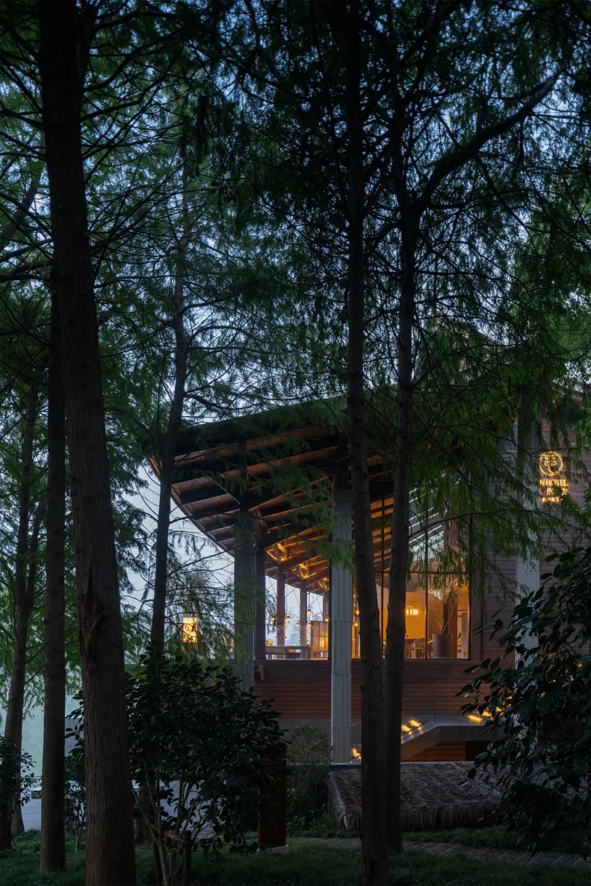

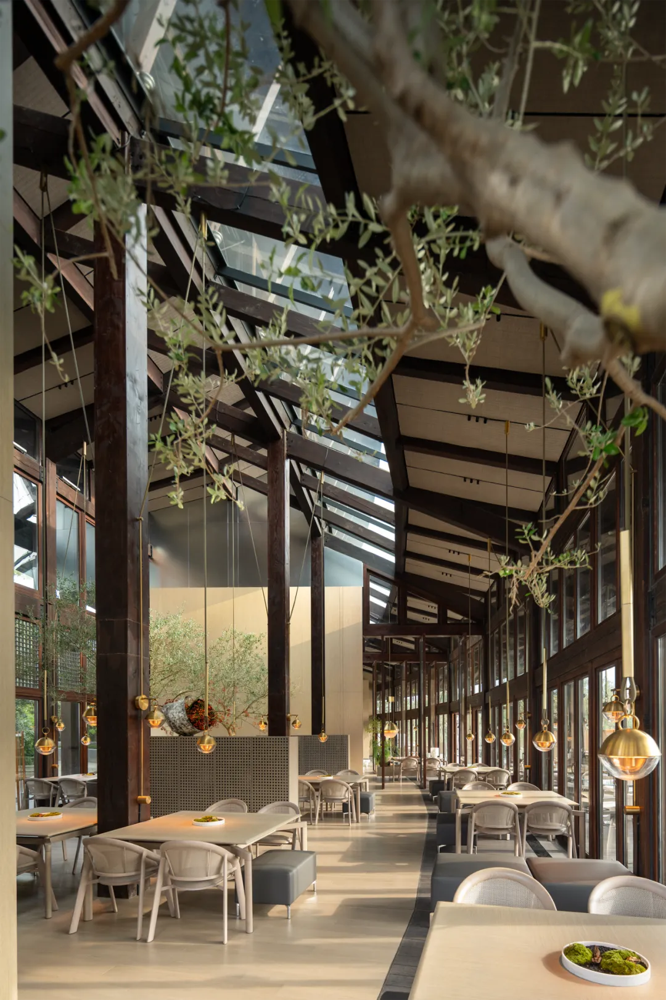

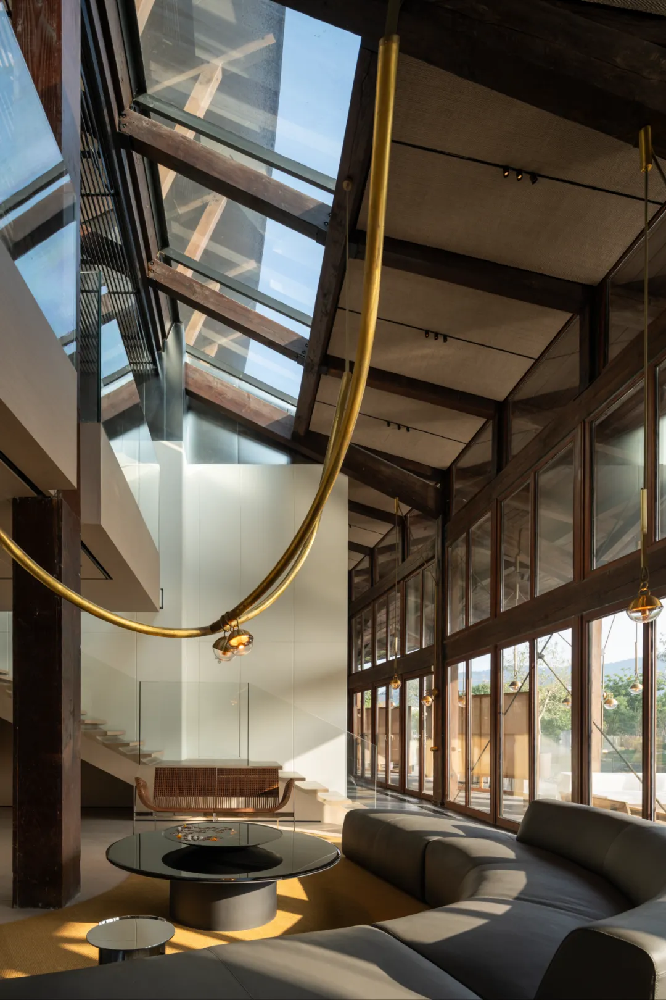

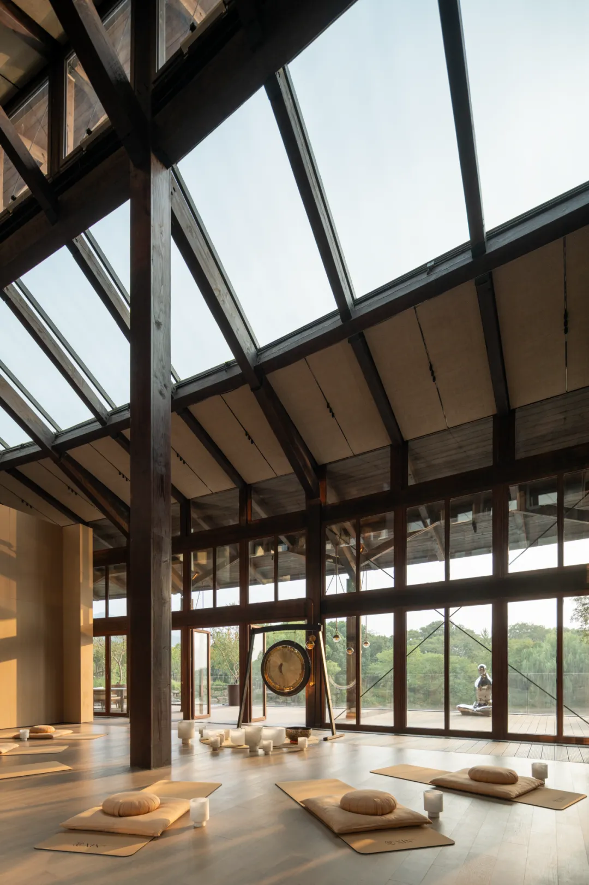
项目摄影 | 吴鉴泉、金良
项目完整介绍可点击下方青年建筑文章链接：
[ 西溪 · 芯HOTEL / DOMANI东仓建设](https://mp.weixin.qq.com/s?__biz=MzAxNzMyNzc1Mg==&mid=2650760125&idx=3&sn=71600187c8661ff3b5929999c8c30401&scene=21#wechat_redirect)
10\.
《梦乡》
朱小地工作室
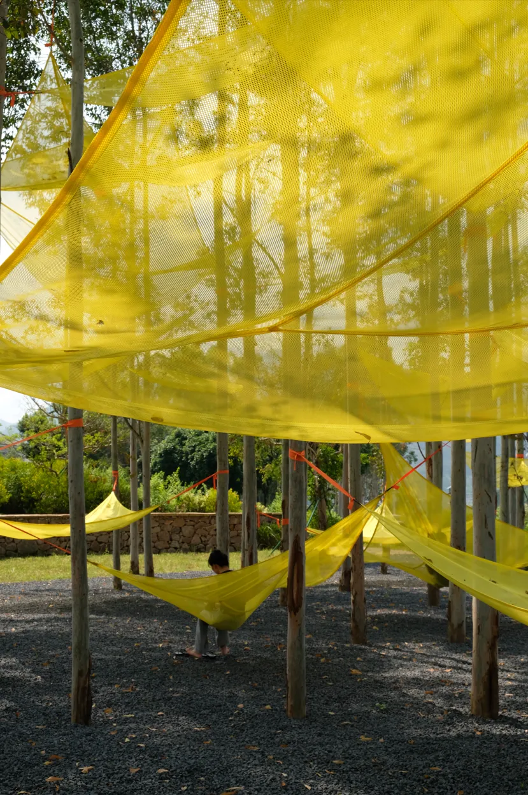
《梦乡》是建筑师、艺术家朱小地为2026年广东蕉岭大地艺术季创作的建筑装置，位于米香湾临河的桉树林中，以轻量介入回应“万物共生”的主题。作品利用原有桉树作为悬挂支点，将明黄色三角形吊床错落布置于不同高度，在挺拔的灰白树干之间形成层叠交织的几何织物空间。高处的吊床相互重叠，构成过滤阳光的漂浮天幕；低处的吊床则成为可供游人躺卧、休憩与观景的柔软平台。装置保留树林原有的通透视线与自然环境，通过织物的轻微摆动、树影变化、风声及身体感知，营造介于建筑空间与艺术体验之间的沉浸式场所。作品从当地村民林下乘凉、休憩的日常习惯出发，以可参与的空间形式延续乡村公共生活，在减少场地干预的同时，为人与自然建立更加亲近的互动关系。
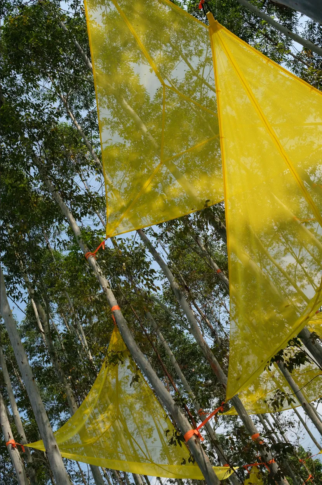

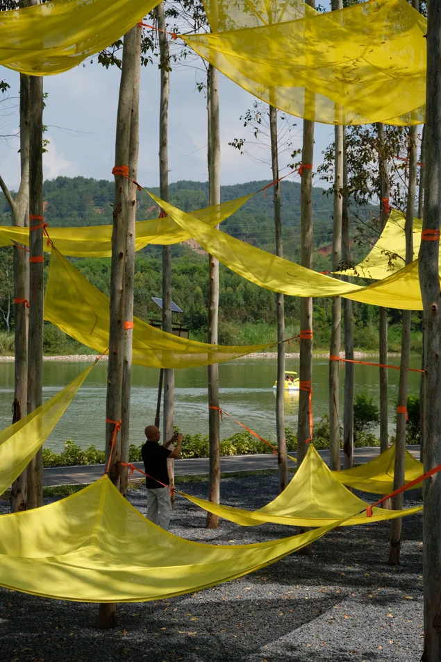

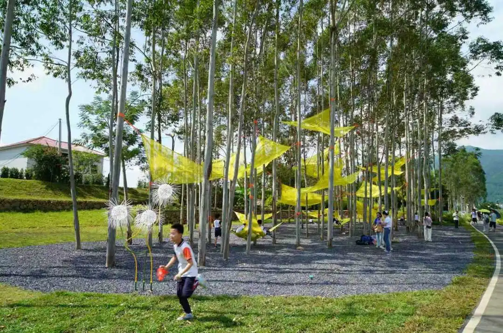

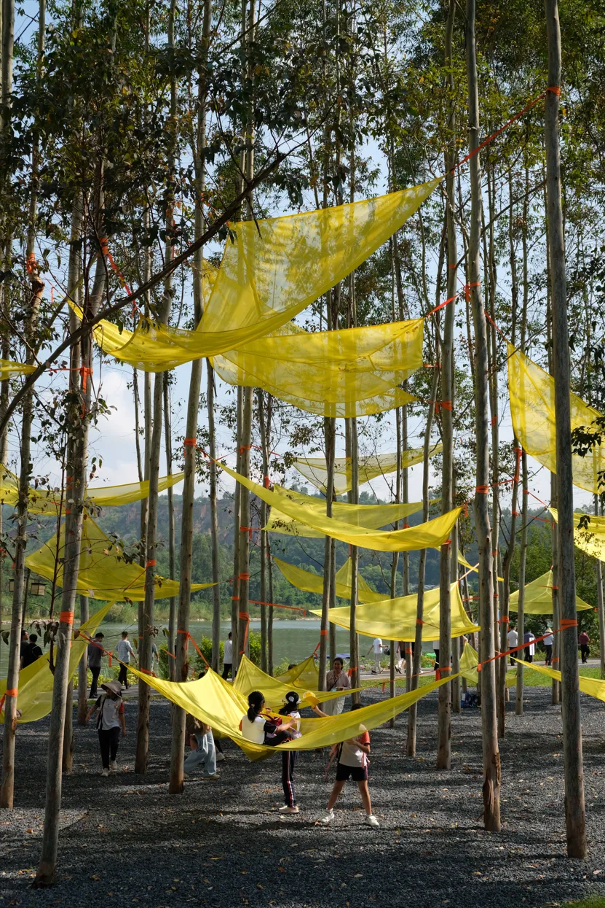
©️朱小地工作室
项目完整介绍可点击下方青年建筑文章链接：
[ 《梦乡》 / 朱小地工作室](https://mp.weixin.qq.com/s?__biz=MzAxNzMyNzc1Mg==&mid=2650760030&idx=3&sn=739c23d615a69e075aac68674f95da4a&scene=21#wechat_redirect)
注：排名不分先后。  ** 投票排名靠前项目将有机会入选年度最佳项目  **
推荐阅读：  [ 【青年建筑】2025年度最佳](https://mp.weixin.qq.com/mp/appmsgalbum?__biz=MzAxNzMyNzc1Mg==&action=getalbum&album_id=4396586359428071425&token=30654799&lang=zh_CN#wechat_redirect)
