# KPF设计得克萨斯州最高建筑：一座向上倾斜的312米摩天大楼

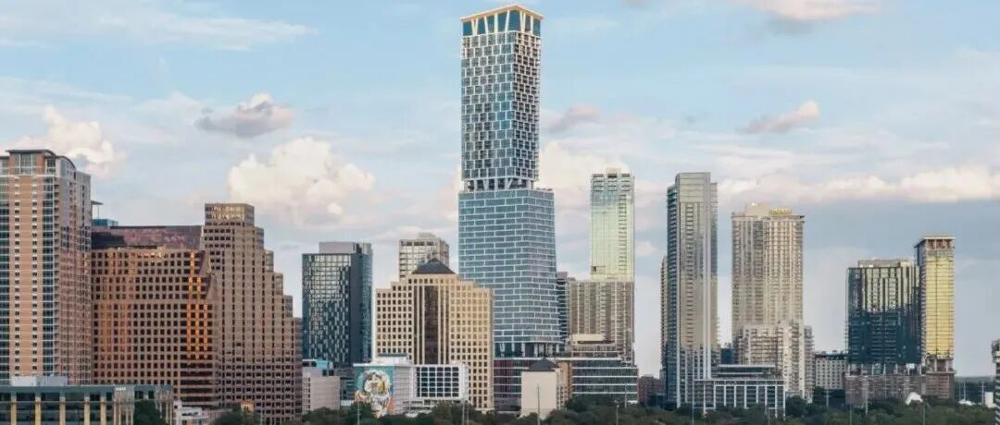

**
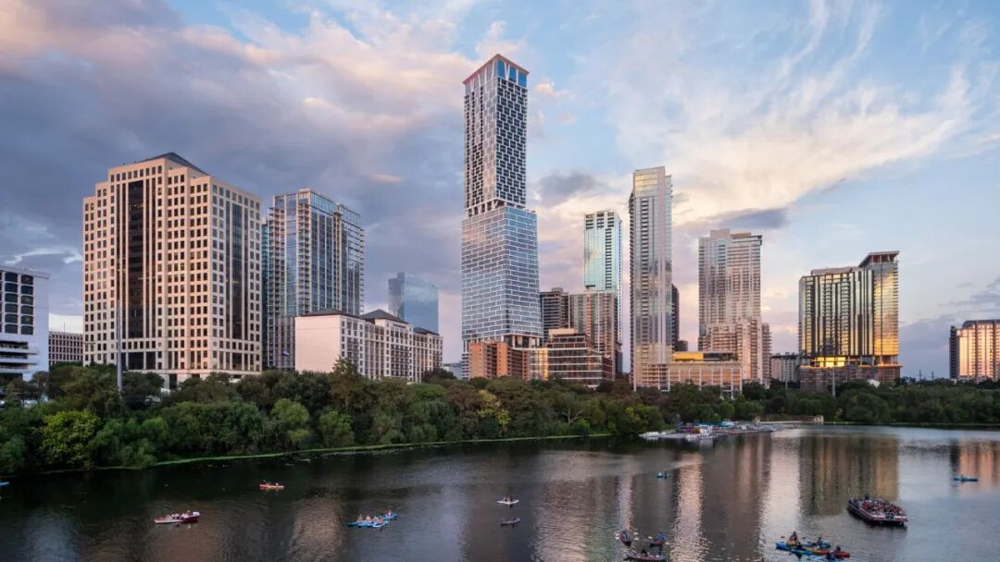
**
**
**
KPF  建筑事务所  在  美国  得克萨斯州奥斯汀完成了Waterline摩天大楼，一座高312米、共74层的综合用途摩天大楼。项目位于奥斯汀市中心98
Red River Street，靠近Lady Bird Lake（伯德夫人湖）与Waller
Creek交汇处。建筑集办公、酒店、住宅、商业和停车功能于一体，建成后成为得克萨斯州最高的建筑。
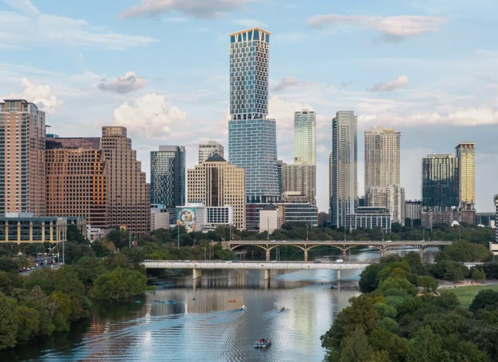
设计团队将塔楼的主要体量集中在一栋建筑中，并通过高度变化回应水岸与周边低层街区的关系。建筑向上延伸时逐渐向远离湖岸的方向倾斜，侧面轮廓呈现连续变化的斜线。事务所曾将这一形态比作牛仔靴，建筑底部与上部之间的错动也由此成为外观的重要特征。
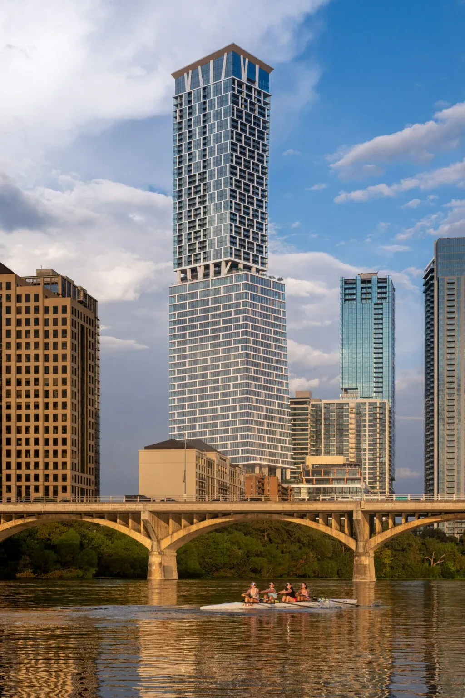
塔楼采用垂直叠加的功能布局。下部设置商业、餐饮和停车空间，中下部布置办公楼层，中部为1 Hotel
Austin酒店，上部则安排352套住宅。不同功能在建筑高度上的转换，通过楼板外挑、双层高空间和支撑柱的变化表现出来。住宅位于上部33层，办公空间约6.53万平方米，酒店设有约250间客房，各部分共享建筑中的部分公共设施与室外空间。
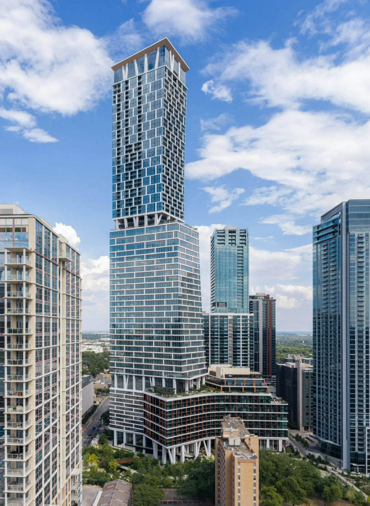
建筑外立面以横向线条为主，连续楼板、阳台和玻璃界面沿塔楼展开，并由竖向构件划分节奏。局部锈红色细节呼应得克萨斯州的地质色彩，宽阔的立面网格则保留了较深的视线层次。随着建筑体量逐渐后退，外部阳台、空中花园和公共露台在不同高度出现，使塔楼轮廓与周边水岸景观保持联系。
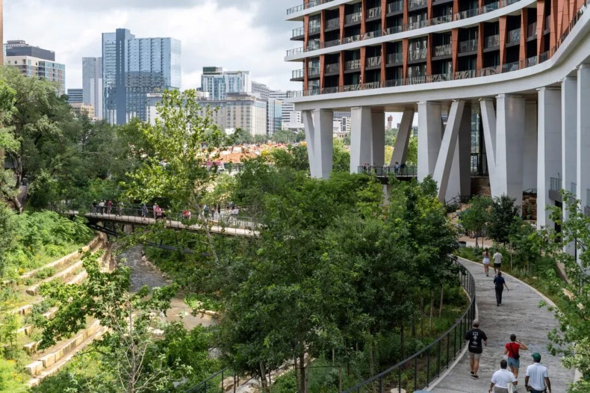

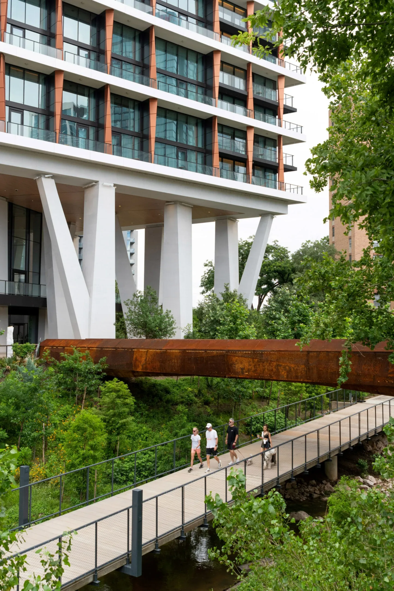
塔楼下部的柱列是建筑结构与公共空间设计的关键。项目共设置92根雕塑化柱体，其中部分柱子采用V形分叉形式，以适应办公楼层与住宅楼层之间不同的结构网格。柱体的形态参考了奥斯汀常见的橡树树干和枝干，较大的柱距也为首层公共通道和室外活动空间留出位置。
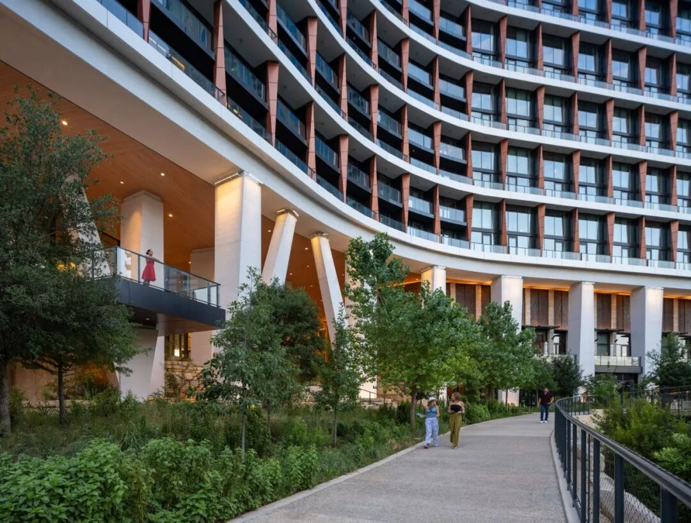

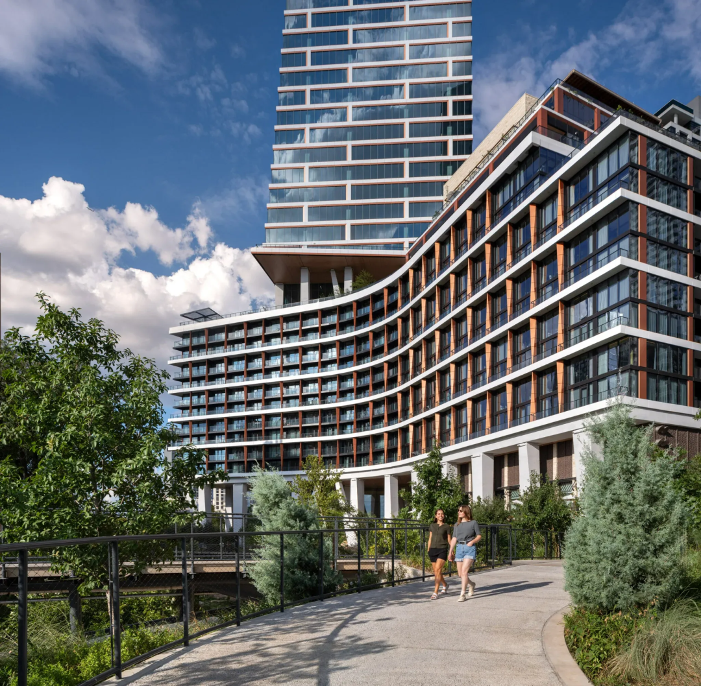
建筑基座沿Waller
Creek的走向形成柔和弧线，并围绕停车结构布置酒店及相关功能。基座中部设置一条名为Paseo的公共步行通道，采用石材铺装，从城市街道穿过建筑延伸至水岸。沿途分布零售、餐饮和室外停留空间，通道还连接附近的Rainey
Street街区、Waterloo Greenway绿地及城市步行和骑行网络。
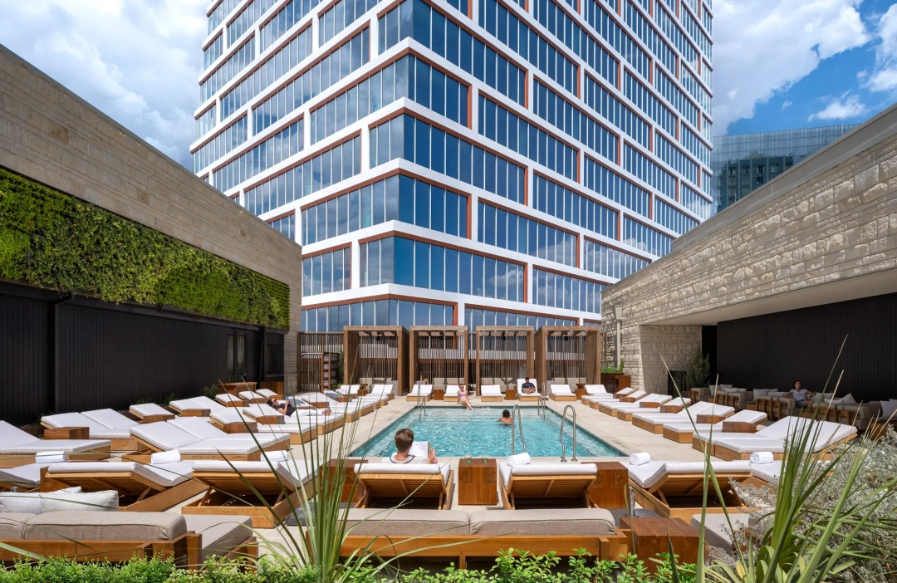

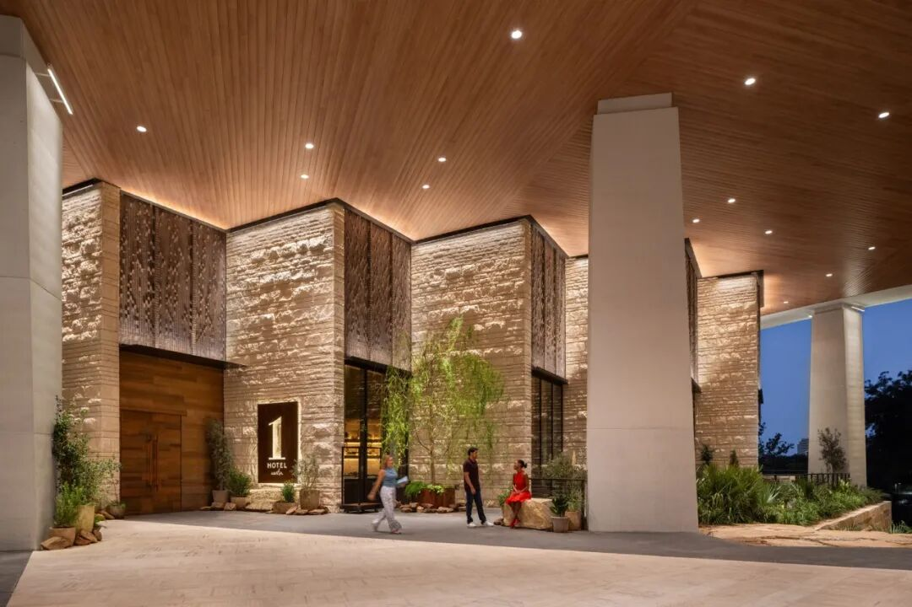
办公空间、酒店和住宅分别配置不同的共享设施。办公区域设有室内休息与会议空间，酒店配备餐饮、休闲和康养设施，住宅部分则结合室内外休闲空间与空中花园。功能转换的位置通过双层高空间、外挑楼板和较大的支撑柱加以区分，使建筑不同高度的使用内容能够从外部得到辨识。
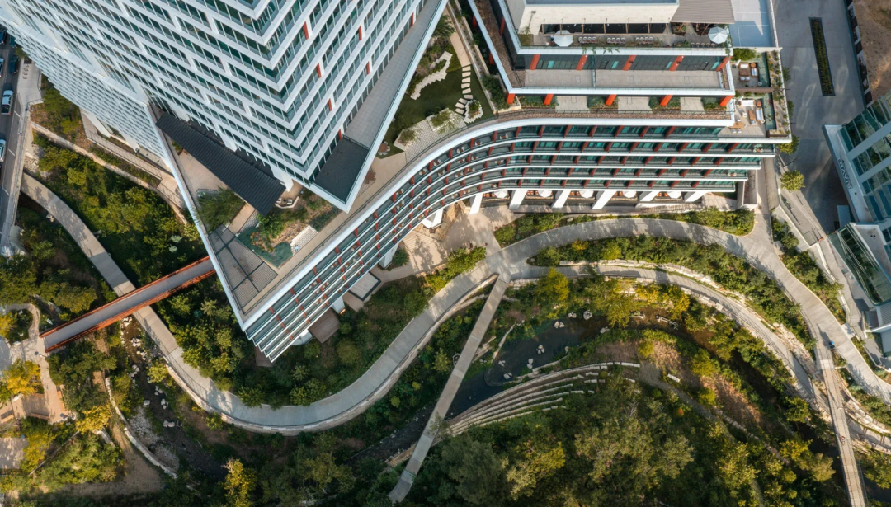
整座建筑通过倾斜的高层轮廓、分层的混合功能、锈红色立面细节、雕塑化柱列和贯穿基座的公共步行通道，将高层开发与奥斯汀的水岸景观及周边城市街区联系起来。
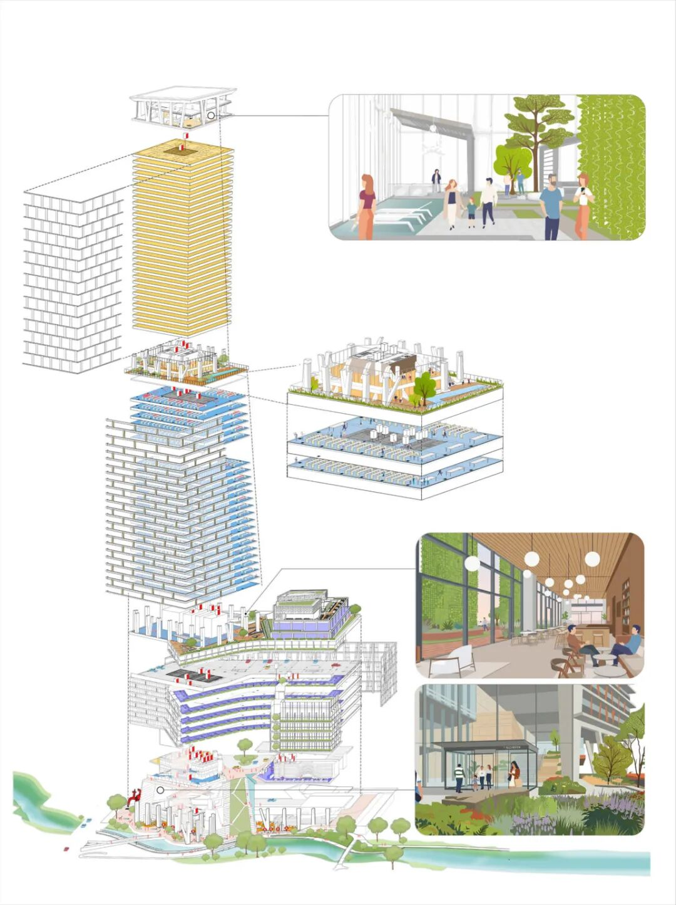

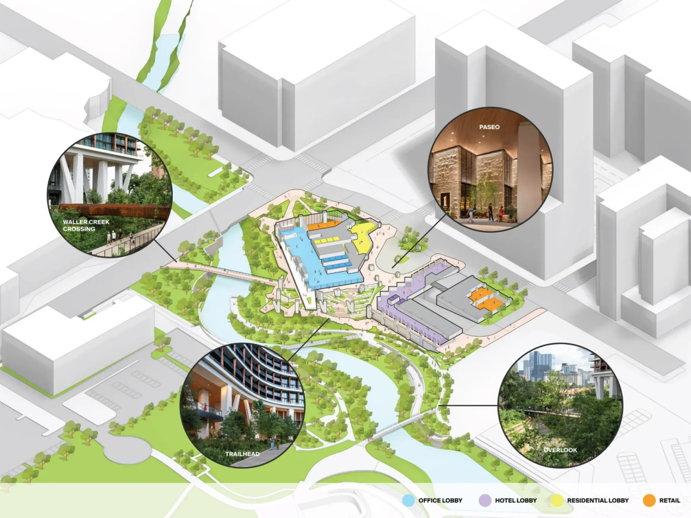
图片：  Nick Blok、Jason O'Rear
    **END**
     联系我们：sheji2415投稿邮箱：youtharch@163.com
    [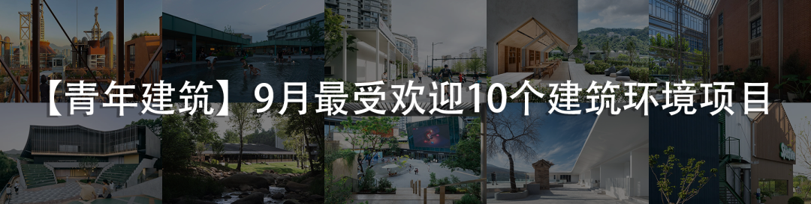](https://mp.weixin.qq.com/s?__biz=MzAxNzMyNzc1Mg==&mid=2650760482&idx=1&sn=40d0c678b0e35483703898a546c6a884&scene=21#wechat_redirect)
