# 裘真 上海兴业太古汇店 洄游之地 / hiih design

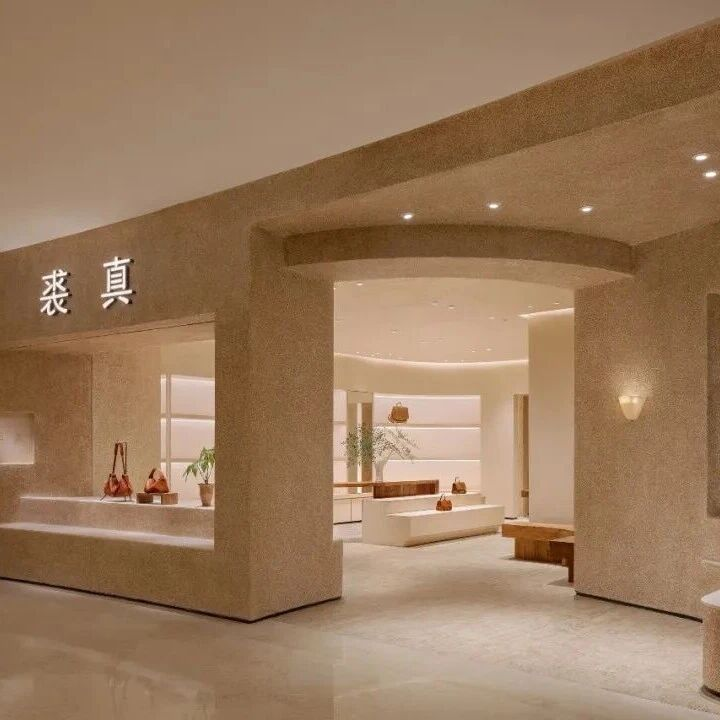

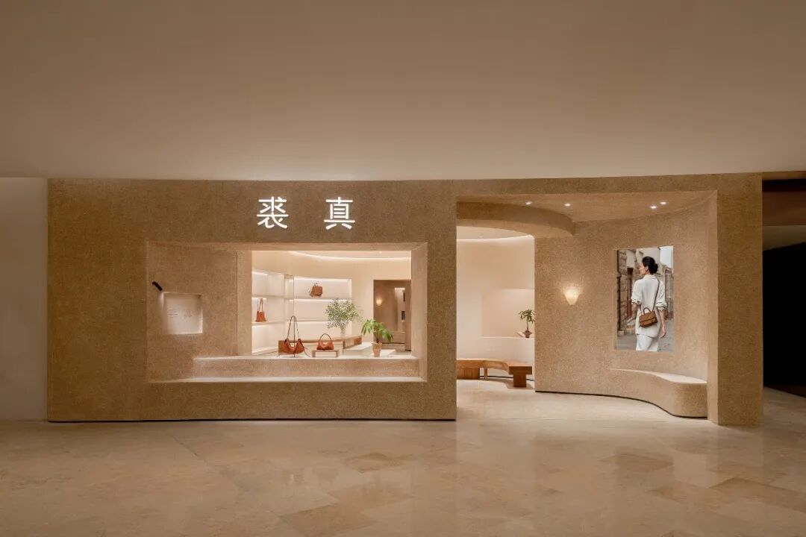
上海兴业太古汇，是南京西路商圈最拥挤的截面之一。裘真将门店落址于此，却选择以近乎沉默的方式存在——没有醒目的门头，没有引导性的灯光，只有一片低饱和的材质肌理。这种“不争夺注意力”的姿态，本身就是品牌对自身形象的一次声明。
一条允许犹豫的动线
门店入口并未设置传统意义上的“迎宾面”。过渡区域作为空间叙事的中转站，以多条路径连接各个区域，消费者可跳出单向动线，自由穿梭、停留与折返。这一“洄游”动线的逻辑，并非对零售效率的漠视，而是对真实选包行为的精确回应——摸一只，背一只，走到另一处看一圈，又想起方才那只，再折返回去比较。选包很少是一条直线，空间理应容纳这种反复，这也降低“被引导消费”的压迫感。当消费者意识到自己没有不足遵循的浏览顺序，停留时间反而延长。
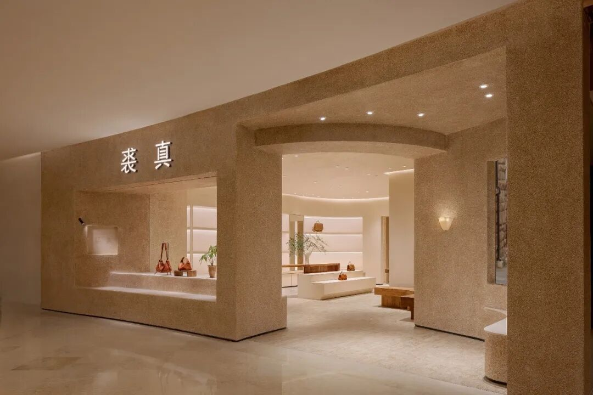
材质的减法原则
空间整体保持自然与留白，这一策略在材质层面表现为一种减法逻辑
：拿掉亮面材质，拿掉高饱和色彩，拿掉可能产生镜面反射的金属件。空间中几乎没有“装饰性材质”——每一种材质都有功能归属：水洗石是墙面，木料是陈列道具，木雕是文化锚点。当材质不再承担“好看”的任务，皮料本身就成为空间中唯一值得被“阅读”的对象。空间主材为艺术漆，搭配温润的木料与天然石材。木料的触感温润，表面保留天然纹路；艺术漆的肌理粗粝，带有手工夯筑的不均匀感。这两种材料的共同点是拒绝工业化的绝对平整。它们的表面起伏是自然的、不可复制的、是带有“材料自身意志”的。
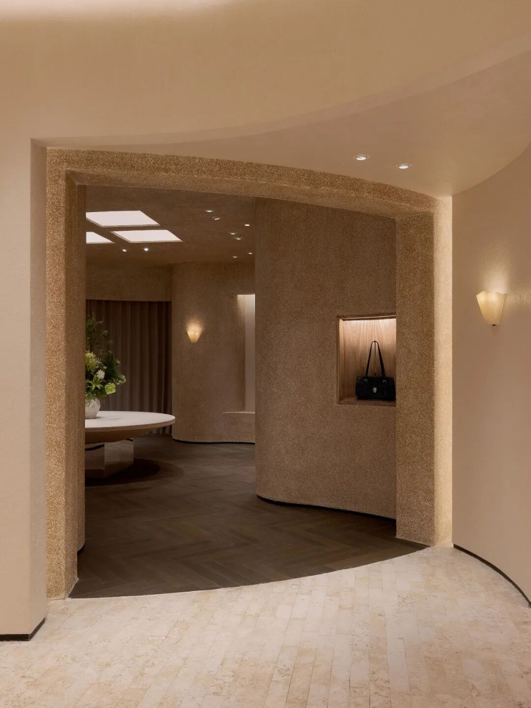

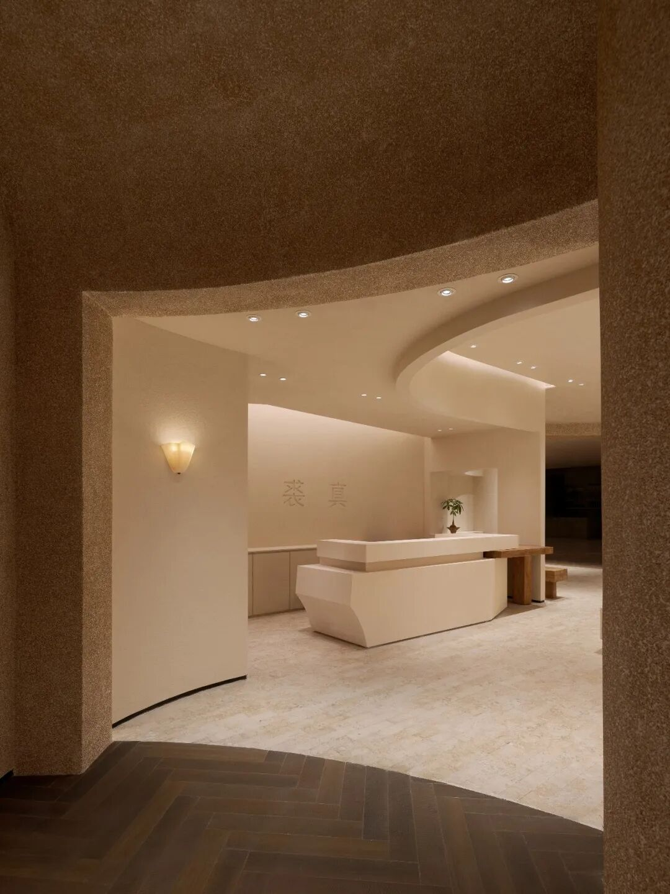

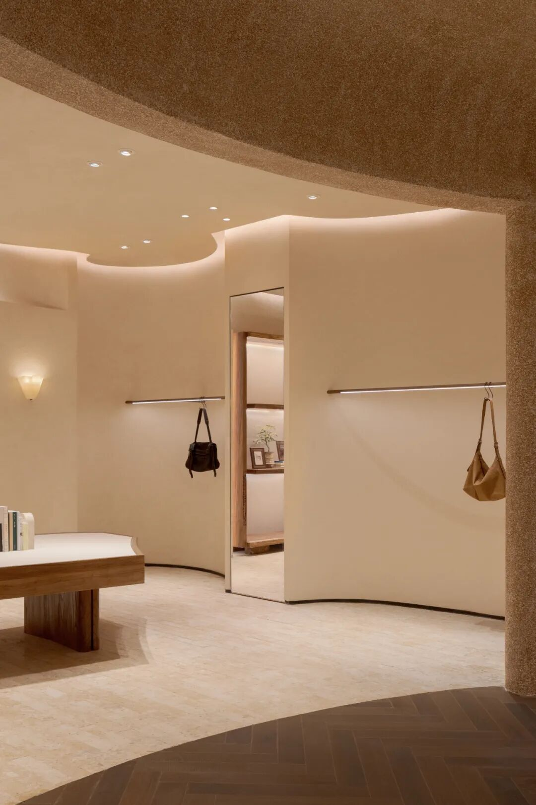

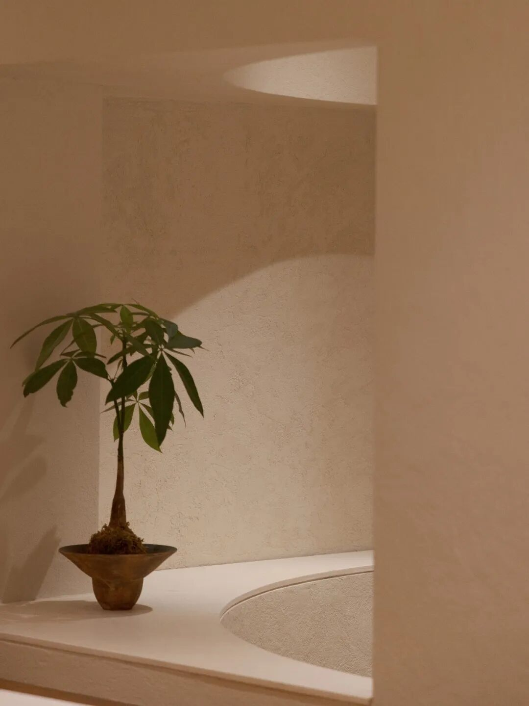
海派底色的隐形介入
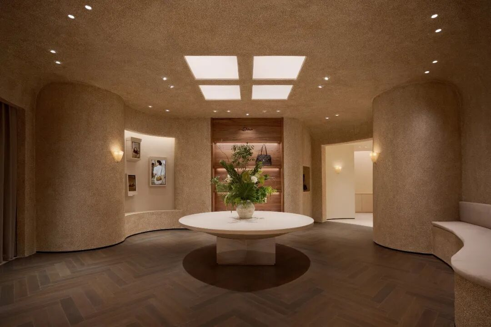

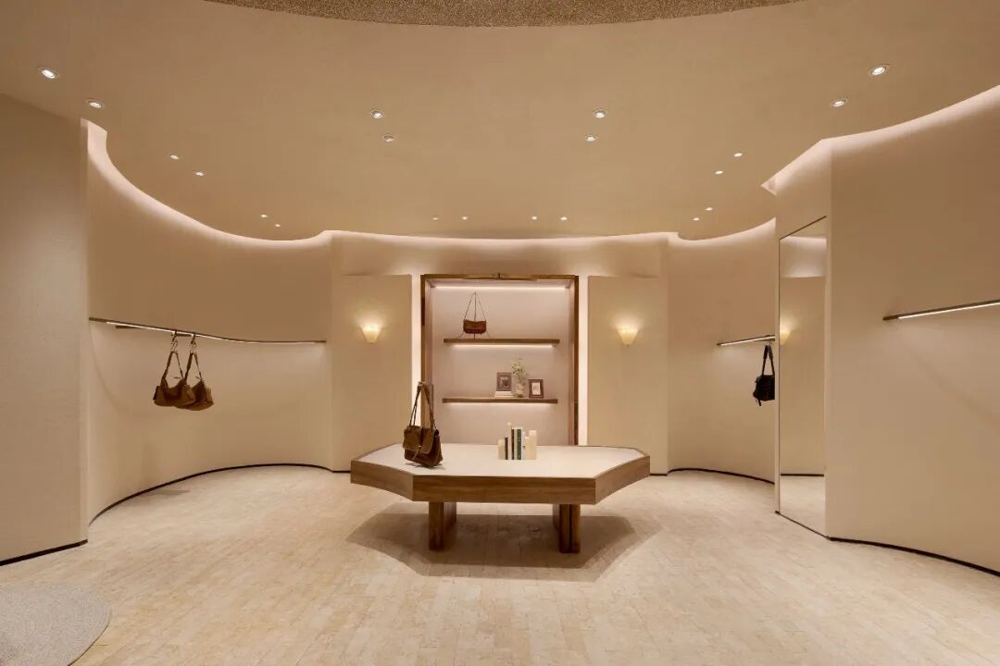
门店所在的上海具有鲜明的建筑秩序感，我们试图在空间中植入一个微型的海派叙事：墙面水洗石的粗粝质感，地面鱼骨拼木地板的色调，局部出现的旧木构件，这些元素共同编织出一种克制的在地性。
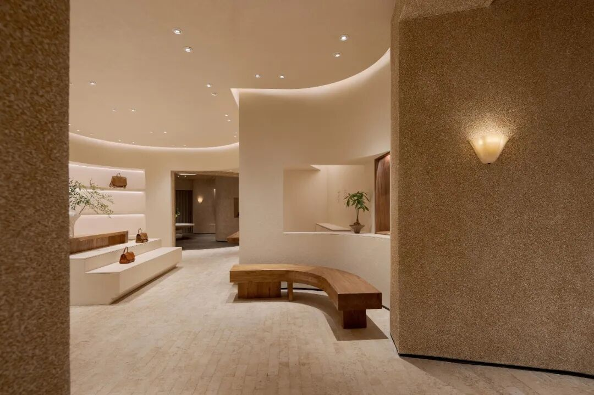

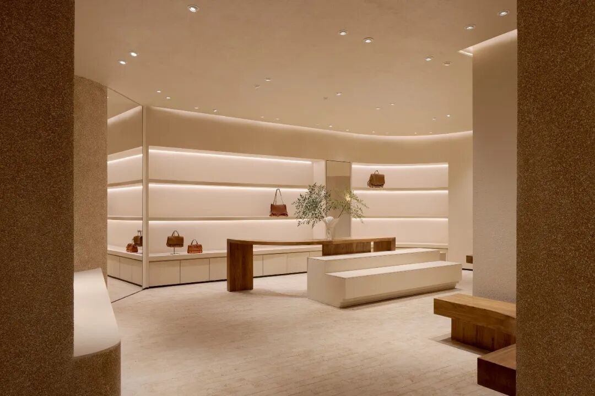

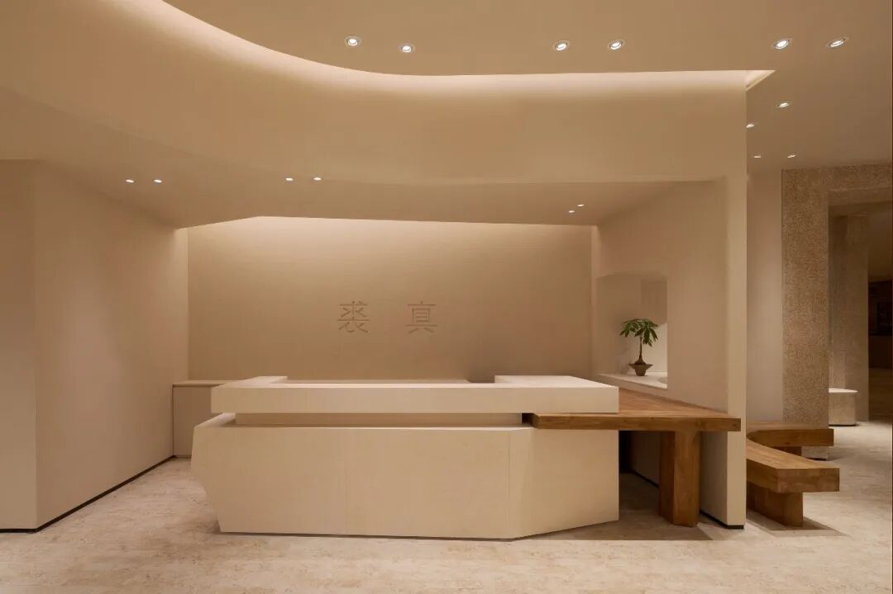
最终，裘真上海兴业太古汇店的所有设计策略——洄游动线、低饱和度色彩、克制材质——都服务于同一个目标：让水染植鞣皮被正确地感知。这种材料拒绝被快速消费，它的价值随使用时间累积而增长，它的美感藏在天然纹理与使用痕迹之中。在一个追求即时满足的商业环境中，裘真选择了一种“慢”的零售方式。空间不催促、不引导、不制造紧迫感，只是安静地呈现材料本身，让消费者与皮料的相遇不被干扰。
项目图纸
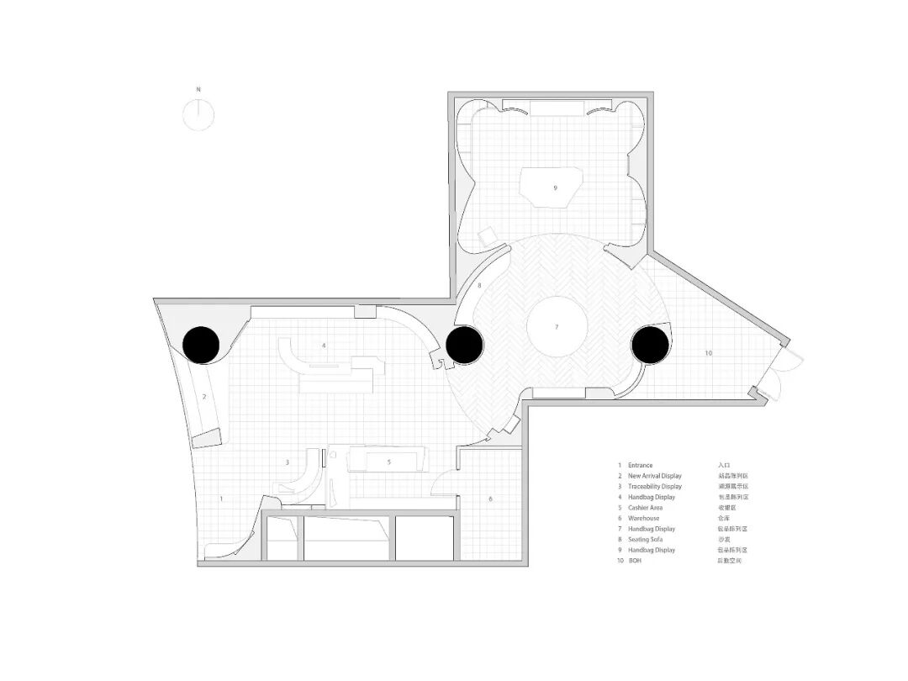

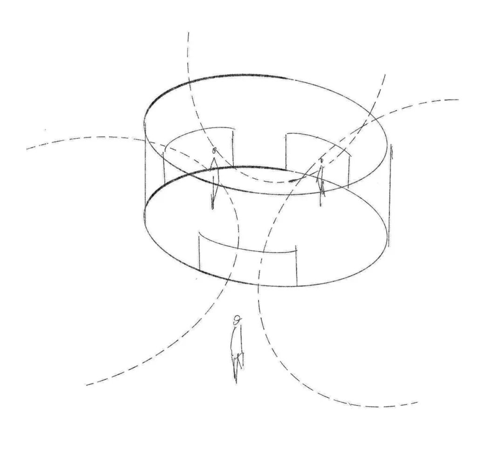
项目名称：裘真 上海兴业太古汇店 洄游之地
项目地点：上海静安区南京西路789号兴业太古汇LG1层LG106B
业主： 香港兴业国际集团与太古地产
主设计团队成员：hiih design
施工单位：裘真
摄影师：wm studio
场地面积：161平方米
建筑面积：161平方米
项目设计时间：2026年5月
项目完成时间：2026年8月
    **END**
     联系我们：sheji2415投稿邮箱：youtharch@163.com
    [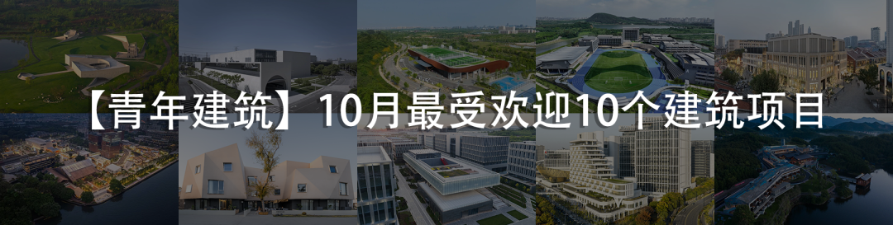](https://mp.weixin.qq.com/s?__biz=MzAxNzMyNzc1Mg==&mid=2650763922&idx=1&sn=1eaa422455c0ce99aa2fc745711769ee&scene=21#wechat_redirect)[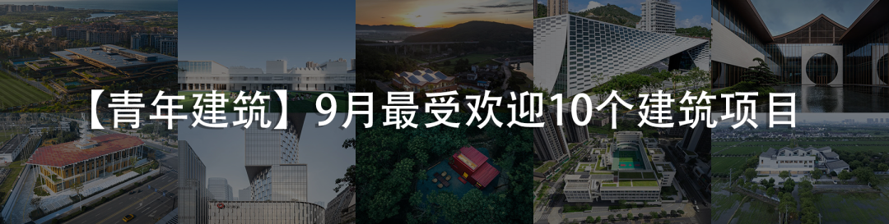](https://mp.weixin.qq.com/s?__biz=MzAxNzMyNzc1Mg==&mid=2650760077&idx=1&sn=58fcd41cc9075444633bbada91bb98df&scene=21#wechat_redirect)
