# 武汉戏曲艺术中心建筑设计方案 / 维思平建筑设计+清华大学建筑设计研究院

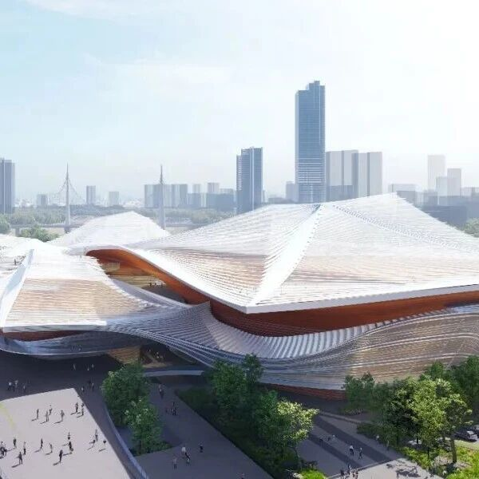

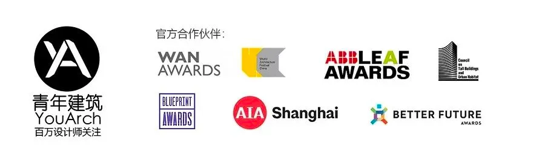

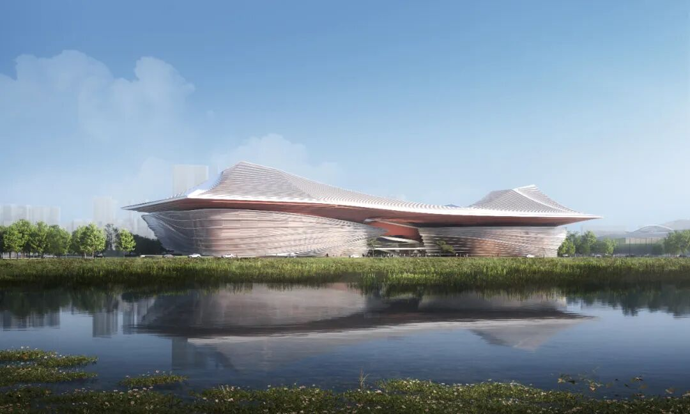
湖北省武汉市武汉戏曲艺术中心建筑设计方案征集结果公布。经资格预审、建筑方案评审、专家评审综合评定，维思平建筑设计与清华大学建筑设计研究院联合体作品成功入围。设计立足荆楚文化与戏曲文脉，以
“城市文化容器” 为定位，尊重场地肌理与在地属性，提出 “戏曲大舞台”“戏曲大园林”
概念，用现代抽象的简洁语言传承历史、表达文化，让戏曲这一最古老的中国艺术形式与现代科技同频共生。
▲ 武汉戏曲中心方案设计视频
愿景
作为城市文化容器的武汉戏曲中心，维思平以发掘武汉文化，戏曲文化以及其在地属性为线索，从城市融合的角度出发。展现其本土、包容、恒定的价值。
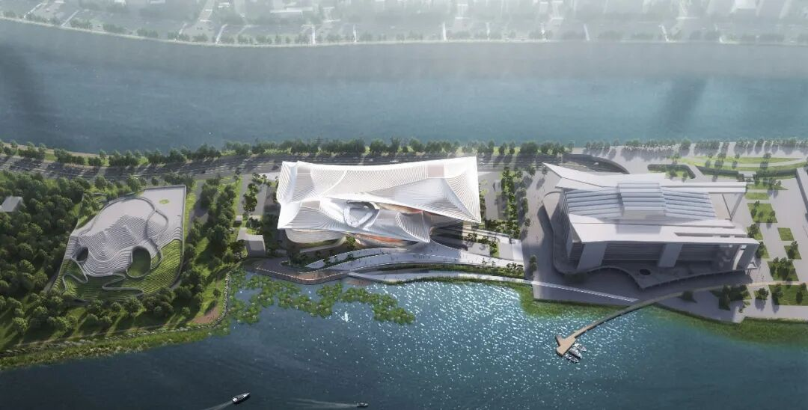
▲ 武汉戏曲中心方案设计
汉江一侧以 “戏曲大舞台”为概念，将其融入到城市滨江界面，通过大舞台的概念将戏曲表演与汉江风光相融合，展现戏曲文化的底蕴和沉淀，营造壮观、震撼的视觉效果。
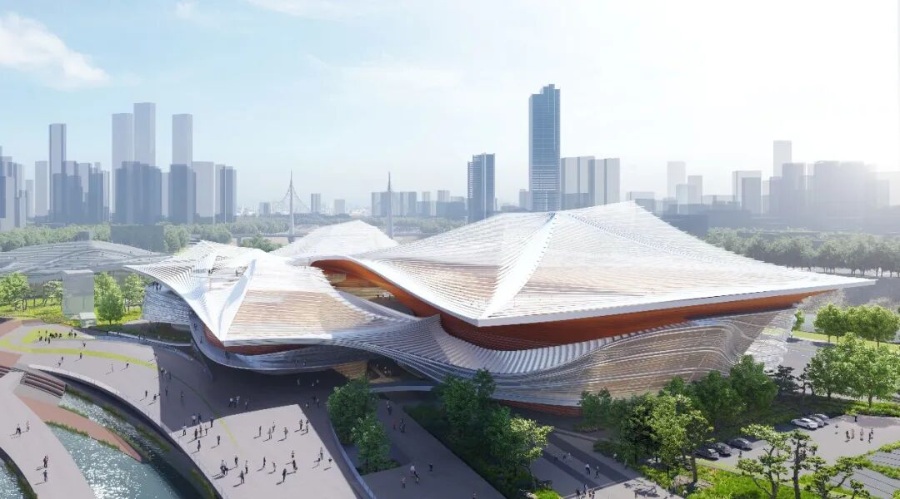
▲ 武汉戏曲中心方案设计
月湖一侧，则有着浓郁的高山流水觅知音的传统文化以及悠扬婉转的园林意境。秉承中国“戏曲大园林”的概念，将传统戏曲文化与中国园林文化相融合。“园林”和“戏曲”在月湖公园这一城市绿肺中相互交织，创造出以戏曲文化为主题的人文环境。让人仿佛置身于一幅幅生动的戏曲画卷之中。
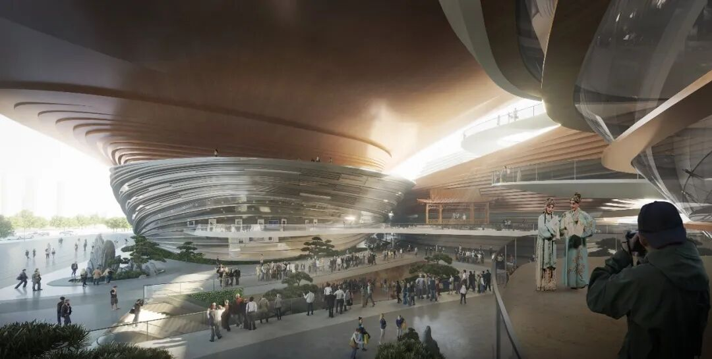
▲ 武汉戏曲中心方案设计
让武汉戏曲中心不仅仅是一个戏曲表演场所，也成为了一个具有传承文化和生态价值的国际文化客厅。
背景
武汉地处长江汉水交汇处，因水而生，因水而起,有浓郁的码头文化，素有”九省通衢沟通南北"之说法，誉为“东方芝加哥”。水运的兴盛造就了汉口码头的繁荣，也将南腔北调的地方戏曲带到此处，武汉成为享誉全国的“戏曲大码头”。
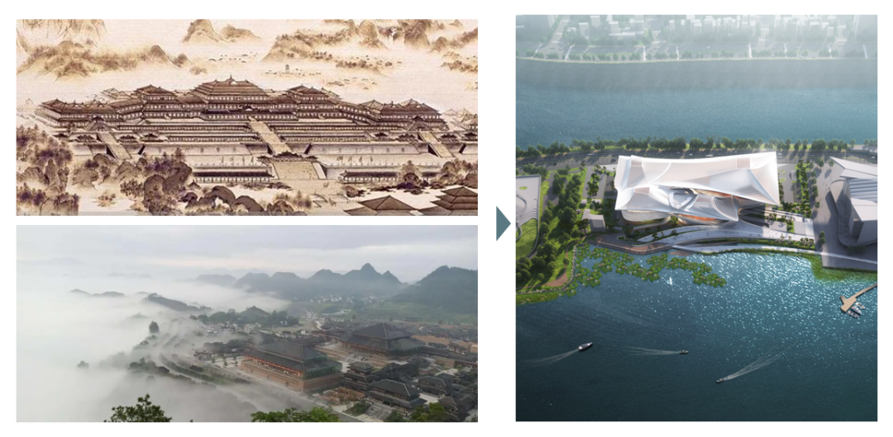
▲ 武汉戏曲中心方案设计
武汉戏曲中心选址位于武汉琴台中央文化艺术区。北临汉江，南依月湖，自然风景和人文资源交相辉映，是彰显武汉市滨水风貌特色和文化艺术形象的城市级公共活动中心，被誉为城市最美“客厅”。
戏曲园林
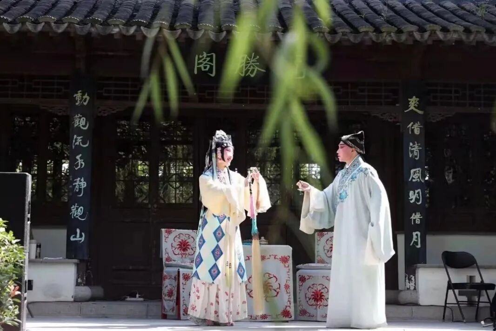
▲ 设计来源图解
荆楚戏曲大园林 ，武汉曲艺大舞台。观湖望江， 为城市打造“戏曲大舞台”，为市民营造“戏曲大园林”。楚风汉韵弄潮，百湖千塘竞娇。江汉交绕,
烟波万里涛。素荑轻撶过银缕，古琴台曲遇知音。规划以戏曲园林为概念，将戏曲与中国园林文化，人文文化紧密结合，营造园中有曲，曲中有园的开放的城市空间，还空间予城市，还生活予市民。
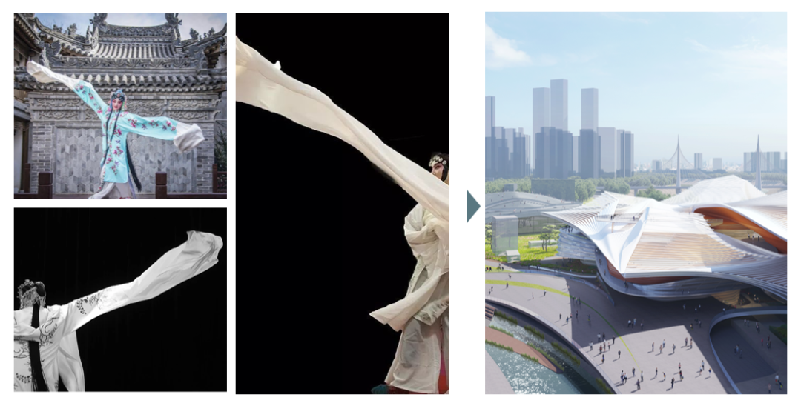
▲ 设计来源图解
建筑立面及造型，以戏曲中水袖为概念原型，将水袖这一独特的瞬时的艺术表达形式化为永久的建筑语言。一尺水袖甩出嗔怒哀怨；一根藤条转眼万里回还；一张桌子拜祭世间冷暖，一张大幕掩映天上人间。
楚风鹤舞

▲ 设计来源图解
建筑屋顶采用楚风制式，建筑屋檐采用飞檐起翘。在沿袭武汉地域内的中国传统建筑形式的威严、庄重的基础上，进行重新解构，辩证解读新中式建筑风格，使其更具人文特色，以服务市民为核心诉求。

▲ 设计来源图解
在处理立面的肌理上， 我们抓取鹤舞时的神、形、意，演化为我们的外立面肌理形式，寓意鹤舞九天。
写意山水
方案采用写意的手法将建筑分为上“山“下”水“两部分，屋顶舒展如山，立面流动如“水”，沿月湖绿畔展开，简洁大气的线条，谱写“高山流水”山水诗篇。

▲ 武汉戏曲中心方案设计
月湖一侧，自然禀赋卓越，
结合建筑打造大型观景平台，形成建筑“外环”，中央庭院以古戏台为核心，盘绕四大剧院，做观赏“内环”，结合内部戏曲景观园林亭廊街巷空间，形成双环动态戏曲游廊空间。打造全时段民众休闲娱乐客厅。
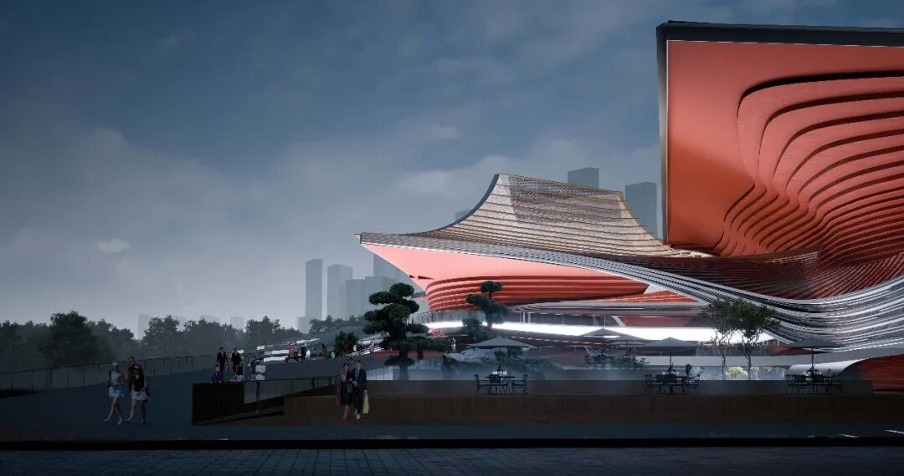
▲ 武汉戏曲中心方案设计
戏曲中心作为一个文化性的场所,融合剧院、艺术空间以及用于节庆和休闲的公共空间。通过创造力及地域性的表达方式,戏曲中心充分体现了东西方文化的丰富性,使戏曲这一最古老的中国传统艺术形式能够随着现代的科技发展共同进步。
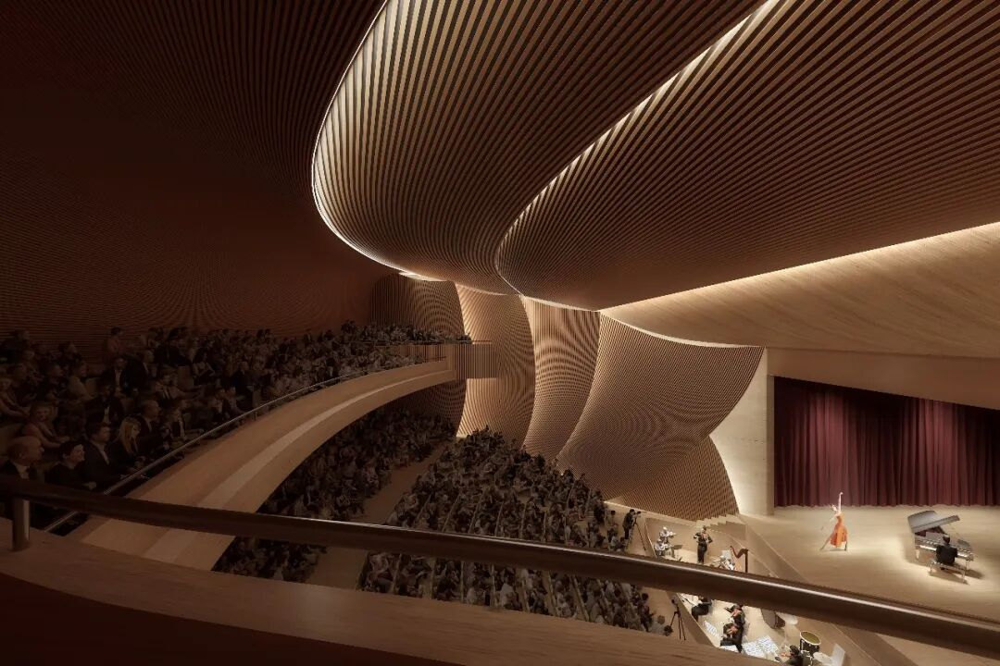
▲ 武汉戏曲中心方案设计
景观策略
景观设计尊崇戏曲“园林”的打造，室外观演
，设计大型观景平台空间和设置丰富的游廊动线，我们期望戏曲中心秉承中国“戏曲大园林”的概念，将传统戏曲文化与建筑相融合，市民游园自然而然置身于戏曲园林之中，打造景荣共生的理念，让民众沉浸式体验戏曲文化的魅力与精髓。
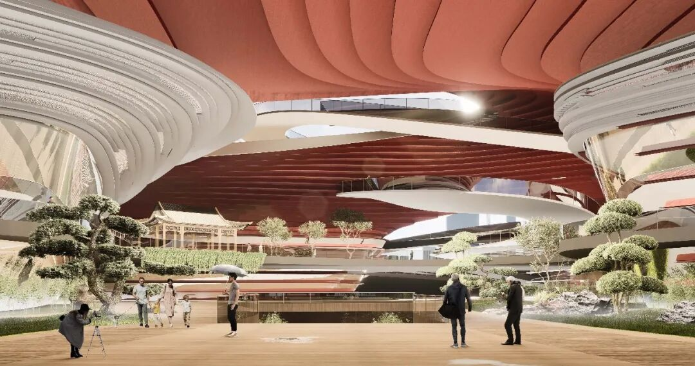
▲ 武汉戏曲中心方案设计
立体景观塑造，采用街区式设计，立体景观，丰富建筑空间，建筑底层开放，形成活力客厅，鼓励市民从各个方向进入戏曲中心。“园林”和“戏曲”在月湖公园这一城市绿肺中相互交织，创造出以戏曲文化为主题的国际文化客厅。
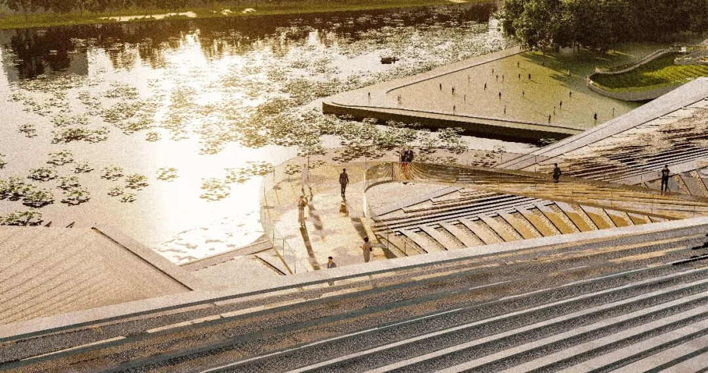
▲ 武汉戏曲中心方案设计
总结
维思平以发掘武汉荆楚文化，戏曲文化,尊重场地文脉肌理以及其在地属性为线索，诠释武汉戏曲中心。建筑用现代的抽象简洁来传承历史，表现文化，展现传统与现代的冲突与和谐并存。从地方文脉出发，塑造富有丰富文化内涵和精神象征意义的空间，创造舒适宜人的生态型使用环境，积极呼应城市整体布局，和谐处理建筑与自然生态环境的关系。

戏曲中心作为一个文化性的场所,融合剧院、艺术空间以及用于节庆和休闲的公共空间通过创造力及地域性的表达方式,戏曲中心充分体现了东西方文化的丰富性,使戏曲这一最古老的中国传统艺术形式能够随着现代的科技发展共同进步。
“楚风汉韵弄潮，百湖千塘竞娇。”
“江汉交绕, 烟波万里涛。”
“素荑轻撶过银缕，古琴台曲遇知音。”
项目名称：武汉戏曲艺术中心
业主单位：武汉文化旅游集团有限公司
设计联合体：北京联合维思平建筑设计事务所有限公司+清华大学建筑设计研究院
主设计师：吴钢，曲克明
设计团队：王德元，曾瑞，吴婉莹，李佳泽，张耀丹，马璐璐
用地面积：39000平方米
总建筑面积：63500平方米
容积率：1.08
观演席位：800（大剧场）、350（小剧场）×3、300（实验剧场）
    **END**
     联系我们：sheji2415投稿邮箱：youtharch@163.com
    [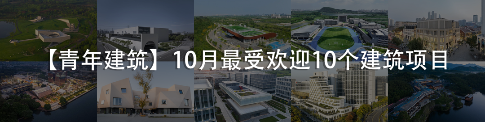](https://mp.weixin.qq.com/s?__biz=MzAxNzMyNzc1Mg==&mid=2650763922&idx=1&sn=1eaa422455c0ce99aa2fc745711769ee&scene=21#wechat_redirect)[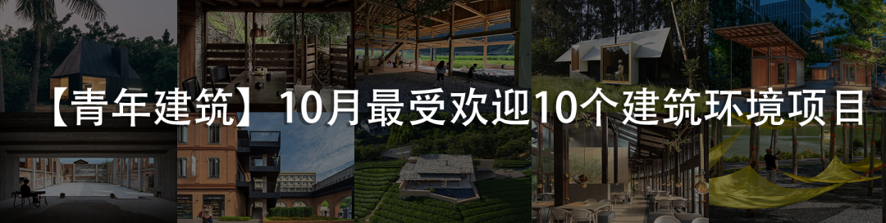](https://mp.weixin.qq.com/s?__biz=MzAxNzMyNzc1Mg==&mid=2650764566&idx=1&sn=5701a89ae6234532344fce6359621bad&scene=21#wechat_redirect)
