# 东京街头藏着一台36年前的“高达”，里面竟是一所学校

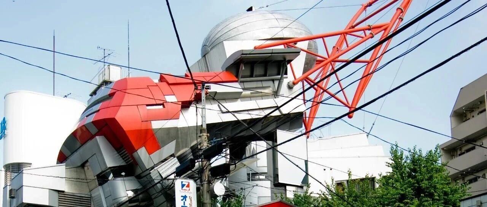

ARCHITECTURE / TOKYO / 1990
#  东京闹市里，藏着一台36岁的“高达”
渡边诚把水箱、避雷针和结构柱“放任生长”，造出一座至今仍让人停下脚步的学校
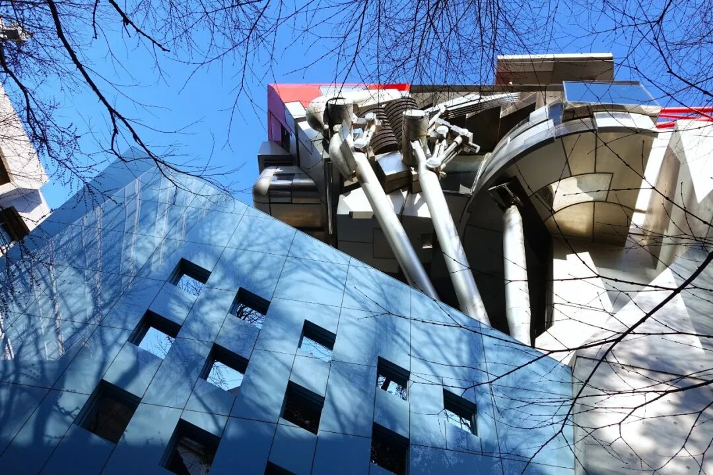
** 图 01｜  ** 从蓝色弧形基座仰望上部悬挑体量，倾斜支柱、银色舱体与红色桁架在街角叠合。图片来源：Wikimedia
Commons。摄影：Sayidufam（CC BY-SA 4.0）。
在  ** 东京（Tokyo）涩谷区（Shibuya）  **
一条并不起眼的街巷里，普通公寓、商店、电线与低层住宅挤在一起。转过街角，一组红、银、灰交叠的金属构件突然探出城市天际线，像机械头颅，也像尚未完成变形的生物。
这就是  ** 青山制图专门学校1号馆（Aoyama Technical College Building No. 1）  ** 。它由  **
渡边诚（Makoto Sei Watanabe）  ** 及其事务所  ** 渡边诚建筑事务所（Makoto Sei Watanabe /
Architects' Office）  ** 设计，方案在1988年国际设计竞赛中获得第一名，1990年建成。公众后来给它起了一个更容易传播的名字：
** “高达建筑”  ** 。
这个昵称抓住了外观，却没有解释建筑真正的起点。渡边诚关注的是  ** 城市生态、自组织、部件生长与建筑的感官作用  **
。在他的设想中，一座学校可以成为缩小后的城市实验：每个部分都拥有自身逻辑，同时又维持整体平衡。
PROJECT DATA
** 项目名称：  ** 青山制图专门学校1号馆（Aoyama Technical College Building No. 1）
** 设计：  ** 渡边诚建筑事务所（Makoto Sei Watanabe / Architects' Office）
** 地点：  ** 日本东京涩谷区莺谷町（Uguisudanicho, Shibuya, Tokyo）
** 竞赛：  ** 1988年国际设计竞赛第一名
** 竣工：  ** 1990年3月
** 规模：  ** 地上5层，延床面积约1,479.47平方米
** 主要功能：  ** 教室、教师空间、门厅、展示与作品发表空间
** 施工：  ** 鸿池组（Konoike Construction）
** 奖项：  ** 1994年HYLAR International Award
** 01  ** / THE CITY AS FOREST
##  涩谷不是混乱废墟，它更像一片自然生长的林地
渡边诚对场地的观察从周边街区开始。这里没有统一檐口，没有连续立面，也没有清晰控制的城市轴线。办公室、集合住宅、商店和小型住宅彼此穿插，道路弯曲，建筑高度参差。若用古典城市规划的尺度衡量，它显得松散、无序，甚至缺少可以被继承的明确文脉。
建筑师没有把这种状态简单归为失败。他将涩谷比作  ** 森林、草原与生态系统  **
：树木、灌木、昆虫和其他生物各自依照不同规则生长，整体仍能维持复杂平衡。  城市表面看不到统一法则，内部却持续发生适应、竞争、协商与更新。
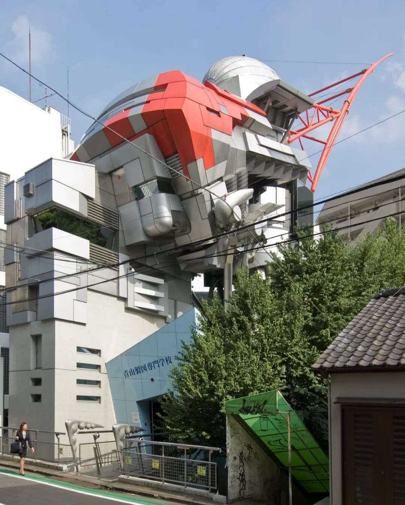
** 图 02｜  ** 建筑从相邻住宅、树木与狭窄街巷之间升起，上部红银构架与低层城市肌理形成强烈尺度反差。图片来源：Wikimedia
Commons。摄影：Wiiii（CC BY-SA 3.0）。
** 建筑在这里承担了一项城市尺度的任务：  **
它无法凭一栋楼完成宏大规划，却可以进入既有关系，制造新的刺激与回应。青山制图专门学校1号馆因此没有选择退回中性的盒子，它主动成为街区中的异物、信号和触媒。
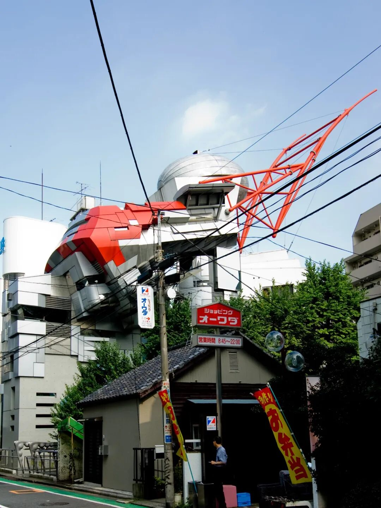
** 图 03｜  ** 沿街接近建筑时，电线、路牌、低层商铺与红色桁架同时进入视野，显示项目对日常街景的主动介入。图片来源：Wikimedia
Commons。摄影：Wiiii（CC BY-SA 3.0）。
** 02  ** / PARTS START TO GROW
##  水箱、避雷针和结构柱，都获得了继续“生长”的权利
建筑最容易被误读的部分，正是它最核心的方法。屋顶巨大的旋转椭球体具有明确用途：  ** 它是一座水箱  **
。向天空伸出的红色构架承担避雷系统功能。三根粗壮的倾斜构件负责支撑最上层空间，柱与梁相遇的位置则发展出复杂的柱头和连接节点。
渡边诚没有在功能完成后收住造型。他允许这些构件沿着自身方向继续伸展：水箱变得更饱满，避雷针继续向上，结构节点出现近似器官或关节的形态。建筑师把这种状态形容为植物获得水分后继续抽芽。
** 形态来自功能的延长、构件之间的相互作用，以及设计者对整体平衡的持续校准。  **
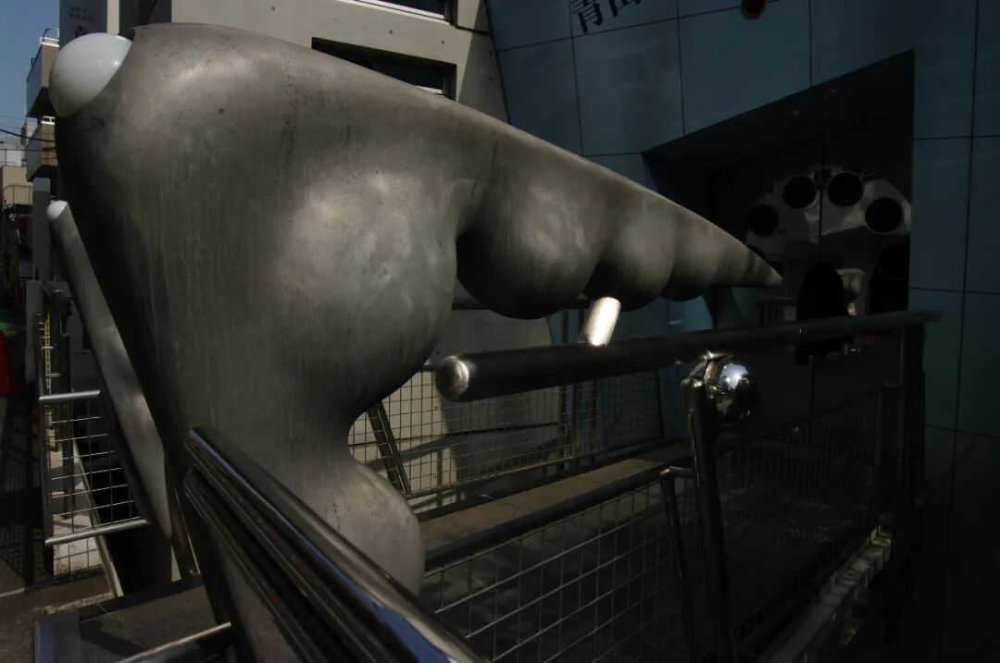
** 图 05｜  ** 入口坡道一侧的黑色雕塑化构件与金属扶手近景，连续曲面为技术性空间加入近似肢体和器官的触觉联想。图片来源：Wikimedia
Commons。摄影：福原邦展（CC BY 3.0）。
KEY IDEA
每个构件都保留个体冲动，整体仍然维持可感知的秩序。
这套原则对应渡边诚所说的“自组织”：整体秩序不依赖部件完全相同，也不需要压平差异。
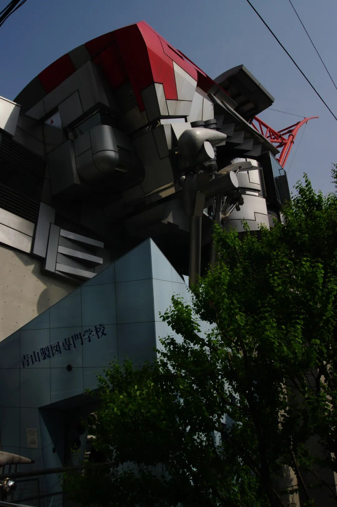
** 图 06｜  ** 从入口侧仰望悬挑体量，树冠、倾斜支柱和折叠金属表皮互相遮挡，建筑呈现由多个独立部件共同生长的状态。图片来源：Wikimedia
Commons。摄影：福原邦展（CC BY 3.0）。
** 03  ** / A SCHOOL AS MODEL
##  一所学校，也是一座关于个体与集体的城市模型
建筑中的部件几乎各不相同。对渡边诚来说，这与学校中的学生相似：每个人拥有不同能力、性格和发展方向。学校若只追求统一，会削弱个体成长；若完全放任，又可能失去共同体。建筑由此成为一项教育隐喻——
** 最大限度保留个体自由，同时建立整体协调。  **
功能组织仍然清晰。建筑容纳教室、教师空间与门厅，最上层设置用于研讨、展示和作品发表的自由空间。悬挑的多面体并非单纯的造型顶部，它为学校提供了面向创作与交流的公共核心，也成为街道上最具辨识度的部分。
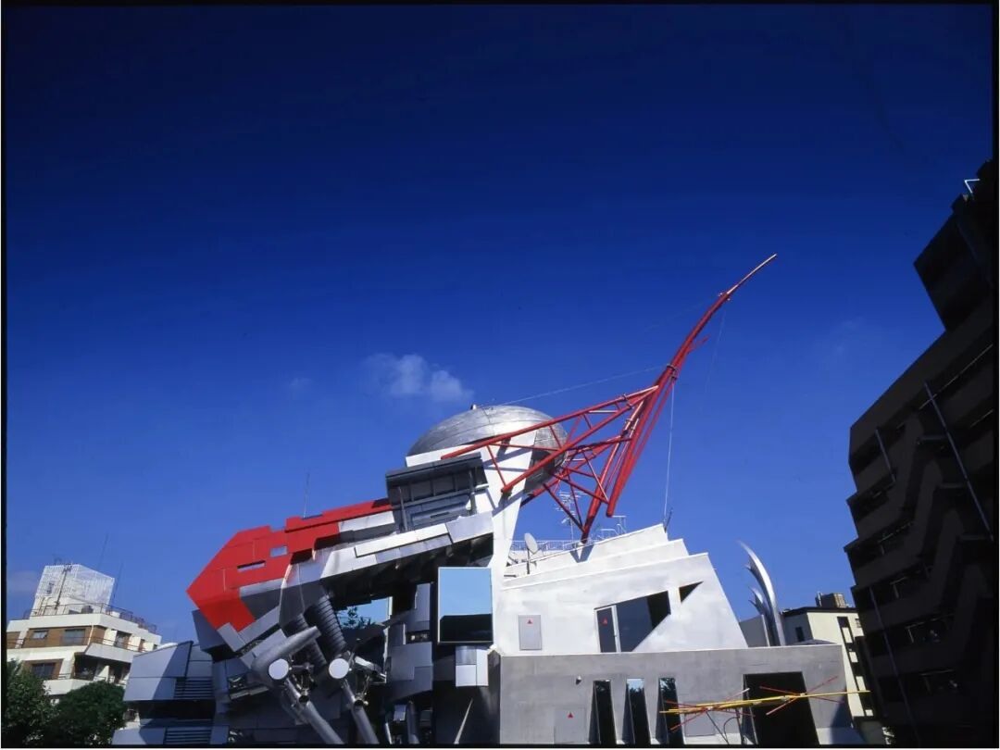
** 图 07｜  ** 蓝天下的建筑整体外观，银色椭球形水箱、红色避雷构架与灰色悬挑体量构成清晰的识别性轮廓。图片来源：青山制图专门学校官网。
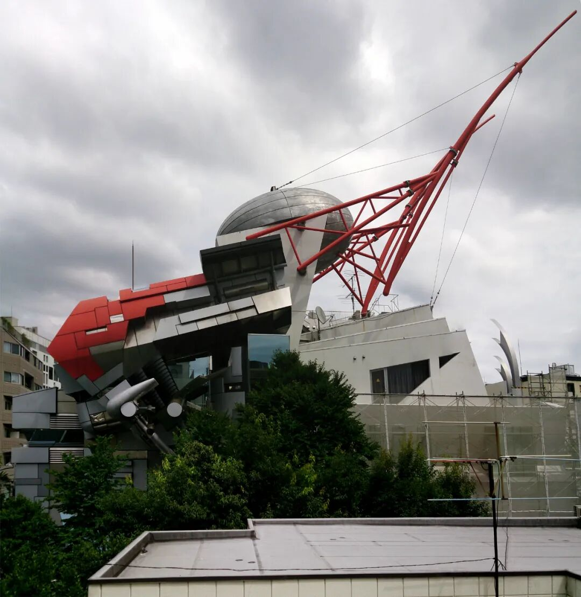
** 图 08｜  ** 从相邻屋顶远望建筑，上部红色桁架跨越低层屋面与树冠，显示其在涩谷密集街区中的远距离可见性。图片来源：Architecture
Tokyo。
** 04  ** / MASS CUSTOMIZATION AHEAD
##  200多块不重复面板，提前预演数字化建造
这座建筑的激进性不只停留在形象层面。外部使用的三维铝板与不锈钢板总数超过200块，  ** 几乎没有完全相同的形状  **
。传统平面与立面图难以完整传递这些复杂几何，三维数据开始承担图纸角色。
在1989至1990年的技术条件下，设计到生产的一体化CAD/CAM流程只能部分实现。  即便如此，这项尝试已经指向后来广泛讨论的  **
多品种、小批量与数字化定制生产  ** 。标准化工业体系擅长重复同一部件，青山制图专门学校则探索如何以计算机辅助方式制造大量差异化构件。
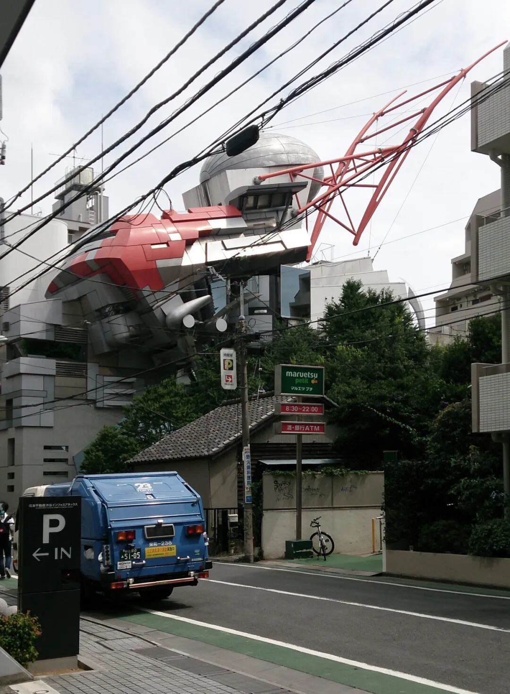
** 图 09｜  ** 街道车辆、停车标识与密集架空线共同构成日常前景，建筑并未脱离城市杂讯，反而借此强化自身的异质感。图片来源：Architecture
Tokyo。
** 05  ** / ARCHITECTURE AS CATALYST
##  让建筑重新拥有触动身体的力量
渡边诚认为，许多现代建筑在追求效率与中性表达时，削弱了建筑直接作用于心理、身体、感觉和记忆的能力。
青山制图专门学校1号馆试图恢复这种力量。它不要求观看者得出统一答案：有人看见机械，有人联想到昆虫、植物或未来城市。
建筑在这里像一面镜子，也像催化剂。它调动观看者已有的文化经验，再把这些经验投射回城市。所谓“高达建筑”正是这种机制的结果：
大众用熟悉的动漫形象理解陌生建筑，建筑由此进入公共记忆。
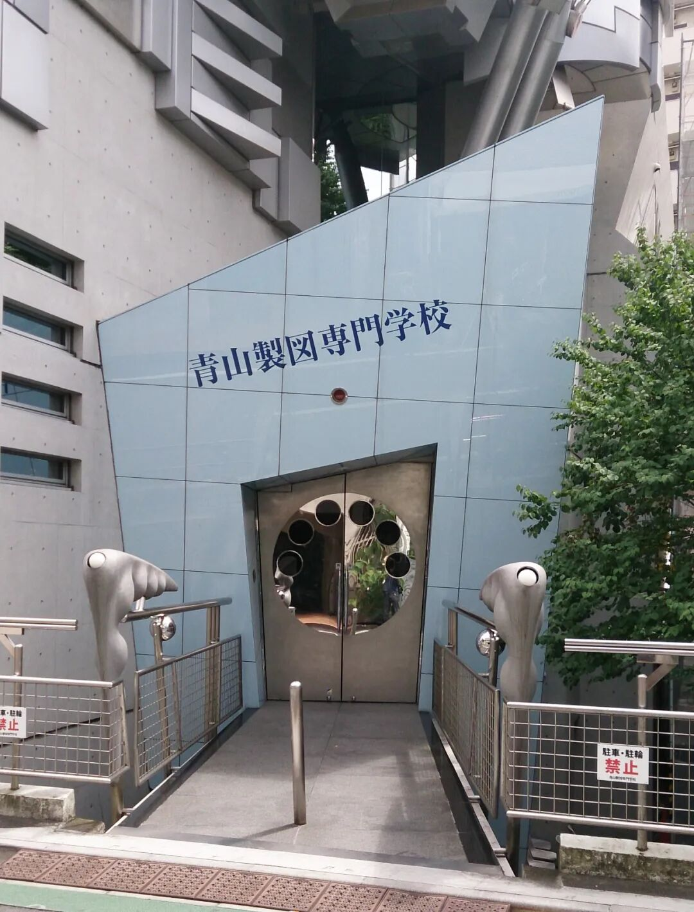
** 图 10｜  ** 蓝灰色入口体量、圆形门洞与两侧金属构件构成近人尺度的到达界面，上方巨大悬挑结构则制造明显压迫感。图片来源：Architecture
Tokyo。
“建筑应当能够触动人的心，并以其他艺术无法替代的方式，带来身体层面的震动。”
——渡边诚对青山制图专门学校设计目标的阐释
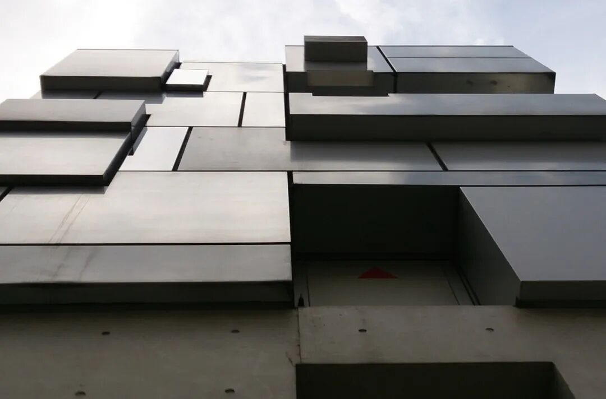
** 图 11｜  ** 分段金属板以不同厚度和进退关系覆盖外墙，板缝、阴影与凸出盒体呈现差异化构件的装配逻辑。图片来源：Architecture
Tokyo。
** EPILOGUE  ** / STILL GROWING
##  36年后，它依旧没有被城市驯服
建筑在2003年完成整体更新，包括清理与保护清水混凝土、重新密封金属面板以及局部涂装。学校持续使用这座建筑，最上层空间也随教学需求发生调整。2025年，渡边诚仍在这里为来访学生讲解当年的设计理念。
它没有成为一件与现实脱节的时代标本。相反，持续使用、维护与重新理解，使这座建筑保持活性。  **
青山制图专门学校1号馆最值得重看的地方，是它把造型冲动、城市理论、教育隐喻和数字制造放进了同一个不稳定却完整的系统。  **
人们依旧会先叫它  “高达”  ，随后才发现：那颗“机械头颅”内部，讨论的是如何让差异共存，如何让建筑对城市产生作用，以及一栋楼怎样继续保有令人惊讶的能力。
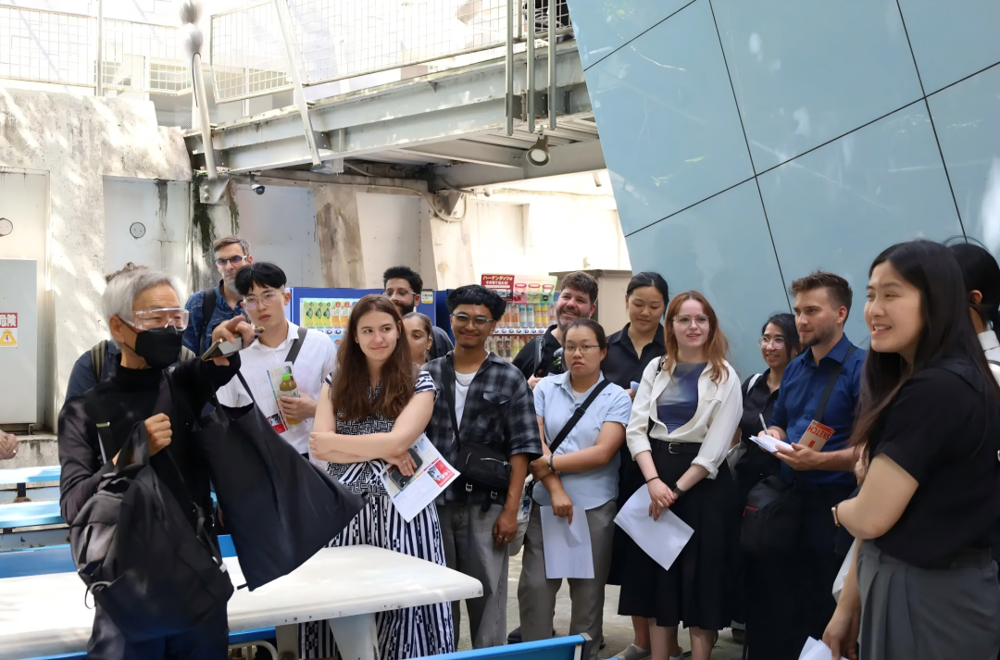
** 图 12｜  **
2025年，渡边诚在1号馆入口一带为来访学生讲解建筑，显示这座建成于1990年的学校仍在持续使用与被重新理解。图片来源：青山制图专门学校官网。
###  参考资料
1\. Instagram：JP 不止于设计｜J.P. Design
2\. Makoto Sei Watanabe / Architects' Office：青山制图专门学校一号馆 1990
3\. Makoto Sei Watanabe / Architects' Office：Aoyama Technical College 1990
4\. 青山制图专门学校：建筑家渡边诚特别讲演会
5\. 青山制图专门学校：学校沿革
6\. DESIGNART：青山制图专门学校 一号馆
7\. Architecture Tokyo：1990 – Aoyama Technical College – Makoto Sei Watanabe
8\. 10＋1 Photo Archives：176 渡边诚
9\. 新建筑数据：青山制图专门学校1号馆
