# 奥雷·舍人公布韩国新数字艺术馆：一座没有传统展厅与门槛的美术馆

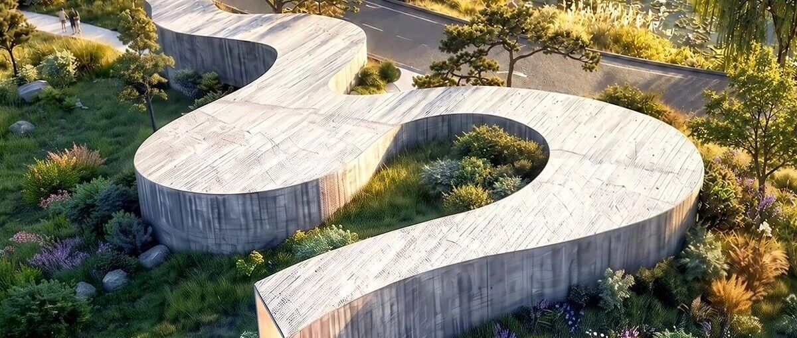

ZAOME / 建筑评论 · 数字艺术空间
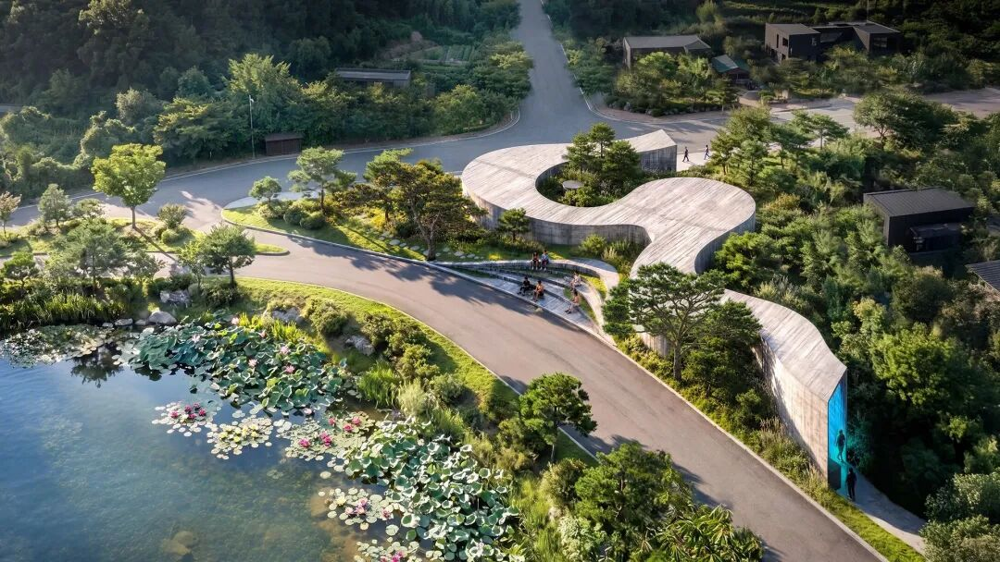
公园与莲池之间的连续艺术馆，方案鸟瞰。 效果图：Büro Ole Scheeren。
364平方米，不设独立展室：奥雷·舍人把艺术馆做成一条公园路径
从池塘边的散步，到光影之间的行走
Suseong Continuum / Büro Ole Scheeren / 韩国大邱
01
沿着公园的路，走进艺术馆
在公园里散步，观展可能从哪一步开始？  ** 奥雷·舍人（Ole Scheeren）  ** 与  ** 奥雷·舍人建筑事务所（Büro Ole
Scheeren）  ** 为韩国大邱设计的  ** 寿城数字媒体艺术馆（Suseong Continuum）  **
，把这个起点放在一条逐渐进入建筑的路径上。沿着池塘行走的人，将经过地形、混凝土墙面与光线的连续变化，进入数字艺术的展示空间。
项目位于  ** 韩国大邱市寿城区（Suseong-gu, Daegu）  **
，场地夹在公共公园、莲池与居住街区之间，远处可见山地。建筑没有以孤立的体量占据场地中心，而是顺着步行路线弯折展开，局部嵌入地形。
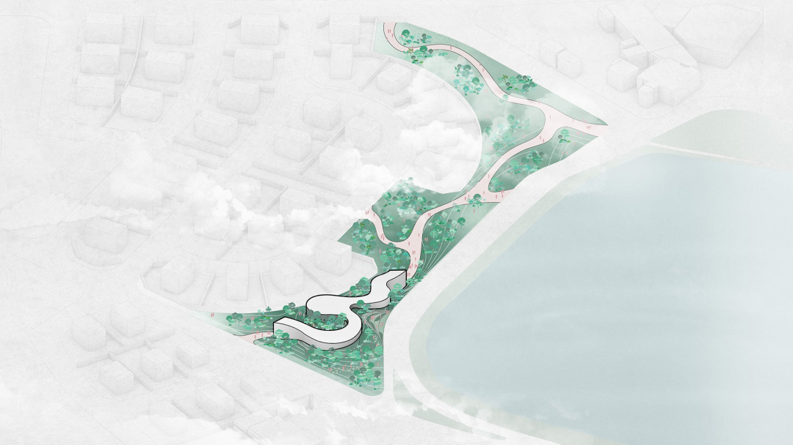
莲池、公园路径与艺术馆的总平面示意。 图纸：Büro Ole Scheeren。
这座艺术馆的  ** 建筑面积为364平方米，其中339平方米用于展览，25平方米用于机电及信息设备  **
；总场地面积1371平方米，建筑高度4.8米。小规模使入口、通道与展览之间的关系尤为关键：路径需要容纳观看与停留，同时延续公园中较为自由的行走节奏。
沿池塘展开的轮廓，也改变了建筑与公园的接触方式。相比单一的大门，一条较长的边界让行走者能够从不同方向感知建筑；弯曲墙面与地形交替进入视野，使空间在抵达之前便已开始展开。
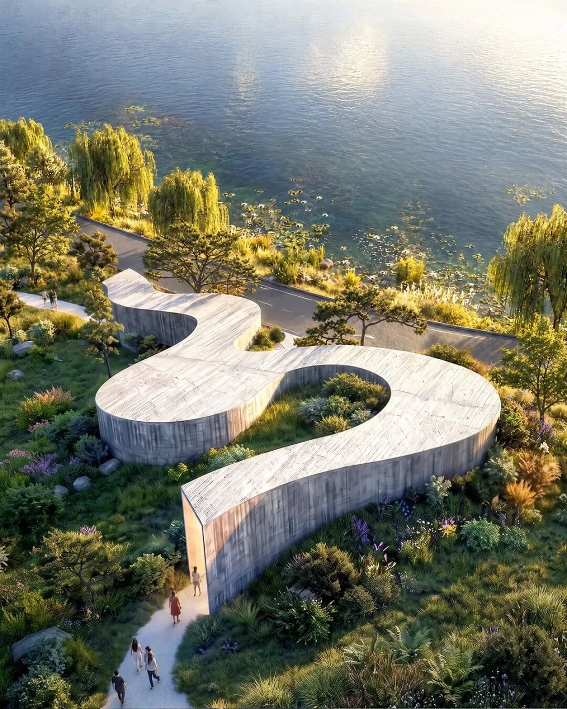
弯折体量沿池塘展开，方案鸟瞰。 效果图：Büro Ole Scheeren。
02
空间的改变，发生在行走之中
通常，门口会清楚提示观众：一个展厅结束，另一个展厅开始。寿城方案则  ** 不设置传统的封闭展室与展室间门洞  **
，把展示组织在一条蜿蜒的连续路线中。路径时而收窄，时而展开，转弯与墙面的弧度改变视线，让下一处空间逐步出现。
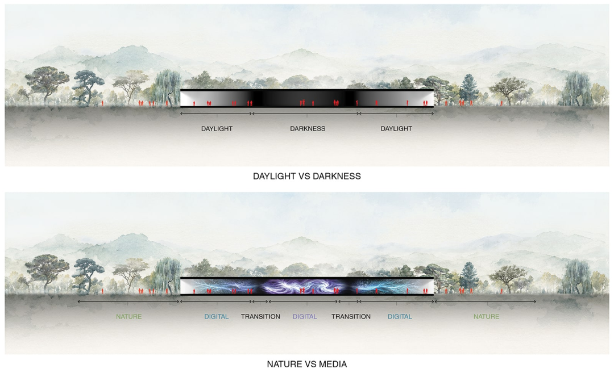
自然光与暗场、自然与媒体关系的剖面示意。 图纸：Büro Ole Scheeren。
这种连续性并不意味着所有区域具有相同的感受。方案通过明暗、声音、围合程度与沉浸强度的变化，形成不同的展示段落。观众可以在较开敞的地方放慢脚步，也会随着转折进入更集中的观看区域；展览的节奏由
** 身体经过空间的过程  ** 展开。
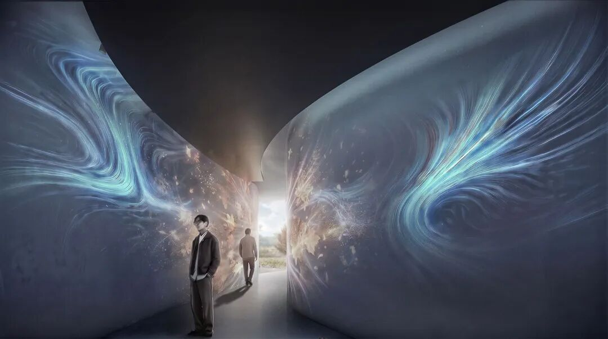
连续路线中的收窄与转折，方案效果图。 效果图：Büro Ole Scheeren。
连续路径还会影响观众彼此之间的关系。有人驻足观看，有人继续前行，宽窄不同的段落便需要容纳不同速度。这里的空间设计同时处理影像与人的移动：展开处为停留提供余地，转弯处组织视线的转换，让小型场馆内部仍然具有层次与方向。
对于数字艺术，墙面、地面和周边光线都会参与作品的呈现。曲面提供了延展影像的背景，也改变了观看距离与视角。一个人向前走几步，原本位于视野边缘的影像便可能成为眼前的主体；连续通道由此为艺术家提供了按路线安排作品的空间条件。
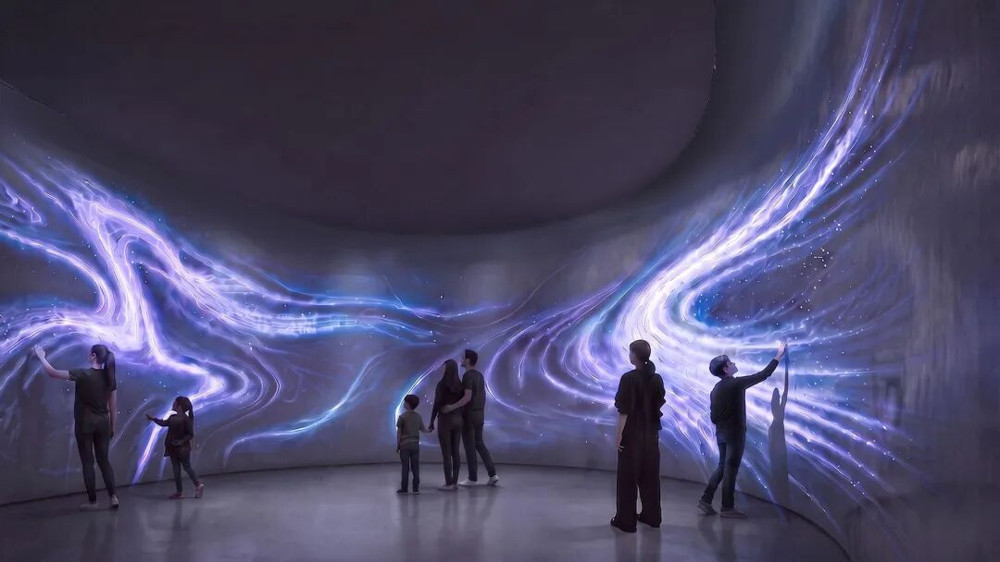
沉浸式影像展示空间，方案效果图。 效果图：Büro Ole Scheeren。
舍人在访谈中谈到，作品可以分别占据连续路径中的局部，又不必彼此完全隔离。这为策展留下了不同于独立展室的组织方式：作品之间能够产生先后、相邻或遥相呼应的关系。最终的观看效果，仍将取决于具体作品与空间的配合。
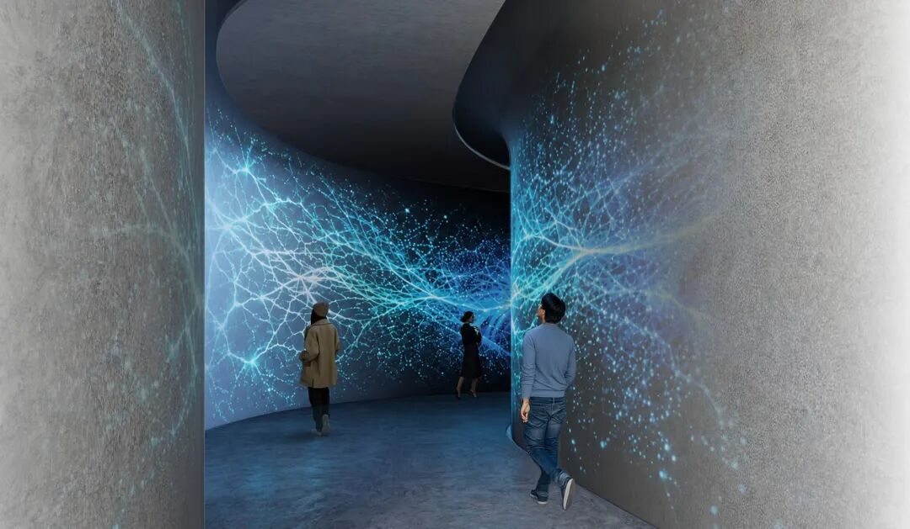
曲面墙体连接不同展示区域，方案效果图。 效果图：Büro Ole Scheeren。
03
从松木纹理，到光滑的投影面
沿路变化的还有材料。外部混凝土保留松木模板留下的粗糙纹理，进入室内后，表面逐渐过渡为适合投影的平滑白色墙面；脚下则由碎石转向抛光混凝土。  **
触感、脚步与亮度的变化  ** 共同标记内外转换，让入口成为一段可以感知的过程。
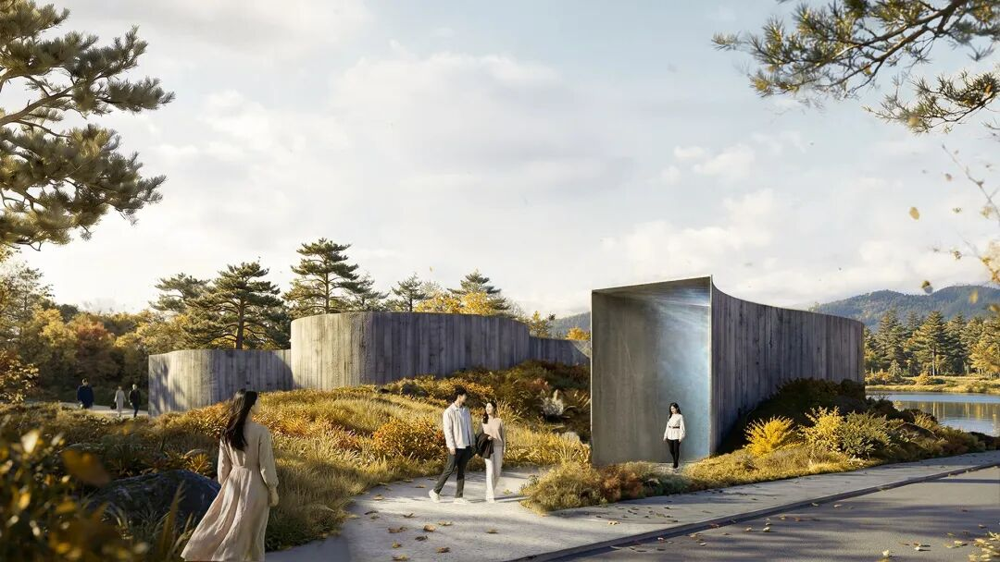
步行路径与混凝土墙面相接，入口方案效果图。 效果图：Büro Ole Scheeren。
建筑局部埋入地形，也具有环境调节的考虑。设计利用覆土提供被动保温条件，应对大邱夏季炎热、冬季寒冷的气候。低矮的体量与覆土将建筑和周围地面联系起来，公园中的地形因此同时参与空间组织与建筑围护。
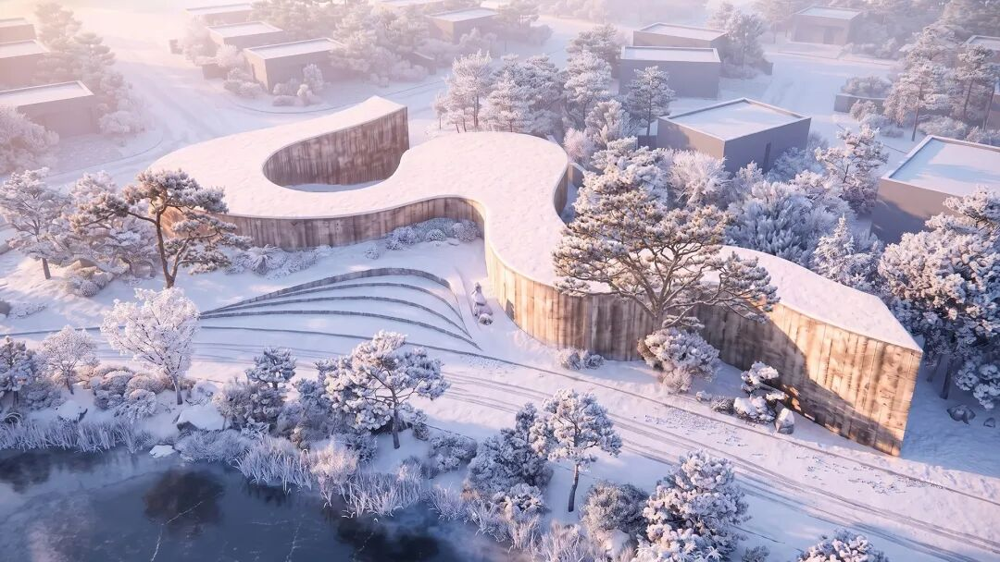
覆雪地形中的低矮建筑，冬季方案效果图。 效果图：Büro Ole Scheeren。
白色曲面背后，仍需容纳数字艺术所依赖的设备。连续分层的天花整合照明及技术基础设施，并为设备重新布置留下条件。舍人特别强调技术层的可接近与可更换：建筑使用年限较长，投影、数据与控制设备的更新周期却更短，二者需要在构造上协同。
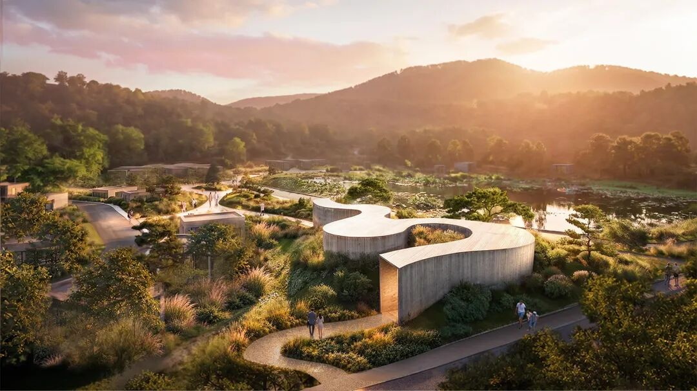
从公园一侧望向连续建筑，方案效果图。 效果图：Büro Ole Scheeren。
04
双年展之后，继续留在社区
展览项目将由  ** 德国卡尔斯鲁厄艺术与媒体中心（ZKM | Center for Art and Media Karlsruhe）  ** 策划，该机构也参与展示技术基础设施的开发。
项目于2025年获得委托，方案纳入2026寿城国际双年展“Living
Ground”。本届双年展从10月27日持续至11月22日，将建筑与景观介入放入公园、湖泊及城市空地。寿城艺术馆延续了这一方向，把展览活动与城市中的实际场所联系起来。
艺术馆  ** 计划2027年开工，并在2028年下一届寿城国际双年展期间开放  **
。相较于短期展陈，它更值得关注的地方，在于完成之后如何进入居民的重复生活：经过池塘、沿路散步、停下来观看，再走回公园。连续空间的意义，也将在这些日常使用中逐渐形成。
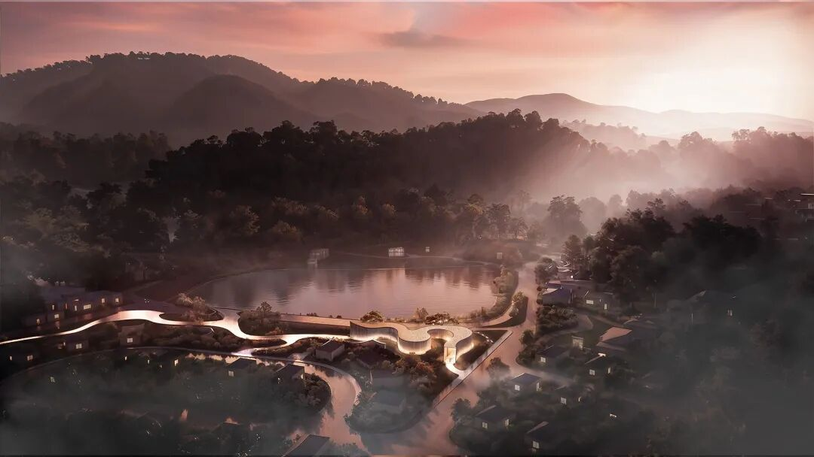
公园与艺术馆的夜间关系，方案效果图。 效果图：Büro Ole Scheeren。
ZAOME / 资料与图像
图片来源
效果图：Büro Ole Scheeren。
图纸：Büro Ole Scheeren。
参考资料
Büro Ole Scheeren｜Suseong Continuum项目官方页面
ArtAsiaPacific｜Ole Scheeren on the Suseong Continuum（建筑师访谈，2026-10-28）
Korea Tourism Organization｜Suseong International Biennale 2026
