# 米兰双雄新主场首次完整亮相！福斯特公布7.15万座新圣西罗球场

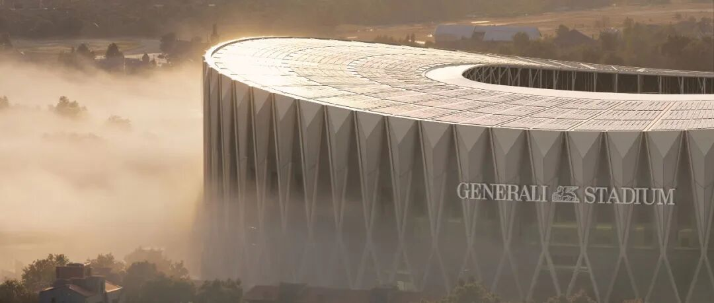

ARCHITECTURE / STADIUM DESIGN
#  米兰双雄新主场首次完整亮相：福斯特与MANICA设计71500座球场
X形混凝土框架、双曲屋顶、37°看台：Generali Stadium如何组织新的主场体验。
MILANO / DESIGN UNVEILED 29 OCT 2026
Milano）正式发布  ** 忠利球场（Generali Stadium）方案：约71500个座位，目标在2031/32赛季迎来首场比赛  **
。项目由福斯特建筑事务所（Foster + Partners）与MANICA建筑事务所（MANICA）共同设计。
它以一圈外露混凝土X形框架围合球场，上方的双曲屋顶向两端抬起。建筑最突出的两处高点，对应球门后的核心球迷看台。面对圣西罗球场（San
Siro）留下的集体记忆，新方案把设计重点放在观众与草坪的距离、看台的连续性，以及数万人共同发声时的现场气氛。
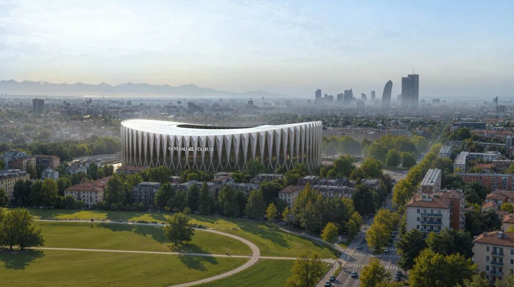
图 01｜新球场与周边绿地、城市道路的总体关系（效果图）。图片来源：Generali Stadium项目官网。效果图：Foster + Partners。
** 01  ** / TWO WALLS OF SUPPORT
##  新主场，仍把球迷放在两端
这次发布在米兰（Milano）的斯福尔扎城堡（Castello Sforzesco）举行。诺曼·福斯特（Norman
Foster）与大卫·马尼卡（David Manica）共同介绍了建筑构想。两家事务所的合作可以追溯到伦敦新温布利球场（Wembley
Stadium），此次面对的任务，是为长期共享主场的两支俱乐部设计一座新的共同家园。
新球场采用两层看台，沿草坪围成连续的360°碗形空间。球门后的两处核心球迷区被突出处理：  ** 每端计划容纳11700人，看台最大坡度达到37°  **
。侧看建筑轮廓，屋顶在这两个位置明显升高，球迷看台的体量由此进入外部造型。
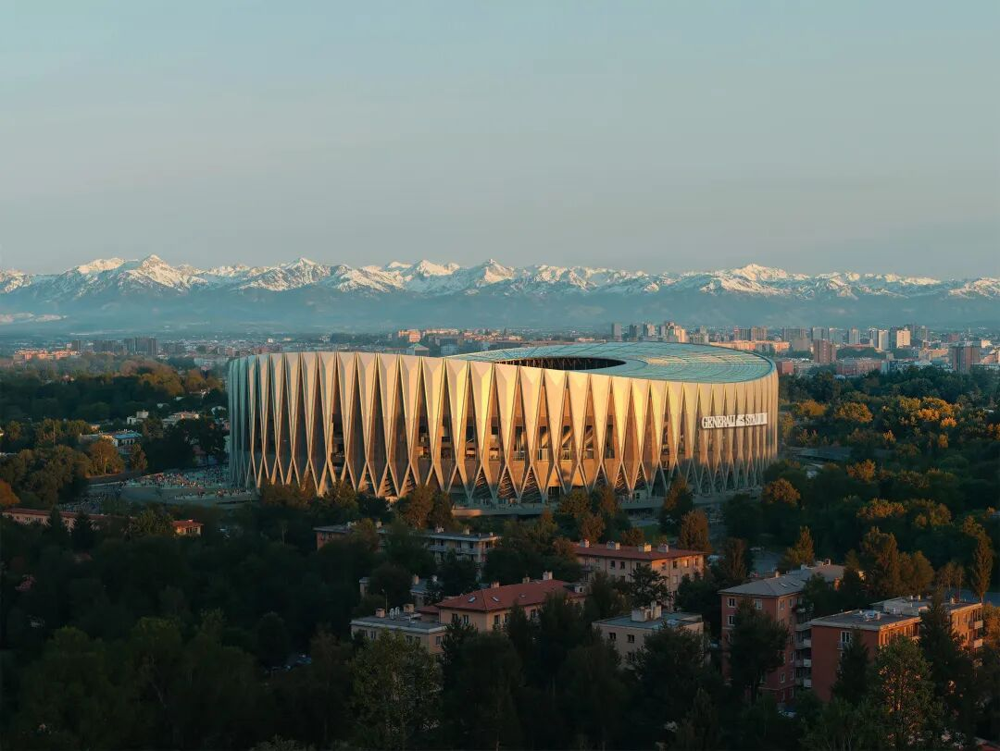
图 02｜双曲屋顶与连续混凝土框架构成的球场轮廓（效果图）。图片来源：Generali Stadium项目官网。效果图：Foster + Partners。
更陡的看台，使后排座席在向上抬升时减少平面上的后退距离。设计同时将两端看台向场地前方组织，试图让球迷靠近比赛发生的位置。高密度的座席、面向球门的方向性与连续上升的轮廓，共同形成两面围绕草坪的观众之墙。这也是新方案回应旧主场气氛的方式。
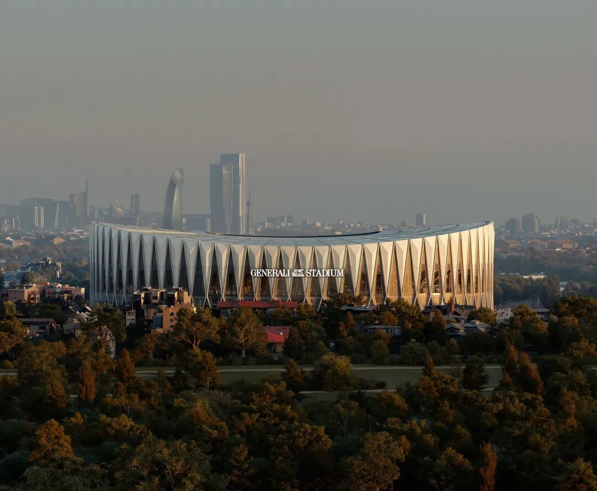
图 03｜日落时的建筑整体，立面由重复的斜向构件围合（效果图）。图片来源：Generali Stadium项目官网。效果图：Foster +
Partners。
** 02  ** / STRUCTURE IN THE OPEN
##  一圈X形框架，从地面升到屋顶
从外部看，新球场最鲜明的特征是一圈细长的混凝土斜向构件。它们上下交会，在立面上形成重复的X形和菱形空隙。  **
外露框架从自然通风的柱廊延伸至立面，并向上支承屋顶  ** ，结构的排列同时决定了外观节奏。
构件的亮面与侧向阴影，让连续立面产生深度。远处看到的是密集的竖向轮廓，走近之后，开口内的楼梯、人群和环廊逐渐显露。同一组框架既参与构成庞大的场馆形象，也在入口附近提供可以辨认的空间单元。
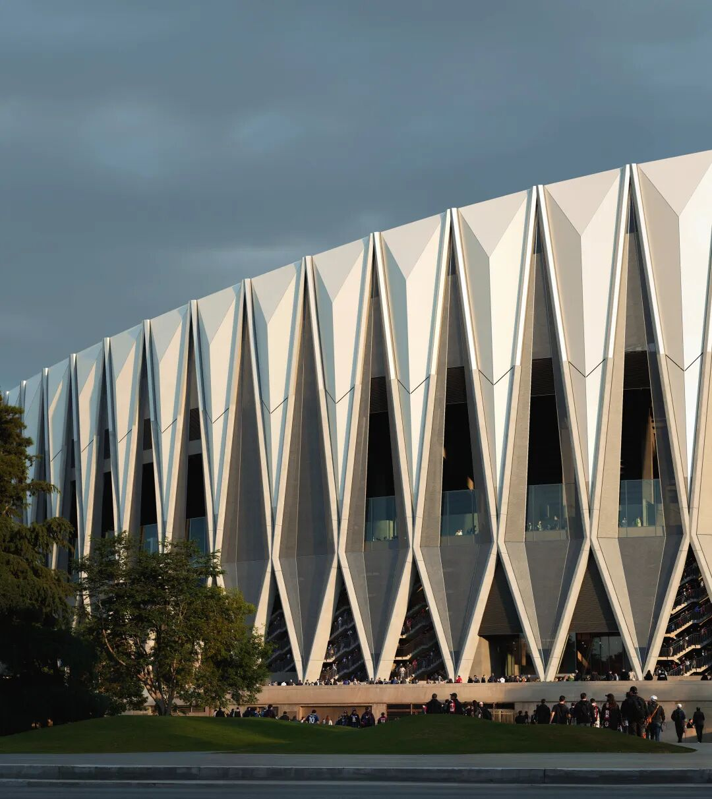
图 04｜外露X形混凝土框架与多层环廊（效果图）。图片来源：Generali Stadium项目官网。效果图：Foster + Partners。
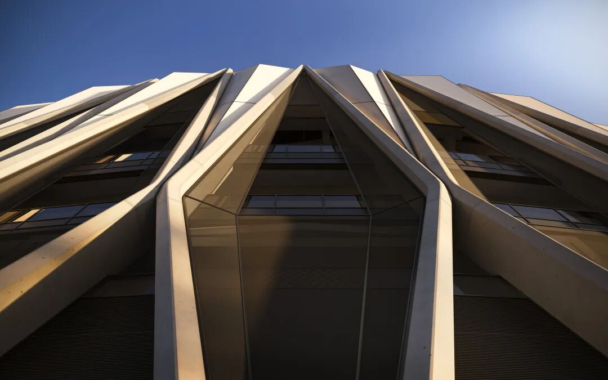
图 05｜从底部仰望菱形开口和向上延伸的结构构件（效果图）。图片来源：Generali Stadium项目官网。效果图：Foster + Partners。
设计以米兰大教堂（Duomo di Milano）的工艺和细部作为城市参照。这里没有照搬尖塔与雕塑，斜向构件的交会、修长开口和连续阴影，成为更抽象的回应。
** 03  ** / THE CITY BETWEEN FRAMES
##  穿过菱形入口，先看见米兰
球场的入口也由菱形构架组织。观众穿过外圈后，进入能够眺望城市的环廊。巨大的开口中，米兰天际线与近处街区成为步行途中的景观；球场内部的比赛空间则在继续向内的路径上展开。
** 自然通风柱廊与观景环廊，构成看台之外的第二圈活动空间  **
。柱廊借鉴米兰门廊与凉廊的城市传统，外圈保持较开敞的边缘，与内部密集的座席形成不同的空间状态。等待同行者、短暂停留和进入看台，被安排在这圈具有方向感的通道中。
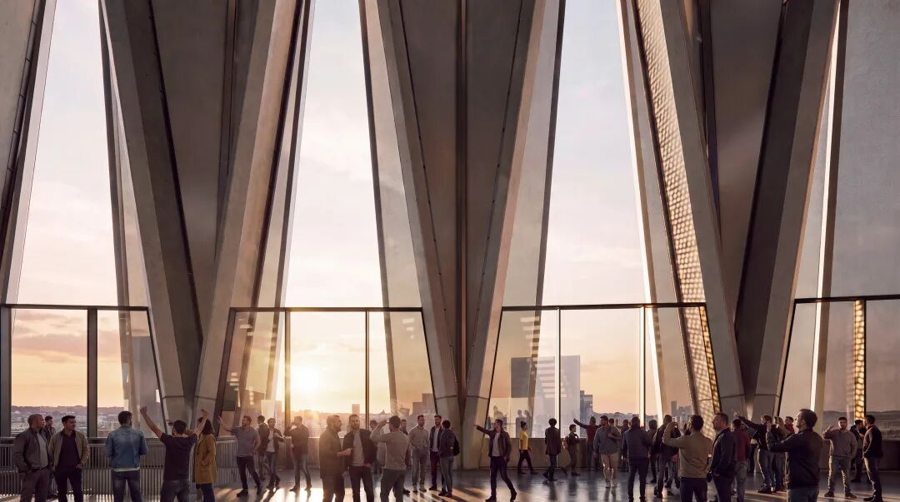
图 06｜透过巨大菱形开口远眺城市的观景环廊（效果图）。图片来源：Generali Stadium项目官网。效果图：Foster + Partners。
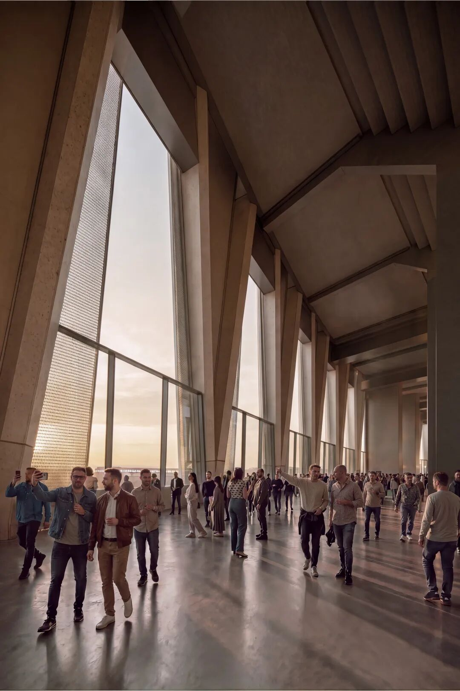
图 07｜自然通风柱廊及其上方结构（效果图）。图片来源：Generali Stadium项目官网。效果图：Foster + Partners。
效果图中，倾斜混凝土构件贯穿环廊高度，玻璃栏板保持较低的视觉遮挡。人能够同时看到构件、天空和城市，结构尺度也可通过近处的人群加以感知。到场过程因此获得了比赛视野之外的内容：进入球场之前，先从建筑边缘重新望向米兰。
** 04  ** / A ROOF OVER THE BOWL
##  起伏屋顶，把两端看台连成一体
屋顶以双向弯曲的连续曲面围绕中央开口展开。项目公布的高度为70米，屋面计划整合  ** 约27500平方米光伏设施  **
。从上方看，中央露天球场与外围屋面有清楚分界；从城市远处看，升降的檐线使两端看台成为轮廓高点。
屋顶、看台和外圈框架在这里相互对应：框架向上延伸，屋顶在核心球迷区上方抬升，内部看台再向草坪集中。建筑的高低变化因观众位置而发生，外部曲线与内部比赛空间由此联系起来。
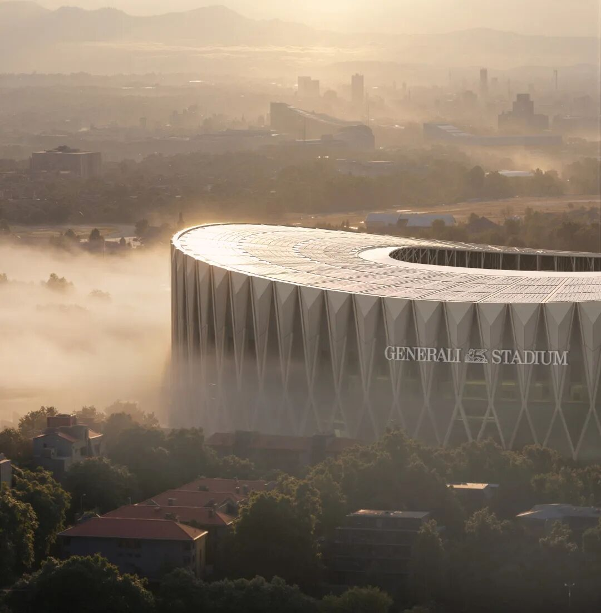
图 08｜屋顶中央开口与外围起伏的双曲屋面（效果图）。图片来源：Generali Stadium项目官网。效果图：Foster + Partners。
声学也是此次方案强调的设计内容。团队希望借助屋顶与碗形空间聚拢助威声，在控制场外噪声影响的同时，增强看台中的临场气氛。  **
**
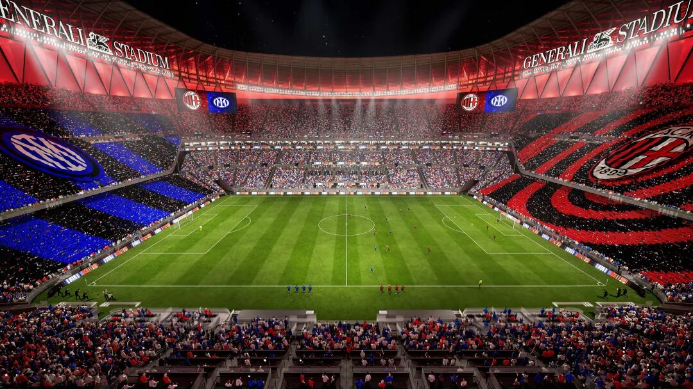
图 09｜360°碗形看台与球场两端球迷区的关系（效果图）。图片来源：Generali Stadium项目官网。效果图：MANICA。
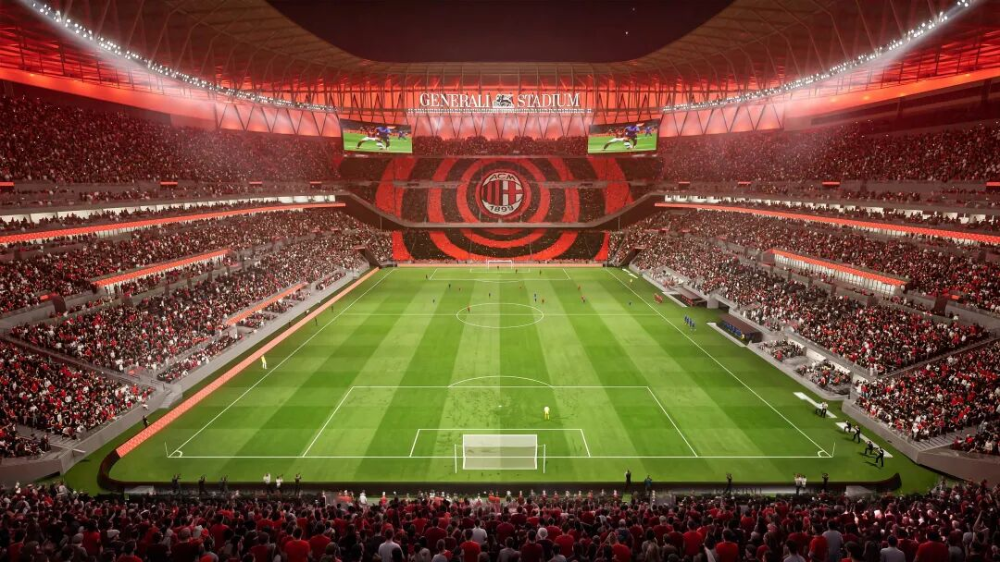
图 10｜面向球门的高坡度球迷看台（效果图）。图片来源：Generali Stadium项目官网。效果图：MANICA。
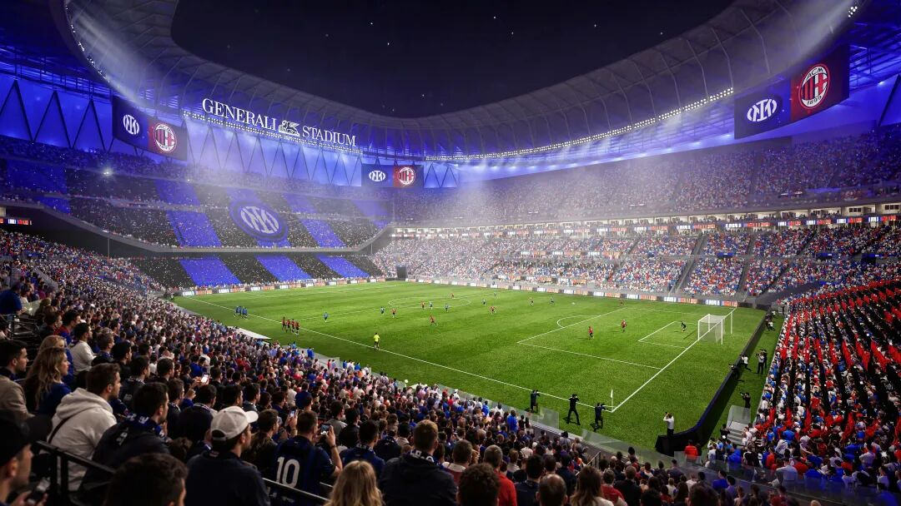
图 11｜蓝色主场灯光场景下的两层看台（效果图）。图片来源：Generali Stadium项目官网。效果图：MANICA。
** 05  ** / BEYOND THE MATCHDAY
##  28.1万平方米，延伸到比赛之外
新球场是约28.1万平方米城市更新计划的核心。公共空间、绿地、休闲与零售设施被纳入周边片区，活动也从足球比赛扩展到演唱会和其他大型文化娱乐事件。场馆内为高强度集会提供空间，外围则计划容纳更分散的日常活动。
球场灯光与活动布置可以随主场和用途变化。官方方案同时展示了红色、蓝色的比赛场景与演唱会状态：同一套混凝土骨架和看台，服务两支球队，也容纳不同类型的观众。
** 建筑的固定结构与可变化的灯光、演出布置，共同适应共享主场的运营需求  ** 。
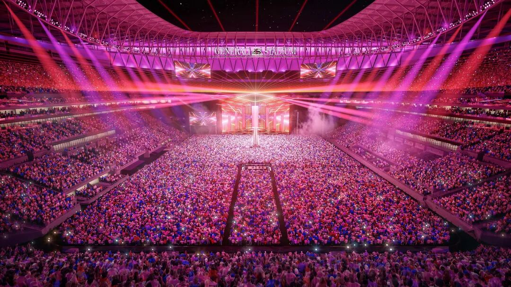
图 12｜球场转换为演唱会场地的活动场景（效果图）。图片来源：Generali Stadium项目官网。效果图：MANICA。
项目由两家俱乐部及其所有者推动，忠利集团（Generali）成为球场冠名合作伙伴，并将担任两家俱乐部的官方保险合作伙伴。从发布阶段起，球场名称就已与长期商业合作绑定。
接下来，方案将进入后续设计与规划程序。项目预计2028年开工，首场比赛目标为2031/32赛季，时间安排仍以必要审批为条件。此次完整发布确定了球场的主要建筑形象，也将两端看台、柱廊、屋顶和周边公共空间放进同一张发展蓝图。
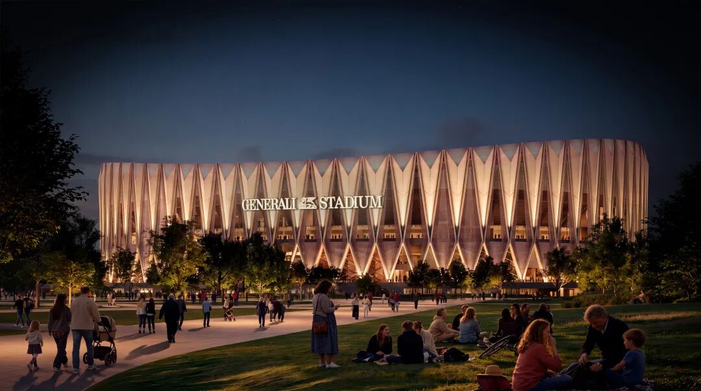
图 13｜非比赛活动中的夜间球场与外围公共空间（效果图）。图片来源：Generali Stadium项目官网。效果图：Foster + Partners。
##  项目档案
** 项目  ** 忠利球场 / Generali Stadium
** 地点  ** 意大利米兰，圣西罗片区
** 使用俱乐部  ** AC米兰、国际米兰
** 建筑设计  ** Foster + Partners × MANICA
** 主创建筑师  ** Norman Foster、David Manica
** 座位容量  ** 约71500座
** 看台  ** 两层，360°连续碗形布局
** 两端核心球迷区  ** 每端11700座，最大坡度37°
** 公布高度  ** 70米
** 光伏设施  ** 计划整合约27500平方米
** 城市更新范围  ** 约281000平方米
** 方案完整发布  ** 2026年10月29日
** 建设计划  ** 预计2028年开工；目标2031/32赛季首场比赛，须完成必要审批
** 冠名合作伙伴  ** Generali
##  参考资料
1\. Generali Stadium｜项目方案与官方效果图
2\. 国际米兰｜Inter and AC Milan unveil Generali Stadium，2026年10月29日
3\. 国际米兰｜斯福尔扎城堡方案发布活动
4\. AC米兰｜Generali Stadium: from Milano, a global icon
5\. Generali｜新球场冠名合作公告
6\. AC米兰｜Foster + Partners与MANICA设计合作公告，2025年9月23日
