# 学校不再是一排排教室：美国最新识字中心把学习空间做成了探险场

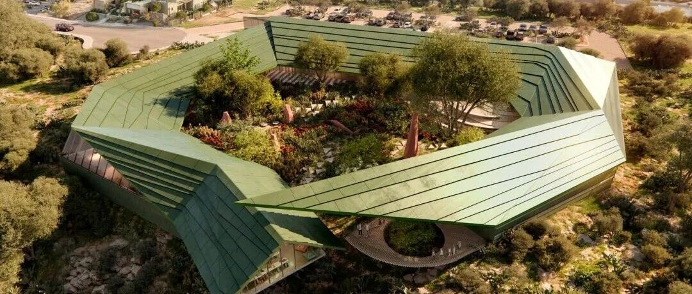

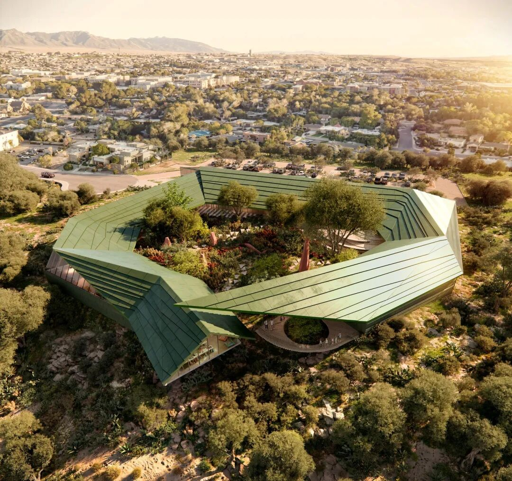
ARCHITECTURE / EDUCATION
#  7间教室、20个小房间：新墨西哥州这所读写中心，把花园放在中央
New Mexico Literacy Institute / Multistudio + Design Plus
美国·阿尔伯克基｜约2880平方米｜计划2027年1月启用
一片起伏、折转的绿色屋顶围出花园，教室和阅读角沿着庭院展开。美国  ** 新墨西哥州阿尔伯克基（Albuquerque, New Mexico）  **
即将增添一座面向儿童、青少年和成人的读写教育中心：在这里，学习可以发生在教室、书架之间，也可以延伸到屋檐下与花园里。
由  ** Multistudio建筑事务所（Multistudio）  ** 与当地  ** Design Plus建筑事务所（Design Plus）
** 合作设计的  ** 新墨西哥州读写教育中心（New Mexico Literacy Institute，NMLI）  **
，建筑面积约3.1万平方英尺，约合2880平方米。7间灵活教室与20个小型学习室提供不同的安静程度和聚集方式，中央庭院则把这些场所接在一起。项目预计2026年完成，计划于2027年1月启用。
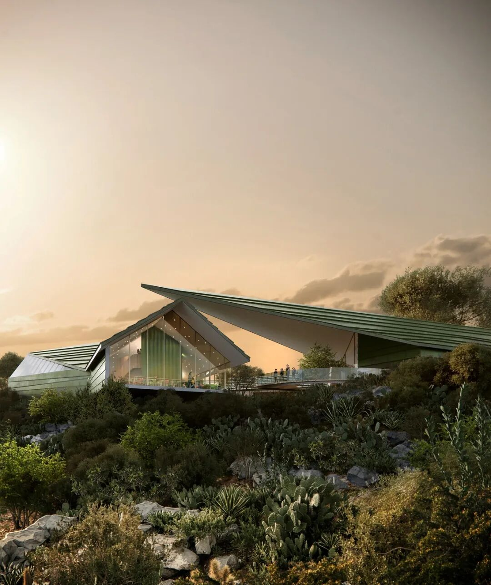
图 01｜  入口外观效果图，起伏屋面、玻璃立面与室外步道。图片来源：Multistudio。效果图：Austin Nikkel with 5Visual。
** 01  ** / AROUND A SHARED GARDEN
##  屋顶折转，房间围着花园展开
项目由  ** 新墨西哥州高等教育厅（New Mexico Higher Education Department）  ** 与  **
新墨西哥州总务厅（New Mexico General Services Department）  **
委托。它承担面向全州的读写教育任务，容纳学习辅导、教育工作者培训以及家庭和社区参与等活动。不同年龄、不同学习能力的人，将在同一座中心里寻找适合自己的学习方式。
建筑外轮廓由一组斜向边线构成，绿色屋面在转角处抬高或压低，入口以通透的玻璃立面打开。与多变的外形相对应，内部采用清晰的  ** 围合式庭院布局  **
：教室、咖啡厅、办公及配套空间沿庭院周边安排，花园占据建筑中央。
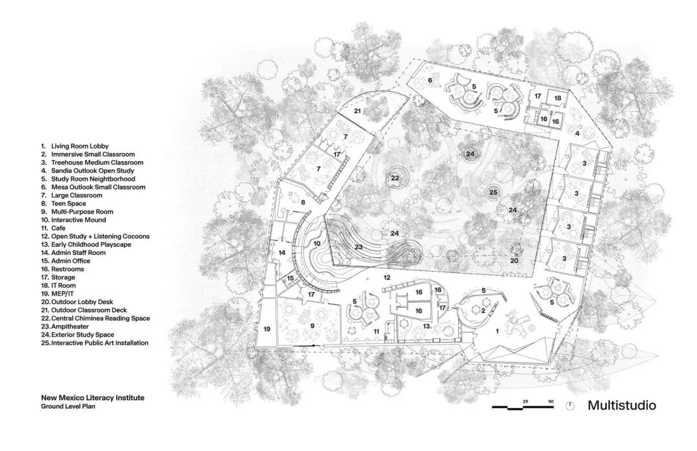
图 02｜首层平面图，教室、小型学习室和公共空间沿庭院分布。图片来源：Multistudio
平面中的大堂与开放学习区相接，青少年空间和多功能厅分布在一侧，幼儿活动区靠近咖啡厅，小型学习室则成组穿插在公共区域。中央花园为这些房间提供共同的朝向；沿窗行走时，人们也能看见庭院里的平台、种植与室外活动。
大面积玻璃将室内学习场所与花园相邻布置，向外伸出的屋檐又为建筑边缘留出遮蔽。房间之间的通行路线因此有了可停留的地方：桌椅、书架和靠窗座位沿途出现，走到下一间教室之前，也能找到一处阅读位置。
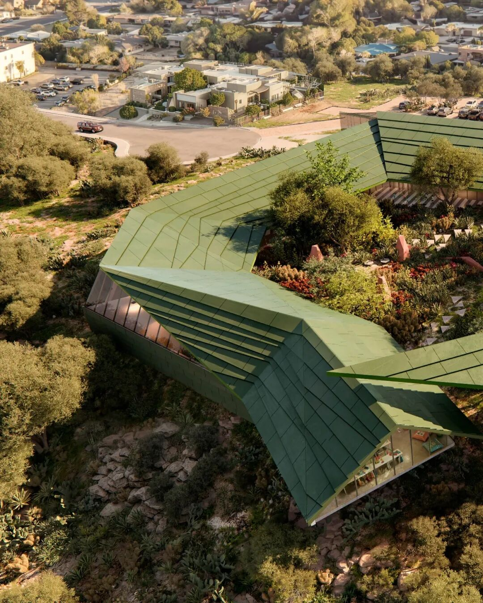
图 03｜  折转的绿色屋顶围合中央庭院  。图片来源：Multistudio。效果图：Austin Nikkel with 5Visual。
** 02  ** / MANY WAYS TO LEARN
##  7间教室之外，还有20个小房间
中心设置  ** 7间形状与大小不同的灵活教室  **
，并配置可用于培训、集体活动和特别项目的大型多功能厅。专门的青少年区域与幼儿学习空间，则让不同年龄段的活动拥有各自的位置。集体教学之外，建筑还安排了更小的空间。
** 20个供1至4人使用的学习室  ** ，以类似小街区的方式成组分布。它们被设计成各具特征的空间单元，给独自学习和少人数交流提供选择。
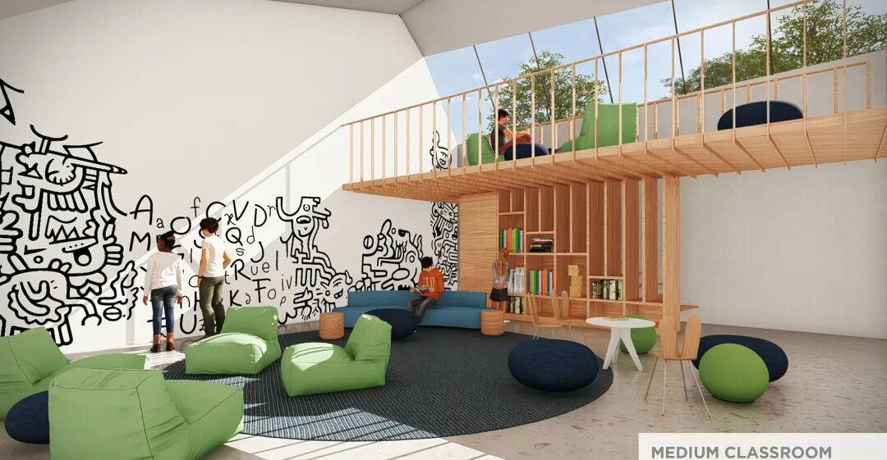
图 04｜中型教室效果图，楼梯、上层平台、书架与坐席。图片来源：Multistudio。效果图：Austin Nikkel with 5Visual。
中型教室的设计把楼梯、上层平台、书架与坐席组合在同一空间中。开放学习区又采用低矮家具、弧形围合和可进入的小角落，在较大的公共区域里划出不同的停留位置。
这些学习场所的用途保留着调整余地。教室、多功能厅、小型学习室与公共区域共同组成一组可供选择的场所，教育工作者可以根据人数和教学活动安排使用；学习者也能在集中参与和独立停留之间切换。
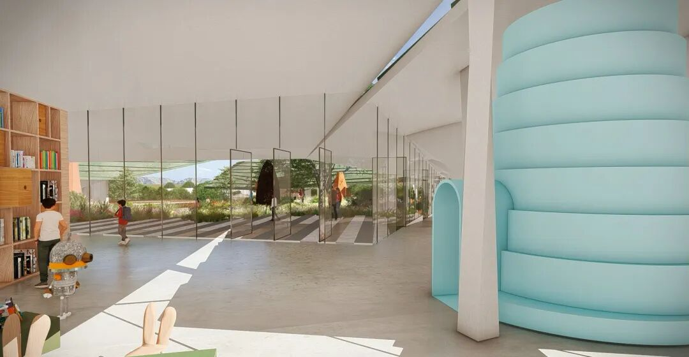
图 05｜开放学习区效果图，书架、小型围合与面向庭院的座位。图片来源：Multistudio。效果图：Austin Nikkel with 5Visual。
** 03  ** / BOOKS WITHIN EVERYDAY REACH
##  书架与小角落，组成可探索的室内
中心以  ** 实体书写、阅读与操作活动  ** 为主要学习方式。图书、纸张、书写工具和教育玩具被纳入空间设计，储物、展示与阅读座位也随之进入室内布置。
嵌入式书柜与层架分布在不同区域，有些书架围出可以坐下的小凹间，有些与台面和座椅相邻。绿色台面在幼儿活动区形成连续的操作表面，周围穿插木色储物格和低矮坐具。读书、书写、摆弄物件与照看儿童，可以在相邻的位置进行。
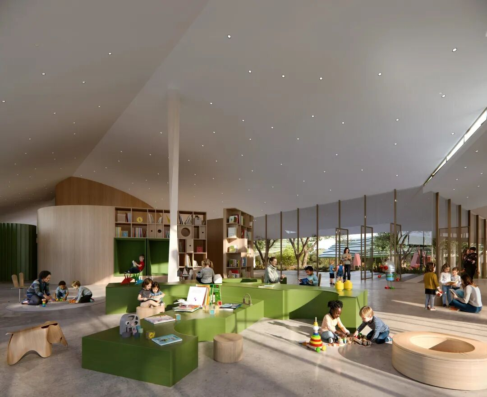
图 06｜幼儿与开放学习区域效果图，绿色操作台、书柜与低矮家具。图片来源：Multistudio。效果图：Austin Nikkel with
5Visual。
室内并不依赖整齐划一的桌椅来界定学习。浅色天花沿屋顶轮廓起伏，木色体量、带有色彩的围合与柔软坐席彼此穿插，局部通道和楼梯又带来不同的进入方式。  **
书架、家具与小空间一起划分活动位置  ** ，让大型开放区域保留了可辨认的小尺度。
靠近庭院的学习区采用连续玻璃，坐席面向花园展开。室内的活动与室外景物同时进入视野，学习者可以留在较为围合的角落，也可以选择开放、面向庭院的位置。
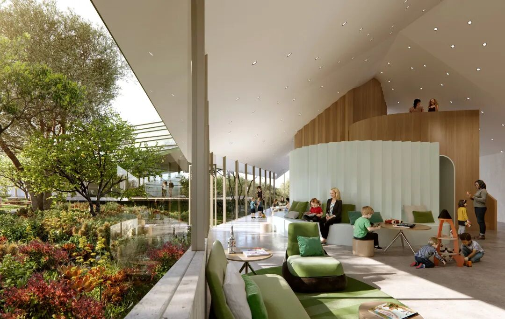
图 07｜临庭院学习区效果图，连续玻璃、弧形围合与阅读坐席。图片来源：Multistudio。效果图：Austin Nikkel with 5Visual。
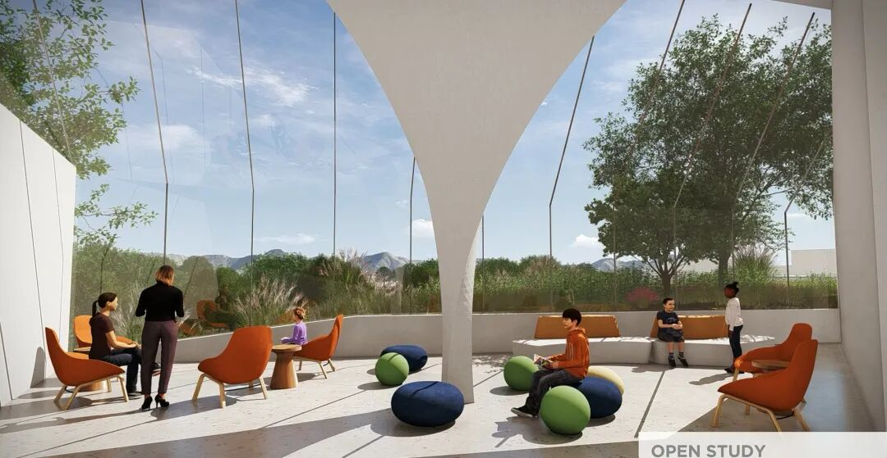
图 08｜开放学习区效果图，面向室外的玻璃转角与不同坐席。图片来源：Multistudio。效果图：Austin Nikkel with 5Visual。
** 04  ** / ROOF WATER AND STORIES
##  雨水向一处汇集，学习向庭院延伸
绿色屋面以层层叠排的表面形成鲜明轮廓，转折的坡度同时参与雨水组织。  ** 屋顶形态与坡向被共同塑造，将雨水引向一个集中收集点  **
。屋面起伏由此兼有外观塑造与排水组织的作用；项目也正以LEED金级认证为目标推进。
庭院内采用本土植物，学习场所分散在种植之间：有供个人使用的位置，也有小组学习区、受遮蔽的室外座位、互动游戏设施和平台。室内外空间合计的设计容量，可同时支持
** 超过550名学习者与教育工作者  ** ，其中也包括在庭院停留和参与活动的人。
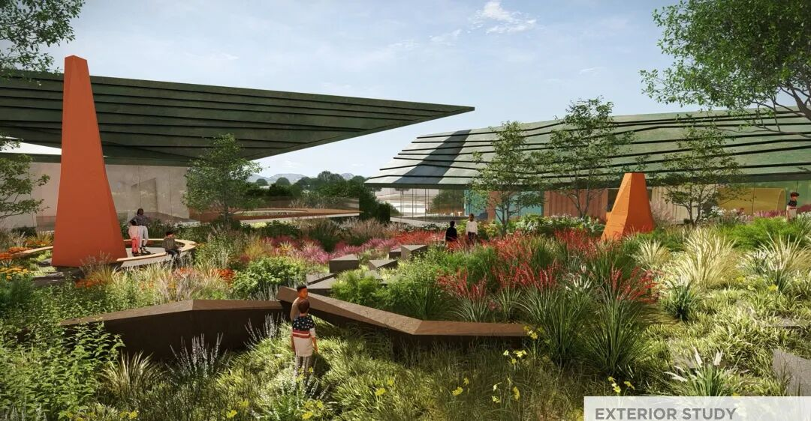
图 09｜庭院效果图，绿色屋檐、平台与烟囱式户外炉故事空间。图片来源：Multistudio。效果图：Austin Nikkel with 5Visual。
阶梯式座席为集体活动提供围坐场地，传统的  ** 烟囱式户外炉（chiminea）故事空间  **
则在花园里设置另一种聚集方式。屋檐下的学习区、室内开放空间和花园里的座位相互衔接，使教育活动拥有多种场地。负责教学与培训的教育工作者可以在其中安排课程，家人也能参与阅读和交流。
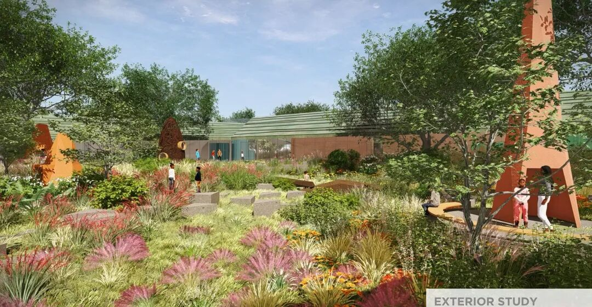
图 10｜庭院效果图，本土植物、步道与室外学习场地。图片来源：Multistudio。效果图：Austin Nikkel with 5Visual。
##  项目档案
** 项目  ** 新墨西哥州读写教育中心／New Mexico Literacy Institute
** 地点  ** 美国新墨西哥州阿尔伯克基
** 设计建筑师  ** Multistudio
** 备案建筑师  ** Design Plus
** 业主  ** 新墨西哥州高等教育厅、新墨西哥州总务厅
** 建筑面积  ** 约3.1万平方英尺／约2880平方米
** 空间配置  ** 7间灵活教室；20个1—4人学习室；多功能厅、青少年与幼儿空间、咖啡厅及庭院
** 设计容量  ** 室内外合计超过550名学习者与教育工作者
** 计划节点  ** 预计2026年完成；计划2027年1月启用
** 认证目标  ** LEED金级
** 效果图  ** Austin Nikkel with 5Visual
##  参考资料
1\. Multistudio｜New Mexico Literacy Institute
2\. 新墨西哥州公共教育厅｜读写教育中心运营与启动服务采购
3\. The Architect’s Newspaper｜New Mexico Literacy Institute by Multistudio and
Design Plus
