# 建筑还能这样玩？BIG最新悬浮公园方案，把整座城市美学带上新高度！

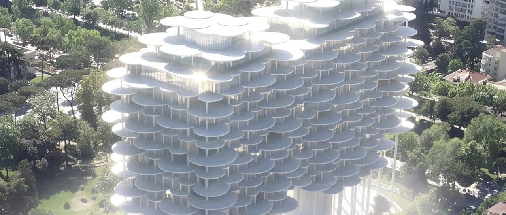

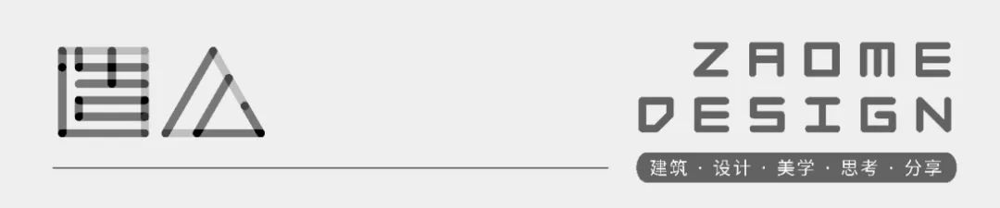

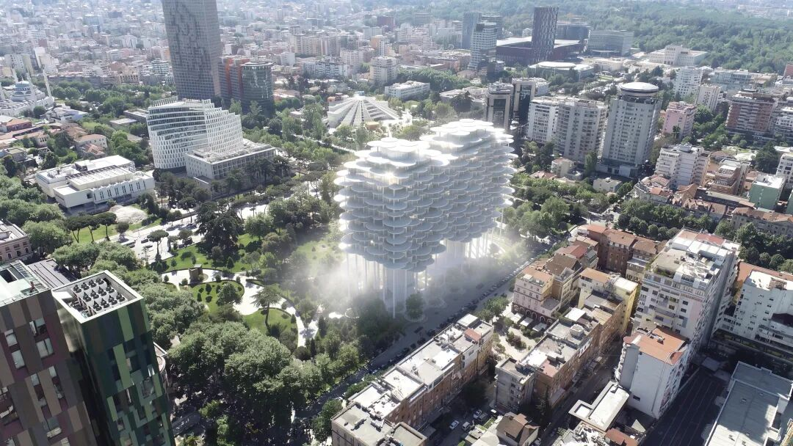
ARCHITECTURE / TIRANA
#  BIG地拉那新方案：把喷泉倒过来，让公园从楼下穿过
一座架空综合体，与它下方的花园、落水和公共空间
竞赛获胜方案 · 阿尔巴尼亚地拉那 · 2026
喷泉通常从地面向上涌起。BIG的新方案把水流的方向反了过来：水从架空建筑的下方落向花园，像一阵被安排在公园里的雨。叠叠白色圆盘与细长立柱，也让这座综合体带着几分不合常理的轻盈。
2026年10月，  ** 比亚克·英格尔斯建筑事务所（Bjarke Ingels Group，BIG）赢得地拉那喷泉广场（Tirana Fountain
Plaza）国际竞赛  ** 。项目位于阿尔巴尼亚首都地拉那（Tirana）的里尼亚公园（Rinia
Park）边缘，计划容纳住宅、酒店、办公及文化空间。它把大部分建筑面积移到上方，让花园、步道和水景进入楼下，试图在中心城区增加开发容量的同时，延续公园的地面。

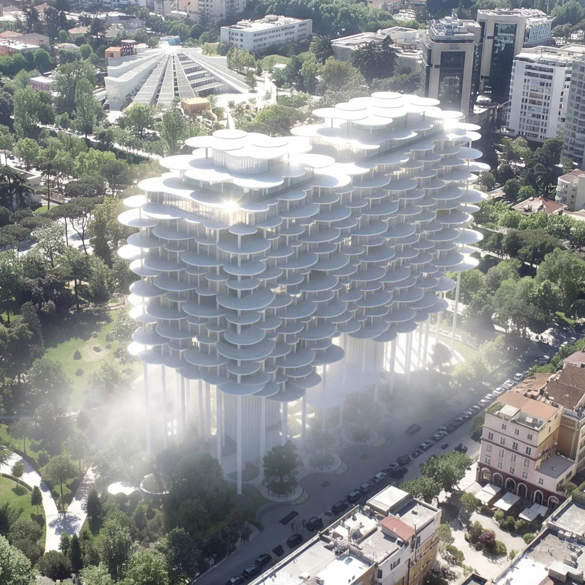
图 01｜鸟瞰效果图：云状体量与里尼亚公园、周边城市街区。图片来源：BIG
** 01  ** / PARK BENEATH THE BUILDING
##  楼在上面，公园向下延伸
项目将更新公园内既有的泰瓦尼综合体（Taivani），并保留原有喷泉。这处原本由私人经营的场地，被纳入连接花园、广场与拉纳河（Lana
River）的公共景观。竞赛入围团队包括BIG、Cobe、Barozzi Veiga、l’AUC和JDSA，BIG最终获选。
在这样一块紧邻绿地的中心城区用地上，新楼怎样接触地面，会直接改变公园的行走路线。通常由商业裙房占据的位置，在方案中成为一片高大的架空空间。  **
住宅、办公和酒店向上集中，地面留给步道、种植与公共停留  ** ，建筑的入口则通过两端包裹竖纹玻璃的弧形体量连接上下。
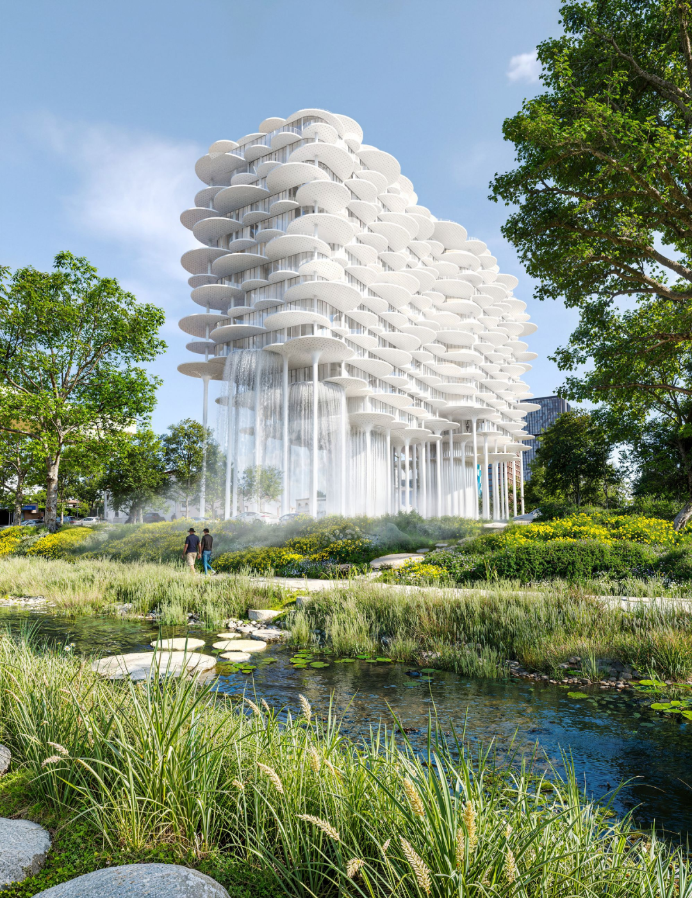

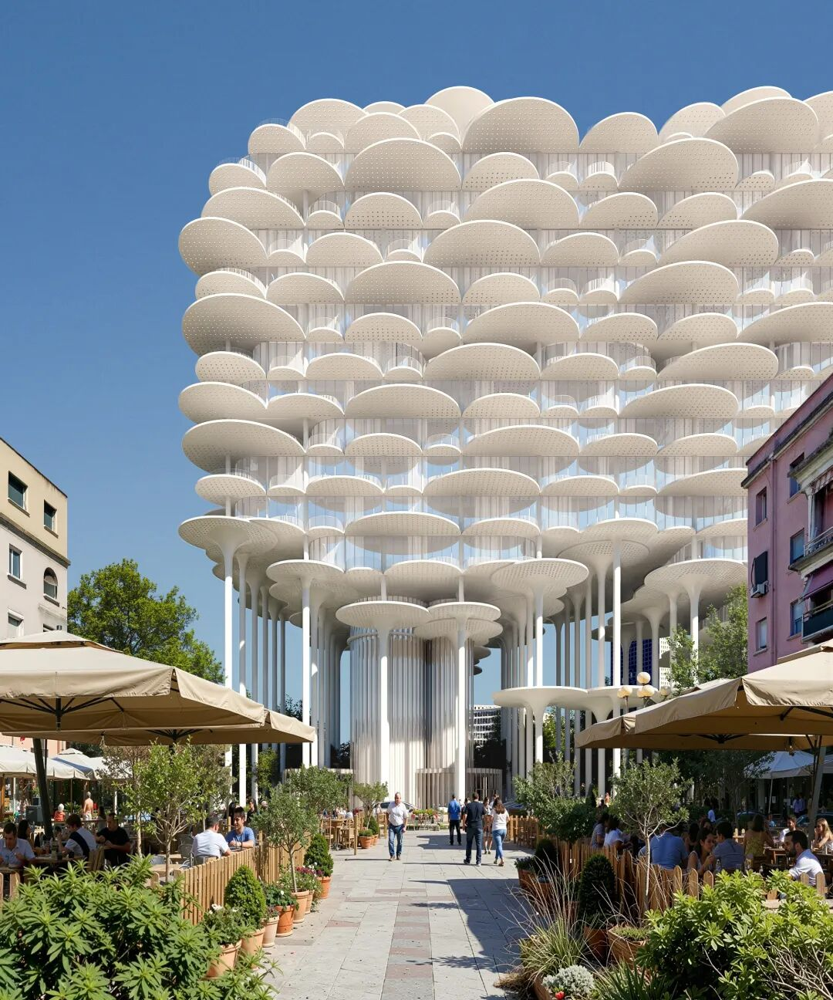
图 02｜街道视角效果图：白色圆盘包裹的上部体量与架空层。图片来源：BIG
建筑师在方案展示中提出，主要体量将抬高约20米，形成超过1000平方米的有遮蔽公共空间。这使楼下有了容纳树木、活动和人流的高度，也使建筑的阴影成为公园景观的一部分。人在地面行走时，可以从柱间看向另一侧花园；综合体的边缘由连续的外墙，变成了柱、入口和绿化之间的开口。
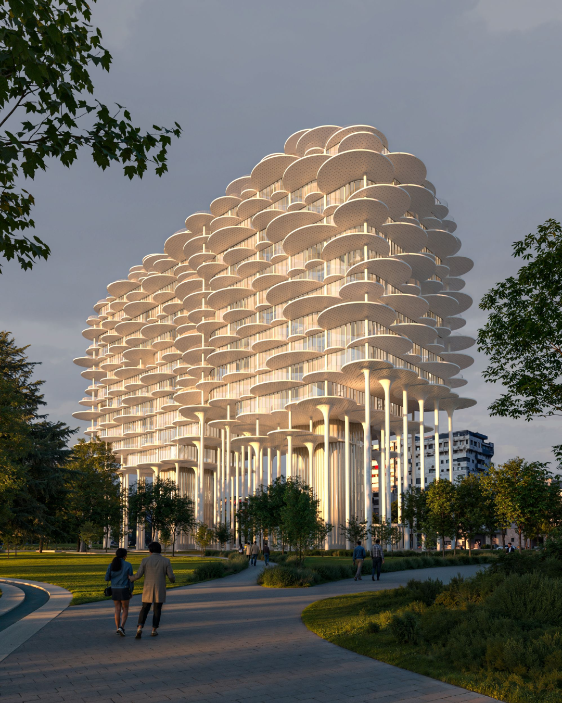

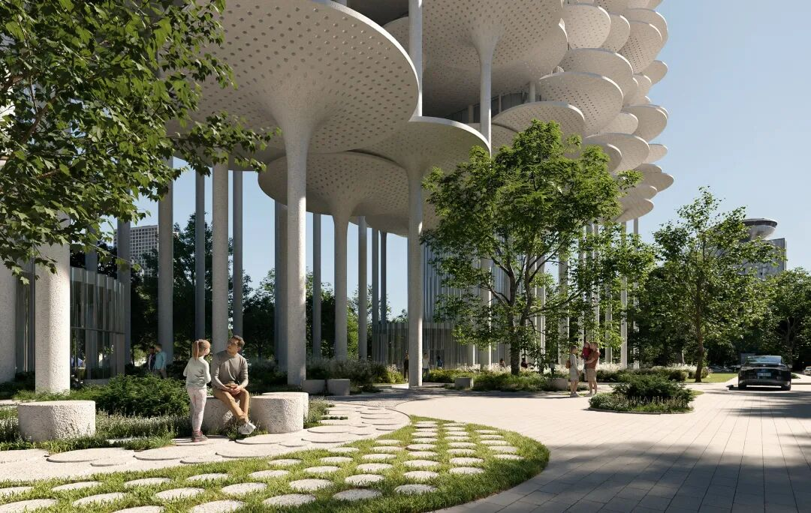
图 03｜地面效果图：柱间步道、树木与建筑边缘的衔接。图片来源：BIG
** 02  ** / LAYERS OF WHITE DISCS
##  一片“云”，由圆盘层层叠起
云的形象来自许多清楚可辨的部件。玻璃立面外排列着尺寸与位置不一的白色圆盘，边缘相互叠压，削弱了水平楼板整齐重复的轮廓。圆盘表面的孔洞又把大块白色切成更细碎的明暗。近处看到的是构件和缝隙，远处则合成一团起伏的体量。
** 圆盘同时参与阳台和遮阳的设计  **
。它们伸出玻璃外侧，将室内外之间拉出一层有深度的边缘；部分位置成为户外停留处，上下叠置的挑出部分则为立面提供遮蔽。建筑师希望借此过滤强烈日照、回应夏季高温。穿孔和构件间隙保留了透光的可能，使外围不至于成为一面厚重的实墙。
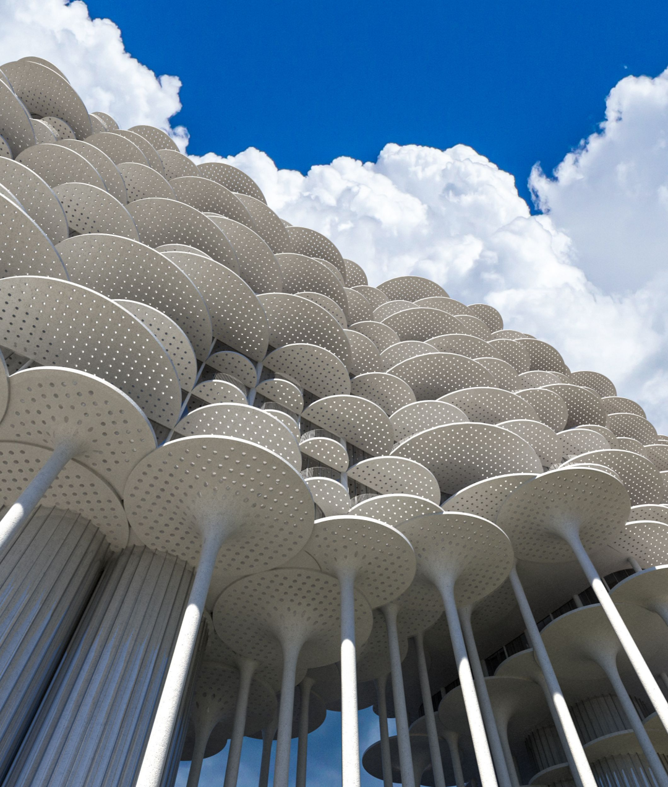

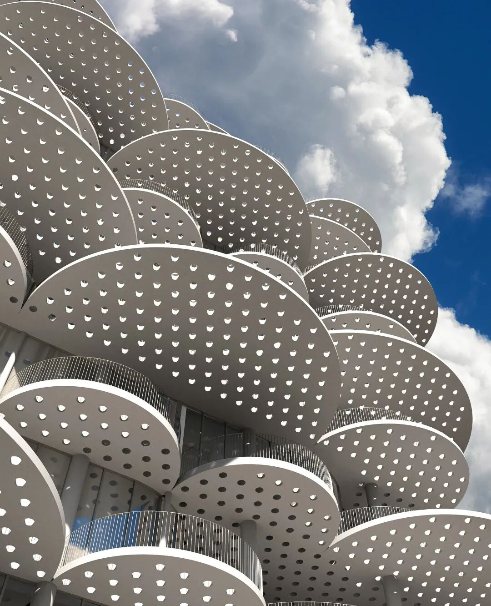
图 04｜立面近景效果图：带孔圆盘层层叠置于玻璃外侧。图片来源：BIG
相同的圆形语汇一直延续到建筑下方。细柱与扩展的圆盘底面组合，形成类似伞盖的轮廓；上部密集的盘片与下部稀疏的支点，造成明显的视觉反差。两端弧形玻璃体量则在开敞柱间形成相对完整的界面。建筑既需要把人送进室内，也要为穿过公园的人保留通道，这两种路线在底层并置。
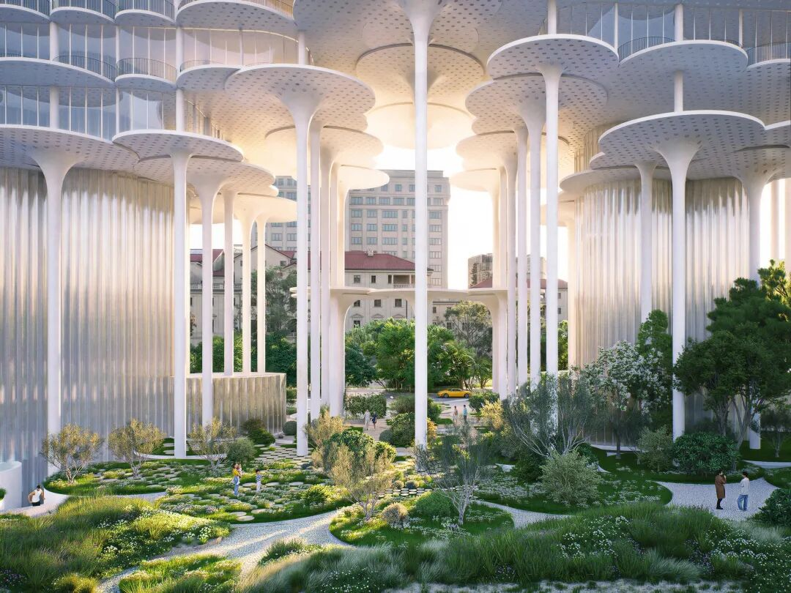

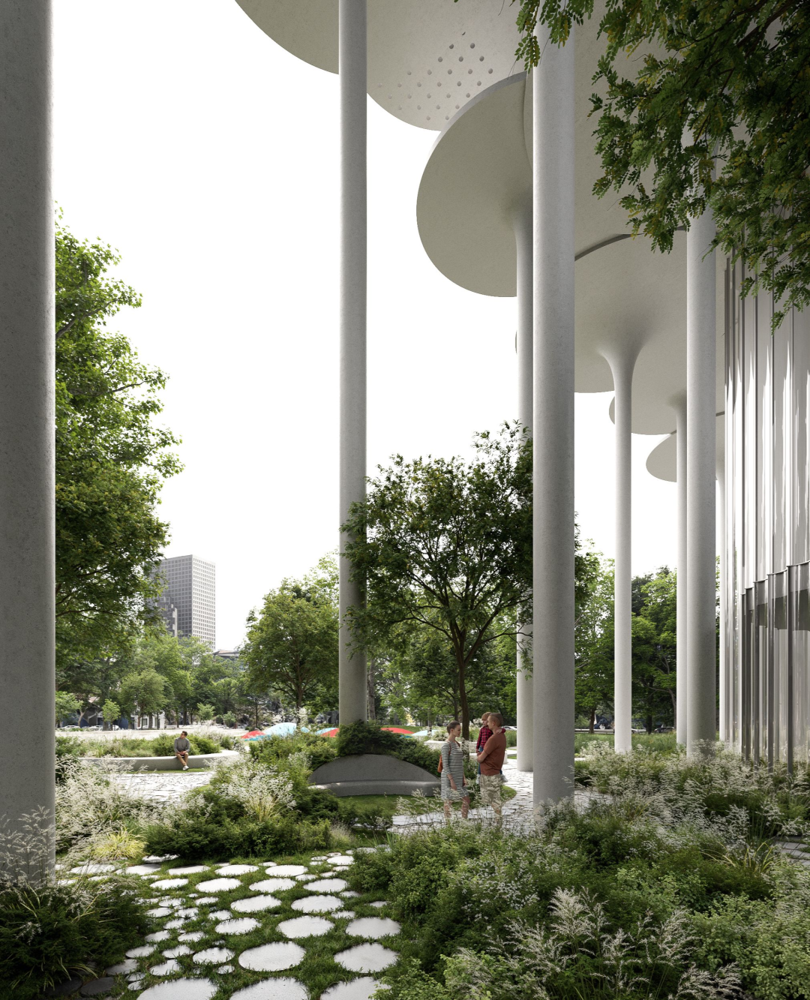
图 05｜仰视效果图：细柱、圆盘底面及两端弧形玻璃体量。图片来源：BIG
** 03  ** / RAIN FROM ABOVE
##  喷泉倒过来，雨水留在场地里
方案最容易被记住的画面，是从架空体量下方落下的水。水流沿着白色构件垂落，靠近柱脚和种植区，原本空旷的楼下因而多了一层有声音、有动态的空间界面。与传统喷泉在水池中心向上喷射相比，
** 倒置喷泉将水景带到建筑与花园的交接处  ** ，抬头看到的底面也成为景观的一部分。
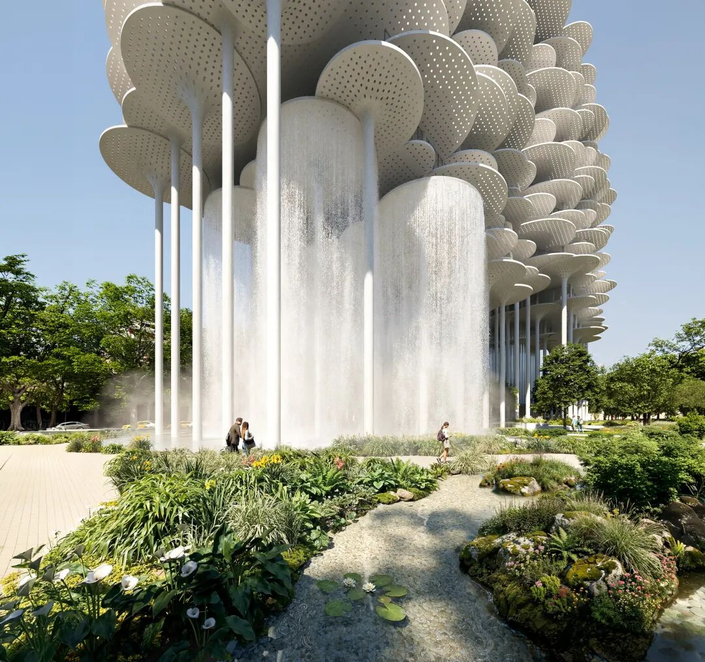
图 06｜水景效果图：水流从架空建筑下方向花园垂落。图片来源：BIG
这组水景与场地的雨水管理一起设计：收集、储存和再利用雨水，为景观灌溉提供水源，并服务于缓解洪涝和改善局部微气候的目标。原有喷泉被保留下来，新的落水装置与花园围绕它展开。BIG将这一系统称为闭环循环，意在让水在场地内被多次利用。
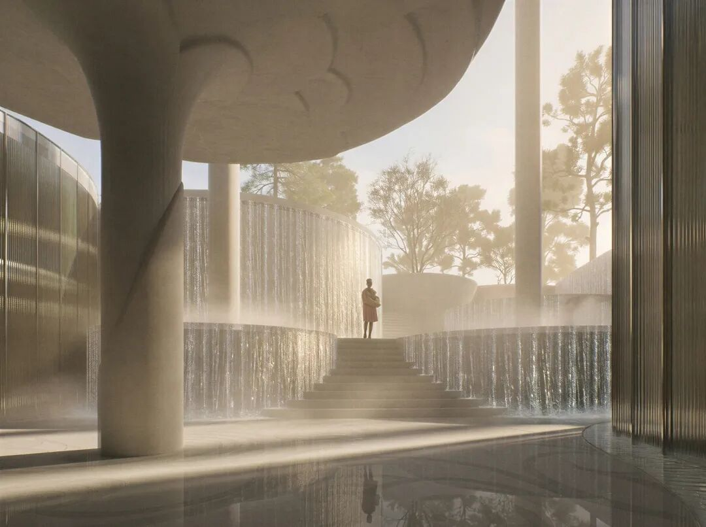
图 07｜室内外过渡空间效果图：台阶、弧形构件与垂落水幕。图片来源：BIG
** 04  ** / CULTURE WITHIN THE PARK
##  从柱间花园，走进图书馆
楼下有了空地，还需要让人愿意留下的用途。方案安排了开放式图书馆、社区设施与有顶公共活动空间，建筑师在展示中提出，文化功能约占总功能面积的10%。这些日常目的地与住宅、酒店及办公并列，使到访公园的人也有进入综合体的理由。
景观中的楼梯沿种植区转折，弧形栏杆围住高低变化的地面。另一处楼梯被圆形顶部开口照亮，垂挂植物沿开口边缘向下生长。  ** 楼梯、采光口与种植一起组织高差
** ，将地面的花园引向不同标高的空间。路径因此有了明确的去向，架空层也不必只承担从街道到大堂的过渡。
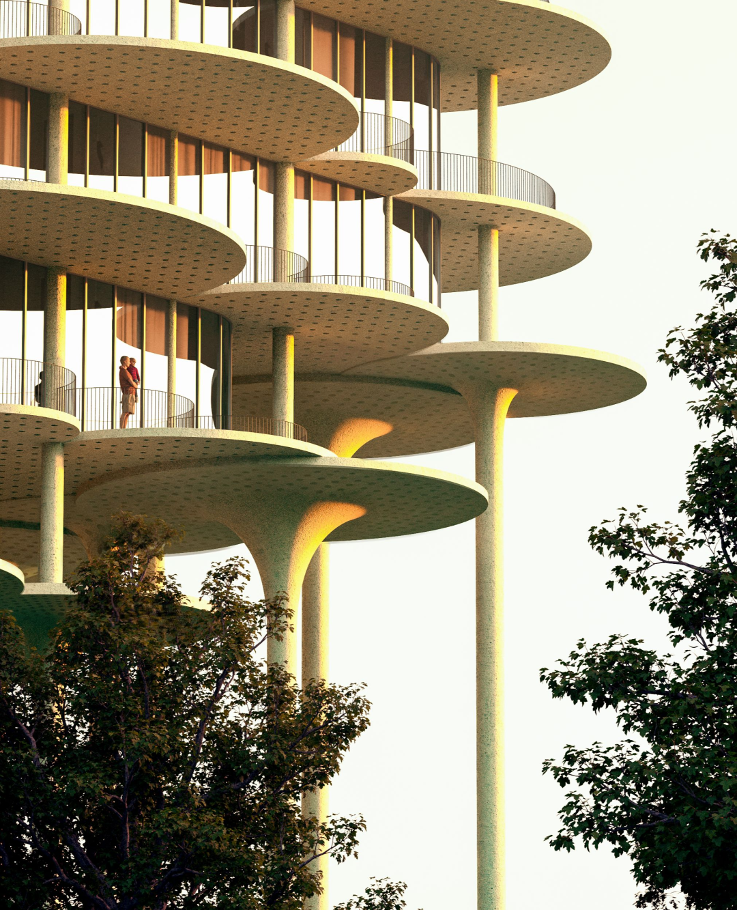

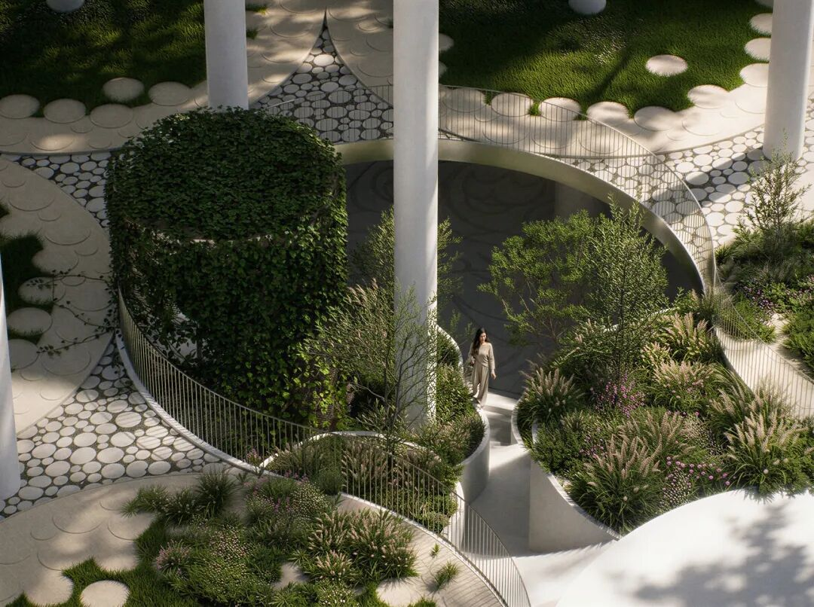
图 08｜景观俯视效果图：种植区、曲线栏杆与下沉楼梯。图片来源：BIG
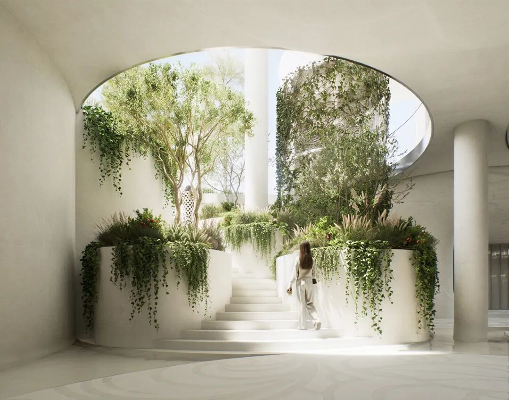
图 09｜楼梯空间效果图：圆形采光开口及垂挂植物。图片来源：BIG
图书馆效果图进一步延续了圆形构件：书架沿弧线展开，阅读坐垫围绕圆形地毯布置，顶部开口把自然光引入室内。室外体量中醒目的圆盘，到这里对应着尺度较小的书架、坐席与光井。
商业开发被安排在同一场地上，建筑却通过抬高主要体量，为公园争取连续的地面。这一方案的城市主张，就体现在楼下这些可以穿行、停留和进入的地方。
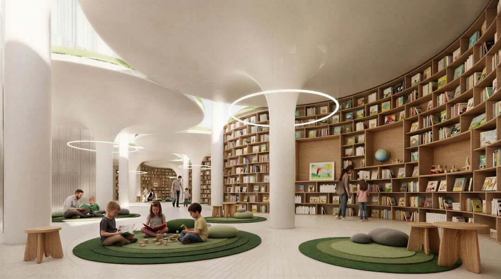
图 10｜图书馆效果图：弧形书架、圆形阅读坐垫与顶部采光。图片来源：BIG
##  项目档案
** 项目  ** 地拉那喷泉广场 / Tirana Fountain Plaza
** 地点  ** 阿尔巴尼亚地拉那，里尼亚公园边缘
** 设计  ** BIG – Bjarke Ingels Group
** 阶段  ** 2026年10月公布的竞赛获胜方案
** 功能  ** 住宅、办公、酒店及文化与社区设施
** 架空策略  ** 主要体量抬高约20米；拟提供超过1000平方米有遮蔽公共空间
** 文化功能  ** 约占总功能面积10%
** 景观与水  ** 保留既有喷泉；雨水收集、储存与回用
##  参考资料
1\. BIG｜2026年10月5日喷泉广场竞赛获胜公告
2\. RTSH｜竞赛方案展示，2026年10月1日
3\. Archiproducts｜Like a Cloud Above the Park
4\. Designboom｜BIG wins Fountain Plaza Tirana competition
5\. Domus｜Tirana Fountain Plaza
