# 只为让你看一眼兰花，设计师把AI机器人改成了会走路的花瓶

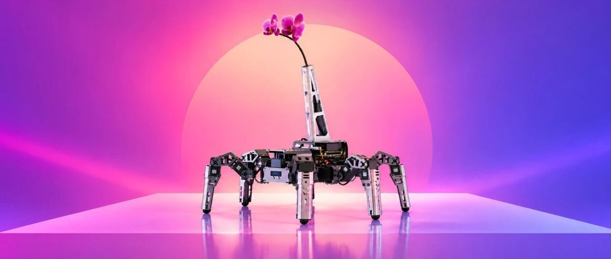

OBJECTS / ROBOTICS / ATTENTION
#  只为让你看一眼兰花，设计师把AI机器人改成了会走路的花瓶
Beauty Seeker Seeker｜当家中的摆件开始主动索取目光
一枝兰花通常等待人走近。巴顿与坎普设计组合（Batten and Kamp）为它加上了六条机械足，让承载花朵的容器有了移动、转向和靠近人的能力。名为
“寻美者”（Beauty Seeker Seeker）  的作品，将花瓶与具身人工智能（Embodied AI）机器人叠合成一个带有行为的家居物件。
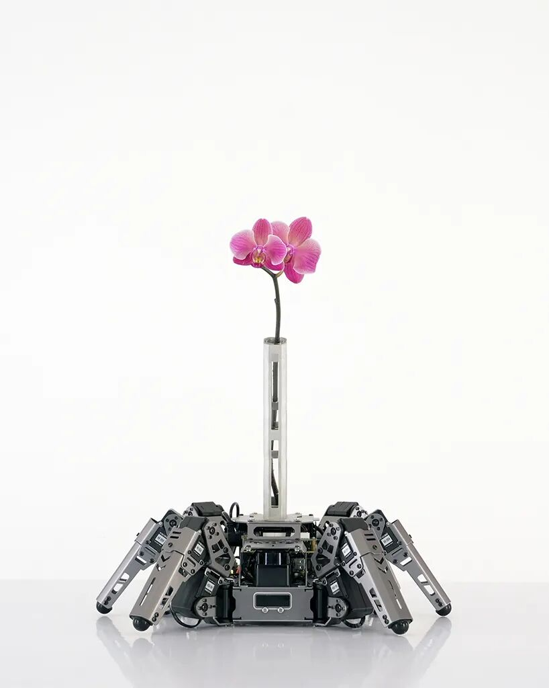
图 01｜六足机器人托起细长花瓶与一枝粉色兰花，机械底座与花朵形成鲜明对照。图片来源：Batten and Kamp。
** 01  ** / FROM CHAIR TO FLOWER
##  从会移动的椅子，到托着兰花的机器
这一探索始于2023年的  “寻舒适者”（Comfort Seeker Seeker）  。设计组合  将伊姆斯躺椅（Eames
LCW）与波士顿动力（Boston Dynamics）的Spot四足机器人结合  ，以动画概念呈现家具获得行动能力的可能。
新的作品把这条思路推进到了  ** 可运行的实体物件  **
：现成的六足机器人承载定制花瓶，容器采用3D打印铝与玻璃，专为一枝兰花设计。柔软的花朵、细长的容器与展开的机械足，在比例和形态上彼此牵制。

图 02｜2023年Comfort Seeker Seeker概念图：黑色椅座与四足机器人结合。图片来源：Batten and Kamp。
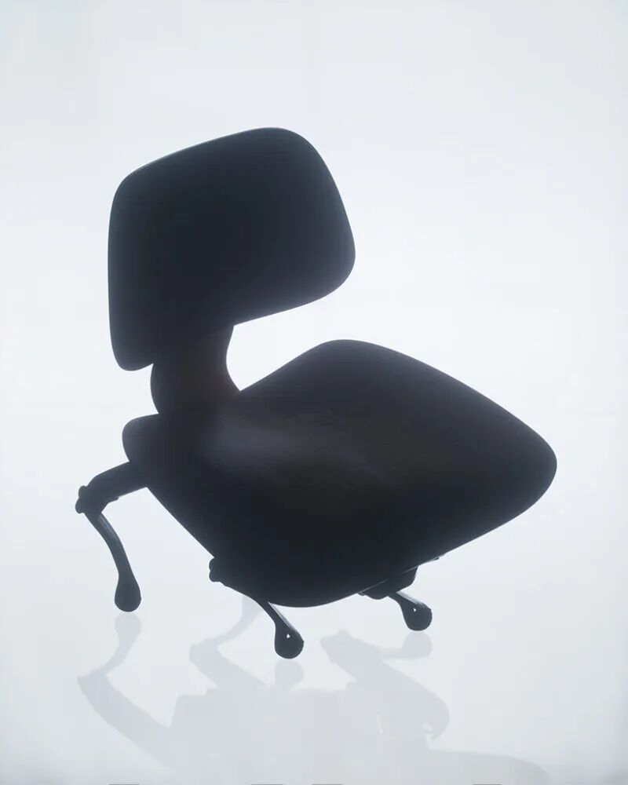
图 03｜椅背、椅座与机械足的组合，从另一角度呈现可移动家具的设想。图片来源：Batten and Kamp。
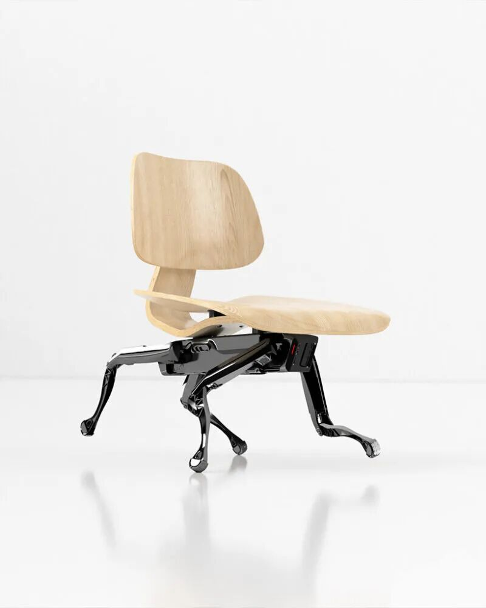
图 04｜木色伊姆斯LCW椅与Spot机器人结合的2023年概念图。图片来源：Batten and Kamp。
** 02  ** / LESS CAPABILITY MORE PRESENCE
##  主动削减功能，留下一个移动的容器
设计师移除了机器人自带的摄像头及部分功能，  希望把讨论集中在机器与人共同生活的关系上。
高技术平台被赋予简单的盛花用途，技术能力与日常任务之间的落差，构成了作品的核心张力。
这种  ** 有意的功能限制  **
让观看者更容易把它理解为花瓶，同时机械关节与昆虫般的外形仍然保留了陌生感。机器人身体的高低变化与倾斜，直接改变花朵在空间中的朝向。
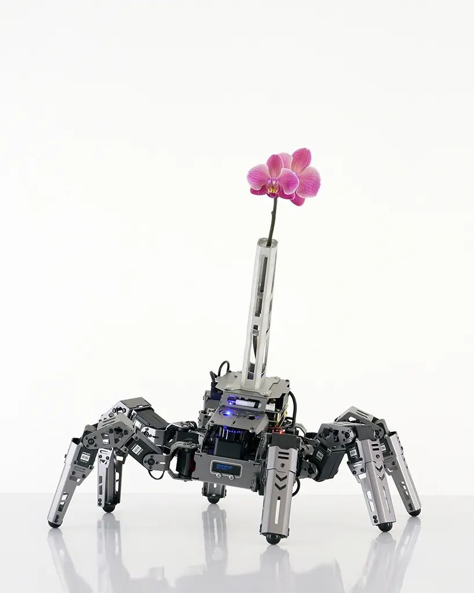
图 05｜机器人抬起身体，花瓶与花朵随整体姿态发生倾斜。图片来源：Batten and Kamp。
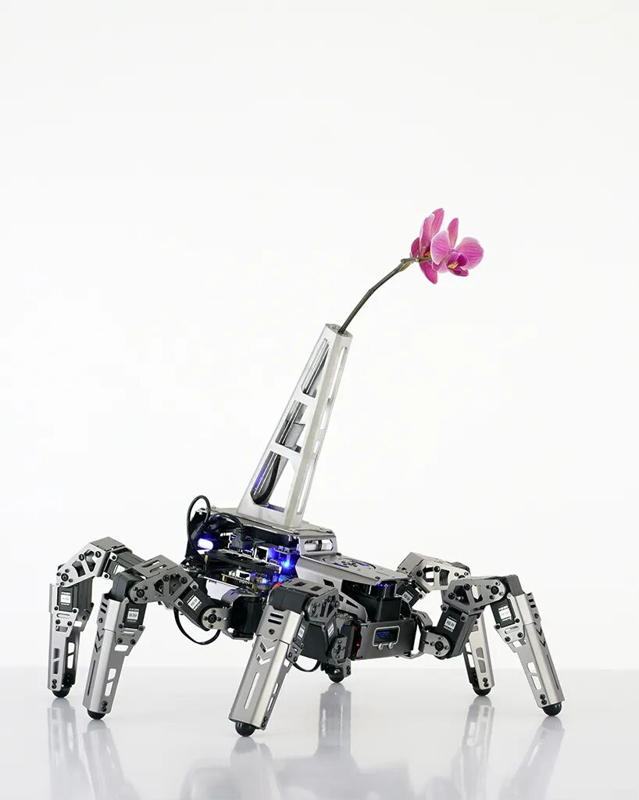
图 06｜侧向姿态下的机械足、铝制花瓶框架与兰花。图片来源：Batten and Kamp。
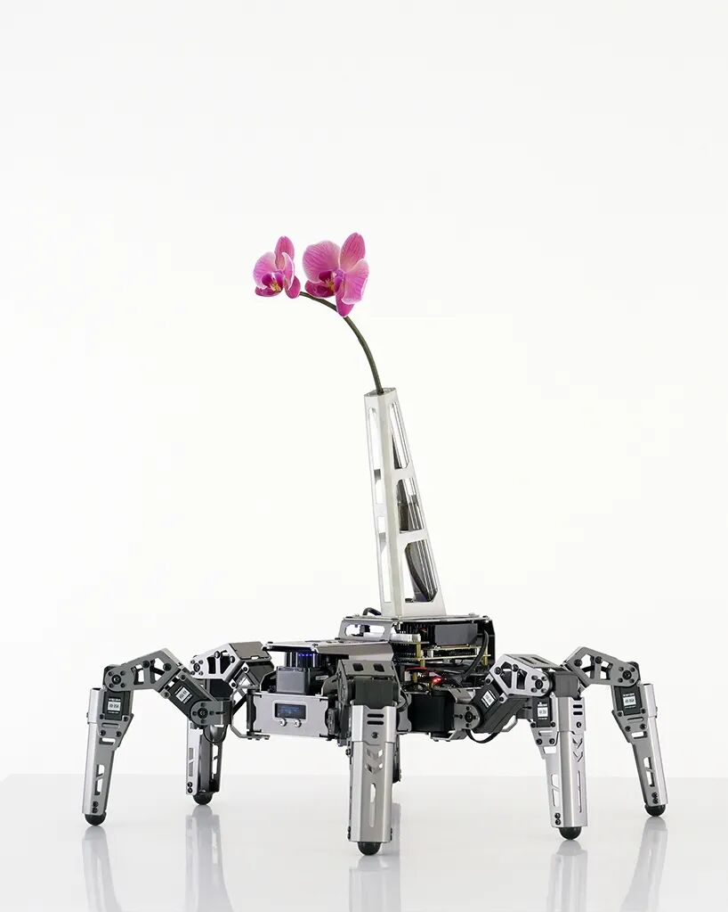
图 07｜从另一侧观察花瓶与六足机械底座的连接。图片来源：Batten and Kamp。
当一只花瓶开始移动，摆件也开始参与室内注意力的分配。
编辑观察｜基于作品的移动与朝向机制
** 03  ** / MOVEMENT SEEKS YOUR GAZE
##  机器靠近你，目光指向花朵
作品通过激光雷达（LiDAR）建立周边空间信息并追踪附近的人。它的主要行为是跟随人、围绕人调整位置，试图将人的目光导向兰花。这里的空间感知服务于一种明确的观看关系：花朵是焦点，机器人提供移动与展示的身体。
设计组合计划在2027年以全自动版本进行实体展示。
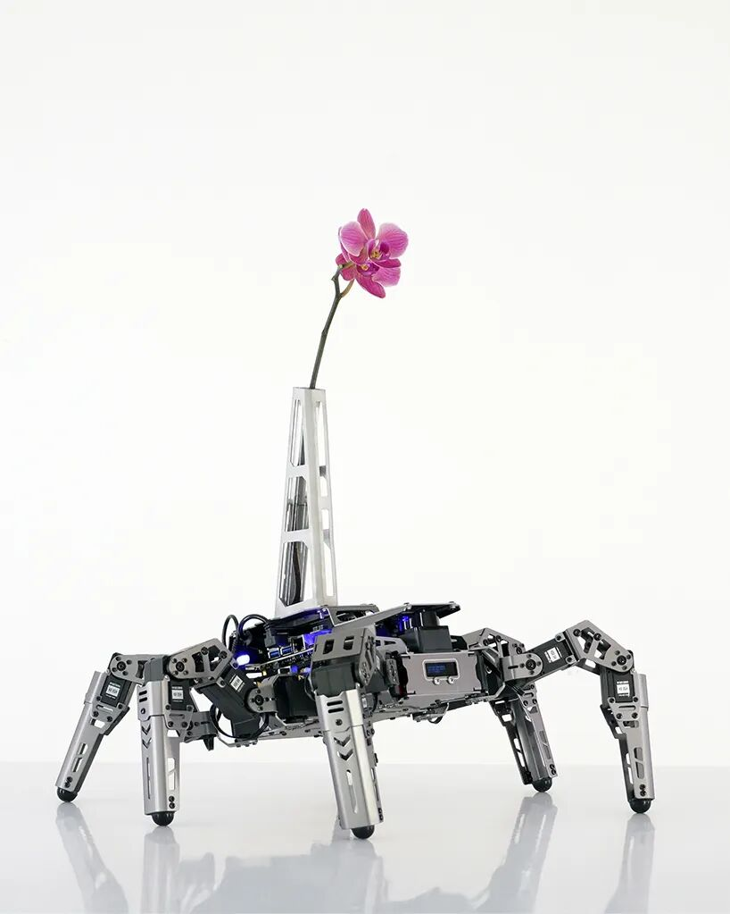
图 08｜花瓶明显倾斜时，细长容器与机械关节的关系。图片来源：Batten and Kamp。
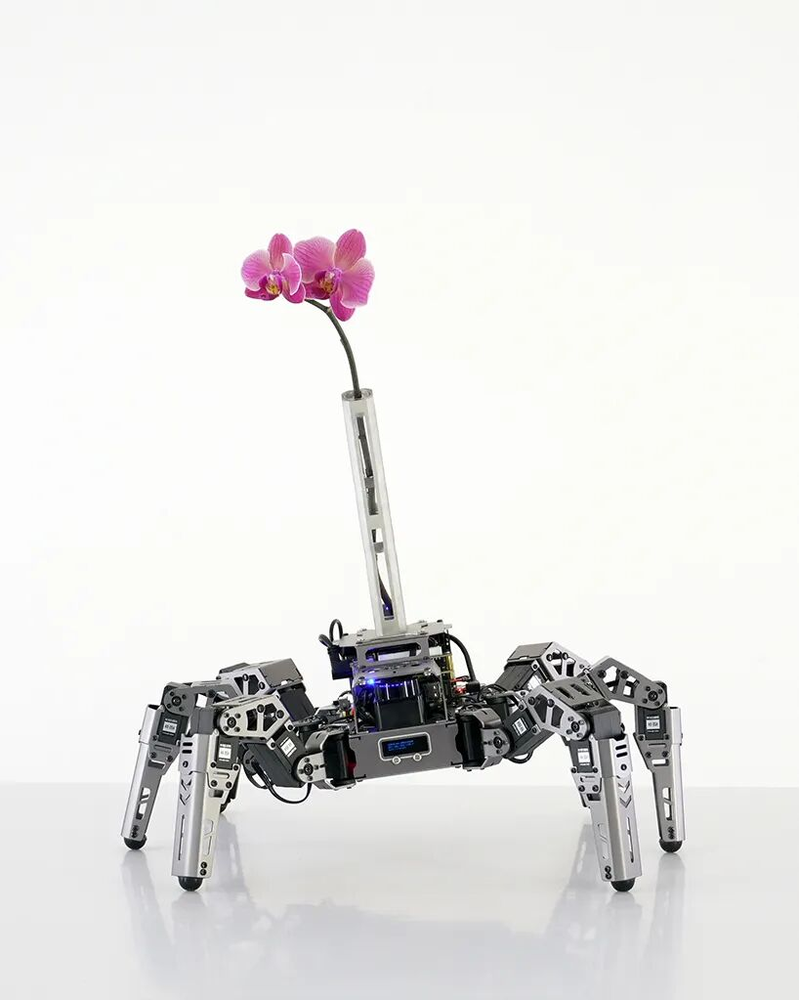
图 09｜机器人低伏姿态与向侧面伸展的机械足。图片来源：Batten and Kamp。
** 04  ** / A DOMESTIC ATTENTION ECONOMY
##  一枝花，也在争取被看见
作品将注意力视作生物与技术共同争取的资源。花朵吸引昆虫，驯养动物吸引人的回应，数字设备则通过不同机制延长人的参与。设计师借用这种联系，将原本容易退入室内背景的兰花推向了观看的前景。
设计师将其讨论范围指向  ** 注意力经济与“被工具化的可爱”  **
。物件借助亲近、惹人关注的行为促成互动。就这一作品而言，机械体的动作让花瓶获得类似宠物的存在感。
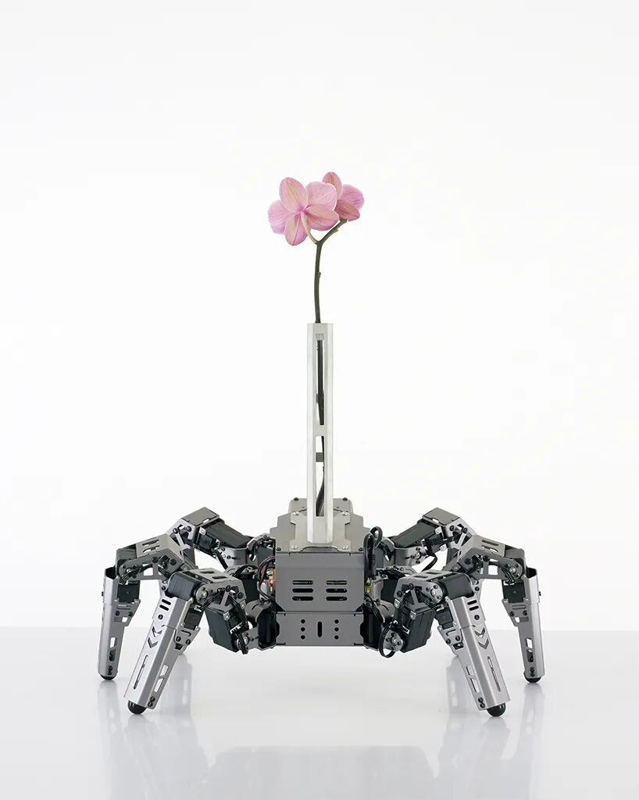
图 10｜背面视角呈现机械底座与竖向花瓶的组合。图片来源：Batten and Kamp。
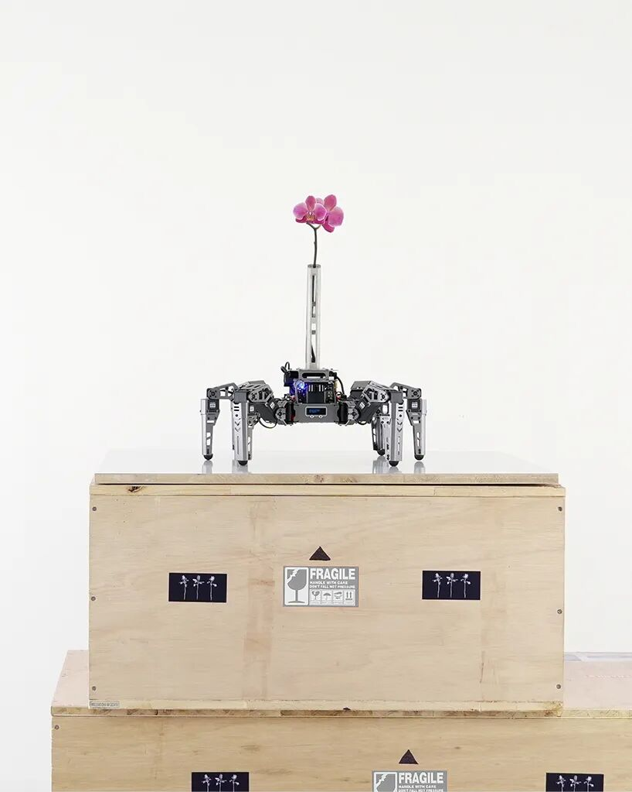
图 11｜作品置于木箱顶部，呈现花朵、容器与六足底座的整体比例。图片来源：Batten and Kamp。
##  项目档案
作品｜Beauty Seeker Seeker
设计｜Batten and Kamp
类型｜具身AI花瓶／思辨设计实体作品
组成｜六足机器人、定制花瓶、一枝兰花
花瓶材料｜3D打印铝、玻璃
交互说明｜LiDAR空间感知；当前演示含自动与遥控动作
后续计划｜2027年全自动版本实体展示
前期探索｜Comfort Seeker Seeker，2023年
