# 有一种旧建筑改造，叫做越“破”越高级

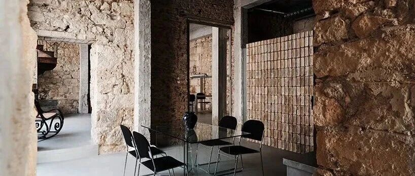

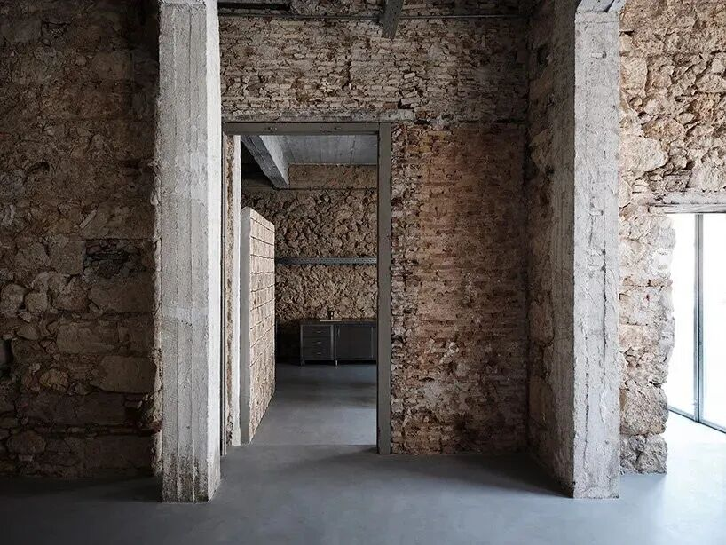
ARCHITECTURE / ADAPTIVE REUSE
#  拆掉吊顶，露出约150年的杉木屋架：MPNYC 把旧港仓库变成一个会“滑动”的文化空间
PIRAEUS, GREECE · MPNYC OFFICE SHOWROOM · 2026
在希腊（Greece）港口城市  ** 比雷埃夫斯（Piraeus）  ** ，  ** MPNYC  **
把一栋经历多次改造的港口仓储与作业建筑，转化为办公室、展示空间与画廊的复合场所。设计没有急着建立统一的新表情，更多是在通过拆除、清理、恢复开口和材料再利用，让建筑的不同年代重新同时出现。
项目位于 Polydefkous Street（波利德夫库斯街） ，斜对面就是 MPNYC 此前完成的文化场所  卡斯托尔空间（Castor Place）
。新空间计划于 2026年10月 以一场摄影展启用。设计主导者  安德烈亚斯·科斯托普洛斯（Andreas Kostopoulos）
希望这里成为一种现实中的交流场：艺术、工艺与设计实践者可以在同一处工作、讨论，也可以把阶段性成果直接展示出来。
01  / A BUILDING OF LAYERS
##  一栋建筑，至少叠了五段不同的生活
这栋建筑最早服务于港口仓储，之后被划分成不同货物的储存单元。维修作坊进入后，又在高挑空间中加入了  ** 混凝土夹层、柱与楼板  **
。再往后，它曾成为工业设备展厅，被吊顶覆盖，也曾被一家中东电影制作公司分隔成一系列房间。
MPNYC 把这种复杂履历理解为建筑已经拥有的素材。设计所面对的，是一组相互覆盖的结构、材料和使用痕迹，不必先选定某个年代作为唯一的“原貌”。  **
所谓改造，先从识别哪些层次值得保留、哪些遮蔽物需要撤掉开始。  **
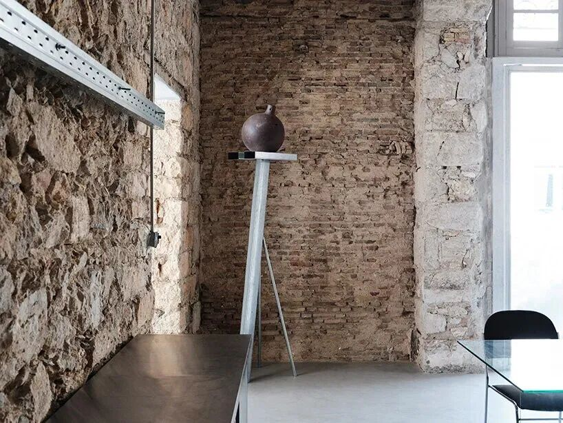
** 图 02｜裸露石砌体与砖墙围合出材料展示与会议空间，旧墙表面保留明显的时间痕迹。 摄影：Yorgos Kaplanidis。  **
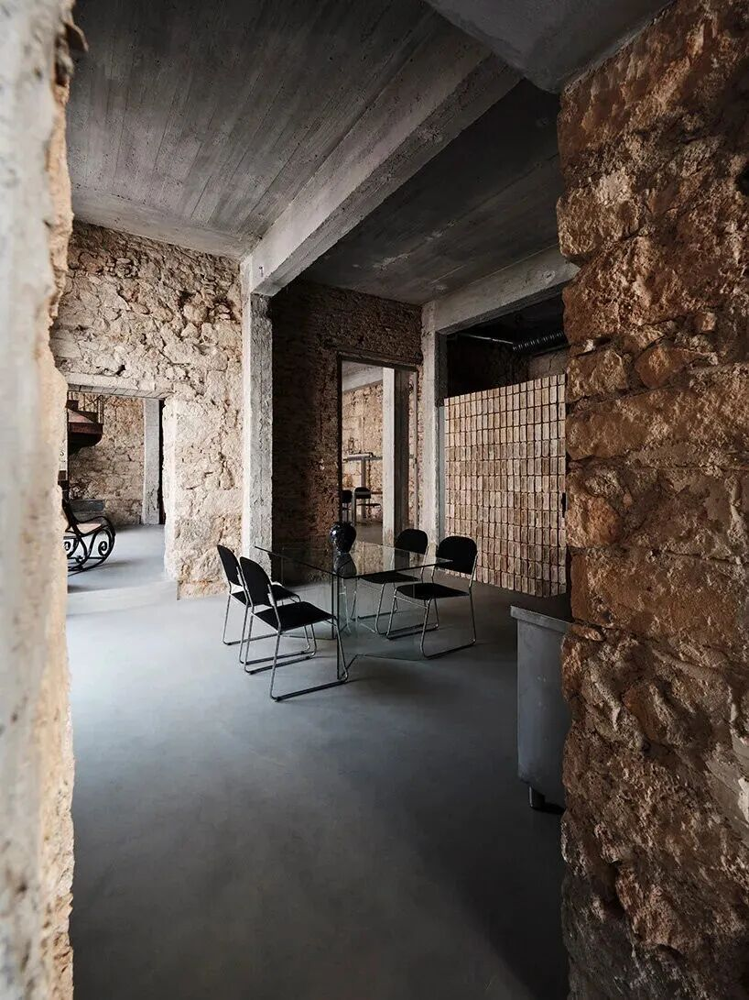
** 图 03｜玻璃会议桌与黑色座椅置于裸露砌体之间，再生砖隔断控制空间边界。 摄影：Yorgos Kaplanidis。  **
** 02  ** / OPENING THROUGH SUBTRACTION
##  拆掉遮蔽，让门洞和自然光重新工作
改造最直接的动作，是移除后来附加、并遮住旧建筑肌理的构造层。团队重新打开原有门洞，让日光可以向室内更深处推进；恢复后的开口中放入  ** 极简钢制枢轴门
** ，新构件的细薄尺度与厚重砌体形成清晰差别。
拆除过程中，建筑师还在墙体中发现旧木百叶，并把它们修复后重新投入使用。吊顶被移除后，屋顶结构也再次显露：  ** 约150年的杉木屋架  **
。光线、门洞、木构与砖石墙同时回到视线中，空间的“旧”不再依赖做旧效果，它来自真实构件的再出现。
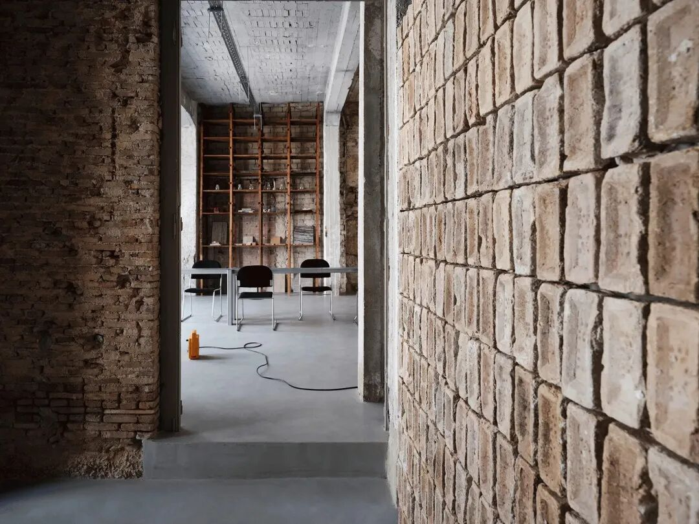
** 图 04｜再生砖构成独立隔断与门槛，新介入保持轻量，后景仍可读取原有墙体。 摄影：Yorgos Kaplanidis。  **
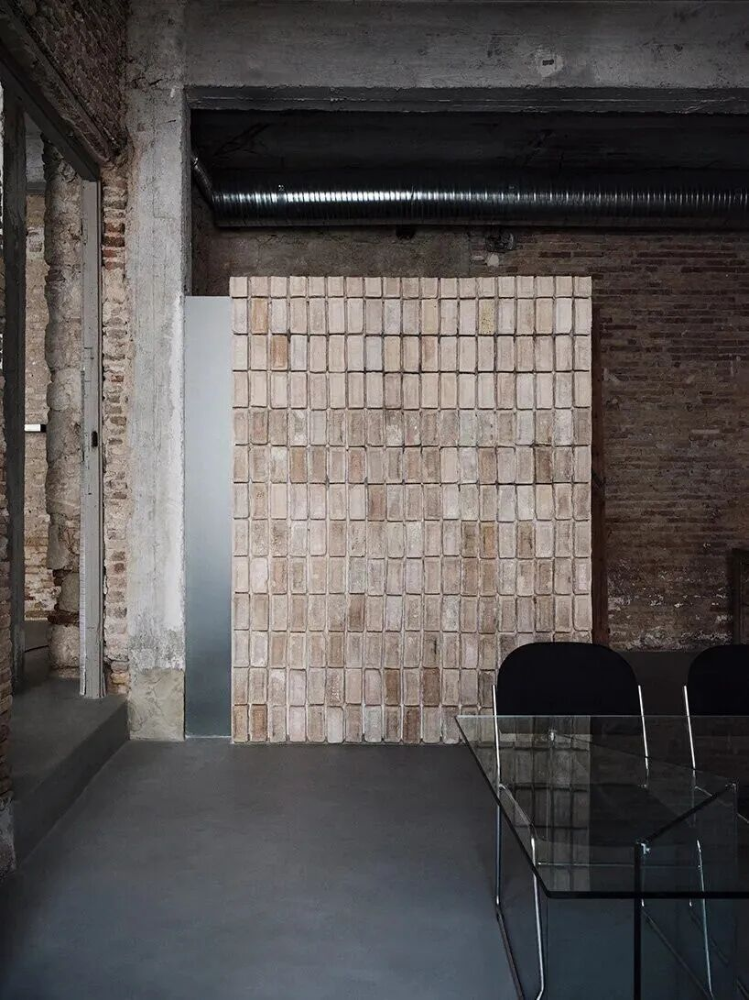
** 图 05｜小尺度再生砖墙位于会议区一侧，与原砖石墙形成新旧材料的细微差异 。摄影：Yorgos Kaplanidis。  **
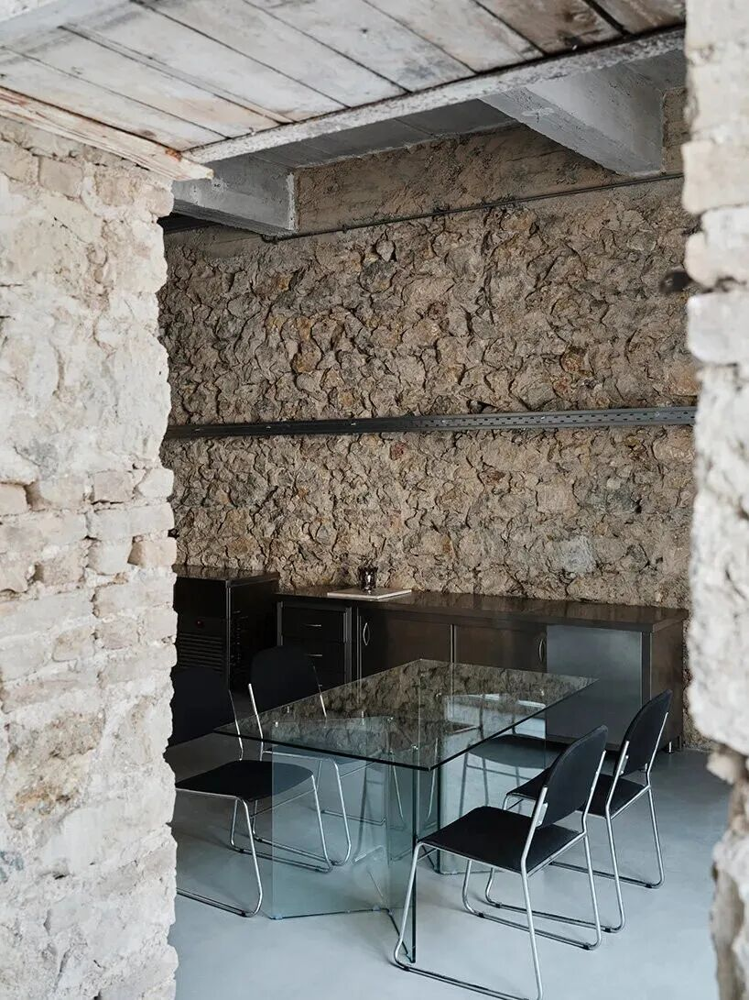
** 图 06｜会议区嵌入原有石墙与门洞之间，透明桌面尽量减少对视线的阻断。 摄影：Yorgos Kaplanidis。  **
** 03  ** / MATERIALS STAY IN PLAY
##  再生砖、旧木柜、金属道具，都继续留在下一轮使用里
材料策略延续了“先用已有之物”的逻辑。  ** 回收砖  **
被用于小型隔断、门槛与窗台；原有砌体和混凝土结构经过清理后直接暴露。曾经用于工具收纳的木柜，不再被当成陈旧设备清走，转而成为材料样本和书籍的展示架。
连展陈家具也来自项目之间的循环。MPNYC 把为 Castor Place 开幕展制作的金属道具带到这里，重新用作桌子和展示单元。  **
材料的重复使用因此不只发生在墙体层面，也进入家具、陈列和日常运营。  **
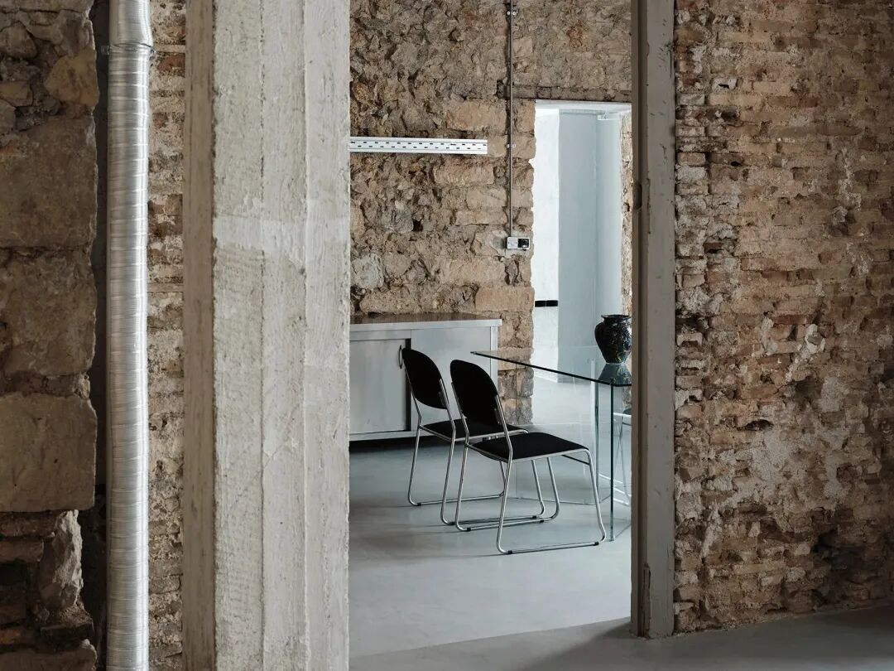
** 图 07｜透过旧门洞望向会议区，恢复后的开口让空间重新获得纵深与连续采光。 。摄影：Yorgos Kaplanidis。  **
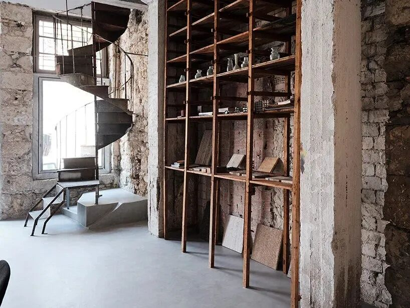
** 图 08｜钢制旋转楼梯与旧木工具柜改造的材料展示架共同组成垂直交通与陈列界面。摄影：Yorgos Kaplanidis。  **
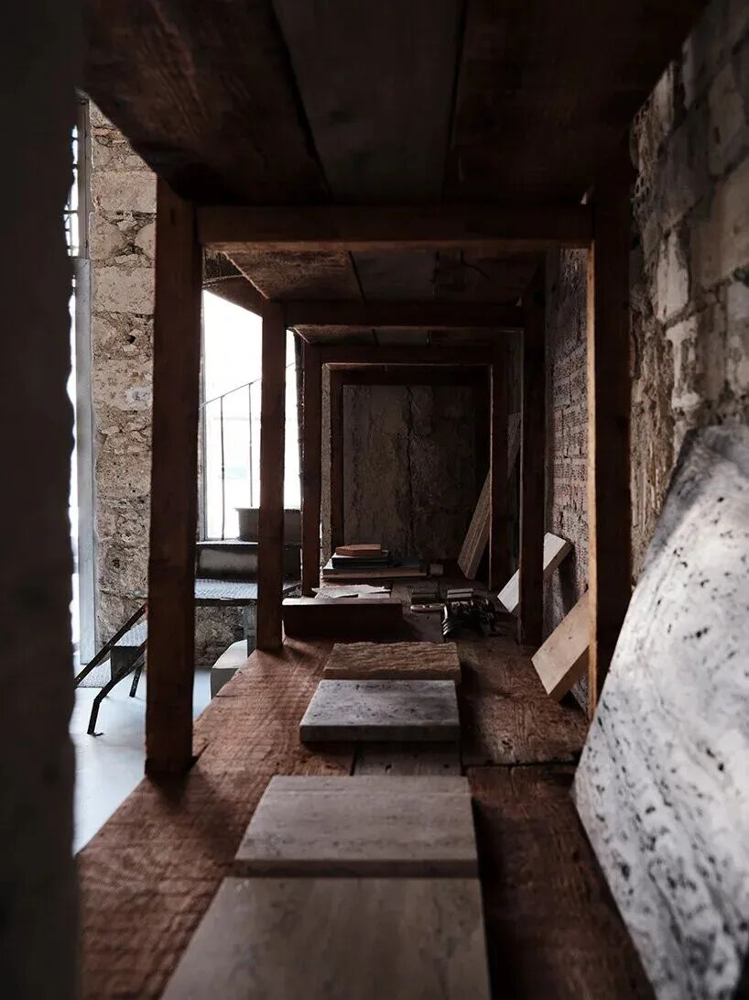
** 图 09｜旧木柜被重新用作材料样本和书籍的展示系统，保留原有木构尺度与使用痕迹。 摄影：Yorgos Kaplanidis。  **
** 04  ** / ROOMS THAT CAN SHIFT
##  房间可以拥有不止一种功能
MPNYC 用  ** “slider”  **
形容这套空间机制：房间可以依据使用者需要在不同功能之间切换。厨房既能承担工作坊和模型制作，也能临时变成餐厅或咖啡空间；会议室则可以在会议、画廊、项目室和工作坊之间转换。
值得注意的是，这种适应性没有依赖一套高复杂度的机械系统。建筑仍由一间间有边界的房间组成，变化发生在  ** 功能定义、家具布置与使用时序  **
上。对于同时容纳工作、展示和交流的文化型空间，这种低技术的可变性也意味着更低的切换门槛。
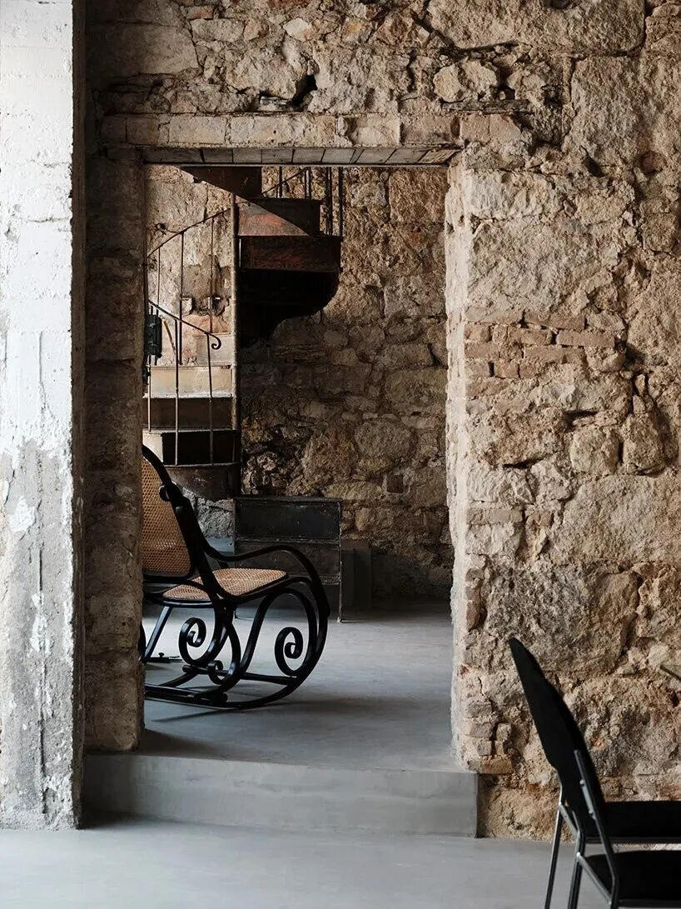
** 图 10｜原有石门洞框取钢制楼梯与复古摇椅，新构件以更轻的金属语言进入旧结构。摄影：Yorgos Kaplanidis。  **
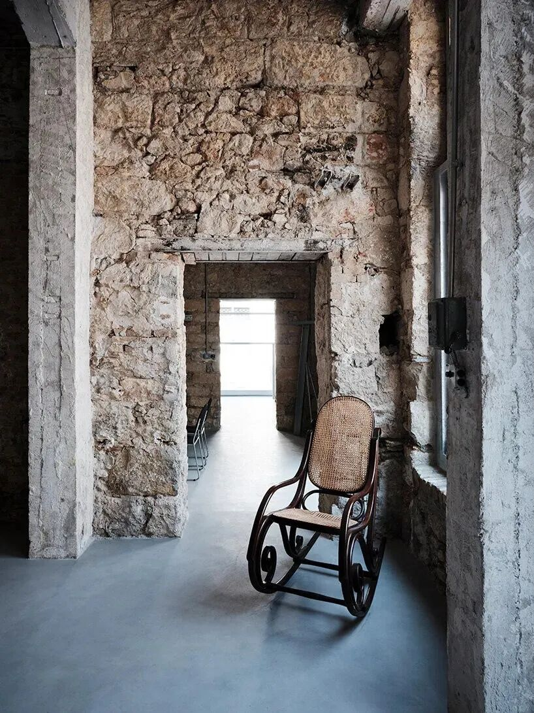
** 图 11｜复古藤编摇椅置于裸露砌体与恢复后的开口之间，家具成为尺度参照。摄影：Yorgos Kaplanidis。  **
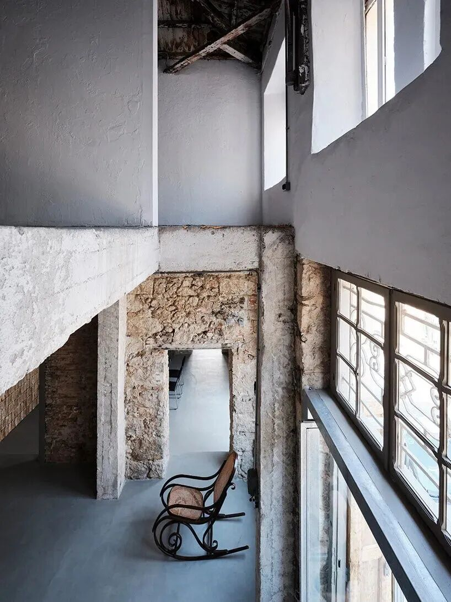
** 图 12｜从较高标高俯看旧门洞、窗洞与室内陈设，仓库的多层空间关系被重新显露。 摄影：Yorgos Kaplanidis。  **
** 05  ** / DISPLAYING THE BUILDING
##  展示空间没有被做成“白盒子”，建筑本身继续参与展览
作为 showroom，这里刻意避开标准展示空间常见的中性背景。物件、材料样本与家具被放进砖石墙、混凝土构件、旧木柜和历史门洞构成的现场中。  **
观看展品的同时，观者也会持续看到建筑曾经被使用和改造的证据。  **
最接近当代“完成面”的一处，是曾经历较多改动的角部空间。这里采用液态金属保温饰面，呼应 Castor Place
上部体量使用过的材料。较新的屋顶下分隔墙则被保留下来，原本用于划分房间的墙面继续承担画廊展墙的角色。
这让改造形成一种很清楚的层级：  ** 粗粝砌体负责记录历史，轻质钢构承担新动作，回收构件连接过去的使用经验，少量新饰面标记需要明确介入的位置。  **
没有哪一种材料试图独占空间。
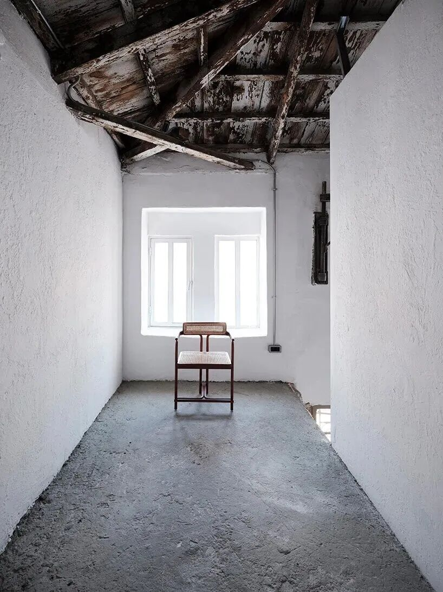
** 图 13｜上层空间拆除吊顶后露出约150年的杉木屋架，较新的墙面继续作为展览界面。摄影：Yorgos Kaplanidis。  **
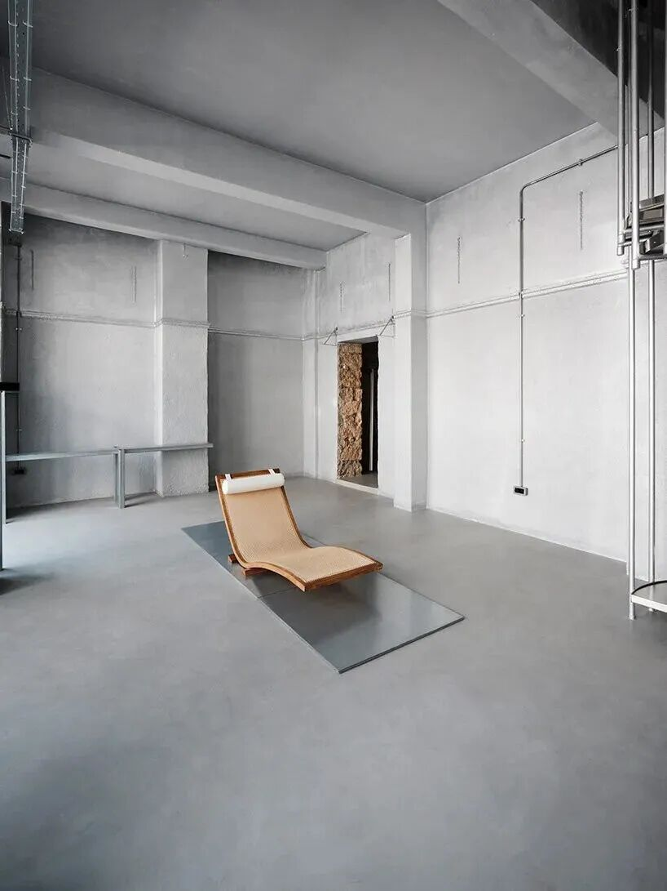
** 图 14｜角部房间采用灰银色完成面，克制家具与明露机电形成更当代的空间段落。 摄影：Yorgos Kaplanidis。  **
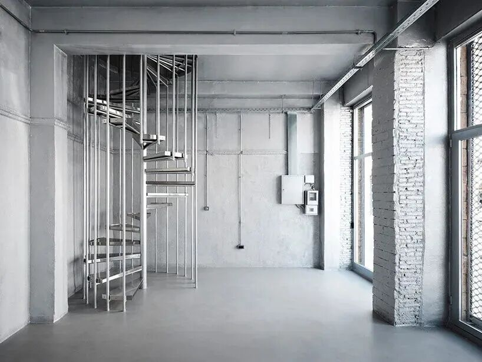
** 图 15｜钢制旋转楼梯位于灰银色空间内，大窗带入自然光，与粗粝砌体区域形成对照 。摄影：Yorgos Kaplanidis。  **
CLOSING NOTE
##  保留“不确定”，也可以是一种耐久设计
MPNYC 在比雷埃夫斯这次改造中没有追求一张干净到看不见过去的完成照。建筑被当作一个已经存在、仍会继续变化的“found
object”：它的厚墙、错误年代的隔断、后来加进去的混凝土，以及重新发现的木百叶都可以成为下一轮空间组织的条件。
最终形成的是一处可以在工作、展示、讨论与短期活动之间不断切换的基础设施，而非功能单一的办公室或展厅。对旧工业建筑来说，  **
真正的更新价值或许正来自这种对未来用途保持开放的能力。  **
###  参考资料
1\. Designboom｜“MPNYC turns former piraeus warehouse into art and design
space”
2\. Manhattan Projects（MPNYC）｜Profile
3\. Designboom｜“MPNYC transforms 19th-century warehouse into flexible cultural
venue in piraeus”
4\. FreeYork｜“MPNYC Revives Historic Piraeus Warehouse into Dynamic Art Venue
with Exposed Brick and Steel”
