# 1300余件钢构件撑起七个无柱展厅，悉尼这座9.15亿澳元投资的“外骨骼博物馆”定于本周开放！

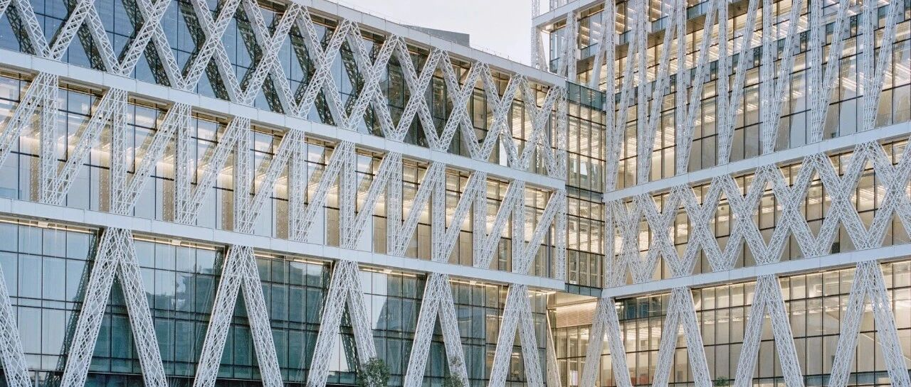

ARCHITECTURE / POWERHOUSE
#  1300余件钢构件，撑起七个无柱展厅：悉尼这座“外骨骼博物馆”本周开放
Powerhouse Parramatta｜Moreau Kusunoki + Genton
巨大的白色钢格构已经包住两栋建筑，飞机、火箭与互动装置陆续就位。  ** 帕拉马塔动力博物馆（Powerhouse
River）岸边，开始以展览、教育和公共活动迎接访客。
这座由  ** Moreau Kusunoki  ** 主导设计、  ** Genton建筑事务所  **
担任本地建筑师的新馆，将七个大型展厅叠置起来，外侧钢结构承担支承与稳定功能。内部因此获得无柱的展示空间，展厅之间则穿插面向河流的明亮区域。
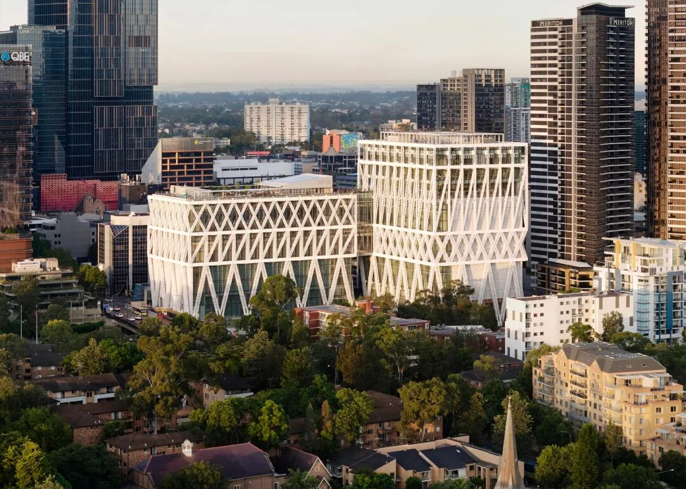
图 01｜博物馆两翼与帕拉马塔城市环境，开馆前外观。摄影：Rory Gardiner。
** 01  ** / READY TO OPEN
##  开门之前，先让整座馆运转起来
新馆的主体建筑工程已于2026年4月完成。随后数月，工作重心转向展览安装、公共区域收尾，以及工作人员培训。开馆准备中，约3000名员工、建设者及亲友获邀参与演练，协助测试建筑、展览和访客服务；影音、互动设备、展签与导向标识也进入最后调试。
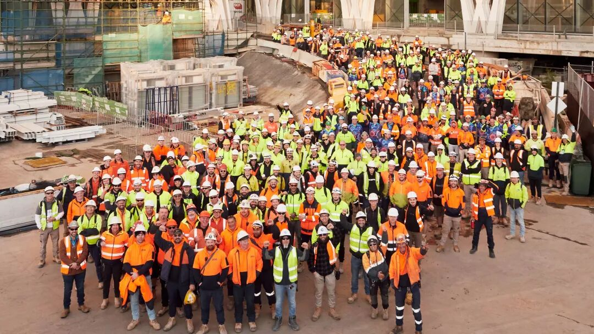
图 02｜主体工程交付阶段的建设团队合影。图片来源：Powerhouse。摄影：Zan Wimberley。
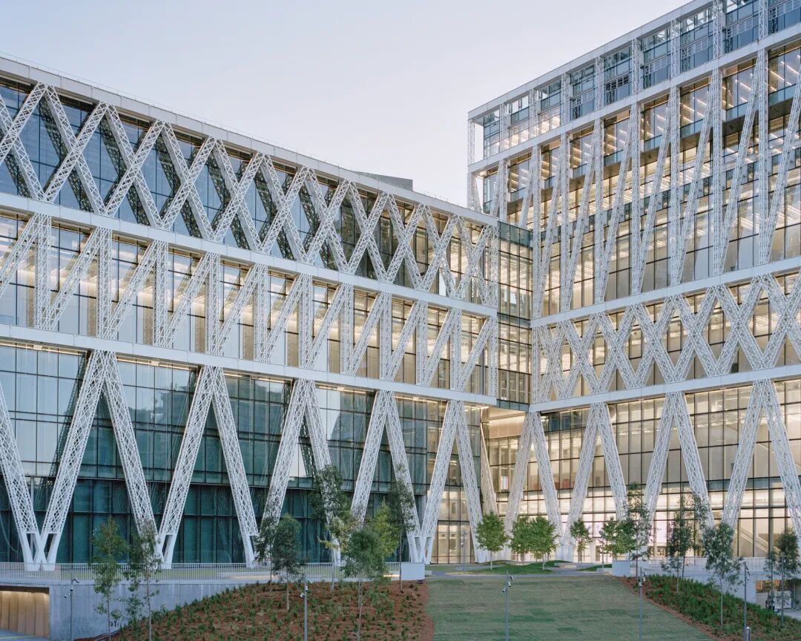
图 03｜两翼外骨骼与地面公共区域，开馆前外观。摄影：Rory Gardiner。
围绕新馆的9.15亿澳元投资，覆盖帕拉马塔场地购置、卡斯尔山（Castle
Hill）新藏品库、藏品数字化，以及新馆交付。四部分分别为1.44亿、4400万、6690万与6.601亿澳元。其中，新馆交付费用涵盖建筑师费用、主体工程、装修、展览、景观和公共艺术。这笔投资同时支撑藏品保管、数字访问与现场展示。
** 02  ** / STRUCTURE ON DISPLAY
##  1300余件钢构件，围出无柱展厅
建筑的外骨骼由1300余件钢构件组成，W、X、N和A形单元高度约4至20米，沿建筑外缘构成格构体系。结构在立面上清楚可辨：较大的斜向支撑控制整体稳定，较细的弦杆和斜杆共同组成格构柱。多种尺度的杆件叠合，也构成了这座博物馆最鲜明的外观。
** 外置承重与支撑体系，为七个主要展示空间保留了无柱内部。  **
展陈团队布置大件藏品、隔墙、观演区和移动路线时，可以在连续的楼面上组织空间，减少室内柱网对布局的切分。
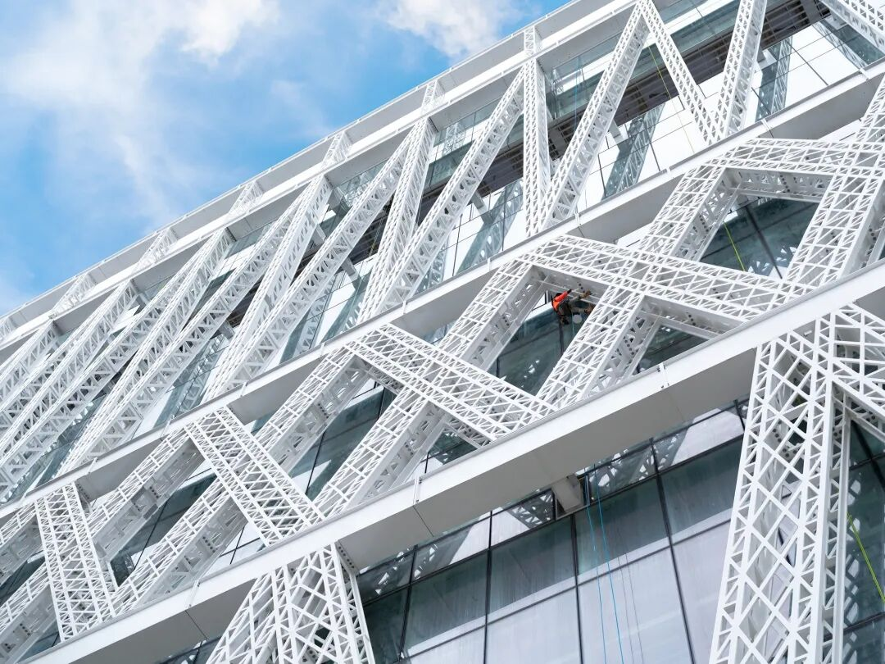
图 04｜外骨骼的大尺度斜杆、细密格构与玻璃围护。图片来源：Powerhouse。摄影：Nic Walker。
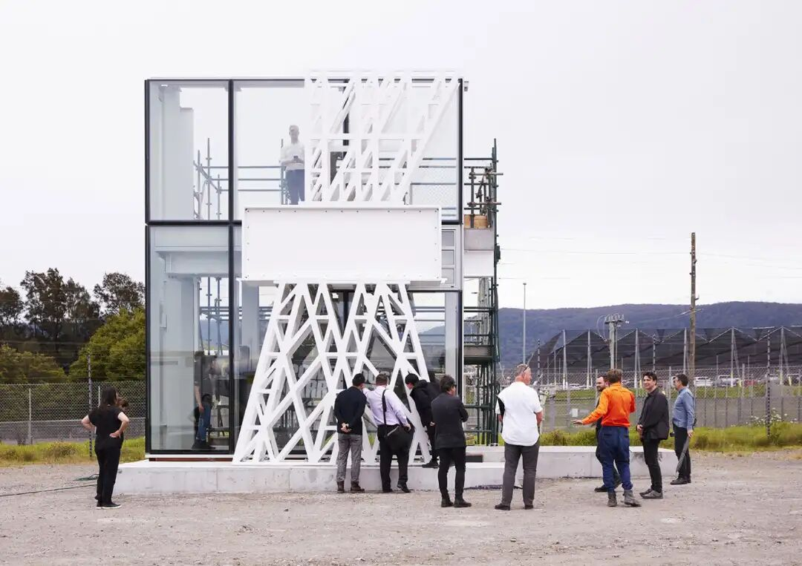
图 05｜外骨骼及幕墙足尺样段评审，建设过程记录。图片来源：Genton。
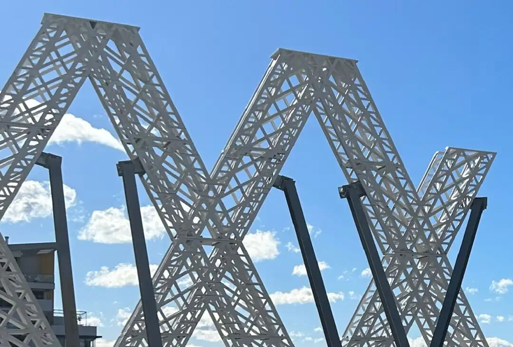
图 06｜建设阶段的斜向支撑与格构细节。图片来源：Genton。
主导设计团队与结构工程师佐藤淳（Jun
Sato）共同发展了外骨骼概念，奥雅纳（Arup）随后承担结构、幕墙、机电、声学等多专业工作。工程设计也把结构本身纳入参观内容：人站在明亮的建筑边缘，可以近距离辨认杆件、交叉关系与支撑尺度，向外则能看到河岸和城市。
外骨骼背后的围护分别采用透明玻璃与不透明墙面。玻璃为交通和公共区域引入自然光，不透明围护则包裹对光敏感的展示空间。  **
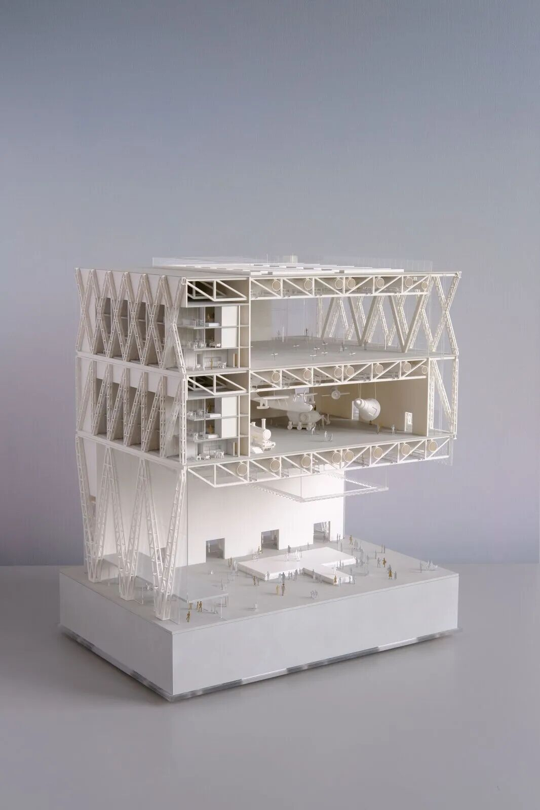
图 07｜外骨骼与内部楼层关系的实体模型。图片来源：Genton。
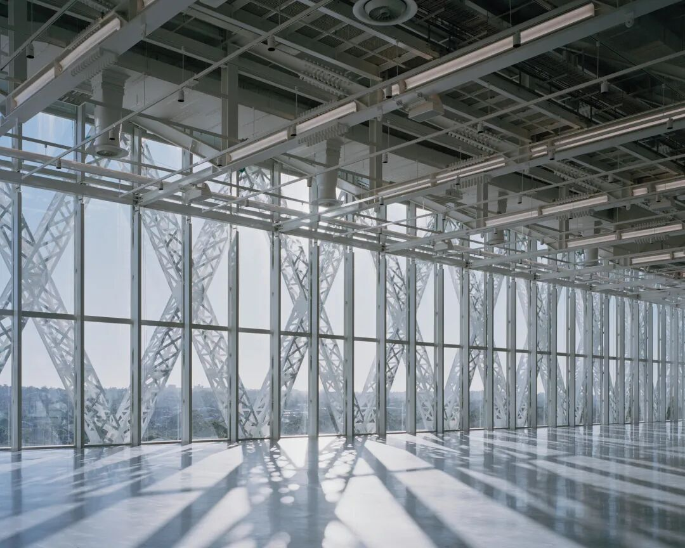
图 08｜开馆前内部空间，楼面、顶棚与外侧钢构。摄影：Rory Gardiner。
** 03  ** / BETWEEN CITY AND RIVER
##  展厅之间，把河景留给人
帕拉马塔新馆没有把所有面积平铺在河边。七个展示空间通过叠置形成紧凑体量，为地面公共空间与滨水区域留出余地。建筑两翼之间以两层高的玻璃连桥相接，展厅与外骨骼之间又穿插连续的过渡空间，将参观动线带向外墙和景观。
设计团队用日语中的  ** “间”（mâ）  **
描述这些介于既定功能之间的区域。相对于内部封闭、便于控制展陈环境的展厅，过渡空间透明、明亮，朝向河流与远处天际线。走出一段沉浸式展览后，访客能够重新看见自然光，也能在进入下一个展厅之前交谈或短暂停留。
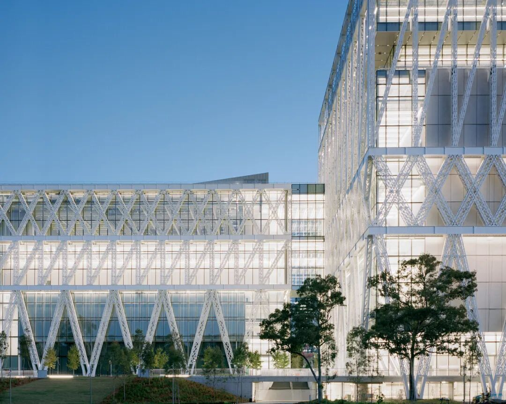
图 09｜两翼建筑及玻璃连接部分的外部视角。摄影：Rory Gardiner。
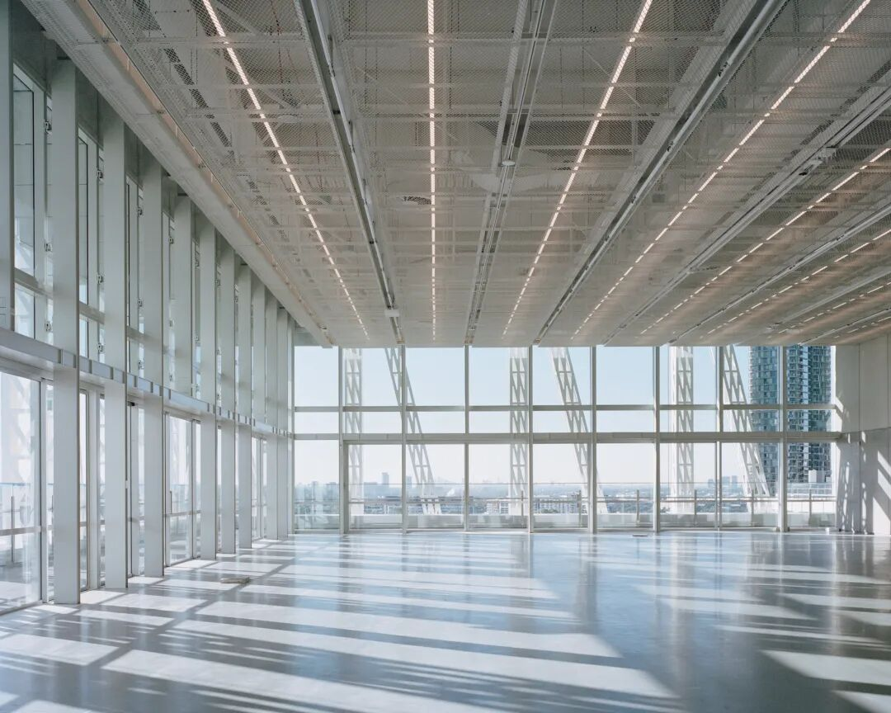
图 10｜开馆前内部实景，玻璃围护与自然光。摄影：Rory Gardiner。
这种安排在馆内外都延续着同一条线索：展厅叠置，地面留出通行和停留空间；交通靠近建筑边缘，让行走与看景结合。新馆同时衔接帕拉马塔市中心通向河岸的城市联系，使到河边散步的人与来馆参观的人在公共区域相遇。
** 可见、可穿行的公共空间，与需要进入特定展览的室内空间并置。  ** 面向城市的建筑边缘因此获得了具体用途：它既组织到达，也为展览之间的停顿提供位置。
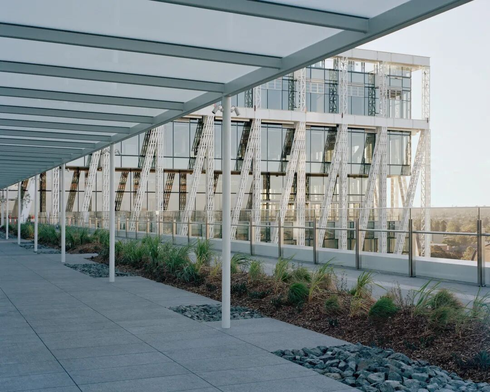
图 11｜外墙边缘的步行空间、种植与外骨骼。摄影：Rory Gardiner。
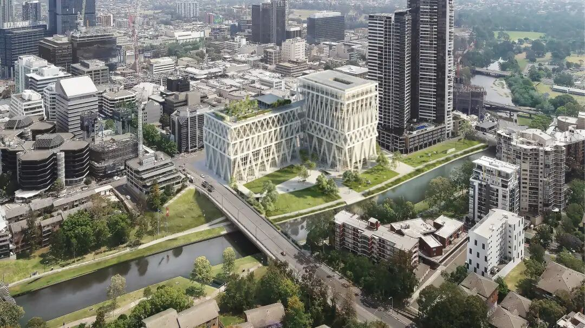
图 12｜建筑体量、屋顶与河岸公共空间的设计效果图。图片来源：Genton。
** 04  ** / FIVE OPENING EXHIBITIONS
##  五个开馆展，装进不同尺度的空间
七个主要展示空间将迎来五个开馆展，合计呈现3000余件展品，其中1600余件来自馆藏。体量与观看方式差异很大：航空硬件需要远观和绕行，服装、图纸及日常物品适合近距离阅读，灯光与镜面装置则会把观众带入作品内部。
** “永恒任务”（Task Eternal）由OPEN建筑事务所（OPEN Architecture）设计展陈  **
，以飞行、航空与航天为线索，呈现850余件展品。澳航历史飞机、阿波罗计划相关航天硬件与月球岩石，将与詹姆斯·特瑞尔（James
Turrell）的新灯光作品同场出现。
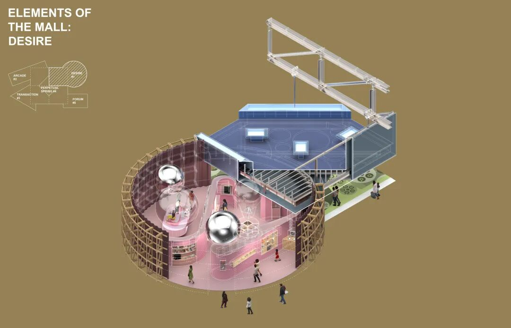
图 13｜“购物中心”展览空间的轴测设计图。图：OMA。
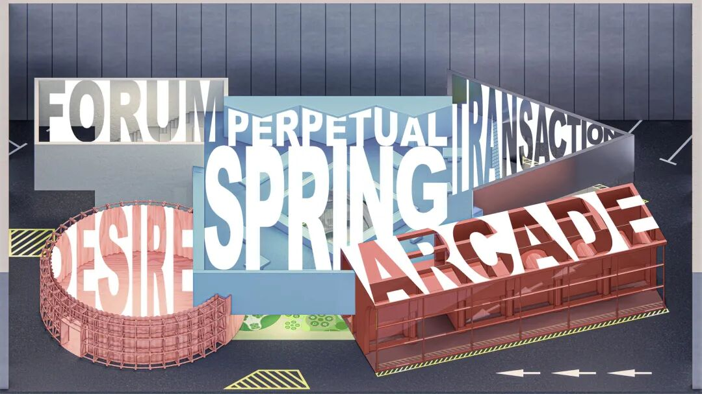
图 14｜“购物中心”展览的空间与视觉设计示意。图：OMA。
“购物中心”（The Mall）  由  大都会建筑事务所及其研究团队（OMA/AMO）
共同参与设计和策展，从购物中心的历史、建筑、设计、技术与服装切入。对建筑读者而言，它把新馆自身的公共空间议题，与另一种深刻影响城市生活的建筑类型并列呈现。
面向4至12岁儿童的“黑暗”（The Dark）、以原住民水域知识为核心的“溢流”（Overflow），以及舞台设计师埃斯·德夫林（Es
Devlin）的“The Turning”展览，共同构成其余三项开馆内容。五个展览中四个免费，“永恒任务”向成人收费，16岁以下访客可免费参观全部展览。
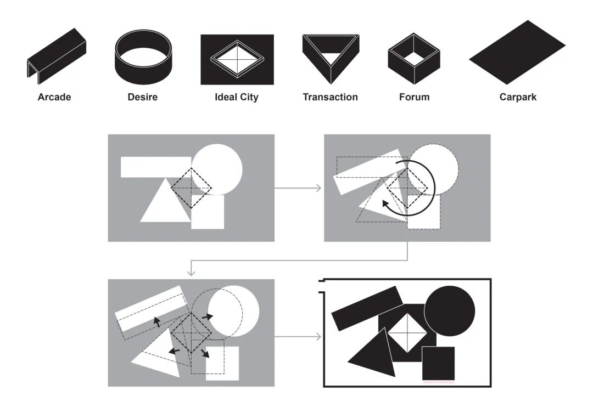
图 15｜“购物中心”展览的几何类型与组织示意。图：OMA。
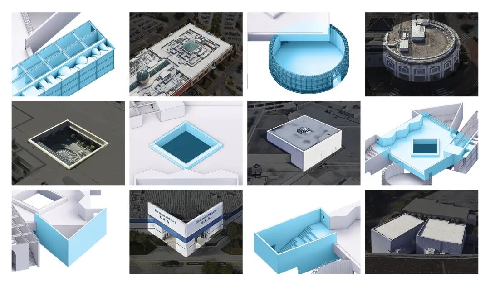
图 16｜“购物中心”研究中的不同建筑案例示意。图：OMA。
** 05  ** / BEYOND THE GALLERIES
##  在屋顶种植，也在博物馆过夜
展厅之外，较低一栋建筑的屋顶设置露台、生产性花园、温室与活动设施。原生植物和可食用种植进入博物馆的教育内容，旁边的  ** 维托科家庭厨房（Vitocco
Family Kitchen）可容纳约200名观众  ** ，用于烹饪展示和实践学习。花园与厨房相邻，使种植、采收、处理和分享食物能够在同一组空间中展开。
朗·沃克家庭学院（Lang Walker Family
Academy）则将住宿纳入教育安排，计划每年提供约1万个高中生学习名额，把科学、技术、工程和数学课程与馆藏、研究者及行业实践连接起来。部分学生可以在馆内留宿，参加跨越日间参观时段的课程。
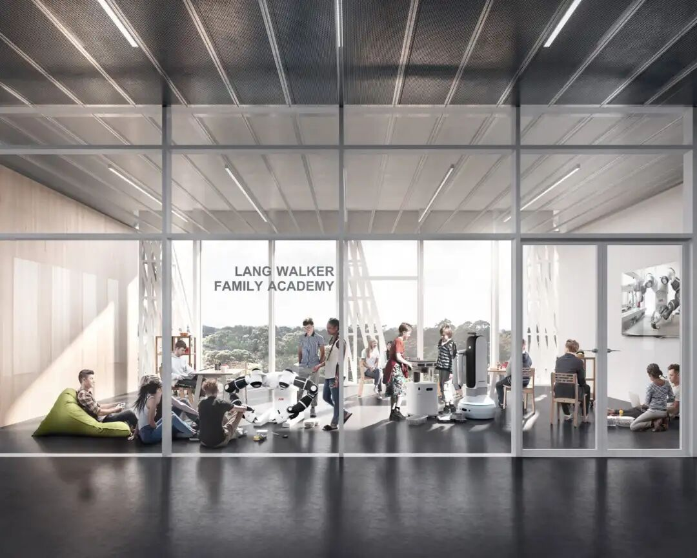
图 17｜学院课堂与协作学习空间的设计效果图。图片来源：Genton。
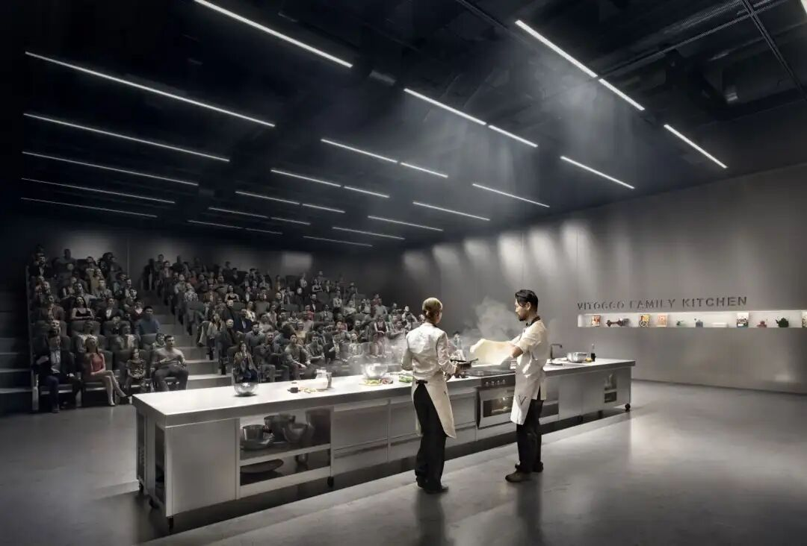
图 18｜示范厨房与观众席的设计效果图。图片来源：Genton。
** 博物馆的使用时间由课程、住宿和晚间活动共同延长。  **
11月7日至29日的开馆节将持续23天，安排179项活动，涵盖设计、建筑、科技、音乐、饮食和电影等领域。开馆节期间，新馆每周七天开放，周四至周日延长至晚9点，周一至周三为上午10点至下午5点。
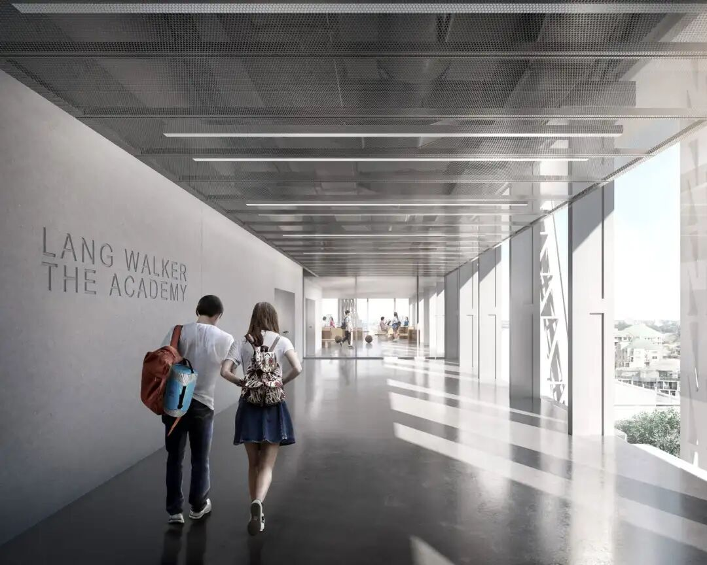
图 19｜教育活动及通行空间的设计效果图。图片来源：Genton。
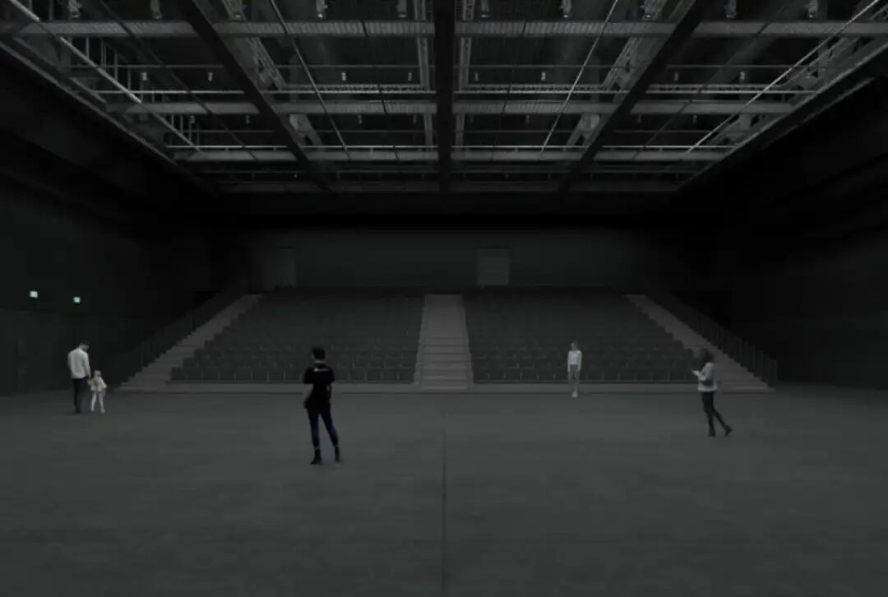
图 20｜观演空间的设计效果图。图片来源：Genton。
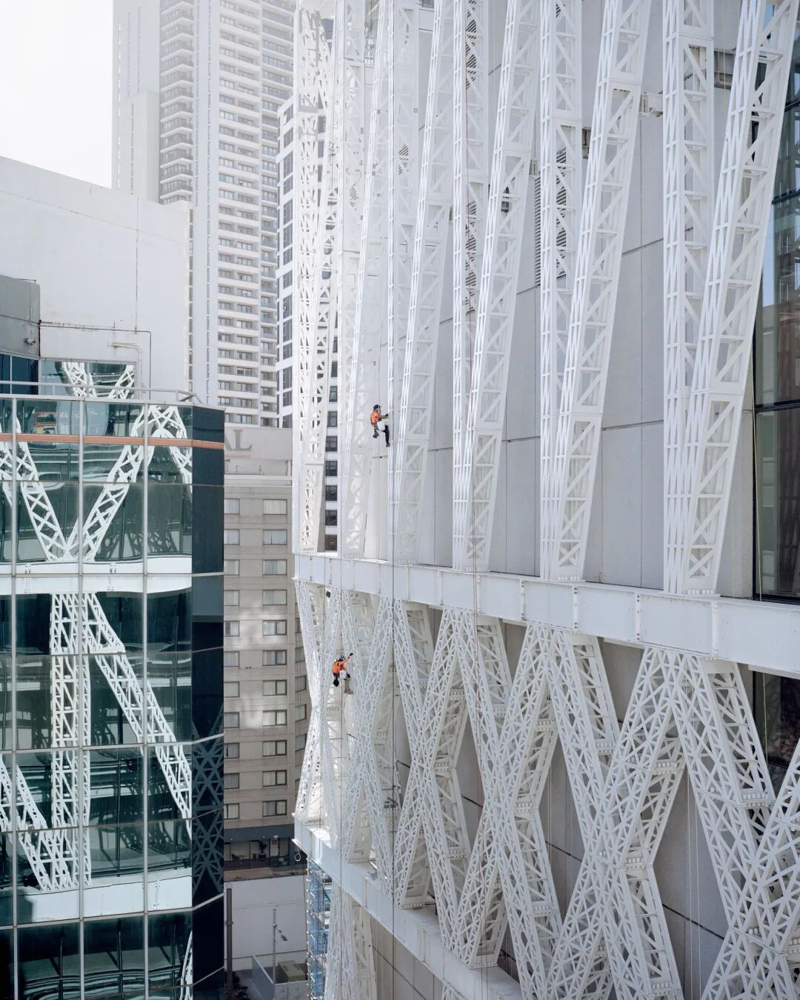
图 21｜外骨骼之间的建筑边缘与向上的立面视角。图片来源：Powerhouse。摄影：Rory Gardiner。
##  项目档案
** 项目  ** 帕拉马塔动力博物馆 / Powerhouse Parramatta
** 位置  ** 澳大利亚新南威尔士州，帕拉马塔河畔
** 主导设计  ** Moreau Kusunoki
** 本地建筑师  ** Genton
** 工程顾问  ** Arup
** 外骨骼概念合作  ** Jun Sato Structural Engineers
** 景观  ** McGregor Coxall
** 建筑照明  ** L’Observatoire International
** 施工  ** Lendlease
** 公共及展示空间  ** 超过18,000㎡
** 主要展示空间  ** 7个
** 主体工程完成  ** 2026年4月
** 对公众开放  ** 2026年11月7日
** 总体项目预算  ** 9.15亿澳元，含场地、藏品库、数字化及新馆交付
##  参考资料
1\. Powerhouse｜Powerhouse Parramatta
2\. 新南威尔士州政府｜开馆演练与预算分项，2026年11月1日
3\. Moreau Kusunoki｜Powerhouse Parramatta项目说明
4\. Infrastructure NSW｜项目交付、外骨骼与围护
5\. 新南威尔士州政府｜项目特征与公共展示空间
