# 298.5㎡地块塞进11套住宅：墨西哥海边这座“方盒子”，把住宅做成了一座“垂直村落”

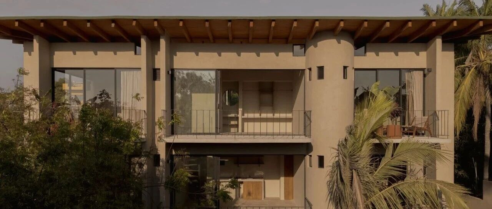

ARCHITECTURE / COASTAL LIVING
#  把11户住宅放进298.5㎡海边地块：
墨西哥这座方盒子，用一口天井把风、光和棕榈带进家
SUUEL LIVING · PUERTO ESCONDIDO · OAXACA · 2026
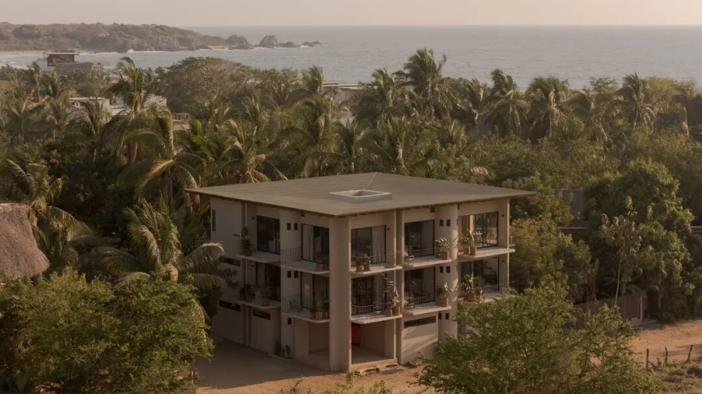
** 图 01｜  ** 棕榈树冠之间的 Suuel Living，远处可见太平洋海岸；紧凑方形体量减少了建筑在场地中的横向铺陈。 摄影：Zaickz
Moz。
在墨西哥瓦哈卡州埃斯孔迪多港（  ** Puerto Escondido, Oaxaca  **
），海岸住宅通常面对一个矛盾：人们希望获得更开阔的光、风与景观，土地却越来越稀缺。由  ** CAAM Arquitectos  ** 设计的  **
Suuel Living  **
选择把11套住宅集中进一个三层、近乎完整的方形体量，再通过中央挑空、连续露台、深檐和屋顶观景点，把密度重新转换成可呼吸的空间秩序。
** 01  ** / COMPACT COASTAL DENSITY
##  紧凑方盒，而非水平蔓延
项目坐落在靠近  ** Playa Los Tamarindos  ** 的棕榈树冠之间，场地面积约  ** 298.5㎡  **
。CAAM没有把住宅分散成多栋低层单元，而将功能集中为一座三层建筑，在场地外围留下砂砾庭院、绿化、入口与小型公共水池。项目总建筑面积为  ** 719.5㎡
** 。
这种紧凑策略让建筑获得清晰的集体性，也减少对棕榈环境的水平占用。低坡四坡屋顶压低了远观尺度，使三层体量在树冠之间保持相对克制。
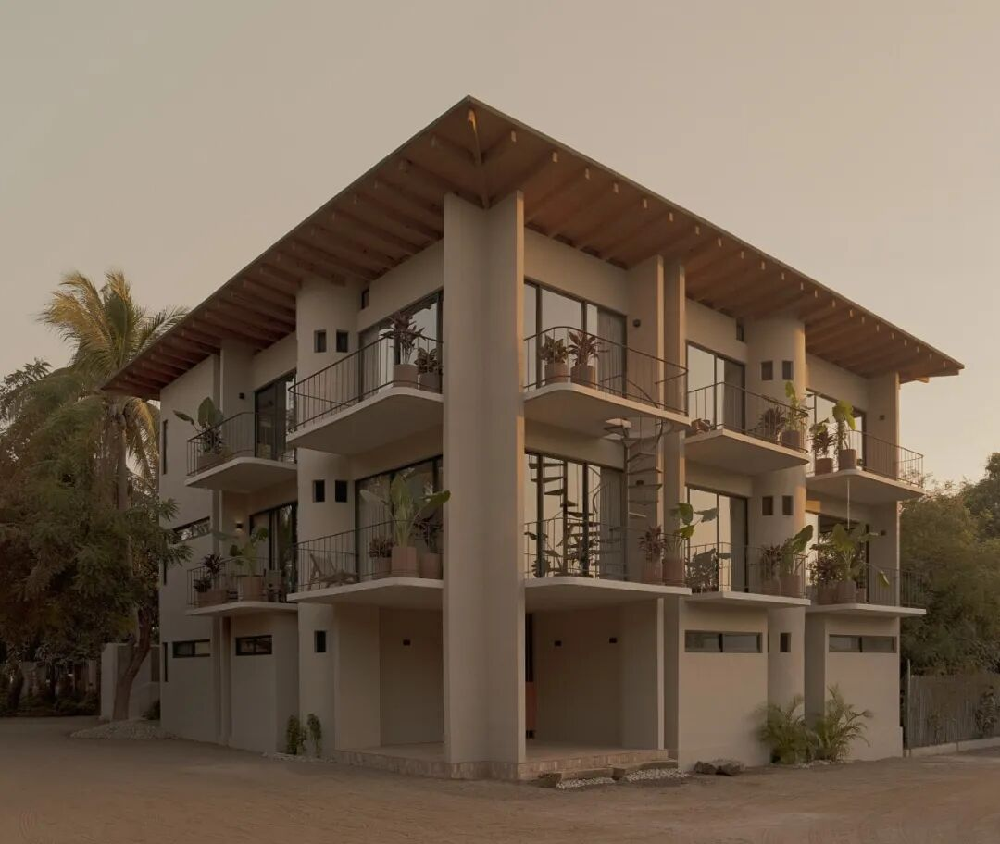
** 图 02｜  ** 黄昏时建筑转角、坡屋顶与通往屋顶观景平台的白色螺旋楼梯。 摄影：Zaickz Moz。
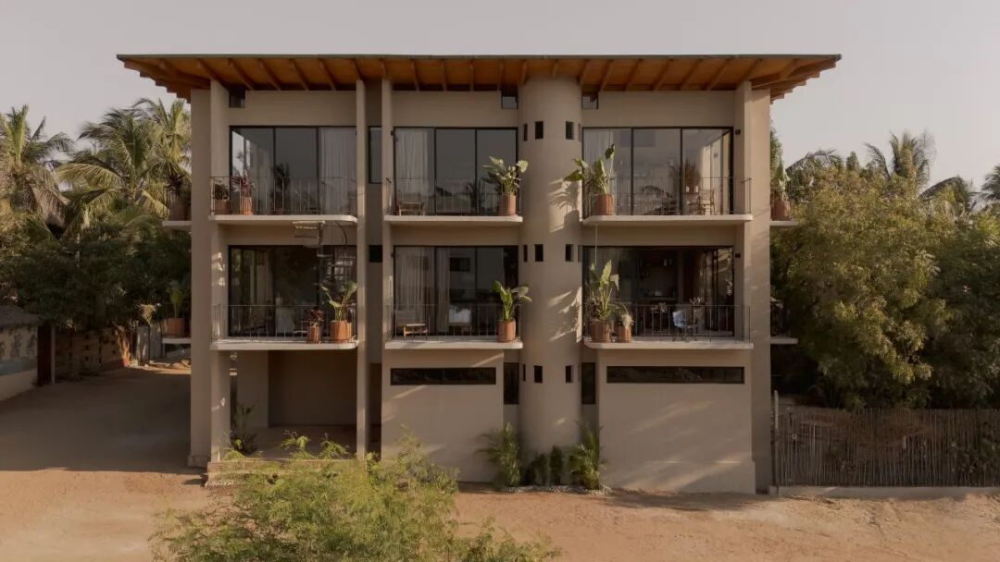
** 图 03｜  ** 三层住宅正立面；连续露台、盆栽植物与大面积推拉玻璃共同形成半户外生活界面。摄影：Zaickz Moz。
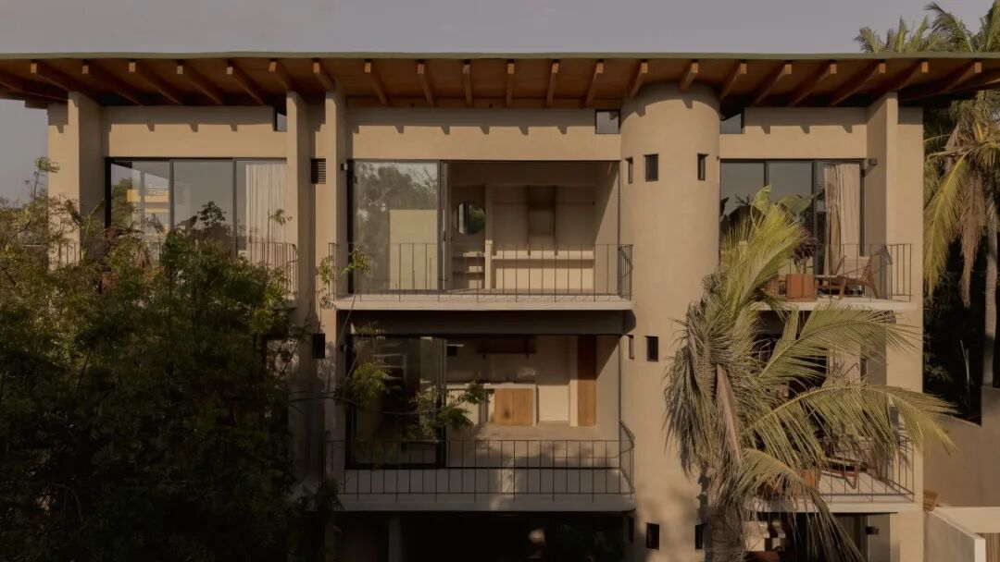
** 图 04｜  ** 建筑背立面与棕榈环境；露台、矮墙和深檐共同调节日照与私密性。 摄影：Zaickz Moz。
** 02  ** / A SQUARE WITHIN
##  一口中央天井，把11套住宅组织起来
Suuel Living的核心来自一张  ** 被完整方形限定的对称网格  **
。中央折板式现浇混凝土楼梯围绕方形挑空上升，形成整栋建筑最重要的公共空间。顶部天窗把自然光带到三层交通核心，黑色纤细钢栏杆在石灰抹灰墙面上投下不断变化的阴影。
规则几何在边缘被有意识地松动：圆角阳台、弧形卫生间隔墙与转角圆筒形交通体形成局部偏差；白色外置螺旋楼梯进一步把动线延伸至屋顶观景点。严谨的方形框架与这些曲线元素共同维持空间的秩序和身体感。
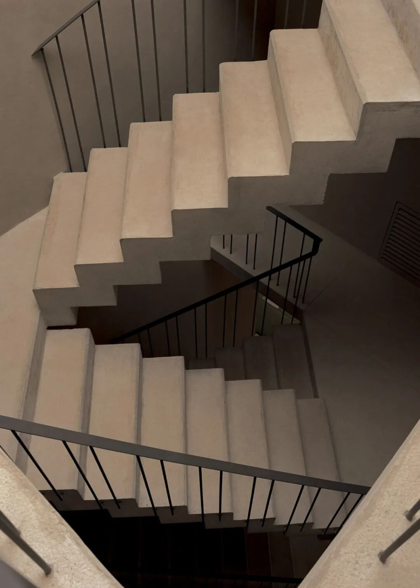
** 图 13｜  ** 从上方俯瞰中央折板混凝土楼梯；方形天井把自然光引入三层交通核心。  摄影：Zaickz Moz。
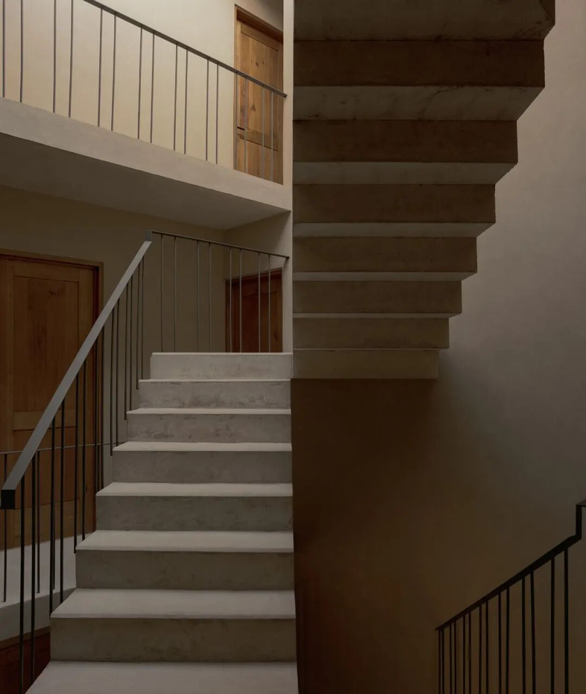
** 图 14｜  ** 中央楼梯核心与木质户门；垂直挑空承担到达、识别和自然采光。  摄影：Zaickz Moz。
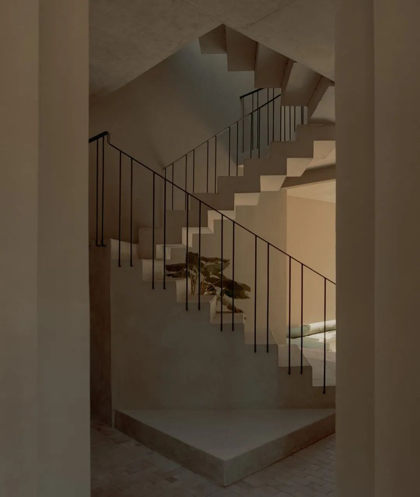
** 图 15｜  ** 中央混凝土楼梯、黑色钢栏杆与盆栽植物，光影强化了公共交通空间的纵深。  摄影：Zaickz Moz。
** 03  ** / TERRACES AS ROOMS
##  每套住宅都有露台，室内永远能看见户外
11套住宅按照垂直层级分布：首层包含  ** 3套公寓  ** 与连接水池的公共休息区；二层设置  ** 5套公寓  ** ；三层再布置  ** 3套住宅
** ，其中包含可通过私人螺旋梯进入夹层的双层挑高户型。户型从一居室开间、两居套房到loft保持差异化。
** 所有单元都拥有露台。  **
大面积推拉玻璃让起居空间直接打开，纱帘过滤强光并保留一定私密性；细钢栏杆降低视觉阻隔，热带盆栽进一步加厚住宅与棕榈景观之间的过渡层。
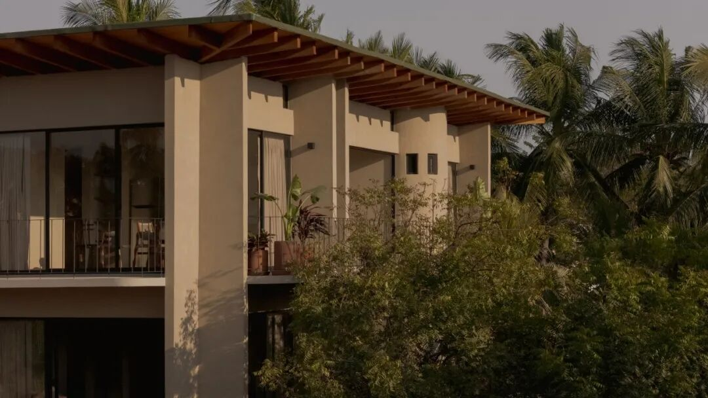
** 图 06｜  ** 顶层露台与裸露松木椽条；深檐覆盖玻璃开口，为室内提供遮阳。  摄影：Zaickz Moz。
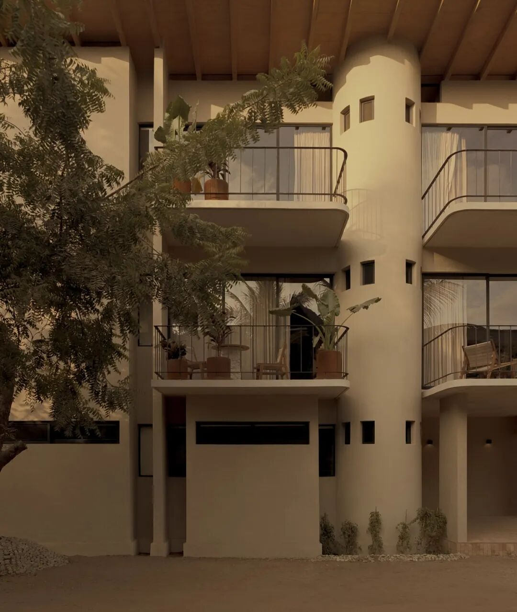
** 图 07｜  ** 转角圆筒形交通体与悬挑露台；圆形构件打破整体方形秩序。  摄影：Zaickz Moz。
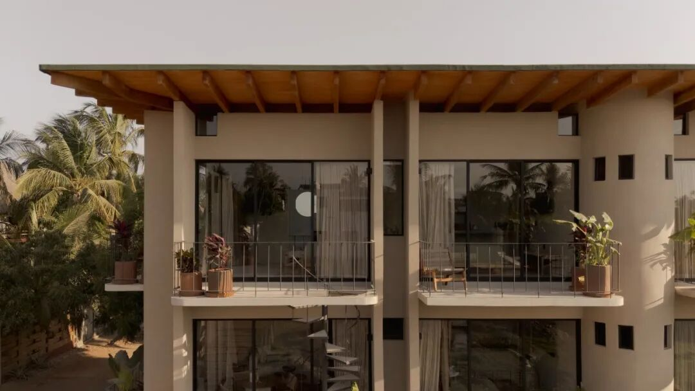
** 图 08｜  ** 立面细部：玻璃露台、陶土花盆、纤细栏杆和螺旋楼梯共同弱化体量边界。  摄影：Zaickz Moz。
** 04  ** / COMMON GROUND
##  公共生活被放低到地面，形成一处阴凉的共享客厅
首层公共区域通过混凝土坡道与宽踏步向下沉，利用高差与主要通行路径建立适度距离。一个被大开口框出的公共休息区直接朝向方形水池，视线越过室内坐席、砂砾、池水与植物，形成一条连续的横向空间轴线。
水池没有被处理成独立的度假符号，它更接近嵌入庭院的一块方形“空洞”。  ** 陶土红池沿  **
与浅色砂砾构成克制对比，也呼应整栋建筑中少量使用的暖色点缀。
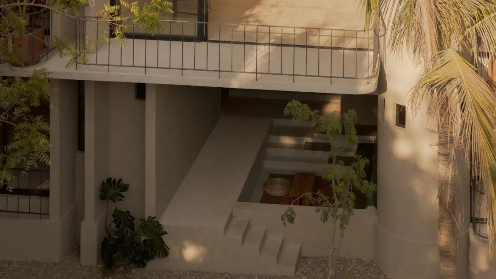
** 图 09｜  ** 首层混凝土坡道与宽踏步下降至下沉式公共区域，植物嵌入动线边缘。  摄影：Zaickz Moz。
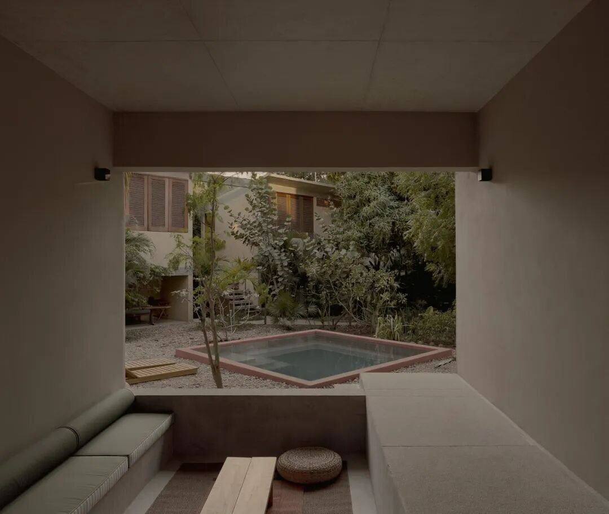
** 图 10｜  ** 下沉公共休息区朝向方形水池；大开口把室内公共空间直接连接到庭院。  摄影：Zaickz Moz。
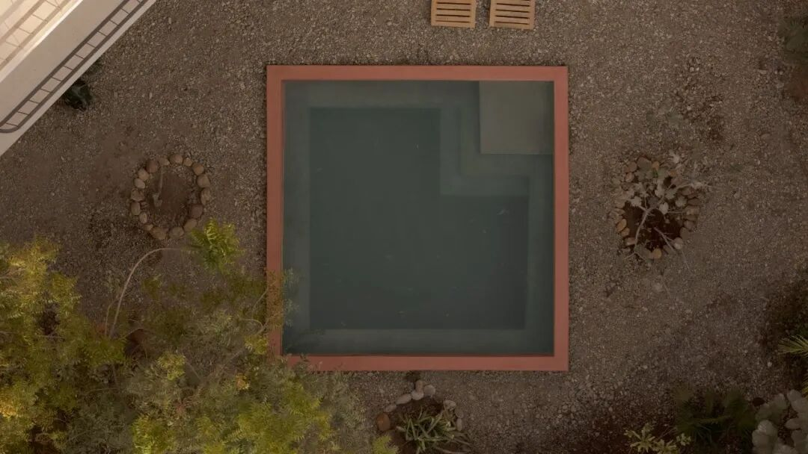
** 图 11｜  ** 从高处俯看方形水池、陶土色池沿与砂砾庭院，几何秩序延伸至室外。  摄影：Zaickz Moz。
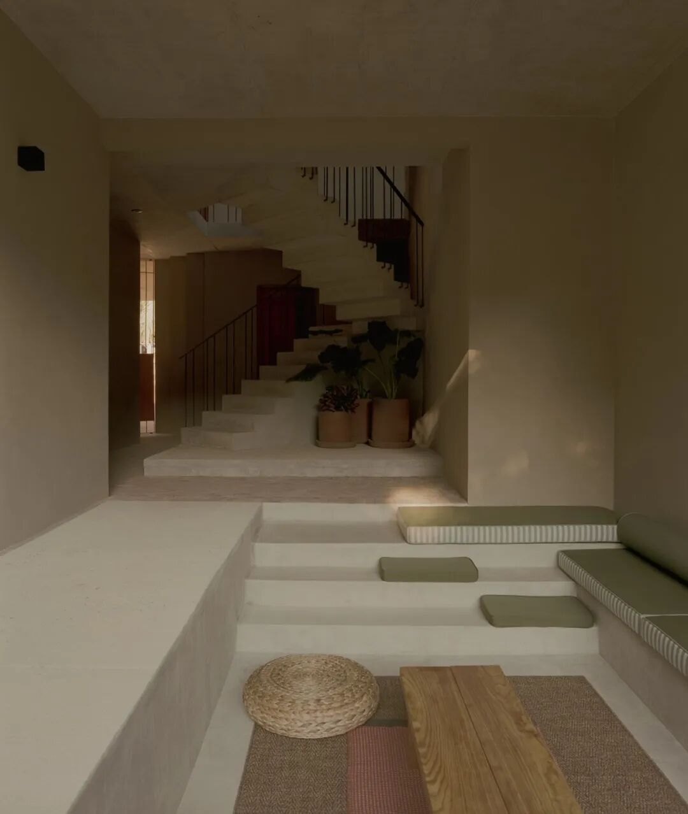
** 图 12｜  ** 入口大厅中的现浇混凝土坐阶、楼梯与天然纤维织物，形成粗粝与柔软并置的材料氛围。  摄影：Zaickz Moz。
** 05  ** / SHADE AIR MATERIAL
##  深檐、石灰墙与木屋架，共同回应热带海岸气候
材料体系被压缩在少数几种构造之内：  ** 手工石灰抹灰、清水混凝土、原木松材、浅色抛光混凝土、黑色钢材、陶土与橄榄绿色屋面  **
。材料之间依靠质地、阴影和色温变化建立层次，避免额外装饰。
四坡屋顶的深檐覆盖四个立面，为全高玻璃和露台板提供遮阳；裸露松木椽条让屋顶从一张薄平面转变为有厚度的构造层。中央屋面开口与楼梯天井在垂直方向对齐，使最深处的公共核心仍能获得自然光。
建筑的气候策略并不依赖夸张装置，而通过  ** 遮阳、开放露台、中央通风采光核心和可完全打开的玻璃界面  ** 共同形成日常舒适度。
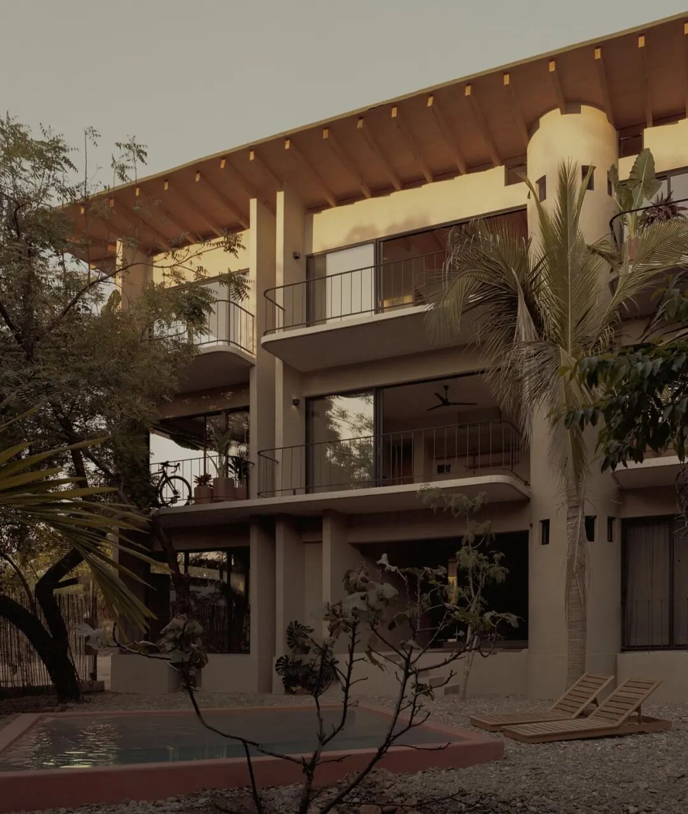
** 图 05｜  ** 首层公共区域与方形水池；砂砾庭院、陶土色池沿和宽檐形成松弛的海岸生活场景。  摄影：Zaickz Moz。
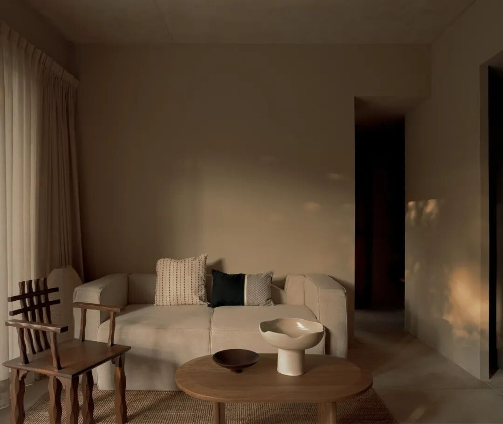
** 图 16｜  ** 公寓起居空间采用石灰抹灰墙面、木质家具与浅色地面，室内色调延续建筑的克制材料体系。  摄影：Zaickz Moz。
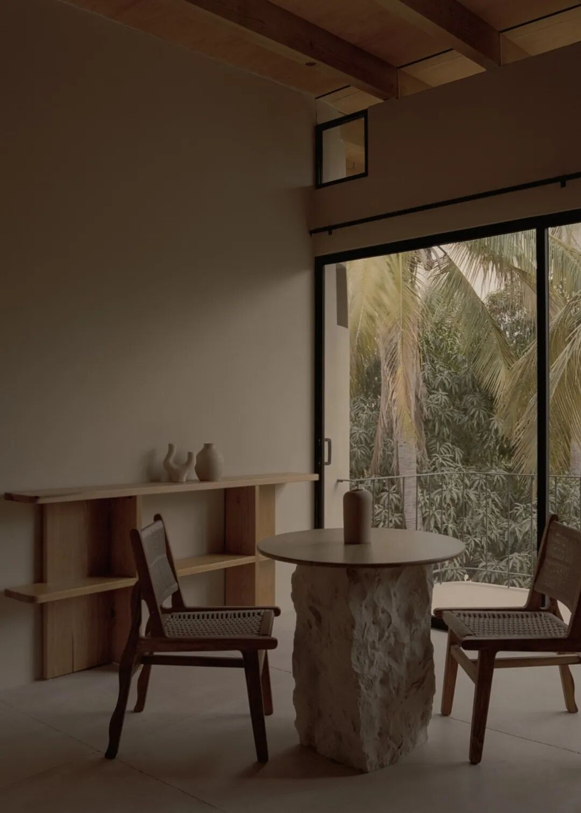
** 图 17｜  ** 顶层双层挑高公寓暴露木屋架，室内通过大开口直接获得棕榈树冠视野。  摄影：Zaickz Moz。
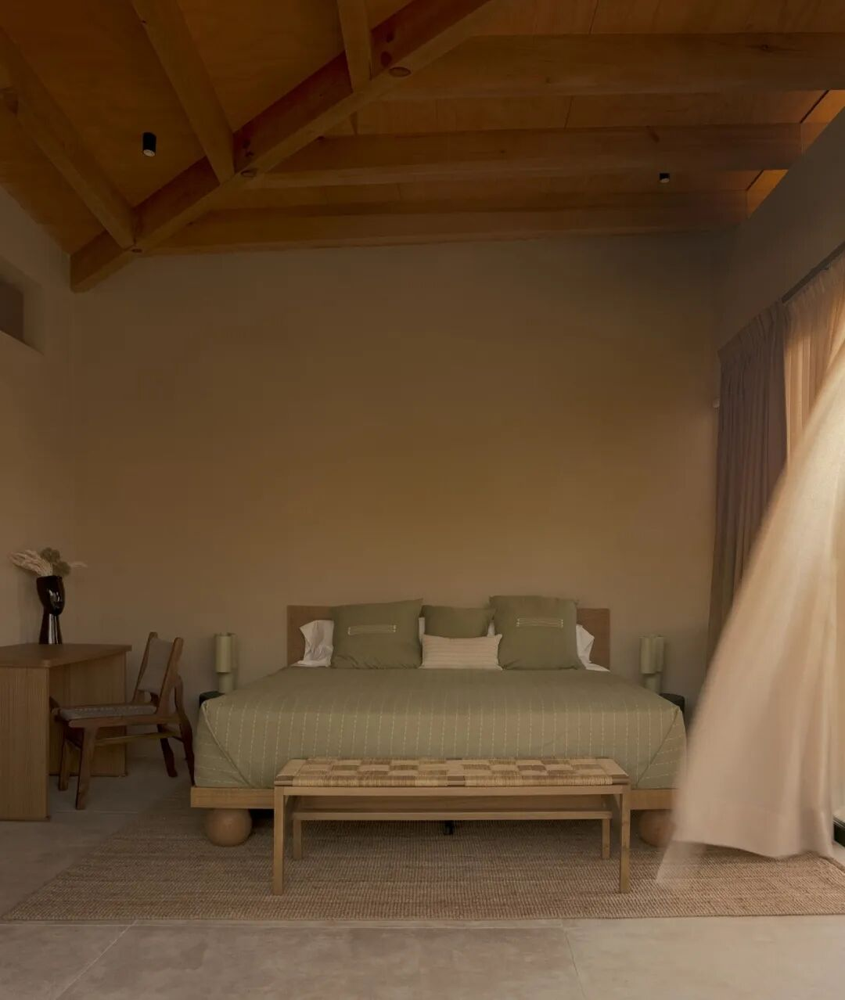
** 图 18｜  ** 卧室位于坡屋顶之下，木构天花、亚麻织物与编织家具构成柔和的居住氛围。  摄影：Zaickz Moz。
PROJECT INFO
** 项目：  ** Suuel Living
** 建筑设计：  ** CAAM Arquitectos
** 主创建筑师：  ** Camilo Moreno Oliveros、Daniel Moreno Ahuja
** 地点：  ** Puerto Escondido, Oaxaca, Mexico
** 年份：  ** 2026
** 场地面积：  ** 约298.5㎡
** 建筑面积：  ** 719.5㎡
** 住宅数量：  ** 11套
** 施工：  ** CIMERA
** 摄影：  ** Zaickz Moz
