# 幼儿园还能这样设计？南非人把幼儿园做成了一座微型城市

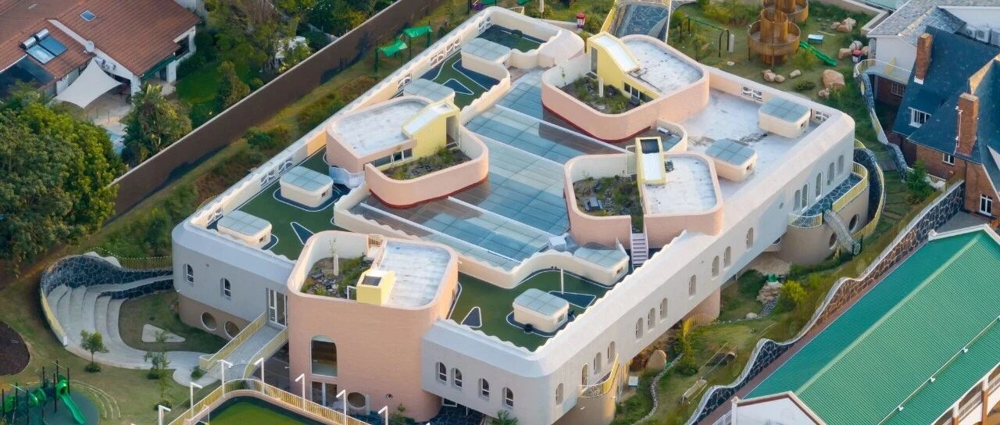

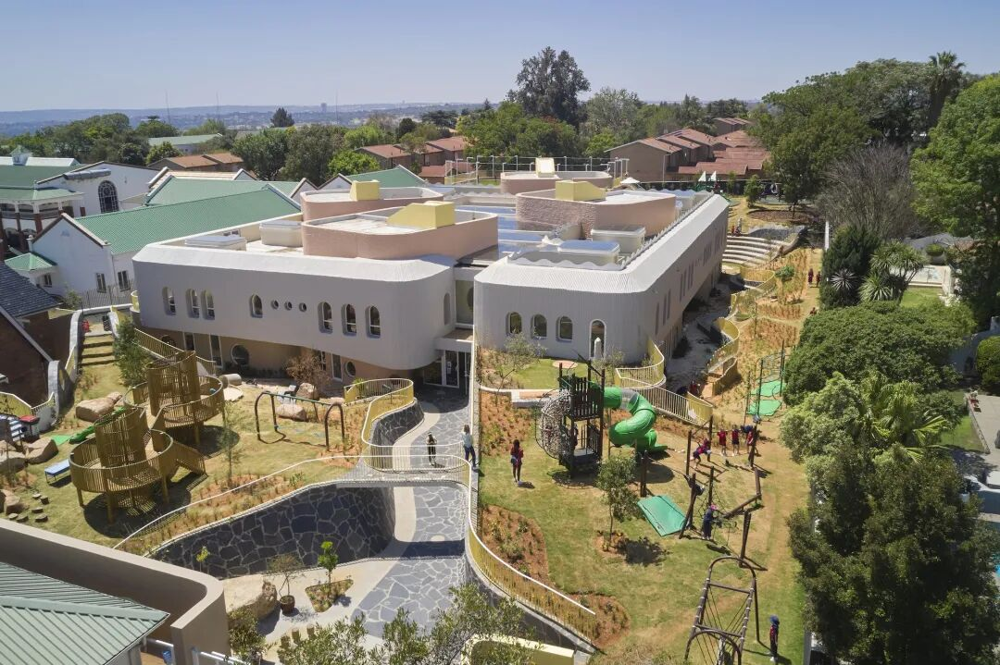
ARCHITECTURE / LEARNING
#  把校园建成儿童小城：南非这座2641㎡早教中心，楼梯、广场和花园都能上课
REDHILL EARLY LEARNING CENTRE
一棵树长在玻璃顶下，宽台阶连接着上下两层，圆窗后面还能看见另一间活动室。南非约翰内斯堡（Johannesburg）的  红山早期学习中心（Redhill
Early Learning Centre）  ，  ** 把教室之间的路程变成了可以停留、观察和玩耍的空间  ** 。
这座由  Hubo Studio
设计的校园于可容纳最多370名3至7岁儿童。16个班级活动基地围绕四座跨层工作坊展开，中央广场将它们联系起来。走出教室，学习仍在楼梯、窗边、厨房和花园中继续。
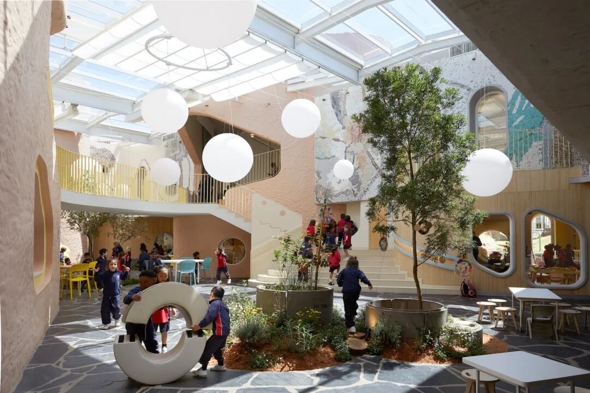
图 01｜玻璃顶下的中央广场、树木与跨层楼梯。图片来源：Hubo Studio。摄影：Elsa Young Photography。
** 01  ** / A CITY FOR CHILDREN
##  四座小塔，围起一处广场
建筑从四周的住宅和树木中露出低矮、起伏的轮廓。四组体量围绕中央空间布置，粉陶色与浅色外墙区分出不同部分；圆角、拱窗和不规则开口进一步弱化了成排教室的重复感。从上方看，它更接近一组彼此相连的小建筑。
设计的出发点来自  瑞吉欧教育法（Reggio Emilia Approach）
。团队赴意大利研究这种以儿童探索为中心的教育方式，再结合南非的教学与生活语境展开设计。教室之外的环境同样承担教学作用，孩子可以通过接触材料、制作物品与彼此交流，逐步形成自己的理解。
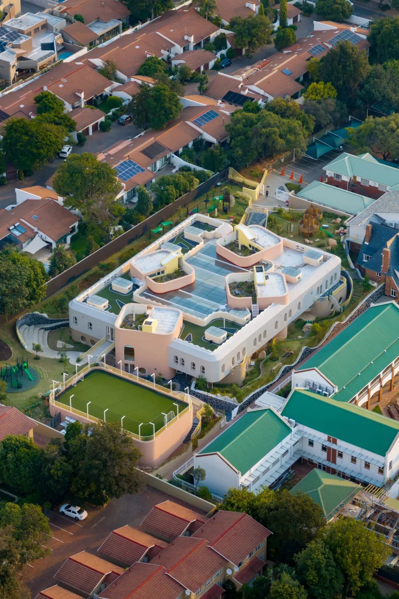
图 02｜校园及其周边住宅街区的鸟瞰。图片来源：Hubo Studio。摄影：Iwan Baan。
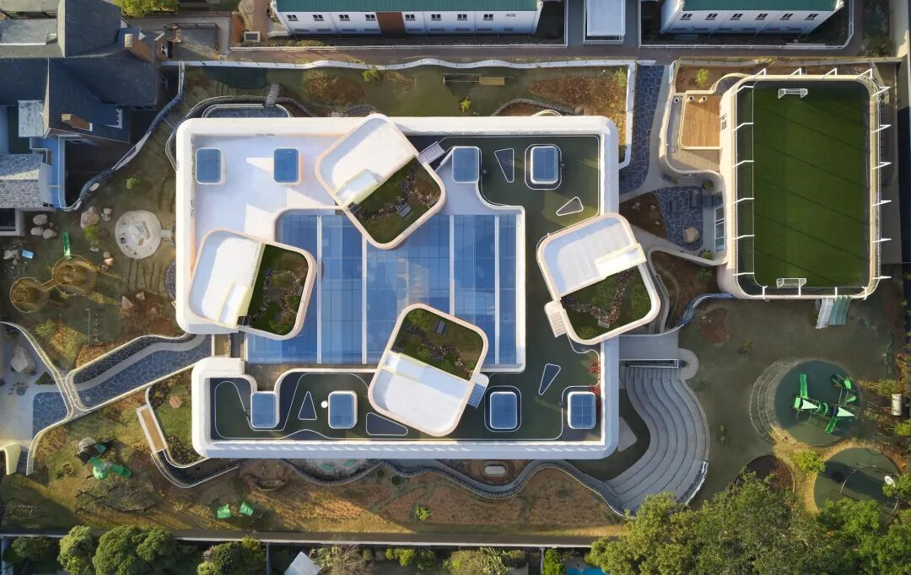
图 03｜俯瞰四组体量围绕中央广场的布局。图片来源：Hubo Studio。摄影：Elsa Young Photography。
中央广场（Piazza）为这组空间提供了共同的会合处。玻璃屋顶将日光引入建筑深处，树木、桌椅、台阶与周边开口共同构成一个可以被看见、也可以进入的活动中心。
** 上下两层的路径沿着广场展开  ** ，儿童能够看到对面的同伴以及楼下发生的事情。
16个班级活动基地（Homebases）保留了各班日常活动的起点，四座跨层工作坊（Ateliers）则提供共享的艺术、制作与探索空间。两者围绕广场联系起来，使单个班级有自己的停留位置，也能方便地参与更大范围的活动。

图 04｜底层平面图，图：Hubo Studio。

图 05｜上层平面图，图：Hubo Studio。
** 02  ** / STAIRS BECOME PLACES
##  楼梯上，也能坐下讲故事
跨层工作坊把不同高度的活动场所连接在一起。  ** 楼梯旁设有可停坐的台阶和滑梯  **
，较宽的落脚处可以容纳短暂停留。上下楼的动作因而拥有不同的节奏：连续行走的路线旁边，还留出了坐下、观看或与同伴交谈的位置。
不同年龄儿童的步速与独立活动能力并不相同。多条路径让移动可以分散进行，教师与儿童也能依据活动选择路线。广场、平台和开口之间保留了视线联系，组织集体活动时，空间的开放程度与教师观察儿童的需要被放在一起考虑。
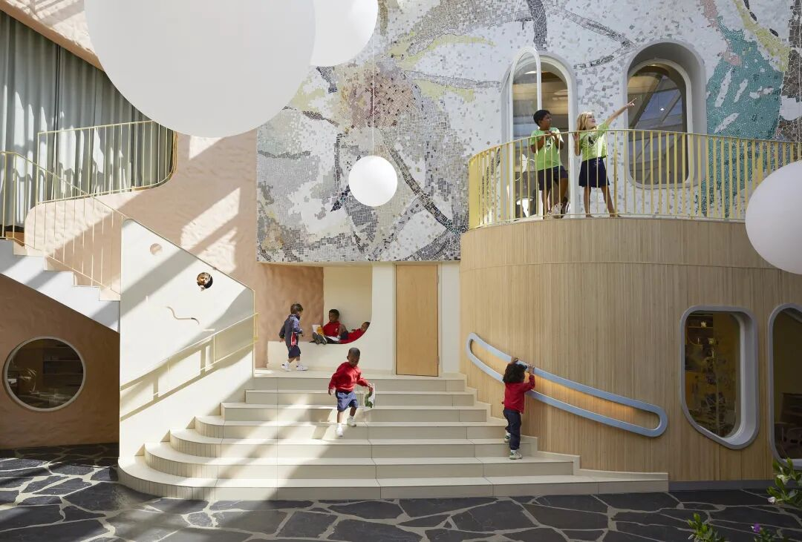
图 06｜宽台阶与扶手滑道并置的跨层连接。图片来源：Hubo Studio。摄影：Elsa Young Photography。
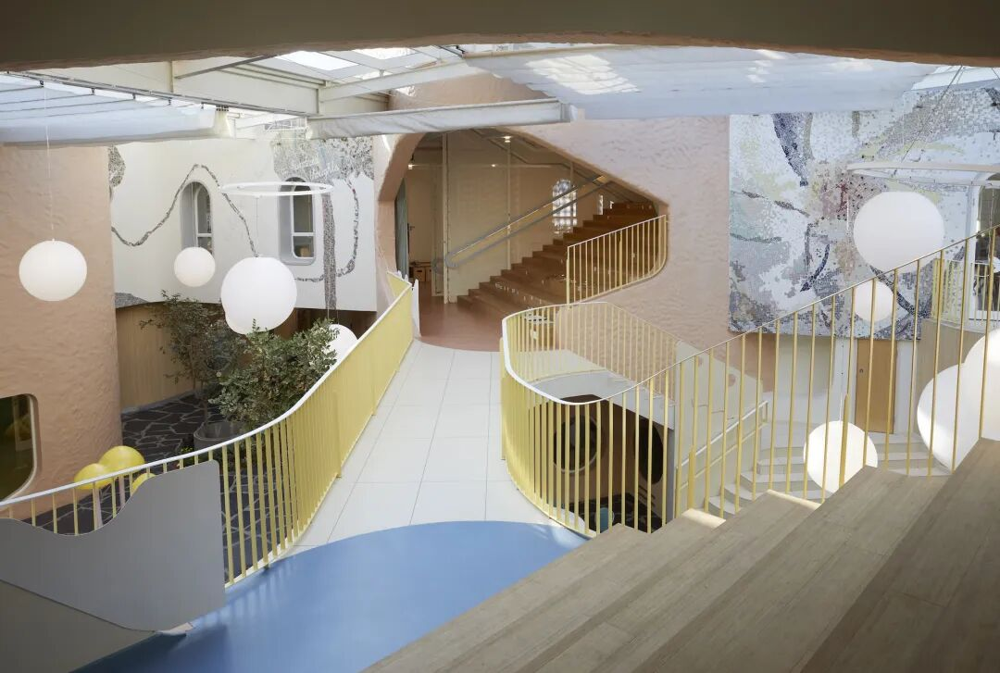
图 07｜楼梯平台、栏杆与上层活动空间相连。图片来源：Hubo Studio。摄影：Elsa Young Photography。
进入活动室，尺度随之收近。低位储物、适合小组围坐的桌面和墙上的圆形洞口，分别对应取放、制作与观察。部分开口靠近儿童的视线高度，穿过一个洞口，便能看见外部或隔壁的活动；墙体由此增加了相互观看的机会。
校园同时留有较暗、较安静的角落，供儿童暂时离开热闹的集体活动。开放区域、故事空间与退避处相邻，形成不同强度的环境。儿童从班级基地出发，可以逐步进入共享空间，也有机会在较小的范围内独处。
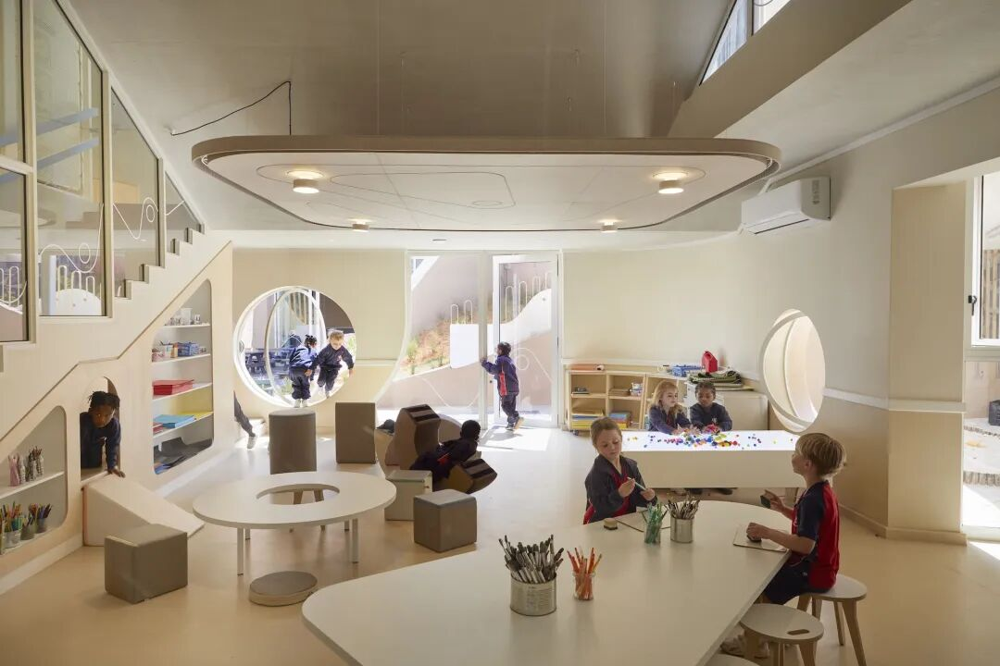
图 08｜工作坊中的圆形开口、低位储物与活动桌。图片来源：Hubo Studio。摄影：Elsa Young Photography。
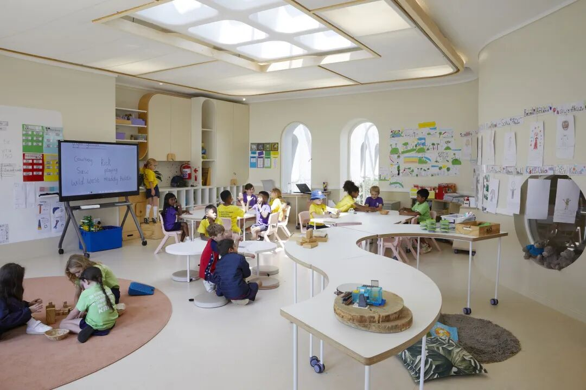
图 09｜儿童围绕活动桌展开的教室空间。图片来源：Hubo Studio。摄影：Elsa Young Photography。
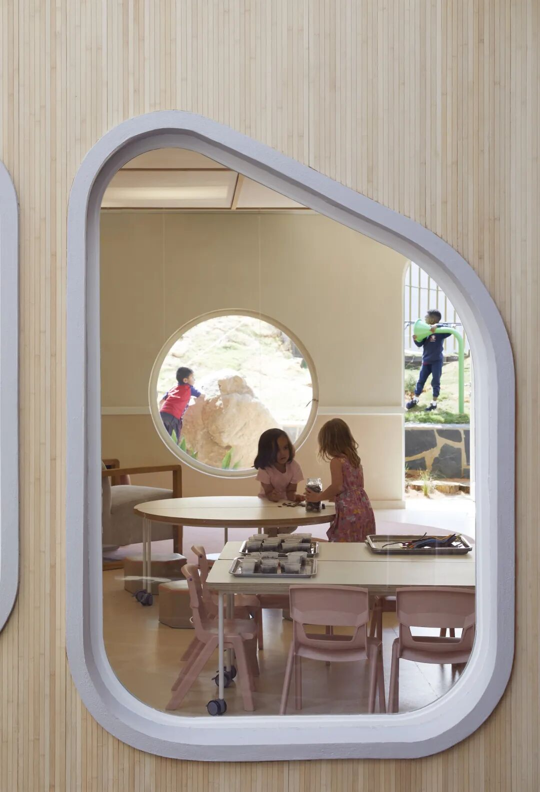
图 10｜窗洞与相邻空间之间的视线联系。图片来源：Hubo Studio。摄影：Elsa Young Photography。
** 03  ** / TEXTURES INVITE EXPLORATION
##  窗洞、马赛克与可以画的墙
颜色被用于辨认不同工作坊，从地面、墙面延续到家具和部分构件。各组空间的窗形也有所区别。在一个拥有多条路径的校园里，这些反复出现的颜色和轮廓，给儿童提供了容易识别的位置线索。
广场墙上的马赛克由艺术家乌莎·西贾里姆（Usha Seejarim）创作，  ** 儿童参与了其中的制作  **
。细碎色块铺成大面积图案，与开口、台阶和栏杆相互穿插。孩子的作品进入了日常经过的公共空间，墙面也成为展示学习过程的一部分。
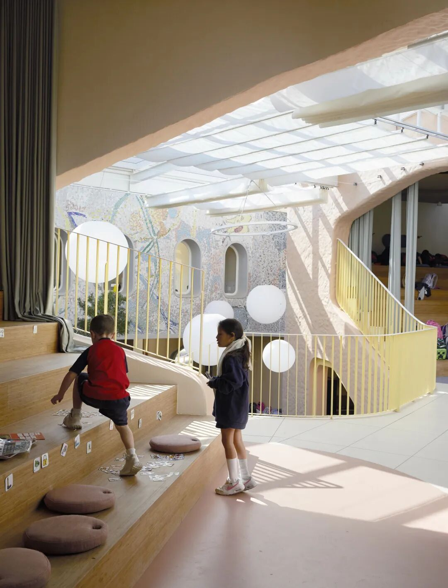
图 11｜沿广场设置的可坐台阶与种植区。图片来源：Hubo Studio。摄影：Elsa Young Photography。
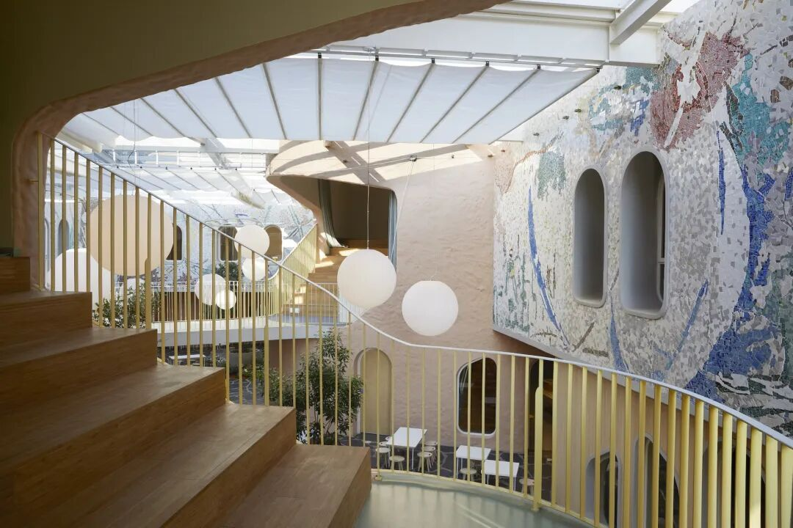
图 12｜由上层路径望向广场及对面的马赛克墙。图片来源：Hubo Studio。摄影：Elsa Young Photography。
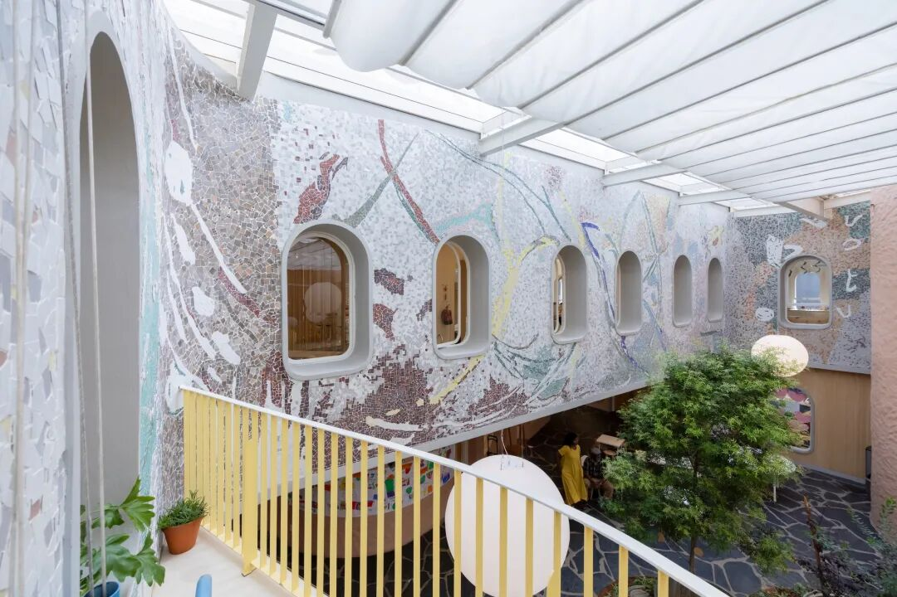
图 13｜马赛克墙、窗洞与黄色栏杆的近景。图片来源：Hubo Studio。摄影：Iwan Baan。
厨房面向共同活动区域开放，烹饪、食物准备和实验进入校园日常。连续的操作台、储物与窗洞把这类活动安排在具体可用的位置；围绕食物展开的观察和动手实践，可以与教室内的制作课程相互衔接。
板岩用于地面和部分墙面，并作为儿童日常涂画的表面；竹材、玻璃、钢材、瓷砖与亚麻地板则形成不同的触感和光线反应。外墙的细密凹凸通过定制抹灰工具制作，纹理灵感来自儿童游戏使用的瓦楞纸板。
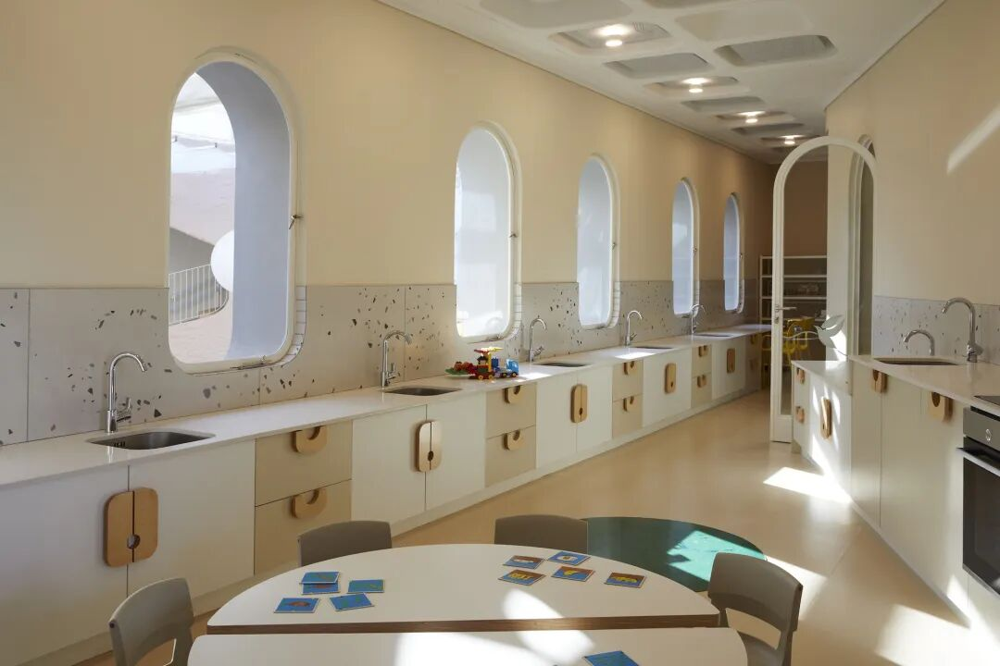
图 14｜沿连续窗洞布置的厨房操作区。图片来源：Hubo Studio。摄影：Elsa Young Photography。
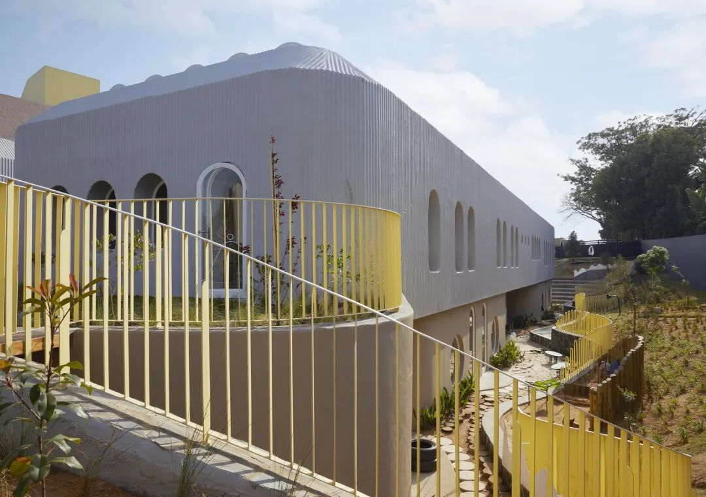
图 15｜带竖向纹理的外墙与室外高差。图片来源：Hubo Studio。摄影：Elsa Young Photography。
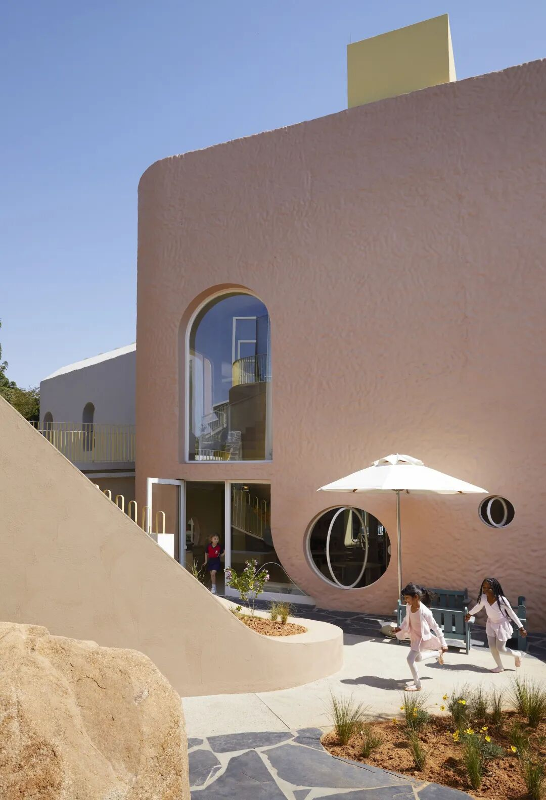
图 16｜粉陶色体量、圆窗与种植景观。图片来源：Hubo Studio。摄影：Elsa Young Photography。
** 04  ** / LESS AREA MORE CONNECTION
##  少建一些，把活动延伸到花园
早期方案面积为4500平方米，最终设计调整为2641平方米，减少约41%。  ** 共享工作坊和叠合的活动路径  **
，使一部分原本需要单独安排的空间可以共同使用。面积的压缩，与前面提到的广场、楼梯和活动基地属于同一套组织方式。
玻璃顶为中央区域提供自然采光，其下方的开口与教室通风构件共同支持空气流动。可收放的遮阳吸声篷调节屋顶下的光照，并用于改善开敞空间的声音环境。
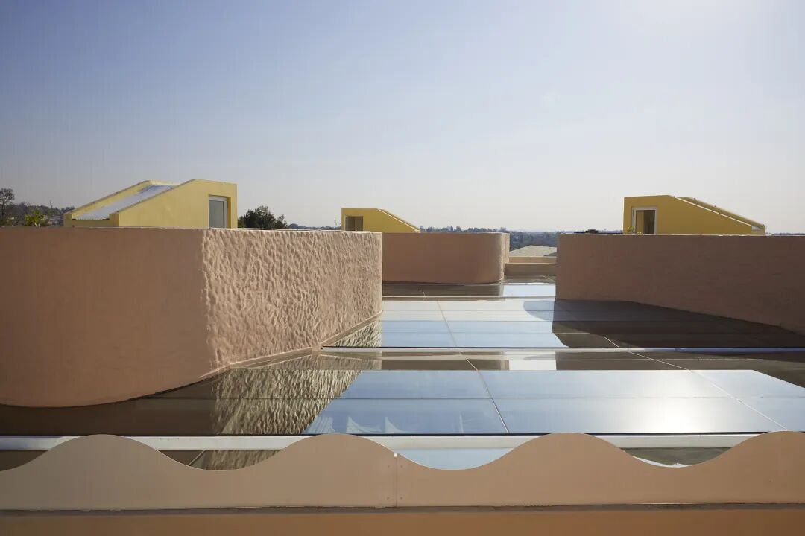
图 17｜屋面玻璃与体量顶部的关系。图片来源：Hubo Studio。摄影：Elsa Young Photography。
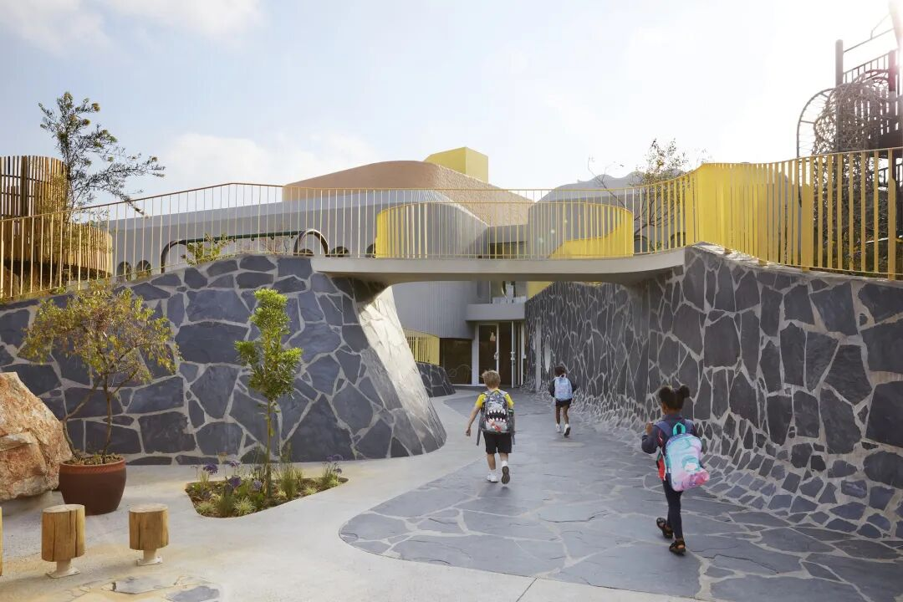
图 18｜由板岩墙体、坡道与栏杆围合的室外路径。图片来源：Hubo Studio。摄影：Elsa Young Photography。
室外空间沿建筑周边连续展开，草地、巨石、台阶和种植区组成不同的游戏场所。儿童可以沿高差移动，也能在相对平坦的位置停下。曲折边界让部分区域靠近建筑，另一些则伸入花园，室内外活动之间留有多个转换位置。
屋顶花园、渗水设施与种植游戏区共同参与雨水处理，并把学习活动延伸到景观之中。草木、泥土与石块提供了可观察和收集的对象，再被带回工作坊继续研究。
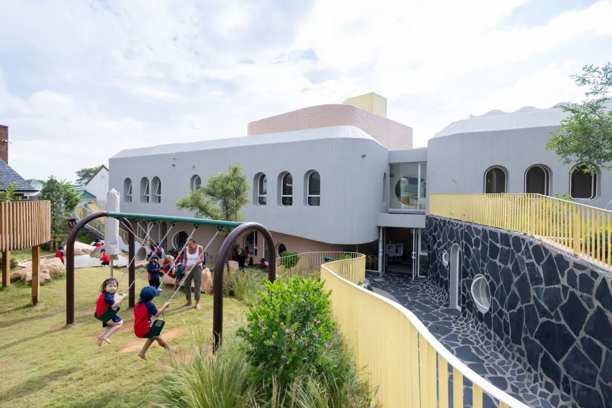
图 19｜沿建筑外侧展开的草地与活动设施。图片来源：Hubo Studio。摄影：Iwan Baan。
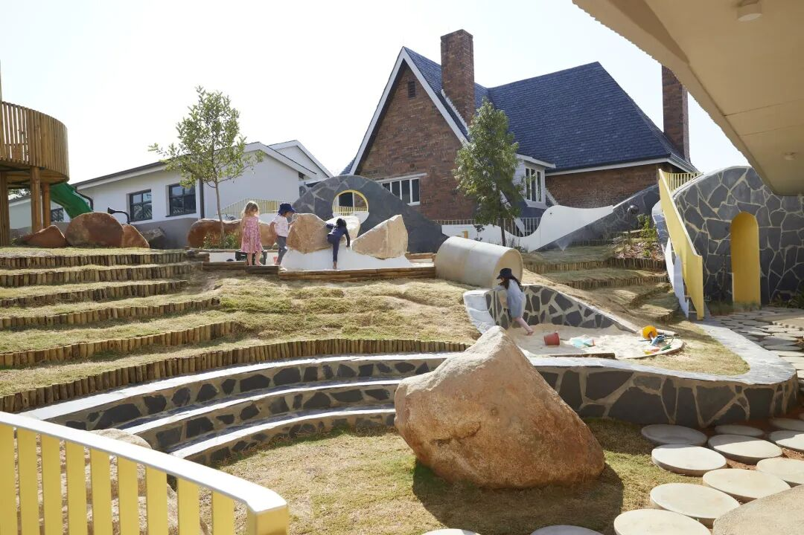
图 20｜地形台阶、巨石与游戏路径。图片来源：Hubo Studio。摄影：Elsa Young Photography。
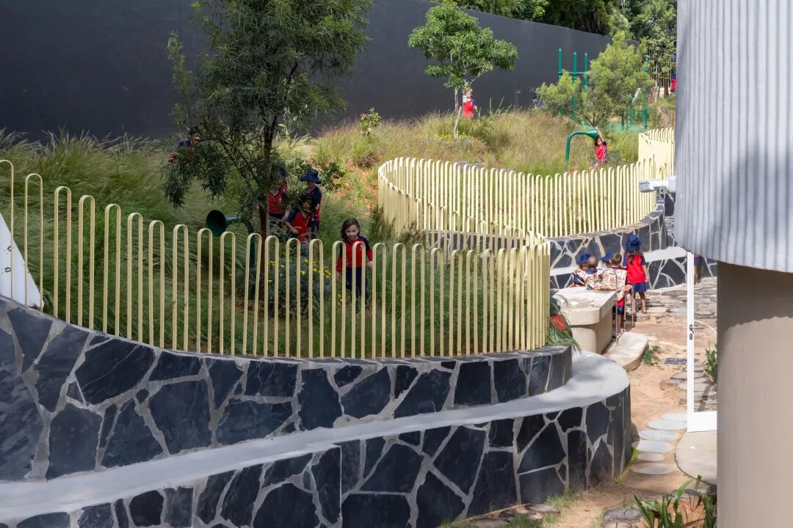
图 21｜屋顶绿化边缘及其与下层路径的关系。图片来源：Hubo Studio。摄影：Iwan Baan。
入夜后，从上空仍能辨认出中央空间与四周体量的联系。白天分散在教室、平台与花园中的活动，被同一组路径串起；校园的整体形象，也来自这些尺度不大的场所如何相邻、相通。
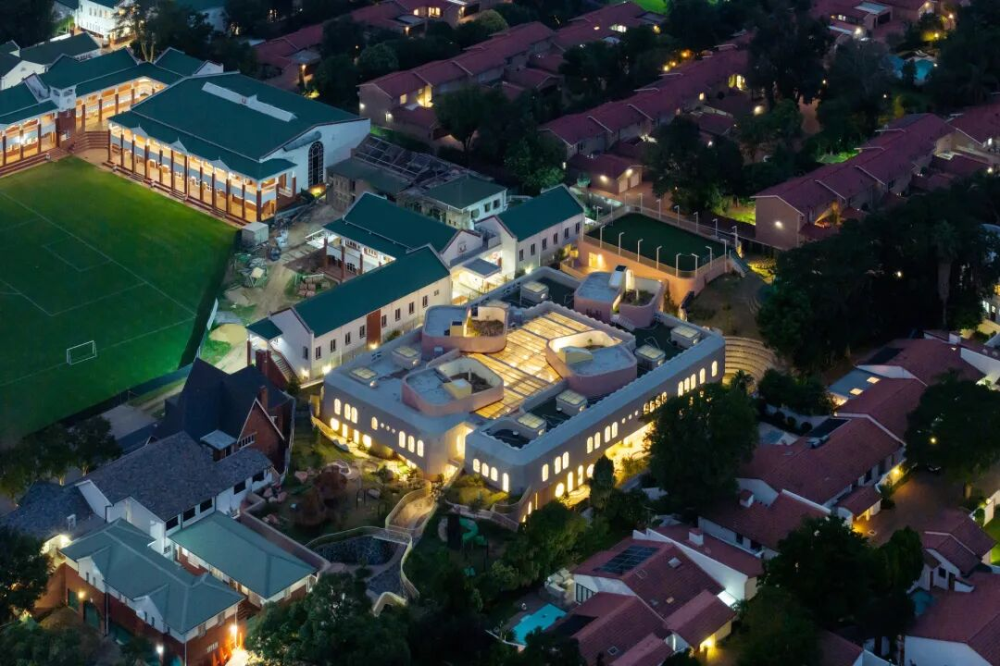
图 22｜夜间鸟瞰下的学习中心与既有校园。图片来源：Hubo Studio。摄影：Iwan Baan。
##  项目档案
** 项目  ** 红山早期学习中心 / Redhill Early Learning Centre
** 地点  ** 南非，约翰内斯堡桑顿
** 建筑面积  ** 2641㎡
** 完成 / 投入使用  ** 2024年 / 2024年9月
** 设计容量  ** 最多370名3—7岁儿童
** 空间组织  ** 16个班级活动基地、4个跨层工作坊
** 设计  ** Hubo Studio
** 主创建筑师  ** 阿舍·马库斯（Asher Marcus）、米歇尔·史密斯（Michelle Smith）
** 业主  ** 红山学校（Redhill School）
** 摄影  ** Elsa Young Photography、Iwan Baan
##  参考资料
1\. ArchDaily｜Redhill Early Learning Centre / Hubo Studio
2\. Hubo Studio｜The Early Learning Centre
3\. Redhill School｜Centre & Facilities
4\. Building & Decor｜Challenging the status quo of school design
