# 为什么这栋墨西哥住宅看起来像没设计完？因为真正的主角是那片空白

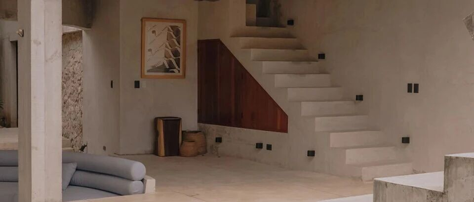

ARCHITECTURE / HOUSE
#  先画“空”，再盖房：梅里达这座250㎡住宅，把花园变成了真正的客厅
CASA SOSKIL · LUDWIG GODEFROY ARCHITECTURE · MÉRIDA, MEXICO
在墨西哥梅里达（  ** Mérida, Mexico  ** ），  ** Soskil住宅（Casa Soskil）  **
把一套常见的住宅设计顺序彻底倒置。  ** Ludwig Godefroy Architecture  **
先确定花园的“空”如何成立，再让房间、楼板与墙体围绕这片空白逐步就位。结果是一栋实体体量并不抢占中心的房子：既有树木、阴影、泳池和穿越花园的路径接管了首层生活，卧室则被安插在树冠之间。建筑在这里更像一套调节视线、光线与私密性的边界装置。
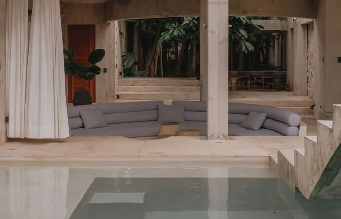
** 图 01｜  ** 泳池一侧的下沉式起居空间与贯穿前后花园的视线，水面、混凝土平台和树木共同构成住宅最开放的社交场所。 摄影：Fernando
Guerra。
** 01  ** / START FROM THE VOID
##  先设计“空”，再决定实体
建筑师用“negative space”概括这栋住宅的核心：  ** 花园不是建筑完成后留下的余地，它从一开始就被当作需要精确塑形的主空间。  **
设计围绕场地中的既有树木布置悬浮般的几何体量，以墙、楼板和开口控制邻里视线，同时保留足够大的缺口，让树冠、空气和人的活动在建筑之间连续穿行。
这种做法产生了一个很有意思的反差：室外依然是花园，却拥有接近室内的包裹感。视线被过滤，天空和树木被选择性框入，私密性不依赖封闭房间来完成。  **
住宅的边界因此变得厚、深，并且可以被穿越。  **
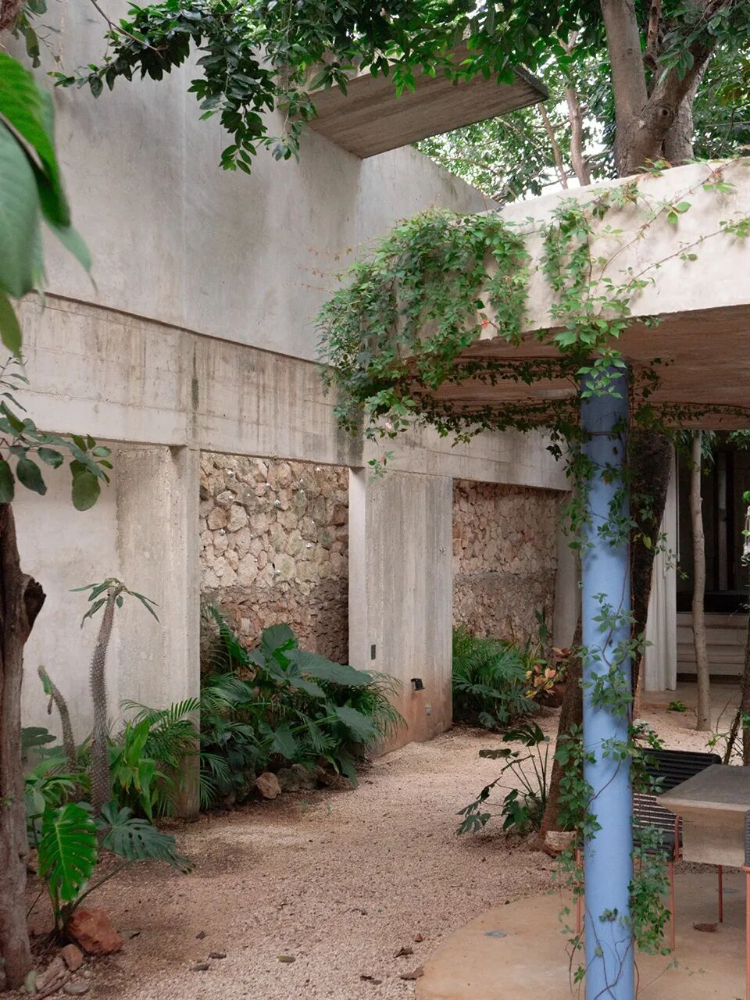
** 图 02｜  ** 中部花园被混凝土墙、粗石墙、既有树木与轻型廊架共同围合，建筑开口为植物生长留出连续空间。 摄影：Fernando Guerra。
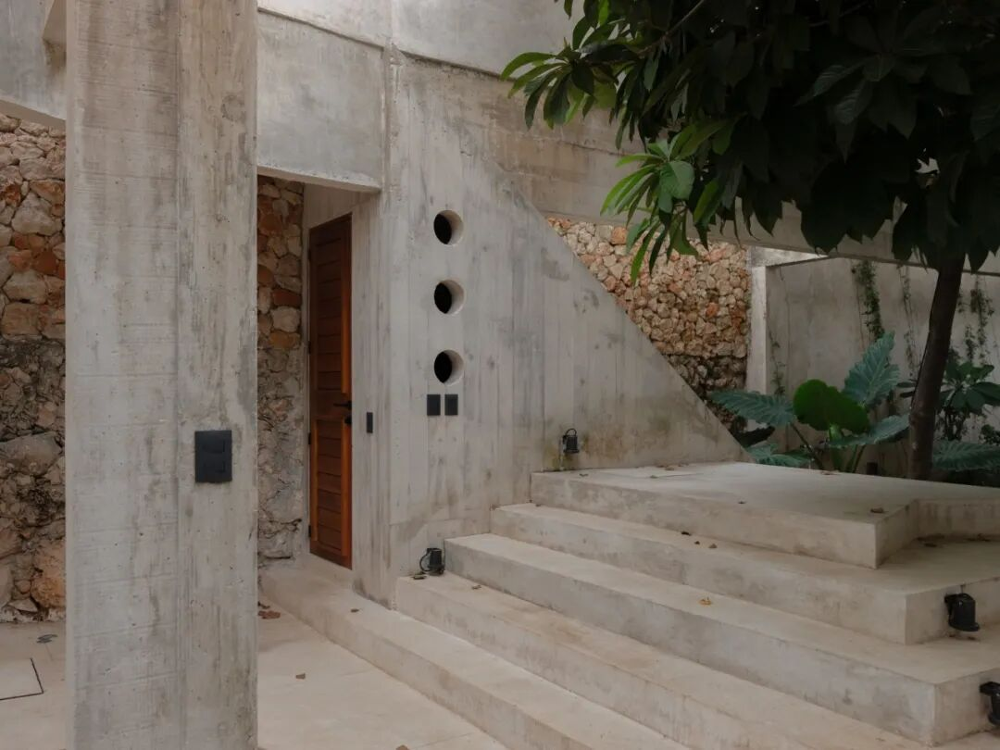
** 图 03｜  ** 入口区域以层层抬高的混凝土台阶穿过树荫，墙体开孔、木门与粗石界面形成克制的到达序列。 摄影：Fernando Guerra。
** 02  ** / TWO POLES OF LIGHT
##  光与影，成为平面组织的坐标
项目团队没有试图把基地的采光条件“平均化”。场地前部接受强烈直射光，后部已有树冠过滤日照，这两种天然状态被直接发展成两组生活重心：  **
前部是围绕泳池、露台与日光平台形成的活跃社交区；后部转入更阴凉的书房、躺卧休憩空间与火坑区域。  **
两端之间没有设置一条封闭走廊。连接它们的是穿行树木之间的花园路径。建筑师将这段花园称作住宅的“green
lung”。从空间结构看，它同时承担交通、景观、通风与日常停留，让“去另一个房间”变成一次经过树下、阴影和开放天空的短途步行。
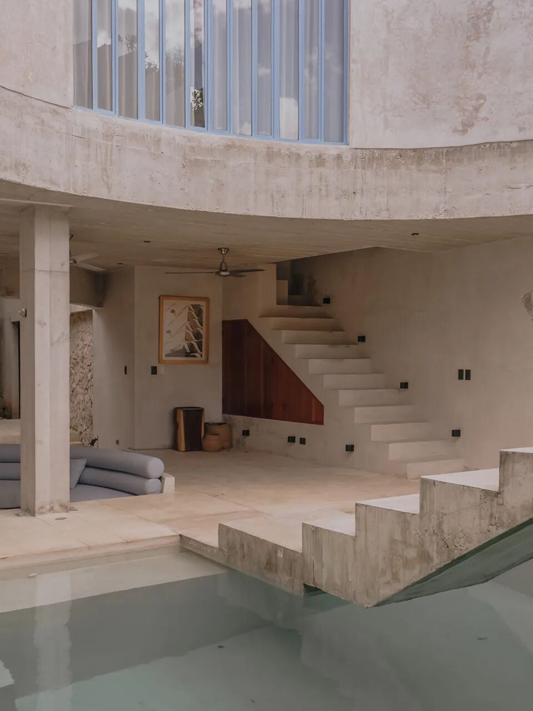
** 图 04｜  ** 泳池与首层生活空间相接，悬挑楼板、柱网和折线台阶共同界定“光之极点”的活动场景。 摄影：Fernando Guerra。
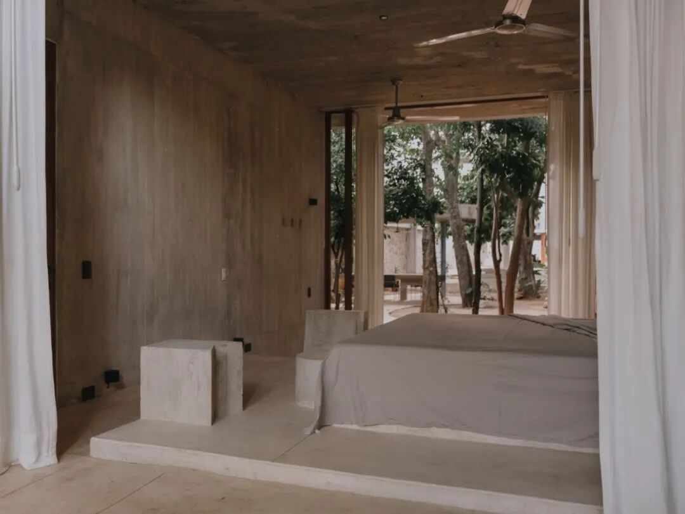
** 图 05｜  ** 较为阴凉的休憩空间面向树木打开，低矮床榻与深檐强化后部空间安静、松弛的氛围。 摄影：Fernando Guerra。
** 03  ** / GARDEN AS LIVING ROOM
##  首层，被组织成一整片开放的生活场
当公共功能被拆散到光、影和树木之间，传统意义上的“客厅”也失去一个固定房间的形态。从入口一直到场地后墙，  **
首层、花园以及每一棵既有树共同构成一个连续的开放生活区。  **
泳池边的下沉座席、廊下餐桌、树下路径和后部安静角落，都是这个大客厅里的不同家具与不同气候区。
木框门窗和帘幕在这里很关键。它们不承担厚重的实体分隔，更多用于微调开放程度：完全打开时，房间与花园接成一体；关闭后，仍可透过玻璃、圆洞或高窗保持与树木的视觉联系。
** “室内—室外”的二分关系被拆成一系列可以调节的过渡状态。  **
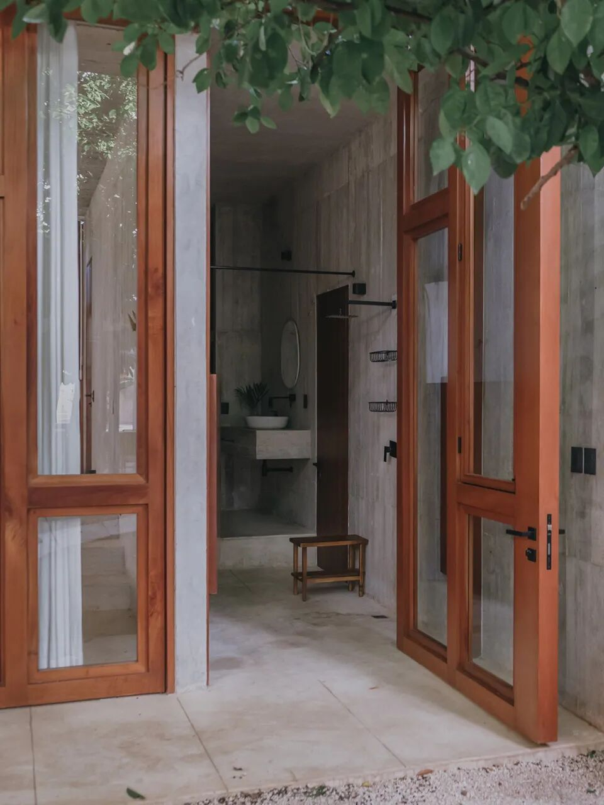
** 图 06｜  ** 木框玻璃门将卫浴与花园相连，门扇完全开启后，室内动线直接接入首层的开放花园系统。 摄影：Fernando Guerra。
** 04  ** / ROOMS AMONG TREES
##  卧室像“树屋”一样嵌入树冠之间
公共生活尽可能回到地面和花园后，卧室获得了更明确的私密性。项目方将这些房间形容为插入既有树木之间的“treehouses”。  **
厚重混凝土、窄高窗、连续高侧窗、木质框架与白色帘幕  ** 共同形成一种内向而不封闭的居住感。
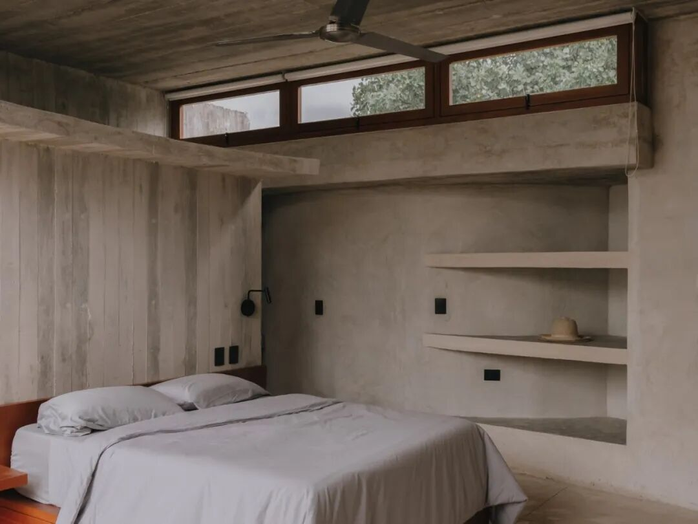
** 图 07｜  ** 卧室以内置搁板、连续高侧窗和清水混凝土构成安静背景，水平开窗把树冠光线引入室内。 摄影：Fernando Guerra。
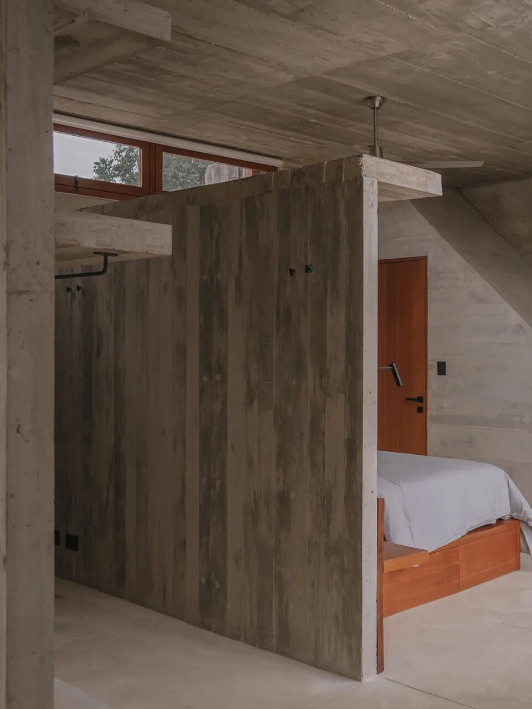
** 图 08｜  ** 卧室内部以厚重的混凝土隔墙切分睡眠与辅助空间，木质床架成为灰色基调中的少量暖色。 摄影：Fernando Guerra。
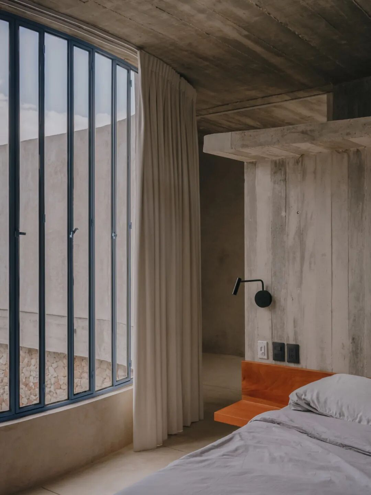
** 图 09｜  ** 卧室一侧采用高而窄的竖向窗扇，金属构件、白色织物与木质床头共同调节混凝土空间的尺度感。摄影：Fernando Guerra。
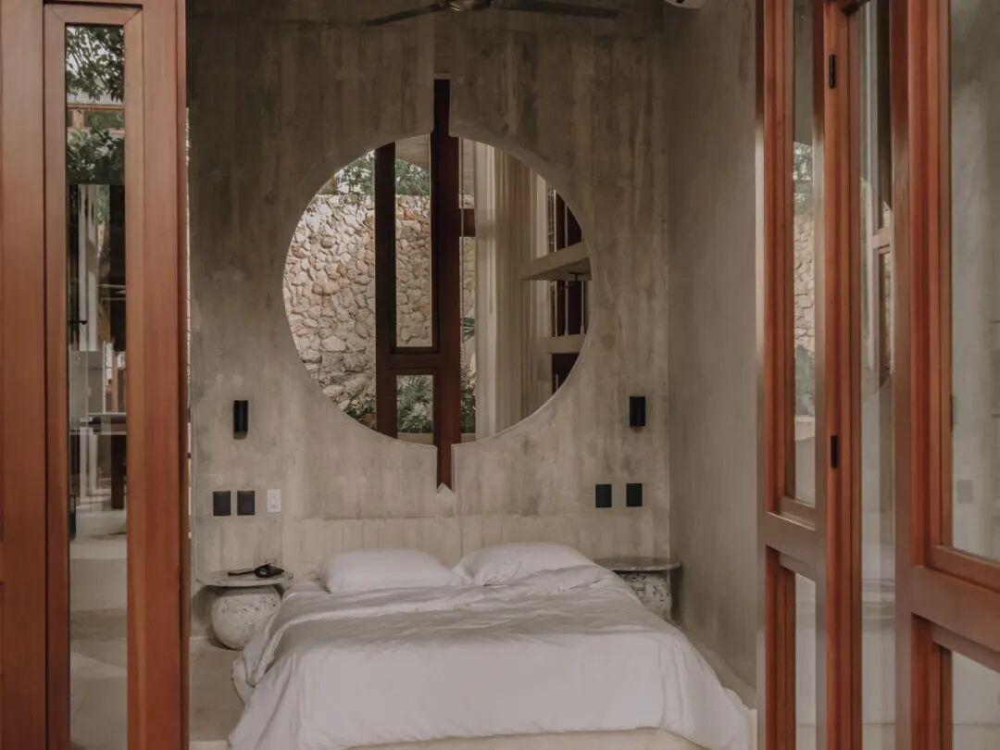
** 图 10｜  ** 圆形墙洞成为卧室最鲜明的取景框，视线穿过木窗、帘幕与石墙，再次落回花园。 摄影：Fernando Guerra。
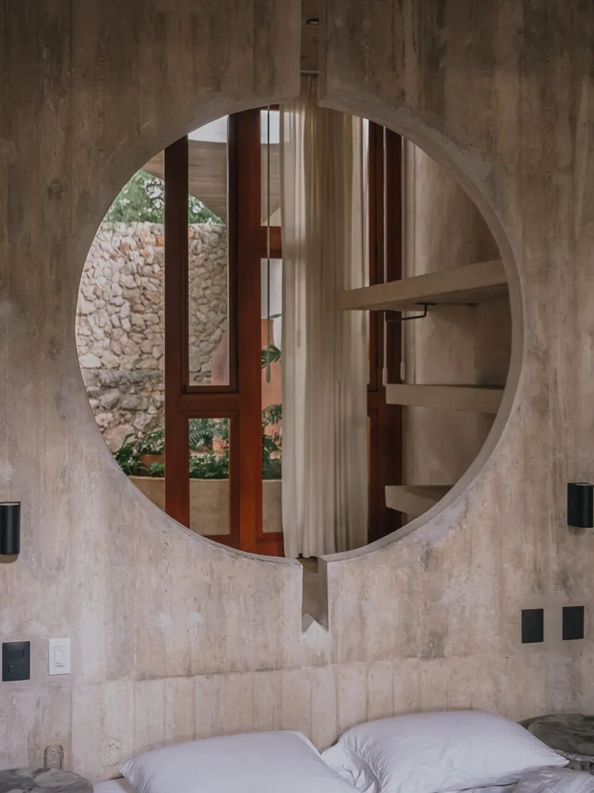
** 图 11｜  ** 圆形开口的近景显示墙体厚度与嵌入式搁板的关系，几何切口在私密空间中继续组织视线。 摄影：Fernando Guerra。
项目信息 / PROJECT INFO
** 项目：  ** Soskil住宅（Casa Soskil）
** 地点：  ** 墨西哥·梅里达（Mérida, Mexico）
** 建筑设计：  ** Ludwig Godefroy Architecture
** 主持建筑师：  ** 路德维希·戈德弗鲁瓦（Ludwig Godefroy）
** 面积：  ** 250㎡
** 年份：  ** 2025
###  参考资料
1\. Divisare：Ludwig Godefroy Architecture, Nicolas Rangel Ronquillo · Casa
Soskil
2\. ArchDaily：Soskil House / Ludwig Godefroy architect
3\. Archilovers：Casa Soskil | Ludwig Godefroy Architecture
