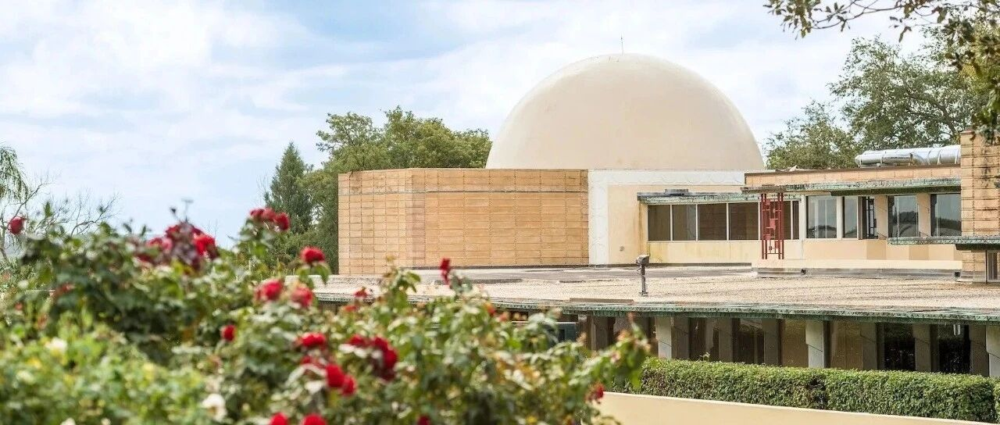
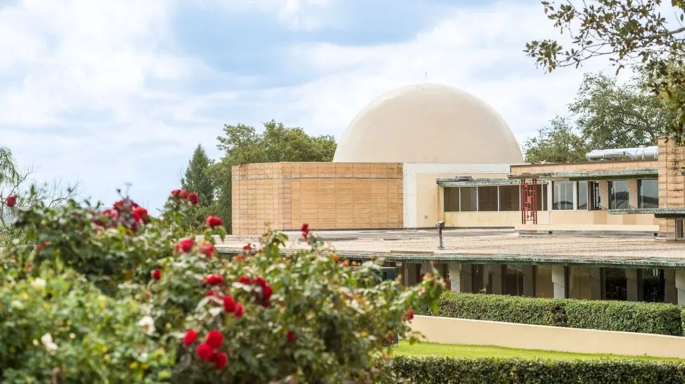
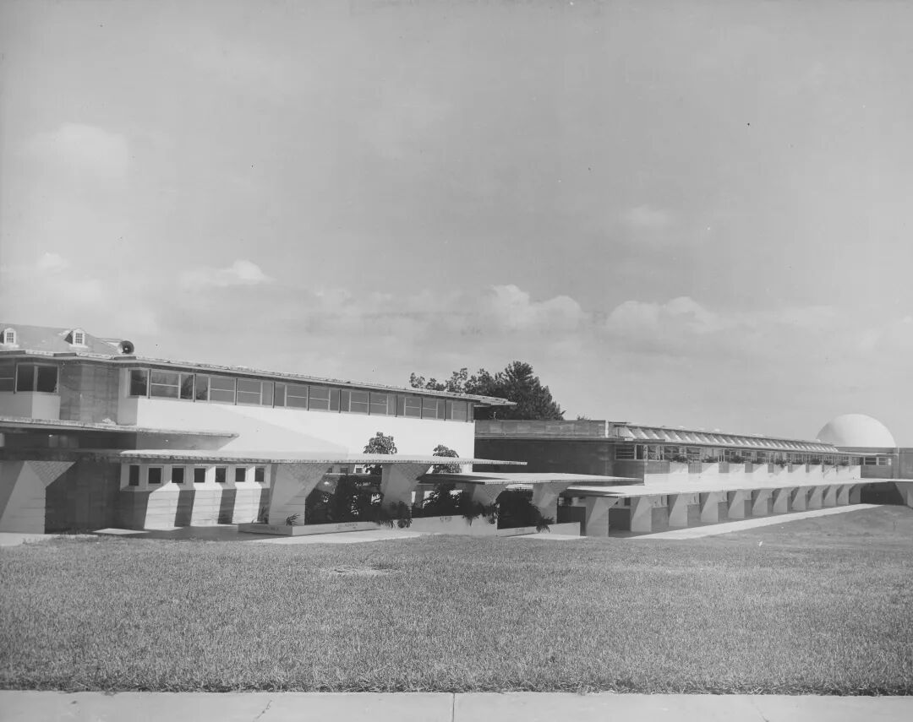
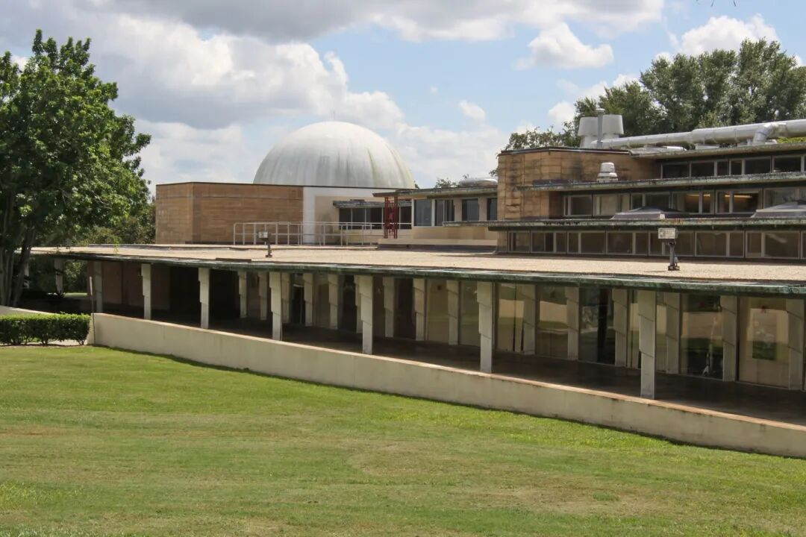
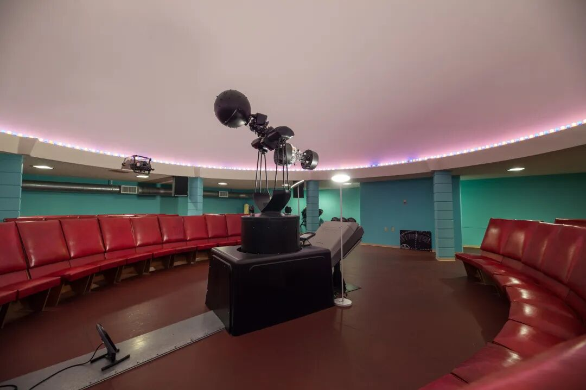
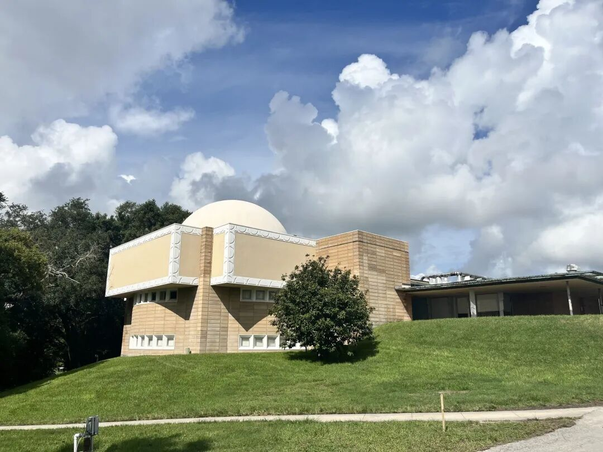
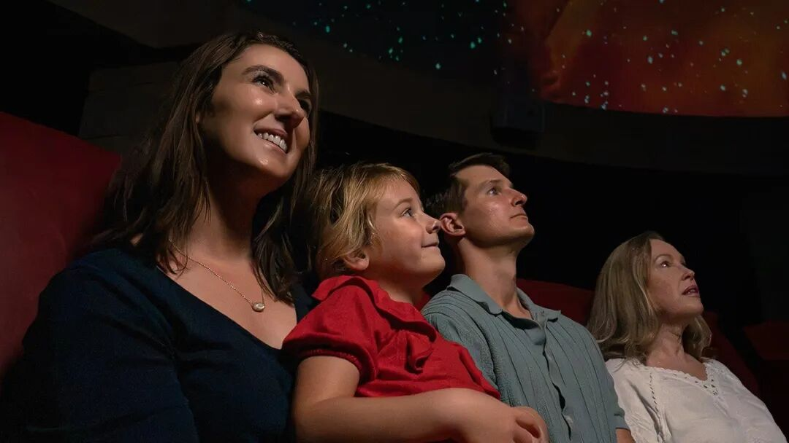

# 75个座位、22年等待：赖特唯一建成的天象馆恢复公众放映

ARCHITECTURE / RESTORATION
#  22年后，赖特唯一建成的天象馆重新放起了星空
一座1950年代的圆顶，迎来新的投影系统与公众放映。
FRANK LLOYD WRIGHT · MILLER PLANETARIUM
一座天象馆可以保留圆顶、座椅和建筑师的名字，却因为投影设备失效，让仰望星空的课堂停下来。  弗兰克·劳埃德·赖特（Frank Lloyd Wright）
唯一建成的天象馆，经历了这样的22年。
College）恢复了米勒天象馆（Miller
Planetarium）的公众放映。分阶段修复处理了建筑水损、墙面与地坪，同时装入新的投影和音响系统。这座1950年代建造的空间，重新迎来学生和校外观众。

图 01｜天象馆圆顶与波尔克科学楼的水平体量。图片来源：佛罗里达南方学院／Architectural Record。
** 01  ** / A DOME FOR SCIENCE
##  科学楼尽头，一座圆顶望向天空
米勒天象馆位于波尔克科学楼（Polk County Science
Building）南端，随科学楼于1954年至1958年间建造。科学楼内设有实验室、教室、办公室与讲授空间，天象馆则把天文学教学集中在一间圆形大厅里。1960年4月7日，它举行了首次放映，此后成为学院天文学课程的一部分，也接待学校参访和公众观众。
这座科学楼属于赖特为学院设计的  “太阳之子”（Child of the Sun）建筑群  。如今校园内汇集  ** 13项  **
赖特设计的建筑与构筑物，构成全球规模最大的单一场址赖特作品群。教堂、教学楼、行政楼与连廊各自承担校园日常，天象馆就嵌在这组仍被使用的建筑之中。

图 02｜科学楼历史档案照片，远处可见天象馆圆顶。图片来源：佛罗里达南方学院档案。
科学楼呈L形，顺着场地坡势展开，外墙采用赖特标志性的纹样混凝土砌块，并配有铜与铝的细部。连续的楼层、檐口和廊道拉出水平线，天象馆的圆顶从低平的建筑群中隆起。圆顶提示了一种特殊的内部用途，却仍与旁边的课堂、走道紧密相连。

图 03｜科学楼廊道、坡地与天象馆的关系，学院档案图像。图片来源：佛罗里达南方学院档案。
** 02  ** / WHEN THE STARS STOPPED
##  投影停了，圆顶仍在
天象馆设有  ** 75个座位  **
，圆形大厅直径约9.75米，室内地面至顶部约7.32米。红色座椅沿圆周布置，投影设备占据中央。观众围坐在穹顶之下，共同观看头顶的影像；这个房间的布置，始终围绕放映展开。
** 2004年  **
，投影系统停止运转，天象馆此后长期仅有限使用。建筑还在，日常课程与面向公众的放映却难以继续。一座为影像和教学而造的建筑，外观保存与功能恢复之间，由此出现了一段漫长的距离。

图 04｜2020年天象馆内部：中央旧投影设备与环绕布置的座椅。图片来源：佛罗里达南方学院档案。
学院曾在1999年宣布技术更新，并于2001年将天象馆重新奉献给约翰·雷蒙德·米勒三世（John Raymond Miller
III）及其妻子埃莉诺·霍尼曼·米勒（Eleanor Honeyman Miller）。
** 03  ** / REPAIRING THE ORIGINAL FABRIC
##  换一块旧砖，也要找回它的颜色
修复建筑师杰夫·贝克（Jeff Baker）来自梅西克·科恩·威尔逊·贝克建筑事务所（Mesick Cohen Wilson Baker
Architects）。他自2007年起参与学院赖特建筑的保护工作。2020年，天象馆进入修复计划；团队研究原始图纸，并为相关构件建立  ** 三维模型
** ，以理解各部分的拼接方式。
混凝土砌块的修复，远比在旧墙上换入一块新砖复杂。不同位置的砌块经历了不同程度的风化、水损和老化，  ** 新砌块需要匹配既有墙面的颜色  **
。施工中，部分受损砌块比预想更难拆除，工人先在其上打孔削弱，再用工具逐步移出。这些逐块处理的工作，决定了修复后墙面能否延续原来的纹理与色调。

图 05｜2026年重新开放报道中的天象馆外墙与圆顶。图片来源：LkldNow。
施工发生在仍正常教学的校园里。团队把部分凿除作业安排在周末，并用围挡保障科学楼南端的学生通行。建筑保护在这里伴随着上课、走路和实验室的日常，工期与施工方式也必须回应这些使用。
后续修复处理了水损，重新涂饰墙面和赖特常用的  ** 切罗基红（Cherokee Red）  **
地坪，使室内配色更接近原设计。外部修复获得佛罗里达州及私人资金支持，内部修复则由  “拯救美国瑰宝”（Save America’s Treasures）
联邦项目和私人捐助共同支持。不同阶段接续推进，才逐步完成这间小型天象馆的修复。
** 04  ** / NEW IMAGES UNDER THE DOME
##  旧圆顶里，放起了新的宇宙
最新阶段安装了  ** COSM投影系统与Bowen音响系统  **
，修复后的空间也整合了空调。新的影像与声音设备，让原有圆形大厅重新承担现代天象馆的放映任务。穹顶、红色座椅与围坐的方式，和当代节目同时出现在观众的视野里。
公众放映从9月26日起恢复，安排在每周二、周四、周六和周日。  ** 6部节目按月轮换  ** ，内容涉及太阳系、火星探索、系外行星以及人类对宇宙的认识。
影片时长约20至32分钟，包含建筑历史介绍的完整体验约60至90分钟。  观众先了解自己身处怎样一座建筑，再观看头顶的宇宙。

图 06｜修复后，观众在天象馆内观看穹顶放映。图片来源：佛罗里达南方学院。
学院学生与教师、来访学校和社区组织也将使用这处空间。  赖特曾希望科学楼包含面向校外公众的教育场所，天象馆早年的参访与放映已实践过这一设想。
如今，定期排片让它重新进入公众的日程；建筑参观之外，也有了为了看一场节目而再来的理由。
##  项目档案
** 项目  ** 米勒天象馆／Miller Planetarium
** 所在建筑  ** 波尔克科学楼／Polk County Science Building
** 地点  ** 美国，佛罗里达州，莱克兰
** 原建筑师  ** Frank Lloyd Wright
** 修复建筑师  ** Jeff Baker／Mesick Cohen Wilson Baker Architects
** 建造时间  ** 1954—1958年
** 首次放映  ** 1960年4月7日
** 公众放映恢复  ** 2026年9月26日
** 座位数  ** 75席
** 室内直径  ** 约9.75米
** 新设备  ** COSM投影系统／Bowen音响系统
##  参考资料
1\. Florida Southern College｜天象馆重新开放
2\. Florida Southern College｜波尔克科学楼档案
3\. Florida Southern College｜修复建筑师Jeff Baker访谈
4\. Florida Southern College｜施工现场记录
5\. Architectural Record｜赖特天象馆修复与重开
6\. LkldNow｜米勒天象馆恢复公众放映
