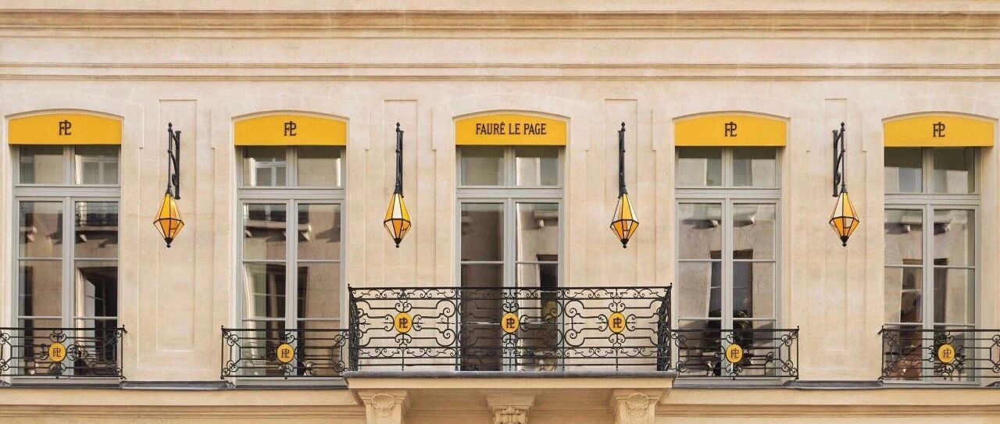
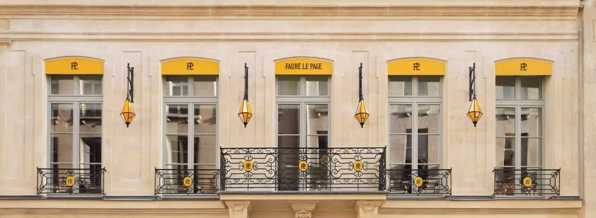
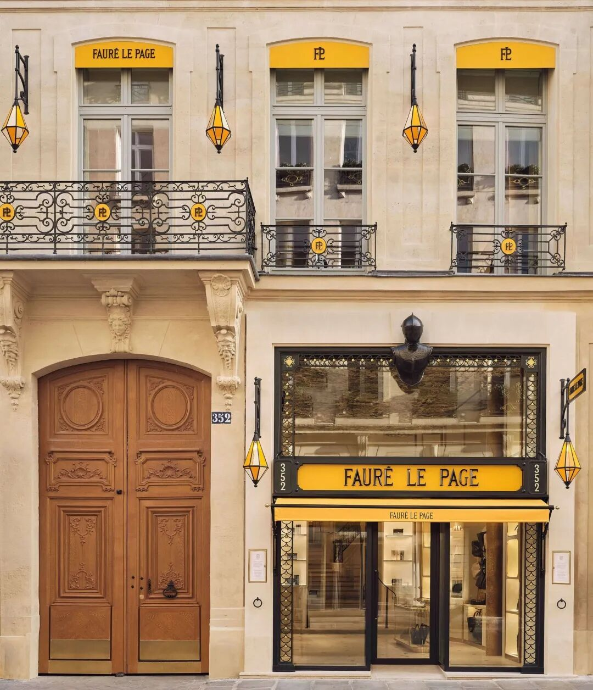
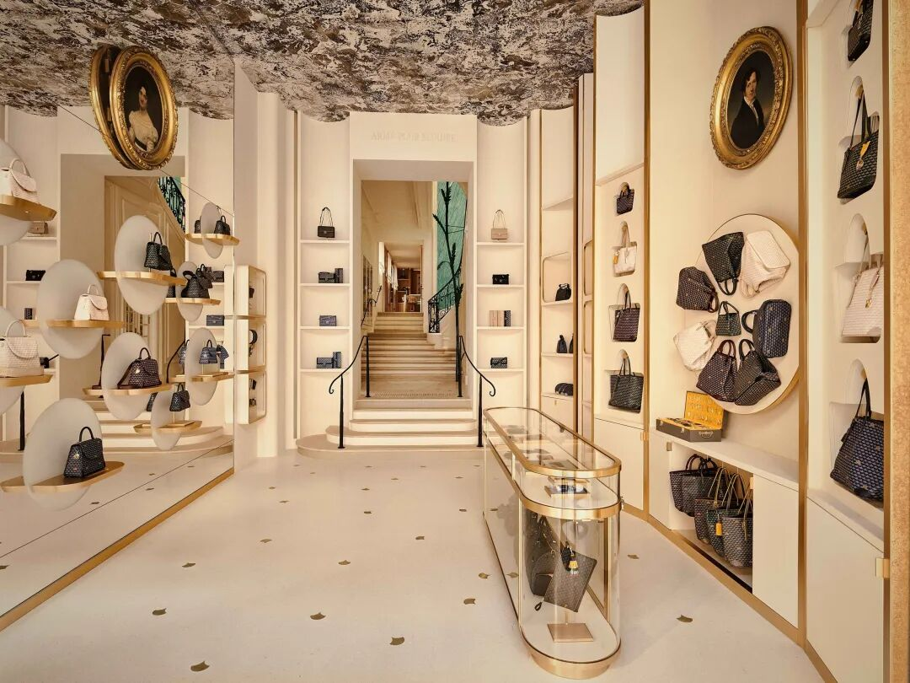
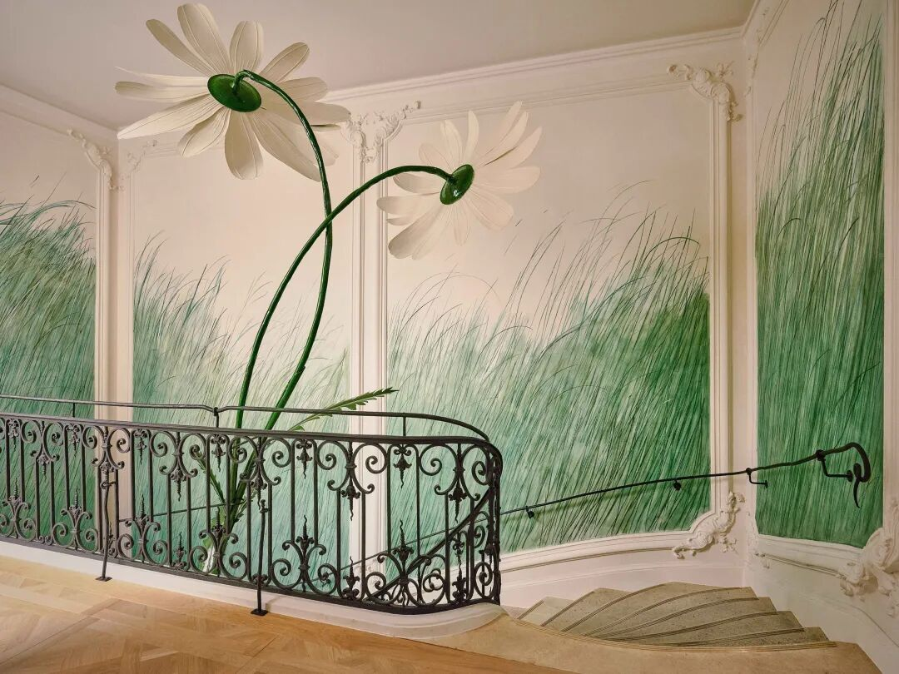
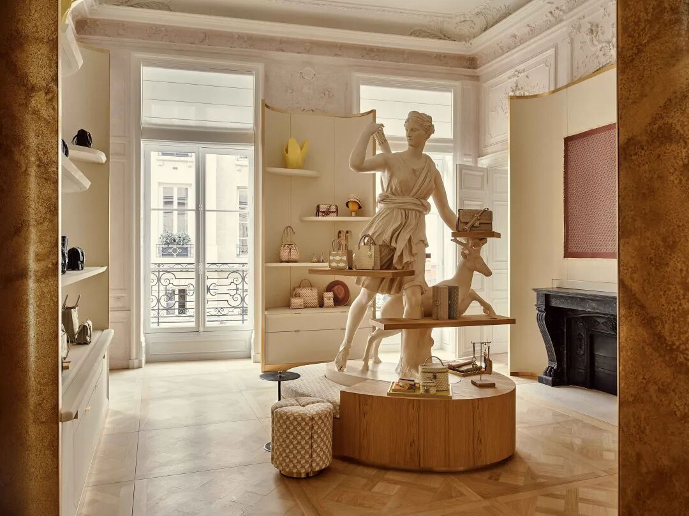
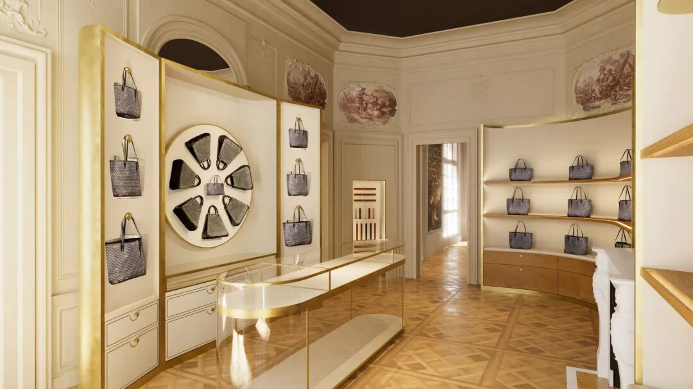
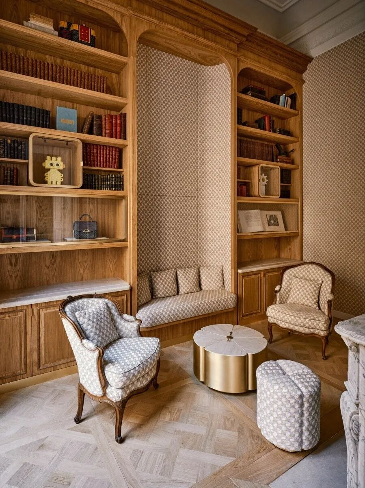
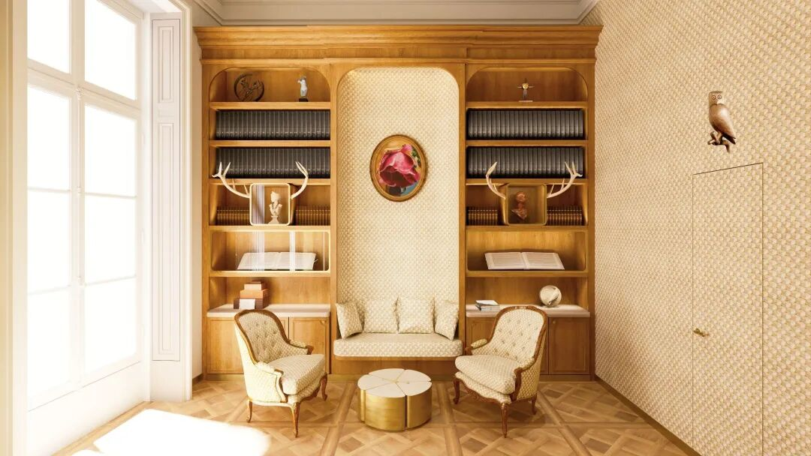
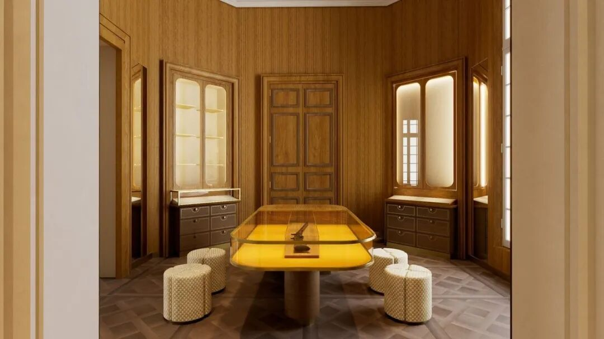

# 318年巴黎老宅变奢侈品店！曾为皇室造枪的品牌，如今在这里卖包

RETAIL / PARIS
#  把500㎡老宅变成旗舰店，Fauré Le Page在巴黎安排了一场“登堂入室”
手袋、金属雏菊、藏书与军械，在一座18世纪宅邸里相遇。
MAISON SAINT-HONORÉ · JEAN DE GASTINES · 2026
巴黎的精品店常借一座老房子介绍自己。  ** 法国皮具品牌Fauré Le Page  **
的新店把这个做法推得更细：门厅展示手袋，楼梯间长出巨大的金属雏菊，藏书室与军械典藏室接续出现，购物被安排进一连串房间。
2026年，  ** 圣奥诺雷之家（Maison Saint-Honoré）  ** 在  ** 巴黎（Paris）圣奥诺雷街（rue Saint-
Honoré）352号  ** 开幕。约500平方米的空间跨越3层，建筑设计由  ** 让·德·加斯蒂纳（Jean de Gastines）  ** 主持。
** 老宅原有的房间尺度与装饰，成为划分陈列、会客和收藏的依据  ** ；品牌故事也随行走逐段展开。

图 01｜临街立面以连续窗洞、铁艺栏杆与黄色遮阳篷形成横向节奏。图片来源：Matthieu Salvaing。
** 01  ** / ROOMS WITH DISTINCT ROLES
##  把一间店，分成一座宅邸的房间
这座宅邸的建造始于  ** 1708年  **
。建筑师修复装饰线脚与室内细节，保留凡尔赛式拼花木地板等构成空间性格的部分。街面上，黄色遮阳篷和招牌让品牌容易辨认，上方窗洞、栏杆与石质墙面仍延续老建筑的秩序。商业标识集中在开口与入口周围，没有覆盖整片立面。

图 02｜沿街入口嵌入历史宅邸立面，木门与店铺门面并置。图片来源：Matthieu Salvaing。
改造的一项关键工作，是  ** 将底层与上一层重新联系起来  **
。对于约500平方米、分布在3层的店铺，楼层之间的衔接决定了访客如何继续深入。门厅、楼梯和上层沙龙由此构成参观的主干，商品系列分配到不同房间，门洞也成为切换主题的节点。
门厅以经典托特包迎接访客，弧形展架沿墙展开，中央玻璃展柜保留了向内观看的视线。墙面仍能读出线脚、壁炉与肖像的位置，陈列家具的高度和轮廓在这些既有构件之间调整。包袋被单独托起，老宅的室内细节也继续可见。

图 03｜门厅中的弧形展架、中央玻璃展柜与深处相连的房间。图片来源：Matthieu Salvaing。
** 02  ** / A FLOWER ABOVE THE STAIRS
##  楼梯间，长出一朵金属雏菊
楼梯间最醒目的新作，是一朵向上伸展的雏菊。金属工艺师  ** 罗曼·巴雷（Romain Barré）  ** 与铜艺雕塑家  ** 埃利·伊尔施（Elie
Hirsch）  ** 合作，将花茎、叶片和花瓣放大到建筑尺度。细长的绿色花茎从平台边缘向上弯起，浅色花瓣进入房间上部的空处，背后墙面铺开诺曼底草地意象。
** 雕塑占据楼梯上方的竖向空间，栏杆继续围合平台边缘  **
。它与观者的距离会随上下楼变化：靠近时可辨认金属构件的曲线，退到平台另一侧又能看见完整花形。原本用于通过的楼梯间，因一件可从多个方向观看的作品，多了一个明确的停留对象。

图 04｜楼梯平台上的雏菊金属雕塑、铁艺栏杆与草地壁画。图片来源：Matthieu Salvaing。
雏菊既是品牌图案，也联系着勒帕日家族来自诺曼底的背景。门厅天花的“火药之云”（Nuage de Poudre）则由装饰艺术家  **
多米尼克·布永与诺埃·布永（Dominique and Noé Bouillon）  **
绘制，回应早期军械工艺。图案分别出现在天花、墙面和金属构件上，访客需要抬头、转身或走近，才能把这些细节连起来。
黛安娜沙龙又采用另一种陈列方式：古典人物雕像周围伸出展示托盘，手袋围绕身体布置，底部圆形台座与坐凳形成一组家具。雕塑的姿态与商品的尺寸并置，历史艺术题材在这里参与了实际的展示。

图 05｜黛安娜沙龙内，雕像周围设置圆形与扇形陈列台。图片来源：Matthieu Salvaing。
** 03  ** / COLLECTIONS AMONG THE SALONS
##  沙龙陈列，书架留出会客的位置
** 四季沙龙（Salon des Quatre Saisons）  ** 容纳男士、旅行与商务系列，  ** 黛安娜沙龙（Salon de Diane）
** 展示女士系列。按房间组织商品，使每组产品获得相对完整的观看范围。不同沙龙的颜色与家具各有差异，进入下一扇门，访客也随之进入另一组陈列。
四季沙龙的名称来自在建筑中发现的四幅绘画板。保留下来的装饰因此参与了房间的命名，新增展架再围绕壁面展开。

图 06｜四季沙龙的壁面展架与陈列布局，建筑效果图。图片来源：JDG Architectes。
临街藏书室的安排更接近会客。  ** 通高木书架把书、藏品和座椅围在同一间房里  **
，小桌与扶手椅留出坐下交谈的位置。它与门厅展示区具有不同节奏：门厅靠连续陈列向内引导，藏书室则用成组座椅将注意力收回房间内部。
书架所收的文学作品，涉及  ** 奥诺雷·德·巴尔扎克（Honoré de Balzac）  ** 、  ** 亚历山大·仲马（Alexandre
Dumas）  **
等作家对勒帕日工坊的提及。产品上的鳞片纹样又被延伸到室内织物。商品、文字与家具分别呈现品牌的不同侧面，避免把所有说明都挤在展柜旁的一块介绍牌上。

图 07｜藏书室实景，通高木书架围合座椅与小桌。图片来源：Matthieu Salvaing。
** 04  ** / ARCHIVES BESIDE CONTEMPORARY BAGS
##  从军械藏品，走到当代手袋
创意总监  ** 奥古斯坦·德·比费旺（Augustin de Buffévent）  ** 将早期军械工艺与当代皮具并置。军械典藏室中，一支带有“Le
Page à Paris”标记、与  ** 热罗姆·波拿巴（Jérôme Bonaparte）  **
有关的1807年长枪，提供了一个有明确年代的实物坐标。夹层档案室则陈列历史店招、文献与19世纪世界博览会获奖记录。

图 08｜藏书室的家具与织物设想，建筑效果图。图片来源：JDG Architectes。
马尔斯艺廊（Galerie de Mars）的“马尔斯挑战”（Défi de
Mars）进一步加入技巧游戏，灵感来自过去巴黎的射击游艺活动。奥诺雷沙龙（Salon
Honoré）则用于工艺、艺术与文化交流。陈列之外，游戏与会面也得到专门的房间。
看包、读书、赏藏与参与活动各有场所，再由门洞、楼梯和走道串联。老宅的多房间格局因而具有当代用途。品牌将其作为全球第12处据点，也借这座巴黎之家集中呈现自己的空间形象。

图 09｜军械典藏室的木饰面与中央展示台，建筑效果图。图片来源：JDG Architectes。
##  项目档案
** 项目  ** 圣奥诺雷之家 / Maison Saint-Honoré
** 品牌  ** Fauré Le Page
** 地点  ** 352 rue Saint-Honoré, Paris, France
** 建筑设计  ** Jean de Gastines
** 面积 / 层数  ** 约500平方米 / 3层
** 原建筑  ** 始建于1708年的宅邸
** 状态  ** 2026年开幕
** 摄影  ** Matthieu Salvaing
** 效果图  ** JDG Architectes
##  参考资料
1\. Fauré Le Page｜旗舰店开幕
2\. Fauré Le Page｜Maison Saint-Honoré门店
3\. La Vie｜Maison Saint-Honoré
4\. Journal du Luxe｜施工现场专访
5\. M&Magazine｜旗舰店参观报道
6\. Epicurisme Mag｜旗舰店空间与工艺
