# 雕塑家给自己造了一个家：决定把悉尼最好的风景留给一家人的日常~

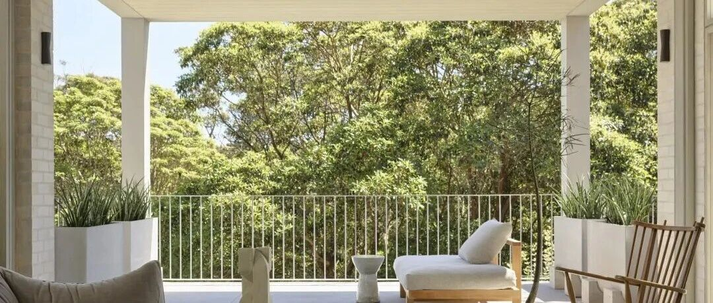

SCULPTED / SYDNEY HOME
#  263㎡、三层住宅，把客厅抬到树冠里：悉尼一位雕塑家的家
建筑与室内设计 / Madeleine Blanchfield Architects
桉树叶落在尚未凝固的混凝土上，留下细小的印痕。这些偶然发生的痕迹被保留在孩子的卧室地面里。对于一位以陶土和木材创作的艺术家，这样的表面并不陌生：材料在制作过程中留下的记录，本来就可以成为作品的一部分。
位于澳大利亚悉尼（Sydney）的雕塑之家（Sculpted），由玛德琳·布兰奇菲尔德建筑事务所（Madeleine Blanchfield
Architects）为艺术家亚伦·克罗瑟斯（Aaron Crothers）及其家人设计。  **
** 263㎡  ** 的住宅嵌入布朗特峡谷（Bronte
Gully）对面的坡地，把家庭活动、艺术创作和树木围绕的景观纳入同一套空间组织。它最值得细看的地方，藏在那些看起来没有经过额外修饰的墙面与地面中。
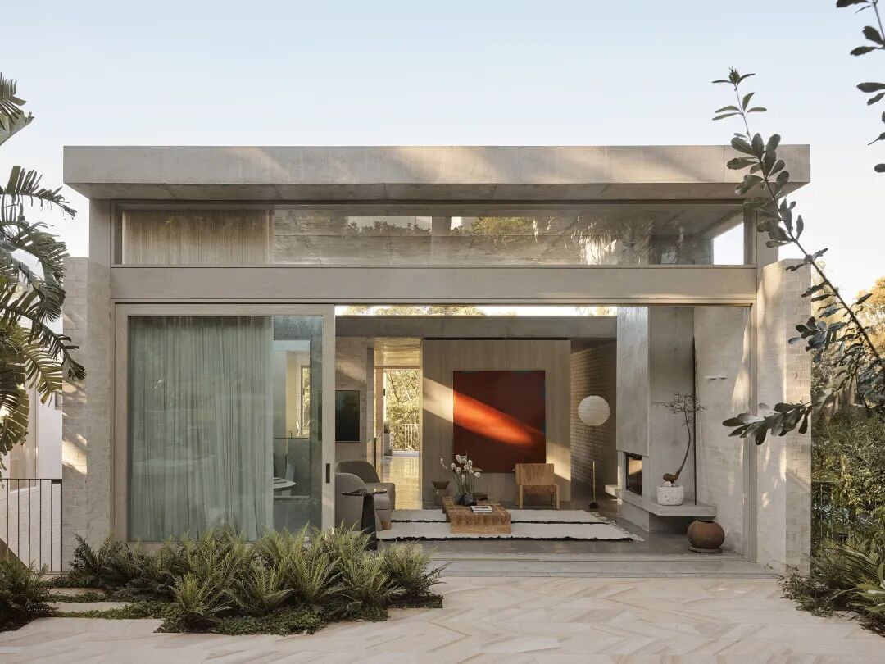
图 01｜住宅庭院立面：混凝土框架、砖墙与大面积玻璃共同界定室内外。摄影：Anson Smart。
** 01  ** / LIVING ABOVE THE TREES
##  把最好的视野留给共同生活
三层住宅顺着地形展开，  ** 厨房、餐厅和客厅安排在上层  **
，卧室与车库位于下方。这样的上下关系，让一家人停留时间较长的公共空间获得树冠与天空的景色，也让休息和工作的场所更接近坡地内部。景观资源的分配由日常生活的使用频率决定，客厅因此有了接近树屋的视线高度。
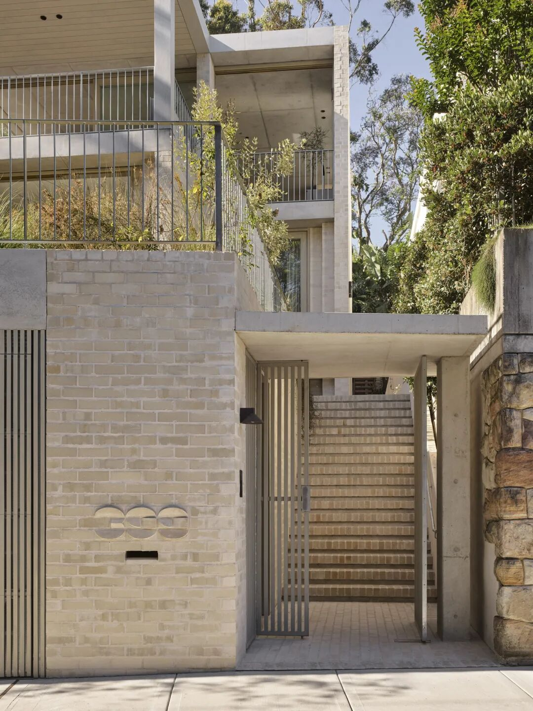
图 02｜临街砖墙与入口台阶，住宅沿坡地逐层展开。图片来源：The Local Project。摄影：Anson Smart。
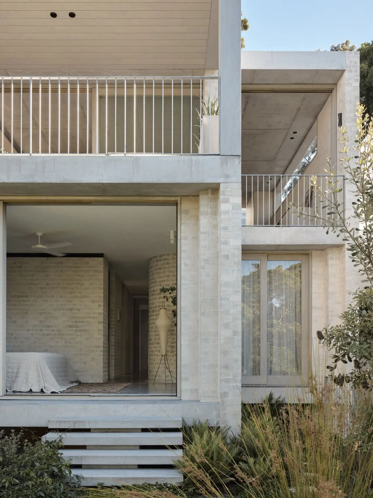
图 03｜上层露台、栏杆与下层开口之间的立面关系。图片来源：The Local Project。摄影：Anson Smart。
北侧向树梢打开，南侧则面向后方花园，空间的开敞程度随朝向变化。对这座住宅而言，坡地同时提供了高处的远景和低处的遮蔽。向外展开的起居区域与较私密的房间各自获得适合的环境，不必让所有房间都以相同的玻璃立面面对外部。
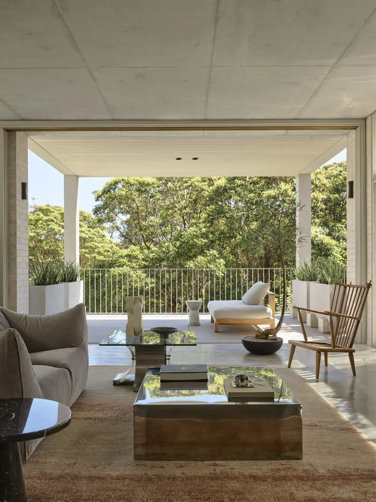
图 04｜面向树冠的起居空间与外部露台。图片来源：The Local Project。摄影：Anson Smart。
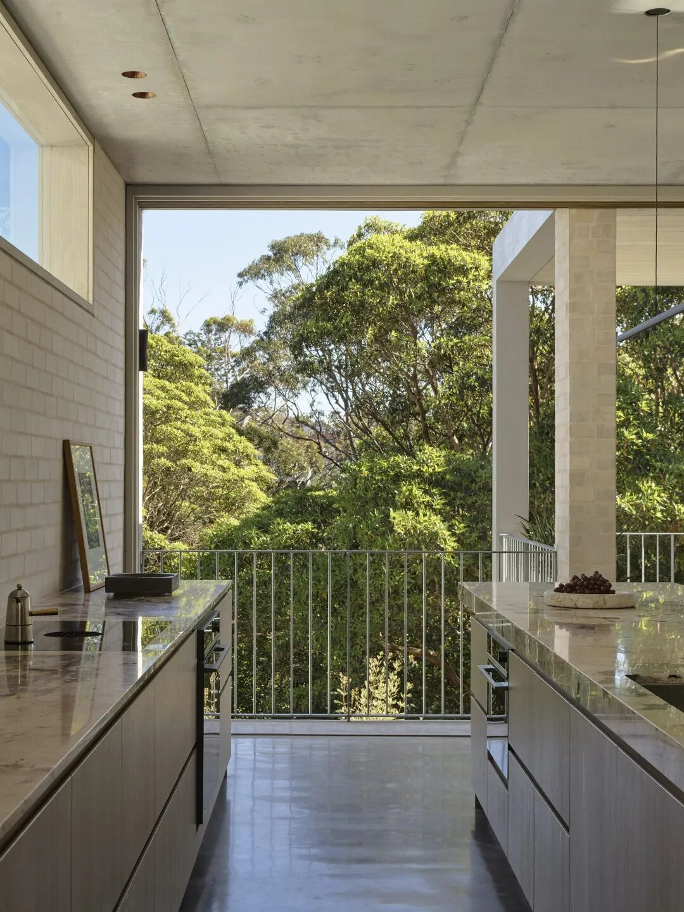
图 05｜厨房沿边界展开，视线越过操作台延伸至树木。图片来源：Madeleine Blanchfield Architects。摄影：Anson
Smart。
混凝土板的水平线和砖墙的竖向边界构成稳定的框架。远处树木在框架中显得格外鲜明；露台延续室内活动的尺度，让看向绿意的动作可以进一步变成走到室外。房屋的体量并没有消失，树冠却成为日常视野中持续存在的部分。
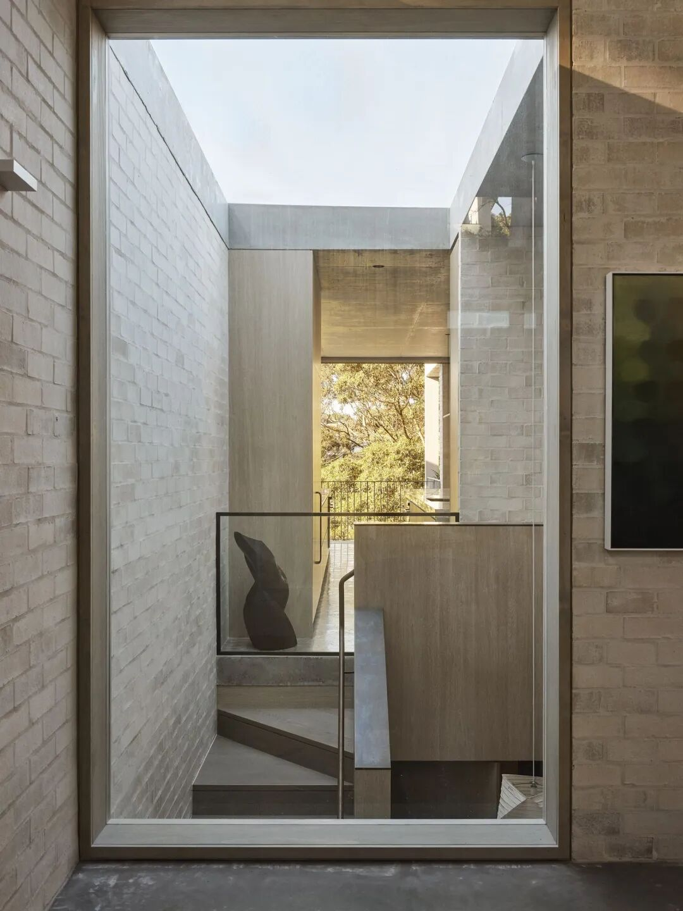
图 06｜楼梯上方的露天开口与采光关系。图片来源：Yellowtrace。摄影：Anson Smart。
** 02  ** / BUILT WITHOUT EXTRA LAYERS
##  少一层饰面，多一层施工要求
建筑师提出的核心原则是  ** 减少多余的构造层次  ** 。当地生产的克劳斯砖（Krause
Bricks）、混凝土和橡木成为住宅的主要材料，承重砖墙和楼板直接显露。  ** 水电管线预先纳入砖墙  **
的施工组织，室内表面减少了另加石膏板或抹灰层的需要。空间的清晰感，从墙体和楼板的建造过程就开始形成。
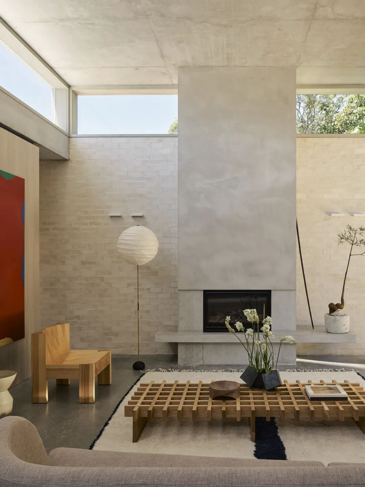
图 07｜砖墙、混凝土顶板及高位玻璃围合起居空间。图片来源：The Local Project。摄影：Anson Smart。
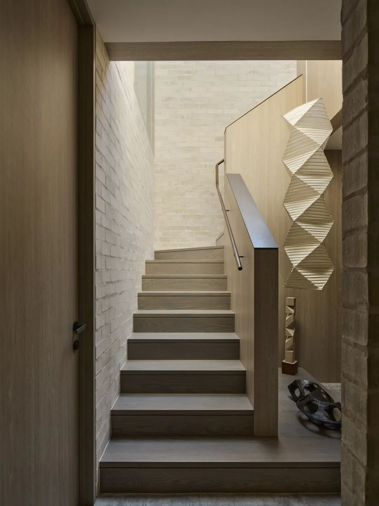
图 08｜折转楼梯与侧面的雕塑作品。图片来源：The Local Project。摄影：Anson Smart。
这种做法会把不少决定提前到施工之前。墙上开口的位置、管线的路径、混凝土的成型质量，都直接关系到最后可见的表面。饰面层减少之后，施工偏差也少了可以遮掩的地方。设计的工作集中到了边缘、转角与开口，而这些恰好是“简单”外观最难轻松获得的部分。
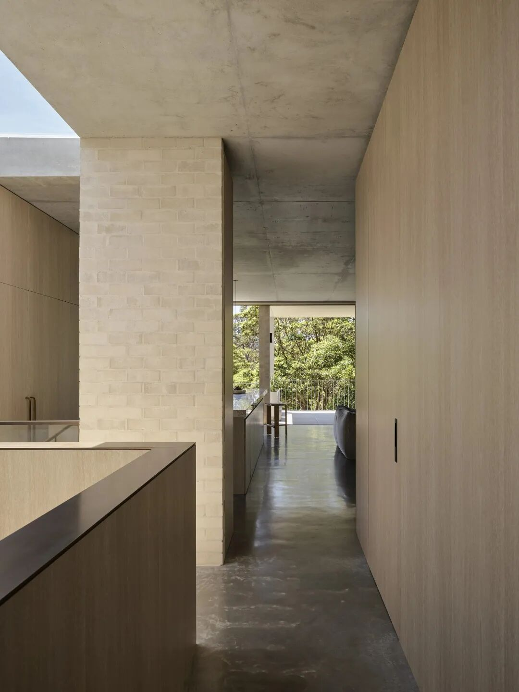
图 09｜木作、砖墙与混凝土在过道中的交接。图片来源：Madeleine Blanchfield Architects。摄影：Anson Smart。
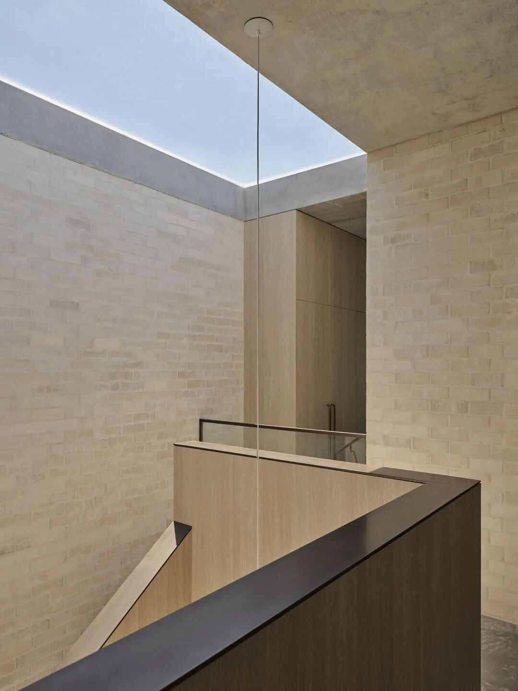
图 10｜高位开口将天空引入墙体围合的空间。图片来源：Yellowtrace。摄影：Anson Smart。
砖的细小色差让墙面保持颗粒感，混凝土则以较大的连续面压住空间。木作介于两者之间，为人的使用提供更细致的尺度。厨房石材岛台带来的丰富纹理集中在局部：大面积背景保持安静，少数物件便能获得清楚的位置。这种材料比例，也让住宅避免因全面暴露结构而显得过分生硬。
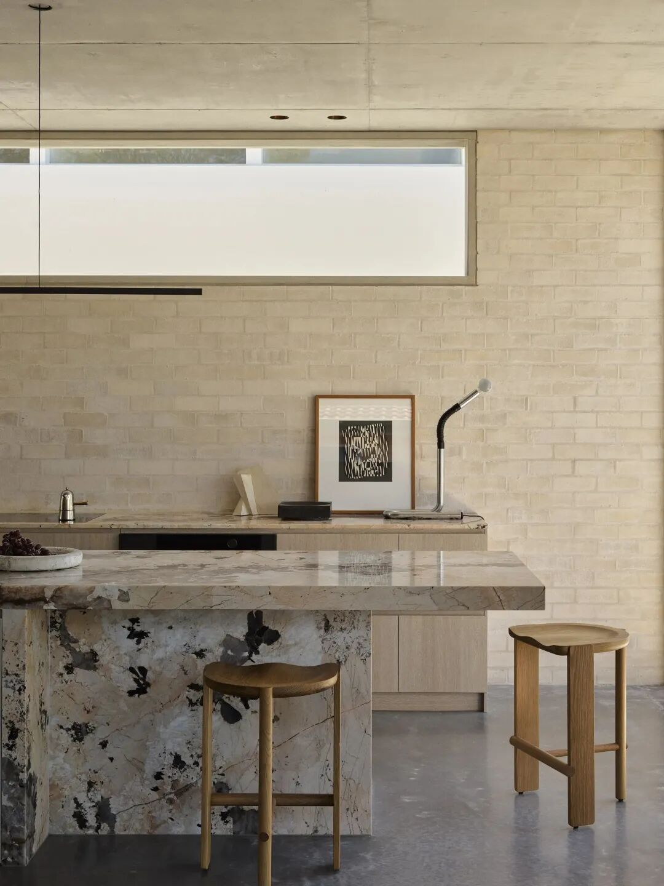
图 11｜厨房石材岛台、木凳与高位横窗。图片来源：Madeleine Blanchfield Architects。摄影：Anson Smart。
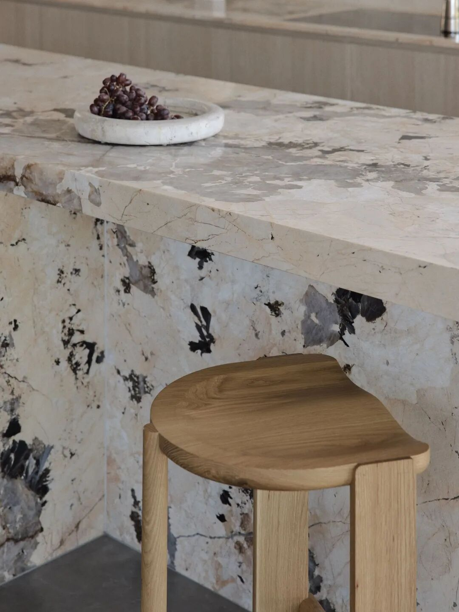
图 12｜岛台石材纹理与木质座椅的细部。图片来源：Yellowtrace。摄影：Anson Smart。
** 03  ** / LIGHT ACROSS THE ROOMS
##  开放的房间，也需要遮阳和退让
起居室的通透感有赖于一套具体的光线安排。建筑向北打开，以较深的挑檐配合  ** 高位窗  **
，使朝南的空间也能获得自然光；穿堂风和混凝土地面的热容量参与室内环境调节。光伏板与雨水回收进一步补充住宅的环境策略。
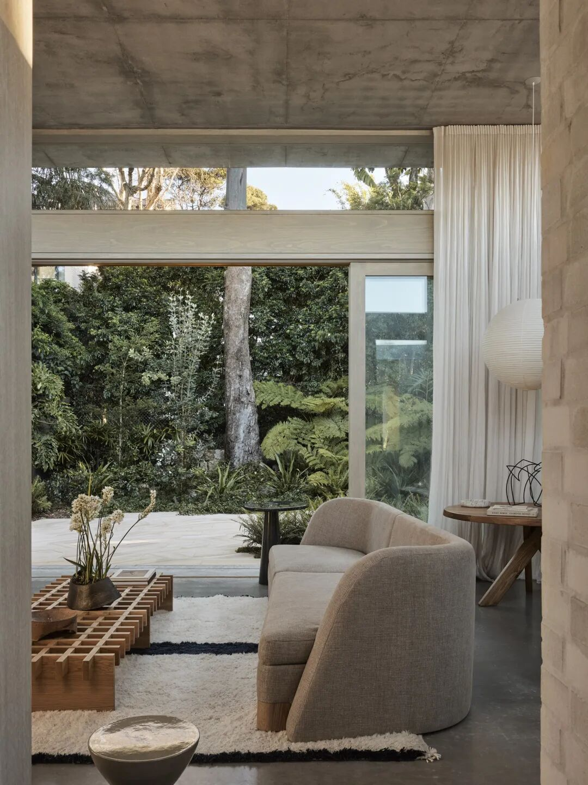
图 13｜打开的玻璃边界让起居室接近庭院。图片来源：The Local Project。摄影：Anson Smart。
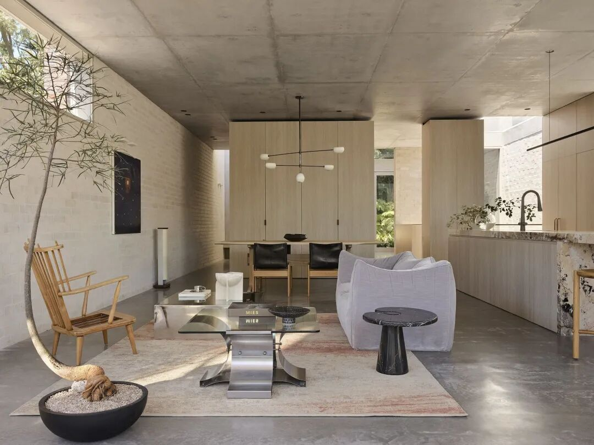
图 14｜家具之间保留通行空间，日光穿过室内。图片来源：Yellowtrace。摄影：Anson Smart。
高位玻璃在顶板与墙体之间留出光带，较高的围墙维持了空间边界，天空仍然可以进入室内。它提供了一种值得借鉴的组合：房间可以保有围合感，同时获得方向清楚的自然光。私密程度与采光并不必然同步增加或减少，关键在于开口所在的高度和位置。
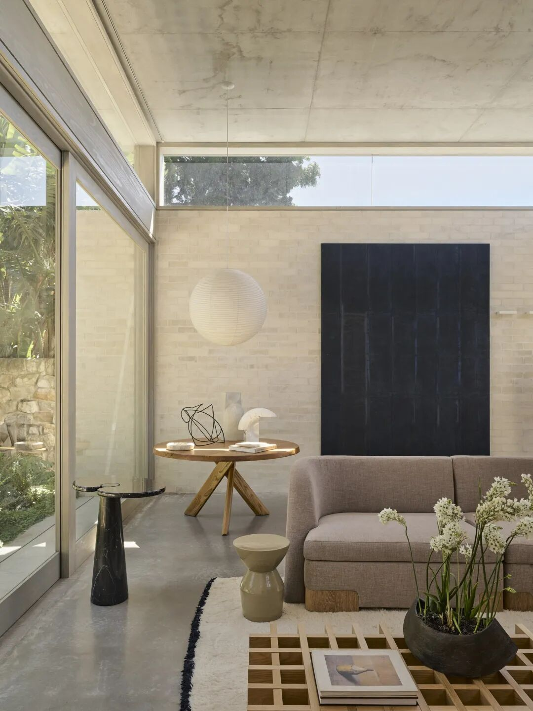
图 15｜砖墙前的艺术作品、家具与柔和灯光。图片来源：The Local Project。摄影：Anson Smart。
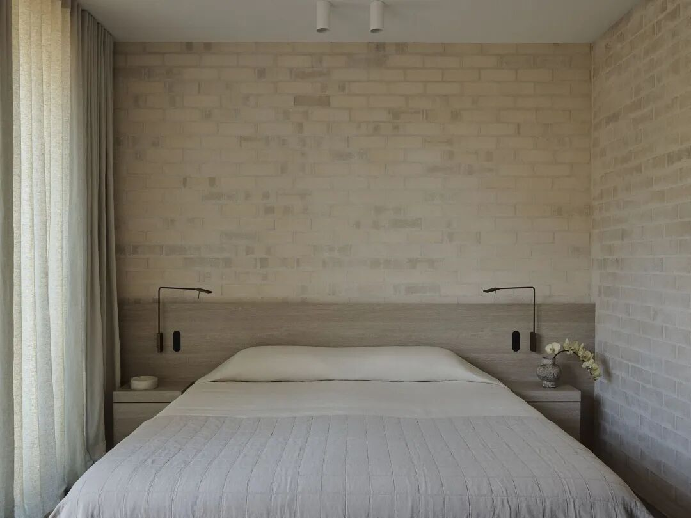
图 16｜卧室以砖墙与低矮床具构成安静的休息空间。图片来源：Yellowtrace。摄影：Anson Smart。
家具与艺术作品给这些清晰的建筑表面补上生活尺度。低矮座具让视线继续向庭院伸展，悬挂灯具与雕塑分布在人的活动范围附近。卧室的陈设更为克制，浴室则借窗与花园联系。公共空间的开敞和休息空间的安静，使一家人在不同时间可以选择不同的环境，而无须始终保持同一种展示状态。
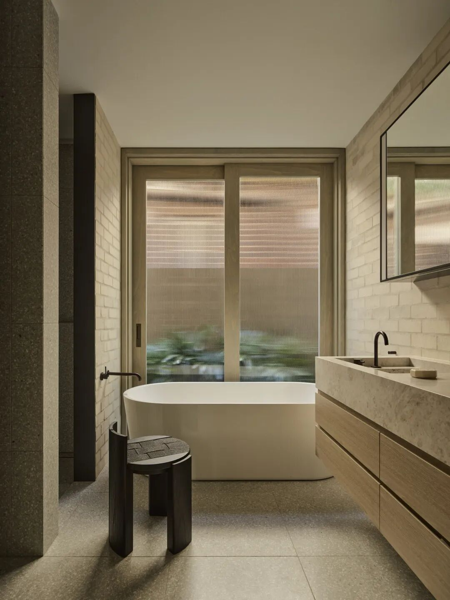
图 17｜浴缸、洗手台与窗外庭院的相邻关系。图片来源：The Local Project。摄影：Anson Smart。
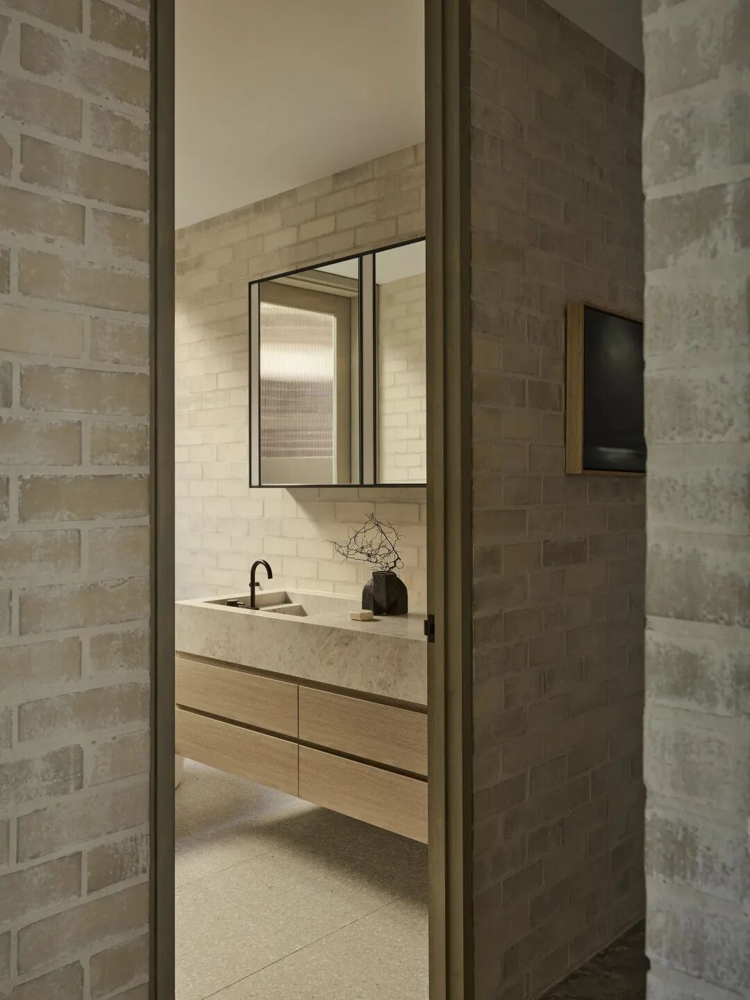
图 18｜砖墙开口中的木质浴室柜与镜面。图片来源：Madeleine Blanchfield Architects。摄影：Anson Smart。
** 04  ** / A PLACE FOR MAKING
##  艺术家的家，要容得下真正的工作
克罗瑟斯的  ** 雕塑工作室  **
邻近车库。它与起居室的状态不同，却同样属于住宅的核心生活内容。对长期在家创作的人而言，生产空间的位置、可使用的尺度与居住空间的关系，会直接影响工作的连续性。
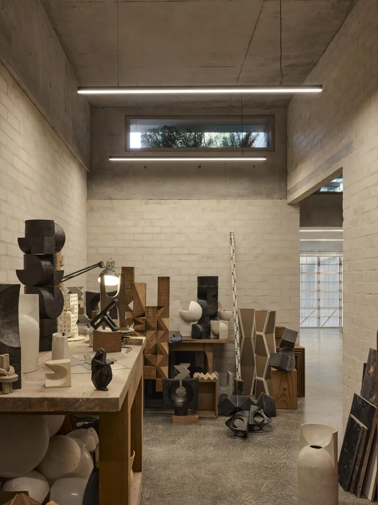
图 19｜艺术家工作室中的工作台、工具与雕塑。图片来源：The Local Project。摄影：Anson Smart。
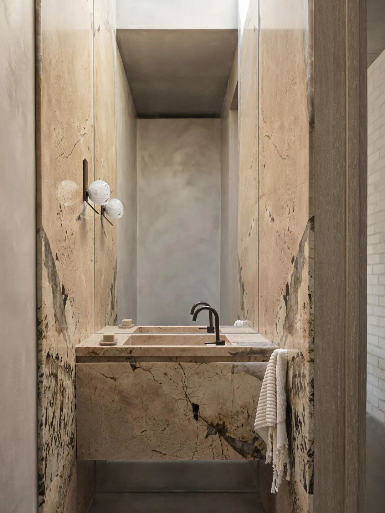
图 20｜狭长空间中的石材洗手台与壁灯。图片来源：Madeleine Blanchfield Architects。摄影：Anson Smart。
屋主也深入参与了住宅建造，协调现场工种。他亲手刻出门牌号码，再将这块砖嵌入临街墙体。
家既容纳完成的作品，也容纳制作中的状态。它允许粗粝的砖面与柔软座具相邻，让原本容易成为展示背景的空间持续服务于真实使用。
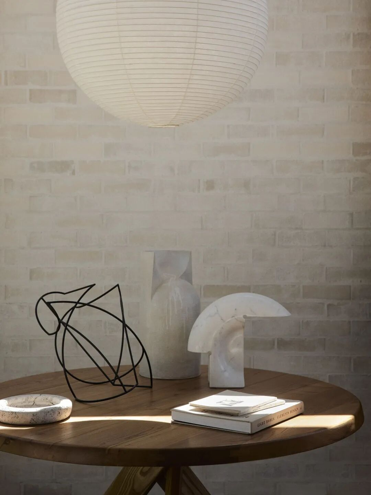
图 21｜小尺度艺术作品与桌面物件的组合。图片来源：Yellowtrace。摄影：Anson Smart。
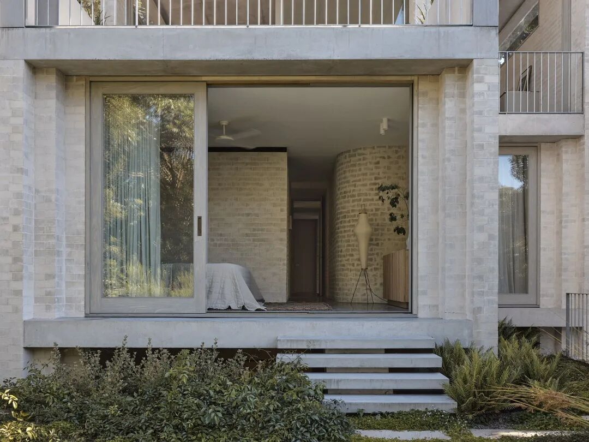
图 22｜庭院绿化、混凝土台阶与下层开口。图片来源：Yellowtrace。摄影：Anson Smart。
##  项目信息
项目：雕塑之家（Sculpted）
地点：澳大利亚，悉尼，Bronte Gully对面坡地
面积：  ** 263㎡  **
层数：3层
建筑 / 室内：Madeleine Blanchfield Architects
景观：Dangar Barin Smith
施工协作：屋主参与施工管理；Hoven Homes
结构工程：Lindsay & Associates
摄影：Anson Smart
造型：Jack Milenkovic
##  参考资料
The Local Project｜Sculpted
Madeleine Blanchfield Architects｜Sculpted
Yellowtrace｜Inside Sculpted, a Sydney Home Built Like a Macro Sculpture
