# 保护还是破坏？美国一座现代主义地标的改造引发争议，50年粗野主义混凝土外墙将被金属和玻璃取代

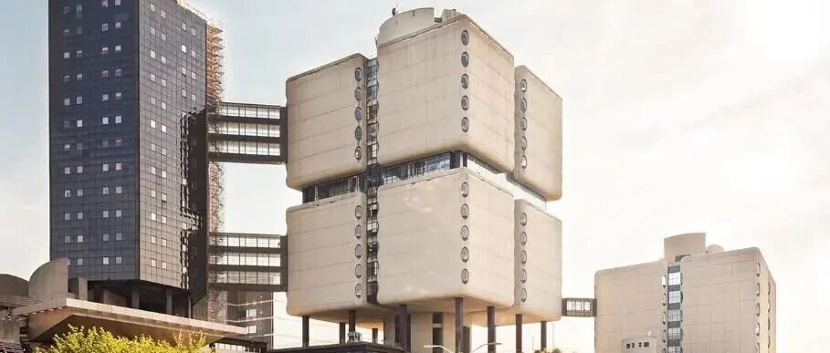

ARCHITECTURE / RENOVATION
#  椭圆窗要消失了！美国这座“悬空医疗城”将换肤，计划2031年完成
石溪大学健康科学中心：金属板与玻璃更新外壳，戈德堡的巨构将呈现另一张面孔
圆角方盒悬在柱子上，椭圆窗沿着转角一层层排列，玻璃连桥跨过塔楼之间的空隙。美国石溪大学健康科学中心（Stony Brook University
Health Sciences Center）的这副面孔，将在新一轮外墙更新中发生明显变化：金属板与预制幕墙将覆盖老化围护，  **
原有椭圆窗则由更大面积的转角玻璃取代  ** 。
贝特朗·戈德堡（Bertrand
Goldberg）把医学院、研究机构和教学医院组织成一座立体的“小城”。如今，更新要在建筑继续使用的条件下推进，大学列出的外墙项目预计于2031年春季完成。
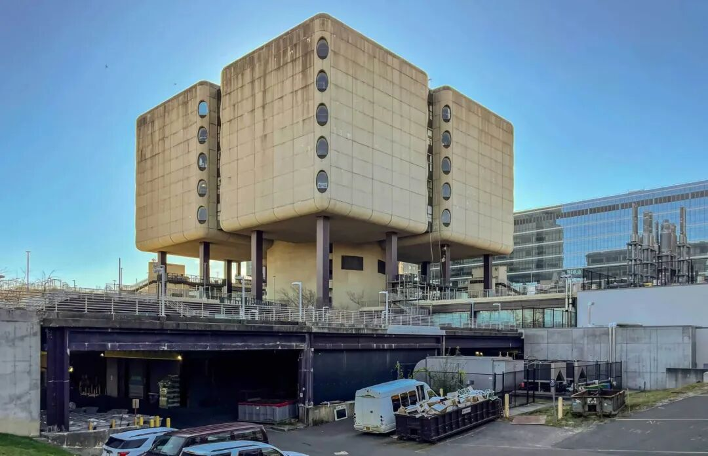
图 01｜原有塔楼转角的椭圆窗、圆角墙面与架空柱（改造前外观）。图片来源： Wikimedia Commons。摄影：Kenneth C.
Zirkel。授权：CC BY 4.0。
** 01  ** / A MEDICAL CITY
##  七层基座，把三种机构接在一起
这组建筑位于纽约州长岛（Long Island）的石溪大学（Stony Brook
University）东校区。规划从1960年代展开，临床科学塔于1976年完成，基础科学研究塔于1978年完成，大学医院在1980年开始接诊。今天看到的整体，是多个阶段逐步建成的医疗与教学共同体。
医学院、实验室和医院各有自己的工作节奏，也需要频繁交换人员、知识与服务。戈德堡给它们相对独立的塔楼，再把共同使用的设施集中到嵌入山坡的七层基座中。塔楼因用途而分开，基座让它们在更大的尺度上连成一体。共同的服务、供应与会面空间由此集中到下部，教学和医疗可以保有各自的工作区域，又不必完全依赖楼与楼之间的室外穿行。
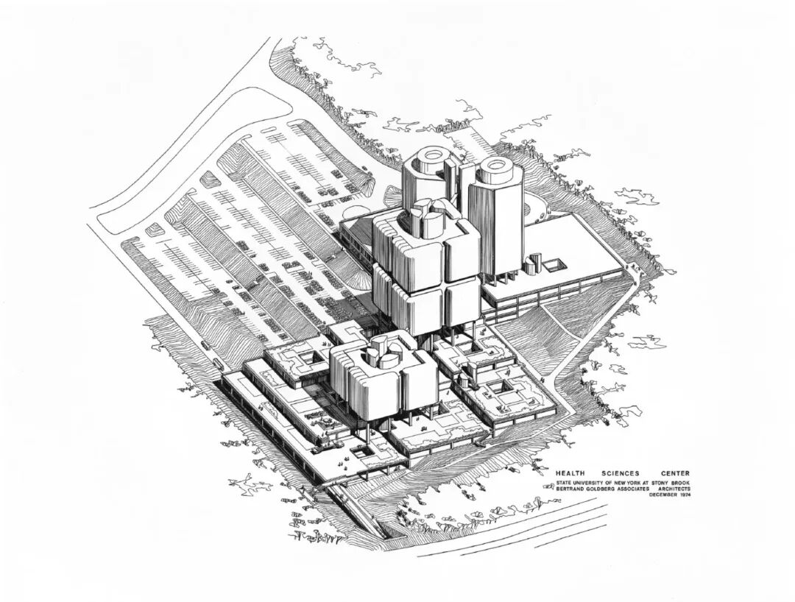
图 02｜健康科学中心整体轴测图，展示塔楼、连桥和层叠基座（1974年档案图纸）。图片来源：Bertrand Goldberg
Archive，经Parametric Architecture。
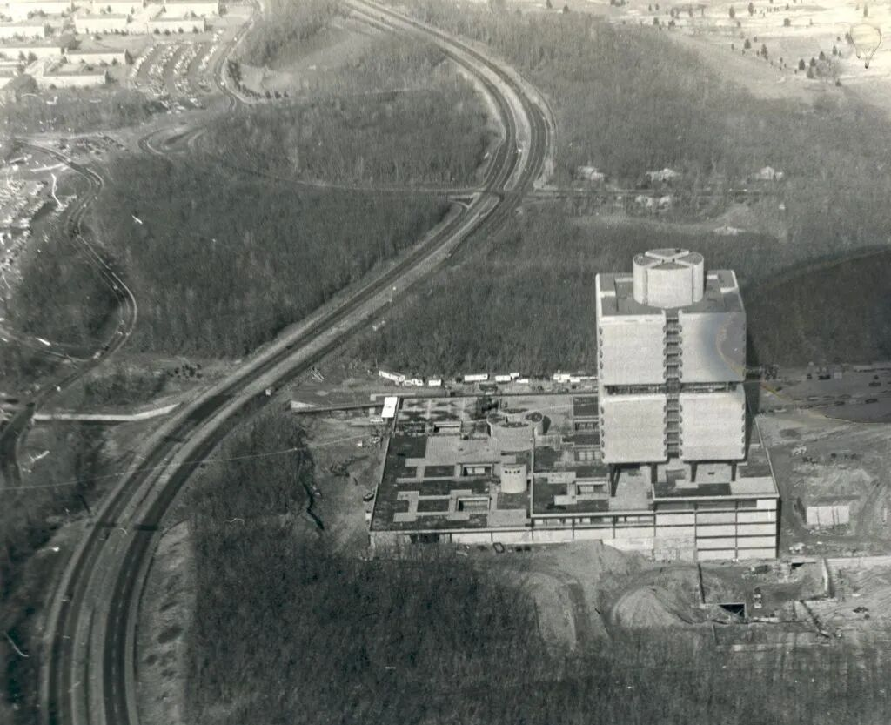
图 03｜健康科学中心东校区的历史航拍，显示建筑与周边道路、林地的关系（约1976年）。图片来源：石溪大学图书馆 / University
Archives。
坡地在这里参与了入口安排。学生从较低位置进入，患者从较高位置抵达医院，  ** 不同人群可以先到达与自身活动相关的层面  **
。建筑内部再通过电梯、扶梯和横向通道联系，上部则以空中连桥缩短塔楼之间的往返。
原始规划面向每天约1.2万人的使用规模。与其把如此多功能摊成一串彼此分离的楼房，戈德堡将它们叠放在一片连续的人造地形上。
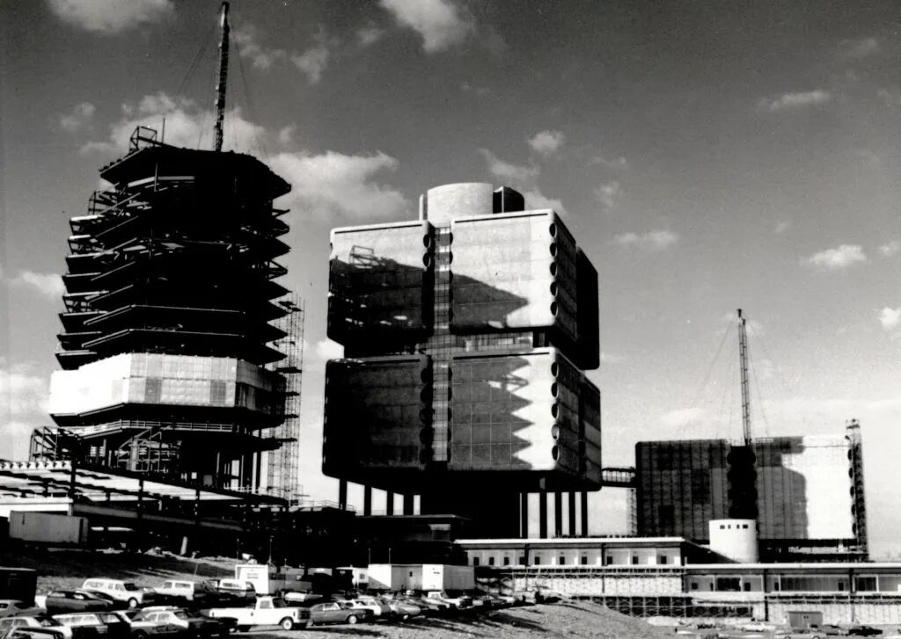
图 04｜各塔楼分期施工时的建筑群，可见病房塔楼骨架（历史施工照片）。图片来源：石溪大学图书馆 / University Archives。
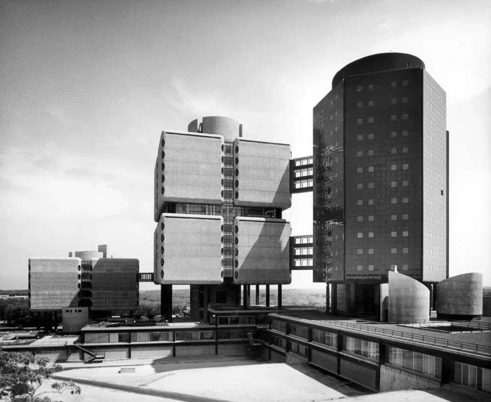
图 05｜落成后的建筑群，实体塔楼与玻璃病房塔楼通过空中连桥相接（档案照片）。图片来源：Bertrand Goldberg
Archive，经Parametric Architecture。
** 02  ** / VILLAGES WITHIN THE BASE
##  巨构内部，藏着中庭与“小村落”
体量越大，人在里面越需要找到可以辨认的局部。戈德堡把基座楼层划分为约200英尺见方、也就是约61米见方的模块，每个模块围绕一个封闭中庭组织。大型建筑内部被进一步分成一组“空间村落”，共同活动有了相对明确的中心。
这些中庭与座位区、功能节点一起，帮助使用者在长距离行走中辨认位置，也为学生、研究者和教师提供相遇的地方。原来的规划  ** 把交流安排在具体路径旁  **
，而不是只把全部房间接上一条漫长走廊。
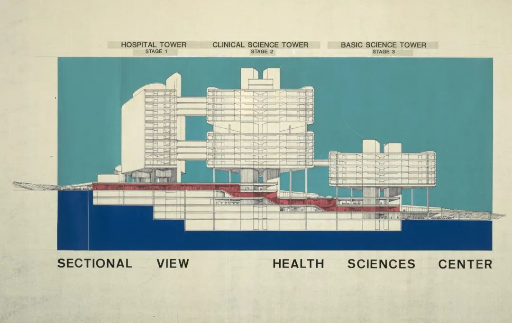
图 06｜医院、临床科学塔和基础科学塔沿坡地展开的剖面关系（原设计档案图纸）。图片来源：Bertrand Goldberg
Associates，经Parametric Architecture。
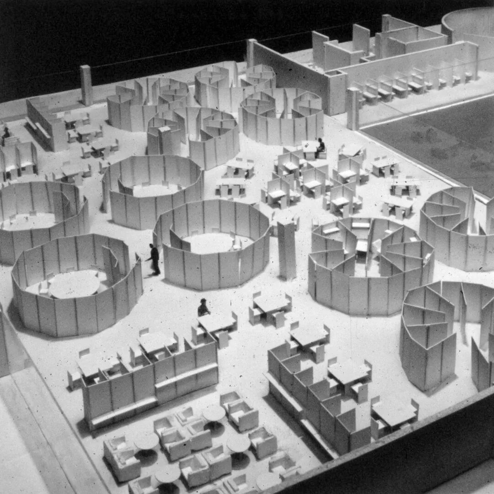
图 07｜室内空间研究模型，圆形围合与多种隔断形式并置（设计研究模型）。图片来源：G. Goldberg + Associates。
基座的屋顶同样被当作可以使用的地面。层叠花园与下沉庭院切进厚重体量，把日光带到较低处的办公室、图书馆和公共空间。剖面上的高差，一边容纳大面积支撑设施，一边借助庭院与露台打开地面以下的界面。
建筑外部像几块巨大盒子，内部却被分解为更小的房间、围合与活动单元。它的“城市感”既来自空中塔楼，也来自基座里这些能够停留、辨向和交换活动的局部。
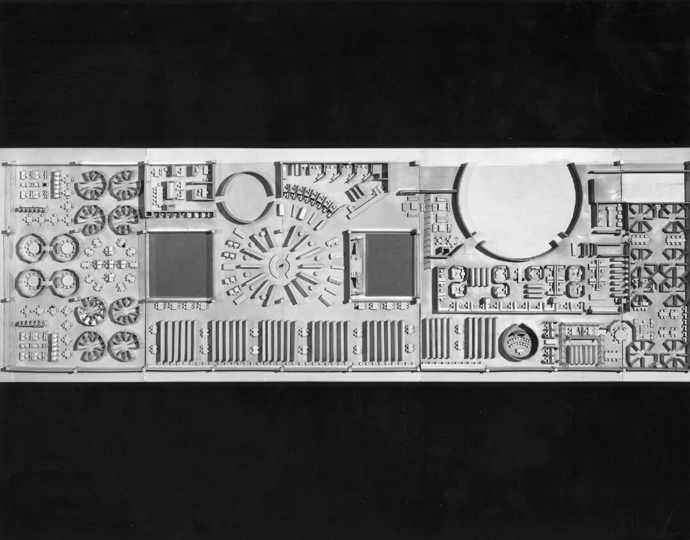
图 08｜长条形模型中的多种房间几何与通道排布（设计研究模型）。图片来源：G. Goldberg + Associates。
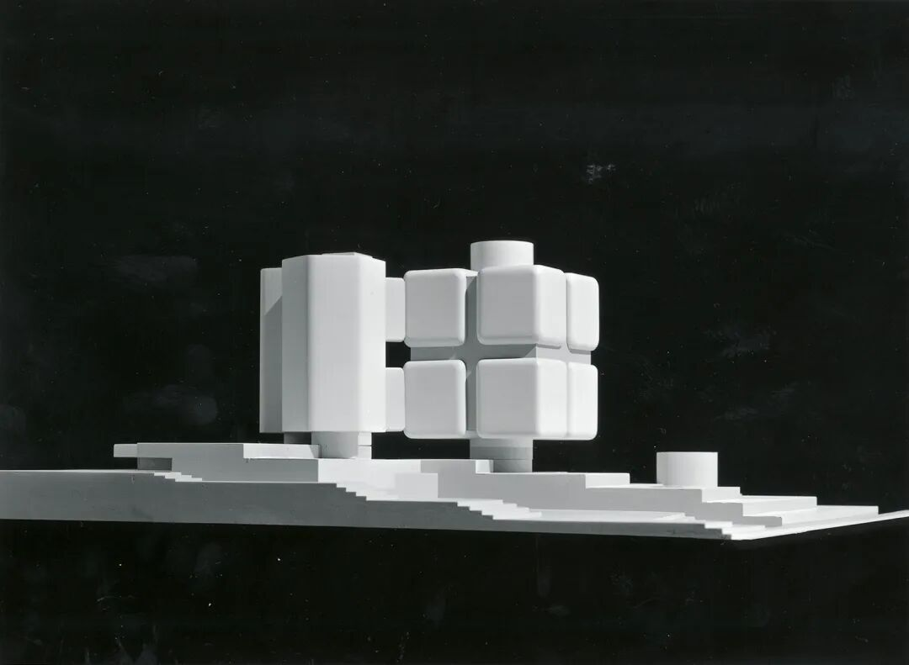
图 09｜塔楼与阶梯状基座的体量关系（设计研究模型）。图片来源：G. Goldberg + Associates。
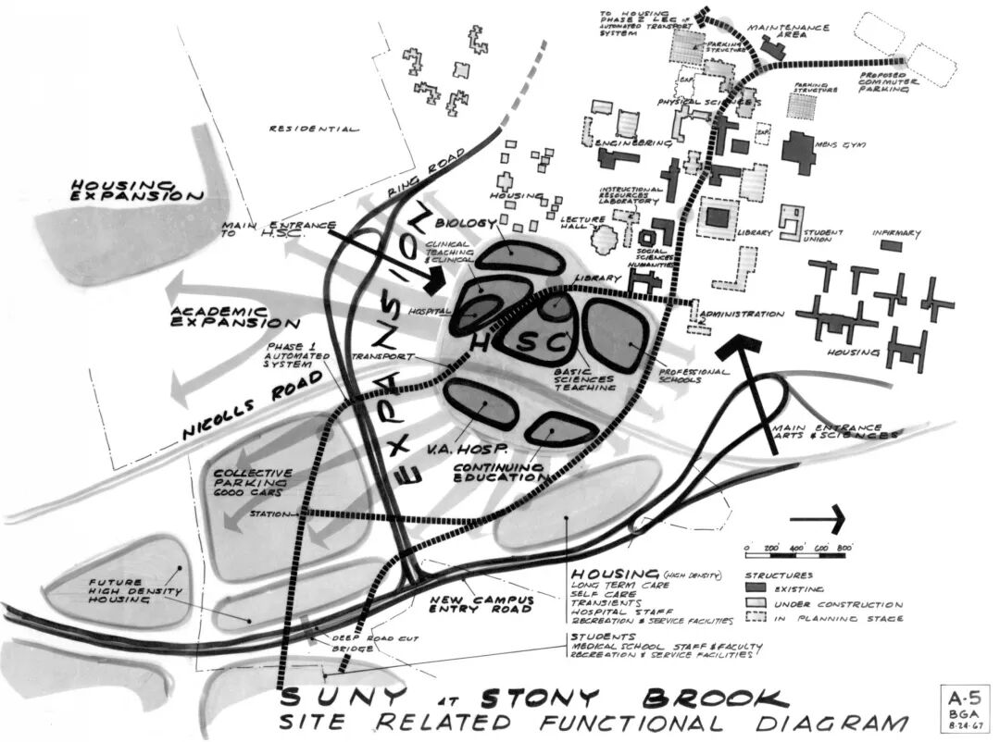
图 10｜场地与周边功能联系的早期研究图（约1967年概念图）。图片来源：G. Goldberg + Associates。
** 03  ** / A CHANGING OUTER SKIN
##  椭圆窗退出，转角改成玻璃
原有教学科研塔楼的外观，依靠大面积实体墙、圆润转角和竖向椭圆窗建立识别。窗洞像被压进厚实外壳，玻璃集中在少数窄缝里。柱子又把盒状体量抬离广场，使墙面边缘、底部阴影和架空空间一起强化了体量感。
经历长期使用后，围护老化已成为改造的直接起点。健康科学塔（Health Sciences
Tower，HST）的既有外墙，包括灰泥、喷覆混凝土饰面及相关支撑，将被完整更换。新方案采用金属板雨幕系统与预制幕墙组件，同时协调它与基础科学塔（Basic
Sciences Tower，BST）的外观。
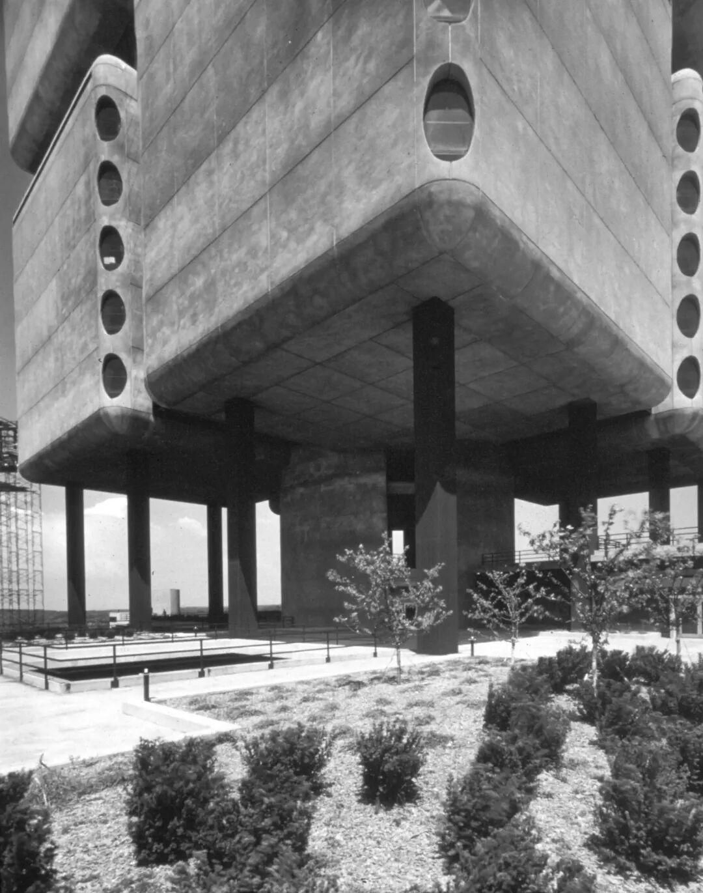
图 11｜架空体量的底部、柱与转角椭圆窗（档案照片）。图片来源：Bertrand Goldberg Archive，经Parametric
Architecture。
改变最明显的位置是转角。新玻璃将替代原有椭圆窗，大学希望借此增加自然采光；  ** 原先由小开口打断的圆角实体，将变成连续得多的透明界面  ** 。
原先的墙面把视线拉向一个个深色窗洞，新的转角则强调透明与竖向连续性。盒状体量、架空关系仍然清楚，原有外壳那种圆钝、厚重的表情却明显减弱。金属板网格把表面拆分得更细，扩大后的玻璃又削弱了四角的封闭感；同一个悬空体量，因开口方式不同而显出另一种轻重关系。
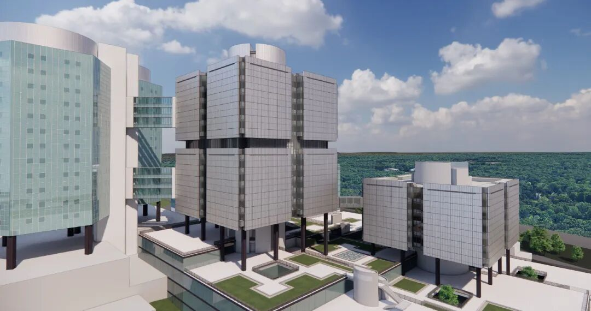
图 12｜金属板外墙、扩大转角玻璃与连桥的更新方案（改造效果图）。图片来源：石溪大学。
** 04  ** / RENOVATION WHILE OCCUPIED
##  建筑继续使用，外墙分段更换
外墙项目还覆盖健康科学塔与基础科学塔之间连桥的外围护，以及广场层周边柱子的包覆。更新对象沿着外部界面展开，施工则采用分期方式，让建筑使用者能够在工程期间继续留在楼内。
与教学科研塔楼的外墙项目同时受到关注的，还有南北两座病房塔楼。霍夫曼建筑与工程事务所（Hoffmann Architects +
Engineers）自2011年起参与病房塔楼的围护修缮策略，工作包括玻璃幕墙、步行连桥及电梯井外饰面。病房塔楼的改造同样需要配合持续的医院运营。
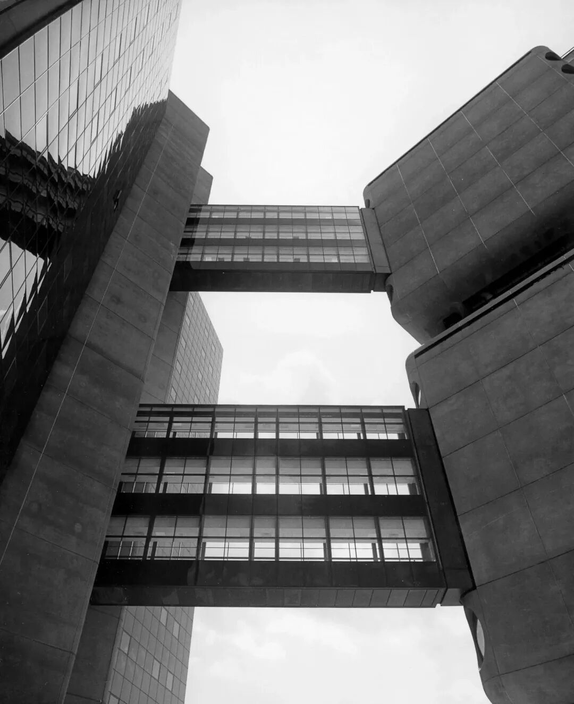
图 13｜塔楼之间上下排列的玻璃连桥（档案照片）。图片来源：Bertrand Goldberg Archive，经Parametric
Architecture。
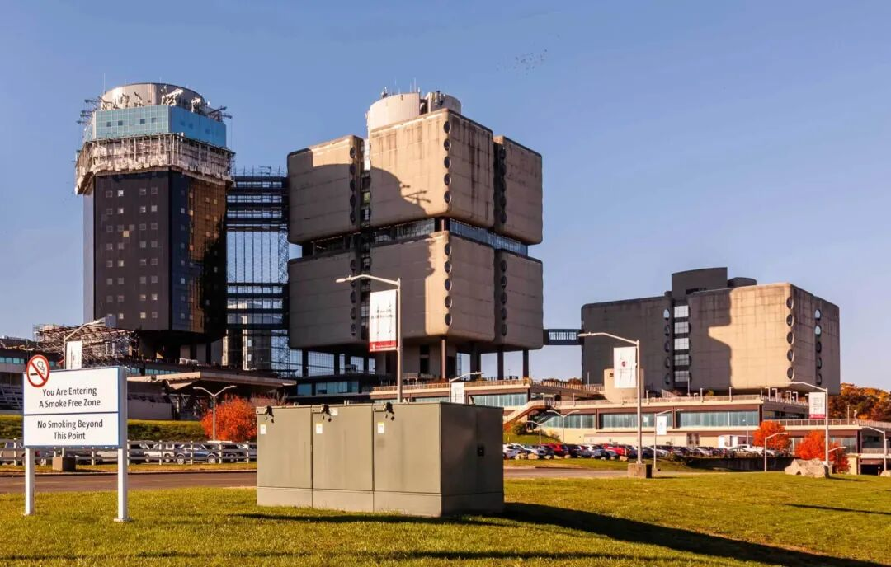
图 14｜建筑群外观，左侧病房塔楼可见外墙施工（资料照片）。图片来源：Wikimedia Commons。摄影：Kenneth C.
Zirkel。授权：CC BY 4.0。
病房塔楼的既有玻璃围护与教学科研塔楼的实体墙不同，更换时需要分别处理框架、玻璃和连接部位。霍夫曼团队对既有外墙进行调查，编制更换文件，并在需要时提供应急修缮服务。
对一座承担教学、研究与医疗的建筑群来说，维护与使用只能在时间上交错推进。预计2031年春季完成的教学科研塔楼外墙项目，也将按这样的条件展开：内部活动继续，外部界面逐步改变。
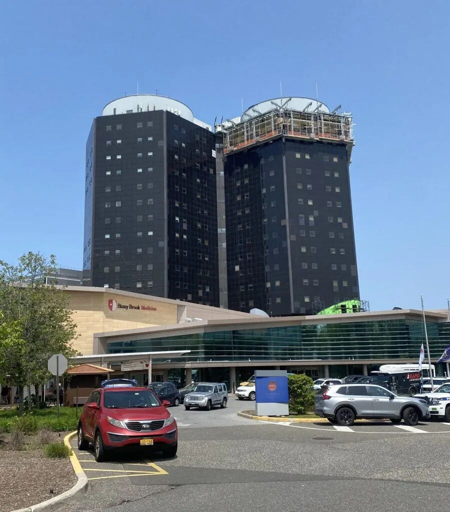
图 15｜维持使用期间的病房塔楼幕墙更换（工程记录照片）。图片来源：Hoffmann Architects + Engineers。
##  项目档案
** 项目  ** 石溪大学健康科学中心 / Stony Brook University Health Sciences Center
** 地点  ** 美国纽约州长岛石溪
** 原设计  ** 贝特朗·戈德堡 / Bertrand Goldberg Associates
** 历史节点  ** 临床科学塔1976年；基础科学研究塔1978年；大学医院1980年启用
** 此次更新  ** 外墙、转角玻璃、HST与BST连桥外围护及广场柱包覆
** 预计完成  ** 2031年春季（大学外墙项目计划）
** 组织部门  ** 石溪大学校园规划、设计与建设部门 / CPDC
##  参考资料
1\. 石溪大学｜Health Sciences Center Facade Replacement
2\. 贝特朗·戈德堡作品档案｜Health Sciences Center
3\. 芝加哥艺术博物馆｜Health Science City
4\. 石溪大学图书馆｜医院40周年历史时间线
5\. Hoffmann Architects + Engineers｜Stony Brook围护改造
