# BUZZ庄子玉新作 | 无围墙的艺术场：梓美术馆文化建筑群，湖北咸宁

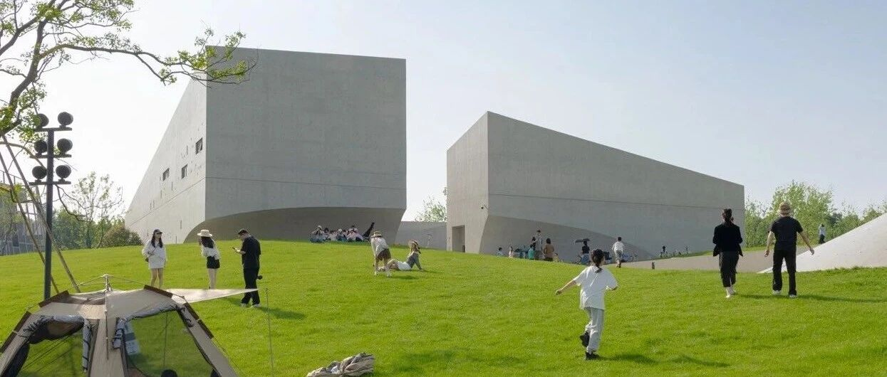

ARCHITECTURE / CULTURAL LANDSCAPE

# 把一座美术馆拆成4栋，庄子玉在湖北湖边铺开一片艺术草场

梓美术馆文化建筑群：展厅、书店与屋顶步道，共享一段湖岸

湖北·咸宁 / 2025年建成 / 4个文化单元

在湖北咸宁的梓山湖畔，逛美术馆可以从一片草坪开始。人们走过缓坡，抵达屋面，再沿着中庭边缘转向湖面；另一条路通往书店，远处还有一座冥想塔。几处清水混凝土建筑之间，留着大片可供停留的绿地。

这组由庄子玉带领BUZZ建筑设计事务所完成的梓美术馆文化建筑群，是梓有集宿集的公共文化核心，2025年9月建成。设计把原先集中式的大场馆拆为4个单元，让湖岸散步、屋顶漫游与室内观展拥有各自的入口和路径。

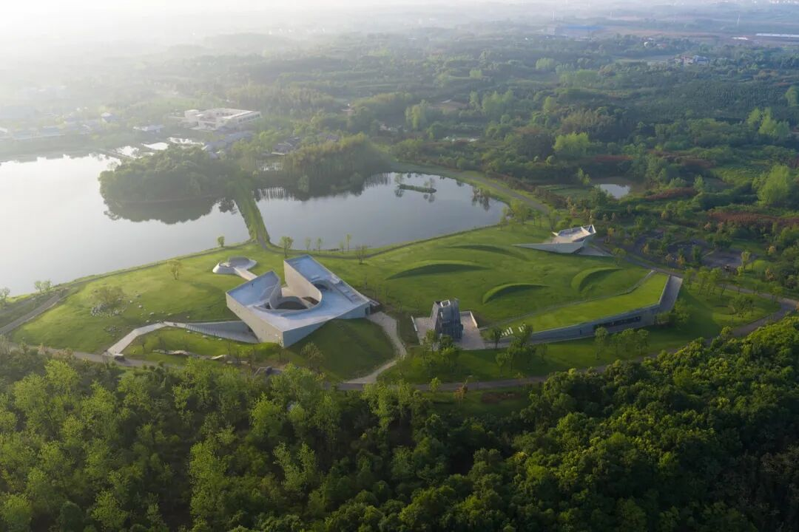

图 01｜梓有集湖岸与公共文化建筑群整体鸟瞰。图片来源：BUZZ建筑设计事务所。摄影：苏圣亮。

01 / FOUR BUILDINGS ONE SHORE

## 把大场馆拆开，湖岸留给日常

项目最初的规划是一座圆形大体量建筑。对一个由不同民宿组团构成的度假聚落来说，这样的集中式场馆容易将公共活动收进一处室内，把湖岸剩下的地方留作建筑周边的空地。

BUZZ改写了这张总图：梓美术馆、艺术工坊、No Art书店和冥想塔沿水岸分散布置，以草坪和步道相接。

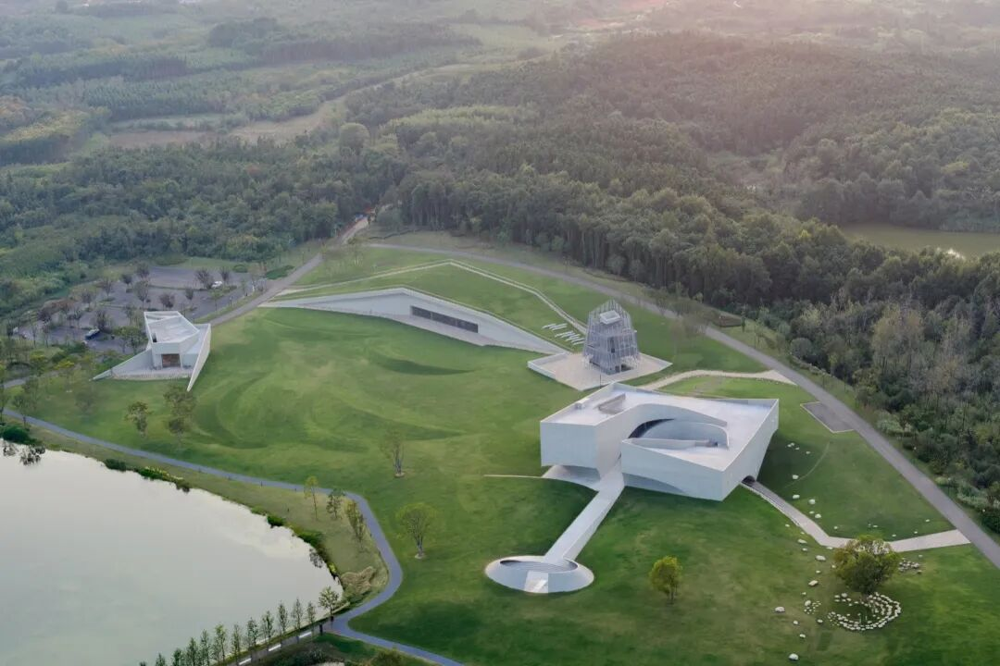

图 02｜沿湖散布的文化建筑群。图片来源：BUZZ建筑设计事务所。摄影：DONG建筑影像。

这种拆分同时改变了公共文化设施与客房的距离。隈研吾（Kengo Kuma）、谢柯等设计师参与的民宿组团散布在湖边，BUZZ负责的文化建筑与它们隔水相望。住客从房间看到的湖岸景象，也成为可以走过去阅读、看展和停留的目的地。文化建筑集中提供共享空间，各民宿组团则保留自己的住宿体验，两者通过水面上的视线和岸边的道路连接。

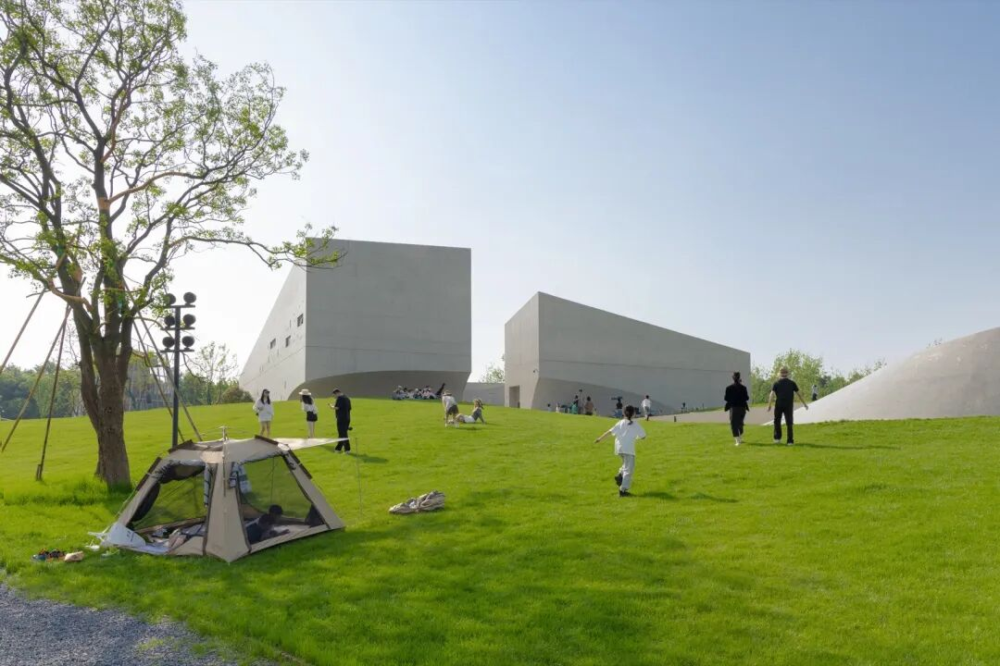

图 03｜公共草坪上的周末露营与户外活动。图片来源：BUZZ建筑设计事务所。摄影：苏圣亮。

原方案中的售票处与闸机被取消，园区公共景观的通行不再围绕一个检票入口组织。具体展览仍可设置前场和弹性检票。这里的空间安排因而分为两层：草坪、步道及建筑外部容纳日常来往，专业展厅保留独立管理的条件。湖岸有自己的生活，参观展览只是进入这片场地的理由之一。

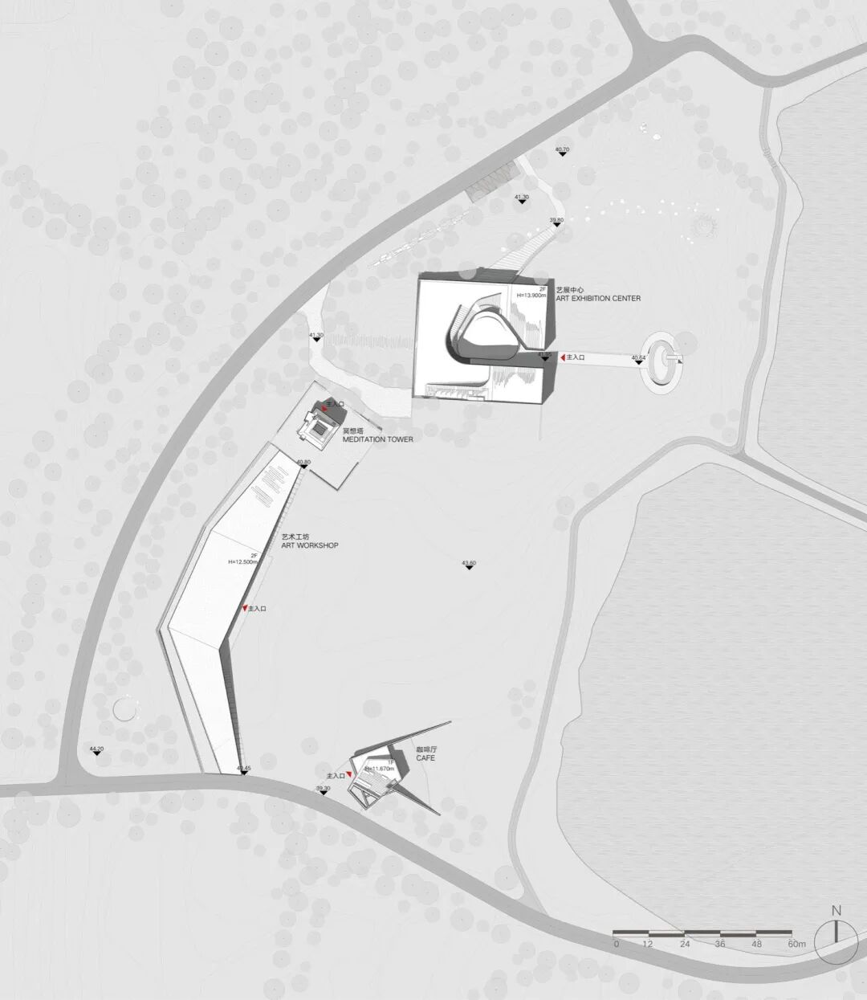

图 04｜梓美术馆文化建筑群总平面图。图片来源：BUZZ建筑设计事务所。

02 / GROUND BECOMES ROOF

## 草坡接上屋顶，建筑多了几层地面

分散体量之后，设计继续处理建筑与地面相接的方式。道路一侧承担后勤、货运和设备出入，面向湖水的一侧则留给公共草坪与活动。服务流线收至背面，临湖界面向步行和停留敞开，避免参观者在水岸活动时反复穿过卸货与设备入口。

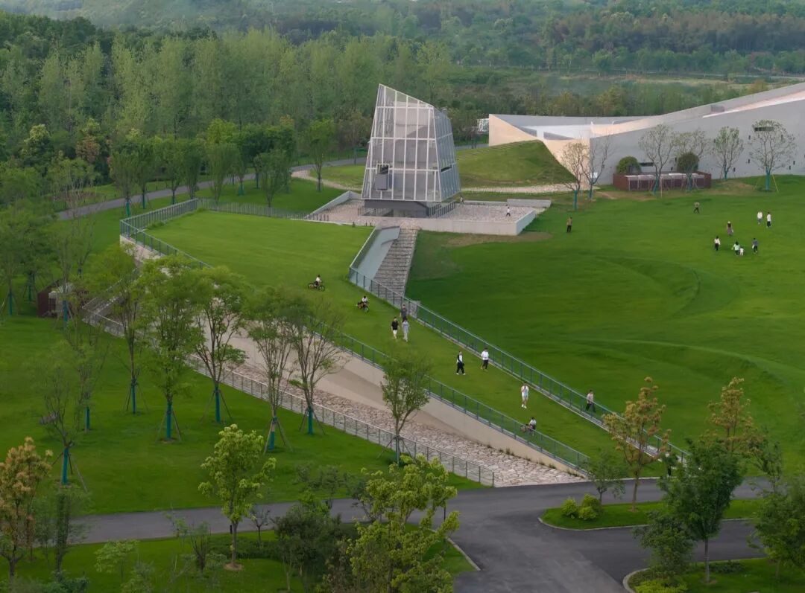

图 05｜道路一侧的建筑群。图片来源：BUZZ建筑设计事务所。摄影：苏圣亮。

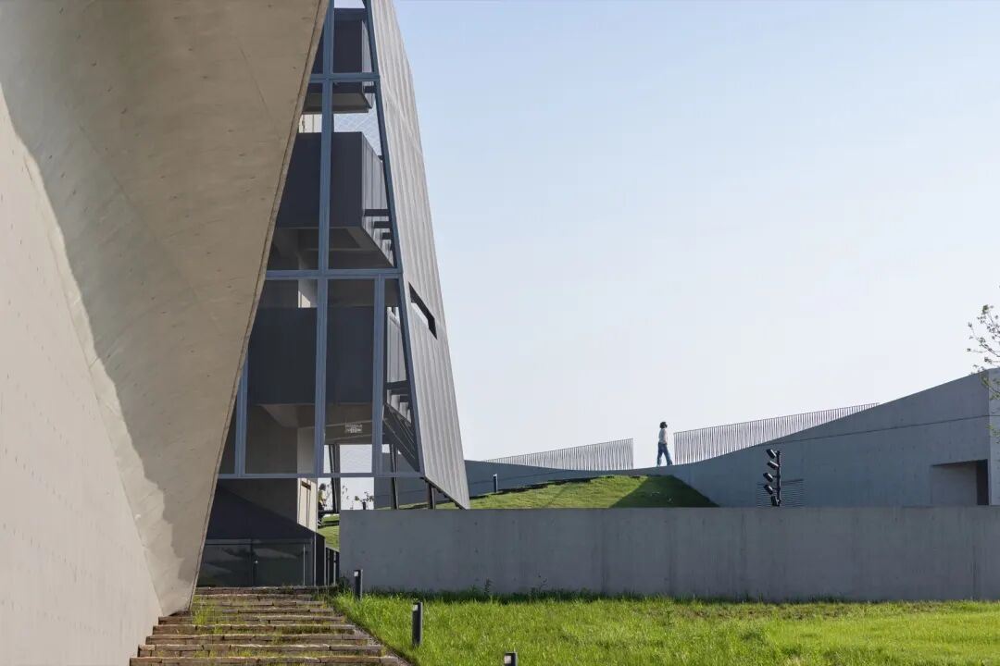

图 06｜美术馆地下层入口与冥想塔地面入口。图片来源：BUZZ建筑设计事务所。摄影：苏圣亮。

场地原有道路与湖面之间的高差，被整理成缓坡、下沉入口与延伸平台。地下层因而可以从室外直接抵达，咖啡、书店等空间与草坪平接，部分坡道继续向上，通往中庭露台及屋面。美术馆延伸出的小礼堂与坡道，把一段普通的层间交通拉向户外，人们行走时也逐渐靠近水面。

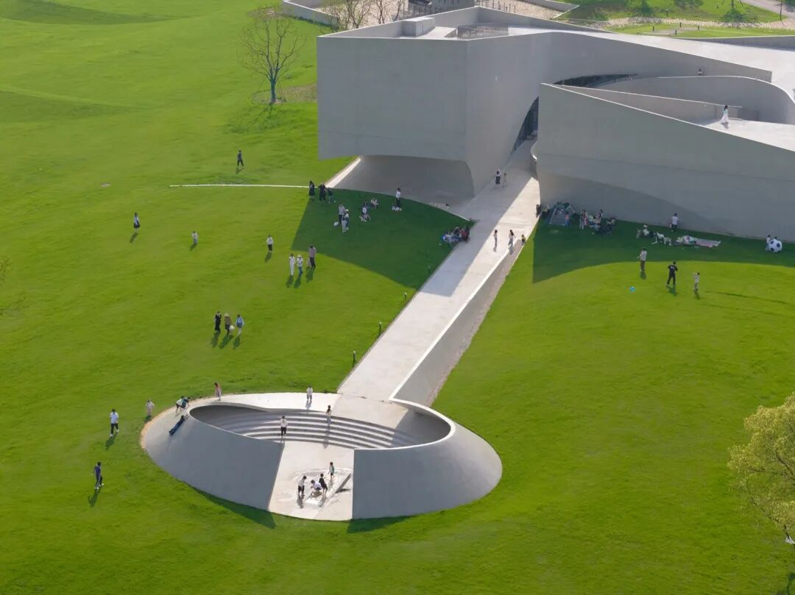

图 07｜美术馆延伸的小礼堂与坡道。图片来源：BUZZ建筑设计事务所。摄影：苏圣亮。

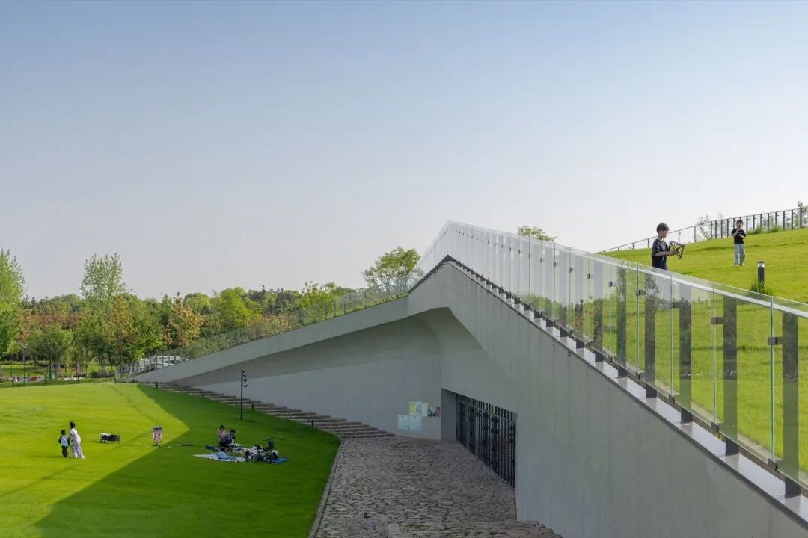

图 08｜艺术工坊绿色屋面。图片来源：BUZZ建筑设计事务所。摄影：苏圣亮。

地下层、景观首层、延伸平台和局部覆土屋面，分别接入室外地形。上楼的过程可以在建筑外部完成，屋顶也获得了步行与观景用途。艺术工坊的大部分体量藏入微地形，绿色屋面延续草坡；美术馆则露出更鲜明的折面轮廓。同一片场地里，建筑有的隐入地面，有的成为远处可辨认的坐标。

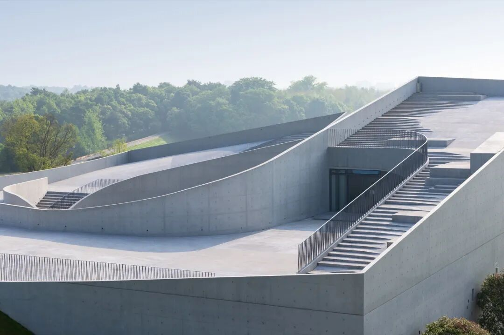

图 09｜可漫游的屋面与坡道。图片来源：BUZZ建筑设计事务所。摄影：苏圣亮。

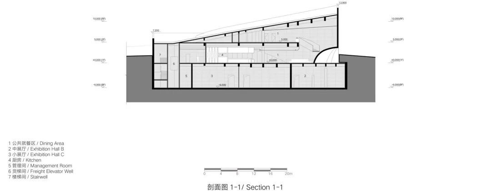

图 10｜梓美术馆剖面，展现地下层、中庭与屋面坡道的标高关系。图片来源：BUZZ建筑设计事务所。

03 / COURTYARD AND GALLERIES

## 看展与看湖，在中庭两侧相遇

建筑面积2884平方米的梓美术馆，是四个单元中最主要的展览载体。清水混凝土的折面在平缓湖岸上建立起清晰轮廓，内侧却围绕中庭展开较为曲折的通道。外部体量的完整，与内部路径的分岔同时存在：人们从远处辨认出一座美术馆，走近之后，又遇到数个可以继续前行的方向。

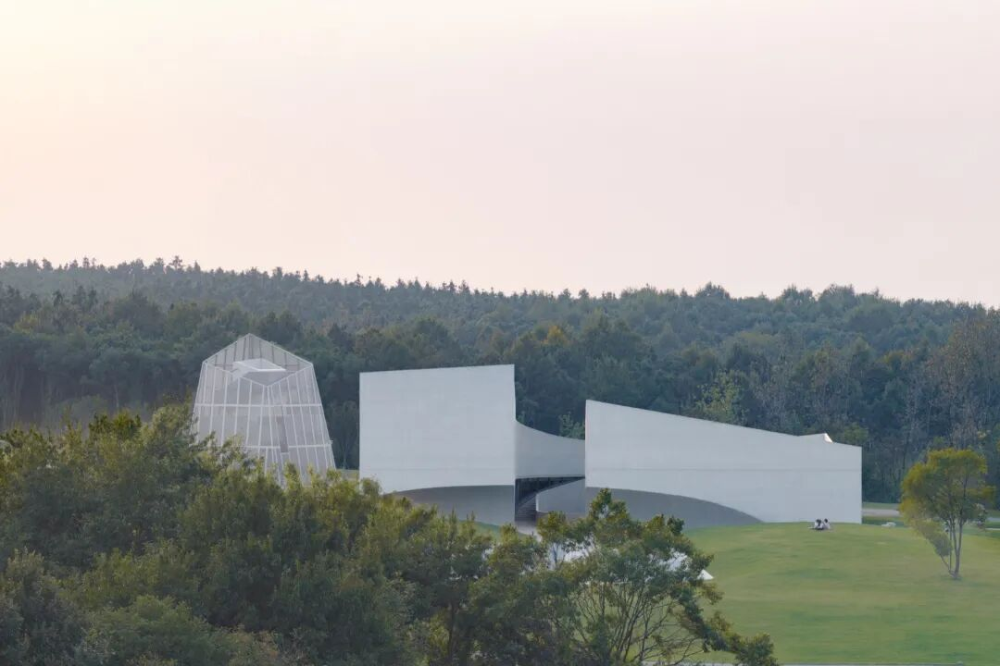

图 11｜美术馆的折面形体。图片来源：BUZZ建筑设计事务所。摄影：DONG建筑影像。

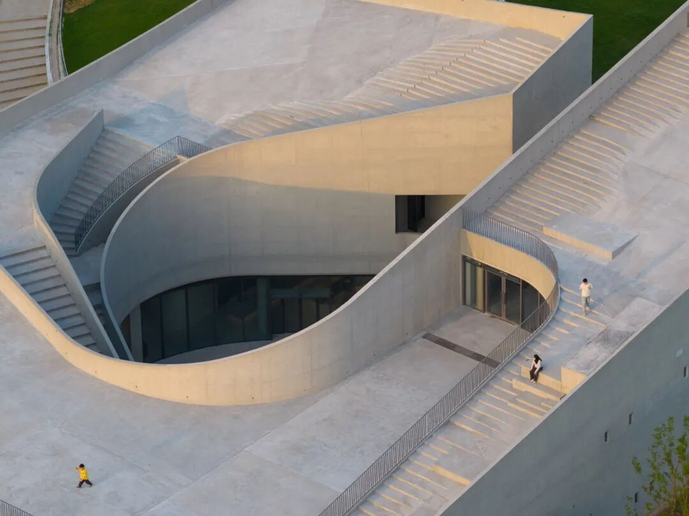

图 12｜美术馆中庭及环绕庭院上升的坡道。图片来源：BUZZ建筑设计事务所。摄影：苏圣亮。

临道路一侧的路径下接地下层，服务学术活动与后勤；这一层配置恒温展厅、藏品库房和多功能报告厅。首层安排可变展厅与花园餐厅，室外景观坡道则直接抵达中庭步道和露台。休闲访客能够从户外上到露台，专业展览仍在室内保有自己的空间。建筑通过出入口和标高分配不同活动，给看展与度假各留了一条路。

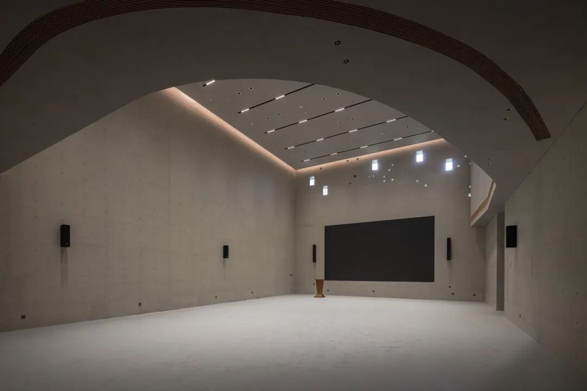

图 13｜美术馆内部的多功能报告厅。图片来源：BUZZ建筑设计事务所。摄影：苏圣亮。

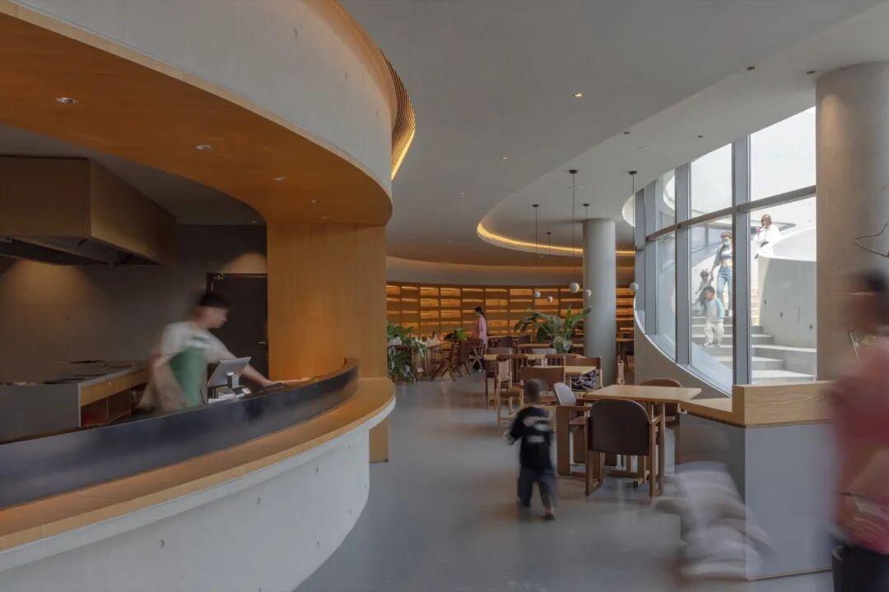

图 14｜临湖玻璃界面一侧的餐饮空间。图片来源：BUZZ建筑设计事务所。摄影：苏圣亮。

中庭周围，弧墙、折墙与坡道连续转向，室内外通道在不同位置靠近展厅和餐饮区。平面中的庭院空腔，为穿行者反复提供方向参照；湖面则在转角和开口处进入视野。这种路线并不要求每个人按同一个次序走完全部空间。看展途中可以停下来，也可以从露台重新接回场地步道，庭院与湖景成为观展间歇里可重复抵达的地方。

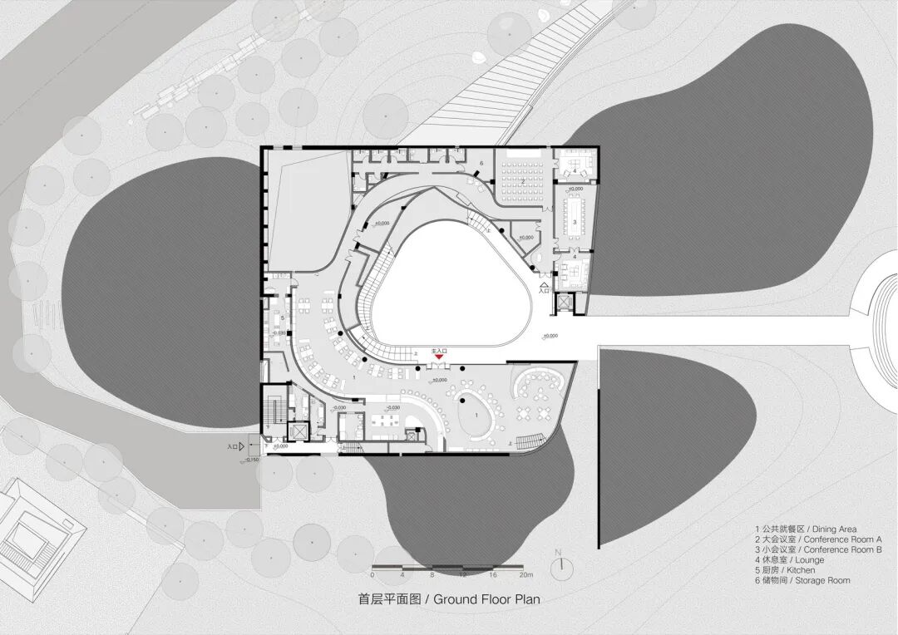

图 15｜梓美术馆首层平面图。图片来源：BUZZ建筑设计事务所。

04 / SMALL PLACES TO STAY

## 工坊藏进草坡，书店面向湖水

另外三个单元的尺度与用途各不相同。839平方米的艺术工坊大半藏入微地形，入口从草坡两侧露出。内部可以灵活分隔，为艺术家驻场、手工制作和小型分享会提供场地。比起把所有文化活动收进美术馆，独立工坊为创作与交流另设一处相对安静的空间，日常使用也不必与大型展览同步。

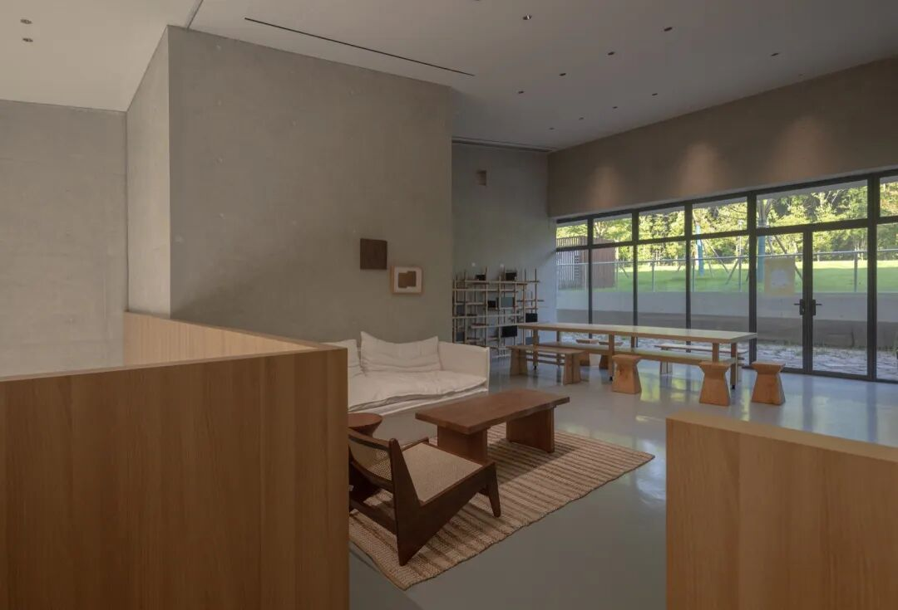

图 16｜艺术工坊内部的木质家具与活动空间。图片来源：BUZZ建筑设计事务所。摄影：苏圣亮。

197平方米的No Art书店紧邻主游线，与道路相对。檐下的半室外空间承接经过的人，室内地坪沿高差逐渐下沉，落地玻璃正对草坪和湖面。书店以书籍、咖啡和短暂停留衔接园区日常，为没有观展计划的访客提供一个同样明确的去处。建筑体量虽小，面向湖水的开口却让阅读与户外景色保持直接联系。

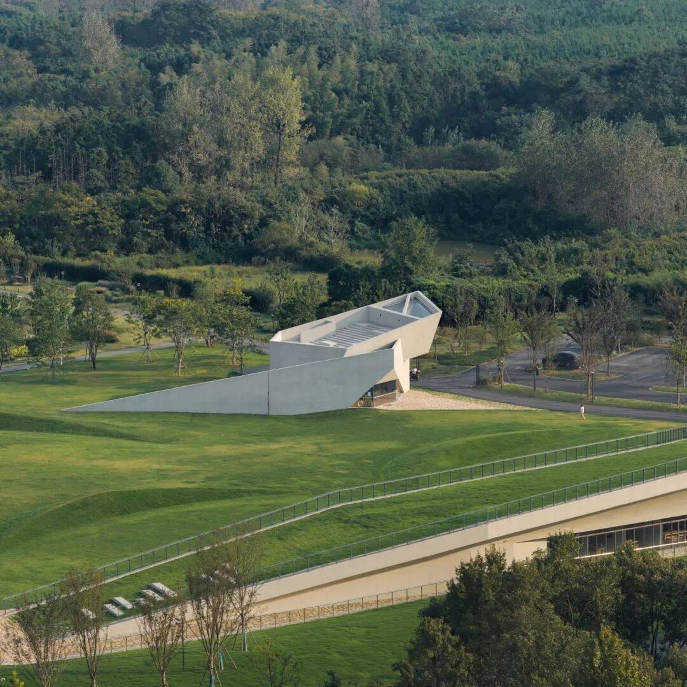

图 17｜No Art书店鸟瞰。图片来源：BUZZ建筑设计事务所。摄影：DONG建筑影像。

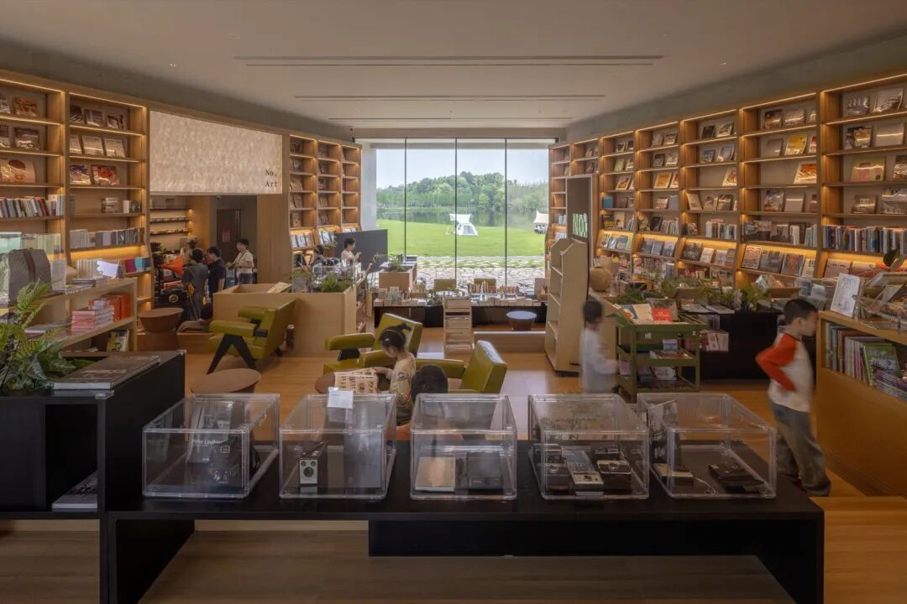

图 18｜No Art书店内部。图片来源：BUZZ建筑设计事务所。摄影：苏圣亮。

冥想塔则把路径竖起来：金属网围护内部盘旋上升的步道，底部衔接下沉庭院。与工坊的藏入、书店的横向展开相比，塔提供了向上行走和俯看场地的机会。四个单元由此形成不同的停留方式：进入展厅、坐下阅读、参与制作、登高望湖。分散布局的内容来自这些具体活动的差别，建筑之间的路程也因此有了目的。

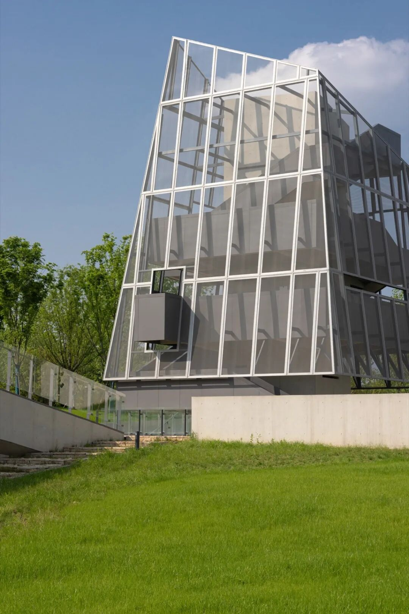

图 19｜金属网围护的冥想塔外观。图片来源：BUZZ建筑设计事务所。摄影：苏圣亮。

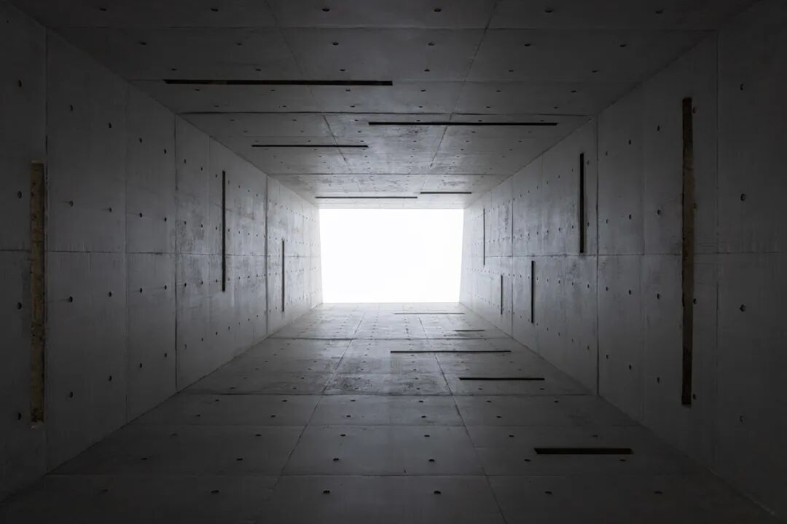

图 20｜从冥想塔内部向上仰望顶部开口。图片来源：BUZZ建筑设计事务所。摄影：苏圣亮。

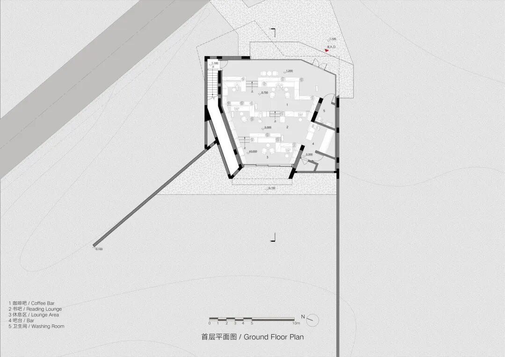

图 21｜No Art书店首层平面，展示道路到达、室内布置与湖岸朝向。图片来源：BUZZ建筑设计事务所。

05 / CONCRETE AGAINST THE LAWN

## 清水混凝土，留下可辨认的轮廓

清水混凝土统一了这组建筑的主要面貌。平缓的水塘与草地缺少突出的地形标记，折面、曲墙和拱形开口便形成容易辨认的轮廓，也让公共文化建筑与周边民宿保持差异。近看时，素面墙体、孔洞与阴影又把建筑的尺度拉回到人的身边；人在拱下经过，厚重的墙面与低处可穿行的空间同时进入画面。

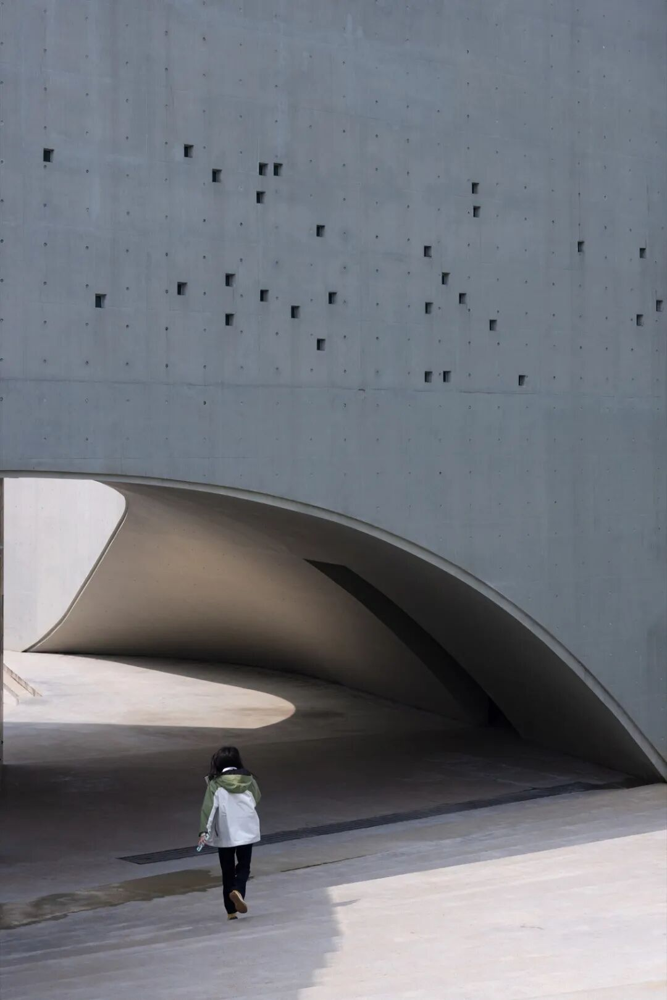

图 22｜曲面混凝土与人的尺度。图片来源：BUZZ建筑设计事务所。摄影：苏圣亮。

形体上的醒目，与地面上的可穿行，在这里同时成立。美术馆保留鲜明的混凝土体量，局部架空、玻璃界面及坡道则让人能够继续走向庭院和湖岸。拱形灰空间连接草坪与台阶，既提供停留的位置，也将室外活动带到建筑边缘。建筑对景观的回应，具体发生在这些可进入、可经过的接缝上。

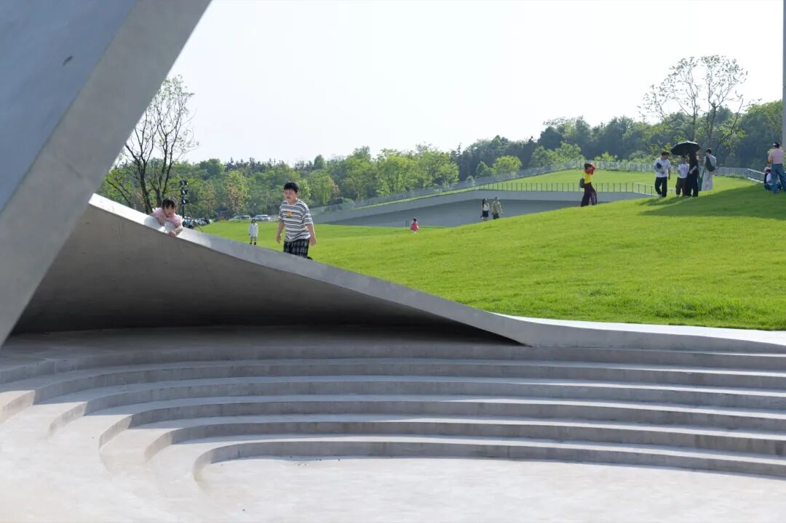

图 23｜小礼堂的拱形灰空间。图片来源：BUZZ建筑设计事务所。摄影：苏圣亮。

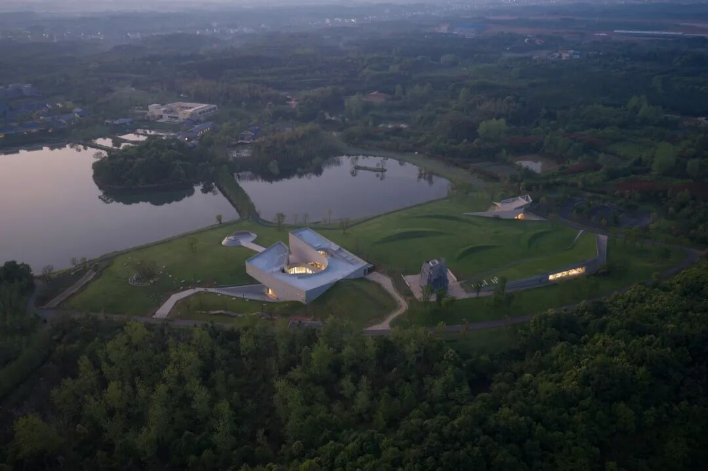

图 24｜夜幕下的文化建筑群与周边湖岸。图片来源：BUZZ建筑设计事务所。摄影：苏圣亮。

## 项目档案

项目　梓美术馆文化建筑群

项目地点：湖北，咸宁

建筑面积：梓美术馆-2884㎡；艺术工坊-839㎡；NoArt书店-197㎡；冥想塔 (构筑物）

设计时间：2023.11

建成时间：2025.9

业主单位：湖北联投集团

建筑及室内设计单位：BUZZ建筑设计事务所

项目主创：庄子玉、李娜、戚征东、杨晔

设计团队：刘健、李楚然、吴梦笛、刘月、陈阵东、刘晨、梁晨、蔡薇、丁竹靓、张皓轩、高峥、潘培成、徐嘉文、高艺乘、文雅、彭川倪

建筑施工图：湖北省建筑设计院

施工单位：湖北工建基础设施建设有限公司

室内设计单位：BUZZ建筑设计事务所

精装施工单位：苏州金螳螂建筑装饰股份有限公司

景观设计单位：环球地景设计

照明顾问：北京远瞻照明设计有限公司

主要建筑材料及供应商：清水混凝土-泉州清水砼建筑工程有限公司，安耐板，拉伸金属网

建筑摄影：苏圣亮，DONG建筑影像

出品图制作：星梦昭、任中琦、徐雅涵、于涵、何佳欣

预览时标签不可点

不喜欢
