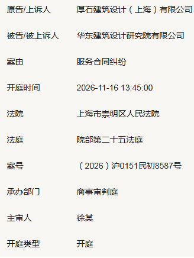
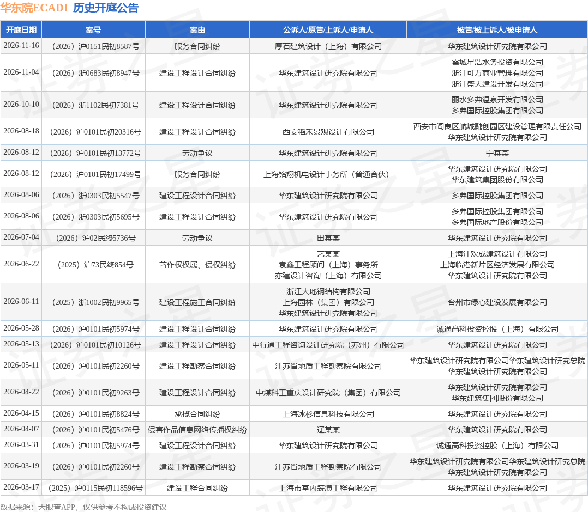

# 华东院又双叒叕被告了！

11月16日下午1点45分，上海市崇明区人民法院第二十五法庭，即将开庭审理一起服务合同纠纷。

原告是厚石建筑设计（上海）有限公司，被告是华东建筑设计研究院有限公司——业内叫华东院，ECADI，国内建筑设计行业的老大哥。
先说清楚双方的体量：厚石建筑1992年成立，注册资本800万，参保人数33人，汪鹏和刘艳两个自然人持股，小型民营院。华东院1993年成立，注册资本1.65亿，参保人数2632人，是华建集团的全资子公司，根正苗红的上海国企龙头。
一家33人的民营小设计院，把合作多年的老大哥告上了法庭。这不是什么意气之争——能让一家小院不顾"抬头不见低头见"的行业规矩撕破脸，只有一种可能：‌  **
现金流绷到极限了，再不告，自己可能先撑不住。  **
‌
##  这不是华东院今年第一次当被告
厚石这起只是最新一起。
据第三方企业信息平台的公开开庭公告统计，近一年内，以华东建筑设计研究院为当事人的历史开庭公告有近20则。其中作为被告的，占了六成以上：建设工程设计合同纠纷、勘察合同纠纷、承揽合同纠纷、服务合同纠纷、劳动争议、著作权侵权，案由排了一整页。

这些原告里，有机电事务所、有勘察院、有景观和幕墙专业公司、有外地合作院——全是华东院的下游分包商和合作方。它们告的事由几乎一样：‌  **
我干完我那部分活了，你没给我钱。  **
‌
##  一条链条，从上游烂到下游
把这些案子摞在一起，一条清晰的债务传导链就出来了。
‌  ** 链条上游，是甲方欠华东院的钱。  ** ‌
华东院自己作为原告的案子，全部是建设工程设计合同纠纷，被告是地产商、项目业主、城投平台——浙江多弗系的公司涉及3起，从温州到丽水横跨多个项目；上海诚通高科1起；还有各地城投。它把甲方告上法庭，核心诉求就一个：设计做完了，设计费没到账。
‌  ** 链条中游，是华东院欠下游分包商的钱。  ** ‌
它从甲方那里拿不到回款，下面的机电、勘察、景观、咨询合作方，钱也就拖着。厚石、铭翔机电、江苏地质勘察院、弗思特科技，这些公司起诉的逻辑完全一致——我不可能无限期垫资，你总公司欠我的钱，不能因为你没收回来，就让我扛着。
‌  ** 链条末端，是员工和个人。  ** ‌
两起劳动争议、一起侵害作品信息网络传播权纠纷，都是行业下行期最容易爆的雷：裁员降薪引发的仲裁、设计成果盗用引发的知识产权官司。
这就是建筑行业最经典的三角债：甲方欠设计院，设计院欠分包商，分包商欠材料商和员工。一环套一环，谁都拿不到现金，最后只能对簿公堂。
最高法10月刚发布的民营经济纠纷典型案例里，就有一模一样的场景：混凝土公司给工程公司供完建材，585万货款只拿到44万首付，剩下540万被拖着。工程公司不是不想给，是它的钱被上游发包方拖住了——发包方不结款，它就没现金付建材款。
‌  ** 三角债最可怕的地方在于：它不是某一家坏，是整条链上所有人都没钱。  **
‌
##  母公司的半年报，比官司更难看
官司只是表象，母公司华建集团的半年报，才是这家龙头院真正的体检报告。
8月26日华建集团披露的2026年中报，数字扎眼：
  * 营业收入23.59亿元，同比下降20.76%；
  * 归母净利润1183.37万元，同比暴跌91.37%；
  * 扣非净利润135.84万元，同比下滑98.37%——‌  ** 扣除非经常性损益，整个集团半年只赚了135万，相当于一个资深主创半年的年薪  ** ‌；
  * 经营活动现金流净额-7.6亿元，比去年同期还多流出7700多万；
  * 新签合同总额28.04亿元，同比下降21.65%。
拆分新签合同看结构：工程承包合同7.82亿，同比暴跌45.83%；设计咨询合同20.22亿，同比下降5.30%；唯一正增长的板块是城市更新，新签5.50亿，同比大涨40.9%。
这信号再明确不过：重资产、垫资多的EPC工程业务在被砍，轻资产的设计咨询相对扛得住，城市更新是仅存的增量。
还有个细节很有意思：研发费用同比减少20.32%，财务费用同比减少96.89%。财务费用大降一般是好事，要么利息少了，要么汇兑赚了；但研发费用砍五分之一，在一个喊"数字化""双碳""AI+建筑"的年份，多少说明兜里是真紧了。
人员数据上，华建集团虽然没直接写"裁员"，但据网传口径，2025年底员工总数约3300人，2026年中报时点已经降到2954人，半年少了近350人。
##  从30万年薪到2740底薪
财报是冷的，落到设计师身上是热的。
今年7月，圈内流传一段华东院内部总师的发言，原话是这么说的：华东院团队里年轻建筑师的月基本工资，是上海市最低工资标准——2740元。他举了个例子：自己家请的清洁工，每天工作3小时，一个月付3000块，比团队年轻人的基本工资还高。
2740元是个什么概念？2025年7月1日起上海月最低工资标准就是这个数。也就是说，合同里写的基本工资，直接贴着上海的法定底线。
以前华东院是什么地方？建筑系毕业生挤破头想进的顶级平台，老八校简历是标配，工作三五年年薪二三十万是常态，核心主创年薪百万不鲜见。现在呢？年轻设计师底薪贴着最低工资，绩效绑着项目回款，回款不到账，绩效就是零。
这不只是华东院一家。今年8月，华东地区某大型设计院通知全员月薪统一调整为2800元；两个月后，另一家华东院把全员底薪压到3000元，项目提成只按实际到账额的40%支付，差旅、办公开支全部由项目组承担，等于让设计师"自带干粮上班"。员工贴出了全员签字的联合声明，说薪酬是劳动合同核心条款，公司单方通知不等于合法变更，降幅超过50%已经影响基本生活。
再往前翻：重庆某设计院把员工月薪从一万多降到一千出头，有人到手只有600多，96名设计师集体仲裁；武汉28名设计师联名抵制停工待岗；广州某院甚至计划对靠窗工位每月收费400到500元，最后员工闹起来才作罢。
‌  ** 当一个行业连"靠窗工位要收费"这种招都想得出来，说明它的困境已经不是"效益不好"能解释的了。  **
‌
##  整个建筑业，第一次出现整体性负增长
龙头院尚且如此，行业大盘的数字更狠。
据中国建筑业协会发布的《2026年上半年建筑业发展统计分析》（这是官方权威口径，不是自媒体统计）：
  * 上半年全国建筑业总产值11.94万亿元，同比下降12.71%——这是中国有建筑业统计以来，第一次出现整体性负增长；
  * 31个省份无一增长，降幅最小的吉林也跌了0.37%，辽宁、江苏降幅超过30%；
  * 房屋建筑新开工面积9.23亿平方米，同比下降26.20%；
  * 房屋建筑竣工面积8.24亿平方米，同比下降31.74%；
  * 直接从事生产经营活动的平均人数3676万人，同比减少13.14%——半年少了480多万人。
竣工面积跌三成，这件事比总产值下跌更要命。竣工是结算和回款的节点——项目没竣工，甲方就有理由拖着不付款；竣工少了三分之一，意味着能真正转化成现金的盘子在快速萎缩。设计院作为项目最前端，却是回款最后端：甲方往往等项目竣工、销售回款后才结清最后一笔设计费，账期从半年拖到一年、再拖到两三年，最后成了坏账。
地方财政这边也绷着。2026年上半年城投债广义借新还旧比例攀升至98.69%，新发行的债券几乎全部用来还旧债，新增融资实质性冻结。地方政府连工程款都付不出来，自然没钱上新项目，市政、基建类设计业务跟着萎缩。
房地产那头更不用说：上半年开发投资同比下降20.6%，房屋新开工同比下降26.2%，标普预测全年新开工还将再收缩15%-20%。曾经撑起设计行业半壁江山的住宅业务，肉眼可见地缩。
三重红利——地产、城镇化、基建——同时消退，设计院的日子能好过才怪。
##  唯一的亮色，也写在半年报里
说点不那么丧的。华建集团半年报里唯一大涨的板块，是城市更新，新签合同额5.5亿，同比增长40.9%。
这不是偶然。《城市更新"十五五"规划》明确提出，未来五年要改造危旧房50万套、城中村4000个、地下管网36.5万公里，市场规模十万亿级。这类项目不依赖土地财政，需求稳定，而且非常考验精细化设计能力——正好避开了传统房建的低价内卷。
另一个逆势增长的数据在海外：上半年我国对外承包工程完成营业额6062.6亿元，同比增长8%，"一带一路"国家完成营业额增长11.8%。华建集团上半年重点布局中东、中亚，4家单位拿到了新一轮援外项目实施企业资格，这是头部院的另一条活路。
还有双碳、数智化、新基建（新能源、水利、数据中心、医疗教育建筑）这些赛道，都在放量。但转型从来不是容易的事——城市更新项目小而散流程复杂，海外有法律和文化风险，数智化需要持续投入短期看不到回报。
##  最 后
回到厚石告华东院这起官司。
很多人会问：都是同行，为什么一定要闹上法庭？
答案很现实：厚石不是不知道"关系"的重要性，也不是不想给老大哥留面子，而是它自己也要活下去。33人的小设计院，现金流就那么点，被龙头拖着一笔服务费，可能就是生死线。如果不是绷到极限，谁愿意把合作方告上法庭——在这个圈子里，打官司意味着以后很难再合作。
但行业走到今天，"面子"已经喂不饱肚子了。
华东院作为行业龙头，它的困境不是它自己的问题，是整个建筑设计产业链现金流断裂的缩影——甲方欠它钱，它欠下游钱，下游欠员工钱，一环套一环，谁都跑不掉。龙头都只剩135万扣非利润的时候，下面的小院、分包商、设计师，日子只会更难。
我们不必神话过去那个"闭眼赚钱"的黄金年代，也不必过分渲染悲观。建筑设计不会消失，但那个靠规模扩张、低价竞争、人脉资源就能活下去的时代，真的结束了。
只是这个转型的阵痛，最后最先挨刀子的，永远是链条最末端的那个人——画图的设计师，和33个人的小设计院。
各位所在的院，回款现在是什么情况？被甲方拖了多久？评论区聊聊。
