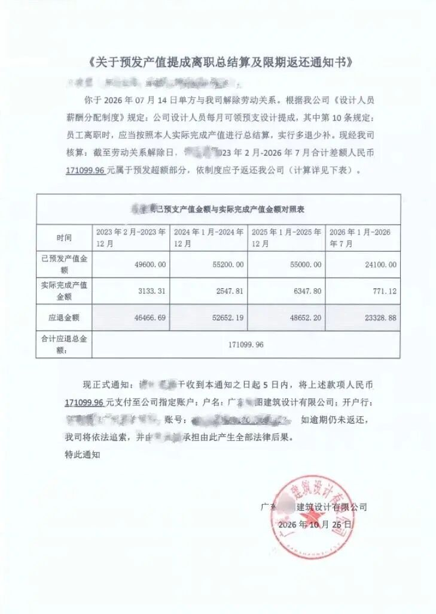
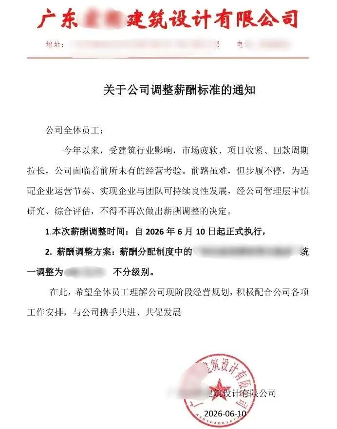

# 追讨离职人员17万上热搜，院负责人：他爱怎么闹就怎么闹...

近日，就"离职员工倒欠公司17万"一事，广州那家建筑设计公司的负责人在接受采访时回应：
"他爱怎么闹就怎么闹去吧，我们也不管，无所谓了。"
一个拿着三年半前的账、追着离职员工讨17万的老板，用"无所谓"三个字，给这场纠纷定了调。

对了，同一次回应里，这位负责人还补了一句：目前行业经营困难，公司出现亏损，"不知道能做多久"。
一边说"我们也不知道自己能撑多久"，一边咬着牙追一个已经走了的员工。
这两句话摆在一起，很多事情就不用多解释了。
##
##  那句"为什么去年没收回来"，才是真正的自白
公司负责人的回应里，藏着一句比"爱闹就闹"更值钱的话。
记者问他有没有做年度核算，他说：按制度会总结算，"为什么去年没给他收回来，万一收回来他们就辞职，就说被动离职了，就担心出现这种情况"。
读三遍。
这话的信息量在于，它把整套操作的底，自己交了。
公司自己定的薪酬制度里，白纸黑字写着：每年12月31日前核算个人工作量提成，次年3月31日前完成对冲和发放。也就是说，"年度核算、年度对账"本来就是这套制度的一部分。
那九年里为什么一次都没做？
负责人的答案是——怕做了，人就跑了。
‌  ** 于是账就这么挂着。不是算不出来，是算出来了也不敢给你看，因为一旦你真欠了钱，你会立刻辞职；而你一辞职，就可能是"被动离职"，公司要多付代价。
** ‌
所以这笔账，攥在手里，等。等到你哪天自己要走，或者哪天不得不动手，才拿出来，一锤子砸下去。
这哪是财务流程，这是一张捂了三年半、等人离场才敢打的牌。
##  那张对照表，荒诞得让人说不出话
回到这张表本身。
公司发了份《预发产值提成离职总结算及限期返还通知书》，把许先生2023年2月到2026年7月的账，一年一年拆开算：
2023年2月到12月，预发49600元，"实际完成产值"3133.31元，应退46466.69元。
2024年全年，预发55200元，"实际产值"2547.81元，应退52652.19元。
2025年全年，预发55000元，"实际产值"6347.80元，应退48652.20元。
2026年1月到7月，预发24100元，"实际产值"771.12元，应退23328.88元。
合计171099.96元，限5天退回。
许先生2017年9月进公司实习，2018年9月转正，干到2026年7月提出离职，在职近9年。

差额退还通知
重点看2024年那一行。公司一年往他卡上打了五万五，平均每月四千六。然后告诉他，他这一整年"实际完成"的产值，是两千五百四十七块八毛一。
一个人一年在工位上画图、干活、加班，被认定只创造了不到两千六的价值；而他每个月收到的钱，现在被重新定义成"先借给你的"。
‌  ** 这不是退"多发的"，这是把过去三年半你每个月领的工资翻出来重算一遍，算完告诉你：这九年，你欠我的。  ** ‌
财务上更离谱的是，"实际产值"低到这个程度，公司当年为什么不核？为什么不调岗、不调薪、不提异议？非要等到人离职，才发现三年半的账全是亏的？一套正常的核算制度，会允许员工的"实际产值"连续四年不到预发的十分之一，还照发不误吗？
答案只有一个：这个数，本来就不是用来核算的，是用来讨钱的。
##  "不知道能做多久"，是现在很多院的大实话
负责人那句"不知道能做多久"，倒未必是气话。
设计院这两年什么处境，前面写过太多了。有人2.9万中标一个设计项目，三家报价差不到1000块；有人月到手1194.8元，跌破最低工资线；有头部国企院搞"人才沉淀池"，把一线骨干工资腰斩逼人自己走；有上市龙头半年扣非净利润只剩135万，现金流净流出7.6亿。
在这样的行情里，一家公司的现金流，可能就悬在几笔应收款上。于是过去发出去的钱，越想越"不该发"，总想找个名目拿回来一点。
许先生的遭遇之所以不是孤例，就在这儿。
公司14名员工走了约一半，其余协商离职的人都没收到退款通知。只有他，和另外两位发起劳动仲裁的同事收到了。三个人里，被追偿最多的是27万多元，是一位高级工程师。
只对维权的员工算这笔账。这不叫"执行制度"，这叫"针对性处理"。
‌  ** 先违反自己定下的核算规则，把账捂起来；等员工走了、甚至维权了，再翻出来单方结算。这不是在管账，是在找人撒气。  **
‌
##  "预发提成"这四个字，得说清楚
圈外人可能看不明白，公司凭什么这么算？
凭一份叫《设计人员薪酬分配制度》的内部文件，第十条写着：员工离职时，按本人实际完成产值进行总结算，多退少补。
这就是设计院通行几十年的"预发提成"制度。
设计这行，项目周期长，从画图到甲方回款动辄一两年。员工月度收入要稳，可产值什么时候结、结多少，说不准。于是行业形成一套办法：先按预估，每月"预发"一部分提成，年底或项目结了再统一核账，多退少补。

公司此前发布的薪资调整通知
上行期，它是激励——活多，产值对得上，预发的就是你的，年底还能再补一笔。
下行期，同一套制度变了味道。活少了，回款慢了，"实际产值"一核，你猛然发现这几年领的钱是"借"的。
‌  ** 制度一个字没改，行情变了，它就从发钱的工具，变成了要钱的通道。  ** ‌
许先生说得很实在：他谈薪谈的是固定工资，2023年公司出了新薪酬制度，工资结构里多了"岗位级别可申请绩效预支提成"一项，可工资总额没有明显变化——"还是那一个工资，所以大家都不在意"。
问题就出在这个"不在意"上。你在职时只知卡上进多少钱，不知道这个数背后对应哪张图、哪个系数。等你走了，公司甩出"实际产值2547.81"，你连反驳的入口都找不到——那套算法，从头到尾就没对你打开过。
##  法律这关，公司未必过得去
几个公开报道里的律师观点，说得挺透。
许先生承认薪酬制度文件他签过字。但《劳动合同法》第四条写明了：劳动报酬这类直接涉及劳动者切身利益的规章制度，得经职工代表大会或全体职工讨论，还要公示告知。签个字确认"知悉"，跟制度合法生效是两回事。四川伟旭律师事务所主任杜伟律师的判断是：多年不做年度核算、不和员工对账，偏等到员工离职、维权之后才单方算总账，这种条款，有被认定无效的可能。
定性上更清楚。按《关于工资总额组成的规定》，提成属于计件工资，是劳动报酬；《劳动合同法》第三十条规定，用人单位应当及时足额支付劳动报酬。项目回款慢、产值不达标，本质是企业的经营风险，原则上得公司自己扛，不能靠薪酬设计悄悄转嫁给劳动者。
而且这已经不是一家公司的玩法。
2025年10月，江西一家工程咨询设计公司给离职员工发函，要求退回"预发项目奖金"68154.72元；更早，重庆一家设计公司的97名设计师离职后被公司起诉，一审设计师败诉，二审因新证据出现，法院撤销一审，驳回公司全部诉请；天津有一起，公司要员工返还提成16万多，一审法院说得干脆——提成是劳动者提供劳动的对价，属于工资，公司不得克扣，主张返还的理由不属于可代扣工资的情形，二审维持。
这些判决指向同一个点：‌  **
法院看的是这笔钱的性质，不看你内部管它叫"预发"还是"借支"。只要它对应的是劳动者已经付出的劳动，那就是劳动报酬，发出去再想拿回来，门槛极高。  **
‌
##  最后
许先生这案子还在走程序，最终怎么判，得看仲裁和法院。
但公司那句"爱怎么闹就怎么闹去吧，我们也不管，无所谓了"，已经把这场纠纷的底色透出来了。
一家公司到了这个份上——账捂了三年半不敢公开，只追维权的人，一边说工资比兄弟单位高一倍，一边把工资的一半定性成借款，最后拿一句"无所谓"打发——它不是在立规矩，是在赌。赌员工耗不起，赌打官司太麻烦，赌你嫌十七万不值得闹。
可它偏偏忘了，这套账的对立面是什么。工资是劳动的对价，不是公司借给你的贷款。这条底线，不是靠"无所谓"三个字就能抹掉的。
‌  ** 真正让人心凉的，从来不是那17万，是有人把这件事算得这么仔细，却连句像样的解释都懒得给。  ** ‌
各位院里，工资条上有没有"预发"这两个字？发的时候讲不讲清楚，走的时候又算不算得明白？评论区聊聊。
