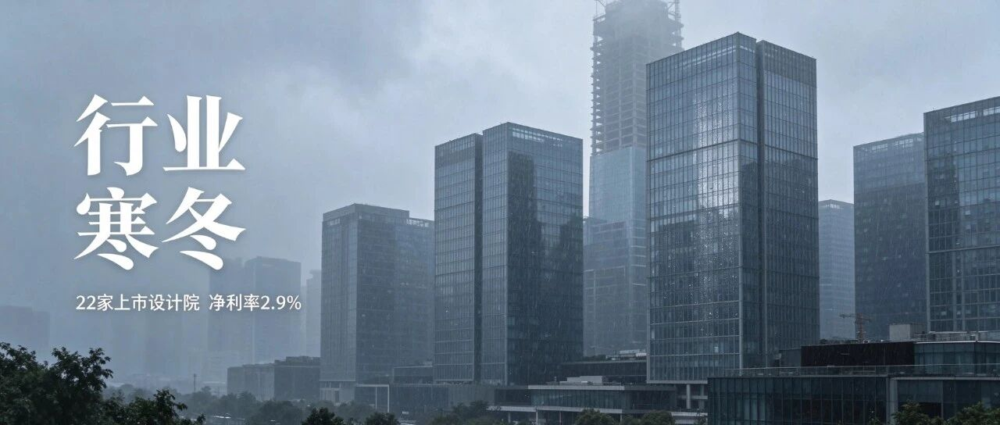
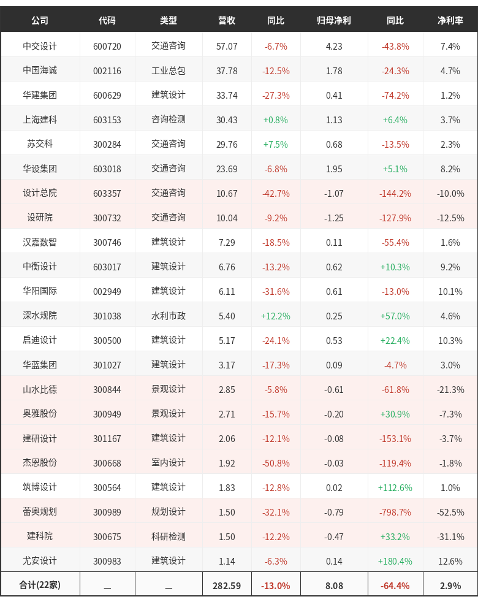
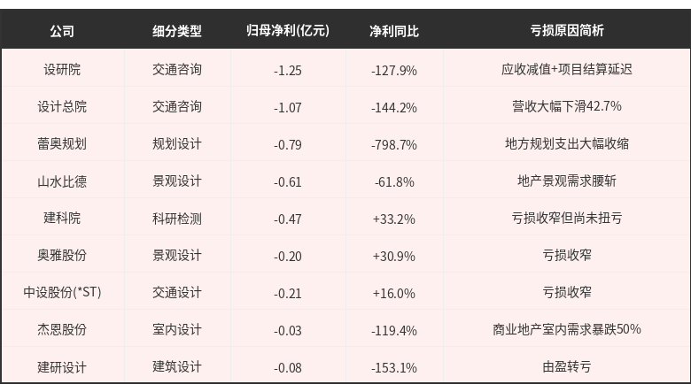
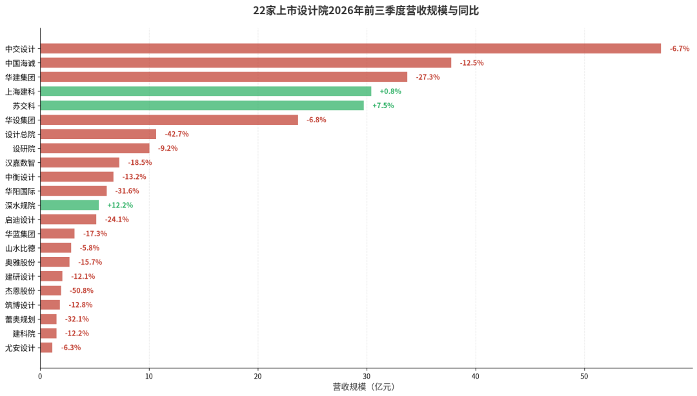
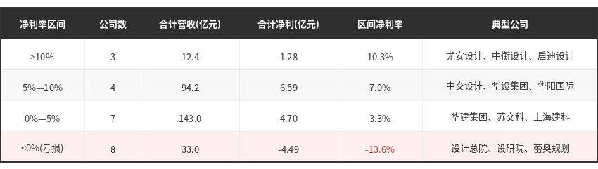
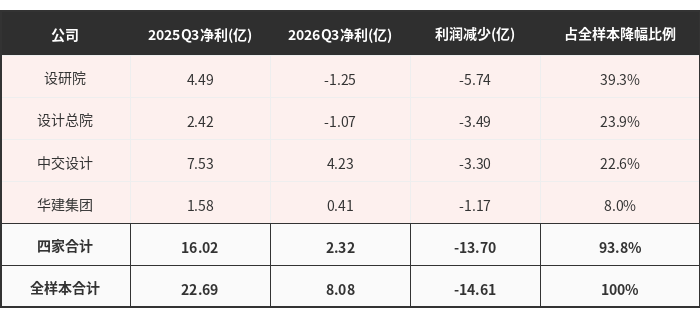
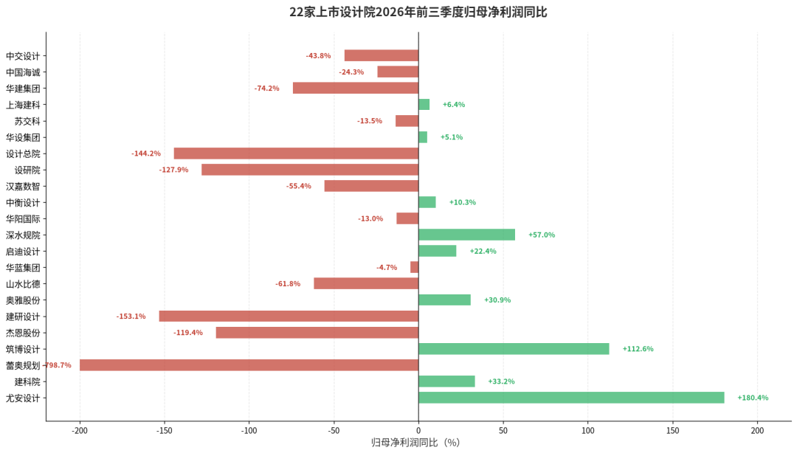
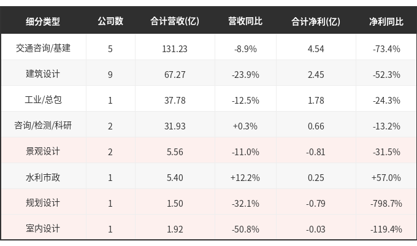
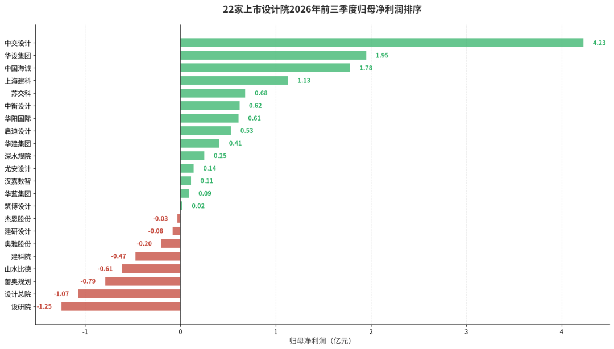
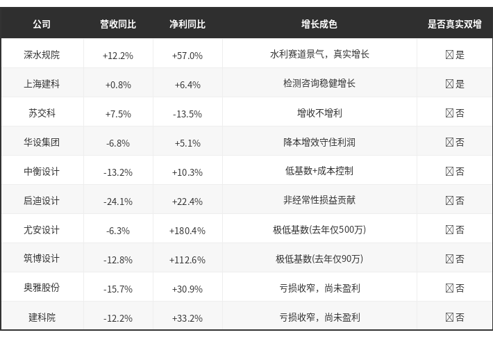

# 行业寒冬:22家上市设计院净利率2.9%

先说一个数字。
2026年前三季度，A股22家主业为设计、规划、咨询的上市公司，合计做了  ** 282.59亿元  ** 营收，比去年同期少了一成三；合计赚了  **
8.08亿元  ** 归母净利润，比去年同期少了六成四。
收入少了13%，利润少了64%。  这两个数字不是同一个故事，它们之间那条越拉越大的缝，才是今年设计行业真正的伤口。
如果只看营收，你大概会觉得"还行，跌了一成多，熬一熬就过去了"。但利润表不会说谎：22家上市公司，8家亏损，13家利润同比下滑，整体净利率从去年同期的6.99%掉到2.86%——
** 282亿的生意，最后只剩下不到3个点的净利。  **
这批公司，是中国设计行业里融资能力最强、股东背景最硬、抗风险能力最好的那一批。它们的三季报尚且如此，那些不在名单里的院子在过什么日子，不用我多说。
##  先把账摊开：谁在跌，谁在赚
样本怎么选的，我先说清楚：A股里以工程勘察设计、规划、景观、室内设计为主业的公司，一共22家。华图山鼎主业已经转向职教，剔除了；矩阵股份这次没取到三季报数据，没算进来。上海建科、建科院做的是检测和科研，归到"咨询/检测"一类，但它们同样是设计产业链上的一环，留着做对照。
表1｜22家上市设计院2026年前三季度经营数据（按营收排序，单位：亿元）

注：亏损企业净利同比失真（蕾奥 -798.7% 表示由盈转亏）；奥雅、建科院同比为正，系亏损收窄而非盈利改善。
看这张表，有几个很直接的感受。
第一，  ** 22家里19家营收下滑  **
，占86%，只有苏交科、深水规院、上海建科三家营收同比正增长。这不是"个别公司经营不善"，这是整个行业的需求端在退。
第二，  ** 8家亏损  ** ，亏损合计4.49亿元。
设研院亏1.25亿、设计总院亏1.07亿，这两家都是交通基建口的老牌大院；蕾奥亏0.79亿、山水比德亏0.61亿、建科院亏0.47亿。
亏损不再只是小院的专利，开始出现在有资质、有品牌、有区域垄断地位的院子身上。
表2｜8家亏损企业名单（单位：亿元）

亏损也不再是"小院专属"。设研院、设计总院都是有资质、有区域话语权的老牌交通院，  ** 一个季度之内从赚四个多亿变成亏一个多亿  **
，这不是慢慢下滑，这是断崖。
图1｜22家营收规模与同比增速：红为下滑，绿为增长

把22家按营收排开，头部和尾部的差距一目了然：中交设计57.07亿，尤安设计1.14亿，相差50倍。但  ** 规模大小和增长好坏没有关系  **
——营收第一的中交设计跌6.7%，营收第三的华建集团跌27.3%，反倒是排在后面的深水规院涨了12.2%。
集中度也值得记一笔：前四家（中交设计、中国海诚、华建集团、上海建科）合计159亿元，占22家营收的  ** 56.3%  **
；后十家加起来只有23.9亿元，占8.4%。  行业的总盘子，其实就靠这四五家撑着；它们一打喷嚏，全行业报表就肺炎。
表3｜22家按净利率分层：规模最大的一档，利润最薄

注：0—5% 区间7家合计营收143亿元、净利4.70亿元，净利率仅3.3%；10%以上的三家营收合计仅12.4亿元，高净利率来自小基数。
这张分层表把"赔本赚吆喝"说透了。  ** 0—5%这一档装了7家公司、143亿营收，占全样本营收的一半以上，最后只赚了4.7亿  **
，净利率3.3%；而亏损的8家，营收33亿，净亏4.49亿。真正净利率上10%的只有三家，加起来营收12.4亿——全是小体量、低基数的公司，撑不起行业的利润率。
换句话说：  这个行业的大部分产值，正在以接近零利润的方式被生产出来。
##  说句不好听的：四家设计院，砸掉了全行业93.8%的利润降幅
22家归母净利润从去年同期的22.69亿元掉到8.08亿元，少了14.61亿元。这个降幅是怎么构成的？我拆了一下。
设研院：去年三季度还赚4.49亿元，今年亏1.25亿元，一来一回  ** -5.74亿元  ** 。
设计总院：从赚2.42亿元到亏1.07亿元，  ** -3.49亿元  ** 。
中交设计：从赚7.53亿元到4.23亿元，  ** -3.30亿元  ** 。
华建集团：从赚1.58亿元到0.41亿元，  ** -1.17亿元  ** 。
就这四家，合计  ** -13.70亿元  ** ，占全样本利润降幅的  ** 93.8%  ** 。
表4｜14.6亿利润降幅，是谁砸的

也就是说，22家上市设计院利润跌了六成四，主要不是"大家一起慢慢变差"，而是几个大块头在很短时间里从赚钱变成不赚钱。
这个结构很重要。它说明设计行业的利润不是被"平均摊薄"的，而是被  ** 集中击穿  **
的。大院子一旦项目断档、结算拖延、应收账款计提，利润表可以在一个季度内翻脸——因为它们体量大、固定成本高、项目周期长，缓冲垫反而比小院薄。
我翻了这几家的收入端：设研院营收只跌了9.2%，设计总院跌了42.7%，中交设计跌了6.7%。除了设计总院，另外两家的收入并没有崩，崩的是利润。收入跌一成、利润跌一倍，中间那一段，就是降价、垫资、坏账和人力成本。
图2｜22家归母净利润同比对比：红为下滑，绿为增长

这里必须留一句冷静的话：  ** 设研院和设计总院的转亏，具体成因要看财报附注  **
，应收账款减值、合同资产减值、单项工程亏损，任何一种都能造成这种量级的波动。本文只做趋势判断，不替代对单家公司的财务分析。但即便扣掉一次性因素，剩下18家的利润也在往下走。
##  最惨的一格：纯建筑设计，营收跌了24%
把22家按主业分组，画面立刻清楚。
表5｜按细分类型分组（单位：亿元）

注：分组同比按组内合计值计算（先加总再求增速），不是各公司增速的算术平均。
纯建筑设计的9家，营收67.27亿元，同比  ** -23.9%  ** ，差不多是行业整体降幅的两倍。这个数字意味着什么？
去年有媒体统计过10家上市建筑设计公司前三季度的表现，营收平均下滑11.2%。今年这9家跌了23.9%，  降幅不是持平，是翻倍。
住宅开发这条线，2026年不是"底部震荡"，是"还在往下走"。
交通/综合咨询这5家，营收只跌8.9%，但利润跌了73.4%。这是另一种病：  ** 收入靠基建投资托着，利润被价格和垫资吃掉。  **
中交设计57亿营收只落4.23亿净利，净利率7.4%，比去年的13%腰斩。基建项目还在，但设计费率和回款条件，已经不是三年前那个样子了。
最难看的是室内和规划。杰恩营收-50.8%，蕾奥-32.1%。这两块业务直接挂在商业地产和地方政府规划支出上，前者跟着商场和酒店的投资走，后者跟着地方财政走，两个源头同时收紧，没有任何缓冲。
##  还有谁在赚钱？三家公司，三种活法
图3｜谁在赚钱、谁在亏钱：22家归母净利润排序

22家里真正实现"营收、利润双增长"的，只有两家：  ** 深水规院  ** ，营收+12.2%，归母净利+57.0%；  ** 上海建科  **
，营收+0.8%，利润+6.4%。
深水规院不是运气好。2026年前三季度全国水利建设投资继续保持高位，水利部年初定的投资计划是历史级规模，广东、浙江、安徽几个省的水网建设都在推。深水规院做的是水务、水利、市政的设计和规划，正好站在投资流向的那一头。
这是今年最重要的一条结构性信息：不是设计行业没需求了，是需求换了地方。
住宅在退，水利、能源、防灾、城市更新在进。谁的业务结构里"水"和"存量"占比高，谁就还有饭吃。
上海建科是第二种活法：营收+0.8%，利润+6.4%。它是检测、咨询、科研为主，客户不是开发商，是政府、业主和既有建筑。存量房时代的检测、加固、绿色认证、城市更新评估，都是它的生意。这类业务单价不高，但频次高、回款相对稳，不押注任何单一投资周期。
还有一类是"数字上好看，但不能当复苏信号"的：尤安+180.4%、筑博+112.6%、奥雅+30.9%、建科院+33.2%。
尤安的利润是0.14亿，筑博是0.02亿——  ** 筑博九个月赚了191万，同比翻倍，是因为去年只赚了90万。  **
这种基数上的翻倍，说明不了行业回暖，只能说明去年太差。奥雅和建科院同比为正，是亏损收窄，不是扭亏。
表6｜十个"正增长"，成色完全不同

注：真正同时实现营收、利润双增长的只有深水规院与上海建科；尤安、筑博、奥雅、建科院属低基数或亏损收窄，不能当作行业回暖信号。
把这些"正增长"摊开看，成色差别很大：  ** 真双增的只有深水规院（+12.2%／+57.0%）和上海建科（+0.8%／+6.4%）  **
；苏交科是增收不增利；华设是守住了利润、丢了收入；中衡、启迪、尤安、筑博靠的是低基数；奥雅、建科院是亏损收窄。  十家"正增长"里，能当复苏证据的只有两家。
写行业稿最怕的就是拿这种数字去做"回暖"的文章。小基数上的高增长，是财务噪音，不是经营改善。真正的复苏信号应该长这样：营收正增长、毛利率企稳、经营现金流为正、应收账款周转天数下降。这四条，22家里没有一家同时满足。
华设集团倒是值得单独说一句：营收-6.8%，利润+5.1%，净利率8.2%，是22家里少数"收入降、利润还能守住"的公司。这类公司的共同点是：项目结构偏交通和市政、区域深耕、成本控制早做了两三年。它们不是没受影响，是提前把刀口对准了自己。
##  收入少了一成，利润为什么少了六成四
这是本文最想讲清楚的一件事。因为绝大多数行业文章会把它归结为"行业下行"，但"下行"是个结果，不是原因。
我把这半年的观察归成四重挤压：
** 第一重，设计费率下行。  **
项目少了，院子多了，招投标就成了价格战。同一栋住宅的施工图，2021年报80万，现在30万还有人接；一个县域的总体规划，过去按面积计价，现在按"打包价"压。收入端跌13%，单价可能跌了30%，量价一起掉。
** 第二重，垫资和账期。  **
地方财政紧，开发商更紧。设计费从"按节点付"变成"竣工验收付"，从"竣工验收付"变成"结算审计后付"，再从"审计后付"变成"分期付、以房抵"。设计院是先干活后收钱的行业，垫的是工资和社保。
** 第三重，坏账计提。  **
这是利润表上最狠的一刀。收入确认在前，钱收不回在后，应收账款挂两三年，按准则计提坏账，直接冲减利润。设研院、设计总院这种量级的转亏，很大概率和减值有关。
收入跌10%是皮外伤，计提一次坏账是内伤。
** 第四重，人力成本刚性。  **
设计院最大的成本是人。裁员要赔钱，降薪会跑人，骨干一走资质和业绩都受影响。2025年行业统计里，勘察设计从业人数已经降到432.9万，设计人员95.4万，同比-6.3%——人是在减，但减得比收入慢，人均产值就在往下掉。
这四重挤压叠在一起，就形成了那条剪刀差：  ** 收入跌13%，利润跌64%。  **
收入是分子，利润是分子减去一堆刚性的分母。分子小一点，分母不动，结果就是断崖。
再往深一层看，还有一个被忽略的口径问题：这22家上市公司里，至少有五六家的收入结构中包含EPC、施工、检测、监理等非设计业务。总承包的收入体量大、毛利薄，会把"设计费率下滑"这件事在报表上稀释掉。所以22家-13%的营收降幅，
** 其实低估了纯设计业务的真实跌幅  ** 。
##  把镜头拉远：三季报和破产名单，是同一件事的两头
今年我们做过另一组统计：以"设计"为关键词检索全国法院破产重整案件信息网的公开信息，2026年1月1日到11月17日，相关破产公开信息上千条，逐条核对后，进入破产程序的设计类企业接近300家。
一边是近300家院子进入破产程序，一边是22家上市公司利润跌64%。这两件事看起来是两极，其实是同一根链条的两头。
破产是尾部的出清，利润归零是腰部的出清。
一家设计院不会今天还在赚钱、明天就破产。它会先丢项目，再降薪，再欠薪，再被起诉，最后进破产名单。而利润表，是这个过程最早、最诚实的记录仪。
所以我不太认同一种说法："破产的都是小院、没资质、靠挂靠的，头部没事。"数据不支持这个判断。22家上市公司里8家亏损，亏损面36%；前四家占了56%的营收，但前四家里的华建集团利润跌了74%、中交设计跌了44%。
** 头部不是没事，是还没到那一步。  **
还有一个坐标必须放进来：2025年的勘察设计统计公报显示，全国工程勘察设计企业26010家，比上年减少8.5%；其中设计企业22976家，减少9%；从业432.9万人，减少5.4%。一年少掉2400多家企业、25万人。
这不是周期波动，这是行业在缩表。
而2026年的需求端，还在往后退：前三季度房地产开发投资同比-20.6%，房屋新开工面积-24.9%，竣工面积-25.1%，建筑业增加值-4.1%。设计是建筑业最前端的一环，新开工跌24.9%，意味着一年后的施工图需求就跌24.9%——
** 今年设计院的订单，是在为明年的收入埋雷。  **
##  三个判断
** 判断一：出清已经从"主体消失"进入"利润表崩塌"阶段。  **
2024到2025年，行业出清的形态是注销资质、关门、老板跑路，都是肉眼可见的。2026年的形态变了：企业还在，人还在，项目还在接，但利润被打到接近零，甚至为负。这种"活着但不赚钱"的状态，比破产更难处理——破产是一次性的疼，薄利是慢性的耗。它会耗掉技术积累、耗掉骨干、耗掉下一代人的信心。
** 判断二：分化不再按"大小"分，按"赛道+现金流"分。  **
过去说设计院分层，说的是部属院、省院、市院、民营院。今年的数据说，这条线已经不准了。真正的分界线是：业务里有不有水利、能源、检测、城市更新这些"非地产需求"；应收账款里有没有三年以上的死账；经营现金流是不是正的。
建筑设计9家营收-23.9%，水利那一家+12.2%，检测那一家+0.8%。同一个行业，同一个季度，两种命运。  ** 不是谁更努力，是谁站在了水流的方向。
** 判断三：2027年，会看到上市公司层面的动作。  **
现在22家里已经有8家亏损，几家净利率跌到1%上下。资本市场的耐心是有限的：连续亏损、净资产收益率归零、股价跌破净资产，接下来就是剥离设计业务、卖壳、国资整合、甚至退市。
中小院的出清在法院，上市设计院的出清在交易所。  两条线会同时走，只是节奏不同。
但我也要泼一盆冷水：别指望"供给侧出清"能救价格。  ** 院子少了，需求少得更快。  **
2025年企业数量减8.5%，2026年新开工减24.9%，供给收缩的速度赶不上需求收缩的速度，费率就还得往下走。真正的拐点不在"同行死掉多少家"，而在"新开工什么时候止跌"。
##  最后
如果你是院里的经营者，这份三季报值得核对三件事：
一是应收账款账龄。收入跌13%不可怕，可怕的是三年以上的应收占比在升。那部分钱，账上还挂着，实际上已经不是你的了。
二是人均产值。人减了6.3%，收入减了13%，人均产值还是负的。这意味着减产比减人快，剩下的每个人都在承担更低的产出。
三是业务结构里"非地产"的比例。这个比例决定你明年是-24%还是+12%。
如果你是还在画图的设计师，我不打算给你灌鸡汤。这个行业不会消失，但会变小、变薄、变得更挑人。水利、能源、检测、城市更新、海外项目，这些方向还在招人；纯住宅施工图和商业方案，短期内看不到量的回归。
282亿营收，8亿利润，2.86%的净利率。这就是2026年前三季度，中国设计行业最头部22家公司的成绩单。
它不是一份死亡通知，是一份体检报告。指标不好，但人还活着。接下来是继续熬，还是换个活法，得自己选。
