# Gensler设计 | 深圳城建云启大厦——在城市天际线中，构筑自然与生活的连接

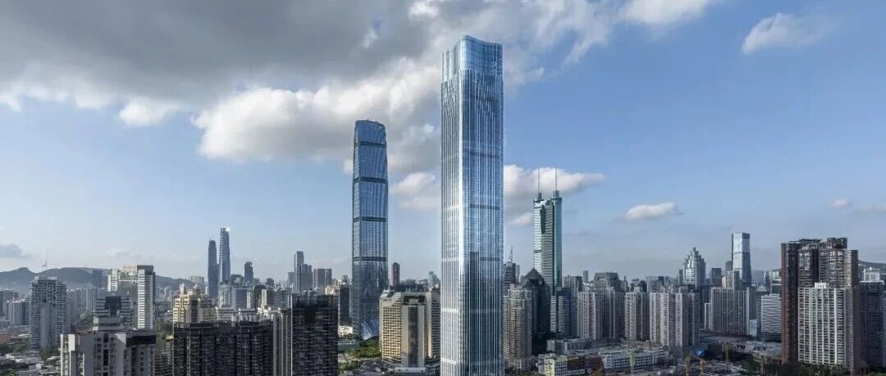

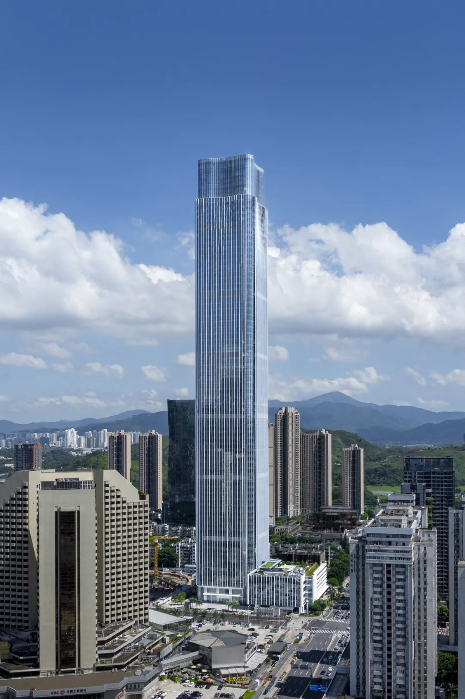
在深圳罗湖，城市发展的活力与自然环境的韧性共同塑造着城市面貌。作为一座  333
米高的超高层综合体，深圳城建云启大厦以自然为灵感，回应高密度城市环境，将办公、商业与文化功能融入一座面向未来的城市地标，在垂直空间中探索城市发展、生态景观与日常体验之间的连接。
Gensler
从泉水、山峦与层叠梯田中汲取灵感，将自然地貌的形态与层次转化为建筑语言：塔冠如泉水涌动，寓意蓬勃生长；塔身如山脊般挺拔而沉稳；裙房则以层层退台呼应梯田的地形肌理。这一设计不仅着眼于塑造鲜明的城市天际线，更希望让建筑成为城市景观的延伸，使自然成为组织空间与塑造体验的重要力量。
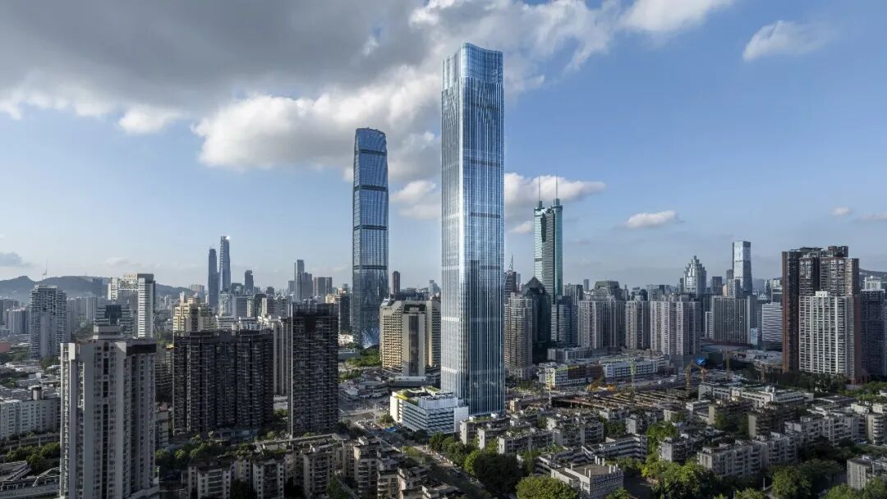
##  以自然为灵感，构筑垂直景观
##
在高密度的城市环境中，自然不应只是建筑的背景，而可以成为连接城市空间与日常生活的纽带。
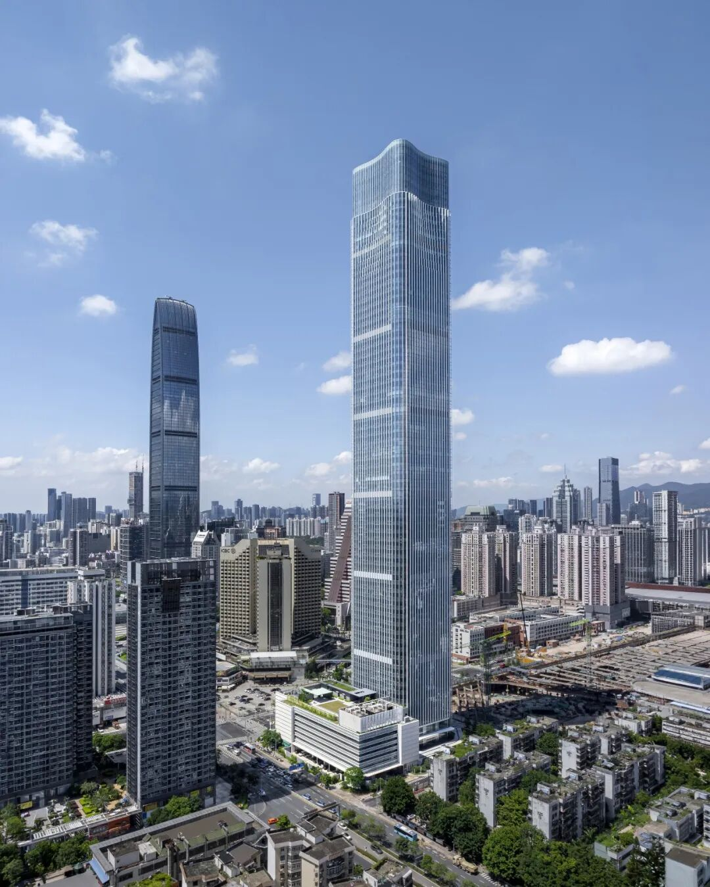
六层商业裙房通过体量延展与退台设计，形成与城市街道相呼应的建筑界面，并形成层次丰富的屋顶花园与景观空间。下沉广场、地面绿化、裙房屋顶花园与塔楼中庭共同构成立体景观序列，让绿意从地面向上延伸，并在不同空间层次之间建立联系。首层架空空间则形成贯通南北的城市步行景观廊道，加强建筑与周边城市环境的衔接。
从街道到裙房，再到塔楼内部的空中花园与生态中庭，景观不再局限于地面，而是成为贯穿建筑的空间组织线索。通过将建筑形态、空间组织与绿化景观整合为一个整体，项目探索在超高层建筑中创造更具亲和力、舒适性与层次感的城市体验。
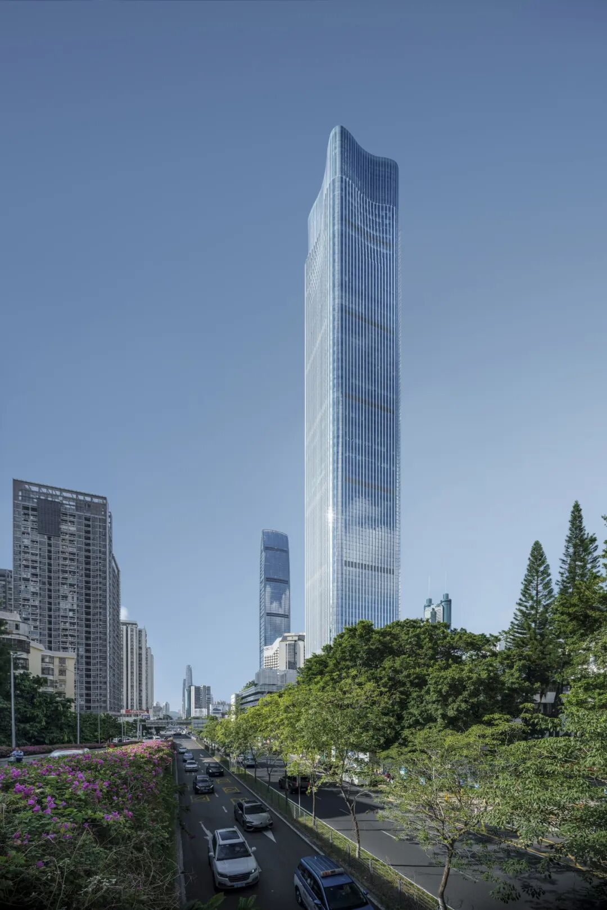
##  将生态策略融入建筑设计
##
面向深圳的气候条件，项目将景观、通风、遮阳与雨水管理纳入整体设计，从场地到建筑，从水平空间到垂直空间，构建相互关联的生态策略。
在景观层面，下沉广场、地面绿化、裙房退台花园与屋顶绿化共同构成立体绿化系统，并通过塔楼中庭延续景观的空间联系。可渗透的地面与屋面材料，以及融入绿化空间的海绵花园，则回应雨水管理与海绵城市建设的需求，使场地设计兼顾景观品质与雨水渗透。
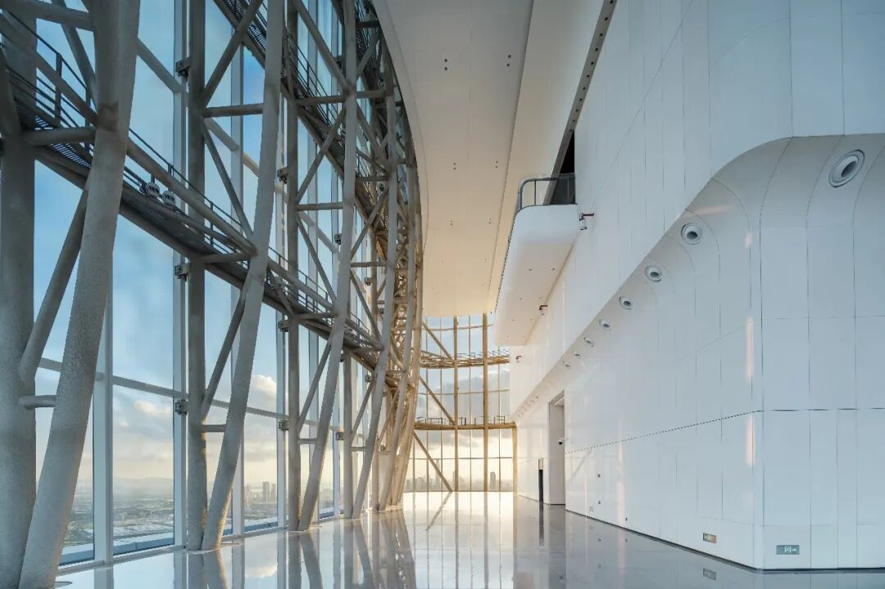
在建筑环境层面，设计探索将自然通风与建筑空间布局相结合，通过组织水平与垂直气流，改善室内外空间之间的环境联系。遮阳构件与建筑形态协同设计，以回应当地气候特点；太阳能板、通风格栅与屋顶设备空间也被纳入建筑顶部的整体构成。
这些策略并非彼此孤立的技术措施，而是与建筑体量、空间流线和场地景观共同构成的设计系统。通过将生态考量融入建筑形态与空间组织，项目旨在让可持续设计成为建筑体验的一部分，而不仅仅停留在技术层面。
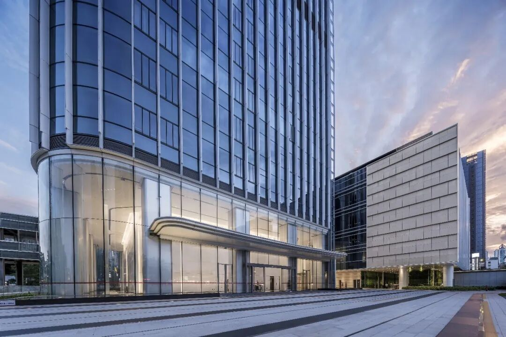
##  连接城市、自然、文化与创新
##
作为蔡屋围城市更新统筹片区的首发项目，深圳城建云启大厦承载城建集团总部功能，并面向总部企业与金融机构，回应区域商务发展与城市更新的需求。项目将办公、商业与文化功能整合于同一综合体，并通过清晰的交通组织与多层次的公共空间，建立建筑内部与城市公共生活之间的联系。
在地面与地下空间的组织上，设计统筹城市步行、公共交通换乘、办公与商业人流，以及机动车落客等不同流线，使各类使用需求得到清晰回应，同时保持不同功能之间的便捷连接。下沉广场既是景观空间，也是连接城市步行体系与建筑内部活动的重要节点；首层办公大堂则结合步行到达与机动车落客需求进行布局，在提升可达性的同时保持空间秩序。
对于办公空间，设计强调灵活性、连通性与健康体验，通过适应不同使用需求的空间组织，为协作交流与未来调整预留可能。由此，建筑不仅承载多元业态，也尝试以更具适应性的空间环境支持企业发展与日常工作。
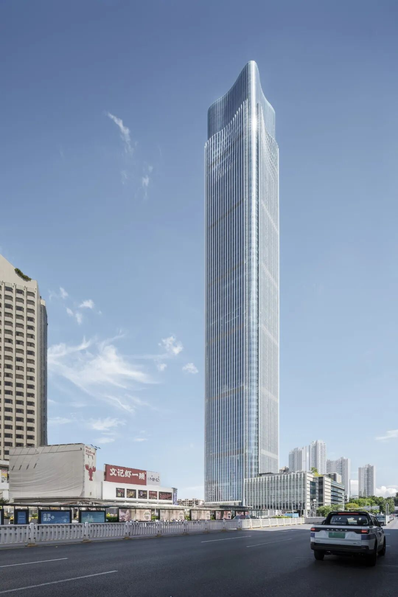
##  在城市天际线中，探索垂直生态的可能
##
深圳城建云启大厦将超高层建筑视为连接城市发展与自然环境的契机，通过富有层次的建筑形态、连续的绿化景观、相互衔接的空间体系与综合性的生态策略，探索垂直开发与城市生活之间更紧密的关系。
从呼应山峦与梯田的建筑轮廓，到贯穿地面、裙房与塔楼的立体景观，项目将自然融入建筑的空间组织之中，呈现一种兼顾城市活力、空间体验与环境响应的设计愿景，让建筑不仅成为城市天际线上的鲜明标识，也成为承载工作、交流与日常生活的城市空间。
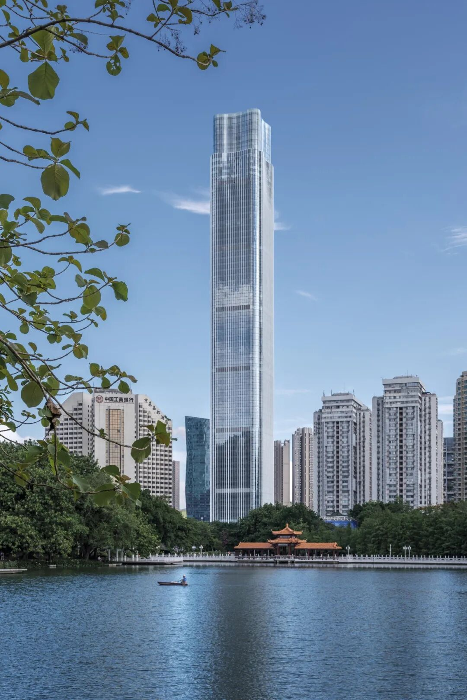

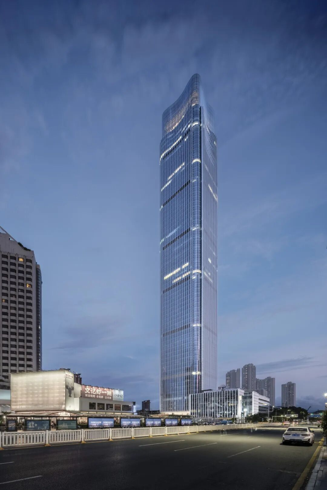

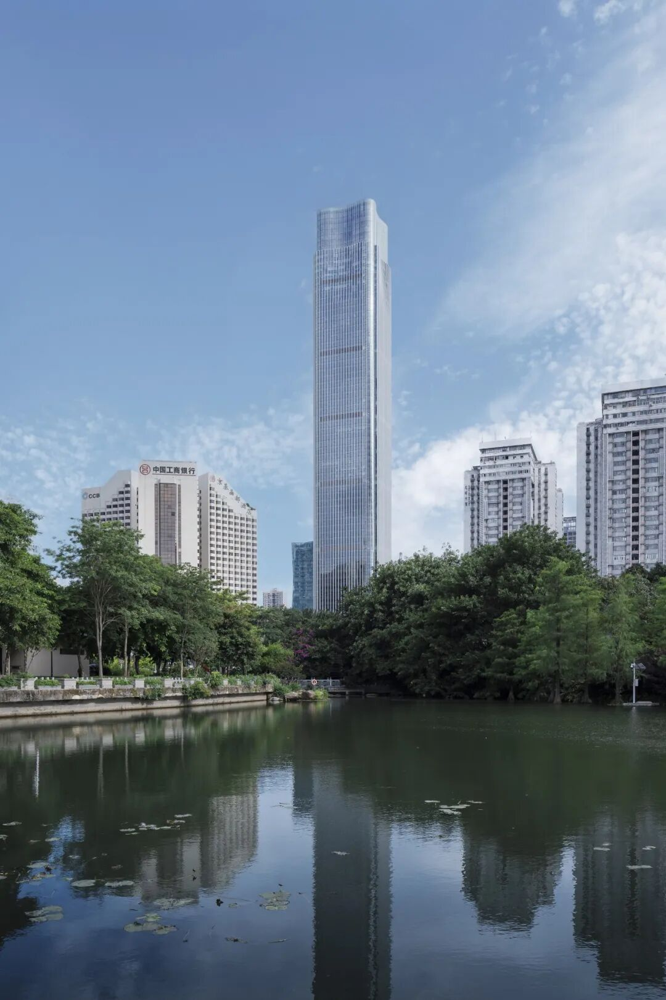
END
#
#
