# ZEN正象设计 | 招商上中隐翠——半抬板：城市与住区之间的柔性边界

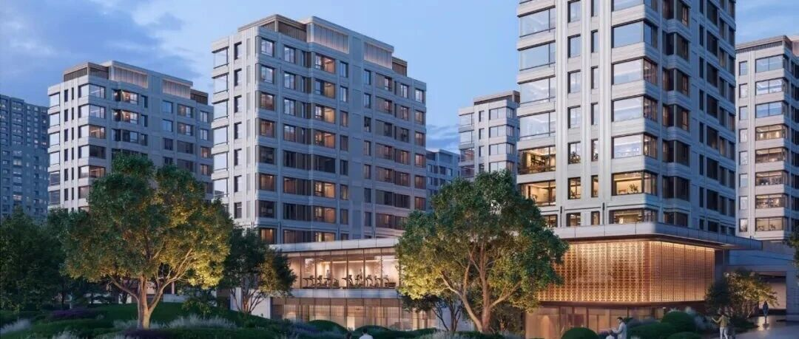

#

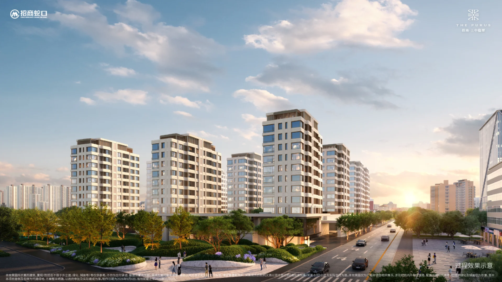

从百色路步行接近项目，最先感知到的不是封闭小区的高耸围墙，而是沿街延伸的L形绿植带。沿着步道往社区方向走，脚下的标高逐渐抬升，3.9米的高差在不知不觉中划分出两个完全独立的空间：下方是与城市衔接的配套与车行空间，上方是没有车流的安静庭院。这是招商·上中隐翠最核心的空间特征：不通过高墙实现隔离，而是通过竖向设计完成城市与居住的自然过渡。

## 场地与项目背景

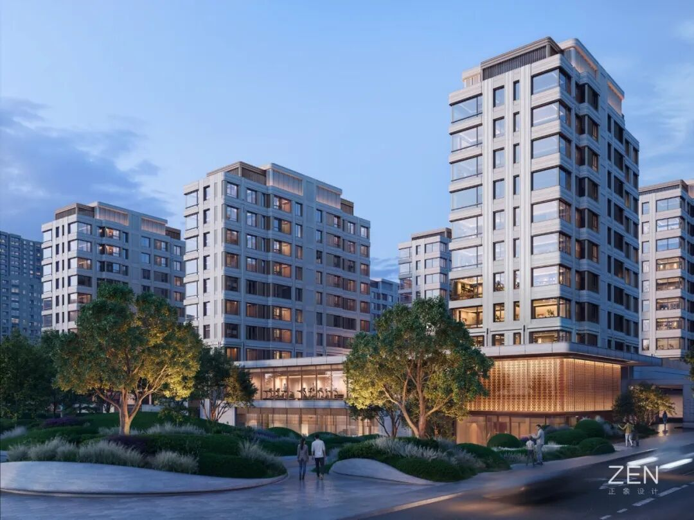

招商·上中隐翠位于徐汇滨江西岸板块，地块西侧紧邻上海中学，东侧临近西岸中央公园生态绿地，南侧衔接规划公共绿地，北侧临城市干道百色路。地块规划容积率约1.8，整体为纯洋房低密住区，无超高层或高层楼栋，是徐汇滨江板块内较为少见的低密居住地块。

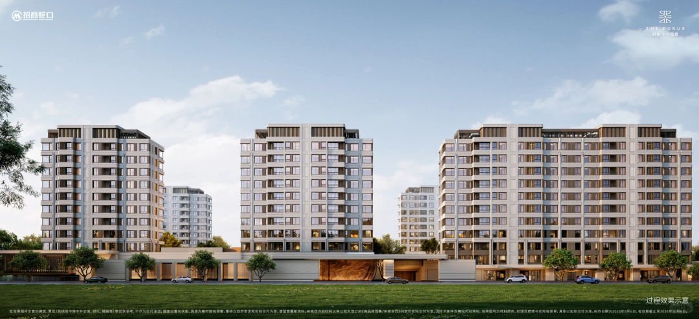

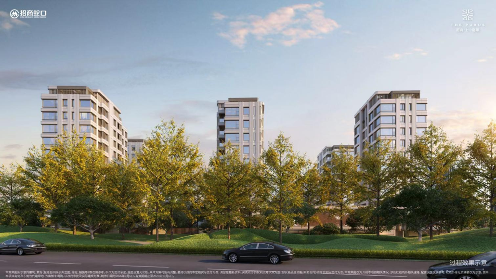

场地本身具备两面环绿、一侧临学府、一侧临城市道路的特征：南侧与东侧的绿地提供了自然生态基底，西侧的百年学府带来人文氛围，北侧的城市道路则需要解决噪音、车流与城市界面衔接的问题。整体设计围绕这一场地特征展开，在保障居住私密性与静谧感的同时，处理好城市与社区的边界关系。

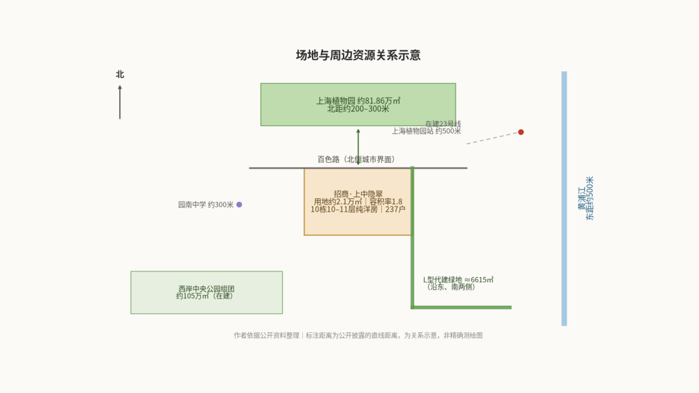

项目场地与周边资源关系逻辑示意（作者整理，非官方图纸）

## 核心设计策略：半抬板的竖向逻辑

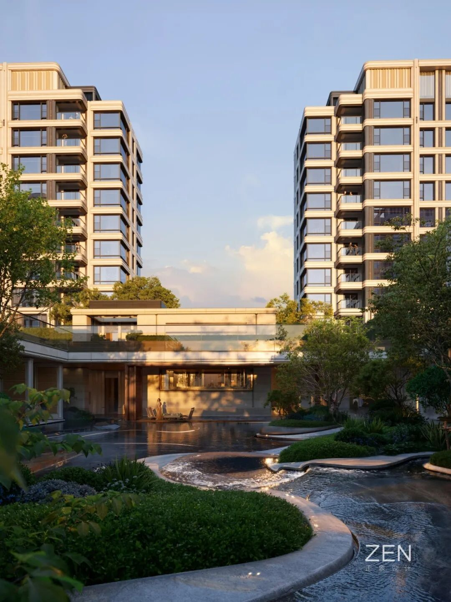

项目的核心设计逻辑围绕竖向高差处理展开，ZEN正象设计未采用当前市场常见的全地块满抬的抬板方案，而是结合南北两侧的场地条件做了差异化处理：北侧临百色路城市道路一侧，整体抬升约3.9米，车辆从北侧入口直接进入抬板下方的地库，地面平台层完全无机动车通行，实现彻底的人车分流，隔绝车流带来的噪音、尾气与安全隐患；南侧朝向公共绿地一侧则不做整体抬升，让社区景观与外部公共绿地自然衔接，避免全抬板设计带来的南侧空间割裂与高耸围墙感。

抬板形成的3.9米高差自然划分出三层竖向空间：抬板下方的地面层布置社区配套与公共服务空间，与城市道路直接衔接；抬板上方的平台层是完整的住区园林与步行归家动线；二层通过连桥与楼栋架空层连通，形成立体化的步行系统。

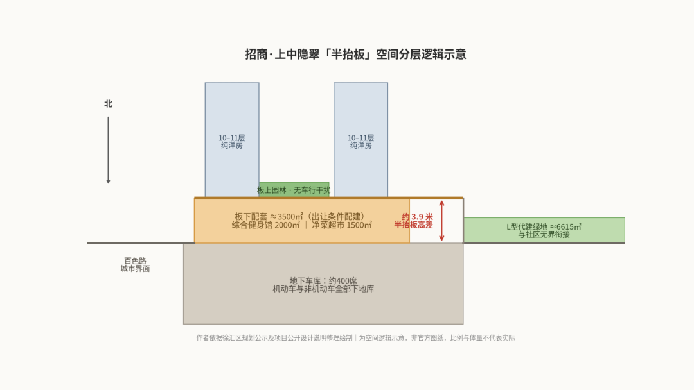

半抬板空间分层剖面逻辑示意（作者整理，非官方图纸）

## 建筑设计：ArtDeco语言的当代转译

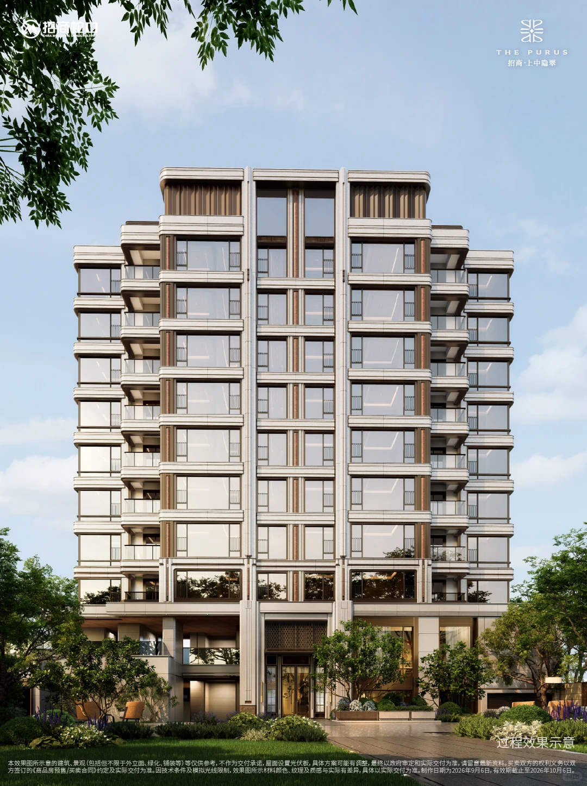

建筑立面设计以上海本土ArtDeco建筑传统为参照，未直接复刻历史建筑的装饰符号，而是提取经典装饰艺术派的核心特征：横向舒展的线条逻辑、错落的体量穿插关系，以水平线条勾勒立面的基础界面，通过楼栋单元的进退变化塑造立面的体积感，在不同日照角度下可形成层次丰富的光影效果。

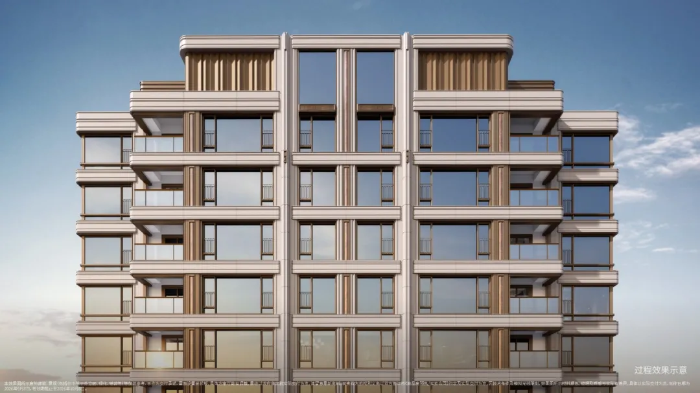

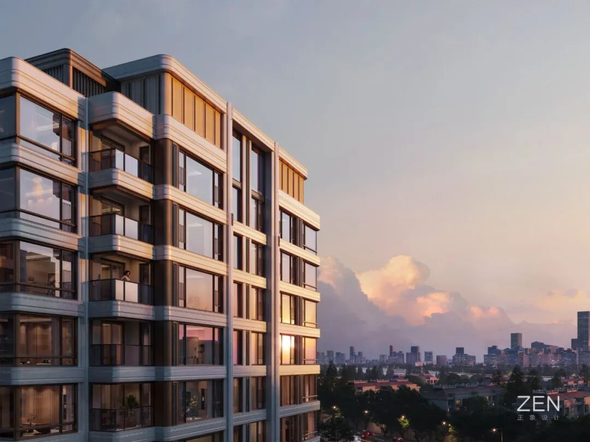

材料选择上，立面大部分区域采用浅黄仿石铝板，局部搭配石材，穿插细窄的鎏金竖向线条作为细节点缀，呈现出温润沉稳的视觉质感，同时避免了传统ArtDeco建筑厚重压抑的感受。单元入户门的设计提取了上海历史建筑荣宅的窗花元素与水圆玻璃构造，搭配仿木格栅形成有节奏的虚实变化，弱化了入户空间的生硬感，呈现出更具温度的归家界面。

## 景观设计：立体分层的庭院系统

景观系统围绕半抬板形成的竖向高差展开，形成三个层次的空间序列：

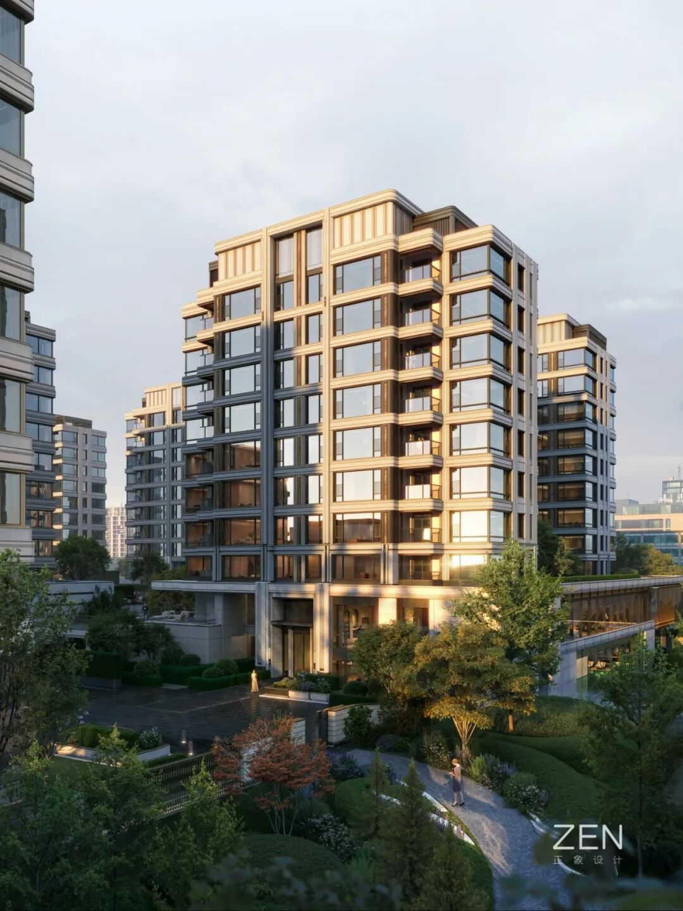

第一层次是北侧沿街的L形口袋公园，作为城市道路与社区之间的过渡带，通过曲径与多层次绿植形成自然的边界，既可以弱化城市道路的噪音与视觉干扰，也作为面向城市开放的公共绿地，消解了封闭式小区围墙的生硬感。

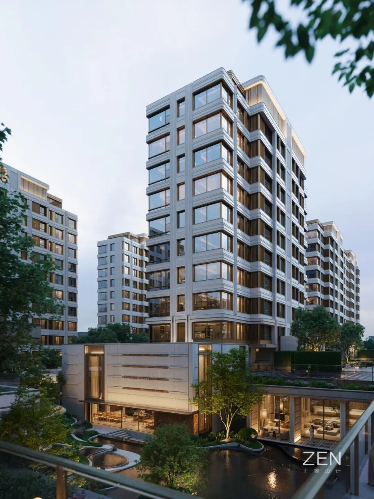

第二层次是抬板之上的立体花园，3.9米高的平台层形成完全无机动车的完整庭院空间，平台之上设置连通各楼栋的连廊，与楼栋架空层的二层空间直接相连，让居民可以在不同高度游走观景，形成平视、俯瞰结合的多层次景观体验。

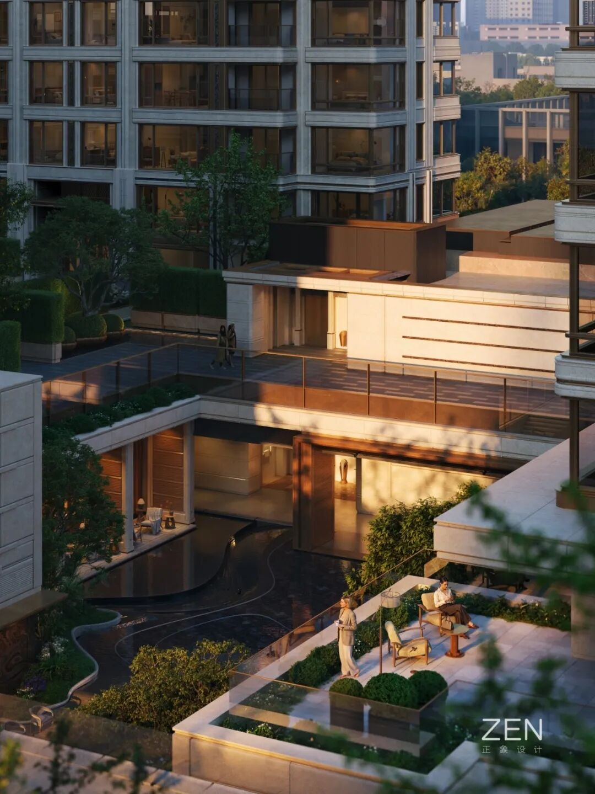

第三层次是核心下沉水院节点，设计参考建筑师埃罗·沙里宁对"无缝连续表面"的设计追求，采用柔和的曲线形态塑造多层次水景，水面与周边台地自然衔接，弱化了硬质景观的边界感，形成尺度适宜的庭院核心。

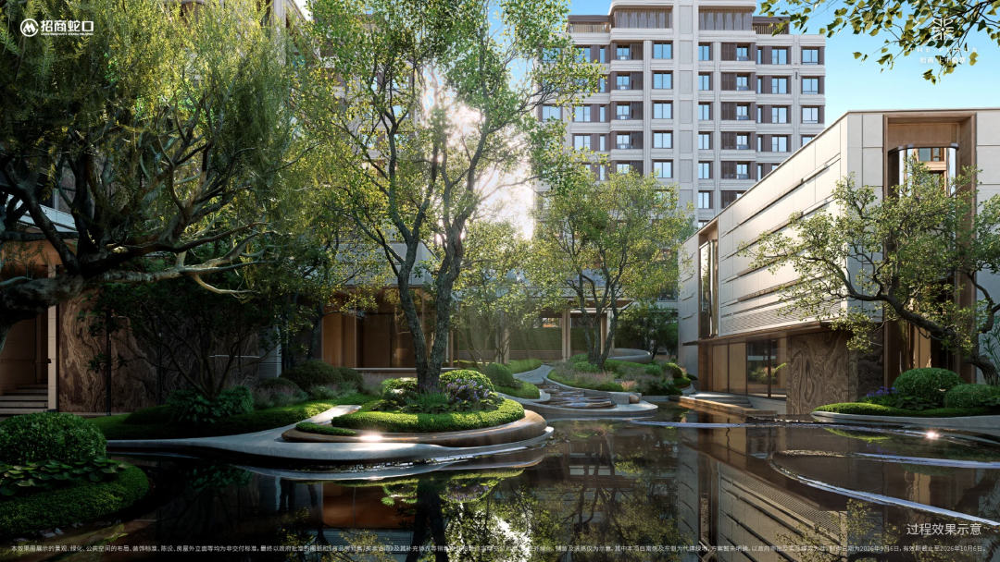

## 户型设计：均衡导向的空间布局

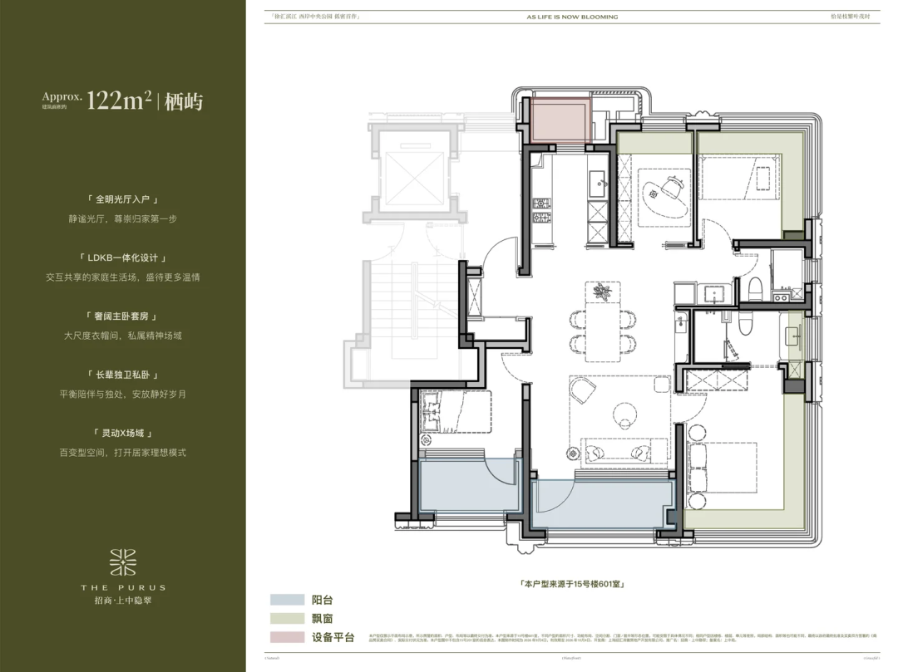

主力户型为建面约122㎡三房与147㎡四房，整体空间布局以均衡性为核心原则，未采用传统大户型刻意放大主卧、压缩次卧的设计逻辑，四个居住空间尺度分配相对均等，保障不同家庭成员的居住体验。

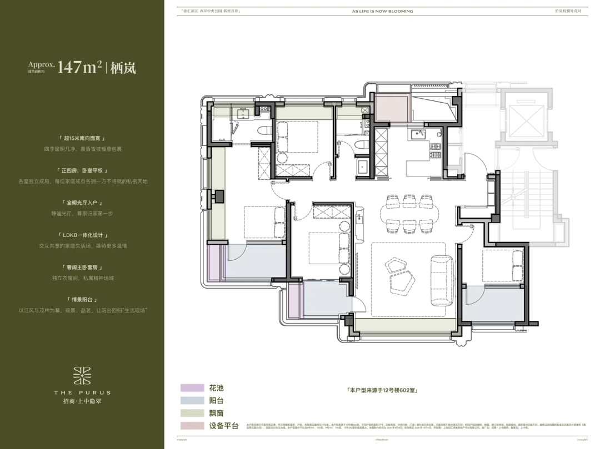

其中147㎡四房户型南向面宽约15.2米，四开间全部朝南，主要活动空间与卧室均可获得南向采光。外窗采用四玻两腔构造，提升隔音隔热性能，适配低密住区的静谧需求。户型内部公共活动区与私密休息区分区清晰，动线无交叉，可满足三口之家、多子女家庭或三代同堂等不同结构家庭的使用需求。

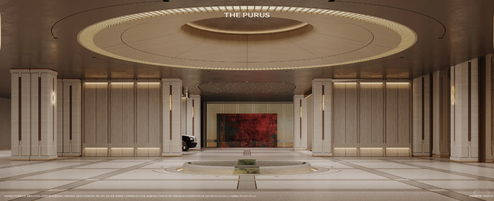

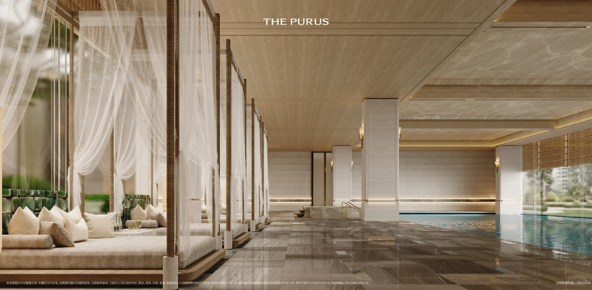

整体设计没有采用夸张的标志性造型或堆叠式的配置堆砌，而是从场地本身的条件出发，通过半抬板的高差处理、在地建筑语言的转译、均衡的空间分配，回应低密居住的核心需求。最终呈现的是一个与周边城市界面自然融合、适配日常居住的安静社区。

预览时标签不可点

不喜欢
