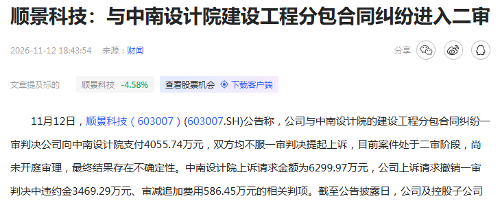
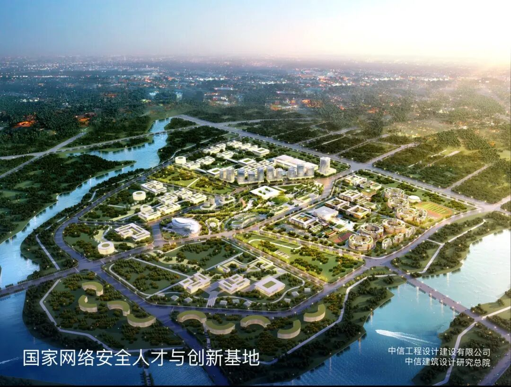
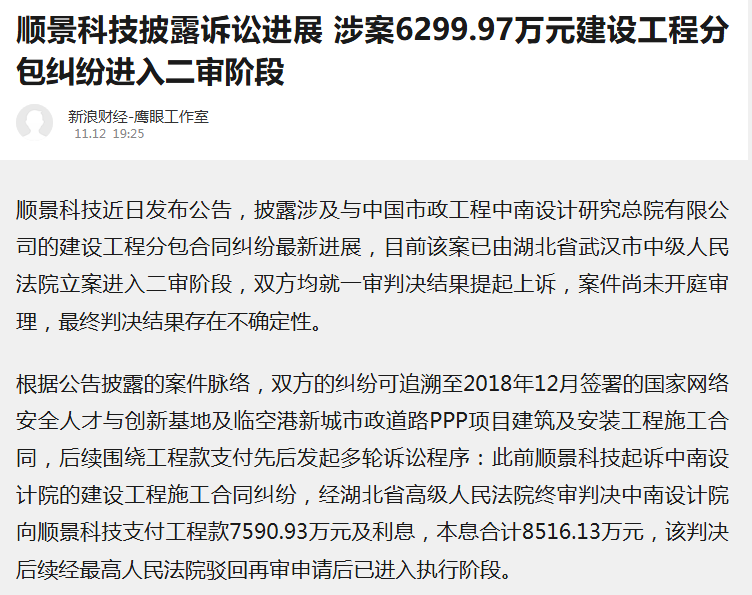
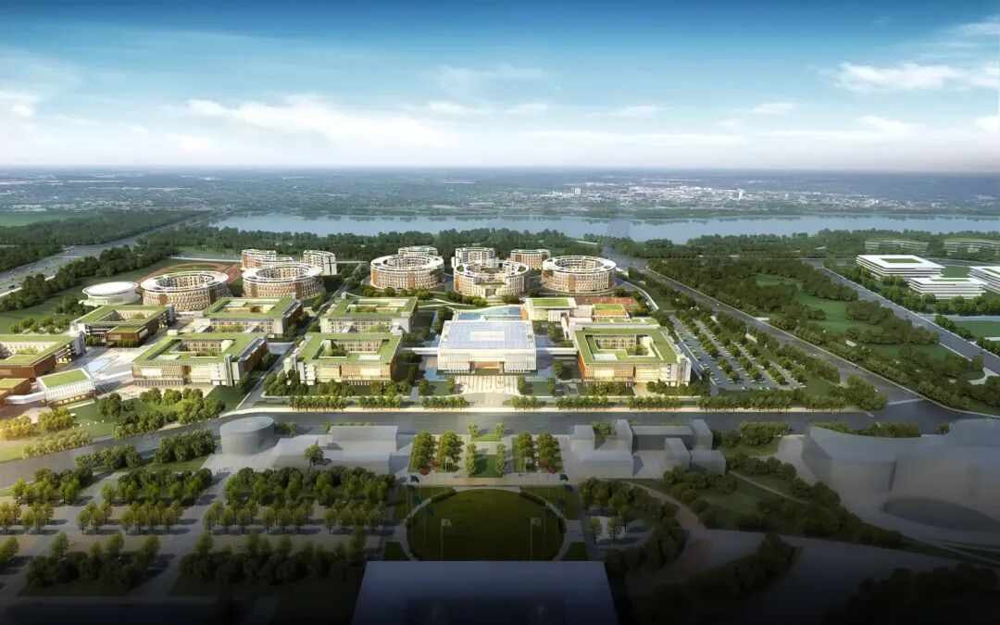

# ‌顶级设计院也翻车

11月12日，顺景科技（603007.SH）发了一份诉讼进展公告，把一个缠了八年的旧账，又拉回了公众视野。
公告说的是一起建设工程分包合同纠纷：公司和中国市政工程中南设计研究总院有限公司（下称中南设计院），双方都不服一审判决，都上诉了，案子现在进了武汉市中级人民法院二审，案号（2026）鄂01民终21869号，还没开庭。

一份上市公司的例行公告，看着平平无奇。但把里头那组数字摆出来，味道就变了：
顺景科技告中南设计院，赢了。法院判中南设计院付它8516.13万元，现在已经进入强制执行。
中南设计院反过来告顺景科技，一审也赢了。法院判顺景科技付它4055.74万元——但判决书里跟了一句话：这笔钱，中南设计院得按顺景科技重整计划规定的清偿条件来拿，不得个别清偿。
翻译成人话：中南设计院被欠的这4055万，只能进对方的破产重整程序里排队，能拿回多少算多少，大概率还要打个折。
一边被判赔出去8516万，得全额掏；一边反诉赢回来4055万，却只能打折收。
这账，怎么算怎么憋屈。而憋屈的，是一家设计院。
##  一个项目，串起了四家公司
要看清这笔账，得先把2018年那个项目拆开。
项目全称叫国家网络安全人才与创新基地及临空港新城市政道路PPP项目，在武汉。四家公司的关系，是一层压一层串起来的：
最上面，是中信网安（武汉）投资发展有限公司，作为发包人（也就是业主），把这个项目以工程总承包的形式，发包给了中南设计院。
中南设计院是中标的工程总承包商。它转手又把其中的道路工程，发包给了顺景科技。

顺景科技拿到活之后，再分包给了华中伟业建设集团。
一条链：中信网安→中南设计院→顺景科技→华中伟业。
项目一期签约价暂定5.9958亿元，二期暂定5.0086亿元，加起来超过11亿——标准的、PPP年代典型的大盘子。
然后，钱出了问题。

##  一个项目，打出了三场官司
PPP项目最怕的就是回款。这个项目，从工程款到分包款，一层层全卡住了，最后只能一家一家上法庭。
‌  ** 第一场，顺景科技告中南设计院。  ** ‌
2023年8月，顺景科技以建设工程施工合同纠纷为由，把中南设计院告到武汉中院，追讨工程款。2025年8月，湖北省高院终审判决中南设计院向顺景科技支付工程款7590.93万元及利息。中南设计院不服，向最高法申请再审；2026年4月，最高法裁定驳回。2026年5月，案子进入执行，本息合计8516.13万元。
也就是说：中南设计院，被判向顺景科技付8516万，正在被强制执行。
‌  ** 第二场，中南设计院反告顺景科技。  ** ‌
2025年10月，中南设计院另案起诉，案由是建设工程分包合同纠纷。它的逻辑是：上一个案子我没提反诉，现在单独告——顺景科技有工期延误、工程结算审减这些问题，得赔我。索赔金额6299.97万元。
2026年10月9日，武汉东西湖区法院一审判决：顺景科技向中南设计院付4055.74万元。但加了那句要命的话——按顺景的重整计划清偿，不得个别清偿。
‌  ** 第三场，华中伟业告中信网安和中南设计院。  ** ‌
顺景科技自己，也欠着它的分包商。华中伟业被确认对顺景享有6461.77万元工程款债权，但这笔债权被归进了破产程序。华中伟业急了，转头去告上家的上家：请求中信网安、中南设计院"在欠付顺景工程款的范围内"直接付钱给它，涉案6983.43万元。
一审，法院驳回了华中伟业的全部请求。它不服，又上诉，现在是二审待开庭。
一个项目，四家公司，三场官司，还有两场挂着二审没判。
##  那句"不得个别清偿"，才是要命的
三场官司里，最该说透的，是中南设计院赢了却拿不到钱这件事。
为什么赢了官司还得打折拿？
因为顺景科技在破产重整。
顺景科技的前身，是花王生态工程股份有限公司，也就是"花王股份"。这家公司做生态工程、市政园林起家，后来连续亏损，戴过*ST的帽子。2024年12月，它做了一轮重整，把大量历史工程债务和对应资产从上市公司体内剥离出去，装进一个叫"云南信托-
祥云24号"的重整服务信托，债权人通过拿信托受益权来受偿。
一句话：那些旧债，已经不在这家上市公司身上了，被装进一个"筐"里，大家按重整计划的规定分。

中南设计院这4055万，恰好就在这个筐里。
所以判决书才要特意写明：你中南设计院，不能凭这个判决单独找顺景要钱，你得跟大家一样，按重整计划的条件排队领。
这就是重整的规则：债务人一旦进入重整，所有普通债权人就得到同一个盘子里分钱，谁也不许插队。判决赢得再漂亮，也得排队。而重整计划的清偿率，通常远低于100%——这4055万最终能拿回多少，是个未知数，可能一半，可能更少。
反过来看顺景科技。它作为债权人，对中南设计院那8516万，是实打实要执行的。中南设计院没破产、没重整，就得全额还。
一边全额掏，一边打折收。亏，全落在中南设计院头上。
##  中南设计院，不是小角色
说到这儿，得给这家院正个名。
中国市政工程中南设计研究总院有限公司，业内叫"中国市政中南院"，1954年成立，前身是建设部直属的五大市政设计院之一。2000年，它从建设部脱钩，加入中信集团，现在是这家世界500强央企新型城镇化板块的子公司。
它有"四综一甲"的顶级资质——工程设计综合甲级、工程勘察综合甲级、工程咨询单位综合甲级资信、工程监理综合，加上城乡规划编制甲级。全国两千多家勘察设计企业里，能同时拿齐这几块牌子的，是极少数。
员工两千多人，注册资本5亿，80多个分院遍布全国，业务覆盖给水、排水、污水处理、道路桥梁、综合管廊、水环境治理，还以EPC、PPP、BOT的形式做过上百亿的工程投资。
这不是一家会没钱的小院。它是行业里的头部。
可就是这样的头部，被一个2018年的PPP项目缠了八年，判赔8516万，反诉赢的4055万还只能在重整里排队。
##  设计院，为什么会掉进这个坑
中南设计院踩的这个坑，根子在一个身份转换上。
本来，设计院是画图卖技术服务的，轻资产，赚的是智力费。可这些年，越来越多的设计院被推着往EPC、PPP里走——从单纯的设计方，变成工程总承包方，甚至是投资方。
这么做有理由。行业喊了多年的"设计引领、全产业链"，能多接活、提高合同额，从设计费那点薄利里跳出来。
但代价是：一旦坐上总承包的位子，你就从"卖图纸的"变成了"要垫资、要管施工、要扛回款的总包"。上面，你得跟业主算账；下面，你得给施工方付钱。中间任何一环卡住，都得自己扛。
这正是EPC最要命的地方：设计方一旦从轻资产掉进重资产，就从"卖脑力"变成了"担风险"。
我们之前写过华建集团2026年半年报：工程承包新签合同7.82亿元，同比暴跌45.83%，是所有板块里收缩最厉害的。原因就在这儿——以设计为先导的EPC，业主资金一收紧，总承包方立马被拖住。
华东院那20起官司里，也是同样的影子：一个设计院，一边被员工和分包商告，一边自己还得去告甲方，讨那笔要不回来的设计费。
‌  ** 设计院做EPC，看着是升级，一不小心，就变成了夹在债务链中间的那个"人质"。  ** ‌
##
##  这不是孤例，是一整条链
把它放进更大的图景里看，就更清楚了。
我们前面写过，建筑行业最典型的就是三角债：甲方欠设计院，设计院欠分包商，分包商欠材料商和员工。一环套一环，谁都拿不到现金，最后只能对簿公堂。
最高法10月发布的民营经济纠纷典型案例里，就有几乎一样的场景：混凝土公司给工程公司供完建材，585万货款只拿到44万首付，剩下540万被拖着——不是不想给，是它的钱被上游发包方拖住了。
中南设计院这个案子，是这条链的一个完整样本，而且是最残酷的那种：链条上的每一环，都在拿上家没给自己的钱，去还下家的钱。
顺景科技欠华中伟业，是因为中南设计院欠顺景科技；中南设计院欠顺景科技8516万，是因为上游的钱没到位；而它反诉赢的4055万，又被顺景的重整一起卷走了。
链条甩起来，每一环都觉得自己冤。可最后埋单的，往往是链条中间那个既跑不掉、又不能不给的角色——这一次，是设计院。
##  说给还在做总承包的院
‌  ** 第一，EPC不是不能做，但得先想清楚"你凭什么是这一环"。  ** ‌
垫资能力、管理能力、跟业主的付款约定，缺一样都别硬上。设计做得再好，垫不起工程款，一样会被拖死。
‌  ** 第二，合同里最该抠的不是设计费单价，是付款节点和违约条款。  ** ‌
什么时候付、付款以什么为前提、业主不付我能不能停、停了算不算我违约——这些，比"设计费打几折"重要一百倍。
‌  ** 第三，对方一旦露出重整、破产的苗头，立即行动。  ** ‌
保全、及时申报债权、研究有没有优先受偿的可能，一样都别落。等判决生效才去要钱，那时候你可能已经排在队尾了。
##  最后
回到11月12日那份公告。
二审还没开庭，最终谁赢谁输、中南设计院能拿回多少，都还是未知数，一切以公司公告和法院判决为准。
但有一件事是确定的：这个2018年的PPP项目，已经让四家公司缠斗了八年，而且远没结束。它像一面镜子，照出设计院这几年最危险的一个转身——当你从画图的，变成垫资的、发包的、总包的，你就再也回不到"只卖图纸、不担风险"的安稳日子了。
行业好的时候，EPC是讲给资本听的增长故事；行业差的时候，它就成了套在脖子上的那根绳。
中南设计院这8516万和4055万，就是那根绳子勒紧的声音。
各位院里的，现在还在做EPC、做总承包吗？回款周期被拖成什么样了？评论区聊聊。
[ 热议设计院](https://mp.weixin.qq.com/mp/appmsgalbum?__biz=Mzg4ODU2MzQxMw==&action=getalbum&album_id=4724085399151935494&subscene=159&subscene=&scenenote=https%3A%2F%2Fmp.weixin.qq.com%2Fs%2FuAQNmELxtOkBl-7QE98-MQ&mid=2247889816&idx=1&nolastread=1#wechat_redirect)
