# 天华/笛东/CCD等 | 上海华润溪屿润璟——从"有天有地"到"每层有院"

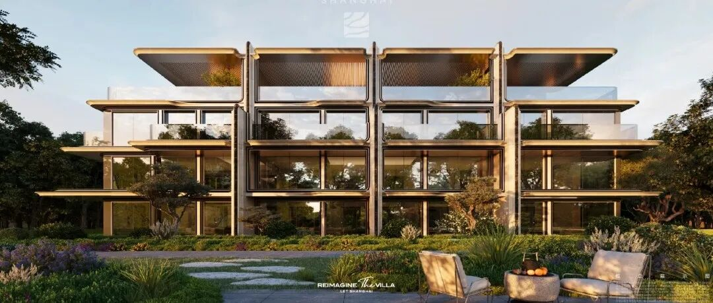

以下文章来源于设计图鉴  ，作者梅吟雪飞凤
**设计图鉴** .  地产与建筑设计人的灵感资料库。聚焦最新热点地产项目、标杆建筑设计案例、高价值设计参考素材，工作日 11:30
南翔上一次出现容积率1.3以下的纯低密宅地，还是五年前。2026年南翔核心区这块十年一遇的低密土地上，华润拿出了北京验证过的四代墅体系，试图在联排的用地上，做出接近独栋的居住体验。
2026年7月上海土地市场第七批次供地清单里，南翔25-06地块刚挂出就成了行业焦点：4.04公顷占地，容积率仅1.3，西侧双河环抱，1公里范围内覆盖南翔印象城MEGA、山姆会员店与11号线陈翔公路站，是近五年南翔核心区唯一一块没有保障房配建、没有商业占比的纯低密居住用地。最终华润置地拿下这块地，带来了其「润璟系」低密新作——溪屿润璟。
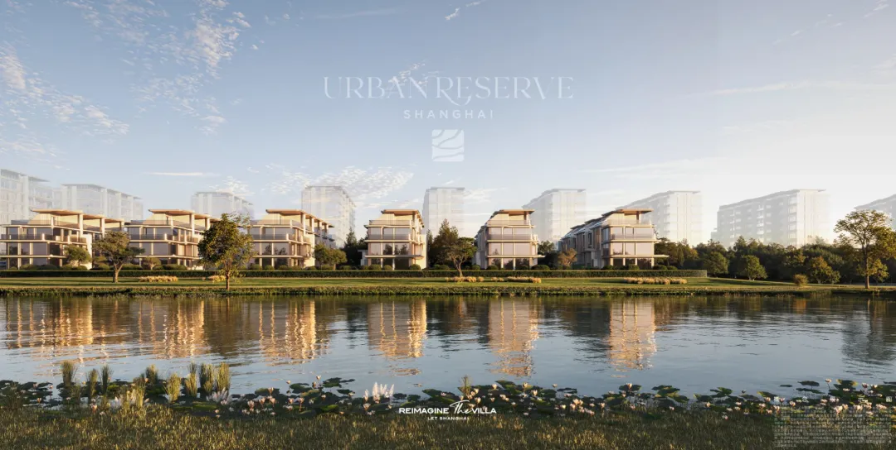
在上海低密土地供应逐年收紧的背景下，外环内真正能做到洋房+联排纯低密组合的项目，一只手数得过来。大多数打着"低密"旗号的项目，要么是高低配挤占公共空间，要么是联排做成了"握手楼"，花园缩水、采光不足、地下室阴暗潮湿几乎是行业通病。而溪屿润璟拿出的解决方案，是把北京润园已经验证过的四代墅体系落地上海，用8大独栋级基因，试图在联排的用地上，做出接近独栋的居住体验。
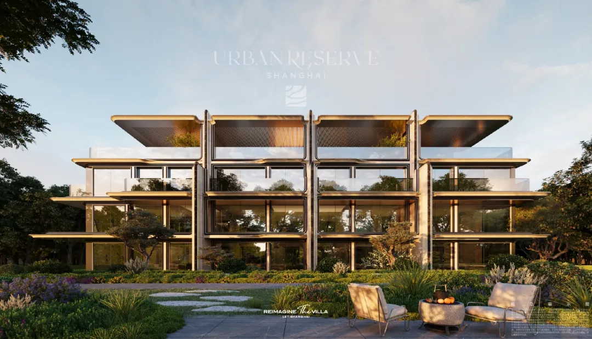
这不是简单的产品复制。从北京温榆河畔的1.01容积率纯墅区，到上海南翔的1.3容积率滨水社区，华润需要解决的核心问题是：在更紧凑的土地上，如何既不牺牲联排的私密感与尺度感，又能兼顾上海家庭对实用性与通勤便利性的需求？
##  从"有天有地"到"每层有院"：别墅产品的四代演进
要理解溪屿润璟的产品逻辑，得先搞清楚我们正在经历的别墅产品代际变化。
国内商品房市场发展三十多年，别墅产品大致经历了四个阶段：
1.0时代的独栋别墅
：核心卖点是"占地"，大花园、大尺度，但距离城市远、配套不足，更像第二居所，适合周末度假，不适合日常居住。2003年"限墅令"出台后，这类产品已经基本退出市场。
2.0时代的联排/叠拼
：把独栋拼在一起，降低总价门槛，但硬伤也很明显：楼间距窄、私密性差、中间户采光不足、地下室基本只能当储物间，"有天有地"更多是营销噱头，实际居住体验并不比大平层好多少。
3.0时代的合院/类独栋
：通过围合式布局改善私密性，增加花园赠送，但往往牺牲了朝向与通风，户型奇怪、能耗高，很多设计为了"有院子"反而牺牲了日常居住的舒适度。
4.0时代的四代墅
：核心逻辑从"追求占地大小"转向"追求空间体验"——不再执着于物理形态上的独栋，而是通过采光、尺度、院落、垂直空间的系统设计，让联排/合院产品也能拥有独栋级的采光、私密感与空间舒适度。
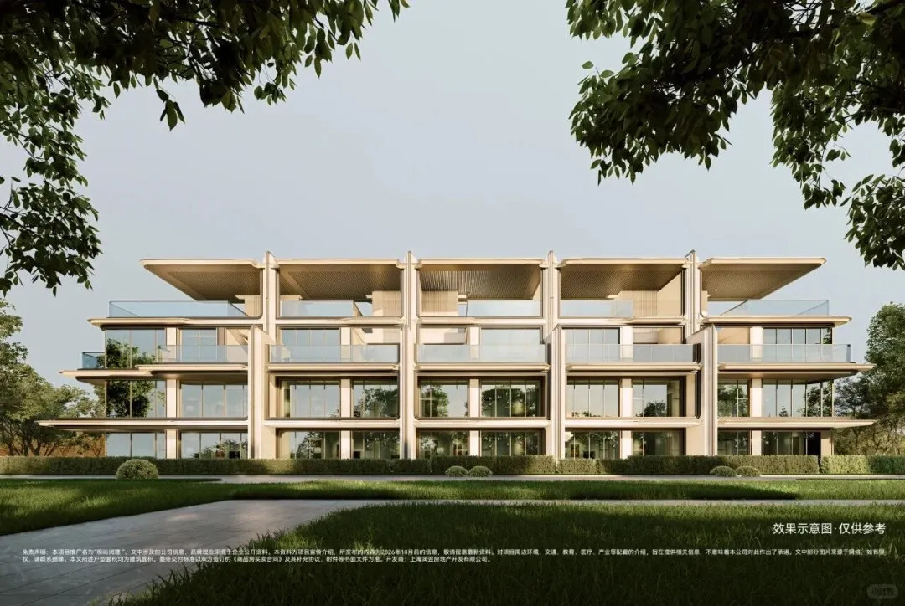

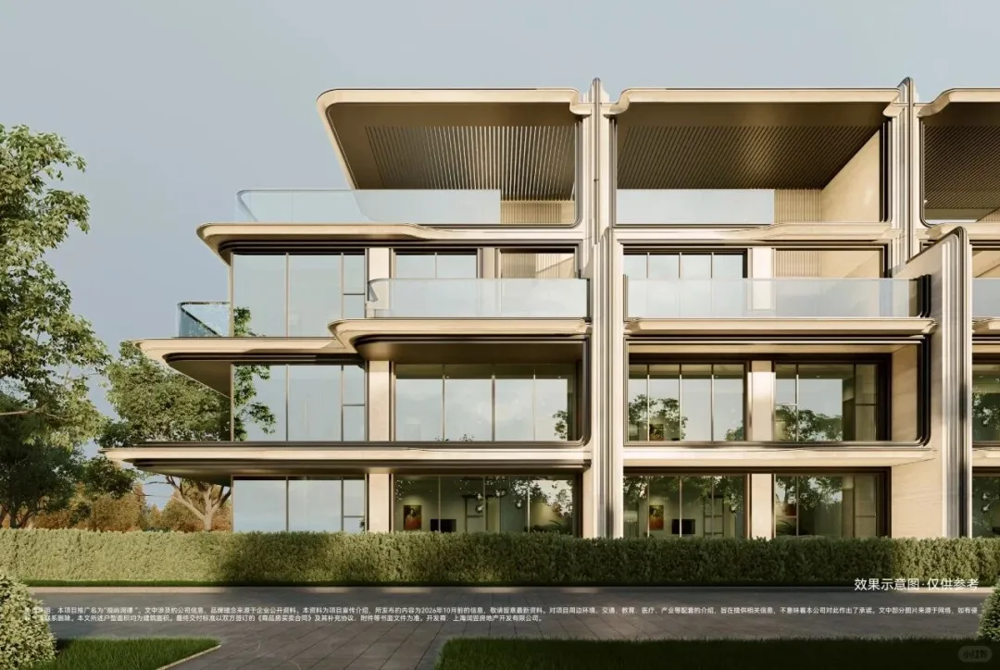
华润在北京润园验证的四代墅体系，核心是七个维度的标准：独墅形态、庭院平权、空间重构、无界光感、超幅宽境、高获得感、高配精装。落到上海溪屿润璟，针对上海家庭的居住习惯做了本地化调整，项目
携手DDON笛东、CCD、HWCD、李益中、天华等全球大师灵感，高定西上海墅居壹号样本，  最终总结为6大独栋级产品基因。
真正的别墅迭代，不是把房子做的更大，而是在有限的土地上，把每一寸空间的体验感拉平到独栋级别。
##  六大独栋基因拆解：不是概念包装，是解决真问题
很多项目喜欢列"十大卖点""八大价值"，但大多数是营销话术的堆砌。我们逐个拆解溪屿润璟的这6个点，看哪些是真解决问题，哪些是概念包装。
###  1\. 0.6容积率联排区：把最好的土地留给低密产品
溪屿润璟整体容积率1.3，但联排片区的实际容积率只有0.6——这是一个接近独栋社区的密度指标。项目采用西低东高的排布逻辑：6栋3-4层联排全部沿西侧双河水岸一线展开，占据了整个地块最好的景观资源；9栋9层洋房布置在地块东侧靠近沪宜公路一侧，既形成了天然的噪音屏障，又把最安静、最亲水性的土地全部留给了联排产品。套均占地约350㎡，户户带半亩花园，这个指标在上海当前的联排市场里是非常少见的——市面上大多数联排项目为了货值最大化，往往会把高层往景观好的地方放，联排挤在边角，花园缩水到只有几十平，"别墅"变成了窄巷里的握手楼。
低密不是整体容积率数字好看，而是愿意把最好的土地、最多的空间，让渡给居住本身。
###  2\. 近3米整体抬高：从根源解决传统别墅的潮湿与隐私问题
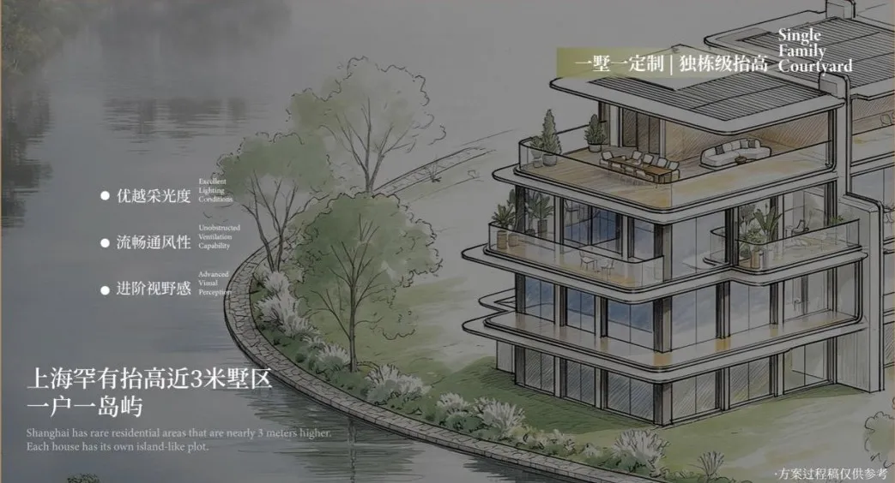
上海的别墅客户最在意的两个痛点，一个是潮湿，一个是隐私。传统联排别墅区的地面往往和市政道路齐平，不仅雨季容易积水返潮，外面路人的视线很容易直接看到院子里和一楼室内，私密性很差。溪屿润璟把整个联排片区整体抬高了近3米，相当于把别墅建在一层楼高的台地上：首层地面相当于普通小区3楼的高度，外界视线很难直接看到院内，隐私性大幅提升；台地形成的自然高差，让雨季积水可以自然排出，从根源上降低了江南地区别墅一楼的潮湿困扰；抬高后地下空间的埋深更浅，采光井和下沉庭院的采光效率更高，地下室不再是阴暗的储物间。这个设计的成本代价很高：整个联排区要做大面积的土方回填和护坡处理，还要解决台地与洋房区、地库的高差衔接问题，每平米建安成本比平地社区高出不少，但换来得是最直观的居住体验提升。
别墅的舒适感从来不是靠堆石材、装水晶灯堆出来的，是从标高设计的第一步，就把居住痛点解决掉。
###  3\. 三向采光系统：让阳光从早到晚待在家里
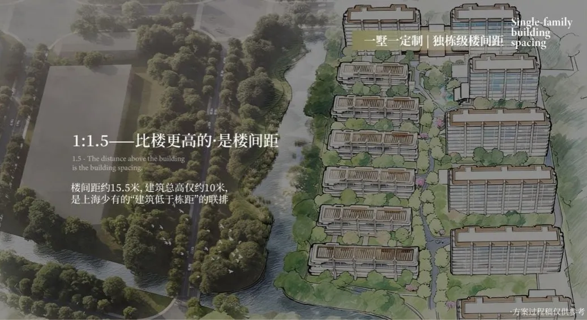
传统中间套联排最大的硬伤是采光差——只有南北两个采光面，开间窄、进深长，中间区域往往是暗厅、暗卫，白天也要开灯。溪屿润璟的联排做了三向采光：南北双采光庭院+西侧临河的巨幅玻璃采光面。西侧临河没有建筑遮挡，下午的阳光可以直接通过西向的落地窗照进室内，相当于比传统联排多了整整一个采光面；再配合南北庭院的采光，整个房子从早上太阳升起到傍晚落下，都能有自然光进入室内。我们之前看过太多联排为了追求南向面宽，把所有房间都挤在南面，导致进深不够、功能分区混乱；而三向采光的设计，不需要刻意压缩进深换面宽，反而可以把空间做的更舒展，每个功能区都能有自然采光。
好的别墅不是看南向有几个开间，是看一天里太阳能在你家待几个小时。
###  4\. 15.5米栋距大于建筑高度：私密性比多盖两栋楼更重要
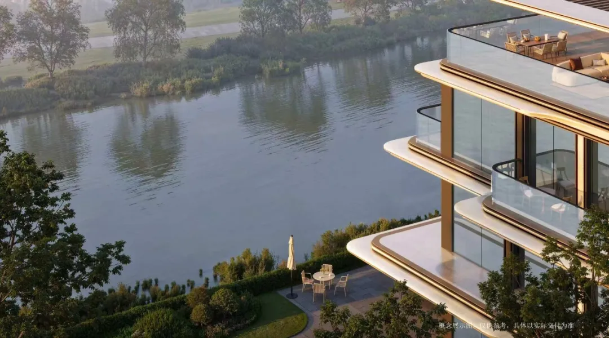
联排社区的楼间距是个很容易被忽略的指标。市面上很多联排的栋距只有8-10米，刚好卡在规范最低线，两户人家站在阳台上可以直接握手，院子里说句话隔壁听得清清楚楚，根本谈不上私密性。溪屿润璟的联排建筑高度约10米，栋距做到了约15.5米，栋距大于建筑高度——这意味着即使在冬至日太阳高度角最低的时候，一楼的院子也能有充足的日照，不会被前排建筑挡光；同时邻里之间的视线干扰被降到最低，院子里不用拉窗帘也不用担心被对面看到。这个设计的本质是取舍：如果把栋距缩小到规范最小值，同样的土地可以多盖至少2-3栋联排，多出来的货值可能上亿，但华润选择了把空间让出来，换居住的舒展感。
衡量低密社区的真正标准，不是容积率数字，而是你站在自家院子里，能不能舒服地穿睡衣晒太阳。
###  5\. 3.5-3.6米层层高：大宅气场不是吹出来的，是尺度给的
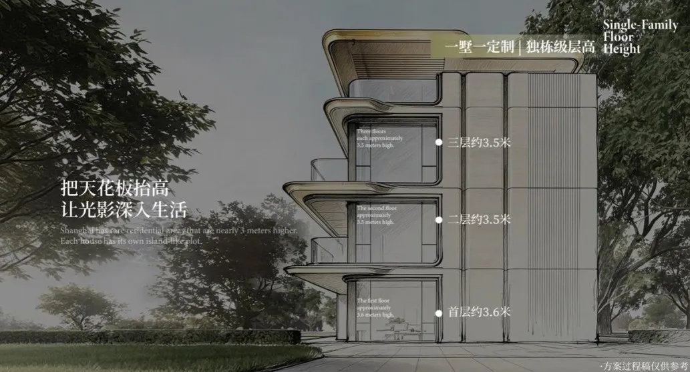
很多人买别墅，装修完反而觉得压抑，问题就出在层高上。普通住宅层高2.8-3米，做完吊顶、铺完地暖，净层高只有2.5米左右；传统联排的首层层高往往也只有3.3米，二三层3米，装修完依然很压抑，根本没有别墅的开阔感。溪屿润璟的联排首层层高约3.6米，二、三层层高约3.5米，比普通住宅高出70-80公分：做完地暖、吊顶之后，净层高依然能保持在3.2米以上，空间感完全不同；可以容纳更大尺寸的门窗，采光面更大，光线能照到房间更深的位置；大尺度的挂画、吊灯、书柜都能放得下，不会显得局促。层高这个东西，每高10公分，建安成本就会上升一截，而且是业主入住后每天都能感受到、但很难通过后期改造弥补的尺度。
别墅的气场从来不是靠奢华装修堆出来的，是你推开门那一刻，空间给你的舒展感。
###  6\. 五层垂直院落：让每个家庭成员都有自己的户外空间
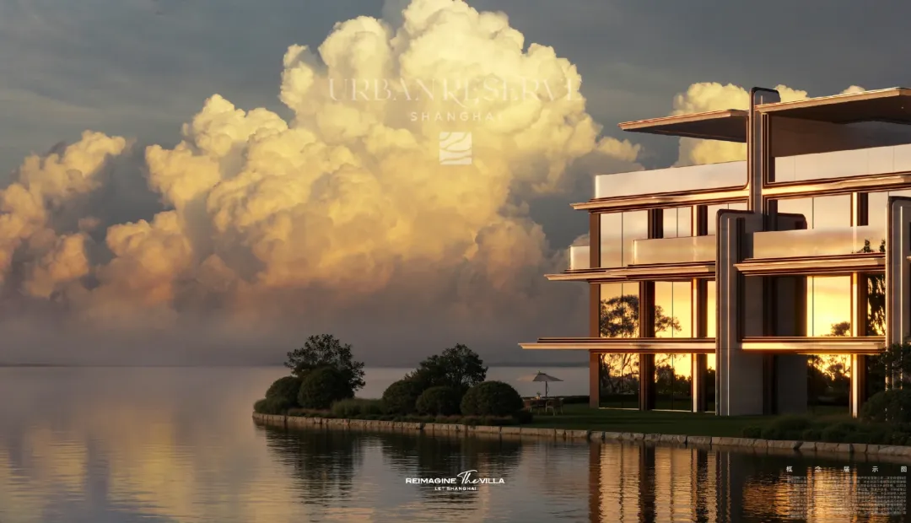
传统联排最大的问题是"庭院平权"做不到——只有一楼有院子，二三层只有小阳台，顶楼露台往往是公共的，老人喜欢院子、年轻人喜欢露台、孩子需要玩耍空间，最后往往是一楼院子被老人占了，其他人没有专属的户外空间。四代墅的核心创新就是垂直院落系统：从地下层的下沉庭院，到一楼的地面花园，到二三层的露台，再到顶楼的屋顶花园，五层每一层都有专属的户外空间。每个家庭成员都能拥有自己的小天地：老人可以在一楼花园种花种菜，年轻人可以在露台喝咖啡办公，孩子可以在下沉庭院玩耍，顶楼可以做烧烤和星空露营。这不是简单的多送几个阳台，而是把"有天有地"的别墅体验，从一楼一户的特权，变成了每层、每个家庭成员都能享受到的日常。
真正的好别墅，不是只有一个大院子给户主撑面子，而是每个家人都能拥有属于自己的那片小天地。
##  低密产品的核心竞争力，从来不是"稀缺"两个字
上海不缺买别墅的客户，缺的是真正适合日常居住的城市别墅。过去很多联排产品，本质上是"为了别墅而别墅"：远郊大盘，配套不足，只能周末住；产品设计硬伤多，采光差、潮湿、私密性差，住进去还不如大平层舒服；交付后物业跟不上，几年后社区破败，价值反而跑输大平层。
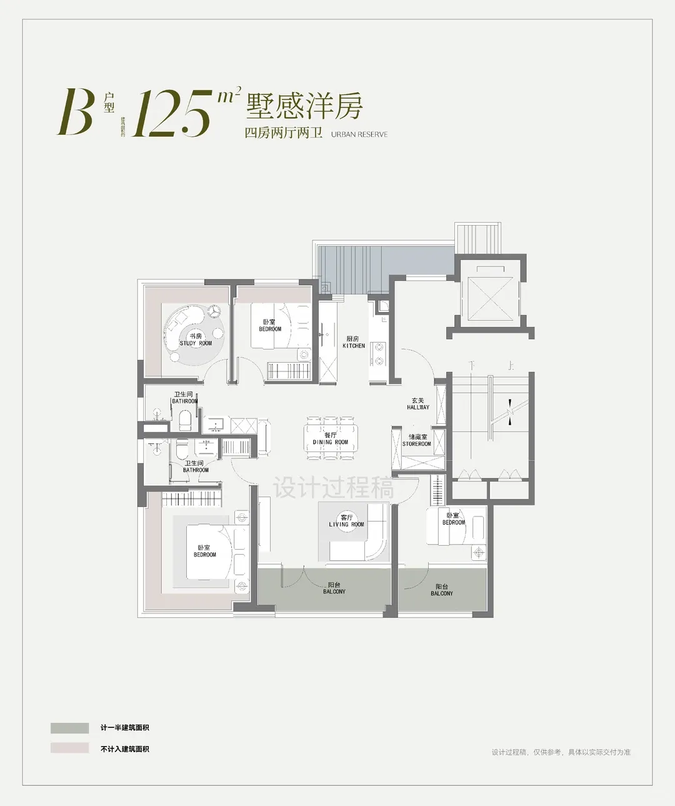

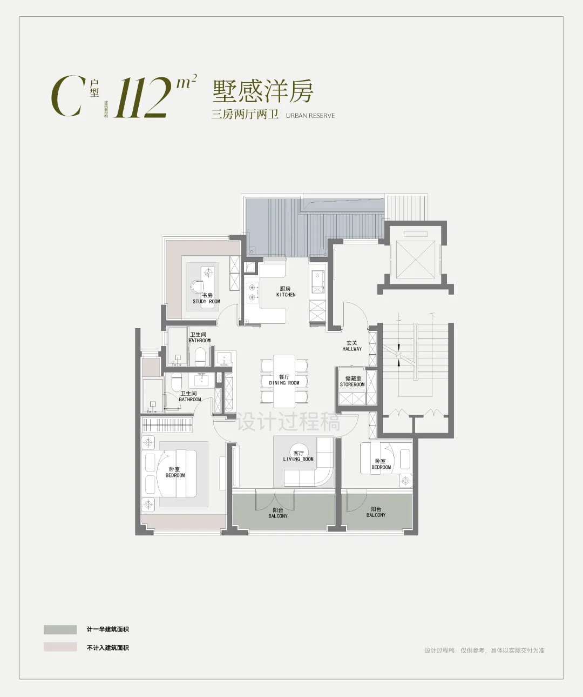
溪屿润璟的价值，不在于它是南翔近五年唯一的低密地块，也不在于它用了多少大师团队，而在于它真正对准了传统联排的那些行业通病，用已经在北京验证过的四代墅产品体系，在城市核心区的成熟配套边上，做出了接近独栋体验的联排产品。
