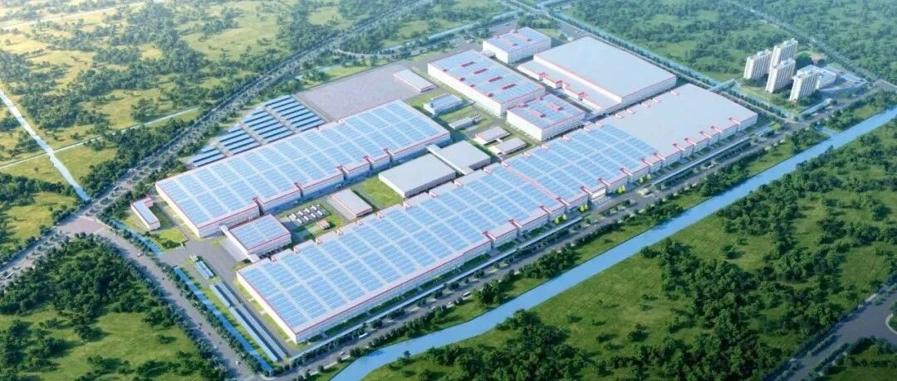
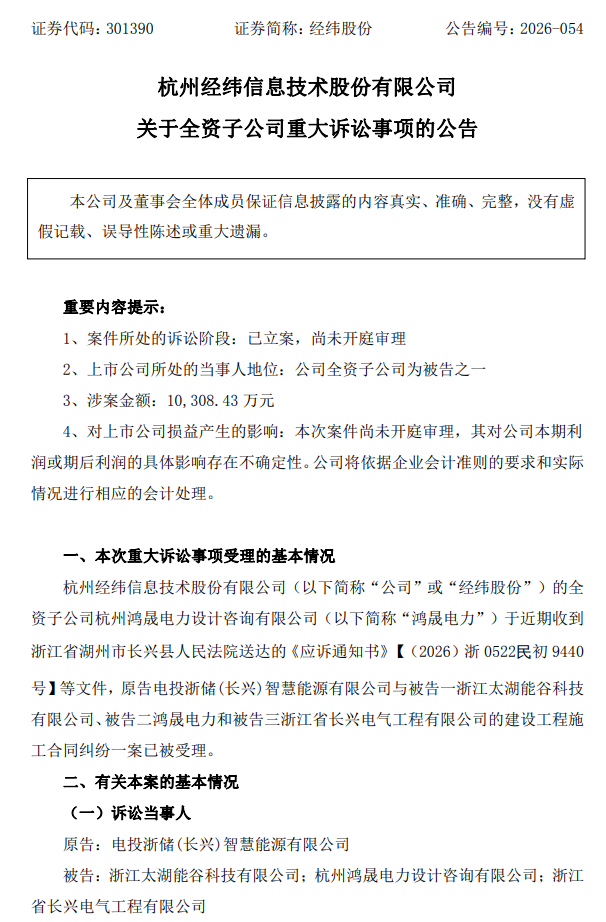
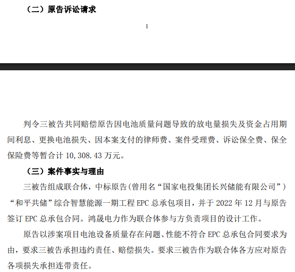

# 只设计画图，被连带索赔1.03亿

先说一个荒诞的组合。
一家公司，不生产电芯、不采购电池、不集成系统、不负责运维，在整个项目里只干了一件事：画图。
现在，它被索赔1.03亿元，理由是——‌  ** 电池质量不行  ** ‌。
11月13日晚，创业板上市公司经纬股份发了份公告：全资子公司杭州鸿晟电力设计咨询有限公司，被国家电投旗下的电投浙储告上法庭，索赔暂合计10308.43万元。案由是建设工程施工合同纠纷，目前案件已立案，尚未开庭。
鸿晟电力在公告里特意强调了一句：‌  ** "在本次诉讼涉案项目中仅负责设计工作。"  ** ‌
这句话，才是这件事真正值得说的部分。

##
##  三家被告里，没有一家造电芯
涉案的项目叫"和平共储"，在浙江湖州长兴县和平镇，2022年上马，总投资16亿元。
它当时头顶一堆光环：国家电投"雪碳行动"重点示范项目、国家能源局新型储能试点示范项目，还号称"全球最大铅碳储能电站"。规划总规模100.8MW/1061.683MWh，一期实施45.36MW/477.757MWh。
2022年12月，三家单位组成联合体中标一期EPC总承包，合同额100859.885万元，折合单价2.11元/Wh。
三家的分工，公告写得很清楚：
表格
单位  |  在项目里的角色  |  是否被诉
太湖能谷  |  设备供货、系统集成、全生命周期运维  |  被告一
鸿晟电力  |  项目设计  |  被告二
长兴电气  |  施工安装  |  被告三
天能集团  |  供应约300万个铅碳电芯  |  未列为被告
看明白了吗？‌  ** 三家被告，没有一家生产电芯。  ** ‌
真正造电池的天能集团——长兴本地企业，供应了这个项目约300万个铅碳电芯——根本不在这份被告名单上。
而被推到被告席的，一家负责设计，一家负责施工，一家负责集成运维。

##
##  更绕的是，原告的股东也是被告
这里还有个更微妙的结构。
原告电投浙储（长兴）智慧能源有限公司，曾用名"国家电投集团长兴储能有限公司"，股权结构是这样的：国家电投集团浙江电力持股50%，国电投绿色能源持股40%，太湖能谷持股10%。
也就是说，‌  ** 太湖能谷既是原告的股东，又是本案的被告  ** ‌，同时还兼着这个项目的设备供货商和运维方。
原告的起诉逻辑很清楚：项目电池设备质量不达标、性能不符合EPC总承包合同约定，导致放电量不足，你们三家联合体，得一起赔。
至于责任怎么分——太湖能谷占原告10%股份，就算最终判赔1.03亿，按持股比例它也只承担约1000万。真正被"连坐"的风险，压在了另外两家身上，尤其是那家只画图的设计院。
有律师的分析点得很透：在EPC联合体里，对甲方而言，三家是作为一个整体承担责任的，业主有权向任意一方主张全额赔偿，‌  **
不需要在起诉阶段就区分清楚是电芯缺陷、系统集成偏差，还是安装调试的问题  ** ‌。
##
##  这不是设计院第一次替电池背锅
更值得警惕的是，这已经是第二次了。
今年1月16日，经纬股份就披露过另一起重大诉讼：浙江电投能谷能源开发有限公司起诉太湖能谷、中建三局第一建设工程有限责任公司，以及鸿晟电力，涉案金额10020.40万元。
案由同样是建设工程施工合同纠纷，理由同样是"工期超期、电池存在质量问题"。鸿晟电力在里面的角色，同样是——负责设计。
据公告披露，从2026年1月17日至今，经纬股份及子公司累计诉讼、仲裁涉案金额约1.13亿元，已经超过公司最近一期经审计净资产的10%。其中作为原告的只有512.66万元，作为被告的高达1.08亿元。
‌  ** 同一个设计方，同一个被告位置，同一类电池纠纷，一年之内来了两次。  ** ‌
一家2025年归母净利润只有527万元的公司，两次被索赔加起来超过2亿元。而对承担设计业务的鸿晟电力来说——它注册资本1001万，净资产2.1亿，2025年全年营收2.13亿、净利润还是负的——‌
** 1.03亿的连带索赔，是它不吃不喝五年也填不平的坑。  ** ‌
##
##  电站投运才三年，电池先扛不住了
电池到底出了什么问题？
这套系统用的是铅碳电池，不是现在大型储能主流的磷酸铁锂。铅碳电池有它的好处——本征安全，没有热失控风险，这是它最大的卖点。
但短板也很硬：
按公开对比数据，铅碳电池循环寿命约1500次，磷酸铁锂是5000到8000次；功率密度200到300W/kg，磷酸铁锂是500到800W/kg。‌  **
衰减快，是这条路线绕不过去的坎。  ** ‌
最直接的一个数据，来自地方政府的公开文件：根据长兴"和平共储"储能电站的运行经验，‌  ** 铅碳电池使用20个月后，电池效率衰减至80%以下。  ** ‌
一座2023年并网、被当成标杆示范的电站，投运二十来个月，效率就掉到了八折以下。
而储能项目的收益，靠的就是电站实际能放出多少电——容量租赁、调峰服务的现金流，一分一厘都系在真实出力上。电池一衰减，收益模型当场被击穿。
原告索赔的大头，正是这笔"放电量损失"：过去三年多，因为电池放不出电而白白流失的收益。
这里还有个反差值得一说。当年各方拍板上这个项目，算的是一笔"低成本账"：依托长兴本地的铅产业链，号称全系统造价能压到0.8到1元/Wh，比其他路线低一半以上。
但这个项目的实际中标价是2.11元/Wh。而有行业分析指出，同期主流磷酸铁锂储能EPC的中标均价大约在1.8到2.0元/Wh，2023年更是跌到了1.2到1.5元/Wh左右。
‌  ** 号称便宜一半的路线，当年真金白银掏出去的造价，其实比磷酸铁锂还贵。  ** ‌
##
##  设计院，为什么总在联合体里挨最重的打
把这件事放大看，它暴露的是EPC联合体一个结构性漏洞。
‌  ** 风险传导的方向，是单向的：从设备端，一路滑向资产最轻、抗风险能力最弱的那一方。  ** ‌
设备供应商有产线、有存货、有产能作为缓冲，一个亿的索赔对它来说可能只是一次项目损失；施工方是重资产，扛得住周期。而设计院的核心资产就是资质和人力，一张资产负债表干干净净，‌
** 一个亿元级的连带索赔，能直接吃掉它好几年的利润。  ** ‌
我们前面写过电建华东院——全国EPC营业额三连冠，一年73次坐进法庭；写过中南设计院——被判赔8516万，反诉赢回来的4055万还只能在对方重整程序里排队打折拿。
现在这一起更极端：‌  ** 设计院连自己负责的那部分都没出问题，纯属被同一条联合体协议上的连带条款，拽进了别人的技术风险里。  ** ‌
问题的根子在于，很多联合体内部协议，压根没把责任边界切干净——电池的衰减曲线、系统效率的保证值、不同工况下的质保赔偿怎么分摊，合同里往往写得很含糊。一旦出事，对外连带，对内扯皮。
有行业协会的专家就建议：涉及连带责任的联合体投标，必须明确各自的责任和义务，尤其在产品性能关键指标、验收标准、故障损失分摊、后期追偿方式这些点上，‌  **
要按成员各自获益的比例，设定赔偿上限的定额  ** ‌。
说白了，就是一句话：你拿了多少的好处，最多就担多大的风险。别让画图的人，去替造电池的人兜底。
##  说给还在做储能EPC的院
‌  ** 第一，联合体协议里的"连带责任"四个字，比中标价重要一百倍。  ** ‌
签之前先问清楚：设备性能出问题，我要不要一起赔？赔多少？有没有上限？这些不写清楚，签的就是一张无上限的欠条。
‌  ** 第二，你不是设备商，别替设备商做性能承诺。  ** ‌
设计方对方案的系统匹配性、合规性负责，不该对电芯的衰减曲线负责。这两件事，合同里必须切开。
‌  ** 第三，别为了拿单，去接超出EPC范畴的兜底条款。  ** ‌ 融资兜底、收益兜底、可用容量兜底——这些都不是设计院的活，一旦背上，就是无限责任。
‌  ** 第四，留好你履职的证据。  ** ‌
设计图纸、审查记录、对设备选型提出过异议的函件，一样都别丢。真到了法庭上，证明"我该做的都做了"，是唯一的挡箭牌。
##
##  最后
这起案子最终怎么判，现在没人知道，一切以法院判决为准。三家被告也还没就实体问题公开答辩。
但有一件事，比判决结果更值得行业记住：
‌  ** 当设计公司，因为别人造的电池，被索赔一个亿的时候，问题就不在这家公司身上了，在"谁中标谁连带"这套规则本身。  ** ‌
储能是这两年设计院最热的转型方向之一，光伏、风电、储能，一个个大项目摆在面前，合同额动辄上亿。可合同额背后挂着的那份连带责任，很多人签的时候根本没细看。
设计院的看家本事是画图、算结构、把方案做扎实。这套本事搁在联合体里，本该是轻装赢利的那一环。可当连带责任变成一种单向的风险传导，最轻的那个人，往往被压在最底下。
‌  ** 画图纸的钱，别去背造电池的锅。这句话，值得每个做EPC的设计院，在签字前默念一遍。  ** ‌
各位院里的，现在还在做储能、做新能源EPC吗？联合体协议里的责任条款，你们是怎么切的？评论区聊聊看。
[ 热议设计院](https://mp.weixin.qq.com/mp/appmsgalbum?__biz=Mzg4ODU2MzQxMw==&action=getalbum&album_id=4724085399151935494&subscene=159&subscene=&scenenote=https%3A%2F%2Fmp.weixin.qq.com%2Fs%2FuAQNmELxtOkBl-7QE98-MQ&mid=2247889816&idx=1&nolastread=1#wechat_redirect)
